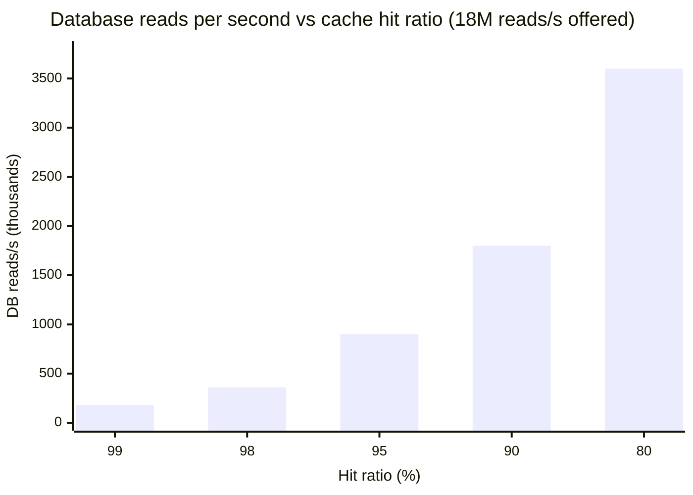
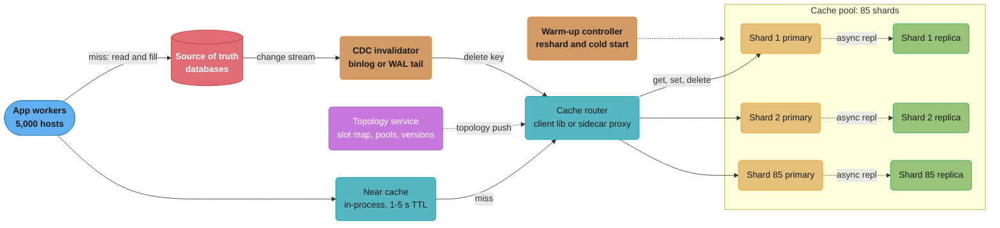
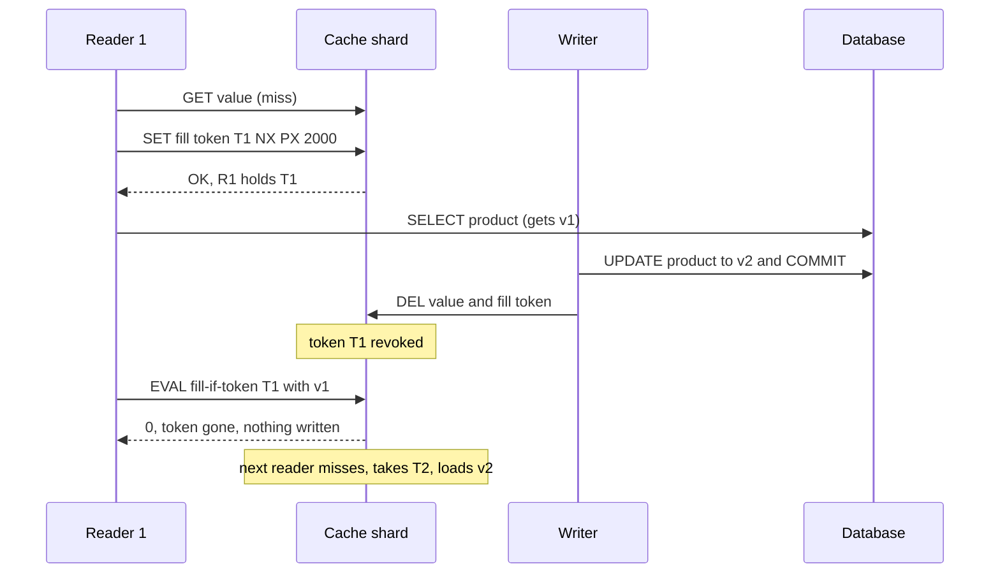
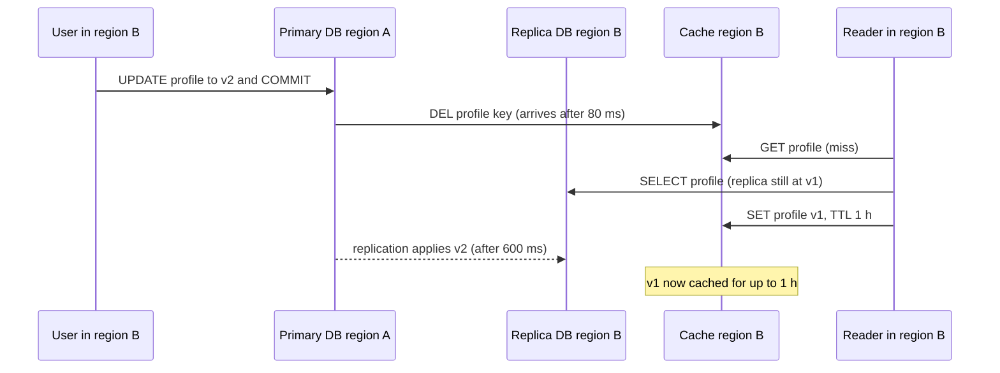

# System Design: Distributed Cache (Memcached / Redis Cluster Class)
## Intuition

> **Design intuition**: A distributed cache is a hash map that is allowed to forget. That one permission changes everything about the design compared with a database: you do not need consensus, you do not need durable logs, and you do not need to survive a partition with every write intact. What you do need is to be *fast* (sub-millisecond in the same availability zone), *spread out* (one key always lands on the same small set of nodes, and adding a node moves as few keys as possible), and *honest about staleness* (a cached value is a copy of a fact that lives somewhere else, and the design must bound how long a wrong copy can survive). The hard problems are not storage. They are **routing** (which node owns this key, and how do clients learn when that changes), **skew** (one viral key can melt one node while the cluster average sits at 20%), **fills** (thousands of concurrent misses for the same key turning into thousands of database queries), and **invalidation** (a lost delete leaves a wrong value in place until its TTL runs out).

**Key insight**: the cache tier becomes *load-bearing* long before anyone admits it. At a 98% hit ratio the database sees 2% of reads; at 90% it sees 10%, which is **5x** the load it was sized for. So the real requirement is not "make reads faster" but "keep the hit ratio stable through node failures, deploys, resharding and traffic spikes", because every event that drops the hit ratio is, one hop later, a database incident. Almost every component below exists to protect that number.

**What this case study is, and what it is not.** This study designs the cache *tier as a shared service*: partitioning, routing, replication, eviction, hot keys, fills and invalidation for a fleet of cache nodes that many applications share. It deliberately does not repeat three neighbours:

- The caching *patterns* (cache-aside, write-through, write-back, read-through, eviction policy basics) are taught in the HLD module [`../caching/caching.md`](../caching/caching.md). This study assumes them.
- The *application-side* implementation of a two-level cache (Caffeine L1 plus Redis L2, `@Cacheable`, Redis pub/sub invalidation, Bloom filters, Lettuce and Redisson configuration) is the Spring case study [`../../spring/case_studies/design_distributed_caching.md`](../../spring/case_studies/design_distributed_caching.md). Where this study needs a near cache (§4.8) it states the server-side contract and links there for the code.
- A *durable* replicated key-value store (quorums, vector clocks, hinted handoff, anti-entropy) is [`./design_key_value_store.md`](./design_key_value_store.md). A cache gives up exactly the guarantees that study works hardest to keep, and §5 explains why that trade is correct here.

---

## 1. Requirements Clarification

### Functional Requirements

- **`get(key)` / `multiGet(keys[])`**: return the cached value or a miss. Multi-get is the dominant call in practice, because a single page or API response typically fans out to dozens or hundreds of keys (a feed of 50 posts needs 50 post objects, 50 author objects and 50 counters).
- **`set(key, value, ttl)`**: store a value with a mandatory time to live. A key without a TTL is a key whose staleness is unbounded, so the service rejects TTL 0 except for an explicit allow-list (§4.7).
- **`delete(key)`**: remove a key. This is the invalidation primitive that the write path of every owning service calls after it commits to its database.
- **`add(key, value, ttl)`** (set only if absent) and **compare-and-set**: the building blocks for single-flight fills and leases (§4.6).
- **Namespaces / pools**: each consuming team gets a key prefix and a pool with its own memory budget, eviction policy and access control, so one team's working set cannot evict another team's.
- **Optional server-assisted near caching**: clients may keep a small in-process copy of hot keys and receive invalidation messages when those keys change (§4.8).

### Non-Functional Requirements

- **Latency**: p50 under 300 microseconds and p99 under 1 ms for a single-key `get` inside one availability zone; p99 under 2 ms for a 100-key multi-get. These are design targets (assumption), chosen because the cache sits inside request paths with total budgets of 100-200 ms that fan out to it many times.
- **Availability of the tier**: 99.99% for the tier as a whole. The loss of one node must cost a bounded slice of the hit ratio (about `1/N` of the keyspace) for a bounded time, never a tier-wide outage.
- **Not durable**: the cache may lose any value at any time. Every consumer must be correct (if slower) against an empty cache.
- **Bounded staleness**: after an owning service commits a write and issues a delete, readers must stop seeing the old value within 1 second in the normal case, and within the key's TTL in the worst case (lost delete, failover, partition).
- **Elastic**: add or remove nodes while serving traffic, moving roughly `1/N` of keys per node change, not most of them.
- **Multi-tenant fairness**: one tenant's hot key or burst must not raise another tenant's p99 by more than 20% (assumption).

### Out of Scope

- **Durability and persistence as a feature**. Redis can persist (RDB snapshots, AOF), but this design treats any persisted file as a warm-start optimization, not a guarantee. Teams that need durability use the key-value store or a database.
- **The CDN / edge cache tier**. Edge caching of HTTP responses is [`../cdn/cdn.md`](../cdn/cdn.md). This study stops at the data-centre cache tier behind the application servers.
- **Rich data-structure workloads** (leaderboards on sorted sets, streams, rate-limit counters). The same cluster technology serves them, but they are owned by [`./design_leaderboard.md`](./design_leaderboard.md) and [`../rate_limiting/rate_limiting.md`](../rate_limiting/rate_limiting.md). Here a value is an opaque blob of bytes.
- **Redis product internals** (encodings, the event loop, fork and copy-on-write, `PSYNC`). Those live in [`../../database/redis_internals/redis_internals.md`](../../database/redis_internals/redis_internals.md).

### The Question to Ask the Interviewer First

"Is the cache allowed to be wrong, and for how long?" The answer decides three designs at once. If a stale value for up to the TTL is acceptable (product descriptions, profile names, rendered fragments), a delete-on-write, TTL-backstopped look-aside cache is enough. If staleness must be under a second even when deletes are lost (prices, permissions, inventory), you need a reliable invalidation stream (§4.7) and short TTLs. If the answer is "never wrong", the honest response is that the thing being described is not a cache, and the read should go to the source of truth or to a strongly consistent replica.

---

## 2. Scale Estimation

All figures in this section are design assumptions for a large consumer platform's shared cache tier in one region, chosen to make the arithmetic concrete. They are not measurements from a named company.

### Traffic

- Peak operations: **20 million ops/sec** across the tier.
- Mix: **90% reads** (18M gets/sec, counted per key, so a 100-key multi-get counts as 100), **10% writes** (2M sets and deletes per second).
- Average value size **800 bytes**, average key **60 bytes**.
- Read egress: `18,000,000 x ~860 B` = **~15.5 GB/s** (about 124 Gbps) of payload leaving the tier.
- Write ingress: `2,000,000 x ~860 B` = **~1.7 GB/s**, roughly halved in practice because deletes carry no value.

### Working Set and Memory

- Live items: **8 billion**.
- Per-item memory: 800 B value + 60 B key + ~60 B of per-item metadata and allocator overhead (assumption; the exact figure depends on the engine and its encoding) = **~920 B**.
- Raw dataset: `8,000,000,000 x 920 B` = **~7.4 TB**.
- Allocator slack: memcached stores items in slab classes whose chunk sizes grow by a factor of 1.25 by default (the `-f` slab growth factor), so an item wastes on average about half a step of chunk size. Budget **15%** for slack and fragmentation: `7.4 x 1.15` = **~8.5 TB**.
- With one replica per shard (§4.4): **~17 TB** of RAM.

### What the Hit Ratio Is Worth

The database behind the tier was sized for the read load it sees at the target hit ratio of **98%**: `18,000,000 x 0.02` = **360,000 reads/sec**. The same arithmetic at lower hit ratios shows why the tier is load-bearing:



A drop from 98% to 90% multiplies database read load by **5x**. A drop to 80%, which is what a careless modulo-hash resize or a mass expiry produces in minutes (§9), multiplies it by **10x**. No database tier sized for 360k reads/sec survives 3.6M, so the practical requirement is that **no single routine event may move the hit ratio by more than a couple of points**.

### Per-Node Load (Sanity Check)

- Node shape (assumption): 32 vCPU, 128 GB RAM of which **100 GB** is given to the cache, 25 Gbps NIC.
- Memory-driven node count: `17 TB / 100 GB` = **170 nodes** (85 primaries, 85 replicas).
- Throughput per node if traffic were uniform: reads go to primaries only (replica reads are off by default, §4.4), so `18M / 85` = **~212k reads/sec per primary**, plus `2M / 85` = **~24k writes/sec**. That is comfortable for a multi-threaded memcached (default 4 worker threads, raised to match cores) or for several Redis processes per host.
- Network per primary: `212,000 x 860 B` = **~182 MB/s**, about **1.5 Gbps** of a 25 Gbps NIC.

### Hot-Key Skew

Uniform load is a fiction. Assume the hottest key in a traffic spike (a celebrity post's counter, a homepage configuration blob) receives **1% of all reads**: `18M x 0.01` = **180,000 gets/sec on one key**. Because a key maps to exactly one primary, that one node now carries its normal ~212k reads/sec *plus* 180k for one key. If that key's value is 20 KB rather than 800 B (a rendered fragment), the egress for that key alone is `180,000 x 20 KB` = **3.6 GB/s, about 29 Gbps**, which exceeds the 25 Gbps NIC by itself. The cluster average stays near 15% utilization while one node drops packets. §4.5 is the answer.

### Connection Count

- Application fleet (assumption): **5,000** application hosts, each running 8 worker processes.
- If every worker opens one connection to every primary: `5,000 x 8 x 85` = **3.4 million** connections cluster-wide, **40,000 per cache node**.
- memcached's default connection limit is 1,024 (`-c`), and every idle connection still costs kernel and server memory. This number, not RAM or CPU, is what pushes large fleets towards a connection-pooling proxy layer (§4.2).

---

## 3. High-Level Architecture



### Request Flow

1. **Near cache first.** The application checks a small in-process cache (a few thousand of its hottest keys, TTL 1-5 s). A hit costs tens of nanoseconds and no network hop. Only hot keys belong here (§4.5, §4.8).
2. **Route.** On a near miss, the router hashes the key to a slot or ring position (§4.1), looks up the owning primary in its cached topology, and sends the request over a pooled, pipelined connection. Multi-gets are split by owning node and sent in parallel (§4.2).
3. **Hit.** The primary answers from RAM. Round trip inside an availability zone is a few hundred microseconds, dominated by the network and the kernel.
4. **Miss and fill.** On a miss the application acquires a fill token (§4.6), reads the database, and writes the value back with a TTL. Concurrent missers for the same key wait briefly or serve a slightly stale value instead of all querying the database.
5. **Writes invalidate.** The owning service commits to its database and then deletes the key. Independently, a CDC invalidator tails the database's change log and deletes the affected keys again, so a delete that the service failed to send (crash after commit, network error) still happens (§4.7).
6. **Replication and failover.** Each primary replicates asynchronously to one replica. If a primary fails, the replica is promoted and the topology service pushes the new owner to all routers (§4.4).
7. **Topology changes.** Adding nodes moves slots, not individual keys. Clients follow `MOVED`/`ASK`-style redirects during migration, and a warm-up controller pre-fills new nodes from the old owners so the hit ratio does not crater (§4.9).

### Why There Are Two Invalidation Paths

The service's own `delete` after commit is fast (sub-millisecond after the commit) but unreliable: the process can crash between the commit and the delete, or the delete can time out. The CDC path is slower (tens to hundreds of milliseconds of log-tailing lag) but reliable, because it is driven by the database's own durable log. Running both gives the fast common case and a bounded worst case. TTL is the third, last-resort bound: if both deletes are lost, the value is wrong for at most one TTL.

---

## 4. Component Deep Dives

### 4.1 Partitioning: Which Node Owns This Key?

Three schemes are in common use, and the difference between them is entirely about what happens when the node count changes.

**Modulo hashing** (`node = hash(key) % N`) is what a first implementation does. A key stays on the same node across a change from `N` to `N+1` only when `hash mod N == hash mod (N+1)`, which holds for about `1/(N+1)` of keys. So growing from 85 to 86 primaries moves **85/86, about 98.8%** of all keys. For a cache, "moves" means "misses": the hit ratio falls from 98% to about 1% in one deploy, and §2's chart says the database receives roughly 50x its sized load.

**Consistent hashing** (a ring, typically with 100-200 virtual points per node, as in the ketama scheme many memcached clients use, and mcrouter's `furc_hash`) moves only the keys between a new node's points and their predecessors: about `1/(N+1)`, **~1.2%** for the same 85-to-86 change. The full mechanics of rings and virtual nodes are in [`../consistent_hashing/consistent_hashing.md`](../consistent_hashing/consistent_hashing.md).

**Fixed hash slots** (Redis Cluster's model) split the key space into **16,384 slots** with `HASH_SLOT = CRC16(key) mod 16384`, and assign whole slots to primaries. Adding a node means *moving slots*, which an operator or controller does deliberately, at a controlled rate, while the slot keeps serving. The slot map is small (16,384 entries) and every node and smart client caches it.

```
Keys that change owner when growing a pool from 85 to 86 primaries

  modulo  hash % N     |##################################################| 98.8%
  consistent hash ring |#                                                 |  1.2%
  hash slots (16,384)  |#                                                 |  ~1.2% (moved
                       |                                                  |   slot by slot,
                       |                                                  |   on your schedule)
```

Caption: the same one-node change is a full cache flush under modulo hashing and a ~1.2% miss bump under the other two. Slots add one more property the ring lacks: the move happens when an operator says so, in small steps, instead of instantly at the moment the client config changes.

Slots also give a clean way to keep related keys together. Redis Cluster hashes only the substring inside the first `{...}` pair when one exists, so `{user1000}.following` and `{user1000}.followers` land in the same slot and can be read together. The function below is a direct implementation of the published algorithm (CRC16 XMODEM, polynomial `0x1021`, initial value 0) and checks itself against the spec's test vector:

```java
import java.nio.charset.StandardCharsets;

public final class HashSlot {
    private HashSlot() {}

    // CRC16/XMODEM: poly 0x1021, init 0x0000, no reflection, no final XOR.
    static int crc16(byte[] buf, int off, int len) {
        int crc = 0;
        for (int i = off; i < off + len; i++) {
            crc ^= (buf[i] & 0xFF) << 8;
            for (int bit = 0; bit < 8; bit++) {
                crc = ((crc & 0x8000) != 0) ? ((crc << 1) ^ 0x1021) : (crc << 1);
                crc &= 0xFFFF;
            }
        }
        return crc;
    }

    // Hash-tag rule: if the key has "{", a later "}", and at least one byte
    // between them, hash only that substring. Otherwise hash the whole key.
    public static int slotFor(String key) {
        byte[] k = key.getBytes(StandardCharsets.UTF_8);
        int open = -1;
        for (int i = 0; i < k.length; i++) {
            if (k[i] == '{') { open = i; break; }
        }
        if (open >= 0) {
            for (int close = open + 1; close < k.length; close++) {
                if (k[close] == '}') {
                    if (close != open + 1) {
                        return crc16(k, open + 1, close - open - 1) & 16383;
                    }
                    break; // "{}" with nothing inside: hash the whole key
                }
            }
        }
        return crc16(k, 0, k.length) & 16383;
    }

    public static void main(String[] args) {
        byte[] vector = "123456789".getBytes(StandardCharsets.US_ASCII);
        System.out.printf("CRC16(\"123456789\") = %04X (spec: 31C3)%n", crc16(vector, 0, vector.length));
        System.out.println(slotFor("{user1000}.following") == slotFor("{user1000}.followers")); // true
        System.out.println(slotFor("foo{}{bar}") == slotFor("foo{}{bar}")); // whole key hashed
    }
}
```

**The hash-tag trap.** Hash tags are a co-location tool, and co-location is the opposite of spreading load. A team that tags every key with its tenant id (`{tenant42}:...`) puts the whole tenant in one slot, so the largest tenant becomes a hot shard by construction. Use tags only for small groups of keys that must be read or written together, never as a namespace.

### 4.2 Routing: Smart Client vs Proxy

Something has to turn "key" into "socket". There are two places to put that logic.

| Option | How it works | Wins | Costs |
|---|---|---|---|
| **Smart client** (Redis Cluster clients, ketama memcached clients) | Each application process holds the topology, hashes the key, talks directly to the owner. Redis Cluster nodes never proxy: a node that does not own the slot answers `-MOVED <slot> <host:port>` and the client retries there and refreshes its map | One network hop, no extra fleet, lowest latency | Every language needs a correct client; topology bugs ship inside application deploys; connection count is `processes x nodes` (§2: 3.4M) |
| **Proxy / sidecar router** (mcrouter, twemproxy) | Clients speak the plain protocol to a local or nearby router; the router owns hashing, pooling, failover and fan-out | Connection pooling collapses 3.4M connections to a few per router per node; routing policy changes without app deploys; uniform behaviour across languages | An extra hop (tens of microseconds on localhost, more on a remote proxy tier); another fleet to operate |

The production evidence leans towards a router at large scale. Facebook built **mcrouter** as a memcached protocol router; its 2014 announcement describes it handling all traffic to, from and between thousands of cache servers across dozens of clusters, close to **5 billion requests per second** at peak, with connection pooling, multiple hashing schemes, prefix routing and replicated pools as headline features. Twitter's **twemproxy** (nutcracker) states in its README that it "was built primarily to reduce the number of connections to the caching servers on the backend". Both are evidence that the connection-count problem in §2 is real.

A reasonable default for this design: **a sidecar router on every application host**. It keeps the extra hop on localhost, pools connections (5,000 hosts x 1-4 connections per cache node, so 5,000-20,000 per node instead of 40,000), and moves routing policy out of application code.

**Multi-get fan-out.** A 100-key multi-get over 85 shards touches about 60 distinct shards (the expected number of distinct bins hit by 100 uniform draws from 85 is `85 x (1 - (84/85)^100)`, about **59**). The request is only as fast as the slowest of those 59 sub-requests, so multi-get p99 is governed by per-node p99.9 or worse. That is the tail-amplification effect described in [`../../backend/tail_latency_and_fan_out/tail_latency_and_fan_out.md`](../../backend/tail_latency_and_fan_out/tail_latency_and_fan_out.md). Two mitigations matter here: co-locate keys that are always read together (a hash tag on a small group, §4.1), and cap batch size so one page does not fan out to every shard.

**Redirect handling during slot migration.** While slot 8 moves from A to B, A serves keys it still has and answers `-ASK 8 B` for keys already moved; the client must send `ASKING` to B before the retried command, and must not update its slot map on an `ASK` (only on `MOVED`, which means the move is final). A router that confuses the two either loops between nodes or permanently points a slot at the wrong owner.

### 4.3 Memory Management and Eviction

A cache is always full. Eviction is the steady state, not an emergency, so the eviction policy decides the hit ratio as much as the memory size does.

**memcached: slab classes.** memcached carves memory into pages that it assigns to slab classes, each class holding fixed-size chunks; chunk sizes grow by the `-f` factor (default **1.25**) and the maximum item size is set by `-I` (default **1 MB**, minimum 1 KB, maximum 1 GB). Each class runs its own LRU. The classic failure is **slab calcification**: memory was assigned to the 400-byte class during last month's workload, today's values are 2 KB, and the 2 KB class evicts aggressively while the 400-byte class holds cold data. memcached can move pages between classes (the `slabs reassign` command, and the `slab_reassign` and `slab_automove` settings for the automatic mover); the operational lesson is to watch per-class eviction rates, not only the global one.

**Redis / Valkey: approximated LRU and LFU.** Redis does not keep an exact LRU list, because one would cost memory per key. It samples a few keys at random (`maxmemory-samples`, default **5**) and evicts the best candidate, and since Redis 3.0 it also keeps a pool of good candidates across samples, which brings it close to true LRU. The policy is chosen with `maxmemory-policy`. For this tier the relevant choices are:

| Policy | Use it when | Avoid when |
|---|---|---|
| `allkeys-lru` | Default for a pure cache. Recency predicts reuse for most social and catalogue traffic | A scan or batch job touches many cold keys once and flushes the hot set |
| `allkeys-lfu` | Popularity is stable over hours (reference data, top products); one-off scans should not evict hot keys | Popularity shifts fast (news), because old frequency counts protect yesterday's hot keys |
| `volatile-lru` / `volatile-ttl` | The same instance mixes cache keys (with TTL) and keys that must not be evicted (without TTL) | Pure cache pools. If no key has a TTL, `volatile-*` behaves like `noeviction` and writes start failing |
| `noeviction` | Never for a cache. Writes fail with an error when memory is full | Always, for this tier |

Two memory facts surprise teams. First, `maxmemory` is **0 (unlimited) by default on 64-bit builds**, so an unconfigured node grows until the kernel's OOM killer ends it. Second, replication and AOF buffers are **not counted** towards `maxmemory`, so a node configured at 100 GB on a 128 GB host can still run out of memory during a replica resync. The Redis documentation recommends leaving headroom for exactly this reason; this design sets `maxmemory` to about **75%** of host RAM.

**TTL is part of eviction design.** If 50 million keys are written by a nightly batch with `ttl = 86,400 s`, they all expire in the same second the following night, and the tier sees 50 million misses at once (§9, War Story 1). Every TTL gets **jitter**: `ttl x (1 + uniform(-0.1, +0.1))` spreads that expiry across about 4.8 hours.

### 4.4 Replication and Failover

**Why replicate a cache at all?** Not for durability. A shard holds `1/85` of the working set, about 100 GB here. Losing it means those keys miss until they are refilled from the database, which at 212k reads/sec on that shard is **212k extra database reads/sec**, more than half of the database's sized 360k/sec, for as long as the refill takes. A warm replica turns a node loss from a database incident into a one-to-two-second blip.

**How it works.** Each primary streams writes to one replica asynchronously. Redis Cluster's specification is explicit about the consequences: replication is asynchronous with a "last failover wins" merge, so a write acknowledged by a primary that dies before replicating it is lost, and a primary that cannot reach the majority of primaries for `NODE_TIMEOUT` stops accepting writes. Failover itself is usually executed in 1 to 2 seconds after the timeout.

**The cache-specific danger is a lost delete, not a lost set.** A lost `set` costs one future miss, which is harmless. A lost `delete` is a correctness bug: the old value survives on the promoted replica, and nothing will remove it until its TTL expires. This is the strongest reason the design has three invalidation layers (§3): the CDC invalidator re-sends deletes from the database's log, so a delete lost in a failover window is re-applied within the CDC lag; and the TTL bounds the damage if both are lost.

**Reading from replicas.** Redis Cluster replicas redirect clients to the primary by default; a client opts into possibly-stale replica reads with the `READONLY` command. This design keeps reads on primaries for ordinary pools, because replica reads double the window in which a just-deleted value is visible, and uses replica reads only for explicitly stale-tolerant, read-heavy pools.

**Replicated pools as a read-scaling tool.** For a small, extremely hot dataset (feature flags, configuration, a few thousand keys read by every request), mcrouter's model of a *replicated pool* fits better than sharding: writes go to every host in the pool and each client reads from one replica chosen per client. Read capacity then scales with the number of replicas, at the cost of `R` times the write traffic and memory. It is the right shape for "tiny but hot", and the wrong one for the 8.5 TB working set.

### 4.5 Hot Keys

§2 showed one key at 180k gets/sec, enough to saturate one node's NIC if the value is large. A hot key cannot be fixed by adding nodes, because consistent hashing deliberately keeps a key on one owner. The fix has three parts.

**Detect.** Each router samples requests (for example 1 in 100) into a per-key counter with a short window, and reports the top 50 keys per pool every 10 seconds. Server-side, per-shard ops/sec and egress bytes/sec are graphed against the pool average; a shard at 4x the average with no extra keys is a hot-key shard. Detection must be automatic, because hot keys appear in seconds (a post goes viral) and leave in minutes.

**Absorb with a near cache.** Once a key is flagged hot, routers (or the application) hold it in process for 1-2 seconds. With 5,000 application hosts and a 1 s near-cache TTL, the cache tier sees at most about **5,000 reads/sec** for that key no matter how many requests the fleet serves: one refresh per host per second. The cost is up to 1 s of extra staleness for flagged keys only. The near cache's implementation is the Spring case study's L1 tier ([`../../spring/case_studies/design_distributed_caching.md`](../../spring/case_studies/design_distributed_caching.md)); the server-assisted variant with invalidation messages is §4.8.

**Spread with key replication.** When even 5,000 refreshes/sec of a 20 KB value is too much for one node (100 MB/s), or when the key must not be stale, store `K` copies under derived keys (`key#0` to `key#7`) whose hashes land on different shards. Readers pick one copy at random; writers and invalidators touch all copies.

```java
import java.util.ArrayList;
import java.util.List;
import java.util.concurrent.ThreadLocalRandom;

/** Spreads one hot logical key over K physical keys on different shards. */
public final class HotKeyFanout {
    private final CacheClient cache;   // thin wrapper over the router
    private final HotKeyRegistry hot;  // fed by the sampling detector

    public HotKeyFanout(CacheClient cache, HotKeyRegistry hot) {
        this.cache = cache;
        this.hot = hot;
    }

    public byte[] get(String key) {
        int copies = hot.copiesFor(key);          // 1 for normal keys, 8 when hot
        if (copies == 1) return cache.get(key);
        int pick = ThreadLocalRandom.current().nextInt(copies);
        byte[] v = cache.get(key + "#" + pick);
        // A miss on one copy is filled from the source like any other miss.
        return v;
    }

    public void set(String key, byte[] value, int ttlSeconds) {
        for (String physical : physicalKeys(key)) {
            cache.set(physical, value, ttlSeconds);
        }
    }

    public void delete(String key) {
        // Invalidation must hit every copy, including copies created before
        // the key was flagged, so always delete the maximum fan-out.
        for (int i = 0; i < HotKeyRegistry.MAX_COPIES; i++) {
            cache.delete(key + "#" + i);
        }
        cache.delete(key);
    }

    private List<String> physicalKeys(String key) {
        int copies = hot.copiesFor(key);
        List<String> keys = new ArrayList<>(copies);
        if (copies == 1) { keys.add(key); return keys; }
        for (int i = 0; i < copies; i++) keys.add(key + "#" + i);
        return keys;
    }
}
```

The comment in `delete` is the bug this code exists to avoid: if invalidation only deletes the copies that exist *now*, a key that was hot an hour ago (8 copies) and is normal now (1 copy) leaves 7 stale copies behind, and any router whose registry still says "hot" reads them.

**Large values are their own hot-key problem.** A 20 KB value at 10k gets/sec is 200 MB/s from one node; the same traffic at 800 B is 8 MB/s. Cap values per pool (this design: 64 KB, with alerts above 16 KB), split larger objects into chunks keyed by part number (mcrouter can split and re-stitch large values automatically), or compress them. The memcached item-size limit of 1 MB is a ceiling, not a target.

### 4.6 Fills: Stampedes and the Stale-Set Race

Two different failures hide in the innocent-looking cache-aside miss path.

**Failure 1: the stampede.** A popular key expires. Every request that arrives before the first refill completes sees a miss and queries the database. The arithmetic from the XFetch paper (Vattani, Chierichetti and Lowenstein, VLDB 2015) makes it concrete: if a key is read **10 times per second** and recomputing it takes **3 seconds**, then **30 requests** recompute it. For the 180k gets/sec hot key with a 50 ms database query, it is **9,000** concurrent identical queries.

**Failure 2: the stale-set race.** This one is a correctness bug and it survives every load test.

***Broken:*** plain cache-aside with delete-on-write:

```java
// BROKEN: a slow reader can write an old value back after the writer's delete.
public Product readBroken(long id) {
    String key = "product:" + id;
    byte[] cached = cache.get(key);
    if (cached != null) return Product.decode(cached);

    Product fromDb = productDao.load(id);          // (1) reader loads v1
    // ... GC pause, slow network, preemption: 200 ms pass here ...
    cache.set(key, fromDb.encode(), 3600);         // (3) reader writes v1 back
    return fromDb;
}

public void updateBroken(Product p) {
    productDao.save(p);                            // (2a) writer commits v2
    cache.delete("product:" + p.id());             // (2b) writer deletes the key
}
```

The interleaving `(1) -> (2a) -> (2b) -> (3)` leaves **v1 in the cache after v2 is committed**, and it stays wrong for the full 3,600-second TTL. The writer did everything right, and so did the reader; the bug is in the gap between them. At 2M writes/sec on a tier with 18M reads/sec, a window of a few hundred milliseconds turns this from "rare" into "several times a minute".

***Fix:*** a fill token (a lease) that the delete revokes. A reader that misses takes a token for the key; the writer's delete removes both the value and any outstanding token; the reader may only write back if its token is still the current one. Readers that miss while another reader holds the token do not query the database; they wait briefly and retry, or serve a stale copy if the pool allows it, which also solves the stampede.

```java
import java.util.List;
import java.util.UUID;

public final class LeasedCacheAside {
    private static final int FILL_TOKEN_MS = 2_000;  // longer than a slow DB read
    private static final int TTL_SECONDS = 3_600;

    // Set the value only if the caller still holds the current fill token.
    // KEYS[1] = value key, KEYS[2] = token key (same hash tag, same slot).
    private static final String FILL_IF_TOKEN = """
        if redis.call('GET', KEYS[2]) == ARGV[1] then
          redis.call('SET', KEYS[1], ARGV[2], 'EX', ARGV[3])
          redis.call('DEL', KEYS[2])
          return 1
        end
        return 0
        """;

    private final CacheClient cache;
    private final ProductDao productDao;

    public LeasedCacheAside(CacheClient cache, ProductDao productDao) {
        this.cache = cache;
        this.productDao = productDao;
    }

    public Product read(long id) throws InterruptedException {
        String valueKey = "{product:" + id + "}:v";
        String tokenKey = "{product:" + id + "}:fill";
        for (int attempt = 0; attempt < 3; attempt++) {
            byte[] cached = cache.get(valueKey);
            if (cached != null) return Product.decode(cached);

            String token = UUID.randomUUID().toString();
            boolean won = cache.setIfAbsent(tokenKey, token, FILL_TOKEN_MS);
            if (won) {
                Product fromDb = productDao.load(id);
                cache.eval(FILL_IF_TOKEN, List.of(valueKey, tokenKey),
                           List.of(token, fromDb.encodeAsString(), String.valueOf(TTL_SECONDS)));
                return fromDb;  // correct for this caller even if the fill was revoked
            }
            Thread.sleep(20);   // someone else is filling: wait, do not stampede the DB
        }
        return productDao.load(id); // bounded fallback after ~60 ms of waiting
    }

    public void update(Product p) {
        productDao.save(p);
        String tag = "{product:" + p.id() + "}";
        cache.delete(tag + ":v", tag + ":fill"); // revokes any in-flight fill
    }
}
```

The hash tag `{product:<id>}` puts the value key and the token key in the same slot, so the script can touch both atomically on one node (§4.1). In the bad interleaving, the writer's delete removes the token at step (2b); the slow reader's script at step (3) finds no matching token and writes nothing. The next reader misses, takes a new token, and loads v2.



**Early recomputation for very hot keys.** For keys where even one miss is expensive, refresh *before* expiry instead of after. XFetch triggers a recompute when `now - delta x beta x ln(rand()) >= expiry`, where `delta` is the measured recompute time stored with the value and `beta` (default 1) tunes eagerness. Because `ln(rand())` is negative, the term is a positive, exponentially distributed head start scaled by recompute time, so slow-to-compute keys refresh earlier, and the number of requests that refresh at the same moment stays small regardless of request rate.

```java
import java.util.concurrent.ThreadLocalRandom;

final class XFetch {
    /** True if this request should recompute the value now, before it expires. */
    static boolean shouldRefreshEarly(long nowMs, long expiryMs, long recomputeMs, double beta) {
        double u = 1.0 - ThreadLocalRandom.current().nextDouble(); // in (0, 1], avoids ln(0)
        double headStartMs = -recomputeMs * beta * Math.log(u);
        return nowMs + headStartMs >= expiryMs;
    }
}
```

Use XFetch for the top few thousand keys by request rate, where it removes the expiry-time spike entirely, and the fill token everywhere, where it protects correctness.

### 4.7 Invalidation

**Delete, do not update.** On a write, the owning service deletes the key rather than writing the new value into the cache. Writing values from the write path creates a second race (two writers commit v2 then v3, but their cache sets arrive as v3 then v2), while a delete is idempotent and order-insensitive: any number of deletes in any order leave the same state, and the next read fills from the database.

**The CDC invalidator.** A service-issued delete is lost if the service crashes between commit and delete, or the delete times out. So the design adds a change-data-capture consumer that tails each database's log (MySQL binlog, PostgreSQL logical decoding via a tool such as Debezium, see [`../../technologies/debezium_change_data_capture/debezium_change_data_capture.md`](../../technologies/debezium_change_data_capture/debezium_change_data_capture.md)), maps each changed row to the cache keys derived from it, and issues deletes. Its properties:

- **Reliable**: it is driven by the committed log, so every committed change produces a delete eventually, including changes made by scripts and migrations that bypass the service.
- **Slower**: typical lag is tens to hundreds of milliseconds, which is why the service's own fast delete remains the primary path.
- **Key mapping is the hard part.** A row change in `products` must invalidate `product:<id>`, every rendered fragment that embedded it, and every list key that contained it. Keep the mapping explicit and owned by the same team that owns the key format; an unmapped derived key is a permanent staleness bug that only TTL bounds.

**Deletes must survive cache-node unavailability.** If the owning shard is unreachable when a delete arrives, the delete cannot be dropped. mcrouter's documented answer is a *reliable delete stream*: deletes to an unreachable destination are logged to disk and replayed asynchronously by a separate process, while the caller is told the delete succeeded. Any router in this design does the same, with the log sized for the longest expected outage (at 2M deletes/sec tier-wide and 1/85 per shard, about 24k/sec per shard, so a 10-minute outage is about 14M entries per shard).

**TTL as the final bound.** Every key has one, and its length is a product decision: it is the worst-case staleness when both delete paths fail. Prices and permissions get minutes; rendered profile fragments get hours.

### 4.8 Client-Side (Near) Caching with Server-Assisted Invalidation

A near cache with a fixed TTL is simple but bounded only by that TTL. Redis 6 added server-assisted client-side caching, called *tracking*, which pushes invalidations to clients so the near cache can hold values longer without serving them stale.

- **Default mode**: the server remembers which keys each tracking client read, in a global *invalidation table*, and sends an invalidation message to those clients when a key is modified, expires or is evicted. The table has a maximum size; when it is full, the server evicts an entry by sending an invalidation for it as if the key had changed. Memory cost on the server grows with `clients x keys read`.
- **Broadcasting mode**: the server remembers nothing per client. Clients subscribe to key prefixes (`product:`, `user:`) and receive an invalidation for every change under the prefix. No server memory, more invalidation traffic.

For this tier, broadcasting mode on a small set of hot prefixes fits better: 5,000 hosts reading overlapping hot keys would make the default-mode table large, and the hot-key set is exactly where a near cache pays off. Two rules come with it. First, **on reconnect a client must flush its whole near cache**, because invalidations sent while it was disconnected are lost. Second, a near cache still needs a TTL, because an invalidation can be lost in flight without the connection dropping.

### 4.9 Resharding, Cold Starts and Warm-Up

**Slot migration.** Growing from 85 to 100 primaries moves about `15/100` of slots, roughly 2,458 slots and **1.3 TB** of data at 8.5 TB total. Redis Cluster migrates slot by slot: the target is marked `IMPORTING`, the source `MIGRATING`, keys move in batches, and clients follow `ASK` redirects for already-moved keys. At a throttled 100 MB/s per migrating node pair and 15 pairs in parallel, the move takes about `1.3 TB / 1.5 GB/s` = **~15 minutes** of background copy.

**For a cache there is a cheaper option: do not copy.** Reassign the slots and let the new owners fill from misses. The cost is a temporary miss bump on `15%` of keys. At 18M reads/sec that is up to `18M x 0.15` = **2.7M** extra database reads/sec at the moment of cut-over, which §2 says the database cannot take. So the slots move in small groups (for example 200 slots, ~1.2% of keys, per step), each step waiting until the moved slots' hit ratio recovers to within 1 point of the pool before the next. That is the cache version of "stagger, do not batch".

**Cold-cache warm-up.** A brand-new or rebuilt cluster is the extreme case: 0% hit ratio. mcrouter documents a *cold cache warmup* route: reads go to the cold pool first and, on a miss, to a designated warm pool, filling the cold pool from the warm one instead of from the database. The same idea works for rolling restarts of Redis nodes: promote the replica, restart the old primary empty, let it resync as a replica, and only then rebalance, so no slot is ever served by an empty node.

**Deploy discipline.** Cache nodes are restarted one at a time with a hit-ratio gate between restarts. Restarting 10% of nodes at once is a 10% miss bump, which §2 says is about 1.8M extra database reads/sec.

### 4.10 Multi-Region: Invalidation Behind Replication Lag

Most large platforms run one cache tier per region, each in front of a local database replica, with writes going to a primary database in one home region. That layout adds one more race, and it is the one teams most often miss.

***The race:*** a user in region B updates their profile. The write goes to the primary database in region A, which commits and deletes the key in region A's cache. Region B's cache also needs a delete, so the write path sends one. Region B's delete arrives in 80 ms (the inter-region round trip); region B's *database replica* applies the change after 600 ms of replication lag. In the 520 ms between those two events, a reader in region B misses, reads the **old** row from the lagging local replica, and fills region B's cache with it. The value is now stale for a full TTL, and the user who just saved their profile sees their old name on the next page load.



***The fix:*** drive each region's invalidation from **that region's own replica**, not from the write. A CDC consumer in region B tails region B's replica and deletes keys only after the replica has applied the change, so a miss that follows the delete reads the new row. The fill token (§4.6) closes the remaining gap: the CDC delete revokes any fill that started before the replica caught up. For the user who made the change, read-your-writes is handled separately: for a few seconds after a write, that user's requests for the changed entity bypass the regional cache and read from the primary region (a short-lived "recently wrote" marker in the user's session).

**Cost of the fix.** Staleness for other readers is now bounded by replication lag plus CDC lag (typically under 1 s), instead of by the TTL. The price is a CDC consumer per region per database, which is the same component §4.7 already requires.

### 4.11 Pools and Tenant Isolation

One shared pool for every team is cheap and dangerous: a single team's batch job that writes 500 million one-off keys evicts everyone else's hot set under `allkeys-lru`. The tier therefore runs **separate pools** with separate memory budgets, routed by key prefix (mcrouter's prefix routing, or a pool field in the router's configuration):

| Pool | Example keys | Memory | Eviction | TTL guidance | Replicas |
|---|---|---|---|---|---|
| `objects` | `user:`, `post:`, `product:` | 60% | `allkeys-lru` | 1-24 h, jittered | 1 |
| `fragments` | rendered cards and lists | 20% | `allkeys-lru` | 5-60 min | 0 (cheap to rebuild) |
| `hot-config` | feature flags, configuration | < 1% | `allkeys-lru`, sized at 10x its data so it never evicts | minutes | replicated pool (§4.4) |
| `counters` | likes, views | 10% | `allkeys-lfu` | hours | 1 |
| `batch` | one-off job caches | 10% | `allkeys-lru` | <= 1 h | 0 |

Per-pool quotas also give each team its own hit-ratio and eviction dashboards, so "the cache is slow" becomes "pool `fragments` has a 91% hit ratio since Tuesday's deploy", which is actionable.

---

## 5. Design Decisions & Tradeoffs

### Memcached vs Redis / Valkey as the Engine

| Dimension | memcached | Redis / Valkey (cluster mode) |
|---|---|---|
| Data model | Opaque bytes, `get/set/add/cas/delete/incr` | Bytes plus lists, hashes, sets, sorted sets, streams, scripting |
| Threading | Multi-threaded (`-t`, default 4 worker threads) | Single command-execution thread per process; I/O threads optional. Scale by running several processes per host |
| Partitioning | None in the server; client or router hashes | Built in: 16,384 slots, `MOVED`/`ASK`, slot migration |
| Replication | None in the server; routers replicate (replicated pools) | Built in, asynchronous, automatic failover |
| Memory layout | Slab classes, per-class LRU, slab calcification risk | General allocator plus approximated LRU/LFU sampling |
| Server-assisted near cache | No | Yes (tracking, Redis 6 and later) |
| Licence | BSD | Redis Inc. changed the Redis licence in 2024, which prompted the Valkey fork: BSD-3-Clause, announced by the Linux Foundation on 2024-03-28, continuing from Redis 7.2.4 |

**Decision for this design**: Redis-protocol cluster (Valkey or Redis) for the general pools, because built-in slots, failover and scripting (needed for the fill-token script in §4.6) remove a large amount of router logic. A memcached pool behind a router remains a strong choice for a very large, simple, value-only pool where multi-threaded throughput per host and the absence of persistence and scripting are features. Engine internals are in [`../../database/redis_internals/redis_internals.md`](../../database/redis_internals/redis_internals.md) and [`../../database/in_memory_databases/in_memory_databases.md`](../../database/in_memory_databases/in_memory_databases.md).

### Smart Client vs Sidecar Router vs Central Proxy Tier

| Option | Added latency | Connections per cache node (5,000 hosts) | Policy change requires | Blast radius of a router bug |
|---|---|---|---|---|
| Smart client in every process | 0 | ~40,000 (8 workers x 5,000 hosts) | App deploys in every language | Every app, at deploy time |
| Sidecar router per host (chosen) | Tens of microseconds on localhost | 5,000 to 20,000 | Router rollout | One host at a time during rollout |
| Central proxy tier | One extra network hop, 100-300 microseconds | A few hundred | Proxy rollout | Every request through the tier |

The sidecar keeps latency close to the smart client while getting the proxy's pooling and central policy. The central tier only wins when application hosts cannot run a sidecar (serverless functions, third-party runtimes).

### Replication vs No Replication

| | One replica per shard (chosen) | No replica |
|---|---|---|
| Memory | 2x (17 TB) | 1x (8.5 TB) |
| Node loss | 1-2 s failover, hit ratio barely moves | ~1.2% of keys cold; ~212k extra DB reads/sec until refilled |
| Stale-after-failover risk | Lost deletes possible; needs CDC invalidation | Same keys are simply gone, which is safe |
| Right for | Pools whose miss cost is high (DB-heavy fills) | Pools whose fill is cheap or whose database has 2x headroom |

A cache is the one place where "no replica" can be a correct, cost-saving answer, but only after doing the database arithmetic for a node loss.

### Delete-on-Write vs Update-on-Write

| | Delete on write (chosen) | Update on write |
|---|---|---|
| Ordering | Idempotent; order of deletes does not matter | Concurrent writers can apply sets out of order and leave the older value |
| Cost | One extra miss after each write | No miss, but values are written even if nobody reads them |
| Hot keys | A delete on a 180k gets/sec key causes a fill; needs the fill token (§4.6) | Avoids the miss, but needs versioned CAS to be correct |

The exception: a few very hot, frequently updated keys (counters, live scores) use update-on-write with a version number and a compare-and-set, because a miss on every update would be a stampede every few seconds.

### Consistent Hashing Ring vs Hash Slots

Both move about `1/N` of keys per node change. Hash slots win for this design because the move is explicit and stepwise (§4.9) and the topology is a 16,384-entry table that every router can cache and diff, while a ring changes ownership the moment a client's node list changes, and two clients with different node lists route the same key to different nodes (a split-brain miss storm that only shows up during deploys).

---

## 6. Real-World Implementations

| Company / project | What they built | Published facts | Lesson for this design |
|---|---|---|---|
| **Facebook (Meta): memcache** | A demand-filled look-aside cache built on memcached, scaled from one cluster to many geographically distributed clusters | The NSDI 2013 paper "Scaling Memcache at Facebook" (Nishtala et al.) describes a system that "handles billions of requests per second and holds trillions of items" | A look-aside cache at this scale is a distributed system in its own right, with its own routing, invalidation and failure handling |
| **Facebook (Meta): mcrouter** | A memcached protocol router, open-sourced in September 2014 | Close to 5 billion requests per second at peak; thousands of cache servers across dozens of clusters; connection pooling, consistent hashing (`furc_hash`), prefix routing, replicated pools, shadowing, cold cache warm-up, reliable delete stream, fast failover with soft and hard error classes. Instagram used it as a standalone binary on AWS before moving to Facebook's infrastructure | Most of §4.2, §4.7 and §4.9 are router features. Put them in a router, not in every application |
| **Netflix: EVCache** | A memcached and spymemcached based caching solution for AWS EC2 | The README expands the name as Ephemeral (TTL-bound), Volatile (can be evicted any time), Cache (in-memory key-value store) | The name is the contract: every consumer must be correct when a value disappears |
| **Redis Cluster** | Built-in sharding for Redis | 16,384 hash slots via CRC16; no proxying, clients follow `MOVED`/`ASK`; asynchronous replication with a documented window for losing acknowledged writes; failover usually within 1 to 2 seconds after `NODE_TIMEOUT`; suggested size up to about 1,000 nodes | Fixed slots make resharding stepwise; the documented write-loss window is why deletes need a second path |
| **Valkey** | A Linux Foundation fork of Redis | Announced 2024-03-28, continuing from Redis 7.2.4 under BSD-3-Clause, with AWS and Google Cloud among the announced participants | The protocol, not the vendor, is the stable interface; routers and clients work against both |
| **Twitter: twemproxy** | A proxy for the memcached and Redis protocols | Its README says it was built primarily to reduce the number of connections to the caching servers | Connection count (§2) is a first-order scaling limit |
| **Goodreads: XFetch** | Probabilistic early expiration (Vattani, Chierichetti, Lowenstein, VLDB 2015) | Evaluated on a week of requests for a popular Goodreads cache item; the paper's example: 10 reads/sec and a 3 s recompute give 30 concurrent recomputations | Stampedes are a function of request rate times recompute time, so refresh-ahead must scale with recompute time |

### What the Pattern Looks Like Across Them

Every one of these systems treats the cache as **lossy by contract** (EVCache's name, memcache's look-aside model, Redis Cluster's documented write loss) and then spends its engineering on the *operational* properties: routing, fan-out, warm-up and reliable deletes. None of them tries to make the cache consistent with the database through the cache itself; consistency comes from the database plus bounded invalidation.

---

## 7. Technologies & Tools

| Tool | Role in this design | Notes |
|---|---|---|
| Valkey | Cache engine (cluster mode) | BSD-3-Clause fork of Redis 7.2.4; Redis protocol compatible |
| Redis | Cache engine (cluster mode) | Same cluster protocol; tracking for near caches (Redis 6+) |
| memcached | Cache engine for simple value-only pools | Multi-threaded; slab allocator; default 1 MB item limit, 1,024 connections, UDP off since 1.5.6 |
| mcrouter | Router / sidecar for memcached-protocol pools | Pooling, `furc_hash`, replicated pools, warm-up, reliable deletes |
| twemproxy | Lightweight proxy for memcached and Redis protocols | Connection reduction and sharding |
| EVCache | Netflix client library and tooling on top of memcached | Reference design for AWS deployments |
| Debezium | CDC source for the invalidation stream | See [`../../technologies/debezium_change_data_capture/debezium_change_data_capture.md`](../../technologies/debezium_change_data_capture/debezium_change_data_capture.md) |
| Amazon ElastiCache | Managed Redis-protocol and memcached clusters | Removes node operations, keeps every design decision in §4 |
| Prometheus | Hit ratio, evictions, per-shard ops and bytes | Alert on per-shard skew, not only pool averages |

### Build vs Buy

A managed service (Amazon ElastiCache, Google Cloud Memorystore) removes patching, failover wiring and node replacement. It does not remove the hard parts of this design: key schema, hash-tag discipline, hot-key handling, fill tokens, the CDC invalidator and the database arithmetic for node loss. Those are application-tier responsibilities on every platform.

---

## 8. Operational Playbook

### Key Metrics

| Metric | Healthy | Alert |
|---|---|---|
| Pool hit ratio (per pool, 1-minute window) | >= 98% | < 96% for 2 minutes (about 2x database read load) |
| Per-shard ops/sec vs pool mean | < 2x mean | > 3x mean for 1 minute (hot key or bad hash tag) |
| Per-shard egress bytes/sec | < 40% of NIC | > 70% of NIC |
| Evictions/sec per shard | Stable within 20% of last week | 3x last week (working set grew, or a slab class calcified) |
| Fill-token contention (waits per second) | Low and flat | Spike: a hot key expired or was deleted |
| CDC invalidator lag | p99 < 500 ms | > 5 s (stale reads now bounded only by TTL) |
| Reliable-delete replay queue depth | 0 | > 0 for more than 5 minutes |
| Router `MOVED` redirects/sec | ~0 outside migrations | Sustained: stale topology in some routers |
| Database read QPS from cache misses | ~360k/sec | > 600k/sec |

### Runbook: Hit Ratio Drops Below 96%

1. Check whether the drop is **pool-wide** or **slot-local**. Slot-local (a few shards) means a node restart, failover or migration step; pool-wide means mass expiry, a key-format change in a deploy, or a flush.
2. Correlate with deploys in the last 30 minutes. A changed key prefix or serialization version silently turns every key into a miss. Roll back the application, not the cache.
3. If mass expiry: confirm TTL jitter is applied in the writer that produced the expiring keys.
4. Protect the database first: enable stale-serve for the affected pool (serve values up to 60 s past expiry while a single filler refreshes) and raise the fill-token wait from 20 ms to 50 ms.

### Runbook: One Shard Hot

1. Pull the router's top-50 keys for that shard. If one key dominates, flag it hot so routers near-cache it and fan it out (§4.5).
2. If many keys share a hash tag, the tag is the bug: open a ticket against the owning team's key schema; as a stopgap, give that pool a dedicated node.
3. If the value is large (> 16 KB), ask the owner to split or compress it; meanwhile near-caching cuts the bytes by the near-cache factor.

### Runbook: Primary Lost

1. Confirm the replica was promoted and routers received the new topology (redirect rate falls back to ~0 within seconds).
2. Check CDC invalidator lag; if it is behind, deletes lost in the failover window are not yet re-applied. For high-risk pools (prices, permissions), replay the CDC stream from 60 s before the failover.
3. Bring the failed host back as a replica only; never as a primary with an empty dataset.

### Runbook: Planned Resharding

1. Move slots in steps of about 1% of the keyspace.
2. Gate each step on the moved slots' hit ratio recovering within 1 point of the pool, and on database read QPS staying under 500k/sec.
3. Pause automatically on any alert in the table above.

---

## 9. Common Pitfalls & War Stories

The war stories below are **composite, illustrative incidents** that combine common failure patterns into one narrative each. The figures are computed from this design's §2 assumptions, not reported by a named company.

| Pitfall | Symptom | Prevention |
|---|---|---|
| Modulo hashing in a client | One node added, hit ratio collapses to ~1% | Ring or slots (§4.1) |
| TTL without jitter | Hit ratio cliff at a fixed time each day | `ttl x (1 +/- 10%)` |
| Lost delete on failover | One stale value served for a full TTL | CDC invalidator plus short TTLs for critical data (§4.7) |
| Hash tag as namespace | One shard at 20x pool load | Tags only for small co-read groups |
| `noeviction` or unset `maxmemory` | Write errors or OOM kill | `allkeys-lru` and `maxmemory` at ~75% of RAM |
| `KEYS *` or a huge value in production | One shard stalls for seconds | Disable dangerous commands; cap value size |
| Near cache without reconnect flush | Stale values for as long as the process lives | Flush on reconnect plus a TTL (§4.8) |

### War Story 1: Synchronized Expiry Takes Down the Catalogue Database

**Broken**: a nightly job pre-warmed 50 million product keys between 02:00 and 02:20 with `ttl = 86400`. At 02:00 the next night the keys began expiring at about 42,000 per second, in the same order they were written, all still hot because daytime traffic had kept them in the cache.

**Impact**: the catalogue pool's hit ratio fell from 98.5% to 81% within 4 minutes. The catalogue database, sized for 150k reads/sec of miss traffic, received about 1.1M reads/sec. Query latency went from 4 ms to over 2 s, connection pools filled, and the product page error rate reached 23% for 26 minutes before the pre-warm completed again. Because the nightly job ran again that night, the incident repeated the following night as well.

**Fixed**: (1) TTL jitter of plus or minus 10% in every writer, spreading the same expiry over about 4.8 hours; (2) the pre-warm job removed, since the jittered TTLs plus fill tokens made a cold key cost one database read instead of thousands; (3) a hit-ratio alert per pool, which would have fired at 02:02 instead of the product-page error alert at 02:09.

### War Story 2: A Delete Lost in a Failover Serves the Wrong Price

**Broken**: a pricing service updated a product price from 49.00 to 39.00, committed, and deleted `price:{sku}`. The delete reached the shard's primary, which acknowledged it and failed 300 ms later before replicating it. The promoted replica still held 49.00 with a 6-hour TTL. There was no CDC path; the service's own delete was the only invalidation.

**Impact**: for 6 hours, about 1 in 85 product pages (the keys on that shard, roughly 1.2% of prices) could show a price that no longer matched the checkout price. About 3,100 orders hit a checkout-time price mismatch; support handled about 400 tickets; the price promotion's measured conversion uplift for that window had to be discarded.

**Fixed**: (1) a CDC invalidator on the pricing database, which re-sends the delete within about 200 ms of the commit regardless of what happens to the first delete; (2) price TTLs cut from 6 hours to 5 minutes, with fill tokens to absorb the extra misses; (3) checkout reads price from the database, never from the cache, so the cache can only ever make a page display wrong, never an order.

### War Story 3: The Viral Post and the Saturated NIC

**Broken**: a rendered "post card" fragment (22 KB) for one post went viral. Reads on that key reached 160,000 per second. The key lived on one shard whose 25 Gbps NIC carried the shard's normal 1.5 Gbps plus about 28 Gbps for that one key.

**Impact**: the NIC saturated, the kernel dropped packets, and every other key on that shard (about 94 million keys) saw p99 rise from 0.8 ms to 400 ms with timeouts. Routers marked the node unhealthy and failed over to the replica, which then saturated in the same way 40 seconds later. Feed requests that touched any key on that shard (about 69% of feed requests, because a 100-key multi-get touches a given shard with probability `1 - (84/85)^100`, §4.2) slowed down for 11 minutes.

**Fixed**: (1) sampled hot-key detection in routers with automatic near caching for flagged keys (1 s TTL, which capped tier reads for that key at about 5,000/sec); (2) automatic 8-way key replication for keys still above 20,000 gets/sec after near caching; (3) a 64 KB value cap with an alert at 16 KB, and fragments rendered from small cached objects instead of cached as large rendered blobs.

### War Story 4: The Client Library Upgrade That Changed the Hash

**Broken**: a platform team upgraded a language's cache client. The new major version defaulted to a different consistent-hash function. Half of the application fleet ran the new version after the canary passed, because the canary only checked error rates.

**Impact**: the two halves of the fleet routed the same key to different nodes. Each half missed on the keys the other half had filled, the hit ratio settled at about 52%, and the database received about 8.6M reads/sec of offered miss traffic. Most of it was shed by connection limits, so users saw errors instead of slowness, for 18 minutes, until the rollout was reverted.

**Fixed**: (1) the hash function and its parameters pinned in shared configuration, never taken from a library default; (2) a router-side routing self-test that hashes 10,000 fixed keys at start-up and refuses to serve if the results differ from the expected table; (3) hit ratio added to the canary's success criteria.

---

## 10. Capacity Planning

### Memory

| Item | Value |
|---|---|
| Items | 8 billion |
| Per-item memory | ~920 B (assumption) |
| Raw | ~7.4 TB |
| With 15% slack | ~8.5 TB |
| With 1 replica | ~17 TB |
| Usable per node | 100 GB of 128 GB (`maxmemory` ~75-80%, rest for replication buffers, fork and OS) |
| Nodes for memory | 170 (85 primary + 85 replica) |

### Throughput and Network

- Reads on primaries: `18M / 85` = **~212k/sec per primary**; writes `2M / 85` = **~24k/sec**.
- Primary egress: **~1.5 Gbps** average on a 25 Gbps NIC, leaving headroom for a hot key until §4.5's mitigations take over.
- Replication traffic: each primary streams its writes to its replica: `24k x 860 B` = **~20 MB/s** per pair.

### Failure Headroom

- Losing one primary moves its load to its promoted replica; no other node's load changes. The replica must have the same CPU and NIC as the primary.
- Losing a whole availability zone (one third of nodes, assuming replicas are placed in a different zone from their primaries): every shard keeps one copy, but the surviving copy now serves all reads for that shard. Size so a node at full pool load still runs under 60% CPU and NIC: here 212k reads/sec and 1.5 Gbps per node, well inside that limit.
- Database headroom: the database should absorb the miss traffic from one cold shard (**~212k extra reads/sec**, about 60% above its 360k/sec baseline) for the 2-3 minutes it takes to refill, or the pool must keep replicas. This number decides §5's replication question.

### Connections

| Model | Connections per cache node |
|---|---|
| Smart client, 8 workers x 5,000 hosts | ~40,000 |
| Sidecar router, 4 pooled connections x 5,000 hosts | ~20,000 |
| Sidecar router, 1 multiplexed connection x 5,000 hosts | ~5,000 |

memcached's default limit is 1,024 connections, so any of these needs an explicit `-c`; the router models keep per-connection memory and accept-queue pressure manageable.

### Growth

At 30% annual growth in items and 20% in traffic (assumptions), memory is the binding constraint: 17 TB becomes 22 TB, about **220 nodes**, after one year. Plan resharding steps (§4.9) quarterly in 1% slot groups rather than one large move a year.

### Summary

| Component | Sizing basis | Estimate |
|---|---|---|
| Cache nodes | Memory: 17 TB / 100 GB | 170 (85 primaries) |
| Reads per primary | 18M / 85 | ~212k/sec |
| Egress per primary | 212k x 860 B | ~1.5 Gbps |
| Hot key ceiling after near cache | 5,000 hosts x 1 refresh/sec | ~5,000 gets/sec per hot key |
| DB read load at 98% hit ratio | 18M x 2% | 360k/sec |
| Extra DB load per cold shard | 18M / 85 | ~212k/sec |
| Reliable-delete log per shard, 10-minute outage | 24k/sec x 600 s | ~14M entries |
| Slot step size for resharding | ~1% of keyspace | ~164 slots |

---

## 11. Interview Discussion Points

**Q: Why is modulo hashing wrong for a cache cluster that will ever change size?**
**Short:** Changing N under hash mod N moves about N/(N+1) of keys, so one added node turns into a near-total cache flush and a database overload.

A key stays put only when `hash mod N == hash mod (N+1)`, which is true for about `1/(N+1)` of keys. Going from 85 to 86 nodes misses on 98.8% of keys, and §2 shows that even a drop to 90% hit ratio is 5x database load. Consistent hashing or fixed slots move about `1/(N+1)` instead. Say this early in an interview, because it is the first thing an interviewer probes.

**Q: Hash slots vs a consistent hashing ring: they both move about 1/N of keys, so why prefer slots?**
**Short:** Slots make ownership an explicit table you move in controlled steps, while a ring changes ownership the moment any client's node list changes.

With a ring, two clients that briefly disagree about membership route the same key to different nodes and each misses on the other's fills. With 16,384 slots, the topology is one small table, moves happen slot by slot with `MOVED`/`ASK` redirects, and an operator can pace the move against the hit ratio. Rings remain fine when a router owns all routing and there is one source of membership.

**Q: Why does a cache need replicas if it is allowed to lose data?**
**Short:** Replicas protect the database, not the data: a cold shard is a sudden flood of misses that the database was never sized to absorb.

Losing one of 85 shards sends its share of reads, about 212k/sec here, to a database sized for 360k/sec total. A replica turns that into a 1-2 s failover. Skip replicas only when the miss cost is cheap or the database has explicit headroom for a cold shard, and say which you chose and why.

**Q: What goes wrong with plain cache-aside plus delete-on-write?**
**Short:** A slow reader can load the old row, lose a race with a writer's commit and delete, then write the old value back for a full TTL.

The interleaving is read-miss, load v1, writer commits v2 and deletes, reader sets v1. Nothing fails and no alert fires. The fix is a fill token (lease) that the writer's delete revokes, so the slow reader's set is refused (§4.6). It also stops stampedes, because only the token holder queries the database.

**Q: How do you handle a single key that receives 180,000 reads per second?**
**Short:** Detect it automatically, absorb it in a short-TTL near cache on each host, and spread any remaining load over several replicated physical keys.

Adding nodes does nothing, since the key lives on one owner. A 1 s near cache caps the tier at one refresh per host per second (about 5,000/sec for 5,000 hosts). If that is still too much, or the value is large, store 8 copies under suffixed keys on different shards and read one at random. Invalidation must delete all possible copies.

**Q: Why delete on write instead of updating the cache with the new value?**
**Short:** Deletes are idempotent and order-insensitive, while concurrent cache updates can land out of order and leave an older value in place.

Two writers committing v2 then v3 can have their cache sets arrive as v3 then v2. Any sequence of deletes leaves the same state. The cost is one miss per write, which fill tokens make cheap. Keep update-on-write for a few hot counters, and then use a version and compare-and-set.

**Q: A delete can be lost. How do you bound staleness anyway?**
**Short:** Send deletes twice, once from the service after commit and once from a CDC consumer of the database log, and keep a TTL as the final bound.

The service delete is fast but can be lost on a crash or timeout; the CDC delete is slower but driven by the committed log, so it covers scripts and failover-lost deletes too. Deletes to an unreachable shard are logged and replayed (mcrouter's reliable delete stream). The TTL is the worst case, so choose it as a product decision.

**Q: What is a cache stampede and how is XFetch different from a lock?**
**Short:** A stampede is many concurrent misses recomputing one key; a lock serializes the refill after expiry, while XFetch refreshes probabilistically before expiry.

Stampede size is roughly request rate times recompute time (10/sec x 3 s = 30 in the XFetch paper's example). A fill token lets one caller refill and makes others wait or serve stale. XFetch has each request decide to refresh early with probability that rises near expiry, scaled by recompute time, so the hot key never actually expires under load. Use both: tokens for correctness, XFetch for the hottest keys.

**Q: Redis client-side caching has a default mode and a broadcasting mode. Which would you use for a large fleet?**
**Short:** Broadcasting mode on a few hot prefixes, because default mode makes the server remember every key each client read.

Default tracking keeps an invalidation table of keys per client, capped in size, and sends targeted invalidations. With 5,000 hosts reading overlapping keys, that table gets large and evictions from it cause spurious invalidations. Broadcasting costs no server memory and sends prefix-wide invalidations. In both modes, flush the near cache on reconnect and keep a TTL.

**Q: How do you add 15 nodes to a live cache without hurting the database?**
**Short:** Move slots in small steps, about 1% of keys each, and gate every step on the hit ratio recovering and database load staying in budget.

Moving 15% at once is up to 2.7M extra database reads/sec here. Either copy the data during migration (about 15 minutes of throttled background copy) or let new owners fill from misses in 1% steps. For a brand-new cluster, use a cold-cache warm-up route that fills from a warm pool instead of the database.

**Q: Why is connection count a scaling limit, and what fixes it?**
**Short:** Every process connecting to every node multiplies to millions of sockets; a pooling router per host or proxy tier collapses that by one to two orders of magnitude.

5,000 hosts x 8 workers x 85 nodes is 3.4M connections, 40,000 per node, against memcached's default limit of 1,024. A sidecar router pools to a few connections per node per host. mcrouter and twemproxy both list connection reduction as a primary reason they exist.

**Q: Should the cache be in the checkout path for prices or inventory?**
**Short:** It can serve display, but the decision that charges money or reserves stock must read the source of truth.

A cache's worst case is a stale value for one TTL. That is acceptable for a product page and not for a charge. Read price and stock from the database (or a strongly consistent store) at checkout and treat any mismatch as a normal, handled outcome. War Story 2 is what happens otherwise.

**Q: How would you explain the difference between this design and a distributed key-value store like Dynamo?**
**Short:** A KV store spends its design on not losing writes; a cache gives that up and spends its design on hit ratio, routing, skew and bounded staleness.

The KV store needs quorums, vector clocks, hinted handoff and anti-entropy ([`./design_key_value_store.md`](./design_key_value_store.md)). The cache uses asynchronous replication with a documented loss window, last-writer-wins, and deletes plus TTLs, because every value can be rebuilt from the source of truth. Choosing the cache model for data that cannot be rebuilt is the classic mistake.

**Q: In a multi-region setup, why can a delete sent from the write path still leave a stale value in a remote region?**
**Short:** The remote delete can arrive before the remote database replica applies the write, so the next miss refills the cache from the stale replica.

The delete travels at network speed (tens of milliseconds); replication can lag by hundreds of milliseconds or more. Any reader that misses in that gap reads the old row locally and caches it for a full TTL. Drive each region's invalidation from a CDC consumer on that region's own replica, keep fill tokens so the CDC delete revokes in-flight fills, and route the writing user's own reads to the primary for a few seconds.

**Q: Why split a shared cache tier into pools instead of one big cluster?**
**Short:** Pools give each workload its own memory budget, eviction policy and dashboards, so one team's scan cannot evict another team's hot set.

Under `allkeys-lru` in one shared pool, a batch job writing 500M one-off keys pushes everyone's hot keys out, and every team sees its hit ratio fall at once with no owner. Separate pools routed by key prefix isolate memory, let cheap-to-rebuild data skip replicas, let stable-popularity data use LFU, and make hit-ratio regressions attributable to one owner.

### Numbers to Remember

| Fact | Value |
|---|---|
| Redis Cluster slots | 16,384, `CRC16(key) mod 16384` |
| Redis eviction sample size default | `maxmemory-samples 5` |
| Redis `maxmemory` default on 64-bit | 0 (unlimited) |
| memcached defaults | 4 threads, 1,024 connections, 1 MB max item, slab growth factor 1.25, UDP off since 1.5.6 |
| Keys moved, modulo 85 to 86 | ~98.8% |
| Keys moved, ring or slots | ~1.2% |
| DB load at 90% vs 98% hit ratio | 5x |
| mcrouter peak (2014) | close to 5 billion requests/sec |

---

## Cross-References

- **Caching patterns, eviction basics and the stampede and penetration vocabulary assumed throughout** -> [`../caching/caching.md`](../caching/caching.md)
- **Application-side two-level cache in Spring (Caffeine L1, Redis L2, pub/sub invalidation, Bloom filters) that §4.5 and §4.8 link to instead of repeating** -> [`../../spring/case_studies/design_distributed_caching.md`](../../spring/case_studies/design_distributed_caching.md)
- **Consistent hashing rings and virtual nodes behind §4.1** -> [`../consistent_hashing/consistent_hashing.md`](../consistent_hashing/consistent_hashing.md)
- **Hot keys, leases and fencing as coordination problems** -> [`../coordination_and_contention/coordination_and_contention.md`](../coordination_and_contention/coordination_and_contention.md)
- **The durable replicated KV store this design deliberately is not** -> [`./design_key_value_store.md`](./design_key_value_store.md)
- **Where the cache tier sits in a feed system's read path (timeline caches, celebrity fan-out)** -> [`./design_twitter.md`](./design_twitter.md) and [`../../backend/case_studies/design_feed_service/design_feed_service.md`](../../backend/case_studies/design_feed_service/design_feed_service.md)
- **Media and photo delivery, where the cache tier holds metadata while bytes go through the CDN** -> [`./design_instagram_photo_sharing.md`](./design_instagram_photo_sharing.md)
- **Cache strategy implementation depth (write-behind, Redis structures)** -> [`../../backend/caching_strategies_deep_dive/caching_strategies_deep_dive.md`](../../backend/caching_strategies_deep_dive/caching_strategies_deep_dive.md)
- **Database-side caching patterns and invalidation** -> [`../../database/database_caching_patterns/database_caching_patterns.md`](../../database/database_caching_patterns/database_caching_patterns.md)
- **Redis engine internals: encodings, eviction, replication, resharding** -> [`../../database/redis_internals/redis_internals.md`](../../database/redis_internals/redis_internals.md)
- **Multi-get fan-out and tail amplification (§4.2)** -> [`../../backend/tail_latency_and_fan_out/tail_latency_and_fan_out.md`](../../backend/tail_latency_and_fan_out/tail_latency_and_fan_out.md)
- **CDC as the reliable invalidation source (§4.7)** -> [`../../technologies/debezium_change_data_capture/debezium_change_data_capture.md`](../../technologies/debezium_change_data_capture/debezium_change_data_capture.md)
- **Load shedding and graceful degradation when the hit ratio falls (§8)** -> [`../resilience_patterns/resilience_patterns.md`](../resilience_patterns/resilience_patterns.md)
- **Per-shard metrics, hit-ratio SLOs and alerting (§8)** -> [`../observability/observability.md`](../observability/observability.md)
- **Class-level design of one in-process cache: segments, eviction policies, single flight (the LLD twin)** -> [`../../lld/system_design_problems/CacheManager.md`](../../lld/system_design_problems/CacheManager.md)
