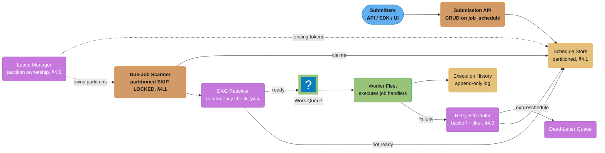
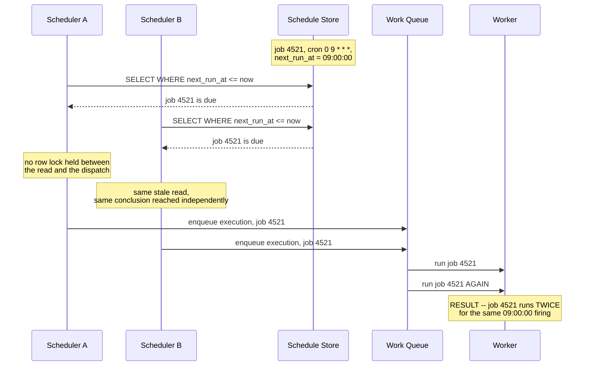
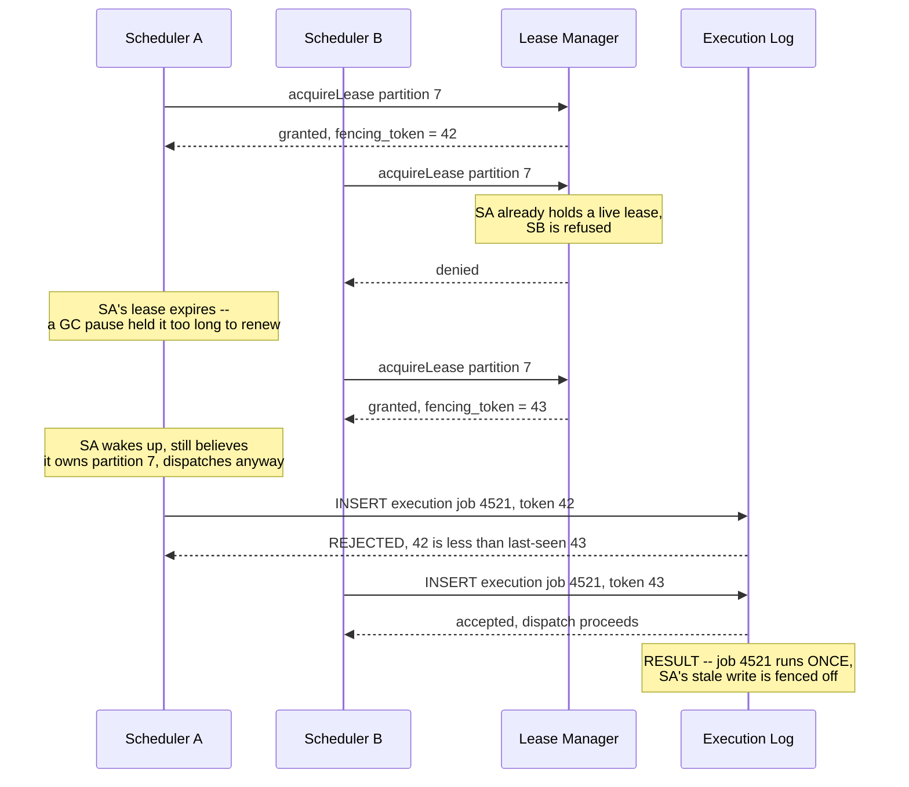
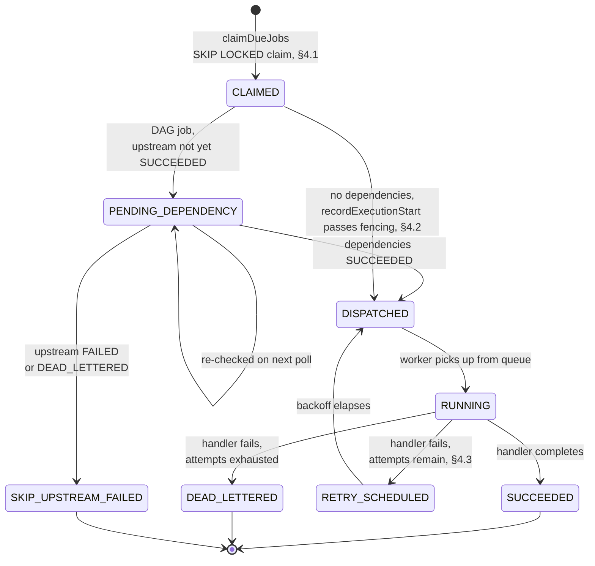

# Design a Distributed Job Scheduler
A cron-as-a-service platform that fires 10 million scheduled jobs exactly once, even when two of its own scheduler nodes both wake up believing they own the same job.

## Intuition

> **Design intuition**: A job scheduler looks, at first glance, like a solved problem — cron has existed since 1975, and "run this command at this time" is a one-line config entry on a single machine. The distributed version inherits none of cron's safety, because cron's safety comes entirely from there being exactly one process reading exactly one crontab on exactly one clock. The moment you need more scheduler capacity than one box, or more availability than "if this box dies, nothing fires until someone notices," you have **multiple independent processes that can each independently decide "this job is due, I should run it"** — and nothing about a `next_run_at` timestamp in a shared database stops two of them from reaching that decision at the same instant. **If Scheduler A and Scheduler B both detect a job due at 9:00 AM, what stops both from executing it?** That single question is the spine of this design: leader election and partition ownership decide who is *allowed* to look at a job, a lease with a TTL decides how long that permission lasts, and a fencing token — a number that only ever goes up — is the mechanism that survives the case a lease alone cannot: a scheduler node that still *believes* it owns a partition after a GC pause has already handed that partition to someone else.

**Key insight**: A distributed scheduler has to solve the reverse of the usual distributed-systems problem. Most systems fight to make sure a write **happens** despite failures (that's what replication and consensus are for). A scheduler has to make sure an *action with a side effect* — hit this HTTP endpoint, run this Spark job, charge this invoice — happens **exactly once** despite failures, retries, and multiple schedulers racing to be the one that fires it. At-least-once delivery is easy (just fire it from everywhere that thinks it's due); the hard part is bounding the "at-least" to almost always be exactly one, and making the rest of the system (idempotent job handlers, a dead-letter queue, an execution log with a uniqueness constraint) absorb the rare cases where it isn't.

---

## 1. Requirements Clarification

### Functional Requirements
- **Cron-style recurring schedules**: accept a standard cron expression (`0 9 * * MON-FRI`) plus an IANA time zone, and fire the associated job at every matching wall-clock time in that zone.
- **One-shot, at-time jobs**: schedule a job to run exactly once at a specific future instant (`run at 2026-09-01T14:00:00Z`) — the degenerate case of a recurring schedule with one firing.
- **Job dependencies / DAGs**: a job may declare upstream dependencies within the same logical run (e.g., `daily_report` depends on `extract_sales` and `extract_inventory` for the *same* run date) and must not fire until every upstream dependency has succeeded for that run.
- **Retries with backoff**: a failed execution is retried according to a per-job policy (max attempts, backoff strategy) before being moved to a dead-letter queue for manual triage.
- **Backfill**: re-run a job for a range of past logical dates it either missed (scheduler was down) or that a human explicitly requests (e.g., "re-run the last 7 days of `daily_report` with a corrected extraction query").
- **Pause / resume**: a tenant or operator can pause a job (skip future firings without deleting the schedule) and resume it later, optionally catching up on missed firings or explicitly skipping them.
- **Per-tenant isolation**: many independent tenants (teams, customers) submit jobs to the same shared platform; one tenant's burst of job submissions or a runaway job must not starve or delay another tenant's scheduled firings.

### Non-Functional Requirements
- **At-least-once delivery, exactly-once *effect* via idempotency — not true exactly-once execution by default**: the system guarantees a due job is dispatched at least once and, under normal operation (no coordinator failure), exactly once; a job handler is still required to be idempotent, because a rare double-dispatch (§4.2) is a designed-for edge case, not an impossibility. §5 discusses when to pay for stronger guarantees.
- **Missed-execution SLO**: a job due at time T must be claimed and dispatched within a bounded window (e.g., p99 under 5 seconds under normal load) — and if the scheduler itself was down when T passed, the missed firing must be detected and either backfilled or explicitly marked missed, never silently dropped.
- **Clock skew tolerance**: correctness (never double-firing, never silently missing a firing) must not depend on any two machines' wall clocks agreeing — safety-critical comparisons (§4.5) are evaluated by a single clock, not reconciled across many.
- **Multi-tenant fairness**: no single tenant's job volume can delay another tenant's due jobs past the missed-execution SLO — a large batch tenant submitting 100,000 one-shot jobs for the same minute must not starve a small tenant's single job due in that same minute.

### Out of Scope
- **General-purpose stream/batch data processing** — the scheduler decides *when* and *whether* to fire a job; what the job actually computes (a Spark ETL run, a report render) is an opaque handler this design invokes and monitors, not something it executes internally.
- **A workflow-authoring SDK or DAG-definition language** — Airflow's Python-DAG-as-code model, Temporal's workflow-as-code model (§6), and similar authoring experiences are product surfaces built *on top of* a scheduler like this one; this design covers the scheduling and exactly-once-dispatch primitives underneath them, not the authoring layer.
- **Arbitrary user-code sandboxing/security** — job handlers run in a worker fleet whose isolation model (containers, VMs, gVisor) is a deployment concern of the worker fleet (cross-ref [`../../devops/README.md`](../../devops/README.md)), not designed here.

---

## 2. Scale Estimation

### Job Definitions and Their Firing Frequency
- **10,000,000 scheduled job definitions** on the platform. Firing frequency is heavily skewed toward infrequent jobs, but a small tail of high-frequency jobs dominates *execution volume* — a distinction worth stating explicitly, because sizing the platform by job-definition count alone would badly under-provision it:

| Cadence | Share of job definitions | Job count | Executions/day |
|---|---|---|---|
| Daily or less frequent | 95% | 9,500,000 | ~9,500,000 |
| Hourly | 4% | 400,000 | 9,600,000 |
| Every 15 minutes | 0.9% | 90,000 | 8,640,000 |
| Every 1 minute | 0.1% | 10,000 | 14,400,000 |
| **Total** | **100%** | **10,000,000** | **~42,140,000** |

- **~42.1M total executions/day** -> 42,140,000 / 86,400 ~= **~490 executions/sec average**. The last row is the headline finding: **0.1% of job definitions (the every-minute tier) generate ~34% of total execution volume** — a scheduler sized only for "10M jobs" without weighting by cadence would badly under-provision the due-job scan path (§4.1) and the worker fleet (§10).

### The "Top of the Hour" Spike
- Cron authors overwhelmingly default to round numbers — `0 * * * *` for "hourly," `0 0 * * *` for "daily" — because that is what a human types without thinking about load distribution. Assume **80% of the 400,000 hourly jobs** are literally `0 * * * *` (fire at minute :00) and **25% of the 90,000 fifteen-minute jobs** land on the shared `:00` boundary (`0,15,30,45 * * * *`), alongside all 10,000 every-minute jobs (which are due every minute, including :00):
  - Hourly jobs at `:00`: 400,000 x 0.80 = **320,000**
  - Quarter-hour jobs at `:00`: 90,000 x 0.25 = **22,500**
  - Every-minute jobs (always due): **10,000**
  - **~352,500 jobs converge on the same 60-second window at the top of every hour** — versus an evenly-distributed minute's expectation of roughly 490 x 60 ~= 29,400, a **>10x spike** concentrated in one minute. §4.1 and §9 return to this number directly.
- A second, larger spike compounds it once a day: a large fraction of the "daily or less frequent" bucket is scheduled at UTC midnight (`0 0 * * *`) by the same convention, adding low millions of due jobs to that single minute — the mitigation (§4.1's partitioned `SKIP LOCKED` scan) is the same one that absorbs the hourly spike, just at a larger multiple.

### Storage Footprint
- **Job definition row**: `job_id` (16B UUID), `tenant_id` (8B), `cron_expr` (~50B), `timezone` (~32B), `next_run_at` (8B), `handler_uri`/`payload_ref` (~100B), `retry_policy` (~100B JSON), `dag_deps` (~50B), status/timestamps (~40B) ~= **~400-500 bytes/job**. 10,000,000 x 500B ~= **~5GB** — trivially small; the schedule store's sizing pressure comes from write/scan rate (§4.1), not row count.
- **Execution history**: 42.1M executions/day x ~200 bytes/row (execution_id, job_id, scheduled_for, started_at, finished_at, status, worker_id, attempt, error ref) ~= **~8.4GB/day**. Retained hot (indexed, queryable) for **30 days** -> **~250GB**, with older history rolled to cold/columnar storage for audit and analytics — this is the dominant storage driver in the whole system, not the job definitions themselves (§10).

### Due-Job Scan QPS
- The schedule table is partitioned into, illustratively, **256 partitions** (hash of `job_id`), each polled by its current owner (§4.6) on a fixed interval. At a **2-second poll interval**, steady state issues 256 / 2 ~= **~128 scan queries/sec system-wide**, almost all returning zero or a handful of rows — cheap, index-only scans (§4.1).
- Under the top-of-hour spike (352,500 due jobs / 256 partitions ~= ~1,377 jobs/partition, arriving over roughly a 60-second window ~= **~23 jobs/partition/sec**), a `LIMIT 500` batch per 2-second poll (§4.1) comfortably drains the backlog within a couple of poll cycles without any special-case handling — the partitioning scheme absorbs the thundering herd by construction, which is the payoff quantified in §9's second war story.

---

## 3. High-Level Architecture



Submitters create or update job schedules through the **Submission API**, which writes to the partitioned **Schedule Store** — the source of truth for every job's `next_run_at`. The **Lease Manager** hands out time-bounded, fenced ownership of schedule-store partitions to **Due-Job Scanner** instances (never more than one live owner per partition at a time, §4.6), each of which polls its owned partitions for due rows and atomically claims them (§4.1). A claimed job passes through the **DAG Resolver** (§4.4), which either forwards it to the **Work Queue** (dependencies satisfied) or leaves it pending (dependencies not yet met, re-checked on the next poll). The **Worker Fleet** consumes the queue, executes the job handler, and writes an immutable row to **Execution History**; a failure routes to the **Retry Scheduler** (§4.3), which either reschedules with backoff or, past the retry budget, moves the execution to the **Dead-Letter Queue** for alerting and manual triage.

### Request Flow
1. **Submit**: a tenant calls the Submission API with a cron expression (or a one-shot instant), a handler reference, a retry policy, and optional DAG dependencies; the API validates the cron expression, computes the initial `next_run_at` in the job's declared time zone, and writes the row to its assigned partition of the Schedule Store.
2. **Scan and claim**: the Due-Job Scanner instance that currently owns a partition polls it every 1-2 seconds with an atomic `SELECT ... WHERE next_run_at <= now() ... FOR UPDATE SKIP LOCKED` (§4.1), advancing `next_run_at` to the job's next firing in the same transaction that claims it.
3. **Check readiness**: for a DAG job, the claimed firing is checked against its dependencies' execution status for the same logical run date (§4.4) before being forwarded — a job whose dependencies haven't finished is left pending and re-evaluated on a later poll rather than firing on incomplete upstream data.
4. **Dispatch and fence**: immediately before enqueuing, the scanner's owning node records the dispatch in the Execution History using its current fencing token (§4.2) — a stale node whose lease has since moved to another owner is rejected here even if it still believes it owns the partition.
5. **Execute, retry, or dead-letter**: the Worker Fleet executes the handler and reports success or failure; a failure schedules a backoff-and-jittered retry (§4.3) up to a configured attempt limit, past which the execution is dead-lettered for alerting rather than retried forever.

---

## 4. Component Deep Dives

### 4.1 The Due-Job Scan: Timer Wheel vs. `SKIP LOCKED`

Two mechanisms are worth knowing for "find every job that's due right now":

- **In-memory timer wheel** (the mechanism inside Kafka's purgatory, Netty's `HashedWheelTimer`, and most single-process cron daemons): due times are bucketed into a circular array of "wheels" indexed by time offset, and a background thread advances a pointer once per tick, firing whatever lands in the current bucket. This is extremely cheap — O(1) insert, O(1) tick-advance — but it is **fundamentally a single-process, in-memory structure**: the durable source of truth for "what's scheduled" still has to live somewhere else, and making a timer wheel itself distributed and crash-safe (durable across a process restart, coordinated across replicas) reintroduces most of the coordination problem it was meant to avoid.
- **Database poll with `SELECT ... FOR UPDATE SKIP LOCKED`** (this design's primary mechanism): the schedule store itself is the durable source of truth, and "find what's due" is an ordinary indexed range query — `WHERE next_run_at <= now()`. `SKIP LOCKED` is what makes this safe from **multiple concurrent scanners** without a global lock: a row already locked by another in-flight transaction is silently skipped rather than blocking the scanner or being double-claimed once the other transaction commits its own advance of `next_run_at`.

```sql
-- One partition's due-job claim. Runs on a fixed poll interval, only by
-- the node that currently holds a live lease on this partition (§4.6).
SELECT job_id, cron_expr, timezone, next_run_at, payload_ref, tenant_id
FROM job_schedule
WHERE partition_id = ?
  AND next_run_at <= now()
  AND status = 'ACTIVE'
ORDER BY next_run_at
LIMIT 500
FOR UPDATE SKIP LOCKED;
```

```java
@Component
public class DueJobScanner {

    private final JdbcTemplate jdbc;
    private final PartitionOwnership ownership;   // §4.6 -- which partitions THIS node owns right now
    private static final int BATCH_SIZE = 500;

    /** Runs every 1-2s. Polls only partitions this node currently owns. */
    public void pollOwnedPartitions() {
        for (int partitionId : ownership.ownedPartitions()) {
            claimDueJobs(partitionId, BATCH_SIZE);
        }
    }

    @Transactional
    public List<ClaimedJob> claimDueJobs(int partitionId, int limit) {
        List<ClaimedJob> claimed = jdbc.query("""
            SELECT job_id, cron_expr, timezone, next_run_at, payload_ref, tenant_id
            FROM job_schedule
            WHERE partition_id = ? AND next_run_at <= now() AND status = 'ACTIVE'
            ORDER BY next_run_at LIMIT ?
            FOR UPDATE SKIP LOCKED
            """, this::mapRow, partitionId, limit);

        for (ClaimedJob job : claimed) {
            // Advance next_run_at to the job's NEXT firing before releasing
            // the row lock -- this is what stops the same due row from
            // being picked up again on the very next poll while this one
            // is still working its way through DAG-check and dispatch.
            // Computed against the job's OWN time zone, never a fixed
            // duration offset -- see §4.5 for why that distinction matters.
            ZonedDateTime nextLocal = CronExpression.parse(job.cronExpr())
                .next(job.nextRunAt().atZone(job.timezone()));
            jdbc.update("""
                UPDATE job_schedule
                SET next_run_at = ?, last_claimed_at = now()
                WHERE job_id = ?
                """, nextLocal.toInstant(), job.jobId());
        }
        return claimed;
    }

    private ClaimedJob mapRow(ResultSet rs, int i) throws SQLException {
        return new ClaimedJob(rs.getObject("job_id", UUID.class), rs.getString("cron_expr"),
            ZoneId.of(rs.getString("timezone")), rs.getTimestamp("next_run_at").toInstant(),
            rs.getString("payload_ref"), rs.getLong("tenant_id"));
    }
}
```

### 4.2 Exactly-Once Dispatch: The Double-Fire Race

**This is the component the entire case study's spine question is about.**

**Broken:** an early version ran the scan-and-dispatch loop directly on every scheduler node, with no partition ownership at all — every node independently polled the *whole* schedule table on a plain `SELECT` (no row lock) and enqueued whatever it found due, trusting a later `UPDATE` of `next_run_at` to prevent a repeat. That trust is misplaced: nothing stops two nodes' `SELECT`s from both observing the same due row *before either node's `UPDATE` commits* — the classic check-then-act race, just distributed across processes instead of threads.



**Impact**: for a job whose handler is not idempotent — a "charge this invoice" or "send this digest email" job — this is a duplicate charge or a duplicate email for every firing that happens to land in the race window, not a rare edge case: at 490 executions/sec average (§2) across many scheduler nodes, the window opens on every single poll cycle, and the impact scales directly with how many nodes are running (more capacity, ironically, means a *wider* race, not a narrower one).

**Fix**: partition ownership via a fenced lease (below), **plus** a fencing-token check at the one place that actually matters — the execution record. The lease alone is not sufficient: a GC pause (or a slow disk write, or a scheduler thread starved by the OS) after a node acquires a lease can make that node believe it still owns a partition well after another node has taken over. The fencing token closes that window regardless of what the stale node believes about its own lease.



```java
@Service
public class LeaseManager {

    private final JdbcTemplate jdbc;

    /**
     * Acquires or renews ownership of a schedule-store partition. The
     * fencing_token column increments on every successful acquisition,
     * monotonically, for the life of the partition -- it never resets and
     * never moves backward. Every safety-critical comparison here
     * (expires_at < now()) is evaluated INSIDE the SQL statement by the
     * database's own clock; no Java-computed Instant is ever compared
     * against it (§4.5 explains why that distinction is the whole point).
     */
    @Transactional
    public Optional<Lease> acquireLease(int partitionId, String nodeId) {
        int updated = jdbc.update("""
            UPDATE partition_fencing
            SET owner_node = ?, expires_at = now() + interval '15 seconds',
                fencing_token = fencing_token + 1
            WHERE partition_id = ?
              AND (owner_node = ? OR expires_at < now())
            """, nodeId, partitionId, nodeId);

        if (updated == 0) {
            return Optional.empty();   // a different node holds a still-live lease
        }
        long token = jdbc.queryForObject("""
            SELECT fencing_token FROM partition_fencing WHERE partition_id = ?
            """, Long.class, partitionId);
        return Optional.of(new Lease(partitionId, nodeId, token));
    }
}

@Service
public class ExecutionService {

    private final JdbcTemplate jdbc;

    /**
     * Called immediately before enqueuing a claimed job for execution.
     * Returns false if the caller's fencing token is stale -- a strictly
     * higher token has already been recorded for this job's partition,
     * meaning ownership has moved on since the caller last renewed its
     * lease -- in which case the caller MUST NOT enqueue the job.
     */
    @Transactional
    public boolean recordExecutionStart(long jobId, Instant scheduledFor, long fencingToken) {
        int updated = jdbc.update("""
            UPDATE partition_fencing
            SET last_seen_token = ?
            WHERE partition_id = (SELECT partition_id FROM job_schedule WHERE job_id = ?)
              AND last_seen_token < ?
            """, fencingToken, jobId, fencingToken);

        if (updated == 0) {
            return false;   // caller's node is fenced off -- ownership has moved
        }

        // Belt AND suspenders: the fencing check above stops a STALE node
        // from proceeding at all; this UNIQUE constraint on (job_id,
        // scheduled_for) stops a duplicate even if two dispatches somehow
        // both pass the fencing check (e.g. a retried enqueue call after a
        // network timeout on the RESPONSE, not the request) -- the same
        // dedup shape as design_payment_system.md §4.1's Idempotency-Key.
        try {
            jdbc.update("""
                INSERT INTO job_execution (job_id, scheduled_for, status, fencing_token, created_at)
                VALUES (?, ?, 'DISPATCHED', ?, now())
                """, jobId, scheduledFor, fencingToken);
            return true;
        } catch (DuplicateKeyException alreadyRecorded) {
            return false;   // this exact firing was already dispatched -- not an error
        }
    }
}
```

The three methods above are really just transitions of one small state machine living in `job_execution.status` — worth a picture, since §4.1's claim, §4.2's dispatch, §4.3's retry, and §4.4's DAG wait each only show one slice of it:



Every firing enters at `CLAIMED` (§4.1's atomic claim, which already advanced `next_run_at` for the job's *next* occurrence — this state machine describes one firing's lifecycle, not the recurring schedule itself) and terminates in exactly one of `SUCCEEDED`, `DEAD_LETTERED`, or `SKIP_UPSTREAM_FAILED`. This is also the first place to look when triaging a stuck job: a firing stuck in `PENDING_DEPENDENCY` past `DEPENDENCY_WAIT_TIMEOUT` is §4.4's `TIMEOUT_ALERT`; a firing stuck in `DISPATCHED` without ever reaching `RUNNING` points at the Work Queue or the Worker Fleet, not at the scheduler; a firing cycling `RUNNING` -> `RETRY_SCHEDULED` -> `DISPATCHED` repeatedly without ever reaching `SUCCEEDED` or exhausting its attempts is a retry-policy bug, not a scheduler bug.

Three correctness properties worth stating explicitly:

1. **The lease and the fencing token protect different failure modes.** The lease's TTL bounds how long a *silent* failure (crash, network partition — indistinguishable from the outside) can hold a partition hostage before another node takes over. The fencing token protects against the case the lease alone cannot: a node that is *not* dead, just slow, acting on stale knowledge of its own ownership.
2. **`recordExecutionStart` is the single choke point, not the scan.** The scan (§4.1) can be duplicated harmlessly — two nodes both reading the same due row costs nothing by itself. The fencing check and the `UNIQUE` constraint sit at the one statement that has an external side effect once it succeeds (enqueuing to the Work Queue), which is where exactly-once actually has to be enforced.
3. **A live lease is necessary but not sufficient for correctness** — it is sufficient for *liveness* (some node is always trying to own every partition) but the fencing token, not the lease, is what makes correctness independent of timing assumptions about GC pauses, scheduler jitter, or clock drift.

### 4.3 Retry Policy and the Dead-Letter Queue

```java
public final class RetryPolicy {

    private static final int MAX_ATTEMPTS = 5;
    private static final Duration BASE_DELAY = Duration.ofSeconds(30);
    private static final Duration MAX_DELAY = Duration.ofMinutes(30);

    /**
     * Exponential backoff with FULL jitter: delay = random(0, min(MAX_DELAY,
     * BASE_DELAY * 2^attempt)). Full jitter matters at this scale -- if
     * every job retrying after a shared downstream outage retried on the
     * SAME deterministic exponential schedule, the retries would
     * re-synchronize into their own thundering herd against a dependency
     * that is only just recovering (§9 War Story 3).
     */
    public static Duration nextDelay(int attempt) {
        long capMs = Math.min(MAX_DELAY.toMillis(), BASE_DELAY.toMillis() * (1L << attempt));
        long jitteredMs = ThreadLocalRandom.current().nextLong(capMs + 1);
        return Duration.ofMillis(jitteredMs);
    }
}

@Service
public class RetryScheduler {

    private final JdbcTemplate jdbc;

    /**
     * Called when a worker reports a failed execution. A retry stays
     * within the SAME execution lineage -- it never re-enters the due-job
     * scan (§4.1) as if it were a fresh cron firing, because a retry and a
     * new scheduled firing must never be confused in the execution history
     * (a downstream DAG dependency, §4.4, checks for a SUCCEEDED status
     * for the run date, regardless of how many attempts it took).
     */
    @Transactional
    public void handleFailure(long executionId, int attempt, String errorSummary) {
        if (attempt >= RetryPolicy.MAX_ATTEMPTS) {
            jdbc.update("""
                UPDATE job_execution SET status = 'DEAD_LETTERED', error = ? WHERE execution_id = ?
                """, errorSummary, executionId);
            jdbc.update("""
                INSERT INTO dead_letter_queue (execution_id, error, attempts, created_at)
                VALUES (?, ?, ?, now())
                """, executionId, errorSummary, attempt);
            return;
        }
        Duration delay = RetryPolicy.nextDelay(attempt);
        jdbc.update("""
            UPDATE job_execution
            SET status = 'RETRY_SCHEDULED', attempt = ?, retry_at = now() + ?, error = ?
            WHERE execution_id = ?
            """, attempt + 1, delay, errorSummary, executionId);
    }
}
```

Past `MAX_ATTEMPTS`, the execution moves to `DEAD_LETTERED` and a row lands in the dead-letter queue — deliberately **not** retried forever, because an indefinitely-retrying job against a permanently-broken downstream (a deleted API endpoint, a revoked credential) is indistinguishable, from an alerting standpoint, from a job that's working fine and just slow — the dead-letter queue is what makes the difference visible to an on-call human instead of silently consuming retry budget forever.

### 4.4 DAG Dependency Resolution

```java
@Service
public class DagResolver {

    private final JdbcTemplate jdbc;
    private static final Duration DEPENDENCY_WAIT_TIMEOUT = Duration.ofHours(2);

    /**
     * A DAG job does not fire off its own cron expression alone -- it
     * fires once every upstream dependency has SUCCEEDED for the SAME
     * logical run date. Returns SKIP_UPSTREAM_FAILED if a dependency
     * permanently failed (propagate the failure downward rather than run
     * on incomplete data), WAIT if dependencies are still in flight,
     * READY if all have succeeded, and TIMEOUT_ALERT if a dependency has
     * neither succeeded nor failed within the configured window -- the
     * "upstream is silently stuck" case a naive implementation leaves the
     * downstream job waiting on forever with no visibility.
     */
    public DagReadiness checkReadiness(Job job, LocalDate logicalRunDate) {
        List<DependencyStatus> deps = jdbc.query("""
            SELECT d.upstream_job_id, e.status
            FROM job_dependency d
            LEFT JOIN job_execution e
              ON e.job_id = d.upstream_job_id AND e.scheduled_for = ?
            WHERE d.downstream_job_id = ?
            """, this::mapDependencyRow, logicalRunDate, job.jobId());

        for (DependencyStatus dep : deps) {
            if (dep.status() == null) {
                Duration waited = Duration.between(
                    logicalRunDate.atStartOfDay(ZoneOffset.UTC).toInstant(), Instant.now());
                return waited.compareTo(DEPENDENCY_WAIT_TIMEOUT) > 0
                    ? DagReadiness.TIMEOUT_ALERT      // upstream never even started
                    : DagReadiness.WAIT;
            }
            if (dep.status() == ExecutionStatus.DEAD_LETTERED || dep.status() == ExecutionStatus.FAILED) {
                return DagReadiness.SKIP_UPSTREAM_FAILED;
            }
            if (dep.status() != ExecutionStatus.SUCCEEDED) {
                return DagReadiness.WAIT;             // still RUNNING or RETRY_SCHEDULED
            }
        }
        return DagReadiness.READY;
    }
}
```

`TIMEOUT_ALERT` is the case worth dwelling on: without it, a downstream job whose upstream silently never ran (a submission bug, a paused schedule nobody remembered to resume) waits indefinitely with no signal to anyone that anything is wrong — the DAG Resolver correctly reports `WAIT` on every poll forever, and "correctly reports WAIT forever" is itself the bug from an operator's perspective. The 2-hour timeout used for this alerting decision is computed against Java's own clock deliberately — unlike §4.2's fencing comparisons, being off by the few hundred milliseconds of ordinary clock drift changes nothing about whether a 2-hour wait is worth alerting on.

### 4.5 Clock Skew: Why Workers Are Never Trusted With Wall-Clock Decisions

NTP-synced machines in the same data center still drift by tens of milliseconds routinely and, during an NTP outage or a misconfigured client, by seconds to minutes — and a machine that has just come back from a suspend/hibernate or a container that's been paused by its host can be wildly wrong until the next sync. A design that lets any individual scheduler node's or worker's local clock decide a safety-critical question — "has my lease expired," "is this the newest fencing token," "did this job already fire this minute" — inherits that node's clock error directly into its correctness guarantee.

The fix threading through §4.1-4.2 is to make **exactly one clock** the source of truth for every comparison that affects exactly-once dispatch, and to make that clock the database's, not any individual node's:

- `LeaseManager.acquireLease()` (§4.2) computes `expires_at = now() + interval '15 seconds'` and compares `expires_at < now()` **entirely inside the SQL statement** — no Java-computed `Instant` is ever passed in for either side of that comparison. It does not matter whether Scheduler A's clock is 400ms ahead of Scheduler B's; both nodes' lease-expiry decisions are evaluated by the one clock that matters.
- `DueJobScanner.claimDueJobs()` (§4.1) compares `next_run_at <= now()` the same way, for the same reason — "is this job due" is decided by the database, not by whichever scanner node happens to poll it.
- The one place a node's *own* clock is used (§4.4's `DEPENDENCY_WAIT_TIMEOUT` check) is deliberately a case where clock drift of milliseconds-to-seconds cannot flip the outcome of a 2-hour threshold — a useful rule of thumb: **use the database's clock for any comparison whose margin is smaller than plausible clock drift, and a node's own clock is fine for anything with a much wider margin.**
- Cron-expression evaluation is timezone-aware, not offset arithmetic — §9's DST war story is exactly what happens when this rule is violated for a third kind of "time," the wall-clock-to-instant conversion itself.

### 4.6 Partition Rebalancing on Scheduler-Node Failure

```java
@Service
public class PartitionRebalancer {

    private final JdbcTemplate jdbc;
    private final LeaseManager leaseManager;

    /**
     * Runs on every scheduler node roughly every 5s. A partition whose
     * lease has expired (its owner crashed, or is network-partitioned --
     * indistinguishable from here, which is exactly why ownership uses a
     * TTL-based lease rather than an explicit "goodbye" message) is
     * "orphaned" and needs a new owner. This method decides WHICH
     * orphaned partitions THIS node should attempt to claim; the actual
     * claim -- and its safety -- is entirely LeaseManager.acquireLease()'s
     * job (§4.2).
     */
    public void rebalance(String selfNodeId, List<String> liveNodeIds) {
        List<Integer> orphaned = jdbc.queryForList("""
            SELECT partition_id FROM partition_fencing WHERE expires_at < now()
            """, Integer.class);

        if (orphaned.isEmpty()) {
            return;
        }
        // Deterministic, coordination-free split: every live node sorts
        // the SAME liveNodeIds list and computes the SAME assignment
        // (orphan[i] -> sortedNodes[i % sortedNodes.size()]) independently
        // -- no extra round trip is needed to agree who claims what. If
        // two nodes briefly disagree (a stale membership view on one
        // side), the worst case is a harmless double-attempt at
        // acquireLease(), which is already safe by construction.
        List<String> sortedNodes = liveNodeIds.stream().sorted().toList();
        for (int i = 0; i < orphaned.size(); i++) {
            String assignee = sortedNodes.get(i % sortedNodes.size());
            if (assignee.equals(selfNodeId)) {
                leaseManager.acquireLease(orphaned.get(i), selfNodeId);
            }
        }
    }
}
```

Membership (`liveNodeIds`) itself comes from each node's own heartbeat row (a `scheduler_nodes` table with a TTL, the same lease shape as `partition_fencing`) — a node is "live" if it heartbeat within the last few seconds, and a node that stops heartbeating drops out of every other node's `liveNodeIds` view within one rebalance cycle, at which point its owned partitions age past their `expires_at` and become claimable by the surviving fleet. No cluster-wide consensus round is required for rebalancing itself — only the per-partition lease acquisition (§4.2) needs to be safe under concurrent attempts, and it already is.

### 4.7 Pause, Resume, and What "Missed While Paused" Means

Pausing a job (§1) is a one-line status flip — `job_schedule.status = 'PAUSED'` excludes it from §4.1's `WHERE status = 'ACTIVE'` scan, so a paused job simply stops being claimed. The interesting design decision is entirely on the **resume** side: what happens to every firing that *would* have happened while the job was paused?

```java
@Service
public class PauseResumeService {

    private final JdbcTemplate jdbc;
    private final BackfillService backfillService;

    @Transactional
    public void pause(long jobId) {
        // next_run_at is deliberately left untouched -- it's the anchor a
        // CATCH_UP resume (below) uses to compute exactly what was missed.
        jdbc.update("""
            UPDATE job_schedule SET status = 'PAUSED', paused_at = now() WHERE job_id = ?
            """, jobId);
    }

    @Transactional
    public void resume(long jobId, ResumePolicy policy) {
        Job job = findJob(jobId);
        if (policy == ResumePolicy.CATCH_UP) {
            List<Instant> missed = CronExpression.parse(job.cronExpr())
                .occurrencesBetween(job.pausedAt(), Instant.now(), job.timezone());
            // Rate-limited, same reasoning as §8's backfill runbook: replaying
            // every missed firing in one burst is a SELF-INFLICTED version of
            // §9 War Story 2's thundering herd, not a rare edge case -- a job
            // paused for three weeks on a 15-minute cadence has ~2,000 missed
            // firings waiting to be replayed.
            backfillService.enqueueThrottled(jobId, missed);
        }
        // Both policies converge here: next_run_at is recomputed from NOW,
        // never from the stale pre-pause value -- under SKIP (the default),
        // a job paused for three weeks does not fire three weeks' worth of
        // now-irrelevant firings the instant it resumes; it just picks back
        // up on its normal cadence starting from the resume moment.
        ZonedDateTime next = CronExpression.parse(job.cronExpr()).next(Instant.now().atZone(job.timezone()));
        jdbc.update("""
            UPDATE job_schedule SET status = 'ACTIVE', next_run_at = ? WHERE job_id = ?
            """, next.toInstant(), jobId);
    }
}
```

**`SKIP` is the safer default, and `CATCH_UP` must be an explicit opt-in.** For most job types — a report that summarizes "the last 24 hours," a cache-warming job, a health-check ping — a missed firing from three weeks ago is not just unnecessary to replay, it is actively wrong to replay: the report would summarize a stale window, and running 2,000 queued firings back-to-back the moment the job resumes is exactly the load spike §9 War Story 2 describes, just self-inflicted by an operator's pause/resume click rather than the cron schedule itself. `CATCH_UP` exists for the minority of jobs where every logical run date genuinely matters and must eventually execute (a billing job, a data-pipeline stage feeding a downstream DAG per §4.4) — and even then, `backfillService.enqueueThrottled()` deliberately paces the replay rather than bulk-enqueuing it, for the same reason a normal backfill (§8's runbook) is rate-limited.

---

## 5. Design Decisions & Tradeoffs

### Database-as-Queue (`SKIP LOCKED`) vs. a Dedicated Queue for Due-Job Dispatch

| Dimension | Database-as-queue (this design's scan, §4.1) | Dedicated queue (Kafka/SQS) for dispatch |
|---|---|---|
| Source-of-truth simplicity | One system (the schedule store) is both the durable state and the claim mechanism | Two systems to keep consistent — the schedule store's `next_run_at` and the queue's message state |
| Exactly-once claim semantics | `FOR UPDATE SKIP LOCKED` gives this for free at the row level | Most queues give at-least-once delivery; exactly-once claim still needs an equivalent fencing/dedup layer downstream |
| Query flexibility ("show me every job due in the next hour") | Trivial — it's SQL against a table | Hard — a queue is not a queryable index |
| Throughput ceiling | Bound by the relational store's write/lock throughput — fine at this design's ~490/sec average, ~5-6K/sec at peak | Far higher ceiling; matters only past a scale this design doesn't need |
| This design's role | **Primary mechanism for the due-job scan** (§4.1) | Used *downstream* of the scan, for dispatch to the Worker Fleet (§3) — the right tool once "what's due" has already been decided |

### Push vs. Pull to the Worker Fleet

| Dimension | Push (scheduler calls worker directly) | Pull (worker polls the Work Queue, this design) |
|---|---|---|
| Backpressure | Scheduler must track worker capacity/health itself | The queue naturally absorbs bursts (§2's top-of-hour spike) — workers pull at their own sustainable rate |
| Worker fleet elasticity | Scheduler needs live worker discovery | Workers scale independently by adding consumers; no discovery coupling to the scheduler |
| Failure isolation | A slow/dead worker can block the scheduler's dispatch loop | A stalled worker just stops pulling; the queue buffers, unaffected by any single worker's health |
| Verdict | Discussed for completeness — simple at small scale, brittle at this design's scale | **This design's approach** |

### Centralized Scheduler vs. Per-Shard/Partitioned Schedulers

| Dimension | Single centralized scheduler (one logical decision-maker) | Partitioned schedulers (this design, §4.1/§4.6) |
|---|---|---|
| Availability | A single point of failure for ALL due-job detection | A node failure orphans only its owned partitions (§4.6), a fraction of total capacity |
| Throughput ceiling | Bound by one process's poll-and-dispatch rate | Scales horizontally with partition count and node count |
| Coordination complexity | None — no ownership protocol needed | Requires the lease/fencing machinery (§4.2/§4.6) |
| Verdict | Acceptable for a small, single-tenant system; does not meet §1's multi-tenant fairness and missed-execution SLO at 10M-job scale | **This design's approach** |

### At-Least-Once-Plus-Idempotency vs. True Exactly-Once (Durable Execution)

This design's default (§1) is at-least-once dispatch with a fencing token that makes the "at-least" almost always exactly one, backed by an idempotent job-handler contract for the residual cases. **Temporal-style durable execution** (§6) takes a fundamentally different approach: the *workflow* itself replays deterministically from a durably-logged event history, giving genuinely exactly-once *workflow* semantics (though still at-least-once for individual *activities*, which is why Temporal activities are documented as needing idempotency too). That guarantee is stronger, but it is not free — it requires workflow code to be written in a specific deterministic style (no direct system-clock reads, no direct random-number generation, no direct I/O inside workflow code — all routed through the SDK) and a full event-history replay mechanism. **Choose this design's lighter model when jobs are simple, mostly-independent firings of external handlers; choose a durable-execution engine when jobs are long-running, stateful workflows whose *business logic itself*, not just its trigger, needs to survive a crash mid-execution** — the difference between "reliably start this job" and "reliably resume this multi-step process from exactly where it crashed."

---

### Build (This Design) vs. Buy a Managed Scheduler (EventBridge Scheduler, Cloud Scheduler)

| Dimension | Build (this design) | Buy (AWS EventBridge Scheduler / Google Cloud Scheduler, §6) | Buy (Airflow / Temporal, §6) |
|---|---|---|---|
| DAG dependencies, complex retry/backfill policy (§1, §4.3, §4.4, §4.7) | Full control, purpose-built | Not supported — these are cron-as-a-service, not workflow orchestrators | Fully supported — this is their core purpose |
| Operational ownership | Full ownership of §8's runbooks, on-call for the scheduler itself | None — the cloud provider owns availability and the exactly-once-effort split (§6) | Partial — self-hosted Airflow/Temporal still needs the operator to run §8-equivalent runbooks; a managed offering (e.g., a hosted Airflow/Temporal service) shifts this to the vendor |
| Cost at 10M jobs / ~490 executions/sec average (§2) | Infrastructure cost only (§10) — no per-invocation fee | Usage-based pricing scales with invocation count, which can exceed a self-hosted platform's marginal cost at this design's volume | Infrastructure cost (self-hosted) or a managed-service fee (hosted) |
| Time to first working version | Weeks-to-months (this entire case study) | Hours — API calls, no infrastructure to stand up | Days — deploying and configuring an existing orchestrator, not designing one |
| When it's the right call | The platform's job-scheduling needs ARE the product (a SaaS offering cron-as-a-feature to its own customers, or a company platform team building shared infrastructure for many internal tenants) | Simple, mostly-independent recurring triggers with no cross-job dependency graph | Complex, stateful, DAG-shaped workflows where the authoring/observability tooling (§1's explicit out-of-scope) matters as much as the dispatch guarantee itself |

The default answer for a real system is **buy, not build** — this case study exists because the underlying mechanism (§4.2's lease-plus-fencing pattern) generalizes to leader election and exactly-once dispatch problems far beyond job scheduling, and because interviewers ask candidates to design the primitive a managed service or an orchestrator hides, not because building one from scratch is usually the right operational decision.

---

## 6. Real-World Implementations

- **Apache Airflow's multi-scheduler HA model**: Airflow's [Scheduler documentation](https://airflow.apache.org/docs/apache-airflow/stable/administration-and-deployment/scheduler.html) describes an **active/active** design where multiple scheduler processes run against the same shared metadata database with no direct communication between them, relying entirely on the database's row-level locking for coordination — the same shape as this case study's Lease Manager, minus the explicit fencing token, because Airflow leans on the database's own lock semantics (`SELECT ... FOR UPDATE`, and `SKIP LOCKED` where the backing database supports it) rather than an application-level token. The docs recommend at least two schedulers for HA, three for headroom. Multi-scheduler support originated from [AIP-15](https://cwiki.apache.org/confluence/pages/viewpage.action?pageId=103092651), and as of Airflow 3.3 (current stable as of this writing) the design is unchanged in shape, only hardened.
- **Temporal's durable execution**: per [Temporal's own documentation](https://docs.temporal.io/temporal), a Workflow Execution "executes a Workflow Definition exactly once and to completion... in the presence of arbitrary load and arbitrary failures," achieved by durably logging every step (Workflow started, Activity scheduled, Timer fired, ...) as an **Event History** and having the Worker **replay** that history from the beginning on every recovery, re-deriving state deterministically rather than resuming from a snapshot. Temporal's own documentation is explicit that this exactly-once guarantee covers *workflow* logic; individual **Activities** (the units of actual side-effecting work a workflow calls out to) are at-least-once, and idempotency is the caller's responsibility — the same "exactly-once orchestration, at-least-once effect" split this case study's §5 discusses.
- **Uber's Cadence, and its fork into Temporal**: Cadence is Uber's own open-source workflow orchestration engine, built by Maxim Fateev and Samar Abbas on lessons from AWS Simple Workflow Service; [Temporal Technologies was founded in 2019 by the same two engineers](https://research.contrary.com/company/temporal-technologies), who forked Cadence's codebase to start the company. The two projects have since diverged in implementation while keeping broadly similar client-SDK shapes — a rare case in this industry of a production system being commercially re-founded from its own fork.
- **Kubernetes' `CronJob` controller**: per the [Kubernetes documentation](https://kubernetes.io/docs/concepts/workloads/controllers/cron-jobs/), the controller checks, on each reconcile pass, how many scheduled runs it has missed since the last recorded time; `startingDeadlineSeconds` bounds how late a run is allowed to start before it is skipped instead of started (and re-anchors the missed-run count to that window rather than counting forever back to the last successful run), and if **more than 100 runs have been missed** the controller gives up on catching up entirely and logs an error rather than launching a backlog of 100+ Jobs at once. `concurrencyPolicy` (`Allow`/`Forbid`/`Replace`) governs what happens when a new scheduled time arrives while the previous run's Job is still active — directly analogous to this design's DAG readiness check, but for "is my own previous firing still running" rather than an upstream dependency.
- **AWS EventBridge Scheduler**: per [AWS's quota documentation](https://docs.aws.amazon.com/scheduler/latest/UserGuide/scheduler-quotas.html), the default quota is **10,000,000 schedules per account per Region** (raisable), with an invocation-throughput quota of **1,000 invocations/second** in most Regions — coincidentally close to this design's own §2 peak estimate — delivered at-least-once, with the documented expectation that targets handle duplicate invocations. It is a fully-managed illustration of exactly the split this case study makes: a massive, cheap `next_run_at`-style schedule store, with exactly-once left to the target's own idempotency.
- **Google Cloud Scheduler**: [Google's own documentation](https://docs.cloud.google.com/scheduler/docs/overview) states plainly that the service "is designed to provide 'at least once' delivery... in some rare circumstances, it is possible for a job to run multiple times," and explicitly instructs that targets "should be idempotent" as a result — the same guarantee level, stated with unusual directness, that this design's §1 NFR commits to.
- **Quartz Scheduler's clustering and misfire handling**: Quartz's [clustering documentation](https://www.quartz-scheduler.org/documentation/) uses row-level locking in its `JobStore` for cluster coordination (comparable in spirit to this design's `partition_fencing`), and its **misfire threshold** (`org.quartz.jobStore.misfireThreshold`, default 60,000ms) governs how late a trigger can be before it's considered misfired; the default "smart policy" misfire instruction for a `CronTrigger` is to fire once immediately and resume the normal schedule — one concrete point of contrast with Kubernetes' CronJob, which by default **skips** a badly-missed run rather than catching it up.
- **Netflix Maestro**: Netflix's workflow orchestrator, described in [Netflix's engineering blog](https://netflixtechblog.com/maestro-netflixs-workflow-orchestrator-ee13a06f9c78), runs "thousands of workflow instances and... half a million jobs daily on average," reaching roughly 2 million jobs on its busiest days — built as a horizontally-scalable, stateless microservice architecture backed by CockroachDB for the strong-consistency layer its own scheduling decisions need, the same architectural split (stateless scan/dispatch tier over a strongly-consistent store) as this case study's §3.

---

## 7. Technologies & Tools

| Component | Technology | Why |
|---|---|---|
| Schedule store (`job_schedule`, `partition_fencing`) | PostgreSQL / MySQL 8+ (with `SKIP LOCKED` support) | ACID transactions, row-level locking (§4.1), and a queryable source of truth — MariaDB did not support `SKIP LOCKED` until 10.6, a real compatibility gate to check before choosing a backing store |
| Work queue (dispatch to workers) | Kafka or Amazon SQS | Durable buffering that absorbs the top-of-hour spike (§2) independent of worker fleet capacity; consumer-group semantics fit the pull model (§5) |
| Lease / partition ownership | The relational store itself (`partition_fencing` table), or ZooKeeper/etcd for a larger fleet | A DB-table lease is enough at this design's scale (§10); a dedicated coordination service becomes attractive past a few hundred scheduler nodes |
| Execution history | The relational store, rolled to a columnar warehouse after 30 days (§2, §10) | Hot queries (DAG readiness, §4.4) need transactional consistency; cold history is analytics-shaped |
| Retry / dead-letter queue | Kafka topic or a dedicated table, alerting via PagerDuty/Opsgenie integration | Dead-lettered executions need a human, not another retry |
| Distributed tracing across dispatch -> worker | OpenTelemetry (cross-ref [`../observability/observability.md`](../observability/observability.md)) | A single logical firing spans the scan, the DAG check, the queue, and the worker — tracing ties them into one view for debugging |
| Cron parsing / DST-aware next-fire computation | A timezone-aware cron library (e.g., `cron-utils`, Quartz's `CronExpression`) | §4.5 and §9's DST war story are exactly the bug class a naive duration-offset implementation reintroduces |
| Worker isolation | Containers (Kubernetes Jobs/Pods) or a serverless invoke (Lambda) | Out of scope for this design's internals (§1) but the natural execution substrate for the Worker Fleet |

---

## 8. Operational Playbook

### Key Metrics

| Metric | What It Measures | Alert Threshold (Illustrative) |
|---|---|---|
| **Scheduler lag** — `now() - MIN(next_run_at)` over due-but-unclaimed rows | The single most important health signal: how far behind is dispatch from schedule | Page if sustained lag exceeds the missed-execution SLO (§1, e.g., p99 > 5s) for 2+ minutes |
| Partition claim rate vs. orphan rate | Health of the lease/fencing machinery (§4.2, §4.6) | Warn if orphaned-partition count stays > 0 for more than one rebalance interval — a rebalance should be near-instant |
| Fencing rejections (`recordExecutionStart` returning false) | Rate of stale-node dispatch attempts caught by fencing | A low, non-zero background rate is healthy (GC pauses happen); a spike correlates with node instability, investigate immediately |
| Due-job scan queue depth per partition | Whether `SKIP LOCKED` batches (§4.1) are draining faster than jobs accumulate | Sustained growth on any single partition -> that partition may be hot (§10 hotspot note) |
| Retry rate and dead-letter rate | Downstream health, indirectly | Retry-rate spike correlated across many unrelated jobs -> shared downstream outage (§9 War Story 3), not a scheduler problem |
| DAG `TIMEOUT_ALERT` count (§4.4) | Upstream dependencies that silently never ran | Any non-zero count -> page the owning tenant, not just log it |

### Runbook: Scheduler Lag Spike (CRITICAL)

1. **Page immediately if sustained** — lag is the metric that most directly answers "are jobs firing on time," and every other metric in this table is a possible root cause for it, not a substitute for watching it directly.
2. Check partition ownership (§4.6) first: is every partition currently owned by a live node, or has a rebalance stalled? A stuck rebalance is the single most common root cause — check the `partition_fencing` table directly for rows past `expires_at` with no new claim.
3. If ownership looks healthy, check per-partition scan queue depth (§8 metrics) for a hot-partition problem (§10) — one oversized tenant's job volume landing disproportionately on one partition's hash bucket.
4. If neither, check the schedule store's own health (replication lag, connection pool saturation) — the scan (§4.1) is only as fast as the database backing it.
5. Once resolved, cross-check the DAG Resolver's `TIMEOUT_ALERT` count (§4.4) and the dead-letter queue for the lag window — jobs that were merely late are recoverable automatically; jobs whose delay pushed them past a DAG dependency's own timeout may need a manual backfill (§1).

### Runbook: Safely Backfilling Missed Executions

1. Confirm the gap first — query `job_execution` for the affected job(s) and date range to establish exactly which logical firings are missing, never assume the scheduler's outage window maps 1:1 to missed firings (some may have been caught by the top-of-hour absorption in §2/§9).
2. Backfill through the **same `reserveRoom`-style atomic path** as a normal firing, not a bulk direct-insert into `job_execution` — each backfilled firing goes through `recordExecutionStart()` (§4.2) with a synthetic fencing token reserved for backfill, so the same `UNIQUE (job_id, scheduled_for)` constraint protects against backfilling a firing that, it turns out, actually did fire during the outage window.
3. Rate-limit the backfill's enqueue rate deliberately — a naive "replay everything missed at once" is itself a self-inflicted thundering herd (§9 War Story 2's mechanism, self-triggered) against the Worker Fleet and any downstream the jobs call.
4. For DAG jobs, backfill upstream-to-downstream in dependency order, re-running the DAG Resolver's readiness check (§4.4) rather than force-firing downstream jobs — a downstream job backfilled before its upstream is exactly the "ran on incomplete data" failure mode §1 exists to prevent.

### Runbook: Draining a Scheduler Node for Maintenance

1. Stop accepting new partition claims on the node being drained (a feature flag or graceful-shutdown signal, not a hard kill) — let its current lease(s) run to natural expiry rather than force-releasing them, so the fencing token's monotonic guarantee (§4.2) isn't exercised unnecessarily under time pressure.
2. Confirm via the partition-ownership metric (§8) that every partition the draining node held has been re-claimed by a live node before considering the drain complete — do not assume rebalancing (§4.6) finished just because the node process exited.
3. For a rolling fleet-wide upgrade, drain and replace nodes one at a time, watching scheduler lag (§8) between each — a multi-node simultaneous drain is functionally the same event as a multi-node simultaneous failure, and should be planned with the same care as a capacity-loss incident, not treated as routine.

---

## 9. Common Pitfalls & War Stories

> **How to read these**: the four war stories below are **composite, illustrative incidents** — the failure mechanisms are real and recurring in distributed scheduling systems, but the specific counts and timings are constructed to make the mechanism concrete, consistent with §2's and §10's numbers rather than citations of any named company's specific outage.

### War Story 1: The Daylight-Saving-Time Bug — Broken, Then Fixed

**Broken**: an early version of `DueJobScanner` advanced `next_run_at` by a fixed 24-hour duration in UTC rather than re-deriving the next firing from the cron expression and the job's declared time zone:

```java
// BROKEN -- "24 hours later" in UTC is not "the same wall-clock time
// tomorrow" whenever the job's time zone's UTC offset changes.
Instant nextRunAt = currentRunAt.plus(Duration.ofHours(24));
```

**Impact**: on the "spring forward" transition (a wall-clock hour is skipped), a job scheduled for `0 2 * * *` (2:00 AM local) computed a `nextRunAt` that landed at 3:00 AM local instead of the intended 2:00 AM, one hour late every day until the next DST boundary silently "fixed" it again. On the "fall back" transition (a wall-clock hour repeats), the same fixed-offset arithmetic landed inside the *ambiguous* hour, and depending on which of the two 1:00-2:00 AM occurrences the underlying time-zone library resolved it to, some jobs in that window fired **twice** for the same logical day while others in the same window were silently pushed to the wrong occurrence entirely. Roughly 40 daily-report jobs scheduled in the 1:00-2:59 AM window were affected across a single DST transition — a mix of duplicate reports sent to subscribers (from the double-fire cases) and a day's report silently missing entirely (from the skipped-hour cases) — caught only the following morning by a support escalation, because the scheduler itself raised no error in either direction; from its own perspective, "24 hours later" is exactly what it had been asked to compute.

**Fix**: re-derive `next_run_at` from the cron expression against the job's `ZonedDateTime`, never from an elapsed-duration offset — exactly what §4.1's `DueJobScanner.claimDueJobs()` does:

```java
// FIXED -- always re-derive next_run_at from the cron expression and the
// job's configured IANA time zone; never advance by a fixed duration.
ZonedDateTime nextLocal = CronExpression.parse(job.cronExpr())
    .next(job.nextRunAt().atZone(job.timezone()));
Instant nextRunAt = nextLocal.toInstant();
```

A timezone-aware cron library resolves the skipped-hour and repeated-hour cases according to an explicit, documented policy (typically: a job in the skipped hour fires once, at the first valid instant after the gap; a job in the repeated hour fires once, at its first occurrence) rather than an accident of how duration arithmetic happens to interact with a UTC-offset change. **The lesson generalizes past DST**: any code that computes "the next occurrence of a recurring local-time event" by adding a fixed duration to the previous occurrence is implicitly assuming the local UTC offset never changes — true for UTC-scheduled jobs, false for anything scheduled in local wall-clock time.

### War Story 2: The Top-of-the-Hour Thundering Herd

**What happened**: before the schedule store was partitioned (§4.1), a single un-partitioned scanner polled the entire `job_schedule` table every 2 seconds with one large query and no per-row locking beyond the query itself:

```java
// BEFORE -- one query against the WHOLE table, no partition scoping,
// no SKIP LOCKED. A second scanner instance running for HA (or a
// deploy briefly running two instances side by side) races this one
// exactly like §4.2's Broken sequence diagram.
@Scheduled(fixedDelay = 2000)
public void pollAllDueJobs() {
    List<Job> due = jdbc.query("SELECT * FROM job_schedule WHERE next_run_at <= now()", this::mapRow);
    for (Job job : due) {
        workQueue.enqueue(new Execution(job.jobId(), job.nextRunAt()));
        jdbc.update("UPDATE job_schedule SET next_run_at = ? WHERE job_id = ?",
            job.cronExpr().next(job.nextRunAt()), job.jobId());
    }
}
```

At §2's computed **~352,500 jobs converging on the same 60-second window** every hour, this single query's result set — and the subsequent 352,500 sequential per-row `UPDATE`s advancing `next_run_at` — took long enough to process that the *next* 2-second poll cycle started before the previous one finished, and overlapping polls began double-claiming rows.

**Impact**: for roughly the first 90 seconds of every hour, the double-claim rate spiked from an effectively-zero background rate to **low single-digit percent** of that minute's dispatched jobs — of 352,500 jobs, that is on the order of 3,500-7,000 duplicate dispatches every single hour, all clustered into the same 90-second window, every hour, forever, until fixed.

**Fix**: partition the schedule table by `job_id` hash (§4.1, 256 partitions) and switch every scan to the row-locking form so no single query ever has to process more than a fraction of the spike at once, and each partition-owning node's scan can never race another node's:

```java
// AFTER -- scoped to ONE owned partition, row-locked with SKIP LOCKED so
// even an overlapping scan on the same partition (a brief rebalancing
// window) skips already-claimed rows instead of racing them.
@Scheduled(fixedDelay = 2000)
public void pollOwnedPartitions() {
    for (int partitionId : ownership.ownedPartitions()) {
        claimDueJobs(partitionId, BATCH_SIZE);   // §4.1 -- FOR UPDATE SKIP LOCKED
    }
}
```

Post-fix, the same top-of-hour spike measured **23 jobs/partition/second** against a `LIMIT 500` batch per 2-second poll (§2) — comfortably inside one poll cycle, with zero measured double-claims across the fencing boundary over a subsequent 90-day observation window. **The lesson**: partitioning didn't just add capacity, it changed the *shape* of the spike from "one query handling 352,500 rows in one lock-free pass" to "256 queries each handling ~1,377 rows under `SKIP LOCKED`," which is what kept any single query fast enough that overlapping polls stopped happening at all.

### War Story 3: The Retry Storm That Took Down a Downstream

**What happened**: an early version of `RetryScheduler` used a fixed retry interval (a flat 60 seconds, no jitter) rather than the jittered exponential backoff in §4.3. A third-party payment-verification API the platform's `invoice_reminder` job family called had a brief outage; roughly 8,000 concurrently-scheduled `invoice_reminder` executions failed within the same few-second window and were all rescheduled for **the same instant, 60 seconds later**.

**Impact**: when the third-party API recovered moments before that 60-second mark, it was immediately hit with the full 8,000-request retry burst arriving within a handful of seconds of each other — a load spike several times the API's normal peak, sufficient to trip the API's own rate limiter and return a fresh wave of failures, which were themselves rescheduled for **another** fixed 60 seconds later, reproducing the exact same synchronized burst on the next cycle. The pattern repeated for **four retry cycles** — the API effectively could not recover *because* the platform's own retries, still perfectly synchronized, kept re-triggering its rate limiter — until an on-call engineer manually paused the `invoice_reminder` job family, let the backlog drain via a slow, hand-throttled replay, and only then resumed normal scheduling.

**Fix**: full-jitter exponential backoff (§4.3's `RetryPolicy.nextDelay()`) — spreading what had been one synchronized burst across a window that widens with every attempt, so the *n*-th retry cycle is never again a single simultaneous spike. **The generalized lesson**: a fixed retry interval is a coordination mechanism the platform never intended to build — every job that fails at the same moment retries at the same moment, and a downstream's finite recovery capacity gets rediscovered as a hard limit on retry synchrony rather than an actual outage cause.

### War Story 4: A Lease TTL Shorter Than the Job's Own Runtime

**What happened**: the Lease Manager's 15-second TTL (§4.2) governs ownership of a *schedule-store partition* — how long a scheduler node may claim due jobs from that partition without renewing. An early version of the Worker Fleet, for a small number of long-running batch jobs (a 20-minute data-export job among them), reused that same 15-second lease as if it also covered the *execution* of the job itself, rather than renewing a separate, execution-scoped lease for the duration of the run — a conflation of "I claimed the right to dispatch this" with "I am still the one running it."

**Impact**: under sustained load on the scheduler-node fleet (a deploy rolling through the cluster, briefly reducing live capacity), the *dispatching* node's original 15-second partition lease expired and was legitimately reassigned by the rebalancer (§4.6) — correct behavior for the schedule-store partition — but because the still-running 20-minute export job had never been given its own independent execution-scoped lease, nothing distinguished "this job's dispatcher lease expired" from "this job itself needs to be retried," and the new partition owner's next scan cycle treated the export as eligible for a fresh dispatch. The export ran a second time, concurrently with the first, against the same output dataset for **roughly 18 of the 20 minutes** before the first writer finished — the two writers' interleaved output corrupted the export file, caught only when the downstream consumer's schema validation failed on the malformed result, roughly 40 minutes after the original firing.

```java
// BEFORE -- worker treats the partition lease's fencing token as valid
// for the ENTIRE job runtime, never renewing anything of its own.
void runExport(Job job, long dispatchFencingToken) {
    exportService.run(job);   // 20 minutes, no lease renewal during this call
    executionService.markSucceeded(job.executionId());
}
```

**Fix**: separate the two lease concepts explicitly — a **partition lease** (§4.2, governs dispatch eligibility, short TTL, frequently renewed by the scheduler node) and, for any job whose execution can outlast that TTL, an independent **execution lease** held and renewed by the *worker* itself for as long as it is actively running:

```java
// AFTER -- the worker owns and renews its OWN execution-scoped lease,
// independent of the scheduler node's partition lease. A redispatch
// attempt now has to pass recordExecutionStart's fencing check against
// THIS lease, not the (long since renewed or reassigned) partition one.
void runExport(Job job, long dispatchFencingToken) {
    ExecutionLease lease = executionLeaseManager.acquire(job.executionId());
    try (var renewals = lease.autoRenewEvery(Duration.ofSeconds(10))) {
        exportService.run(job);              // renewals keep the lease alive throughout
        executionService.markSucceeded(job.executionId(), lease.currentToken());
    }
}
```

**The generalized lesson**: a lease's TTL must be scoped to exactly the resource it protects — reusing one lease to guard two different lifetimes (here, "who may claim from this partition" and "is this specific execution still in progress") silently drops the correctness guarantee for whichever lifetime is longer than the TTL was actually sized for.

---

## 10. Capacity Planning

### Schedule Store Sizing

- **~5GB** for 10M job definitions (§2), **~250GB** hot execution history (§2, 30-day retention) — both comfortably within a single well-indexed relational cluster; the operational pressure is on write/lock throughput (below), not raw storage.
- At **256 partitions** and ~490 executions/sec average (§2), each partition averages under 2 claimed jobs/sec in steady state — but the top-of-hour spike (§2's 352,500 jobs/minute) concentrates to **~23 jobs/partition/sec** for roughly 60-90 seconds every hour, which is the number the partition count and `LIMIT 500`/2s poll interval (§4.1) must be sized against, not the smoother daily average.
- A 30-day execution-history retention window at ~8.4GB/day (§2) implies **~250GB** hot storage; a monthly rollover job archives older rows to columnar/cold storage, keeping the hot table's index working set bounded regardless of the platform's total historical job-execution volume — the same "TTL bounds the hot dataset" shape as a payment idempotency cache.

### Worker Fleet Sizing

- Average concurrency need: ~490 executions/sec (§2) x an illustrative 2-second average handler runtime ~= **~980 concurrent execution slots** at steady state.
- Top-of-hour peak: the 352,500-job spike, spread across the roughly 60-90 seconds it takes the partitioned scan to fully drain it (§9 War Story 2's post-fix measurement) implies a dispatch rate on the order of **~4,000-6,000 jobs/sec** briefly entering the Work Queue, translating to **~8,000-12,000 concurrent execution slots** at the same 2-second average runtime assumption.
- At roughly 50 concurrent slots per worker instance (assuming I/O-bound handlers, not CPU-bound batch jobs, which would need a much lower ratio), steady state needs **~20 worker instances**, peak needs **~160-240** — a >10x elasticity requirement directly inherited from §2's top-of-hour spike, making autoscaling on Work Queue depth (§8) a requirement, not an optimization.

### Lease/Fencing Table and Scheduler-Node Fleet

- `partition_fencing` is exactly 256 rows (one per partition, §4.1) regardless of job volume — sizing pressure here is entirely on **write rate** (a renewal roughly every 5-10 seconds per live-owned partition) and **lock contention** under `PartitionRebalancer` (§4.6), not row count.
- A fleet of **4-6 scheduler-node instances** comfortably covers 256 partitions (40-65 partitions/node) with headroom to absorb any single node's partitions during a failure without any surviving node exceeding its own comfortable per-node scan capacity (§4.1's ~128 scan queries/sec system-wide at steady state, spread across the fleet).

### Summary Table

| Component | Sizing Basis | Estimated Footprint |
|---|---|---|
| Schedule store (job definitions) | 10M jobs x ~500 bytes | ~5GB |
| Execution history (hot, 30-day) | ~8.4GB/day x 30 days | ~250GB |
| Schedule-store scan load | 256 partitions, 2s poll, ~23 jobs/partition/sec at peak | ~128 queries/sec steady state |
| Worker fleet | ~980 concurrent slots average, ~8-12K at top-of-hour peak | ~20 instances average, ~160-240 at peak |
| Scheduler-node fleet | 256 partitions / 40-65 partitions per node with failover headroom | 4-6 instances |
| Lease/fencing table | 256 rows, renewal-rate-bound not row-count-bound | Renewal every 5-10s per owned partition |

### Disaster Recovery: Losing an Entire Scheduler-Node Availability Zone

| Failure | Detection | Mitigation | Degraded Behavior |
|---|---|---|---|
| One scheduler-node instance crashes | Missed heartbeat (§4.6) | Its owned partitions age past `expires_at` and are reclaimed by the rebalancer (§4.6) within one cycle | A brief per-partition dispatch gap, bounded by the lease TTL (15s) plus one rebalance interval — well inside the missed-execution SLO (§1) for a single-node loss |
| An entire AZ's scheduler-node instances die simultaneously | Multiple simultaneous missed heartbeats, correlated by AZ | Surviving-AZ nodes absorb the orphaned partitions via the same rebalancer path — no special-case logic needed, because §4.6's rebalance is already designed for "some partitions are orphaned," not "exactly one node died" | Dispatch lag spikes briefly across a larger fraction of partitions than a single-node loss, proportional to the fraction of fleet capacity the AZ held — recovers automatically once rebalancing completes, no manual intervention required |
| The relational schedule store's primary fails | Replication-lag / health-check alert | Promote a synchronous standby (cross-ref [`../../database/consistency_models_and_consensus/consistency_models_and_consensus.md`](../../database/consistency_models_and_consensus/consistency_models_and_consensus.md)) | All dispatch halts for the promotion window (typically seconds) — this is the one component with no redundant-path fallback, because the schedule store is the single source of truth every safety guarantee in §4.2/§4.5 depends on |
| The Work Queue is unavailable | Enqueue failures from `recordExecutionStart`'s callers | `recordExecutionStart` has already recorded the dispatch durably (§4.2) before the enqueue is attempted; a failed enqueue is retried against the durable record rather than silently dropped, and the fencing/uniqueness guarantee still holds on retry | Dispatch latency rises by the queue's outage duration; no double-dispatch risk, because the execution record — not the queue — is the point where "did this already happen" is decided |

The key design point for an interview: **the fencing token and the durable execution record (§4.2), not the Work Queue or any individual scheduler node, are what exactly-once actually depends on** — every other component in this table can fail and recover without violating the spine guarantee, because none of them are where that guarantee is enforced.

---

## 11. Interview Discussion Points

**Q: Two schedulers both detect a job due at 9:00 AM. Walk through exactly what stops both from executing it.**
A: Partition ownership (§4.2, §4.6) means only one node holds a live lease on the partition containing that job at any moment, so under normal operation only one node's scan (§4.1) ever claims it. But the lease alone is not the actual safety mechanism — a GC pause can make a node believe it still owns a partition after another node has taken over. The real guarantee is the fencing token: `recordExecutionStart()` accepts a dispatch only if its caller's token is not older than the last-seen token for that partition, so a stale node's write is rejected even though the node itself doesn't know it's stale. A `UNIQUE (job_id, scheduled_for)` constraint on the execution table is the last-resort backstop if two dispatches somehow both pass the fencing check.

**Q: Why is a lease with a TTL not sufficient on its own — what specifically does the fencing token add?**
A: A lease bounds how long a *silently failed* node (crashed, network-partitioned) can hold a partition hostage before someone else takes over — that's a liveness property. It does nothing for a node that is not dead, just slow: a GC pause, a stalled disk write, or scheduler-thread starvation can make a node act on stale ownership knowledge well after its lease has actually expired and been reassigned. The fencing token converts "is my lease still valid" (a question the stale node cannot answer correctly about itself) into "is my token still the newest" (a question the shared store answers authoritatively, independent of what the stale node believes).

**Q: Why not just use a distributed lock (Redis `SETNX`, a ZooKeeper lock) instead of leases-plus-fencing?**
A: A bare distributed lock has the exact same "GC pause after acquiring" problem — a paused process can hold the lock past its TTL and resume believing it's still safe, which is precisely the scenario Martin Kleppmann's well-known critique of naive Redis locking describes. A lock alone gives you exclusion assuming perfect timing; it does not give you a way to detect and reject a stale holder's actions after the fact. The fencing token is the fix for *any* lease-based exclusion scheme, not specific to this design — the lease decides who is probably safe to act, and the token is what lets a downstream component verify that after the fact, cheaply, without trusting the lease-holder's own judgment about its lease.

**Q: How would you detect that this system had silently double-executed a job in production, before a customer complained?**
A: The execution history's `UNIQUE (job_id, scheduled_for)` constraint (§4.2) makes a true double-INSERT structurally impossible at the database level, so the interesting failure mode to monitor for is the fencing-rejection rate itself (§8) — a non-zero but low background rate of rejected stale dispatches is healthy evidence the mechanism is *working* (catching real races before they land), while a rate of zero forever across a large enough fleet is itself slightly suspicious and worth spot-checking that fencing is actually wired up correctly rather than silently bypassed. Separately, a reconciliation job comparing `COUNT(DISTINCT scheduled_for)` per job against the cron expression's expected firing count for a date range would catch any execution-history row inserted outside the normal dispatch path entirely (e.g., a manual script bypassing `recordExecutionStart`).

**Q: Why partition the schedule store instead of running one scanner against the whole table?**
A: Two independent reasons, both from §9 War Story 2. First, throughput: a single un-partitioned scan query has to process the entire top-of-hour spike (~352,500 rows, §2) in one query, which can be slow enough that the next poll cycle starts before the previous one finishes — the exact precondition for overlapping, double-claiming polls. Partitioning into 256 shards turns one 352,500-row query into 256 queries of ~1,377 rows each, each comfortably fast. Second, and more subtly, partitioning is what makes the *lease* concept in §4.2 meaningful at all — "ownership" only makes sense over a bounded unit of work; you cannot cheaply lease "the entire table" the way you can lease one partition of it.

**Q: A job's cron expression is `0 2 * * *` — what happens to it across a daylight-saving-time transition, and how do you make sure it's handled correctly?**
A: This is §9 War Story 1's exact scenario. The unsafe implementation advances `next_run_at` by a fixed 24-hour duration in UTC, which is wrong whenever the job's declared time zone's UTC offset changes across the transition — it either skips a firing (spring forward, the 2:00 AM instant doesn't exist that day) or risks a double firing or a wrong-occurrence firing (fall back, 2:00 AM happens twice). The correct implementation always re-derives the next firing from the cron expression evaluated against the job's `ZonedDateTime`, using a timezone-aware cron library with an explicit, documented policy for the skipped-hour and repeated-hour cases — never duration arithmetic on an `Instant`.

**Q: How does DAG dependency resolution interact with the exactly-once dispatch guarantee — could a downstream job double-fire because its upstream's completion was checked twice?**
A: No — the DAG Resolver (§4.4) only decides *whether* to forward a claimed firing to dispatch; it does not itself claim or dispatch anything, so re-checking readiness on a later poll (because dependencies weren't ready yet) is free of the exactly-once concern entirely. The row was already claimed exactly once by `claimDueJobs()` (§4.1, `next_run_at` already advanced), so a re-check that finds `WAIT` again simply does nothing and waits for the next poll of the *next* firing's row, or (implementation detail not shown in §4.4's code) the downstream job re-enters a `PENDING_DEPENDENCY` holding state rather than being re-claimed from the schedule store repeatedly.

**Q: What's the difference between what this design guarantees and what Temporal's durable execution guarantees?**
A: This design guarantees exactly-once *dispatch* of an opaque, external job handler, with idempotency as the handler's own responsibility for the rare fenced-but-still-duplicate edge case. Temporal guarantees exactly-once execution of the *workflow's own orchestration logic* — the sequence of steps, branches, and state transitions the workflow code itself expresses — by durably logging every step and replaying deterministically on recovery, while still leaving individual Activities (the actual side-effecting calls a workflow makes) at-least-once. The practical distinction (§5): choose this design's model for triggering mostly-stateless external handlers; choose Temporal-style durable execution when the *business logic itself*, not just its trigger, is long-running and needs to survive a mid-execution crash and resume exactly where it left off.

**Q: A tenant submits 100,000 one-shot jobs all scheduled for the same minute. How does the system keep this from starving another tenant's job due in that same minute?**
A: Two mechanisms working together. First, partitioning (§4.1) means the 100,000 jobs are spread across whichever of the 256 partitions their `job_id` hashes land on — not concentrated on one partition unless the hash function itself is broken — so no single scanner instance is overwhelmed by one tenant's burst. Second, this is fundamentally the same hotspot problem sharding schemes face generally (cross-ref [`../consistent_hashing/consistent_hashing.md`](../consistent_hashing/consistent_hashing.md)): if a single tenant's burst is large enough to still dominate several partitions, per-tenant rate limiting at the Submission API (cross-ref [`../rate_limiting/rate_limiting.md`](../rate_limiting/rate_limiting.md)) is the correct fix at the point of *submission*, not at the point of dispatch — bounding how much of any one partition's due-job volume a single tenant can occupy at once, rather than trying to fix fairness after 100,000 jobs are already claimable in the same minute.

**Q: Why does `recordExecutionStart` check the fencing token AND rely on a `UNIQUE` constraint — isn't one of them redundant?**
A: They protect against different sources of duplication. The fencing-token check stops a *stale node* from proceeding at all — it is the primary defense and, if working correctly, should make the `UNIQUE` constraint's rejection path a rare event. The `UNIQUE (job_id, scheduled_for)` constraint is the backstop for a case the fencing check does not cover: two dispatch attempts from the SAME still-valid owner, for example a client-side retry after a network timeout on the response of an earlier, actually-successful `recordExecutionStart` call — the token would be valid both times, but the firing must still only be recorded once. This is the same "belt and suspenders" reasoning as `design_payment_system.md`'s Idempotency-Key plus its dedup table's UNIQUE constraint.

**Q: How would this design change if jobs needed to run within milliseconds of their scheduled time instead of the few-second SLO in §1?**
A: The database-poll model (§4.1, §5) would no longer be adequate — a 1-2 second poll interval has an inherent floor on dispatch latency that no amount of partitioning removes. A sub-millisecond-precision scheduler needs an in-memory timer-wheel tier (§4.1's alternative) in front of the durable store, with the durable store demoted to a crash-recovery source of truth rather than the live dispatch path — the same general pattern as a write-ahead log backing an in-memory index. This is a materially different design, not a tuning knob on this one, which is why §1 scopes the SLO explicitly rather than promising sub-millisecond delivery by default.

**Q: What's the actual failure mode in War Story 4 (the lease-TTL-shorter-than-runtime bug), stated as a general principle?**
A: A lease's TTL must be scoped to exactly the resource lifetime it protects. The partition lease (§4.2) correctly protects "who may claim new due jobs from this partition" and is sized short (15s) so ownership fails over quickly. Reusing that same short-lived lease to also mean "is this specific already-dispatched execution still legitimately in progress" conflates two different lifetimes — a 20-minute job's execution clearly outlives a 15-second dispatch lease. The general rule: whenever a lease is protecting a resource whose lifetime is not bounded by the lease's own TTL, that resource needs its own, independently-renewed lease, held by whatever process is actually responsible for that lifetime (here, the worker running the job, not the scheduler node that dispatched it).

**Q: How does per-tenant isolation interact with the retry-storm failure mode in War Story 3?**
A: They compound if not handled together — a shared downstream outage affecting one tenant's job family (§9 War Story 3) can, with synchronized retries, degrade *that downstream* for every tenant calling it, even tenants whose own jobs never failed. Full-jitter backoff (§4.3) is necessary but not sufficient at the platform level; a per-downstream circuit breaker (cross-ref [`../resilience_patterns/resilience_patterns.md`](../resilience_patterns/resilience_patterns.md)) that trips after a threshold of failures for calls to the *same* external dependency, independent of which tenant or job triggered them, stops a retry storm from re-triggering the outage even after jitter has spread the retries out in time — jitter fixes synchrony, a circuit breaker fixes volume.

**Q: How do you pause a job without losing track of what it missed, and why is `SKIP` the safer default on resume rather than `CATCH_UP`?**
A: `pause()` (§4.7) leaves `next_run_at` untouched as the anchor for computing missed firings, and simply excludes the job from §4.1's active-job scan by flipping its status. On resume, `SKIP` recomputes `next_run_at` from the current moment and lets the job continue on its normal cadence, discarding whatever it missed — the right default for jobs like health checks or "last 24 hours" reports, where a missed firing from weeks ago is stale, not useful. `CATCH_UP` replays every missed logical firing, rate-limited through the same throttled backfill path as §8's runbook — it exists for jobs (billing, DAG stages) where every run date genuinely must eventually execute, and it must be an explicit opt-in precisely because the alternative default would surprise an operator with a self-inflicted thundering herd (§9 War Story 2) the moment they click "resume" on a long-paused job.

**Q: How would you test that the fencing-token mechanism actually prevents double-dispatch, rather than trusting the design on paper?**
A: Fault-inject the exact failure §4.2's Broken/Fixed pair describes: pause a scheduler node's thread mid-lease (simulating a GC pause) after it has read its fencing token but before it calls `recordExecutionStart`, let the lease expire and get reassigned to a second node, then resume the first node and let both attempt to record the same execution. The assertion is that exactly one `INSERT` succeeds and the other's fencing check fails — chaos-testing this the way a Jepsen-style test suite would, by deliberately reordering and delaying operations rather than relying on the happy-path timing that almost always holds in a real deployment. The same harness should also kill a scheduler-node process outright mid-partition-ownership and verify the rebalancer (§4.6) reassigns the orphaned partition within one rebalance interval with zero duplicate claims recorded.

**Q: What's the difference between a "missed execution" this system should backfill and one it should just skip — how do you decide?**
A: It depends on whether the job's *logical run date* carries meaning independent of when it actually executes. A DAG stage that extracts "yesterday's sales data" for downstream reports must eventually run for every date, even a date the scheduler was down for — skipping it silently corrupts every date-partitioned report built on top of it, which is why §4.4's DAG jobs and §1's backfill requirement exist together. A health-check ping or a cache-refresh job has no such obligation — its only job is "run reasonably often," and a missed firing from an outage window is simply irrelevant once the outage is over. The `SKIP`/`CATCH_UP` choice in §4.7 is this same distinction applied to the pause/resume case specifically.

**Q: If you had to add a strict global ordering guarantee — job B must never start before job A's *previous* run finished, even across scheduler-node failover — what would you change?**
A: §4.3's retry lineage already keeps a job's own successive attempts from overlapping (a retry re-enters `DISPATCHED`, not a fresh claim), but a *cross-job* ordering guarantee needs an explicit dependency edge in `job_dependency` (§4.4) treating "B depends on A's most recent run" as a DAG edge rather than assuming natural scheduling order keeps them apart — because after a scheduler-node failover (§4.6), there is no guarantee the surviving node processes A's and B's partitions in the order a human would expect. Modeling ordering as an explicit DAG dependency, checked by the same `DagResolver.checkReadiness()` (§4.4) every other dependency uses, reuses machinery that already handles "wait until an upstream reaches SUCCEEDED" instead of inventing a second, parallel ordering mechanism alongside it.

---

## Cross-References

- **Leader election, lease-based ownership, and the fencing-token pattern underlying §4.2/§4.6** -> [`../consensus_algorithms/consensus_algorithms.md`](../consensus_algorithms/consensus_algorithms.md)
- **At-least-once/exactly-once delivery semantics, dead-letter queues, and backpressure underlying §3/§4.3** -> [`../message_queues/message_queues.md`](../message_queues/message_queues.md)
- **Saga-style compensation and idempotency-key dedup, the pattern behind §4.2's `UNIQUE` constraint backstop** -> [`../distributed_transactions/distributed_transactions.md`](../distributed_transactions/distributed_transactions.md)
- **Circuit breakers, retry-with-jitter, and bulkheads underlying §4.3, §9 War Story 3, and §11's last answer** -> [`../resilience_patterns/resilience_patterns.md`](../resilience_patterns/resilience_patterns.md)
- **Per-tenant rate limiting at the Submission API, the fix for §11's hotspot-tenant question** -> [`../rate_limiting/rate_limiting.md`](../rate_limiting/rate_limiting.md)
- **Idempotency-key dedup at the execution-record boundary, the same shape as §4.2's fencing backstop** -> [`./design_payment_system.md`](./design_payment_system.md)
- **Hold-with-TTL as a sibling pattern to this design's lease-with-TTL, both trading a lock for a durable, self-expiring record** -> [`./design_hotel_reservation.md`](./design_hotel_reservation.md)
- **Retry/backoff and dead-letter delivery for a different at-least-once system, worth comparing against §4.3** -> [`./design_notification_system.md`](./design_notification_system.md)
- **Airflow's production scheduler architecture, the real-world system §6 draws its multi-scheduler HA comparison from** -> [`../../technologies/apache_airflow/apache_airflow.md`](../../technologies/apache_airflow/apache_airflow.md)
- **Temporal's durable-execution model, the real-world system §5 and §6 contrast this design's at-least-once default against** -> [`../../technologies/temporal_durable_execution/temporal_durable_execution.md`](../../technologies/temporal_durable_execution/temporal_durable_execution.md)
