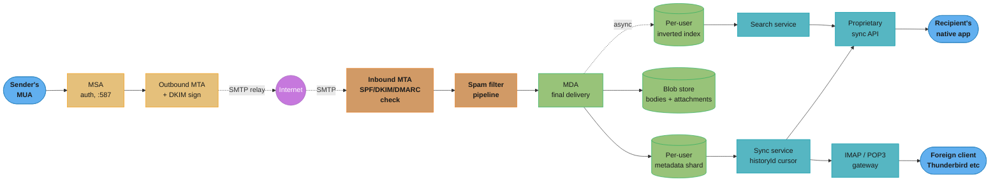
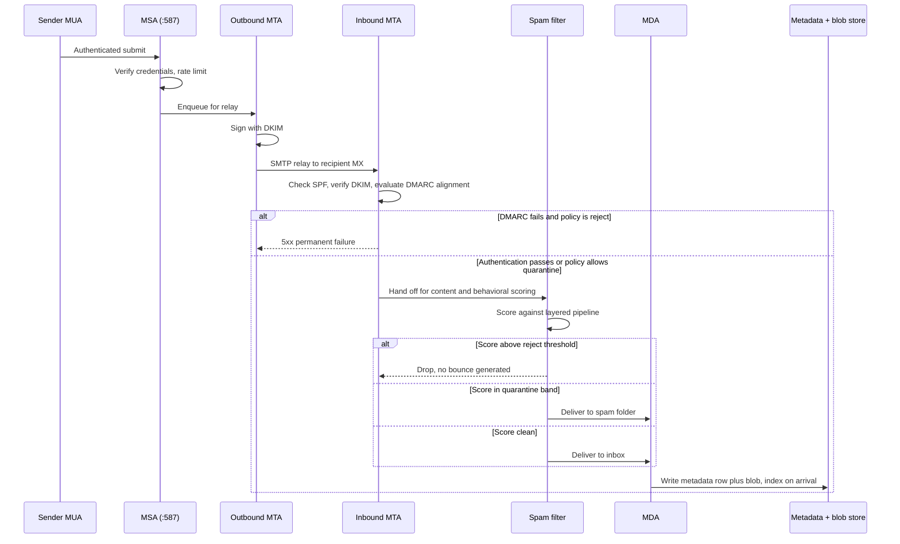
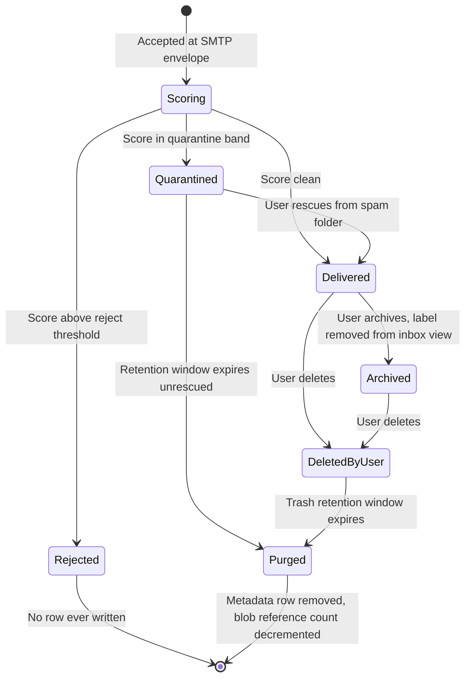

# System Design: Email Service (Gmail / Outlook Scale)
## Intuition

> **Design intuition**: Every messaging system in this section ([`./design_whatsapp.md`](./design_whatsapp.md)) gets to design its own wire protocol and its own client. Email cannot — it is the one large-scale system in this section whose interoperability contract was frozen by RFCs written between 1982 and 2008, and whose client population includes software you will never control: a decade-old Outlook install, a phone's stock mail app, a cron job piping `sendmail`. **The entire design problem is building a fast, proprietary, well-indexed mailbox system underneath a protocol floor you are not allowed to break.** SMTP ([RFC 5321](https://www.rfc-editor.org/rfc/rfc5321)) governs how mail moves between servers; IMAP ([RFC 9051](https://www.rfc-editor.org/rfc/rfc9051.html)) and POP3 ([RFC 1939](https://www.rfc-editor.org/rfc/rfc1939)) govern how a generic client reads a mailbox — and a modern provider treats both as **compatibility surfaces**, not as the system's actual architecture. Gmail's own apps do not speak IMAP to Gmail's own backend; they speak a proprietary sync API with a change-log cursor, and IMAP exists so that a foreign client (Thunderbird, Apple Mail, a script) can still get in.
>
> **Key insight**: Once you accept the mailbox as the unit of everything — one mailbox, one owner, almost never contended — email becomes **one of the cleanest single-tenant-partition designs in all of system design**. There is no cross-user transaction on the hot path (contrast [`./design_digital_wallet.md`](./design_digital_wallet.md), where a transfer touches two ledgers), no fan-out write storm (contrast [`./design_twitter.md`](./design_twitter.md)'s celebrity-follower problem), and no global ordering requirement (contrast [`./design_stock_exchange.md`](./design_stock_exchange.md)'s single-writer-per-symbol book). Shard by `user_id`, and 95% of the hard problems — mailbox durability, sync, search, threading — become problems solved *once per user*, embarrassingly parallel across a billion users. The two things that break this clean story are exactly the two things this design has to name explicitly: **shared mailboxes and delegated access** (§4.b, §9), which reintroduce multi-writer contention into a model built assuming there is none; and **deliverability** (§4.f), which is the one part of the system that is not internal at all — it depends on the reputation judgment of servers you do not operate.

---

## 1. Requirements Clarification

### Functional Requirements
- **Compose and send mail**: authenticate a client, accept a message for submission (RFC 5321's Message Submission Agent role, port 587 per [RFC 6409](https://www.rfc-editor.org/rfc/rfc6409)), and relay it toward the recipient's domain.
- **Receive and deliver mail**: accept inbound SMTP connections from the wider internet, evaluate the sender's authenticity (§4.f), classify for spam (§4.g), and place the message into the recipient's mailbox.
- **Retrieve and sync mail from any device**: the primary path is a proprietary API with an incremental change-log cursor (§4.e); IMAP and POP3 remain first-class for any client that only speaks the open protocols.
- **Organize mail**: labels/folders, and a **conversation/thread view** grouping related messages (§4.c) rather than a flat list.
- **Search the entire mailbox**, including years of history, with structured operators (`from:`, `has:attachment`, `before:`) layered over full-text search (§4.d).
- **Filters and rules**: auto-label, auto-forward, auto-archive/delete based on sender, subject, or content match, evaluated at delivery time.
- **Attachments**, up to a stated per-message size cap, stored and retrievable independently of the message body.
- **Spam and phishing detection**, applied before a message ever reaches the inbox view (§4.g).
- **Offline read and compose**, with changes reconciled against the server the next time connectivity returns (§4.e).
- **Shared mailboxes and delegated access** — a support-team inbox with multiple simultaneous readers/writers, or "grant my assistant access to my mailbox." This is named explicitly in requirements because, per the Intuition above, it is the one functional requirement that violates the single-owner-per-mailbox assumption everything else in this design leans on (§4.b, §9).

### Non-Functional Requirements
- **Durability is a hard invariant, not a target**: once a message is accepted at the SMTP envelope's final `.` (RFC 5321 §4.1.1.4), losing it is a correctness failure on par with double-charging a payment ([`./design_payment_system.md`](./design_payment_system.md)) — there is no "eventually consistent" framing that makes a silently vanished email acceptable.
- **Availability**: a mailbox must be reachable from any client, in any region, with no dependency on a single node — but see §3's asymmetry note: this does not mean the *mailbox's data* must be multi-region-writable, only that *some* replica must always be reachable.
- **Delivery latency**: seconds, not minutes, for the common inbound-to-inbox path; anything routinely taking longer is treated as a queue-backup incident (§8), not normal operation.
- **Search latency**: sub-second p99, even against a mailbox holding a decade of history — the search architecture (§4.d) is chosen specifically to keep this true without the index growing unboundedly expensive per query.
- **Storage economics at planetary scale**: a free tier (Google's is currently **15 GB shared across Gmail, Drive, and Photos** — source: [Google Account storage help, checked 2026-08-27](https://support.google.com/mail/answer/9312312)) offered to on the order of a billion mailboxes must not be a subsidized loss leader; §4.b's metadata/blob split and §10's dedup numbers are what make the economics work.
- **Deliverability**: outbound mail must reliably land in the recipient's inbox, not their spam folder or a silent drop — this is the one non-functional requirement whose grader is an external party (§4.f), not this system's own SLOs.
- **Multi-tenant isolation**: one mailbox's load — a user with 40 years of retained mail running a huge search, or a shared mailbox under heavy concurrent write load (§4.b) — must never degrade another user's mailbox, which is exactly what the per-user shard model (§3) is built to guarantee.

### Out of Scope
- **Implementing the SMTP/IMAP wire-protocol parsers from scratch, line by line** — this design treats the protocol layer as a well-understood, already-solved surface (§7's Postfix/Dovecot-class software exists precisely so nobody re-derives RFC 5321 state machines per project) and focuses on what sits behind it.
- **Calendar, contacts, video-call integration** — Gmail and Outlook ship these as a bundled suite, but they are separate systems with separate data models, not a mail-service concern.
- **Multi-channel push/SMS/email notification fan-out for OTHER products** — that is [`./design_notification_system.md`](./design_notification_system.md)'s problem, which explicitly treats an email provider (Amazon SES, in that design's own words) as a black-box channel it integrates with. This design is the system *behind* that black box, not the dispatcher in front of it.
- **Real-time collaborative co-editing of a draft** — mail composition is single-author; the OT/CRDT convergence problem belongs to [`./design_google_docs.md`](./design_google_docs.md), not here.

---

## 2. Scale Estimation

### Anchoring on a Real, Published Number
Google's own last officially disclosed Gmail user count is **1.5 billion active users**, announced by the official Gmail account in **April 2019** (source: contemporaneous coverage, e.g. [PhoneArena, "Gmail sends tweet to announce that it now has 1.5 billion active users"](https://www.phonearena.com/news/Gmail-now-has-1.5-billion-active-users_id110445); Google has not published a newer figure since). The "1.8 billion" figure widely repeated in third-party statistics roundups traces back to unattributed trackers, not a Google disclosure — worth being precise about in an interview, since citing an unverifiable number is exactly the kind of thing that erodes credibility on a scale-estimation answer. **This design uses 1.5 billion mailboxes as its scale anchor**, treating it as a floor rather than a current figure.

### Storage: Quota Is Not Usage
15 GB of *quota* per account (§1) does not mean 15 GB of *actual* usage — the overwhelming majority of accounts use a small fraction of quota, and only a minority approach or pay to exceed it. For capacity planning, this design assumes a **median logical usage of ~3 GB/mailbox** and a **long tail** of paid/heavy accounts averaging closer to 20-50 GB, giving a blended **~6 GB/mailbox average** — an assumption stated explicitly as an assumption, not a disclosed figure, in the same spirit as [`./design_flash_sale_ticketing.md`](./design_flash_sale_ticketing.md) §2 deriving its own working numbers from a real reference point rather than inventing them wholesale.

| Input | Value | Basis |
|---|---|---|
| Mailboxes | 1.5B (§2 anchor) | Google's last published figure, floor not ceiling |
| Avg logical usage/mailbox | ~6 GB | Assumption: median ~3GB, blended with a heavier paid tail |
| **Raw logical storage** | **~9 exabytes** | 1.5B x 6GB |
| Attachment dedup savings (§4.b, §10) | ~30-40% reduction on attachment bytes | Same content-addressed principle as [`./design_google_drive.md`](./design_google_drive.md) §4.1, applied cross-account |
| Durability overhead (erasure coding, §7) | ~1.5x raw bytes stored | Same order as [`./design_object_storage_s3.md`](./design_object_storage_s3.md)'s Reed-Solomon 6+3 scheme |

### Message Volume — Stated as an Assumption, Not a Disclosed Figure
No vendor publishes a global "messages/day" figure precise enough to cite as fact, so this design states its working assumption plainly: **~30 messages received per active mailbox per day** (personal + business mail, before spam filtering removes a large fraction of inbound *attempts* — §4.g). At 1.5B mailboxes:

- **Total inbound volume**: 1.5B x 30 = **45 billion messages/day** = ~520,000 messages/sec average.
- **Diurnal peak multiplier**: mail traffic follows working-hours-across-timezones curves, not a flat rate — a **~3x peak-over-average** multiplier (business-hours concentration, similar in shape to the diurnal curves in [`./design_twitter.md`](./design_twitter.md) §2) gives a **peak inbound rate of ~1.5M messages/sec** globally.
- **Outbound submission volume** is smaller than inbound *arrivals* at the edge, because a large share of inbound SMTP connections are spam/abuse attempts rejected or filtered before ever reaching a real mailbox (§4.g) — outbound legitimate submission is closer to **one-third to one-half** of the accepted-inbound figure, since one sent message often reaches multiple recipients.

### Read:Write, and Why It Looks Different From a Feed System
Unlike [`./design_twitter.md`](./design_twitter.md)'s fan-out-dominated read:write ratio, email's "write" (a delivered message) and "read" (a sync poll, a search, opening a message) are cleanly separated by the metadata/blob split (§4.b) — and the read side is dominated not by humans reading messages, but by **sync clients polling for changes**:

| Access pattern | Rough volume | Where it lands |
|---|---|---|
| New message delivery (write) | ~1.5M/sec peak (above) | MDA -> metadata store + blob store (§4.b) + index write (§4.d) |
| Sync cursor poll (`history.list`-style, §4.e) | Every connected client polls or holds a push channel; ~3-5 devices/user x 1.5B users | Cheap, metadata-store-only reads against a per-user change log |
| Search query | Assume ~15% of mailboxes search 2x/day | Per-user inverted index (§4.d), never a shared cluster |
| Message open (body fetch) | A fraction of delivered messages are ever opened | Blob store GET, cacheable at the edge for recently-synced content |

### Bandwidth
At an average message-plus-metadata size of ~75 KB (skewed heavily by the minority carrying attachments) and 1.5M messages/sec peak, delivery alone is **~112 GB/sec** of write bandwidth into the blob+metadata tier at peak — a number that makes the case for the metadata/blob split (§4.b) on its own: no single store should be asked to absorb that rate for both a 300-byte header row and a 5 MB attachment with the same write path.

### Message Size Distribution — Why the Split Pays Off Disproportionately
The 75 KB blended average above hides a distribution shape that matters for §4.b's design: most messages are small, and a minority of attachment-bearing messages carry almost all the bytes.

| Message class | Assumed share of message count | Typical size | Share of total bytes |
|---|---|---|---|
| Plain text/HTML, no attachment | ~70% | 5-20 KB | ~3% |
| Small attachment (a signature image, a short PDF) | ~20% | 200 KB-2 MB | ~25% |
| Large attachment (a presentation, a media file) | ~9% | 2-25 MB | ~60% |
| Newsletter/marketing with embedded images | ~1% | 100-500 KB, but sent to very large lists | ~12% (via fan-out volume, not per-message size) |

Reading this table against §4.b's split: the ~70% of messages carrying almost no bytes are exactly the case where a metadata-only sync poll never touches the blob store at all — a client can render an entire inbox list, apply labels, and thread conversations (§4.c) from metadata rows alone, only reaching into blob storage for the minority of messages a user actually opens with an attachment worth downloading. A design that stored bodies inline in the metadata row would pay blob-tier I/O costs on every one of those 70%-share cheap reads for no benefit.

### Storage Growth Over a Mailbox's Lifetime
Because durability (§1) means a message is retained indefinitely by default, a mailbox's logical footprint is a monotonically increasing function of account age, not a steady-state number — which is a different growth shape from most systems in this section, where an active user's data volume tends to plateau ([`./design_twitter.md`](./design_twitter.md)'s timeline, for instance, is naturally bounded by what a user scrolls back to, not by everything they ever posted). At the §2 blended assumption of ~30 messages/day and ~75 KB average, one mailbox accumulates roughly **~2.25 MB/day**, or **~800 MB/year**, of new logical data before any dedup savings (§4.b) are applied — meaning a mailbox active for a decade carries an order of magnitude more data than one active for a year, and the ~6 GB blended average (§2) already has to account for a population mixed across every account-age from brand-new to decades-old. This is the concrete reason §10's capacity planning treats storage growth as an ongoing, compounding line item rather than a number that can be provisioned once and left alone — unlike [`./design_flash_sale_ticketing.md`](./design_flash_sale_ticketing.md)'s infrastructure, which is sized for a known event and torn down, a mailbox's storage tier has to be sized for a curve that keeps climbing for as long as the account exists.

---

## 3. High-Level Architecture



*SMTP (RFC 5321) governs everything left of the mailbox; IMAP/POP3 and the proprietary API are two different doors into the same per-user store on the right. Deliverability checks (§4.f) and spam filtering (§4.g) sit on the inbound path before a single byte reaches durable storage — rejecting or quarantining early is cheaper than storing, indexing, and later deleting a message nobody should have received.*

### The Metadata/Blob Split, Stated Up Front
The single architectural decision every other component in §4 assumes: **headers, threading state, labels, and the inverted index live in a distributed structured store; message bodies and attachments live in blob storage.** A metadata row is a few hundred bytes and read on every sync poll, every list view, every search hit; a body-with-attachment can be megabytes and is read only when a user actually opens that message. Conflating the two — storing a full MIME blob inline in the same row a sync poll reads — means every cheap metadata read pays for expensive-blob I/O it never needed, the same anti-pattern [`./design_google_drive.md`](./design_google_drive.md) §4.2 avoids by keeping its metadata tree separate from chunk content, and the same shape [`./design_object_storage_s3.md`](./design_object_storage_s3.md) assumes when it decouples its metadata index from the blob layer entirely.

### Why This Is (Almost) Single-Tenant Sharding
Per the Intuition above, the mailbox is the partition key for everything: metadata rows, the inverted index, the sync change log. A mailbox with a badly-behaving search query or a huge inbox does not contend with any other mailbox's shard — there is no equivalent of [`./design_twitter.md`](./design_twitter.md)'s celebrity-account hot shard, because no operation naturally spans mailboxes except delivery itself (writing one copy of an incoming message into each of its recipients' shards, which is a small, bounded fan-out — a message with 500 `Bcc:` recipients is unusual, not the modal case a Twitter celebrity's follower count represents).

### Where the Clean Story Breaks
Two things reintroduce cross-shard or multi-writer concerns, both named in §1:
- **Shared mailboxes / delegated access** (§4.b, §9) put more than one writer against the same per-user shard, reintroducing exactly the contention the single-tenant model was built to avoid — handled as a scoped exception, not by redesigning the whole system around multi-writer mailboxes.
- **Cross-account attachment deduplication** (§4.b, §10) is the one place metadata legitimately spans users: two different people's mailboxes can reference the same underlying blob (a mailing-list attachment, a forwarded file), which means the blob's reference count — not any single mailbox — decides when it is safe to garbage-collect, identical in shape to [`./design_google_drive.md`](./design_google_drive.md) §4.7's dual-counter quota accounting.

### Mailbox Region Pinning, and Why It's Not a Multi-Region-Write Problem
A global mail provider serves clients from every region, but per §3's single-tenant framing, a given mailbox's data does not need to live in more than one region to be consistent — unlike [`./design_flash_sale_ticketing.md`](./design_flash_sale_ticketing.md) §3's *inventory*, which genuinely cannot be split by geography without breaking atomicity, a mailbox has exactly one owner and no cross-mailbox transaction ever needs its data, so **pinning each mailbox's metadata and blob shard to one home region** (chosen at account creation, often by data-residency requirement or by the region closest to signup) is both simpler and sufficient. A user traveling or connecting from a distant region pays a longer round-trip on sync/search calls to their home region — a bounded latency cost, not a correctness one — while inbound SMTP delivery (§4.a) is itself naturally region-agnostic: an inbound MTA in any region can accept a message and forward it internally to the recipient's home-region shard, the same way [`./design_flash_sale_ticketing.md`](./design_flash_sale_ticketing.md) §3 deploys its stateless edge/waiting-room tier multi-region while pinning stateful inventory to one region. **Durability still requires replication within the home region** (§4.a's "never lose an accepted message" invariant) — region pinning is about where the single writable copy of a mailbox's *logical* data lives, not about how many physical replicas back it.

Data-residency regulation (a mailbox that must legally stay within a country's borders) is a natural fit for this model rather than a complication of it: because a mailbox was never going to be split across regions anyway, "keep this mailbox's shard entirely within region X" is a placement-policy decision at shard-assignment time, not a new consistency mechanism.

---

## 4. Component Deep Dives

### (a) Mail Submission and Delivery — MSA, MTA, MDA

[RFC 5598](https://www.rfc-editor.org/rfc/rfc5598.html) ("Internet Mail Architecture") names the roles every mail system implements under different product names: the **MSA** (Message Submission Agent) accepts an authenticated message from a sender's client on port 587 ([RFC 6409](https://www.rfc-editor.org/rfc/rfc6409)); the **MTA** (Message Transfer Agent) relays it one hop closer to the recipient, a chain that can be one hop or several; and the **MDA** (Message Delivery Agent) performs final delivery into the recipient's mailbox. A subtlety worth being precise about in an interview: SMTP's **envelope** (`MAIL FROM` / `RCPT TO`, negotiated during the SMTP session per RFC 5321 §3.3) and the message's **header** (`From:` / `To:`, per [RFC 5322](https://www.rfc-editor.org/rfc/rfc5322) §3.6.2) are **independent** — the envelope is what routing and SPF (§4.f) actually check, while the header is what a human reads, and the two are allowed to disagree (this is exactly how a mailing list works: envelope-from is the list's bounce address, header-from is the original author).

```java
public final class SubmissionHandler {
    /** MSA role: authenticate, then hand off to the outbound MTA queue --
     *  never relays anything from an unauthenticated sender (the historical
     *  "open relay" mistake that turned early SMTP servers into spam cannons). */
    public SubmissionResult submit(AuthenticatedSender sender, OutboundMessage msg) {
        if (!authService.verify(sender.credentials())) {
            throw new SubmissionRejectedException("535 Authentication required");
        }
        if (!rateLimiter.allow(sender.accountId())) {           // per-account send rate,
            throw new SubmissionRejectedException("450 Rate limit"); // see ../rate_limiting/rate_limiting.md
        }
        String envelopeFrom = sender.verifiedAddress();          // envelope MAIL FROM -- what SPF checks
        outboundQueue.enqueue(new QueuedMessage(envelopeFrom, msg.headerFrom(),
            msg.recipients(), msg.rawContent(), Instant.now()));
        return SubmissionResult.accepted();
    }
}
```

The outbound MTA then signs the message with DKIM (§4.f) and relays it toward each recipient domain's MX servers, retrying with exponential backoff on transient failures (a `4xx` SMTP response) and generating a bounce (a Non-Delivery Report back to the envelope sender) on a permanent failure (`5xx`) — the queue itself is a durable, retryable work queue in the same shape as [`../message_queues/message_queues.md`](../message_queues/message_queues.md), not a fire-and-forget call.

**The full path, sender to recipient's inbox**, showing where each check in §4.f/§4.g sits relative to the durable-storage boundary:



*Every rejection or quarantine decision happens before the message is durably stored — only content the pipeline has already decided to keep ever reaches the metadata/blob tier, which is why §4.g's layers are ordered cheapest-check-first (connection reputation, then authentication, then content scoring).*

### (b) The Metadata/Blob Split — Schema and the Shared-Mailbox Exception

Per §3, headers/threading/labels live in a per-user-sharded metadata store; bodies and attachments live in blob storage, referenced by content hash for cross-message and cross-account dedup — the identical content-addressing principle [`./design_google_drive.md`](./design_google_drive.md) §4.1 uses for file chunks, applied here to attachment blobs instead:

| Store | What it holds | Shard key | Read pattern |
|---|---|---|---|
| Metadata store (wide-column or equivalent) | `message_id`, headers, thread_id, labels, flags (read/starred), `historyId` (§4.e) | `user_id`, sorted by reverse-timestamp within a user's range | Every sync poll, list view, search-result hydration |
| Blob store | Message body (MIME), attachments, keyed by content hash | Content hash (dedup key), not user | Only when a message is actually opened or an attachment downloaded |
| Inverted index | Per-user token -> message_id postings (§4.d) | `user_id` | Search queries only |

**Shared mailboxes break the "shard key = one owner" assumption directly.** A support-team inbox with five agents reading and archiving concurrently means the metadata shard for that mailbox now has multiple writers racing on the same rows (who archived this ticket, who's currently viewing it) — the design's answer is to treat a shared mailbox as its own logical `user_id` with an **access-control list** of members rather than inventing a second storage model: the shard-per-mailbox invariant survives, but "mailbox" and "human account" are no longer synonyms, and last-write-wins on flag updates (read/archived) is accepted as good enough, deliberately not re-deriving [`./design_google_docs.md`](./design_google_docs.md)'s OT/CRDT machinery for what is, in practice, low-contention concurrent access rather than concurrent *editing*.

A metadata row's own lifecycle, independent of which store holds it, moves through a small number of states that §4.g's spam scorer, §9's dedup reference count, and the blob-retention policy each key off:



*Only "Delivered" and "Archived" states are ever visible in a normal sync poll (§4.e); "Quarantined" surfaces only in the spam-folder view; "Purged" is the state that finally decrements the blob's reference count (§9's dedup pitfall) — a message can sit in any pre-Purged state indefinitely without affecting another mailbox's reference to the same attachment blob.*

### (c) Threading — Broken (Subject-Only), Then Fixed (References-First)

Gmail's own API documentation is explicit that both conditions must hold for a message to join a thread: **"The `References` and `In-Reply-To` headers must be set in compliance with the [RFC 5322] standard"** *and* **"The `Subject` headers must match"** (source: [Gmail API, "Threads"](https://developers.google.com/workspace/gmail/api/guides/threads), checked 2026-08-27) — Subject match alone is explicitly *not* sufficient. It's worth seeing why the weaker rule fails before building the correct one.

***Broken:*** group purely by a normalized subject line (strip `Re:`/`Fwd:` prefixes, lowercase, trim):

```java
static String normalizeSubject(String subject) {
    String s = subject.trim();
    boolean stripped;
    do {
        String before = s;
        s = s.replaceFirst("(?i)^(re|fwd|fw)\\s*:\\s*", "").trim();
        stripped = !s.equals(before);
    } while (stripped);
    return s.toLowerCase(Locale.ROOT);
}

// BROKEN -- collapses every message with the same normalized subject into
// one bucket, regardless of whether they have any actual reply relationship.
static Map<String, List<Message>> threadBySubjectOnly(List<Message> messages) {
    Map<String, List<Message>> buckets = new LinkedHashMap<>();
    for (Message m : messages) {
        buckets.computeIfAbsent(normalizeSubject(m.subject()), k -> new ArrayList<>()).add(m);
    }
    return buckets;
}
```

Two completely unrelated conversations that both happen to be titled "lunch?" — Alice/Bob planning Tuesday's lunch, Carol/Dave planning a different one weeks later — collapse into a single five-message thread. Run against a small test set (Alice-Bob's 3-message exchange plus Carol-Dave's unrelated 2-message exchange, both normalizing to `"lunch?"`), the broken version produces:

```
=== BROKEN: subject-only threading ===
Bucket "lunch?" -> 5 messages:
  <a1@co> from alice@co
  <a2@co> from bob@co
  <a3@co> from alice@co
  <b1@co> from carol@co
  <b2@co> from dave@co
```

***Fixed:*** thread by the `References`/`In-Reply-To` graph — [RFC 5322 §3.6.4](https://www.rfc-editor.org/rfc/rfc5322#section-3.6.4) defines `References` as accumulating the `Message-ID` of every ancestor in the reply chain, so a union-find over that graph recovers the true reply relationships regardless of what the subject line says:

```java
// FIXED -- union-find over the References/In-Reply-To graph. A message with
// no References header is its own singleton root; it only ever merges with
// another message by being explicitly referenced, never by subject text alone.
static Map<String, List<Message>> threadByReferences(List<Message> messages) {
    Map<String, String> parent = new HashMap<>();
    for (Message m : messages) parent.put(m.messageId(), m.messageId());
    for (Message m : messages)
        for (String ref : m.references())
            if (parent.containsKey(ref)) union(parent, m.messageId(), ref);

    Map<String, List<Message>> buckets = new LinkedHashMap<>();
    for (Message m : messages)
        buckets.computeIfAbsent(find(parent, m.messageId()), k -> new ArrayList<>()).add(m);
    return buckets;
}
```

Run against the identical test set, the fixed version correctly separates the two conversations:

```
=== FIXED: References/In-Reply-To threading (RFC 5322 s3.6.4) ===
Thread root <a1@co> -> 3 messages:
  <a1@co> from alice@co
  <a2@co> from bob@co
  <a3@co> from alice@co
Thread root <b1@co> -> 2 messages:
  <b1@co> from carol@co
  <b2@co> from dave@co
```

(Full source and actual `javac`/`java` output above, run as `ThreadingDemo.java` in this deliverable's verification pass — not simulated.) **The subject-based rule is not deleted, it's demoted to a fallback**: a message with no `References`/`In-Reply-To` at all (an MUA that strips them, or truly the first message referencing nothing) still needs *some* grouping heuristic, and normalized-subject-plus-a-time-window is the accepted fallback for that narrow case — Gmail's own dual-condition rule (References valid **and** Subject matches) is effectively "trust the graph, use Subject as a sanity check that also happens to catch the no-References edge case."

### (d) Search — Per-User Inverted Index, Not a Global Cluster

The instinct from [`./design_search_autocomplete.md`](./design_search_autocomplete.md) — "stand up an Elasticsearch cluster" — is the wrong shape here, and it's worth being explicit about why. Autocomplete searches a **shared corpus** (every user's queries feed the same trie); mailbox search is the opposite — **every query is already scoped to exactly one user's data**, and no query ever needs to rank a match in user A's mailbox against one in user B's. A single sharded-by-content-hash Elasticsearch cluster optimizes for a workload this system never has, while paying real costs a per-user design avoids: a global index co-locates unrelated users' postings on the same shard (a security-review headache — one compromised query path could, in principle, touch every user's data), and a global cluster's rebalancing/resharding operations (per [`../database_sharding/database_sharding.md`](../database_sharding/database_sharding.md)) are unnecessary complexity for data that was already perfectly partitioned by `user_id` before search ever entered the picture.

The design instead builds **one small inverted index per user**, co-located with that user's metadata shard (§4.b), updated **incrementally at delivery time** rather than by a separate batch indexing job:

```java
public final class IncrementalIndexer {
    /** Called synchronously in the MDA's delivery path (see §3's diagram) --
     *  by the time a client's next sync poll (§4.e) sees the new message,
     *  it is already searchable. No separate batch/cron indexing pass. */
    public void indexOnArrival(String userId, Message msg) {
        Set<String> tokens = tokenize(msg.subject() + " " + msg.bodyPreview());
        for (String token : tokens) {
            perUserIndex(userId).appendPosting(token, msg.messageId());
        }
        // Structured fields (from:, has:attachment, before:) are indexed as
        // separate exact-match postings, not tokenized text -- a `from:`
        // query is a metadata-row filter joined against the text postings,
        // not a full-text search over the sender address.
        perUserIndex(userId).indexStructuredField("from", msg.senderAddress(), msg.messageId());
        if (msg.hasAttachments()) {
            perUserIndex(userId).indexStructuredField("has_attachment", "true", msg.messageId());
        }
    }
}
```

Because each index is scoped to one mailbox, its size is bounded by that one user's mail volume — a heavy user with a decade of history has a proportionally larger index, but it never grows because of *other* users' activity, which is exactly the property that keeps §1's sub-second p99 search latency achievable without the index-growth problem a shared corpus would have.

**Ranking is recency-weighted, not relevance-only** — a distinction worth naming explicitly, because it's the opposite default from general web search. A query like `project update` should surface the most recent matching message near the top even if an older message matches the tokens slightly more densely, because a mailbox search is almost always "find the thing I just got," not "find the definitive document on this topic." A structured query combines the text postings with the exact-match structured fields and a recency boost in a single pass:

```java
public final class MailSearchService {
    /** Parses "from:alice has:attachment project update" into a structured
     *  filter (from, has_attachment) plus free-text tokens, then intersects
     *  the structured-field postings with the text postings before ranking. */
    public List<SearchHit> search(String userId, String rawQuery) {
        ParsedQuery parsed = queryParser.parse(rawQuery); // operators vs. free text
        Set<String> candidateIds = null;

        for (var field : parsed.structuredFilters().entrySet()) {
            Set<String> matches = perUserIndex(userId)
                .structuredPostings(field.getKey(), field.getValue());
            candidateIds = (candidateIds == null) ? matches : intersect(candidateIds, matches);
        }
        for (String token : parsed.freeTextTokens()) {
            Set<String> matches = perUserIndex(userId).textPostings(token);
            candidateIds = (candidateIds == null) ? matches : intersect(candidateIds, matches);
        }

        return candidateIds.stream()
            .map(id -> new SearchHit(id, rankScore(id, parsed)))
            .sorted(Comparator.comparingDouble(SearchHit::score).reversed())
            .limit(50)
            .toList();
    }

    /** Recency dominates relevance for mailbox search -- a message from
     *  today with a weaker text match still typically outranks a
     *  denser-matching message from three years ago. */
    private double rankScore(String messageId, ParsedQuery parsed) {
        double textRelevance = textRelevanceScore(messageId, parsed.freeTextTokens());
        double recencyBoost = recencyWeight(metadataStore.deliveredAt(messageId));
        return textRelevance * 0.4 + recencyBoost * 0.6;
    }
}
```

Intersecting structured-field postings before text postings (rather than the reverse) is a small but real optimization: `from:` and `has:attachment` filters are typically far more selective than a common free-text token, so narrowing the candidate set with the cheap structured filter first keeps the more expensive text-relevance scoring pass working over a much smaller set.

### (e) Sync Protocol — The `historyId`/`modseq` Cursor Model

A client (native app, IMAP-bridging gateway, or a foreign IMAP client behind it) needs to ask "what changed since I last looked" without re-downloading the whole mailbox on every check. Gmail's API answers this with `history.list(startHistoryId)` (source: [Gmail API sync guide](https://developers.google.com/gmail/api/guides/sync), checked 2026-08-27); Fastmail's JMAP implementation answers the identical question with a Cyrus **`modseq`** (modification sequence) delta query, tracking `ADDED_MODSEQ`/`REMOVED_MODSEQ` per message (source: [Fastmail, "Building offline: mail storage"](https://www.fastmail.com/blog/offline-mail-storage/), checked 2026-08-27) — different vendor names for the same append-only-change-log-with-a-cursor pattern, the identical shape [`../message_queues/message_queues.md`](../message_queues/message_queues.md) uses for a consumer offset and [`../event_sourcing_cqrs/event_sourcing_cqrs.md`](../event_sourcing_cqrs/event_sourcing_cqrs.md) uses for projection replay.

```java
final class MailServer {
    private final Deque<Change> changeLog = new ArrayDeque<>();
    private long nextHistoryId = 1;
    private final int retentionWindow; // server retains only the last N changes

    long recordChange(String messageId, String type) {
        long id = nextHistoryId++;
        changeLog.addLast(new Change(id, messageId, type));
        while (changeLog.size() > retentionWindow) changeLog.removeFirst();
        return id;
    }

    /** Mirrors Gmail's history.list contract: everything strictly newer than
     *  startHistoryId, or empty if that cursor has aged out of the retained log. */
    Optional<List<Change>> historySince(long startHistoryId) {
        if (!changeLog.isEmpty() && startHistoryId < changeLog.peekFirst().historyId() - 1) {
            return Optional.empty(); // cursor too old -- caller must fall back to a full resync
        }
        List<Change> result = new ArrayList<>();
        for (Change c : changeLog) if (c.historyId() > startHistoryId) result.add(c);
        return Optional.of(result);
    }
}
```

A client that syncs frequently stays on the cheap incremental path forever; a client that goes offline long enough for its cursor to fall outside the server's retained window gets an empty `Optional` back and must fall back to a full resync — exactly the behavior the Gmail API documents (a **404** response for an expired `historyId`, source as above). Run with a deliberately small 5-entry retention window to force both code paths:

```
=== Client A: online, syncs every change as it happens ===
  incremental sync from cursor 0: 1 change(s)
    historyId=1 MESSAGE_ADDED <msg1@co>
  incremental sync from cursor 1: 1 change(s)
    historyId=2 MESSAGE_ADDED <msg2@co>
  incremental sync from cursor 2: 1 change(s)
    historyId=3 MESSAGE_ADDED <msg3@co>

=== Client B: was offline, comes back after 8 more changes (past the 5-entry retention window) ===
  incremental sync from cursor 0: 3 change(s)
    historyId=1 MESSAGE_ADDED <msg1@co>
    historyId=2 MESSAGE_ADDED <msg2@co>
    historyId=3 MESSAGE_ADDED <msg3@co>
server: latest historyId=11 after offline period
  cursor 3 expired -> FULL RESYNC
  full resync complete, cursor now 11

=== Summary ===
Client A: 3 incremental, 0 full resyncs, final cursor=3
Client B: 1 incremental, 1 full resyncs, final cursor=11
```

(Full source and actual `javac`/`java` output above, run as `SyncCursorDemo.java` — not simulated.) **The retention window is the single tuning knob that trades storage cost against full-resync frequency** — too short, and any client offline for more than a few hours pays for a full resync every time (§9 War Story 2); too long, and the server retains change-log entries most clients never need.

### (f) Deliverability — SPF, DKIM, DMARC, and 2024+ Bulk-Sender Requirements

Three RFCs, layered, answer three different questions a receiving MTA (§4.a) asks about an inbound message before deciding whether to trust it:

| Mechanism | RFC | Question it answers | How |
|---|---|---|---|
| **SPF** | [RFC 7208](https://www.rfc-editor.org/rfc/rfc7208) | "Is this connecting server authorized to send for the envelope-from domain?" | A DNS TXT record at the domain lists permitted sending IPs/hosts; the receiver checks the connecting IP against it. |
| **DKIM** | [RFC 6376](https://www.rfc-editor.org/rfc/rfc6376) | "Has this message's content been altered since the sending domain signed it?" | The sender signs a hash of selected headers + body with a private key; the public key is published in DNS; the receiver verifies the signature. |
| **DMARC** | [RFC 9989](https://www.rfc-editor.org/rfc/rfc9989.html) (obsoletes RFC 7489, as of May 2026) | "What should I do if SPF and/or DKIM fail, and who do I tell?" | A DNS policy record (`p=none`/`quarantine`/`reject`) plus **alignment** — the visible `From:` header's domain must match the domain that passed SPF or DKIM, not just any domain. |

DMARC's current RFC set is worth being precise about, since it changed recently: **RFC 7489 was obsoleted in May 2026 by three companion documents** — RFC 9989 (core mechanism), [RFC 9990](https://www.rfc-editor.org/rfc/rfc9990.html) (aggregate reporting), and [RFC 9991](https://www.rfc-editor.org/rfc/rfc9991.html) (failure reporting). The `p=none`/`quarantine`/`reject` tags and the `_dmarc.<domain>` TXT record location are unchanged, so existing deployments keep working — but RFC 9989 **removes the `pct` sampling tag** (partial-enforcement rollout is no longer a first-class mechanism) and adds a **DNS Tree Walk** for organizational-domain discovery (a `psd` tag replacing reliance on the Public Suffix List, capped at 8 DNS queries to bound abuse) — source: [RFC 9989](https://www.rfc-editor.org/rfc/rfc9989.html), verified 2026-08-27.

**Alignment is the piece interviewers probe hardest**, because SPF and DKIM alone are each individually spoofable in a way that matters: SPF checks the invisible envelope-from (§4.a), so a phisher can pass SPF while forging a completely different visible `From:` header; DKIM checks a signature, but says nothing about *whose* domain the visible header claims. DMARC closes that gap by requiring the visible `From:` domain to match the domain that actually passed SPF or DKIM — without alignment, an attacker can legitimately pass both underlying checks using their own domain while still showing the victim's brand in the `From:` line.

**The 2024+ bulk-sender requirements** are Google's and Yahoo's own policy layered on top of the RFCs — not a protocol change, but an enforcement threshold that makes SPF/DKIM/DMARC effectively mandatory rather than optional for anyone sending real volume:

| Requirement | Google (5,000+ msgs/day to Gmail) | Yahoo (bulk senders) |
|---|---|---|
| Effective date | February 1, 2024 | February 2024, gradual rollout through H1 2024 |
| SPF + DKIM | Both required | Both required |
| DMARC | Required, `p=none` acceptable but record must exist and pass | Required, `p=none` minimum, must pass, relaxed alignment permitted |
| One-click unsubscribe | Required on marketing mail (`List-Unsubscribe` + `List-Unsubscribe-Post: List-Unsubscribe=One-Click`) | Required, one-click via [RFC 8058](https://www.rfc-editor.org/rfc/rfc8058) POST method recommended; must process within 2 days |
| Spam complaint rate cap | Below 0.30% in Postmaster Tools (0.10% recommended for headroom) | Below 0.3% |
| Other | Valid forward/reverse DNS (PTR), TLS in transit, RFC 5322-compliant formatting, no Gmail `From:` impersonation | Valid forward/reverse DNS, compliance with RFC 5321/5322 |

Sources: [Google's email sender guidelines](https://support.google.com/a/answer/81126) and [Yahoo Sender Hub best practices](https://senders.yahooinc.com/best-practices/), both checked 2026-08-27. **The two policies converge on nearly identical thresholds** (SPF+DKIM+DMARC mandatory, ~0.3% complaint cap, one-click unsubscribe) — evidence that receiving providers arrived at the same enforcement bar independently, the same convergence pattern [`./design_flash_sale_ticketing.md`](./design_flash_sale_ticketing.md) §6 observes across unrelated flash-sale operators.

**One-click unsubscribe is a header contract, not a UI feature.** Google's and Yahoo's requirements both point at the same mechanism ([RFC 8058](https://www.rfc-editor.org/rfc/rfc8058)): a bulk sender includes `List-Unsubscribe` with an HTTPS URL and `List-Unsubscribe-Post: List-Unsubscribe=One-Click` in the message headers, and a compliant receiving client issues a single `POST` to that URL with no further user interaction (no landing page, no login, no "are you sure") — the mechanism enforcement checks against, not merely a visible link in the body:

```java
public final class UnsubscribeHeaderBuilder {
    /** Called when composing a bulk/marketing send -- required per §4.f's
     *  bulk-sender rules for anything Google/Yahoo classify as such. */
    public Map<String, String> buildHeaders(String recipientId, String campaignId) {
        String unsubscribeUrl = unsubscribeService.tokenizedUrl(recipientId, campaignId);
        return Map.of(
            "List-Unsubscribe", "<" + unsubscribeUrl + ">",
            "List-Unsubscribe-Post", "List-Unsubscribe=One-Click"
        );
    }

    /** The receiving side of the contract: a bare POST, no auth challenge,
     *  no confirmation page -- Yahoo's requirement is processing within 2 days,
     *  but nothing about this handler should ever take that long in practice. */
    public void handleUnsubscribePost(String token) {
        String recipientId = unsubscribeService.resolveToken(token);
        suppressionList.add(recipientId, Instant.now());
    }
}
```

A sender that implements only the *visible* unsubscribe link in the message body — without the header pair — technically offers unsubscribe but fails the specific mechanism Google's and Yahoo's compliance checks look for, which is why §8's pre-launch checklist lists it as a header requirement rather than a general UX suggestion.

### (g) Spam Filtering — A Layered Pipeline, Not One Classifier

Following the same honest framing [`./design_flash_sale_ticketing.md`](./design_flash_sale_ticketing.md) §4.e uses for bot defence: no single spam-filtering layer is sufficient alone, and each layer closes a different hole.

| Layer | Stops | Does NOT stop |
|---|---|---|
| Connection-level (sending IP reputation, RBLs) | High-volume botnets with known-bad IPs | A freshly-compromised, previously-clean IP/domain |
| Authentication (§4.f: SPF/DKIM/DMARC pass/fail as a scoring input) | Domain spoofing, "impersonating your bank" phishing | Spam sent from a legitimately-authenticated but low-quality sending domain |
| Content classification (Bayesian/ML models over subject, body, structure) | Known spam patterns, phishing-link structures | A novel campaign the model has not seen, or content-free spam (an image with no text) |
| Behavioral/engagement signal (open rate, reply rate, delete-without-open, report-as-spam rate) | Legitimately-authenticated senders whose *recipients* don't want the mail — the exact signal behind §4.f's 0.3% complaint-rate threshold | A brand-new sender with no engagement history yet to score |
| User feedback loop (report-spam / report-not-spam, retrains the classifier) | Drift — spam patterns the model missed, corrected by aggregate user signal | A sophisticated campaign engineered specifically to look like wanted mail to a first look |

The pipeline runs **before** final delivery (§3's diagram) — a message failing early (bad connection reputation, failed authentication with a strict `p=reject` policy) is rejected at the SMTP level with a `5xx`, cheaper than accepting it and filtering after the fact, the same "reject early" principle [`./design_flash_sale_ticketing.md`](./design_flash_sale_ticketing.md) §3 applies to admission control.

Each layer contributes a score rather than an independent yes/no veto, because a message that is individually borderline on two layers (a middling IP reputation *and* a first-time sender with no engagement history) is a stronger spam signal combined than either alone — the aggregation, not any single layer's threshold, is what the two enforcement bands (reject / quarantine) actually key off:

```java
public final class SpamScorer {
    // Weights are illustrative -- real weights are tuned continuously against
    // labeled feedback (the user-report loop in the table above), not fixed.
    private static final double CONNECTION_WEIGHT = 0.20;
    private static final double AUTH_WEIGHT = 0.30;      // failed/missing SPF+DKIM+DMARC weighs heavily
    private static final double CONTENT_WEIGHT = 0.30;
    private static final double BEHAVIORAL_WEIGHT = 0.20;

    public SpamVerdict score(InboundMessage msg) {
        double connectionScore = connectionReputation.score(msg.sendingIp());       // §4.g row 1
        double authScore = authenticationResult.score(msg.spfResult(),              // §4.f
            msg.dkimResult(), msg.dmarcAlignment());
        double contentScore = contentClassifier.score(msg.subject(), msg.body());   // §4.g row 3
        double behavioralScore = senderReputation.score(msg.envelopeFrom());        // §4.g row 4

        double combined = connectionScore * CONNECTION_WEIGHT
            + authScore * AUTH_WEIGHT
            + contentScore * CONTENT_WEIGHT
            + behavioralScore * BEHAVIORAL_WEIGHT;

        if (combined >= REJECT_THRESHOLD) return SpamVerdict.reject();
        if (combined >= QUARANTINE_THRESHOLD) return SpamVerdict.quarantine();
        return SpamVerdict.deliverToInbox();
    }
}
```

A DMARC `p=reject` failure is deliberately **not** folded into the weighted score at all — it is checked and enforced *before* this scorer ever runs (§4.a's sequence diagram), because a domain that has explicitly published "reject anything that fails my alignment check" has made a policy decision this system has no standing to override with a favorable content or behavioral score.

---

## 5. Design Decisions & Tradeoffs

| Decision | Option A | Option B | Choice & Why |
|---|---|---|---|
| Primary sync surface | Proprietary API with a change-log cursor | Raw IMAP as the native client protocol | **Proprietary API (§4.e), IMAP as a compatibility surface.** IMAP's protocol design predates incremental-sync-friendly semantics (`CONDSTORE`/`QRESYNC` extensions bolt this on later); a purpose-built cursor API is simpler to reason about and cheaper to serve, while IMAP stays available for any client that needs it. |
| Search architecture | One global, sharded-by-content cluster (Elasticsearch-style) | One small inverted index per user, co-located with that user's metadata shard | **Per-user index (§4.d).** Every query is already scoped to one mailbox; a global cluster optimizes for a cross-corpus workload this system never has, at the cost of unnecessary blast-radius and rebalancing complexity. |
| Threading algorithm | Normalized-subject grouping | References/In-Reply-To graph (RFC 5322 §3.6.4), subject as a secondary check | **References-first (§4.c).** Subject-only threading merges unrelated conversations that happen to share a subject line; the header graph is authoritative, and Gmail's own documented rule requires both, treating Subject as a sanity filter rather than the primary signal. |
| Attachment storage | Inline in the metadata row | Content-addressed blob, referenced by hash, deduplicated across messages and accounts | **Content-addressed blob (§4.b), reusing [`./design_google_drive.md`](./design_google_drive.md)'s dedup principle.** A metadata row stays small and cheap to read on every sync poll; the same attachment forwarded to 50 people or sent to a large mailing list is stored once. |
| Indexing timing | Batch/cron reindex on a schedule | Incremental index-on-arrival, synchronous with delivery | **Incremental (§4.d).** A message is searchable by the time the next sync poll would even see it; a batch job introduces a search-lag window that a user (who just received and can already read the message) would find confusing. |
| Shared-mailbox model | A separate storage/consistency model built for multi-writer mailboxes | Treat a shared mailbox as its own `user_id` with an ACL, keep last-write-wins on flags | **ACL over a normal shard (§4.b).** Real contention on a shared support inbox is low relative to [`./design_google_docs.md`](./design_google_docs.md)'s concurrent-editing rate; building CRDT-grade convergence for occasional flag races is solving a problem this workload doesn't actually have. |
| Spam-filtering timing | Deliver first, filter/reclassify asynchronously after | Filter synchronously, on the inbound path, before durable storage (§4.a's sequence diagram) | **Synchronous, pre-storage (§4.g).** Reject/quarantine decisions made before a message is durably stored avoid ever indexing (§4.d) or syncing (§4.e) content that will be deleted moments later — the small latency cost of inline scoring is cheaper than storing-then-unwinding. |
| Mailbox data placement | Multi-region active-active per mailbox | Single home region per mailbox, chosen at account creation (§3) | **Single home region (§3).** A mailbox has exactly one owner and no cross-mailbox transaction, so there is no correctness reason to pay multi-region write coordination cost; a distant user pays a longer round-trip, not a consistency risk. |
| DMARC policy rollout speed | Publish `p=reject` immediately on a new domain | Staged rollout: `p=none` -> `p=quarantine` -> `p=reject`, monitored via aggregate reports at each step | **Staged (§9's Further Pitfalls).** An immediate `p=reject` silently drops any legitimate mail from a sending path not yet covered by DKIM/SPF, with no visibility into what broke; the staged rollout trades a slower path to full enforcement for the ability to see failures via aggregate reports (§4.f, §8) before they become silent drops. |

---

## 6. Real-World Implementations

- **Gmail** — Google's original Bigtable paper names Gmail explicitly among Bigtable's production users at Google, describing the wide-column model (rows keyed by user, column families for different data classes) that a mailbox-shaped workload maps onto naturally (source: [Chang et al., "Bigtable: A Distributed Storage System for Structured Data," OSDI 2006](https://research.google.com/archive/bigtable-osdi06.pdf)). Google's Gmail API documentation is itself a primary source for two of this design's core mechanisms: the `historyId` sync cursor (§4.e) and the dual References-plus-Subject threading rule (§4.c) are both specified there, not inferred. Google's bulk-sender guidelines (§4.f), effective February 2024, are the clearest public evidence that a major provider treats deliverability policy as a first-class, versioned system boundary rather than an informal norm.
- **Fastmail** — publishes unusually detailed engineering accounts of both halves of this design. Its storage architecture runs **Cyrus IMAP server instances on standalone 2U servers, up to 100 per machine**, each mailbox ("store") replicated across **three slots on different machines** with sub-30-second automated failover (source: [Fastmail, "The Fastmail storage architecture"](https://www.fastmail.help/hc/en-us/articles/1500000278242-The-Fastmail-storage-architecture), checked 2026-08-27). Its offline-sync design uses JMAP ([RFC 8620](https://www.rfc-editor.org/rfc/rfc8620)/[8621](https://www.rfc-editor.org/rfc/rfc8621)) with a **Cyrus `modseq`** as the change cursor — functionally the same mechanism as Gmail's `historyId` (§4.e), independently arrived at by a different engineering team (source: [Fastmail, "Building offline: mail storage"](https://www.fastmail.com/blog/offline-mail-storage/), checked 2026-08-27).
- **Amazon SES** — as the black-box provider [`./design_notification_system.md`](./design_notification_system.md) integrates with, SES's own published architecture is directly relevant to §4.f/§8: **managed dedicated IP pools** that auto-scale per receiving ISP and continuously re-adjust routing based on recent sending performance and historical forecasts, explicitly to protect sender reputation (source: [AWS Messaging Blog, "How to use managed dedicated IPs for email sending"](https://aws.amazon.com/blogs/messaging-and-targeting/how-to-use-managed-dedicated-ips-for-email-sending/)). AWS's own case study on Fanatics Commerce reports the platform absorbing **48x peak-season volume growth** on SES while maintaining deliverability through managed dedicated IPs, multi-tenant isolation, and real-time observability (source: [AWS Messaging Blog, "How Fanatics Commerce built a scalable email platform on Amazon SES"](https://aws.amazon.com/blogs/messaging-and-targeting/how-fanatics-commerce-built-a-scalable-email-platform-on-amazon-ses/)).
- **Yahoo** — its Sender Hub best-practices page is the second half of the "2024+ bulk sender requirements" story (§4.f), published on the same rough timeline as Google's and converging on nearly identical thresholds despite being a separate engineering organization's independent policy (source: [Yahoo Sender Hub, "Best Practices"](https://senders.yahooinc.com/best-practices/), checked 2026-08-27).

### Synthesis Across §6
Gmail and Fastmail arrive at the same cursor-based incremental-sync shape (`historyId` vs. `modseq`) from opposite ends of the company-size spectrum, and Google and Yahoo converge on nearly identical bulk-sender enforcement thresholds without coordinating — the same "independently-arrived-at convergence is evidence of a real constraint, not a stylistic choice" pattern [`./design_flash_sale_ticketing.md`](./design_flash_sale_ticketing.md) §6 draws from its own set of unrelated companies.

### Comparable Systems for Cross-Reference

| System | Similarity to this design | Key difference |
|---|---|---|
| **Gmail** | Metadata/blob split over a wide-column store (§4.b, §6); the `historyId` sync cursor (§4.e) and dual References/Subject threading rule (§4.c) are the direct source of both mechanisms | Fully proprietary end to end; IMAP is offered as a bridge (Gmail's IMAP support) rather than the backend's native protocol |
| **Fastmail** | Same replicated-per-user-store shape (§3), independently arrived at; JMAP's `modseq` cursor is functionally identical to `historyId` (§4.e, §6) | Runs an open-source IMAP server (Cyrus) as its actual backend rather than treating IMAP purely as a compatibility shim; co-authored the open JMAP standard rather than keeping sync proprietary |
| **Microsoft Outlook / Exchange Online** | Same MSA/MTA/MDA submission path (§4.a); a proprietary sync protocol (Exchange ActiveSync / Graph API) plays the same role as Gmail's API | Historically stronger emphasis on calendar/contact integration in the same sync protocol, a scope this design deliberately excludes (§1) |
| **ProtonMail** | Same per-user mailbox partitioning (§3) and layered spam/authentication pipeline (§4.f, §4.g) | Client-side end-to-end encryption of message bodies changes what the server-side spam/search pipeline (§4.d, §4.g) can see — content classification and full-text search must operate differently (or not at all server-side) when the server cannot read the body it is storing |

---

## 7. Technologies & Tools

| Layer | Technology Options | Notes |
|---|---|---|
| MTA (send/relay) | Postfix, Exim, Sendmail | Handles SMTP's envelope-level protocol (§4.a); mature, widely deployed, not something worth reimplementing per §1's Out-of-Scope. |
| IMAP/POP3 server | Dovecot, Cyrus (Fastmail's choice, §6) | The compatibility-surface server (§3) fronting the same per-user store the proprietary API serves. |
| Metadata store | Wide-column (Bigtable-class), or a sharded relational store | Row-per-message, keyed by `user_id` + reverse timestamp (§4.b); see [`../../database/wide_column_databases/wide_column_databases.md`](../../database/wide_column_databases/wide_column_databases.md). |
| Blob store | S3-class object storage | See [`./design_object_storage_s3.md`](./design_object_storage_s3.md) for the durability/erasure-coding mechanism this design's attachment tier reuses directly. |
| Search | Per-user inverted index, Lucene-based library or custom | Deliberately not a shared Elasticsearch cluster (§4.d); see [`../../database/search_engines/search_engines.md`](../../database/search_engines/search_engines.md) for inverted-index internals. |
| Sync protocol | Proprietary cursor API (Gmail-style), or JMAP ([RFC 8620](https://www.rfc-editor.org/rfc/rfc8620)/[8621](https://www.rfc-editor.org/rfc/rfc8621)) | JMAP is the open-standard equivalent of a proprietary sync API, published by the same team behind Fastmail's implementation (§6). |
| Client auth for IMAP/SMTP | OAuth2 (XOAUTH2), not username/password | Replaces the legacy basic-auth flow that made credential-stuffing against mail servers trivial; see [`../security_and_auth/security_and_auth.md`](../security_and_auth/security_and_auth.md). |
| Deliverability tooling | Google Postmaster Tools, DMARC aggregate-report analyzers | Postmaster Tools is the primary source for the spam-rate metric §4.f's threshold is measured against. |
| Spam filtering | Rspamd, SpamAssassin, or a proprietary ML pipeline | Layered per §4.g; no single product is described as sufficient alone by any vendor in §6. |

### Build vs. Buy Considerations
The MTA and IMAP/POP3 layers (§4.a, §3) are the clearest "buy" (or, for open-source, "adopt rather than reimplement") decisions in this design — Postfix, Exim, and Dovecot each represent decades of RFC-compliance edge cases (§1's Out of Scope explicitly defers this) that a from-scratch implementation would need years to match, with no differentiated value in doing so. The metadata store, blob store, search, and sync layers (§4.b-e) are where a real provider's competitive differentiation actually lives, and are correspondingly the layers built in-house at Gmail/Fastmail scale (§6) rather than bought — the per-user index architecture (§4.d) in particular has no off-the-shelf equivalent, since general-purpose search products (Elasticsearch, Solr) are built for the shared-corpus workload §4.d explicitly argues against. Deliverability tooling (Postmaster Tools, DMARC analyzers) sits in between: the analysis dashboards are typically consumed as a free vendor service, but the sending infrastructure that keeps the metrics healthy (IP warm-up, §8) is inherently operator-specific and not something any vendor can run on the operator's behalf.

---

## 8. Operational Playbook

### Sending-Domain and IP Warm-Up
A brand-new sending IP or domain has no reputation history, and receiving providers (§4.f, §4.g's behavioral layer) treat an unknown sender with default suspicion — sending at full volume on day one gets a large fraction filtered or bounced regardless of content quality. The standard mitigation is a **gradual volume ramp** over 2-4 weeks, starting at a small fraction of target volume and increasing only as engagement metrics (open rate, low complaint rate) stay healthy — the same principle as [`./design_flash_sale_ticketing.md`](./design_flash_sale_ticketing.md) §8's "warm every cache and connection pool ahead of T+0," applied to reputation instead of infrastructure.

| Warm-up week | Volume target | Gate to advance |
|---|---|---|
| Week 1 | ~1-2% of steady-state target volume | Complaint rate stays well under the 0.30% bulk-sender cap (§4.f); no unexplained bounce spike |
| Week 2 | ~10% of target | Engagement metrics (open rate, low spam-folder placement) trending flat or improving, not degrading |
| Week 3 | ~35% of target | Postmaster Tools reputation indicator (§7) shows "good" or better, not "medium"/"bad" |
| Week 4 | 100% of target | Sustained health across weeks 2-3 with no rollback needed |

A ramp that hits a gate failure at any week does not simply pause — it **rolls back** to the previous week's volume and holds until the metric recovers, rather than continuing forward on the assumption the dip was noise; a domain that pushes through a degrading reputation signal digs the hole deeper, since reputation recovery is materially slower than reputation loss.

### Pre-Launch Deliverability Readiness Checklist
1. **Publish SPF, DKIM, and DMARC records before sending any production volume**, not after — a domain with no DMARC record at all cannot generate the aggregate reports (§8's Key Metrics) that would otherwise catch a misconfiguration early; start at `p=none` (§9's rollout order) so the record exists and is monitorable from day one.
2. **Register the sending domain with both Google Postmaster Tools and Yahoo's equivalent reporting surface** before relying on either provider's dashboards during an incident — registration itself has a propagation delay, and the first time to discover that is not during a live reputation crisis.
3. **Confirm forward and reverse DNS (PTR records) resolve correctly for every sending IP** — both Google's and Yahoo's published bulk-sender requirements (§4.f) list this as a baseline, and a missing PTR record is silently fatal to deliverability in a way that produces no obvious error until mail simply stops arriving.
4. **Rehearse the DKIM key-rotation runbook (below) at least once against a non-production domain** before the first real rotation — §9 War Story 3 is what happens when the first rehearsal is the first real rotation.
5. **Set the initial sending-volume ramp schedule and the metrics that gate advancing to the next step**, agreed before warm-up starts — deciding "did engagement look good enough to increase volume" in the moment invites the same under-informed, pressured judgment call [`./design_flash_sale_ticketing.md`](./design_flash_sale_ticketing.md) §8 avoids by pre-agreeing kill-switch triggers.

### Key Metrics

| Dashboard metric | Alert threshold (example) | What it catches | First action |
|---|---|---|---|
| Spam complaint rate (Postmaster Tools) | Approaching 0.30% (§4.f) | Outbound reputation degrading toward the bulk-sender enforcement line | Pause the offending campaign/sender segment; investigate list-acquisition source |
| Bounce rate (hard bounces) | Sudden spike vs. baseline | A compromised sending credential blasting to invalid/scraped addresses | Revoke the credential, pause outbound for that account, audit recent sends |
| DMARC aggregate report failure rate (`rua`) | Any unexpected rise in SPF/DKIM failures for legitimate mail | A misconfigured DNS record, or a DKIM key rotation done wrong (§9 War Story 3) | Check the most recent DNS/key change first |
| Sync cursor expiry rate (§4.e) | Rising share of clients hitting the 404/full-resync path | Retention window too short relative to real client offline durations (§9 War Story 2) | Widen the retention window, or investigate a client-side polling regression |
| Search index lag (time from delivery to searchable) | p99 above target (§1's sub-second target refers to query latency, not indexing lag) | Incremental indexer (§4.d) falling behind, or a backlog on the delivery path itself | Check indexer queue depth before assuming the delivery pipeline itself is slow |

### Runbook: DKIM Key Rotation
DKIM keys should rotate periodically (a compromised private key otherwise signs indefinitely), but rotating naively — publishing a new public key and immediately switching all outbound signing to it — breaks verification for any message signed with the *old* key that is still in flight or sitting in a receiver's queue at rotation time. The safe sequence: publish the new public key under a new DKIM **selector** while the old selector's key is still published and still signing; only remove the old selector's DNS record after a dwell period (typically several days) long enough that no legitimately-signed, still-unverified message could still be in transit.

### Runbook: Sudden Bounce-Rate Spike
1. Check whether the spike correlates with one specific sending campaign/segment, not the whole outbound fleet — isolates whether this is a bad list versus a systemic problem.
2. If isolated to one segment: pause that segment's sends immediately (§4.f's complaint-rate math means even a short window of high-bounce sending measurably damages domain reputation).
3. If fleet-wide: check for a recent DNS change (SPF/DKIM/DMARC record edit) before assuming a content or list-quality problem — a broken authentication record can look identical to a reputation collapse from the sending side.

### Runbook: Search Index Lag
1. Check the incremental indexer's queue depth (§4.d) against the delivery pipeline's own throughput — if delivery is healthy but the index queue is growing, the indexer itself is the bottleneck, not upstream.
2. If the indexer is healthy but lag is still rising, check for a small number of unusually large mailboxes generating outsized per-user index-write volume — the per-user index model (§4.d) bounds *query* cost per user but a pathological single user can still generate a large *write* volume that a shared indexer fleet has to absorb.

### Multi-Region Delivery and Regional Failover
Per §3's region-pinning model, the inbound MTA tier (§4.a) is deliberately deployed multi-region and stateless, while a given mailbox's metadata/blob shard lives in exactly one home region — which means a regional outage has two very different blast radii depending on which side of that split it hits. An inbound-MTA-only outage in one region is nearly invisible operationally: DNS-level MX failover routes incoming SMTP connections to a healthy region's MTA fleet, which forwards internally to each recipient's home-region shard exactly as it would from any other region, at the cost of a small added relay hop. A **home-region storage outage**, by contrast, is the failure that actually matters — every mailbox pinned to that region becomes unreachable for both delivery and sync until the region recovers or a pre-provisioned durable replica (§1's durability invariant, distinct from the home-region-for-writes framing in §3) is promoted, which is why durability replication *within* the home region (§3) is non-negotiable even though cross-region *write* coordination is deliberately not built.

| Failure scope | What's affected | Recovery mechanism |
|---|---|---|
| One region's inbound MTA fleet | Nothing durable — DNS MX failover routes around it | Automatic, sub-minute, no data at risk |
| One region's sync/IMAP gateway fleet | Clients in that region see elevated latency reaching their home-region store, or failover to a nearby region's gateway | Automatic gateway failover; underlying data untouched |
| A mailbox's home-region storage | Every mailbox pinned there is unreachable for delivery, sync, and search until recovery | Depends entirely on the durability-replica promotion path (§1); this is the incident that actually requires an operator response |

---

## 9. Common Pitfalls & War Stories

The four war stories below are **composite, illustrative incidents** — recurring failure patterns across mail systems, written as concrete narratives so the mechanism and its cost are visible, not verbatim accounts of any single publicly reported incident. §6 above carries the sourced, named-vendor material.

### Pitfall Summary

| Pitfall | Impact | Fix |
|---|---|---|
| Threading by normalized subject alone | Unrelated conversations sharing a subject template collapse into one thread; a misdirected reply can leak one customer's content to another | References/In-Reply-To graph (§4.c) as the primary signal, subject as a fallback only |
| Undersized sync-cursor retention window | A client offline longer than the window triggers a full resync; a regional outage synchronizes thousands of full resyncs into one thundering herd | Widen the retention window to cover realistic offline durations, jitter recovery-triggered resyncs |
| DKIM key rotation with no overlap window | In-flight, already-signed mail fails verification the moment the old key's DNS record is removed | Publish the new key under a new selector; retire the old selector only after a dwell period |
| Trusting an open-protocol client population | A single buggy third-party IMAP client's reconnect bug can generate a connection/query storm against shared infrastructure | Per-client-IP and per-account connection-rate limiting scoped specifically to reconnect bursts |
| Blob GC without a cross-account reference count | Deleting one mailbox's message can delete an attachment another mailbox still legitimately references | Reference-count the blob itself (§4.b), never delete on a single mailbox's delete alone |
| `p=reject` DMARC adopted before authentication coverage is complete | Legitimate mail from an uncovered sending path (a third-party tool, a forgotten subdomain) is silently dropped | Roll out `p=none` -> `p=quarantine` -> `p=reject`, monitored via aggregate reports at each step |
| Treating "SPF failed" as an automatic reject | Legitimate mailing-list and forwarding traffic, which routinely breaks SPF, gets rejected even though it passes DMARC via DKIM alignment | Check the DMARC verdict (either-aligned), never a single sub-mechanism in isolation |

### War Story 1: Subject-Only Threading Merged Two Customers' Support Tickets

**What happened**: An early version of the threading service (§4.c) grouped messages by normalized subject alone, on the reasoning that most support-ticket subjects ("Re: Order #48213 issue") were unique enough in practice not to collide. A recurring subject template — auto-generated subjects like "Re: Your subscription renewal" sent to thousands of different customers — meant every customer's independent renewal conversation normalized to the identical bucket key.

**Impact**: The shared support mailbox's thread view showed a single "conversation" containing messages from hundreds of unrelated customers, all replying to structurally-identical auto-generated subjects. Support agents replying from within what they believed was one customer's thread occasionally replied into the merged view and had their reply routed to the wrong customer — a small number of genuine misdirected-reply incidents before the pattern was caught, each one a customer-facing privacy and trust problem, not just a UI annoyance.

**Fixed**: References-first threading (§4.c) — the auto-generated subject collision stopped mattering once grouping was keyed off the `Message-ID`/`References` chain, since two independent customers' auto-generated messages never reference each other's `Message-ID`s regardless of identical subject text. The generalizable lesson: **any heuristic derived from content a sender can trivially cause to collide (a shared subject template, a common file name) is unsafe as a primary grouping key** — it needs to be a fallback under a structural signal the sender does not control, exactly the role Gmail's own dual-condition rule (§4.c) assigns to Subject.

### War Story 2: A Short Retention Window Turned a Brief Outage Into a Full-Resync Storm

**What happened**: The sync service's change-log retention window (§4.e) was sized for the common case — most clients poll every few minutes — at a window covering roughly 6 hours of change history. A regional outage took the sync API down for **9 hours**; every client that had been actively syncing during the outage came back with a cursor now older than the retained window.

**Impact**: On recovery, essentially the entire regional client population simultaneously received the 404/expired-cursor response and fell back to a full resync (§4.e) at the same moment — a self-inflicted thundering herd against the metadata store, at a request shape (full mailbox listing, not incremental) the store was never capacity-planned for as a *simultaneous* load pattern. The metadata store's read capacity was saturated for the first several minutes after recovery, meaning even clients whose cursors *were* still valid experienced degraded service during what should have been a clean recovery.

**Fixed**: Two changes. First, the retention window was widened to **72 hours**, covering the vast majority of realistic outage/offline durations rather than the common-case polling interval — a storage-cost tradeoff (§4.e's stated tuning knob) deliberately accepted in exchange for avoiding this failure mode. Second, full-resync requests triggered by the same regional recovery event were **randomly jittered** across a multi-minute window rather than served immediately on first retry, the identical full-jitter principle [`./design_flash_sale_ticketing.md`](./design_flash_sale_ticketing.md) §9 War Story 3 applies to client retry storms — a recovering fleet of clients is exactly the same synchronized-retry shape as a flash sale's synchronized T+0 arrivals, and needs the same desynchronizing fix.

### War Story 3: A DKIM Key Rotation Without an Overlap Window

**What happened**: A DKIM key rotation (§8's runbook, written *after* this incident) published a new public key and immediately reconfigured the outbound MTA fleet to sign exclusively with the new private key, removing the old key's DNS record in the same change.

**Impact**: Messages that had already been signed with the old key but were still queued for retry (§4.a's retry-on-`4xx` behavior) or sitting in a slow receiving MTA's own queue failed DKIM verification once the old public key vanished from DNS — and because DMARC alignment (§4.f) was configured at `p=quarantine` for the sending domain, every one of those in-flight messages was quarantined or rejected by receivers checking it after the key disappeared. A multi-hour window of legitimately-sent mail was affected before the pattern was diagnosed.

**Fixed**: The overlap-window rotation procedure in §8 — publish the new key under a new selector while the old selector stays live, remove the old selector only after a dwell period long enough that no legitimately-signed message could plausibly still be unverified. The generalizable point: **any credential rotation on a fire-and-forget protocol (SMTP retries, unlike a synchronous request that either uses the new credential or fails immediately) needs an overlap period sized to the protocol's own retry/queue horizon, not to how long the operator assumes propagation "should" take.**

### War Story 4: A Misbehaving IMAP Client Turned a Brief Blip Into a Connection Storm

**What happened**: A popular third-party IMAP client shipped a bug in its reconnect logic — on any dropped connection, it reconnected **immediately**, with no backoff, and re-issued a full `SELECT` plus an unnecessarily broad `SEARCH` against the mailbox on every reconnect rather than resuming from where it left off. A routine few-second network blip at one IMAP gateway node caused every client connected through that node to disconnect simultaneously.

**Impact**: Tens of thousands of copies of that client reconnected within the same one-second window, each issuing the same expensive full-mailbox `SEARCH` — a connection and query storm against the IMAP gateway tier that looked, from the metadata store's side, identical in shape to §9 War Story 2's full-resync thundering herd, except triggered by a client-side bug rather than a server-side retention-window miscalculation. The gateway tier's connection pool saturated for several minutes, degrading IMAP access for clients unrelated to the original blip.

**Fixed**: Two changes, one on each side of the boundary. Server-side, the IMAP gateway added **per-client-IP and per-account connection-rate limiting** ([`../rate_limiting/rate_limiting.md`](../rate_limiting/rate_limiting.md)) specifically scoped to reconnect bursts, independent of the general request-rate limiting already in place — a reconnect storm is a distinct failure shape from steady-state abuse and needed its own threshold. Client-side, the vendor was engaged directly and shipped a fix adding jittered exponential backoff to reconnects, plus resuming from the IMAP `UIDVALIDITY`/`UIDNEXT` state it already had rather than re-querying from scratch. The generalizable point, distinct from War Story 2's lesson: **a system built entirely to spec on the server side can still be taken down by a client population it does not control** — IMAP and POP3 (§3's compatibility surfaces) mean this design inherits every client implementation's bugs as an operational risk, which is exactly the tradeoff of supporting an open protocol instead of only a first-party client the operator can fix unilaterally.

### Further Pitfalls (Briefly)
- **Cross-account attachment dedup without a reference count is a silent-deletion bug waiting to happen.** If attachment garbage collection deletes a blob because *one* mailbox deleted the message referencing it, without checking whether another mailbox's message still references the same content-hash, a forwarded attachment can vanish out from under an unrelated recipient — the exact failure mode [`./design_google_drive.md`](./design_google_drive.md) §4.7's dual-counter accounting exists to prevent, reused here unmodified.
- **A shared mailbox's ACL check belongs on every read and write path, not just the UI.** Treating access control as a client-side concern (the app hides mailboxes a user shouldn't see) rather than enforcing it at the metadata-store query layer means any client bypassing the official app — a raw IMAP client, a script using leaked credentials — gets full access with no server-side gate; see [`../security_and_auth/security_and_auth.md`](../security_and_auth/security_and_auth.md).
- **A `p=reject` DMARC policy adopted before SPF/DKIM coverage is complete silently drops legitimate mail.** Any outbound path not yet covered by DKIM signing (a third-party sending tool, a misconfigured subdomain) starts failing DMARC alignment the moment the policy tightens from `p=none` to `p=reject` — the safe rollout order is `p=none` (monitor via aggregate reports) -> `p=quarantine` -> `p=reject`, never straight to reject.
- **POP3's "leave a copy on server" setting is a duplicate-delivery trap disguised as a client preference.** A POP3 client configured to leave mail on the server, connecting from two different devices with an overlapping poll window, can both fetch the same messages and each locally mark them read/deleted independently — POP3 (RFC 1939) has no concept of multi-client state synchronization at all, which is precisely why it is treated in this design as a legacy compatibility surface (§3) rather than a first-class sync mechanism.
- **A message that fails SPF but passes DKIM (or vice versa) is not automatically spam** — DMARC alignment (§4.f) only requires *one* of the two to pass and align, by design, because legitimate scenarios (a message relayed through a mailing list, which typically breaks SPF while leaving DKIM intact) fail one check routinely. Treating "SPF failed" alone as a hard reject, without checking DMARC's actual pass/fail verdict, silently drops legitimate mailing-list traffic.

---

## 10. Capacity Planning

### Metadata Store Sizing
At §2's ~9 exabytes of raw logical storage, metadata rows (headers, threading, flags — not bodies, per §4.b's split) are a small fraction of that: assuming an average metadata row of ~500 bytes per message and 45 billion messages/day (§2) accumulating over years, the metadata store's growth is dominated by **row count**, not byte volume — billions of small rows per large mailbox over a decade, which is precisely the access pattern a wide-column store (§7) is built to serve efficiently (sorted scans within a user's row range), not a byte-throughput problem. At 45B new rows/day and ~500 bytes/row, the metadata tier's own daily *write* footprint is roughly 22.5 TB/day — trivial next to the blob tier's ~3.4 PB/day (§2's bandwidth section), reinforcing why the metadata store is provisioned for row-count and read-QPS headroom rather than write-bandwidth headroom.

### Blob Store Sizing
The bulk of §2's ~9 exabytes is attachment and body bytes, where §4.b's cross-account content-addressed dedup (identical mechanism to [`./design_google_drive.md`](./design_google_drive.md) §4.1) meaningfully reduces the physical footprint — a popular forwarded attachment or a mailing-list post reaching thousands of recipients is stored once, not once per recipient. Layering §2's ~30-40% dedup-savings assumption onto the erasure-coding overhead from [`./design_object_storage_s3.md`](./design_object_storage_s3.md) (~1.5x for 6+3 Reed-Solomon) gives a **net physical-storage multiplier of roughly 1.0x** on logical bytes — dedup savings and durability overhead roughly cancel, which is the actual number a capacity plan should carry forward, not either figure in isolation.

This near-cancellation is worth treating as a coincidence of the specific assumptions, not a law — a provider whose user base skews toward less attachment-sharing behavior (mostly 1:1 personal correspondence rather than mailing lists and forwarded media) would see dedup savings closer to the low end of that 30-40% range, pushing the net multiplier above 1.0x and making erasure-coding overhead the dominant term instead; the two numbers should be re-measured against real traffic, not assumed to cancel by default.

### Search Index Sizing
Bounded per-user (§4.d) — the aggregate index size scales linearly with total mail volume, not with user count times some shared-corpus multiplier, and no single index instance grows because of another user's activity. Provisioning is a **fleet-of-small-shards** problem: many small per-user indexes distributed across an indexing fleet, sized by total token-posting volume rather than by peak-query concurrency the way a shared cluster would be.

### Delivery Pipeline (MTA Fleet) Sizing
At §2's peak inbound rate of ~1.5M messages/sec globally, and assuming a single MTA instance sustainably handles on the order of a few thousand SMTP sessions/sec including the SPF/DKIM/DMARC checks (§4.f) and the first spam-filtering pass (§4.g) inline, that implies a fleet on the order of **hundreds to low thousands of MTA instances** globally, sharded by receiving region — small relative to the metadata/blob storage tiers, because the compute-per-message here is bounded (a handful of DNS lookups and a signature check) rather than proportional to message size.

The content-classification layer (§4.g's ML scorer) is the one part of this fleet whose per-message cost is not bounded the same way a DNS lookup or a signature check is — a larger model run inline on every message would materially change this sizing math. Keeping that model small and fast enough to run within the inline pipeline's latency budget (§1's "seconds, not minutes" delivery target) is itself a capacity-planning constraint, not just an accuracy one: a content classifier accurate enough to matter but too slow to run inline would force asynchronous post-delivery scoring instead, reopening exactly the "index/sync content that gets deleted moments later" problem §5's synchronous-filtering decision was made to avoid.

### Sync Fleet and Connection Budget
With ~3-5 connected devices per active mailbox (§2) across 1.5B mailboxes, the sync tier's connection budget is on the order of **several billion concurrent or periodically-reconnecting client sessions** globally — a horizontally-trivial, stateless-per-connection tier in the same shape as [`./design_whatsapp.md`](./design_whatsapp.md)'s WebSocket fleet, sharded by user so that no single sync-service instance needs global state.

### Summary Table

| Tier | Sizing basis | Provisioned capacity (order of magnitude) |
|---|---|---|
| Metadata store | Row count over years of retention, not byte volume | Billions of small rows/mailbox at the high end; sharded by `user_id` |
| Blob store | Logical bytes minus dedup savings, plus erasure-coding overhead (~net 1.0x) | Multi-exabyte fleet, same durability target as [`./design_object_storage_s3.md`](./design_object_storage_s3.md) |
| Search index | Total token-posting volume, bounded per user | Many small shards, fleet sized by aggregate write volume |
| MTA/delivery fleet | SMTP sessions/sec including auth checks | Hundreds-to-low-thousands of instances, regionally sharded |
| Sync fleet | Concurrent/periodic client connections | Billions of stateless-per-connection sessions, sharded by user |

### Sizing the Sync Retention Window — the Headroom Multiple, Made Explicit
§4.e names retention window size as the single tuning knob trading storage cost against full-resync frequency, and §9 War Story 2 shows what an undersized window costs; it is worth pinning a number the way [`./design_flash_sale_ticketing.md`](./design_flash_sale_ticketing.md) §10 pins its admission-rate headroom multiple. If the overwhelming majority of client sessions reconnect within a few hours (normal sleep/wake, brief connectivity loss), a **72-hour retention window** (§9's post-incident fix) covers roughly two full offline-weekend cycles with margin, while a **7-day window** — closer to what Gmail's own documentation states history records are "typically" retained for (§4.e) — covers an extended trip or a longer outage at a proportionally higher storage cost. The tradeoff is linear and explicit: doubling the window roughly doubles the change-log storage footprint for a proportionally smaller reduction in full-resync frequency once the window already covers the realistic tail, which is why neither vendor commits to an unbounded retention guarantee.

### Sizing for the Free-Tier Floor
Because §10's Cost Shape observation below treats storage as a standing liability rather than a one-time cost, it is worth sizing the floor explicitly: at the blended ~6 GB/mailbox assumption (§2) and roughly net-1.0x physical overhead (dedup savings offsetting erasure-coding cost, above), **each free-tier mailbox represents an ongoing multi-dollar-per-year physical storage cost** even before compute, at cloud-storage list-price-per-GB economics — small per account, but multiplied across thereabouts a billion accounts (§2's anchor), a percentage-point shift in either the dedup-savings assumption or the average-usage assumption moves the aggregate figure by an amount easily comparable to the entire delivery-pipeline compute budget (§10, MTA fleet sizing). This is the concrete version of why §5 treats dedup as a first-order design decision rather than an optimization applied after the fact.

### Cost Estimate (Order-of-Magnitude)
Illustrative arithmetic at commodity public-cloud list prices (the same $0.023/GB-month storage and ~$0.02/GB blended-egress figures used elsewhere in this section's cost estimates) — a real operator running its own datacenters pays substantially less than list price, so treat this as a shape, not a forecast:
- **Blob + metadata storage**: §2's ~9 exabytes of net physical storage (dedup savings roughly offsetting erasure-coding overhead, above) at $0.023/GB-month = 9x10^9 GB x $0.276/GB-year ≈ **~$2.5B/year** at list price — by far the dominant line item.
- **Metadata-store compute**: a fleet sized for billions of small rows per heavy mailbox (§10, Metadata Store Sizing), order-of-magnitude several thousand nodes at ~$30k/year fully loaded ≈ **~$150M/year**.
- **MTA/delivery fleet compute**: §10's low-thousands-of-instances estimate at ~$30k/year ≈ **~$60M/year**.
- **Sync/IMAP gateway fleet compute**: a comparable stateless fleet ≈ **~$45M/year**.
- **Bandwidth**: at §2's ~45B messages/day and ~75KB average, annual delivery volume is roughly 1.2 exabytes/year; at $0.02/GB blended ≈ **~$25M/year** — small relative to storage, because most of a mailbox's bytes are written once and read rarely, not re-transmitted.
- **Total illustrative envelope**: **~$2.8B/year**, roughly **90% storage**.

**This cost shape is the mirror image of [`./design_whatsapp.md`](./design_whatsapp.md) §10's own cost breakdown**, and the contrast is worth stating explicitly in an interview: WhatsApp's messages are transient (deleted after delivery, §1's Out-of-Scope note on that design) and its cost is dominated by compute — holding hundreds of millions of idle-but-open connections. Email retains every message indefinitely by default, so its cost is dominated by storage instead — the architectural decision that "email is a permanent record, chat is not" is not just a product philosophy, it is the single biggest lever on which line item a capacity plan needs to optimize hardest.

### Cost Shape
Unlike [`./design_flash_sale_ticketing.md`](./design_flash_sale_ticketing.md)'s short-lived, torn-down-after-the-event infrastructure, an email service's cost is dominated by **steady-state storage held indefinitely** — a free-tier mailbox, once created, is a standing storage liability for as long as the account exists, which is exactly why §4.b's dedup and §10's blob-sizing numbers matter more here than raw compute: a percentage point of dedup efficiency, multiplied across a billion mailboxes held for years, is a materially larger cost lever than any single compute optimization on the delivery path.

---

## 11. Interview Discussion Points

### How to Structure a 45-Minute Answer
1. **Clarify scope** (2-3 min): confirm whether shared mailboxes/delegated access (§1) are in scope, and whether the interviewer wants protocol-level detail (SMTP/IMAP internals, §4.a) or backend architecture (§3) as the emphasis.
2. **Establish scale** (3-5 min): anchor on a real published number (§2's 1.5B mailboxes, dated April 2019) rather than an invented one, derive message volume and peak rate from a stated assumption, and be explicit about which numbers are disclosed facts versus working assumptions.
3. **Sketch the high-level architecture** (5 min): sender -> MSA -> outbound MTA -> internet -> inbound MTA (SPF/DKIM/DMARC) -> spam filter -> MDA -> metadata store + blob store, then sync/IMAP out to clients (§3's diagram).
4. **Justify the metadata/blob split** (5 min): why a cheap, frequently-read row (headers) and an expensive, rarely-read blob (body/attachment) must not share a storage tier or a read path (§3, §4.b).
5. **Deep dive on threading** (5-8 min): show the broken subject-only version failing on a concrete example, then fix it with the References/In-Reply-To graph (§4.c) — this is the component most interviewers probe for correctness reasoning, not just architecture.
6. **Deep dive on sync** (5-8 min): the `historyId`/`modseq` cursor model, what happens when a cursor expires, and why the retention window is a deliberate tradeoff (§4.e).
7. **Cover deliverability** (5-8 min): SPF/DKIM/DMARC's three distinct questions, why alignment matters, and the 2024+ bulk-sender enforcement thresholds (§4.f) — interviewers reward candidates who can explain *why* DMARC needs alignment, not just recite the three acronyms.
8. **Discuss spam filtering as a layered pipeline** (3-5 min): no single layer is sufficient (§4.g), and the ordering (reject early, cheapest check first) matters.
9. **Walk through a failure mode** (3-5 min): pick one of §9's war stories and trace the mechanism and fix end to end.
10. **Close with capacity numbers and the free-tier cost tradeoff** (2-3 min): §10's storage-economics framing is a strong closer, since it ties every earlier architectural choice (dedup, the metadata/blob split) back to a concrete cost lever.

**Q: Why does a modern email provider build a proprietary sync API instead of just serving IMAP directly from the backend?**
**Short:** IMAP predates efficient incremental sync; a purpose-built cursor API is simpler and cheaper to serve at scale.
IMAP's core protocol was designed before change-log-style incremental sync was a design goal, and the extensions that retrofit it (`CONDSTORE`, `QRESYNC`) are add-ons rather than the protocol's native shape. A proprietary API built around a single cursor concept (§4.e) is both simpler to implement correctly and cheaper to serve at scale, while IMAP stays available as a compatibility surface (§3) for any client that specifically needs it — the two are not mutually exclusive, they're layered.

**Q: Why doesn't the design use one shared search cluster the way [`./design_search_autocomplete.md`](./design_search_autocomplete.md) does?**
**Short:** Every mailbox search is already scoped to one user; a shared corpus optimizes for a workload this system never has.
Autocomplete searches a genuinely shared corpus where cross-user ranking matters; mailbox search never ranks one user's message against another's, because every query is pre-scoped to exactly one mailbox. A per-user index (§4.d) matches that access pattern directly, avoids co-locating unrelated users' data on the same index shard, and sidesteps the resharding operations a shared cluster would need as it grows — the shared-cluster architecture is solving a problem this workload doesn't have.

**Q: Walk through what happens when two completely unrelated conversations share the exact same subject line.**
**Short:** References/In-Reply-To threading keeps them separate; only a pure subject-match rule would merge them.
Both messages normalize to the identical subject-bucket key, but neither message's `References`/`In-Reply-To` header (RFC 5322 §3.6.4) points at the other's `Message-ID`, so the union-find graph (§4.c) never merges their roots. The demo code run for this design shows exactly this: two "lunch?" threads from different sender pairs stay in separate buckets under the References-first algorithm while collapsing into one under a subject-only rule.

**Q: Why does DMARC need "alignment" — isn't passing SPF or DKIM already enough proof the message is legitimate?**
**Short:** SPF/DKIM prove a hidden domain passed, not that the visible `From:` domain did — alignment closes that gap.
SPF checks the invisible envelope-from and DKIM checks a signature, but neither one, by itself, constrains what the *visible* `From:` header says — an attacker can register their own domain, pass SPF and DKIM cleanly under their own name, and still put a victim brand's address in the visible `From:` line. DMARC alignment requires the visible header's domain to match the domain that actually passed one of the underlying checks, which is the specific gap that makes brand-impersonation phishing possible even when the lower-level mechanisms are individually working correctly.

**Q: What actually breaks the "email is a clean single-tenant partition" story, and why are those the exceptions rather than the rule?**
**Short:** Shared mailboxes (multi-writer) and cross-account attachment dedup (a blob referenced by many users) are the two exceptions.
Shared mailboxes and delegated access (§1, §4.b) put more than one writer against a single mailbox shard, which the per-user model was never built to arbitrate cleanly — handled as a scoped ACL-over-a-normal-shard exception rather than a redesign, because real-world contention on a shared inbox is low relative to what would justify [`./design_google_docs.md`](./design_google_docs.md)-grade convergence machinery. Cross-account attachment dedup (§4.b, §10) is the other exception: the blob itself, not any single mailbox, is the thing multiple users' metadata can reference, which is why its lifecycle is governed by a reference count rather than any one mailbox's delete operation.

**Q: A stakeholder asks why search can't just reuse the company's existing shared Elasticsearch cluster used for other products — how do you respond?**
**Short:** A shared cluster optimizes for cross-corpus ranking mailbox search never needs, and co-locates unrelated users' private data.
Point to §4.d directly: every mailbox search query is already scoped to one user before it is ever issued, so a cluster built to rank across a shared corpus is solving a problem this workload doesn't have, while introducing a real cost the per-user model avoids — unrelated users' private mail content sharing index infrastructure, which is a harder security boundary to reason about than data that was already partitioned by user before search entered the picture at all.

**Q: How would you detect that a DKIM key rotation broke deliverability, and how would you have prevented it?**
**Short:** DMARC aggregate reports (`rua`) surface a spike in SPF/DKIM failures; prevention is an overlap window, not a rollback.
DMARC's aggregate reporting (§4.f, RFC 9990) is sent by receiving providers back to the domain's published `rua` address and would show a sudden rise in DKIM-fail results correlated with the rotation timestamp — the detection mechanism named in §8's runbook. Prevention (§9 War Story 3) is the overlap-window rotation procedure: publish the new key under a new selector while the old selector stays live in DNS, and only retire the old selector after a dwell period long enough that no legitimately-signed, still-in-flight message could still need it.

**Q: Why is the sync cursor's retention window sized as a tradeoff rather than "as long as possible"?**
**Short:** A longer window costs more change-log storage; the right size covers realistic offline durations, not "forever."
Retaining the change log indefinitely is a real storage cost multiplied across every mailbox's own log; §9 War Story 2 shows what happens when the window is sized too short (a mass full-resync thundering herd after an outage that outlasted it). The right number is whatever covers the realistic tail of client-offline durations (an extended outage, a phone off for a long weekend) with margin, not an unbounded retention that pays storage cost for scenarios that essentially never occur.

**Q: What's the difference between an SMTP envelope and a message header, and why does an interviewer care?**
**Short:** The envelope (`MAIL FROM`) drives routing and SPF; the header (`From:`) is what a human reads — they can legally differ.
The envelope is negotiated during the SMTP session itself (RFC 5321 §3.3) and is what routing decisions and SPF checks (§4.f) actually evaluate; the header (RFC 5322 §3.6.2) is embedded in the message content and is what a mail client displays. They are allowed to differ by design — a mailing list's envelope-from is a bounce-handling address while the header-from preserves the original author — and understanding that gap is what makes SPF's and DMARC's respective roles (§4.f) make sense rather than seeming redundant.

**Q: Why does incremental, on-arrival indexing matter more here than it might in a general search system?**
**Short:** A user can already read a message the moment it's delivered, so a search-lag window would look like a visible bug.
Because the message is already visible in a plain list/sync view (§4.e) the instant it's delivered, any gap between "delivered" and "searchable" is a user-facing inconsistency a batch-indexing design would introduce for no good reason — the incremental indexer (§4.d) runs synchronously in the delivery path specifically so search is never observably behind what the user can already see by other means.

**Q: How does this design's treatment of storage economics differ from a system like [`./design_object_storage_s3.md`](./design_object_storage_s3.md)?**
**Short:** Object storage sells capacity per byte; here storage is a standing cost under a free-tier promise, so dedup is the lever.
Object storage as a product is priced and capacity-planned around what customers actually pay for per byte stored; an email provider's free-tier mailboxes are a standing cost with no matching per-byte revenue, which is exactly why §4.b's cross-account content-addressed deduplication (reusing [`./design_google_drive.md`](./design_google_drive.md)'s chunk-hash mechanism) and §10's dedup-versus-erasure-coding cost analysis matter more here than in a system whose storage layer is the product being sold rather than a cost center under a fixed free allowance.

**Q: If you had to cut one component from this design to ship an MVP fastest, which would it be, and what would you tell users they're losing?**
**Short:** Search — mail is still fully usable via a chronological/label view without it; threading and deliverability are not optional.
Search (§4.d) is the one component whose absence degrades the product without breaking it — a mailbox with only chronological and label-based browsing is a materially worse experience but still a functioning mail client, whereas cutting deliverability (§4.f) means mail simply doesn't arrive reliably, and cutting threading (§4.c) breaks the mental model of "a conversation" that most mail UIs are built around. Framing the cut explicitly this way — degraded versus broken — is a stronger interview answer than picking a component without naming what users actually lose.

**Q: Why does IMAP/SMTP client authentication use OAuth2 instead of a plain username and password?**
**Short:** A static password sent on every IMAP login is a standing credential-stuffing target; OAuth2 tokens are scoped and revocable.
A password-based IMAP login sends the same long-lived secret on every connection, which is exactly what made mail servers a favored credential-stuffing target for years — a leaked password anywhere else on the internet is immediately useful against it. OAuth2 (XOAUTH2, §7) replaces that with short-lived, scope-limited access tokens issued through a proper authorization flow, individually revocable without changing the user's actual account password, and auditable per-application rather than per-login — see [`../security_and_auth/security_and_auth.md`](../security_and_auth/security_and_auth.md) for the general OAuth2/OIDC mechanics this design reuses unmodified.

**Q: SPF passes and DKIM fails for a message — should it be rejected?**
**Short:** Not automatically — DMARC alignment only needs one mechanism to pass and align; check the DMARC verdict, not either check alone.
DMARC (§4.f) is explicitly an "either, aligned" gate, not an "both must pass" one — a message can legitimately fail DKIM (a mailing-list relay that rewrote the body, breaking the signature) while still passing DMARC via SPF alignment, or vice versa. Rejecting on a single failed sub-check without consulting the actual DMARC verdict is precisely the mistake named in §9's Further Pitfalls, and it silently breaks legitimate mail flows (mailing lists, forwarding) that the DMARC spec was written to still accommodate.

**Q: How would "the right to be forgotten" (a user's data-deletion request) interact with cross-account attachment deduplication?**
**Short:** Deleting a user's mailbox rows is safe on its own; the underlying blob is only freed when its reference count reaches zero.
Deleting a user's account safely removes every metadata row that references a shared blob (§4.b), decrementing that blob's reference count (identical mechanism to [`./design_google_drive.md`](./design_google_drive.md) §4.7) — but the blob itself is only eligible for garbage collection once **no** mailbox anywhere still references it, because another user may have received a forwarded copy of the same attachment independently. This is a case where the dedup mechanism that saves storage cost (§10) also has to be the exact mechanism that prevents a deletion request from silently breaking someone else's still-legitimate mail.

**Q: Why is a per-user search index bounded in a way a shared cluster's per-shard size is not?**
**Short:** A per-user index only grows with that user's own mail volume, never because of unrelated users sharing its shard.
A shared cluster's shard boundaries are drawn across many users' data by a hashing scheme (§4.d), so a shard's size and hot-key behavior depend on which users happen to land on it together — a classic [`../consistent_hashing/consistent_hashing.md`](../consistent_hashing/consistent_hashing.md) hot-shard problem. A per-user index has exactly one tenant by construction, so its size is a direct, predictable function of that one mailbox's own history — nothing another user does can make it larger, which is what makes §1's sub-second search latency a guarantee rather than a statistical hope.

**Q: What's the operational cost of supporting IMAP and POP3 as compatibility surfaces, beyond just running the extra servers?**
**Short:** Inherited client-side bugs — a badly-behaved third-party client can degrade the platform the way a first-party bug never could.
Per §9 War Story 4, a first-party client's bugs are the operator's own to fix on their own schedule; a third-party IMAP/POP3 client's bugs (a reconnect storm, a duplicate-delivery misconfiguration) are inherited operational risk the platform did not write and cannot patch directly — the mitigation has to live on the server side (rate limiting scoped to reconnect bursts, §9) rather than assuming client behavior will always be well-formed, which is a materially different operating posture than a platform that only ever talks to its own app.

**Q: How would this design change for a provider like ProtonMail, where message bodies are end-to-end encrypted and the server cannot read them?**
**Short:** Server-side search and content-based spam scoring lose their input; both must move client-side or be dropped for encrypted mail.
The metadata/blob split (§4.b) itself survives unchanged — headers still need to be queryable for sync and listing — but §4.d's incremental indexer and §4.g's content-classification layer both assume the server can read the body, which is no longer true once the blob is client-side-encrypted before it ever reaches the server. The two realistic answers are pushing full-text indexing to the client (search runs locally, against locally-decrypted content, at the cost of not being available from a device that hasn't synced yet) or accepting that search and content-based spam scoring simply don't cover the encrypted body — spam filtering then has to lean more heavily on the layers that don't require reading content: connection reputation, authentication (§4.f), and behavioral signal (§4.g), each of which still works unchanged.

**Q: Why is the admission-gate-style "reject early, cheapest check first" ordering in §4.g's pipeline not just an optimization — what would go wrong if content scoring ran before connection/authentication checks?**
**Short:** Content scoring is the most expensive check; running it before cheap rejects wastes compute on messages a cheap check would already drop.
Connection-reputation and authentication checks (§4.f) are DNS lookups and signature verification — cheap, fast, and able to reject a large share of clearly-bad traffic (a known-bad IP, a failed DMARC-`p=reject` policy) before the message ever needs the more expensive content-classification model to run. Running the ML content classifier first would mean paying its compute cost on every inbound connection, including the large share that a cheap check would have rejected anyway — the same "compress the expensive path down to only what survives the cheap filters first" principle [`./design_flash_sale_ticketing.md`](./design_flash_sale_ticketing.md) §3 applies to its admission gate ahead of the purchase path.

**Q: Why does this design's cost shape (§10) come out storage-dominated while [`./design_whatsapp.md`](./design_whatsapp.md)'s comes out compute-dominated, given both are "messaging" systems at similar scale?**
**Short:** Email retains every message indefinitely by default; WhatsApp deletes messages after delivery — that single policy difference flips which resource dominates cost.
The architectural cause is a product decision, not a technical one: WhatsApp's transient server-side storage model (messages deleted post-delivery, per that design's own §1) means its infrastructure cost is dominated by holding hundreds of millions of long-lived idle connections open, i.e. compute. Email's default is the opposite — a message is retained until the user explicitly deletes it, often for years — so §2's ~9 exabytes of standing logical storage dwarfs every compute line item in §10's cost estimate. The lesson generalizes beyond these two systems: **retention policy, not message volume or user count, is usually the single biggest lever on a messaging-shaped system's cost structure.**

**Q: A user reports that a message they can see in the web app doesn't show up when they search for an exact phrase from it — how would you debug this?**
**Short:** Check whether the message is fully indexed yet (§4.d's incremental indexer lag) before assuming the query or the index itself is broken.
First isolate whether this is a lag problem or a correctness problem: check the incremental indexer's queue depth and the message's own delivery timestamp against §8's search-index-lag runbook — a message delivered seconds ago that hasn't been indexed yet is expected, momentary behavior, not a bug. If the message is old enough that lag can't explain it, check whether the query parser (§4.d) is correctly tokenizing the exact phrase versus treating it as separate terms intersected rather than a phrase match, and whether the message's tokens were correctly extracted at index time (a message with unusual encoding or a body the tokenizer mishandled is a more likely root cause at that point than the search service being globally broken, since §4.d's per-user index model means a systemic bug would show up as a much broader pattern across many users, not one isolated report).

**Q: How does supporting a shared mailbox change the threading algorithm (§4.c) or the sync cursor model (§4.e)?**
**Short:** Neither changes — both are already keyed by mailbox (`user_id`), and a shared mailbox is just a `user_id` with multiple authorized readers.
Threading (§4.c) operates on the References/In-Reply-To graph within one mailbox's message set regardless of how many humans read that mailbox, so a shared support inbox threads its tickets exactly the same way a personal inbox threads its conversations — the algorithm has no concept of "how many people are looking." The sync cursor (§4.e) is similarly indifferent: `historyId` advances on changes to the mailbox's change log, and every authorized reader's client polls the same cursor sequence, seeing the same change log a personal mailbox's single owner would see. The only new mechanism a shared mailbox actually requires is the ACL check (§4.b, §9) gating who is allowed to open that `user_id`'s connection in the first place — everything downstream of authorization is unmodified.

### Numbers to Remember

- Mailboxes: 1.5B (Gmail's last officially disclosed figure, April 2019 — a floor, not a current count, §2)
- Free-tier quota: 15 GB, shared across Gmail/Drive/Photos (checked 2026-08-27, §1)
- Assumed avg logical usage/mailbox: ~6 GB blended (§2, stated as an assumption)
- Assumed inbound volume: ~30 messages/mailbox/day -> ~45B messages/day -> ~520K/sec average, ~1.5M/sec peak at a 3x diurnal multiplier (§2)
- Bulk-sender spam-complaint cap: below 0.30% (Google and Yahoo both, effective/rolling out since February 2024, §4.f)
- Sync cursor retention window: 6h (undersized, §9 War Story 2) -> 72h (fixed) vs. Gmail's own "typically at least one week" (§4.e)
- Fastmail storage: Cyrus instances, up to 100/2U server, 3-slot replication, sub-30s failover (§6)
- Amazon SES: managed dedicated IPs absorbed 48x peak-season volume growth for Fanatics Commerce (§6)
- DMARC's current RFC set: 9989/9990/9991, obsoleting 7489 as of May 2026; `pct` tag removed (§4.f)
- IMAP: RFC 9051 (IMAP4rev2, 2021) obsoletes RFC 3501 (IMAP4rev1); SMTP is RFC 5321; message format is RFC 5322; POP3 is RFC 1939

---

## Cross-References

- **Blob storage durability and erasure-coding mechanism underlying the attachment tier (§3, §4.b, §10)** -> [`./design_object_storage_s3.md`](./design_object_storage_s3.md)
- **Content-addressed chunking and cross-account deduplication, reused directly for attachments (§4.b, §10)** -> [`./design_google_drive.md`](./design_google_drive.md)
- **The multi-channel notification dispatcher that treats an email provider as a black-box channel (§1's Out of Scope)** -> [`./design_notification_system.md`](./design_notification_system.md)
- **WebSocket/connection-fleet sizing pattern reused for the sync tier's connection budget (§10)** -> [`./design_whatsapp.md`](./design_whatsapp.md)
- **Change-log-with-a-cursor pattern shared with consumer offsets (§4.e)** -> [`../message_queues/message_queues.md`](../message_queues/message_queues.md)
- **Append-only event log and projection-replay shape underlying the sync cursor model (§4.e)** -> [`../event_sourcing_cqrs/event_sourcing_cqrs.md`](../event_sourcing_cqrs/event_sourcing_cqrs.md)
- **Per-account submission rate limiting (§4.a)** -> [`../rate_limiting/rate_limiting.md`](../rate_limiting/rate_limiting.md)
- **OAuth2 client authentication replacing legacy IMAP/SMTP basic auth, and shared-mailbox ACL enforcement (§4.b, §9)** -> [`../security_and_auth/security_and_auth.md`](../security_and_auth/security_and_auth.md)
- **Inverted-index internals underlying the per-user search architecture (§4.d)** -> [`../../database/search_engines/search_engines.md`](../../database/search_engines/search_engines.md)
- **Sharding and resharding cost that a per-user index model avoids by construction (§4.d)** -> [`../database_sharding/database_sharding.md`](../database_sharding/database_sharding.md)
- **Convergent concurrent-editing machinery this design deliberately does NOT build for shared mailboxes (§4.b)** -> [`./design_google_docs.md`](./design_google_docs.md)
- **Back-of-the-envelope estimation methodology underlying §2's derived rates from a stated assumption** -> [`../capacity_estimation/capacity_estimation.md`](../capacity_estimation/capacity_estimation.md)
- **RED-method dashboards and alert-threshold design underlying §8's Key Metrics table and runbooks** -> [`../observability/observability.md`](../observability/observability.md)
