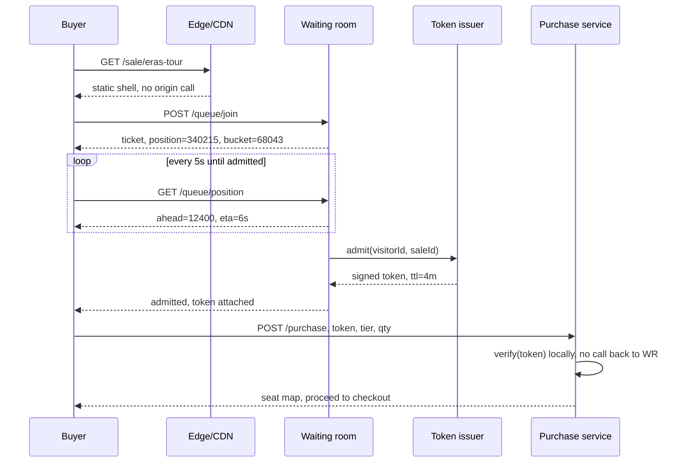
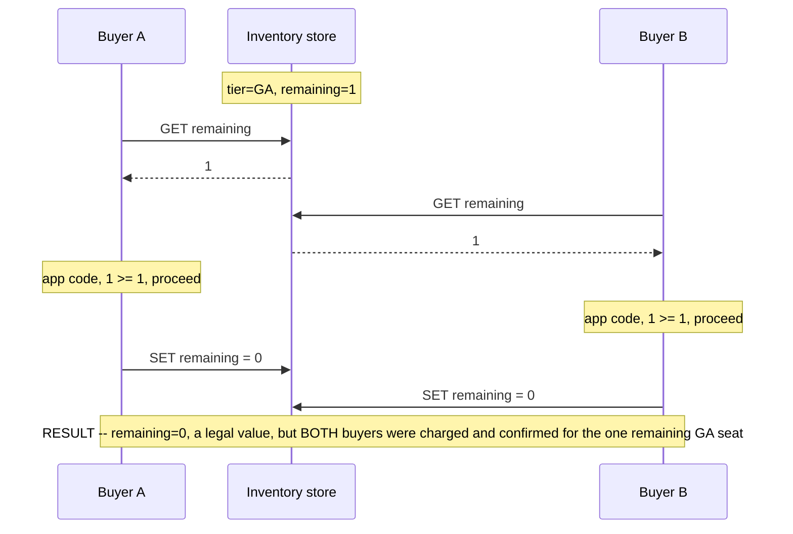

# System Design: Flash Sale / Ticketing System
## Intuition

> **Design intuition**: Every other case study in this section fights uncertainty — you don't know when the next hotel search will land, when the next tweet will go viral, when the next Uber rider will open the app. A flash sale removes that uncertainty and replaces it with something harder: **you know the exact instant demand will exceed supply by two orders of magnitude, and you know it days in advance.** 50,000 seats. 2,000,000 people refreshing the page. One clock. That's not a capacity problem you can autoscale your way out of — autoscaling reacts to load that has already arrived, and this load arrives as a single vertical line at T+0, not a curve. The system has to be *pre-shaped* for the spike before the spike exists.

**Key insight**: A flash sale is not "an e-commerce checkout under heavy load" — it is an **admission-control problem wearing a checkout's clothes**. The purchase logic itself (decrement inventory, charge a card, confirm) is small and, per [`./design_hotel_reservation.md`](./design_hotel_reservation.md), already solved by an atomic conditional update. What's new here is everything upstream of that: deciding, for two million simultaneous strangers, in what order and at what rate they are even allowed to *attempt* a purchase, without that decision itself becoming the bottleneck. Get the admission layer right and the purchase path is boring. Get it wrong and the purchase path never gets the chance to matter — the origin falls over on `GET /event/eras-tour` before a single seat is ever contested.

---

## 1. Requirements Clarification

### Functional Requirements
- **Browse a sale/event**: show the item (seat map, product SKU, ticket tier) and its stated on-sale time; before T+0 this page must be servable from a static edge cache with zero calls to any backend that also serves purchases.
- **Enter the waiting room**: at or near T+0, a buyer is placed into a virtual queue and shown a position/estimated-wait indicator rather than the purchase page itself.
- **Gain admission**: the queue admits buyers into the purchase flow at a rate the backend has been provisioned to sustain, issuing each admitted buyer a short-lived, cryptographically signed **admission token**.
- **Select and hold inventory**: an admitted buyer selects seats/quantity and receives a short hold (same hold-with-TTL primitive as [`./design_hotel_reservation.md`](./design_hotel_reservation.md) §4.2 — **not re-derived here**, only referenced).
- **Checkout**: convert the hold into a confirmed order — payment capture, idempotent purchase call, order confirmation.
- **Queue position visibility**: the buyer can see they are still in line and roughly how long is left, so "is this broken?" has a visible answer that isn't silence.
- **Bot and scalper resistance**: distinguish, well enough to matter, an individual human buyer from an automated purchasing script running at 100x human speed.
- **Purchase caps and per-account limits**: enforce a maximum quantity per buyer/account (e.g., 4 tickets, 1 unit of a limited SKU) as a first-class rule the purchase path checks, not an afterthought bolted onto checkout.
- **Real-time operational visibility**: expose queue depth, admission rate, and inventory-remaining to an internal dashboard during the sale window (§4.g, §8) — this is a functional requirement, not just an ops nicety, because the operational playbook's kill-switch decisions (§8) depend on it existing and being accurate to the second.
- **A stated, explicit fairness policy**: the system must commit — publicly, before the sale — to *how* it decides who gets admitted first, because every policy is a different promise:
  - **FIFO admission** (first to join the queue is first admitted) promises *effort and timing* — reward whoever refreshed earliest / had the fastest connection. It systematically favors bots and people with the best network path, and it means the queue itself becomes the object of a speed race.
  - **Randomized lottery / raffle** (everyone who joins within a window is shuffled, then admitted in that random order) promises *fairness of chance* — arriving one second after T+0 is exactly as good as arriving one second before it, which removes the incentive to hammer refresh and removes bots' timing advantage, at the cost of a slower human occasionally "winning" over a faster one.
  - **Weighted / priority admission** (pre-registered "verified fan" cohorts, loyalty tiers, or presale codes get an earlier slot) promises *access to a chosen group* — it is the mechanism a rights holder actually wants most of the time, and it is also the one most likely to draw complaints from anyone outside the favored cohort.
  This design defaults to **randomized admission within short time windows**, layered under an optional priority cohort, and is explicit in §4.1 about why FIFO is the wrong default despite being the most obvious one.

### Non-Functional Requirements
- **Zero overselling is a hard invariant, not a target.** Unlike most systems in this section where "occasionally wrong under extreme load" is an acceptable degradation, selling seat 14C to two people is a real-world collision with legal and reputational cost that no amount of "eventually consistent" language papers over. This bar is identical to the hotel-reservation invariant (§4.1 there) — the mechanism differs because the traffic shape differs.
- **p99 admission-decision latency under 200ms even while 500,000+ requests/sec arrive at the gate** — the waiting room itself must not become the thing that's down.
- **Graceful degradation, not collapse**: when the admission-controlled purchase path is saturated, the system must show a slower queue, never a 500 error or a blank page. A visible queue is a working system; a stack trace is not.
- **Blast-radius isolation**: the flash sale must not be able to take down browsing, search, or unrelated purchases on the same platform. Amazon does not want a PS5 restock to take Amazon.com's product-detail pages with it; Ticketmaster does not want an Eras Tour onsale to take down every other artist's page.
- **Idempotency under retry storms**: buyers on a spotty connection will double-tap "Buy," and clients will retry on timeout; the same admission token or the same checkout attempt submitted twice must never charge twice or decrement inventory twice.
- **Observability at T+0**: the operational team needs real-time visibility (queue depth, admission rate, inventory-remaining, error rate) in the seconds around the sale opening, because that is the only window in which a manual intervention (kill switch, throttle change) is still useful — five minutes later, the sale is often already sold out or already a public incident.

### Out of Scope
- **Seat-map rendering and 3D venue visualization** — a client-side concern layered on top of the inventory API this design builds.
- **Dynamic/surge pricing of tickets** — resale-market pricing and primary-market demand-based pricing are a separate pricing-engine concern; this design assumes fixed face-value pricing per tier.
- **Payment processing internals** (PCI tokenization, PSP integration, chargebacks) — fully covered by [`./design_payment_system.md`](./design_payment_system.md); this design calls it as a step in checkout (§4.d) and does not re-derive it.
- **Secondary/resale marketplace** — StubHub/SeatGeek-style resale is a different system (search + escrow + transfer of an already-owned ticket), not this one.

---

## 2. Scale Estimation

### The Shape of Demand — a Single Vertical Line
- Unlike every read-heavy case study in this section, traffic is **not** a diurnal curve — it is near-zero for days, then a step function at a known instant. For a headline event: **50,000 seats**, **500,000–2,000,000 concurrent buyers** attempting to reach the page in the first 10–30 seconds after T+0.
- Ticketmaster's own published account of the November 2022 Taylor Swift *Eras Tour* Verified Fan presale is the reference data point for this shape: **1.5 million verified fans were invited**, but **over 14 million people** showed up to the site, generating **3.5 billion total system requests** — roughly **4x Ticketmaster's previous single-day peak** — while **over 2 million tickets sold** in the day, the most ever sold for a single artist in one day (source: [Ticketmaster Business, "Taylor Swift | The Eras Tour On Sale Explained"](https://business.ticketmaster.com/press-release/taylor-swift-the-eras-tour-onsale-explained/); corroborated by [Variety](https://variety.com/2022/music/news/ticketmaster-explains-taylor-swift-ticket-crisis-eras-tour-1235435673/)). Read that ratio again: **14M visitors chasing tickets that, across all shows, numbered in the low millions at most** — a demand:supply ratio in the same 5–10x range this design assumes, sustained across an entire on-sale campaign rather than one instant.
- Take a single-venue instance of this pattern for our own numbers: **50,000 seats**, **1,000,000 buyers** hitting the gate within **60 seconds** of T+0. That is roughly **17,000 buyers/sec** arriving at the edge, most of whom will get nothing.

### The First 60 Seconds — Arrival Is Not Uniform Either
Averaging "1,000,000 buyers in 60 seconds" to a flat 17,000 req/sec understates the true instantaneous peak, because arrivals are not spread evenly across that window — they cluster tightly around T+0 and taper as the fastest-arriving buyers are absorbed into the queue and stop generating new page-load requests. A representative shape, modeled as a decaying arrival rate rather than a flat one:

| Window after T+0 | Cumulative arrivals | Instantaneous rate in that window |
|---|---|---|
| 0-5s | 550,000 (55% of total) | ~110,000 req/sec |
| 5-15s | 250,000 (25%) | ~25,000 req/sec |
| 15-30s | 130,000 (13%) | ~8,700 req/sec |
| 30-60s | 70,000 (7%) | ~2,300 req/sec |

The **peak 5-second window runs at roughly 6x the 60-second average** — 110,000 req/sec, not 17,000 — because everyone who has the page bookmarked or the reminder set genuinely does refresh within the first few seconds of the advertised time. **This is the number the edge/CDN tier (§3) actually has to be provisioned against**, not the smoothed average — a capacity plan built off the 60-second average alone under-provisions the tier that takes the hardest hit, by close to an order of magnitude, in exactly the first few seconds when the sale's reputation (and, per §9 War Story 1, the rest of the stack's stability) is decided.

### Requests/Sec at Each Layer — and How Much Never Reaches Inventory
- **Edge/CDN (static shell + queue-join call)**: absorbs the full 17,000 req/sec — this tier is stateless and horizontally trivial, the same as any CDN-fronted static page. **This is the layer that must absorb ~99% of the load**, because almost none of these 1,000,000 people can be served a seat.
- **Waiting-room admission-decision service**: receives one "join queue" call per buyer (~1,000,000 total, spread over the sale's opening seconds) and issues admission tokens at a rate the purchase backend has been sized for — say **2,000 admissions/sec**, chosen so the purchase path (§4.b) never sees more concurrent checkouts than it was load-tested against.
- **Purchase/checkout path**: at 2,000 admissions/sec, and assuming each buyer takes ~15 seconds to pick seats and pay, that's a **steady-state concurrency of ~30,000 in-flight checkouts** — two orders of magnitude smaller than the 1,000,000 who showed up, and a load profile the checkout tier can actually be capacity-planned against (§10).
- **Inventory service**: for 50,000 seats sold across the sale's admitted population, that is **at most 50,000 successful decrement operations** total — trivial volume for any datastore. The inventory service's hard problem is not throughput, it is **correctness under contention on a tiny hot key set** (a handful of seat-map rows, or a single pooled counter per price tier, all being decremented by the entire first wave of admitted buyers within the same few seconds) — see §4.b.
- **The headline number to defend in a design interview**: of **17,000 req/sec at the edge**, only **~2,000/sec** (12%) reach anything resembling a write path, and of *those*, the inventory service itself does at most a few hundred writes/sec at the very peak. **The admission layer's entire job is compressing a 3–4 order-of-magnitude demand spike down to a rate the write path was actually built for** — that compression, not the write path itself, is where the engineering effort goes.

### Bandwidth and Connection Load
- 1,000,000 concurrent long-poll or WebSocket connections for live queue-position updates, at roughly 200 bytes/update every 5 seconds, is **~40 MB/sec** of steady egress just for position pings — small in absolute terms but a connection-count problem (§4.a) more than a bandwidth one, similar in kind to WhatsApp's presence system.
- The static event page + queue-join JS bundle, served to 1,000,000 unique visitors at ~150 KB (image-light, edge-cached), is **~150 GB** of CDN egress in the opening minute — a CDN/edge-cost line item, not an origin-capacity one.

### Read:Write Ratio, Compared to the Rest of This Section
Most case studies in this section are anchored by a read:write ratio that stays roughly constant across the traffic curve — [`./design_url_shortener.md`](./design_url_shortener.md)'s ~100:1 reads-to-writes holds whether traffic is light or heavy. A flash sale's ratio is not constant, it **collapses toward 1:1 exactly during the window that matters**:

| System | Typical read:write ratio | What changes it |
|---|---|---|
| URL shortener | ~100:1, roughly constant | Traffic volume scales; the ratio doesn't move |
| Hotel reservation | ~100:1 in steady state (§2 there) | Search vastly exceeds booking, always |
| Flash sale, pre-sale browsing (before T+0) | Very read-heavy (event page views) | Ordinary content-browsing ratio |
| Flash sale, at T+0 | Approaches ~1:1 among *admitted* buyers (nearly everyone admitted intends to write) | Admission control has already filtered out the read-only lookers |

That collapse is precisely why the admission gate matters so much more here than in a hotel-reservation-style system: a system whose ratio stays read-heavy can lean on caching and read replicas to absorb a spike (as the hotel-reservation design does), but a system whose *admitted* population is almost entirely intending to write cannot cache its way out — every admitted request is, almost by definition, headed for the contended write path in §4.b. The waiting room's real job, restated in this framing, is holding back everyone who has not yet been converted from "read-only looker" into "about-to-write buyer," for as long as the write path needs.

### Alibaba Singles' Day — the Other End of the Spectrum
- Flash-sale traffic shape is not unique to ticketing. Alibaba's Apsara operating system publicly reported **544,000 orders/sec** at the 2019 Singles' Day peak and **583,000 orders/sec** at the 2020 peak (source: [Alibaba Cloud Community, "Learn How Alibaba Cloud's Databases Could Support 87 Million Transactions per Second"](https://www.alibabacloud.com/blog/learn-how-alibaba-clouds-databases-could-support-87-million-transactions-per-second_595593); order-rate figures corroborated by contemporaneous coverage). Alibaba has not published a peak-TPS figure publicly since 2020/2021, holding sales-total figures back to just gross merchandise value in recent years — but the 2019–2020 numbers stand as the highest publicly disclosed order-throughput figures for any flash-sale-shaped event, roughly **1,000x** this design's target rate, and a useful sanity check: **the architecture in §3 is the same shape at 1,000x scale**, just with more shards.

---

## 3. High-Level Architecture

```mermaid
flowchart LR
    classDef io      fill:#61afef,stroke:#2e86c1,color:#1a1a1a,font-weight:bold
    classDef frozen  fill:#c678dd,stroke:#9b59b6,color:#fff
    classDef train   fill:#98c379,stroke:#27ae60,color:#1a1a1a
    classDef mathOp  fill:#d19a66,stroke:#e67e22,color:#1a1a1a,font-weight:bold
    classDef lossN   fill:#e06c75,stroke:#c0392b,color:#fff,font-weight:bold
    classDef req     fill:#56b6c2,stroke:#0097a7,color:#1a1a1a
    classDef base    fill:#e5c07b,stroke:#f39c12,color:#1a1a1a

    buyers(["1M buyers<br/>at T+0"]) --> edge["Edge / CDN<br/>static shell"]
    edge --> wr["Virtual<br/>waiting room"]
    wr --> tokgen["Token issuer<br/>signed JWT"]
    tokgen -.->|admit at<br/>2000-sec rate| gate{"Admission<br/>gate"}
    gate -->|token valid| purchase["Purchase service<br/>seat select + hold"]
    gate -->|queued| wr
    purchase --> inv[("In-memory<br/>inventory<br/>Valkey/Redis")]
    purchase --> pay["Payment capture"]
    pay --> outbox["Order outbox"]
    outbox --> fulfill(("Async fulfilment<br/>queue"))
    fulfill --> ledger[("Durable order<br/>store")]
    fulfill --> notify["Confirmation<br/>email/SMS"]
    inv -.->|reconcile| ledger
    bots["Bot / scraper<br/>traffic"] -.->|filtered by| edge

    class buyers io
    class edge base
    class wr,tokgen mathOp
    class gate mathOp
    class purchase train
    class inv train
    class pay frozen
    class outbox,fulfill req
    class ledger train
    class notify req
    class bots lossN
```



*The static shell and waiting room absorb the 17,000 req/sec spike before it touches anything stateful; the admission gate is the sole valve controlling how much of that load the purchase service ever sees; inventory lives in memory ahead of the sale and reconciles back to the durable store asynchronously rather than on the hot path.*

### The Isolation Boundary
The single architectural decision that recurs across every real flash sale in §6 is: **run the sale on infrastructure the rest of the platform does not share.** A separate deployment (or, per [`../cell_based_architecture/cell_based_architecture.md`](../cell_based_architecture/cell_based_architecture.md), a dedicated cell) for the event page, waiting room, and purchase path means:
- A traffic spike or an outright outage in the sale cannot cascade into the main site's shared database connection pool, shared cache cluster, or shared service mesh — the classic [`../resilience_patterns/resilience_patterns.md`](../resilience_patterns/resilience_patterns.md) bulkhead applied at the scale of an entire subsystem, not just a thread pool.
- The sale's infrastructure can be **pre-scaled to a known peak** and then torn back down, rather than permanently provisioning the main platform for a load pattern it only sees a few hours a year.
- A kill switch (§8) can shed *only* the sale's load without taking checkout for the rest of the platform down with it.

### Why the Edge Can't Answer "Is There Inventory Left"
It's worth being precise about what the static/CDN shell (§3's diagram) can and cannot absorb, because "just cache it at the edge" is the first instinct and it only half-applies here. The **event page's static content** — description, venue, price tiers, the on-sale time itself — is genuinely cacheable and edge-servable with zero origin calls, because it does not change from one buyer's request to the next. **Remaining-inventory is not** — it is the one piece of information on that page that is simultaneously the most requested and the most volatile, changing with every successful purchase. Caching it at the edge with any TTL longer than near-zero reproduces exactly [`./design_hotel_reservation.md`](./design_hotel_reservation.md) §9 War Story 2's stale-search-cache failure, at flash-sale velocity where the staleness window that mattered there (15 minutes) would need to shrink to single-digit seconds to stay useful here — and at single-digit-second TTLs, the "cache" is providing little protection anyway. The practical resolution is the one this design already uses: **don't answer "is there inventory left" from the edge at all** — the waiting room answers "are you allowed to try yet," and only the admitted, narrow population downstream ever asks the inventory question, against the atomically-consistent source in §4.b.

### Why the Waiting Room Comes Before Any Stateful Read
Every request that can be answered "you are #340,215 in line, check back in ~4 minutes" without consulting inventory, without touching a database, and without allocating a hold, is a request the write path never has to reason about. The waiting room is deliberately the *dumbest, cheapest, most horizontally-scalable* tier in the stack — stateless per-request beyond a signed cookie and a counter — specifically so it can be the one absorbing 17,000 req/sec while the tiers behind it see a fraction of that.

### Multi-Region Buyers, Single-Region Inventory
A global or national event (the Eras Tour spanned dozens of US cities; Alibaba's Singles' Day spans a country) draws buyers from many regions, but the inventory for a *given show* is not similarly distributed — 50,000 seats at one venue is one coherent pool, not something that can be sharded by buyer geography the way [`../../database/sharding_and_partitioning/sharding_and_partitioning.md`](../../database/sharding_and_partitioning/sharding_and_partitioning.md) shards a hotel-reservation system's inventory by `hotel_id`/region. The design's response is asymmetric: the **waiting room and edge/CDN tier are deployed multi-region**, close to buyers, because position-tracking and static-shell serving have no cross-region consistency requirement; the **admission gate, inventory, and purchase path stay single-region**, pinned to wherever that show's inventory lives, because the atomic decrement (§4.b) only has a well-defined "atomic" if it isn't also trying to stay consistent across regions. Buyers admitted from a distant region simply pay a longer round-trip on the purchase call itself — a small, bounded latency cost, versus the alternative of trying to keep a globally-distributed inventory count consistent under exactly the contention §4.b already shows is hard within one region.

For a multi-show tour (dozens of shows, each with its own venue and its own inventory pool, sold across overlapping on-sale windows), the region pinning happens once, at admission-token issuance, and is carried through every subsequent call rather than re-resolved per request:

```java
public String issue(String visitorId, String saleId) {
    String homeRegion = saleRegionRegistry.regionFor(saleId); // e.g. "us-east-1" for a specific venue
    return JWT.create()
        .withSubject(visitorId)
        .withClaim("sale", saleId)
        .withClaim("region", homeRegion) // purchase-path router reads this, not the buyer's own geo-IP
        .withIssuedAt(Date.from(Instant.now()))
        .withExpiresAt(Date.from(Instant.now().plus(TOKEN_TTL)))
        .withJWTId(UUID.randomUUID().toString())
        .sign(signingKey);
}
```

Routing off the token's `region` claim, rather than the buyer's own geo-IP at request time, keeps the purchase call deterministic — a buyer connecting through a VPN or a mobile network that hairpins through a different region still lands on the one region actually holding that show's inventory, rather than being misrouted to a region with no authority over the seats they are trying to buy.

---

## 4. Component Deep Dives

### (a) The Virtual Waiting Room — Token Issuance and Position Estimation

The waiting room's job is to convert "1,000,000 simultaneous arrivals" into "a bounded admission rate" without itself becoming a bottleneck, and without lying to buyers about where they stand.

**Position estimation.** Position is not tracked as an exact per-buyer rank (that would require a globally ordered structure updated 17,000 times/sec) — it is derived from an atomically incremented counter at join time and the admission service's known throughput:

```java
public final class WaitingRoomService {
    private final AtomicLong joinSequence = new AtomicLong(0);
    private final AtomicLong admittedSoFar = new AtomicLong(0);
    private static final long ADMISSIONS_PER_SECOND = 2_000;

    /** Called once per buyer when they land on the sale page after T+0. */
    public QueueTicket join(String visitorId) {
        long position = joinSequence.incrementAndGet();
        // Randomized-window admission (§1 fairness policy): buyers who join
        // within the same 5-second bucket are shuffled together rather than
        // strictly FIFO'd, removing the reward for sub-second refresh timing.
        long bucket = position / (ADMISSIONS_PER_SECOND * 5);
        long jitterSeed = bucket * 31 + visitorId.hashCode();
        return new QueueTicket(visitorId, position, bucket, jitterSeed, Instant.now());
    }

    /** Polled by the client every ~5s; O(1), no per-visitor state lookup. */
    public QueuePosition estimate(QueueTicket ticket) {
        long ahead = Math.max(0, ticket.position() - admittedSoFar.get());
        long etaSeconds = ahead / ADMISSIONS_PER_SECOND;
        return new QueuePosition(ahead, Duration.ofSeconds(etaSeconds));
    }
}
```

**The admission token.** Once a buyer's turn arrives, the waiting room issues a short-lived, signed token — not a session cookie — because it must be independently verifiable by the purchase service without a round-trip back to the waiting room on every request:

```java
public final class AdmissionTokenService {
    private final Algorithm signingKey; // HMAC256, rotated per sale
    private static final Duration TOKEN_TTL = Duration.ofMinutes(4);

    public String issue(String visitorId, String saleId) {
        Instant now = Instant.now();
        return JWT.create()
            .withSubject(visitorId)
            .withClaim("sale", saleId)
            .withIssuedAt(Date.from(now))
            .withExpiresAt(Date.from(now.plus(TOKEN_TTL)))
            .withJWTId(UUID.randomUUID().toString()) // single-use, checked at §4.d
            .sign(signingKey);
    }

    /** Purchase service calls this locally -- no network hop to the waiting room. */
    public DecodedJWT verify(String token, String expectedSale) {
        DecodedJWT decoded = JWT.require(signingKey).build().verify(token); // throws on tamper/expiry
        if (!decoded.getClaim("sale").asString().equals(expectedSale)) {
            throw new IllegalArgumentException("Token issued for a different sale");
        }
        return decoded;
    }
}
```

A **4-minute TTL** is deliberate: long enough to select seats and enter payment details, short enough that a buyer who is admitted but abandons the tab returns their effective "slot" to the system quickly (the slot is never explicitly reclaimed — inventory is what's actually scarce, and the hold in §4.d has its own, shorter TTL — but a short admission window bounds how long a distracted buyer can sit inside the purchase tier without transacting, keeping that tier's concurrency close to the planned 30,000 from §2).

**Single-use enforcement.** JWT verification (above) proves the token is authentic and unexpired, but does not by itself stop the *same* valid token being presented twice — e.g., a buyer who opens the sale page in two tabs. The `jti` (JWT ID) claim set at issuance is checked against a short-lived seen-set at the point of first genuine use:

```java
public final class TokenReplayGuard {
    /** Called once, at the moment a token is first used to enter checkout --
     *  not on every request, since that would just move the contention problem. */
    public boolean claimSingleUse(String jti) {
        // SET NX with a TTL matching the token's own expiry: if the key already
        // exists, this token has already been redeemed by an earlier request.
        return cache.setIfAbsent("token-used:" + jti, "1", TOKEN_TTL);
    }
}
```

This is the identical `SET NX` claim pattern as the idempotency key in §4.d, applied one step earlier in the flow — the token can only ever fund one entry into checkout, and a second tab presenting the same token is rejected before it can even attempt a purchase, rather than being allowed to race the first tab at the inventory layer.

**The admission flow end to end**, from a buyer's first request to a usable token:



*Position polling only ever touches the stateless waiting room; the purchase service verifies the token cryptographically and never calls back to the waiting room, keeping the two tiers' failure domains separate per §3.*

### (b) Inventory Decrement — Broken, Then Fixed

This is the same failure family as [`./design_hotel_reservation.md`](./design_hotel_reservation.md) §9 War Story 1, but it deserves to live in the component deep dive here rather than being parked in the war-stories section, because a flash sale makes the race **certain**, not occasional: instead of two buyers occasionally colliding on one hotel room-night, this design has the admission gate deliberately releasing a **burst of hundreds of admitted buyers within the same second** at exactly the moment inventory is at its scarcest (the last few dozen seats of a popular tier). If the decrement isn't atomic, this isn't a rare bug — it is the *modal* outcome of every popular flash sale's final seconds.

***Broken:*** A naive purchase service reads the remaining count, checks it in application code, then writes a new value:

```java
// BROKEN -- check-then-act race, guaranteed to fire under flash-sale burst admission
public boolean purchaseSeatBroken(String tierId, int quantity) {
    Integer remaining = inventoryStore.get(tierId);      // read
    if (remaining != null && remaining >= quantity) {     // check, in app code
        inventoryStore.set(tierId, remaining - quantity); // write an ABSOLUTE value
        return true;
    }
    return false;
}
```



Exactly the trap called out in the hotel-reservation write-up: two absolute writes of the same computed value leave the row in a state that looks perfectly legal, so no constraint check catches it, and both buyers walk away with a confirmation email.

***Fix:*** Collapse the read-check-write into a single atomic conditional operation. In-memory inventory (§4.c) makes this a one-line Lua script executed atomically by the cache server itself:

```lua
-- KEYS[1] = inventory key, e.g. "sale:eras-tour:tier:GA"
-- ARGV[1] = quantity requested
local remaining = tonumber(redis.call('GET', KEYS[1]))
if remaining == nil or remaining < tonumber(ARGV[1]) then
    return -1  -- sold out or insufficient stock; caller must NOT proceed
end
redis.call('DECRBY', KEYS[1], ARGV[1])
return remaining - tonumber(ARGV[1])  -- new remaining count, for observability
```

Because Redis (and Valkey — see §7) executes a Lua script as a single atomic unit with no other command interleaving mid-script, there is no window between the check and the decrement for a second buyer's script to run. The equivalent guarantee against the durable, reconciled store (§4.c) uses the exact same atomic-`UPDATE` pattern as the hotel-reservation fix:

```sql
UPDATE inventory
SET remaining = remaining - :quantity, version = version + 1
WHERE tier_id = :tierId AND remaining >= :quantity;
-- rows affected = 1  -> success, proceed to hold + checkout
-- rows affected = 0  -> sold out (or someone else just took the last units);
--                       caller throws SoldOutException, no partial state anywhere
```

```java
public PurchaseResult purchaseSeatFixed(String tierId, int quantity) {
    int rowsAffected = jdbc.update(
        "UPDATE inventory SET remaining = remaining - ?, version = version + 1 " +
        "WHERE tier_id = ? AND remaining >= ?",
        quantity, tierId, quantity);
    if (rowsAffected == 0) {
        throw new SoldOutException(tierId);
    }
    return PurchaseResult.reserved(tierId, quantity);
}
```

The fix costs nothing extra in the success path and removes the race window entirely rather than narrowing it, for the same reason it does in the hotel case: the datastore's own row/key-level serialization makes the second caller's conditional evaluate against the *already-updated* value, not a stale snapshot.

### (c) Pre-Loading Inventory Into Memory, and Reconciling It Back

Reading remaining-inventory from a durable relational store on every one of a few hundred writes/sec at peak is not, by itself, a scaling problem (§2 already showed inventory write volume is small). The reason flash-sale designs still pre-load inventory into an in-memory store ahead of the sale is **latency and blast-radius**, not throughput: a purchase call that touches the same durable store the rest of the platform's checkout depends on couples the sale's failure modes to everyone else's, and a durable store under connection-pool pressure adds tens of milliseconds exactly when the admission gate is trying to keep the purchase path fast enough to drain its queue.

```java
public final class InventoryPreloader {
    /** Run by an operator/scheduled job in the hours before T+0 -- never on the request path. */
    public void preload(String saleId, List<TierInventory> tiers) {
        for (TierInventory tier : tiers) {
            String key = "sale:" + saleId + ":tier:" + tier.tierId();
            // SETNX: refuse to clobber a key that already exists (re-running
            // preload after a partial run must not reset a partially-sold tier).
            boolean wasSet = cache.setIfAbsent(key, String.valueOf(tier.totalCount()));
            if (!wasSet) {
                log.warn("Preload skipped for {} -- key already present (remaining={})",
                    key, cache.get(key));
            }
        }
    }

    /** Runs continuously during the sale: durable store is the eventual source of
     *  truth, cache is the hot path. Every successful decrement (§4.b) is also
     *  appended to the outbox (§4.f) so this reconciliation has a log to replay. */
    public void reconcile(String saleId) {
        for (SoldEvent event : outboxReader.pollUnreconciled(saleId)) {
            jdbc.update(
                "UPDATE inventory SET remaining = remaining - ? WHERE tier_id = ? AND remaining >= ?",
                event.quantity(), event.tierId(), event.quantity());
            outboxReader.markReconciled(event.id());
        }
    }
}
```

The durable store is never bypassed permanently — it is the system of record that survives a cache-node restart and the thing finance reconciles against — the cache is a **fronting layer with the durable store as its backstop**, not a replacement for it. This is the same cache-aside-with-a-source-of-truth shape as [`../caching/caching.md`](../caching/caching.md), applied to a write path instead of the usual read path.

### (d) Idempotency on the Purchase Call

A flash sale guarantees retry storms: buyers double-tap "Buy Now" out of impatience, and mobile clients retry on timeout against a backend that is, by design, running close to its provisioned ceiling. Without an idempotency key, a retried purchase call double-decrements inventory and double-charges a card.

```java
public final class PurchaseController {
    public PurchaseResult purchase(String idempotencyKey, String admissionToken,
                                    String tierId, int quantity) {
        // Single-use enforcement on the admission token itself (§4.a's jti claim) --
        // a token cannot be redeemed twice even by a legitimate double-submit.
        Optional<PurchaseResult> existing = idempotencyStore.lookup(idempotencyKey);
        if (existing.isPresent()) {
            return existing.get(); // replay the original result -- no re-execution
        }

        // SET key NX with a short TTL claims the key atomically; a concurrent
        // retry arriving mid-flight sees the claim fail and can poll/back off
        // instead of racing the original request through purchase logic.
        boolean claimed = idempotencyStore.claim(idempotencyKey, Duration.ofSeconds(30));
        if (!claimed) {
            throw new ConcurrentRetryException("Purchase already in flight for this key");
        }

        PurchaseResult result = purchaseSeatFixed(tierId, quantity); // §4.b
        idempotencyStore.record(idempotencyKey, result, Duration.ofHours(24));
        return result;
    }
}
```

The idempotency key is client-generated once per checkout attempt (a UUID stored in the client before the first submit) and reused on every retry of that same attempt — this is the identical pattern [`./design_payment_system.md`](./design_payment_system.md) §4 uses for charge safety, applied one layer earlier so it also protects the inventory decrement, not just the payment capture.

### (e) Bot and Scalper Defence — What Each Layer Actually Stops

No single control stops a determined scalping operation; each layer raises the cost of automation and closes one specific hole. Being honest about what each control does and does not do matters more than listing them:

| Control | Stops | Does NOT stop |
|---|---|---|
| Per-IP / per-device rate limiting at the edge ([`../rate_limiting/rate_limiting.md`](../rate_limiting/rate_limiting.md)) | Naive scripts hammering a single endpoint from one address | Distributed botnets and residential-proxy pools rotating IPs per request |
| Device fingerprinting + behavioral signals (mouse movement entropy, request timing regularity) | Headless-browser scripts with no human interaction signal | A well-funded operation running real browser automation (Puppeteer with injected human-like jitter) |
| Proof-of-work challenge before queue join (client must compute a small, verifiable hash puzzle) | Cheap, high-volume automated joins, by making each join cost real CPU time | A scalper willing to pay for GPU-accelerated solving at scale |
| CAPTCHA / managed challenge at admission | Fully automated end-to-end scripts with no human in the loop | Click-farm operations paying humans to solve challenges |
| Per-account purchase caps (e.g., max 4 tickets per verified account) | A single account buying a block large enough to corner a tier | Many distinct real or synthetic accounts each buying the cap |
| Verified-Fan / pre-registration cohorts, tied to phone number and purchase history | Fresh throwaway accounts created just for one sale | A patient operation that pre-registers accounts weeks ahead of time |

The honest framing for an interview: **bot defence is a cost-raising exercise, not a cost-eliminating one.** Layering all six raises the marginal cost of acquiring one ticket via automation well above face value for most operators; none of them, individually or combined, makes automated purchasing *impossible* against an operator willing to spend enough. This is the same logic as [`../resilience_patterns/resilience_patterns.md`](../resilience_patterns/resilience_patterns.md)'s framing of defense in depth — no single layer is airtight, the stack is.

A worked example of the proof-of-work control, since it is the one most often skipped as "just a CAPTCHA replacement" when it is actually a distinct control with a distinct cost model — it charges CPU time, not human attention, so it degrades a script's *throughput* even when the script has no human bottleneck at all:

```java
public final class ProofOfWorkChallenge {
    private static final int DIFFICULTY_BITS = 18; // ~0.3s on commodity hardware, tunable per sale

    /** Issued alongside the queue-join response; the client must solve before
     *  the join is accepted, imposing a real CPU cost per join attempt. */
    public Challenge issue(String visitorId) {
        String nonce = UUID.randomUUID().toString();
        return new Challenge(nonce, DIFFICULTY_BITS, Instant.now().plusSeconds(30));
    }

    /** Client brute-forces `answer` such that sha256(nonce + answer) has
     *  DIFFICULTY_BITS leading zero bits -- cheap to verify, expensive to solve. */
    public boolean verify(Challenge challenge, String answer) {
        if (Instant.now().isAfter(challenge.expiresAt())) {
            return false; // stale challenge, forces a fresh (costly) solve
        }
        byte[] hash = sha256(challenge.nonce() + answer);
        return leadingZeroBits(hash) >= challenge.difficultyBits();
    }
}
```

Tuning `DIFFICULTY_BITS` is a direct lever: too low and it's free for a botnet to solve at scale; too high and it burns a real human's phone battery and adds visible latency before they even see the queue. A sale expecting heavier bot pressure (a high-resale-value item) tunes it up; a low-scalping-risk sale can leave it near zero or skip it.

### (f) Async Fulfilment — What the Buyer Sees While It Drains

Checkout's synchronous path (§4.b–d) does the minimum needed to be safe: verify the admission token, atomically decrement inventory, capture payment authorization, write an outbox event, and return **202 Accepted** with an order reference — it does not wait for the confirmation email, the PDF ticket generation, or the loyalty-points credit before responding.

```java
public OrderAck checkout(CheckoutRequest req) {
    PurchaseResult reservation = purchaseController.purchase(
        req.idempotencyKey(), req.admissionToken(), req.tierId(), req.quantity());
    PaymentAuth auth = paymentService.authorize(req.paymentToken(), reservation.totalCents());
    Order order = orderStore.createPending(reservation, auth); // durable write, fast
    outbox.publish(new OrderCreatedEvent(order.id(), order.tierId(), order.quantity()));
    return new OrderAck(order.id(), OrderStatus.PROCESSING); // 202 -- buyer sees "confirming your order"
}
```

Everything downstream — PDF ticket rendering, barcode generation, confirmation email/SMS ([`./design_notification_system.md`](./design_notification_system.md)), analytics, loyalty credit — drains from the outbox through [`../message_queues/message_queues.md`](../message_queues/message_queues.md) at a rate decoupled from checkout's peak. The buyer's UI polls the order-status endpoint (or receives a push) and flips from "Confirming your order..." to "You're going!" seconds later — a UX cost, but a bounded and honest one, versus holding the HTTP connection open through every downstream side effect and multiplying checkout's peak latency by however many of those steps are synchronous.

```java
public final class OrderStatusController {
    /** Cheap, cacheable-for-a-second read -- never touches the fulfilment
     *  pipeline directly, only the durable order row the pipeline updates. */
    public OrderStatusResponse status(String orderId) {
        Order order = orderStore.find(orderId)
            .orElseThrow(() -> new OrderNotFoundException(orderId));
        return switch (order.status()) {
            case PROCESSING -> OrderStatusResponse.processing("Confirming your order...");
            case CONFIRMED  -> OrderStatusResponse.confirmed(order.ticketUrl());
            case FAILED     -> OrderStatusResponse.failed(order.failureReason());
        };
    }
}
```

The fulfilment consumer updates `order.status` as each downstream step completes (or fails — e.g., a payment authorization that later declines on capture), so this endpoint is always answering from the durable store's current row, not reaching into the queue itself. A client polling this every 2-3 seconds imposes negligible load — order-count volume (§2) is small, and each read is a single-row lookup by primary key.

### (g) Observability — the T+0 Dashboard

Every mechanism above (§8's kill switch, §9's war stories) depends on an operator being able to see, within seconds, that something is wrong — a dashboard built from the platform's standard 1-minute-resolution metrics pipeline is too coarse for a sale that, per §6's Xiaomi figures, can sell out entirely in under a minute. The metrics that matter are emitted at request-path granularity, not batched:

```java
public final class SaleMetricsEmitter {
    private final MeterRegistry registry;

    public void recordAdmission(String saleId) {
        registry.counter("flash_sale.admissions", "sale", saleId).increment();
    }

    public void recordPurchaseAttempt(String saleId, String tierId, boolean success) {
        registry.counter("flash_sale.purchase_attempts", "sale", saleId,
            "tier", tierId, "result", success ? "success" : "sold_out").increment();
    }

    /** Sampled every few seconds by a background job, not per-request --
     *  a gauge, not a counter, since "remaining" is a point-in-time value. */
    public void recordInventoryRemaining(String saleId, String tierId, long remaining) {
        registry.gauge("flash_sale.inventory_remaining",
            Tags.of("sale", saleId, "tier", tierId), remaining);
    }

    public void recordCheckoutLatency(String saleId, Duration latency) {
        registry.timer("flash_sale.checkout_latency", "sale", saleId)
            .record(latency);
    }
}
```

| Dashboard metric | Alert threshold (example) | What it catches | First action |
|---|---|---|---|
| Checkout error rate | >5% for 30s | The purchase path is failing beyond normal sold-out rejections (§8's kill-switch trigger) | Reduce admission rate (kill-switch level 1, §8) |
| Checkout p99 latency | >2s sustained | Approaching the threshold that triggers client retry storms (§9 War Story 3) | Reduce admission rate; check downstream (payment provider) latency first |
| Admission-token redemption rate vs. admission rate | Redemption << admission for >1min | Mass queue abandonment (Further Pitfalls, §9) or a broken purchase-path entry point | Check purchase-path health directly (a broken entry point looks like abandonment on this metric alone) |
| Inventory-remaining slope | Any negative-then-flat discontinuity | A tier appears sold out faster than admitted-buyer count could account for — possible bypass of the admission gate | Freeze the tier (stop decrements), page the on-call engineer immediately — this is the oversell-detection signal from §11 |
| Payment-provider p99 latency | Vendor-specific SLA breach | The PSP, not this system, is the bottleneck (§9 Further Pitfalls) | Page the payment/PSP liaison (§8 roles table); do not reduce admission rate first, it won't help a PSP-side bottleneck |

These are the same metric categories any production service tracks — the difference here is **resolution and pre-agreed thresholds**: a 1-minute rollup that would be perfectly adequate for the main platform's steady-state dashboards is too slow to act on before a sale that can be over in under a minute (§6), so the thresholds in §8's kill-switch playbook are wired against second-level, not minute-level, aggregation.

---

## 5. Design Decisions & Tradeoffs

| Decision | Option A | Option B | Choice & Why |
|---|---|---|---|
| Admission strategy | Queue everyone, admit at a fixed rate | Admit-and-reject (let everyone try, fail fast on overload) | **Queue-everyone.** Admit-and-reject turns a scarcity problem into a visible mass-failure event (a wall of error pages) — queueing converts the same scarcity into a legible wait, which is a materially better experience for the ~95% of buyers who were never going to get a seat either way. |
| Inventory system of record during the sale | In-memory (Valkey/Redis) fronting a durable store | Durable relational store directly on the hot path | **In-memory fronting a durable store (§4.c).** Throughput alone doesn't demand it (§2 showed peak writes are modest) — latency isolation and blast-radius separation from the platform's shared database do. |
| Concurrency control on the decrement | Optimistic (version check, retry on conflict) | Pessimistic (row/key lock, atomic conditional write) | **Atomic conditional write (§4.b), not classic optimistic-with-retry.** Optimistic retry-on-conflict is fine at low contention; at flash-sale contention (hundreds of writers targeting the same key within the same second) it produces a retry storm on the losers. A single atomic `DECRBY`/`UPDATE...WHERE` resolves the contention inside the datastore in one round trip per caller, win or lose, with no retry loop needed. |
| Per-seat locking vs. pooled-count decrement | Lock/hold each specific seat individually | Decrement a single pooled count per price tier, assign the specific seat after the count succeeds | **Pooled count for GA/unassigned tiers; per-seat hold (hotel-reservation-style) for assigned seating.** A pooled counter is one hot key, trivially made atomic, and sidesteps a combinatorial seat-picking UI under contention; assigned seating still needs the per-seat mechanism because the buyer is choosing a specific seat, not just a quantity. |
| Overselling policy | Never oversell, reject at the boundary | Oversell slightly, compensate/cancel after the fact | **Never oversell** for tickets/seats (§1 hard invariant) — unlike an airline overbooking a flight against predictable no-show rates, a sold-out concert has no no-show buffer to bank on, and "your ticket was cancelled after purchase" is a worse experience than "sold out" shown honestly. |

**What "oversell-then-compensate" actually costs, when an interviewer pushes on why it isn't the default here.** Airlines can oversell because a predictable fraction of booked passengers simply don't show, so the airline is betting on a statistical pattern with decades of data behind it — bump a handful of the unlucky remainder onto a later flight plus a travel voucher, and the math works out favorably at scale. A flash sale has no equivalent no-show pattern to bet on: **every unit "sold" was actively, competitively fought for by a buyer who wants exactly that seat at exactly that show**, so an oversell has to be resolved by canceling a real, wanted purchase after the fact. The compensation is categorically worse than an airline's: a refund plus a goodwill credit does not give the guest back the concert they now cannot attend, unlike a rebooked flight that still gets the traveler to the same destination a few hours later. Compounding that, a cancelled ticket after confirmation is exactly the kind of story that becomes public (a support-forum post, a local news item, a viral social post) in a way a routine flight rebooking rarely does — the reputational cost is asymmetric with the airline case in both directions, which is why this design treats "never oversell" as non-negotiable rather than a tunable business parameter.
| Fairness policy (§1) | Strict FIFO | Randomized-window admission | **Randomized-window (§4.a)** — FIFO rewards raw speed (favoring bots and best-network-path buyers over patient humans); randomizing within short join windows removes that incentive while still bounding total wait. |
| Queue position accuracy | Exact global rank, recomputed per poll | Estimated position from two counters (§4.a) | **Estimated.** An exact rank requires a globally-ordered, contended structure updated on every poll — reintroducing the exact hot-key write contention the waiting room exists to keep away from the write path. An estimate is close enough to be useful and costs one atomic read. |
| Metrics granularity for the sale window | Standard platform 1-minute rollups | Second-level, sale-specific emission (§4.g) | **Second-level, for the sale's duration only.** A sale that can sell out in under a minute (§6) makes a 1-minute rollup useless for any live intervention decision; the finer granularity is deliberately scoped to the sale window rather than adopted platform-wide. |

### Why "Queue Everyone" Wins Even Though It Feels Wasteful

The admit-and-reject alternative is tempting precisely because queueing feels like unnecessary ceremony for the ~95% of buyers who were never going to get a seat regardless of which strategy is used — why not just let them all try and fail fast? The answer is that "try and fail fast" only stays fast if the backend can evaluate a failing request cheaply, and evaluating "is there still inventory" cheaply, for 17,000 requests/sec, against a hot key set of a few dozen rows, is exactly the contention problem §4.b exists to solve — admit-and-reject does not remove that problem, it just runs it at 1,000,000 requests/sec instead of the admission gate's chosen 2,000/sec. Queueing is not about being nice to the 95% who will not get a seat; it is about never letting the backend see more concurrent write attempts than it was built to serialize correctly.

### Why Pooled-Count Decrement Is the Default, Not Per-Seat Locking

Per-seat locking (acquire a lock on `seat_14C`, check it's free, assign it) is the right primitive when the buyer is choosing a specific seat — that's what [`./design_hotel_reservation.md`](./design_hotel_reservation.md) already does well, and this design reuses it unmodified for assigned seating. But for general-admission tiers, quantity is what the buyer wants, not a specific unit, and modeling that as "acquire N individual seat locks" multiplies the contention surface by N for no benefit — a single pooled counter, decremented atomically per §4.b, gives the same correctness guarantee against one hot key instead of N, and sidesteps having to resolve which specific seats a buyer "should" get when they don't care.

---

## 6. Real-World Implementations

- **Ticketmaster** — the *Eras Tour* Verified Fan presale (November 2022) is the highest-profile public case study of this architecture under stress: **2 million+ tickets sold in a single day** (a record for one artist), against **1.5 million invited "verified fans"** and **14 million total site visitors**, generating **3.5 billion system requests — roughly 4x** the company's previous peak. Ticketmaster's own account attributes the failure primarily to **bot traffic and un-invited fans without presale codes** overwhelming a system sized for the invited cohort, not the invited cohort itself — precisely the gap §4.e's bot-defence layering and §1's explicit-cohort fairness policy target (source: [Ticketmaster Business](https://business.ticketmaster.com/press-release/taylor-swift-the-eras-tour-onsale-explained/)).
- **Alibaba (Tmall/Taobao) — Singles' Day (Double 11)** — the highest publicly disclosed sustained order-throughput figures for any flash-sale-shaped event: **544,000 orders/sec at peak in 2019**, **583,000 orders/sec at peak in 2020**, powered by Alibaba's Apsara distributed OS and a database layer built to scale write throughput horizontally across the event window rather than provision for it year-round (source: [Alibaba Cloud Community](https://www.alibabacloud.com/blog/learn-how-alibaba-clouds-databases-could-support-87-million-transactions-per-second_595593)). Alibaba stopped publishing granular peak-TPS figures in more recent years, disclosing only aggregate GMV — a reminder that headline scale numbers in this space age quickly and should be sourced to the year they were measured, not assumed current.
- **Amazon Prime Day** — a multi-day flash-sale event rather than a single T+0 spike, but AWS's own published 2025 retrospective gives a sense of the sustained infrastructure load behind it: **Amazon Aurora processed 500 billion transactions** and **transferred 999 terabytes of data** over the event, while **Amazon GuardDuty monitored an average of 8.9 trillion log events/hour** (up ~49% year over year) — evidence that even a "spread out" flash-sale-adjacent event still produces order-of-magnitude infrastructure load spikes that get architected for months ahead (source: [AWS News Blog, "AWS services scale to new heights for Prime Day 2025"](https://aws.amazon.com/blogs/aws/aws-services-scale-to-new-heights-for-prime-day-2025-key-metrics-and-milestones/)).
- **Shopify** — publishes the clearest open engineering account of the admission-gate pattern at the load-balancer tier: a **checkout throttle implemented as a scriptable Lua module inside the edge load balancer**, ahead of the application layer entirely, buffering excess requests into a **queue page cached at the edge and polling the checkout endpoint**, with admitted buyers issued a signed cookie that lets them skip the throttle for the remainder of their session (source: [Shopify Engineering, "Surviving Flashes of High-Write Traffic Using Scriptable Load Balancers"](https://shopify.engineering/surviving-flashes-of-high-write-traffic-using-scriptable-load-balancers-part-i)). This is the same admission-token shape as §4.a, implemented one layer lower in the stack.
- **Flipkart — Big Billion Days** — India's largest e-commerce flash-sale event, where Flipkart's own engineering commentary describes traffic running **6-7x normal daily volume** during the event window, with the company's real-time serving layer (Aerospike-backed) reported to scale to **90 million queries/sec** across its broader commerce platform, and a hybrid-cloud strategy that bursts workloads from its own private data centers (the "Flipkart Cloud Platform") to Google Cloud Platform specifically to absorb the event's peak rather than permanently over-provisioning owned infrastructure (source: [Aerospike, "Inside Flipkart's Journey to 90 Million QPS"](https://aerospike.com/blog/flipkart-journey-90-million-qps/); traffic-multiplier and hybrid-cloud detail corroborated by contemporaneous engineering coverage). The hybrid-burst pattern is the same isolation-boundary idea as §3, applied at the level of "which cloud," not just "which cluster."
- **Xiaomi — China flash-sale product drops** — Xiaomi built its retail model around single-SKU flash sales years before "flash sale" became a general e-commerce pattern, and its publicly reported sell-out times are a useful data point for just how compressed a T+0 spike can get in practice: the **Mi MIX** sold out its first flash sale in **10 seconds** (source: [PhoneArena](https://www.phonearena.com/news/Xiaomi-Mi-MIX-sets-company-record-by-selling-out-its-first-flash-sale-in-just-10-seconds_id87419)); the **Mi 8** sold out in **37 seconds** (source: [Wccftech](https://wccftech.com/xiaomi-mi-8-sold-out-in-just-37-seconds-of-its-release/)); the **Mi 9** sold out in **53 seconds** (source: [GSMArena](https://www.gsmarena.com/newscomm-35716.php)); and on Flipkart specifically, **50,000 Redmi 1 units sold out in 11 seconds** (source: [Inshorts](https://inshorts.com/en/news/flash-sale-1-lakh-xiaomi-phones-sold-in-seconds)). A sale that resolves in single-digit-to-double-digit seconds leaves essentially no time for a human operator to intervene mid-sale — everything in §8's readiness checklist has to be right *before* T+0, because there is no "during."
- **Nike SNKRS — draw-based (raffle) admission**, as opposed to first-come-first-served. Rather than a queue-position waiting room, Nike's most contested drops use a "Draw" mechanic — entries are collected over a fixed window (roughly 2-15 minutes depending on drop type), and Nike states winners are selected **at random** from that window rather than by arrival order, explicitly to remove the incentive to build faster refresh/bot scripts (source: [Queue-It, "What Are Sneaker Raffles & How Do They Work"](https://queue-it.com/blog/sneaker-raffles/); mechanic details corroborated by [Inverse, "Nike's changing how SNKRS app works"](https://www.inverse.com/input/style/nike-snkrs-pass-draw-raffle-updates-changes-bots-first-come-first-serve-lottery)). This is the real-world precedent for §1's **randomized-window admission** default over strict FIFO — Nike arrived at the same conclusion this design argues for, in a different product category.
- **Managed waiting-room products** — rather than every retailer building §4.a from scratch, **Cloudflare Waiting Room** and **Queue-It** are the two widely deployed managed offerings. Cloudflare's product queues visitors once traffic crosses admin-configured thresholds (total active users, new-users-per-minute), supports **FIFO, Random, and Passthrough** queueing methods, and exposes a "Queue-All" mode as an emergency stop for the entire waiting room (source: [Cloudflare Waiting Room docs](https://developers.cloudflare.com/waiting-room/reference/queueing-methods/)). Queue-It positions its waiting room explicitly as a **pre-origin security checkpoint** for bot and abuse mitigation — filtering and throttling before traffic ever reaches the retailer's infrastructure — and, via a partnership with Akamai ("Hype Event Protection"), layers Akamai's bot-detection signal underneath its own queueing logic (source: [Queue-It Bot & Abuse Management](https://queue-it.com/developers/bots-abuse-management/); [Akamai blog on the Queue-It partnership](https://www.akamai.com/blog/security/protect-hype-events-bot-proof-launches-akamai-queue-it)).

### Synthesis Across §6's Examples
Read side by side, the six examples above converge on the same architecture from different starting points — a ticketing platform (Ticketmaster), a national e-commerce event (Alibaba, Amazon, Flipkart), a single-merchant platform (Shopify), a hardware manufacturer's own drops (Xiaomi), a sneaker retailer's raffle system (Nike), and two purpose-built managed products (Cloudflare, Queue-It) all independently arrived at: an admission-controlled queue in front of the write path, a fairness policy chosen deliberately rather than defaulted to FIFO, and — wherever the account is detailed enough to say — a scarce-inventory decrement that must be atomic under contention. None of these companies started from each other's codebase; the convergence is evidence that this is closer to a law of the problem than a stylistic choice, in the same way most of this section's case studies converge on a handful of recurring primitives (hold-with-TTL, atomic conditional writes, cache-aside with staleness tradeoffs) regardless of the specific product built on top of them.

---

## 7. Technologies & Tools

| Layer | Technology Options | Notes |
|---|---|---|
| Edge / static shell | CDN (CloudFront, Fastly, Cloudflare) | Serves the pre-sale event page and queue-join JS with zero origin calls; absorbs the vast majority of the 17,000 req/sec spike (§2). |
| Virtual waiting room | Cloudflare Waiting Room, Queue-It, or a custom service per §4.a | Custom is justified when admission rate must be coupled tightly to real-time inventory-remaining telemetry (§8); a managed product is justified when bot-signal breadth (Akamai-grade fingerprinting) matters more than that coupling. |
| Admission tokens | JWT (HMAC or RSA signed), short TTL | Verified locally by the purchase service with no network round trip — the point of a signed token over a session-lookup cookie. |
| In-memory inventory | **Valkey** (BSD-3, Linux Foundation) or Redis (RSALv2, SSPLv1, or AGPLv3 from Redis 8, May 2025) | AWS ElastiCache and Google Cloud Memorystore now provision **Valkey by default for new clusters** (AWS since 2024; Google Memorystore for Valkey 9 GA October 2025) — the fork retains full command/Lua-script compatibility with Redis, so the atomic-decrement script in §4.b runs unmodified on either. For a new build, Valkey is the default choice on the managed clouds; Redis remains viable self-hosted or where one of its RSALv2, SSPLv1, or AGPLv3 terms is acceptable. The licensing distinction changes procurement and support posture, not the mechanism this design relies on. (Sources: [Redis AGPLv3 announcement](https://redis.io/blog/agplv3/); Valkey-as-default coverage in [Redis vs Valkey 2026 comparisons](https://dev.to/synsun/redis-vs-valkey-in-2026-what-the-license-fork-actually-changed-1kni).) |
| Durable order/inventory store | PostgreSQL / MySQL (sharded by sale/tier) | System of record reconciled against by §4.c; small write volume (§2) means this tier is sized for durability and correctness, not raw throughput. |
| Async fulfilment | Kafka, or a managed queue (SQS, Pub/Sub) | Drains the checkout outbox (§4.f) at a rate decoupled from admission rate; see [`../message_queues/message_queues.md`](../message_queues/message_queues.md). |
| Bot / abuse detection | Akamai Bot Manager, Cloudflare Bot Management, or in-house device fingerprinting | Layered per §4.e; no single product is sufficient alone. |
| Payment capture | Stripe, Adyen, Braintree, or a PSP-abstraction layer | Delegated entirely to [`./design_payment_system.md`](./design_payment_system.md)'s design. |
| Observability | Real-time metrics (Prometheus/Grafana or a vendor equivalent), on a dashboard built specifically for the sale window | See §8 — the standard platform dashboard is usually too coarse-grained for the seconds-level decisions T+0 demands. |

---

## 8. Operational Playbook

### Pre-Sale Readiness Checklist (T-minus days to T-minus hours)
1. **Load-test with the real traffic shape, not a ramped curve.** A load test that ramps from 0 to peak over 5 minutes validates a different system than the one that will actually run — flash-sale traffic arrives as a step function within seconds. Generate the test load as a burst, not a ramp.
2. **Pre-load inventory into the in-memory store (§4.c) and verify the count against the durable store before opening the gate** — a mismatched pre-load is a class of bug that only manifests as "we oversold" hours later, when it is much harder to unwind.
3. **Confirm the isolation boundary is real, not assumed** — run a chaos exercise that saturates the sale's dedicated infrastructure and verify the main platform's checkout, unrelated to the sale, is unaffected.
4. **Rehearse the kill switch (below) as an actual drill**, not a runbook nobody has executed — the first time a kill switch is pulled should not be during a live incident.
5. **Set the admission rate deliberately below the purchase path's tested ceiling**, not at it — headroom here is what makes a mid-sale rate adjustment (item 4 below) possible without first breaching capacity.
6. **Warm every cache and connection pool ahead of T+0**, not at T+0 — a cold connection pool opening its first several thousand connections in the same second the sale opens adds exactly the wrong kind of latency to exactly the wrong moment; a scheduled synthetic warm-up traffic ramp in the minutes before T+0 keeps pools, JIT-compiled hot paths, and CDN edge caches already primed.
7. **Verify the payment provider's per-merchant rate limit has been raised for the sale window** (§9) — this is an external dependency's configuration, not something your own load test can validate, and it must be confirmed with the provider directly, in writing, ahead of time.
8. **Dry-run the reconciliation job (§4.c) against a synthetic sold-out scenario** — confirm it correctly detects a deliberately-injected mismatch before trusting it to detect a real one live.

A minimal load-test harness that generates the *step-function* shape item 1 calls for, rather than a ramp, is worth having as a standing script rather than reinvented per sale:

```java
public final class FlashSaleLoadTest {
    /** Fires `concurrentBuyers` requests within `burstWindow`, not ramped --
     *  the shape that matters (§2), not a steadily increasing curve. */
    public void simulateOpening(int concurrentBuyers, Duration burstWindow, String saleUrl) {
        ExecutorService pool = Executors.newVirtualThreadPerTaskExecutor();
        Instant tZero = Instant.now().plus(burstWindow); // synchronized start for every virtual thread
        List<Future<HttpResponse<Void>>> results = new ArrayList<>(concurrentBuyers);
        for (int i = 0; i < concurrentBuyers; i++) {
            results.add(pool.submit(() -> {
                Thread.sleep(Duration.between(Instant.now(), tZero).toMillis());
                return httpClient.send(joinQueueRequest(saleUrl), HttpResponse.BodyHandlers.discarding());
            }));
        }
        pool.shutdown();
        reportLatencyPercentiles(results); // p50/p95/p99 against the SLA in §1
    }
}
```

The important property is `Thread.sleep` to a **shared, synchronized `tZero`** across every virtual thread rather than firing requests as fast as the harness can loop — a loop-bound ramp under-tests exactly the burst concurrency real buyers produce by all refreshing at the same publicized on-sale time.

### What's ON, What's OFF During the Sale
- **ON**: the isolated sale infrastructure, real-time dashboards (queue depth, admission rate, inventory-remaining per tier, checkout error rate, payment-provider latency), and an on-call engineer with kill-switch authority watching the first 10 minutes live.
- **OFF or throttled**: any non-essential feature sharing infrastructure with the sale path — recommendation engines, A/B test variant assignment, non-critical logging pipelines that compete for the same connection pools. The fewer moving parts on the hot path during T+0, the fewer things there are to fail.
- **A pre-agreed, numeric trigger for the kill switch** — e.g., "if checkout error rate exceeds 5% for 30 continuous seconds, or if payment-provider p99 latency exceeds 2s, drop the admission rate by 50% and page on-call" — decided ahead of time so it is a mechanical response during the highest-pressure minutes, not a judgment call made under pressure.

### Roles During the Sale Window

| Role | Responsibility during T+0 | Authority |
|---|---|---|
| On-call engineer | Watches the T+0 dashboard (§4.g) live, executes the kill-switch playbook if a pre-agreed trigger fires | Can pull any of the three kill-switch levers below unilaterally |
| Incident commander (paged if kill switch is pulled) | Coordinates cross-team response if the sale-pause level is reached | Escalation authority beyond the on-call engineer's playbook |
| Payment/PSP liaison | Monitors payment-provider-side latency and error rate (a signal not always visible on the internal dashboard) | Escalates directly to the PSP if their side is degrading |
| Business/event stakeholder | Informed in real time via the same dashboard, makes the call on any *business* decision the playbook doesn't cover (e.g., extending the sale window) | Cannot override a safety-triggered kill-switch action, only decide what happens after |

Assigning this explicitly ahead of time is what keeps the kill-switch triggers in §8 mechanical rather than requiring a live judgment call under pressure — the trigger conditions are already agreed, so pulling the lever is executing a decision made calmly days earlier, not making one in the moment.

### The Kill Switch
A flash-sale kill switch is not one control, it is three, each cheaper and faster than the next fallback:
1. **Reduce admission rate** — the least disruptive lever; slows the rate new buyers enter the purchase path without affecting anyone already inside it.
2. **Queue-all / passthrough-off** — Cloudflare's and Queue-It's own products expose exactly this as a named mode (§6): stop admitting anyone new, hold the entire remaining population in the waiting room, while in-flight checkouts finish.
3. **Full sale pause** — stop issuing new admission tokens entirely and show a "the sale is temporarily paused" page; reserved for genuine emergencies (payment provider outage, inventory-reconciliation mismatch detected) rather than routine load management.

Each level is a small, independent, pre-built operation — deliberately not something assembled under pressure during an incident:

```java
public final class KillSwitchController {
    /** Level 1 -- the least disruptive; can be called repeatedly to tune down
     *  (or, once conditions improve, back up) without disrupting in-flight buyers. */
    public void setAdmissionRate(String saleId, long newRatePerSecond) {
        admissionConfig.update(saleId, newRatePerSecond);
        auditLog.record(saleId, "ADMISSION_RATE_CHANGED", newRatePerSecond);
    }

    /** Level 2 -- stop admitting anyone new; buyers already inside checkout
     *  are unaffected and can still complete their purchase. */
    public void queueAll(String saleId) {
        admissionConfig.update(saleId, 0L);
        waitingRoomConfig.setMode(saleId, QueueMode.QUEUE_ALL);
        auditLog.record(saleId, "QUEUE_ALL_ENGAGED", null);
    }

    /** Level 3 -- the sale itself stops; reserved for genuine emergencies (§8). */
    public void pauseSale(String saleId, String reason) {
        saleConfig.setStatus(saleId, SaleStatus.PAUSED);
        tokenIssuer.revokeAll(saleId); // in-flight tokens no longer verify
        auditLog.record(saleId, "SALE_PAUSED", reason);
        pagerService.page(OnCallRoles.INCIDENT_COMMANDER, saleId, reason);
    }
}
```

Every level writes to an audit log before or alongside acting — a kill-switch action taken mid-incident is exactly the kind of event the post-sale retrospective (below) needs a precise timeline for, and "what time did we reduce the admission rate, and by how much" should never depend on someone's memory of a stressful few minutes.

### Post-Sale
- **Reconcile the in-memory inventory count against the durable store immediately** (§4.c) — any drift is either a bug to fix before the next sale or evidence of an oversell that needs manual resolution before customers find out from a cancellation email.
- **Drain the async fulfilment queue and confirm its depth returns to zero** within the expected window — a queue that never drains is either under-provisioned consumers or a poison-pill message stuck retrying.
- **Publish (internally) the T+0 metrics against the pre-sale capacity plan (§10)** — this is the input to next time's headroom decision, and the gap between planned and actual peak is almost always informative.

---

## 9. Common Pitfalls & War Stories

Both war stories below are **composite, illustrative incidents** — recurring failure patterns across flash-sale systems, written as concrete narratives so the mechanism and its quantified cost are visible. They are shaped by, but are not verbatim accounts of, any single publicly reported incident; §6 above carries the sourced, named-company figures.

### War Story 1: The Waiting Room Became the Bottleneck It Was Built to Prevent

**What happened**: An early waiting-room implementation stored each buyer's queue position as a row in the same relational database used for checkout, updated via a per-buyer `UPDATE` on every position-poll request (§4.a's client polls every 5 seconds). At **1,000,000 concurrent buyers polling every 5 seconds**, that is **200,000 UPDATE statements/sec** against a table that checkout itself also needed to query — the tier meant to *protect* the write path from the spike was itself generating a larger write load than the spike it was shielding against.

**Impact**: The database's connection pool saturated within the first 90 seconds of the sale opening, and because the waiting-room table lived in the same database instance as inventory (no isolation boundary, contrary to §3's guidance), checkout queries began timing out **before a single buyer had even been legitimately admitted**. The sale was paused 4 minutes in, after admitting fewer than 1% of the eventual sold quantity, and restarted 40 minutes later on a redesigned waiting room.

**Fixed**: Position tracking moved to the atomic-counter design in §4.a — an in-memory increment-and-compare with no per-buyer row and no database write on the hot poll path at all. Polling load became O(1) per request against memory instead of O(1) *database writes* per request, and the isolation boundary (§3) was enforced by moving the waiting room to entirely separate infrastructure from checkout, so a waiting-room incident could no longer touch inventory even in principle. The lesson generalizes: **a component built to shed load must not share a failure domain, or a datastore, with the component it is shedding load for** — otherwise "the queue is slow" and "checkout is down" become the same incident.

### War Story 2: The Cache Stampede at T+0

**What happened**: The in-memory inventory store (§4.c) was deployed as a single-node cache with no read replicas, on the reasoning that write volume was low (§2 correctly predicted this) — but every one of the first wave of ~30,000 concurrently-admitted buyers (§2's steady-state concurrency estimate) issued a **read** of remaining-inventory to render the seat-selection UI before attempting a purchase, all within the same 1–2 second window right after admission opened.

**Impact**: 30,000 near-simultaneous reads against a single cache node, arriving as a burst rather than a steady rate, pushed the node's connection count past its configured limit; new connections began failing, and buyers who had just been admitted — the buyers the entire waiting room existed to protect — saw an error page at the last step instead of a seat map. Roughly 8% of the first admission wave had to be re-queued after the node was scaled out mid-incident, adding an average 6-minute delay for exactly the buyers who had "won" their place first.

**Fixed**: Two changes. First, the in-memory tier was deployed as a **primary with multiple read replicas** from the start of the next sale, splitting the read burst across nodes while keeping the atomic decrement (§4.b, which must be a write) pinned to the primary. Second, the seat-selection UI was changed to render from a **short-lived, edge-cached snapshot of remaining-inventory** (refreshed every 1–2 seconds) rather than a live read per buyer — accepting a second or two of staleness on the *display* count, identical in spirit to [`./design_hotel_reservation.md`](./design_hotel_reservation.md) §9 War Story 2's search-cache TTL tradeoff, while keeping the *actual purchase decrement* on the strongly-consistent atomic path where staleness is never acceptable. The generalizable point: **admission control bounds write concurrency (§2), but does nothing to bound simultaneous read concurrency** — a wave of freshly-admitted buyers reading the same hot key at the same moment is its own stampede, and needs its own defense (read replicas, or a cached snapshot, per [`../../database/database_caching_patterns/database_caching_patterns.md`](../../database/database_caching_patterns/database_caching_patterns.md)).

### War Story 3: The Retry Storm That Doubled the Real Load

**What happened**: Mobile clients were shipped with a fixed 2-second retry-on-timeout policy for the checkout call — reasonable-looking under normal load, where a timeout is rare and isolated. During a flash sale, the purchase path's p99 latency crept past 2 seconds under peak concurrency (still within the SLA's p99 target most of the time, but the *distribution's* tail was wide enough that a meaningful fraction of requests exceeded 2 seconds even while the median stayed healthy).

**Impact**: Every client whose request crossed the 2-second mark fired an identical retry, **synchronized to the same moment** because the clients that timed out had all started their original request at roughly the same moment too (everyone refreshing at T+0). The retries landed as a second wave of load shaped almost exactly like the first, arriving roughly 2 seconds after it — at the worst possible moment, while the purchase path was still working through the backlog from the original wave. Measured peak concurrent checkout attempts briefly **hit roughly double** the capacity-planned figure from §10, and p99 latency degraded further under the compounded load, triggering more timeouts, more retries — a short but sharp feedback loop that took the purchase path close to its actual breaking point before the admission gate's rate reduction (§8) caught up.

**Fixed**: Client retry policy changed to **exponential backoff with full jitter** — so that even though every client's *first* request landed in a synchronized burst, their *retries* spread out across a window instead of re-synchronizing into a second burst:

```java
public final class BackoffPolicy {
    private static final Duration BASE = Duration.ofMillis(300);
    private static final Duration CAP = Duration.ofSeconds(8);

    /** Full jitter, per the fix: uniformly random between zero and the
     *  exponentially-growing cap -- NOT a fixed delay, and not "jitter added
     *  on top of" a fixed delay (that still partially re-synchronizes). */
    public Duration nextDelay(int attempt) {
        Duration exponential = BASE.multipliedBy((long) Math.pow(2, attempt));
        Duration cappedMax = exponential.compareTo(CAP) > 0 ? CAP : exponential;
        long jitteredMillis = ThreadLocalRandom.current().nextLong(cappedMax.toMillis() + 1);
        return Duration.ofMillis(jitteredMillis);
    }
}
```

The purchase path additionally started returning a `Retry-After` header on any 503/timeout response, giving well-behaved clients an explicit signal for how long to wait rather than guessing. The generalizable point: **synchronized clients (by construction, since they're all responding to the same advertised on-sale time) produce synchronized retries unless the retry policy deliberately desynchronizes them** — a naive fixed-delay retry is worse than no retry at flash-sale scale, because it reliably reproduces the original spike's synchronization on every failure.

### Detecting and Unwinding an Oversell, If the Invariant Is Ever Broken

§1 states zero overselling as a hard invariant, and §4.b's atomic decrement is what enforces it in the normal case — but the alert table in §4.g still has a "freeze the tier" action wired to inventory-remaining discontinuities, because a defense-in-depth design assumes its own primary control can fail (a deployment that accidentally shipped the broken §4.b code path, a bug in the pre-load step of §4.c, a manual database intervention gone wrong) and plans for detection anyway:

```java
public final class OversellDetector {
    /** Run continuously during and immediately after the sale; compares the
     *  durable store's confirmed-order count against the tier's known capacity. */
    public List<OversellIncident> detect(String saleId) {
        List<OversellIncident> incidents = new ArrayList<>();
        for (TierCapacity tier : tierRegistry.forSale(saleId)) {
            long confirmed = orderStore.countConfirmed(saleId, tier.tierId());
            if (confirmed > tier.totalCapacity()) {
                long overage = confirmed - tier.totalCapacity();
                incidents.add(new OversellIncident(tier.tierId(), overage, Instant.now()));
                inventoryStore.freeze(tier.tierId()); // stop further decrements immediately
            }
        }
        return incidents;
    }
}
```

Resolution from there is a business decision layered on a technical one: the technical step (freeze the tier, page on-call per §8's roles table) is mechanical and immediate; the business step (which of the overage's orders get compensated, and how) is explicitly **not** automated — per §5's cost analysis, a cancellation decision made by an algorithm with no human review is the single fastest way to turn a small technical incident into the reputational story §5 describes. The detector's job ends at "stop the bleeding and alert a human," not "decide who loses their ticket."

### Further Pitfalls (Briefly)

- **The payment provider rate-limits you, not the other way around.** A purchase path tuned to admit 2,000 checkouts/sec can still be throttled by the payment provider's own per-merchant rate limit, which is frequently sized for the merchant's *normal* traffic, not a flash-sale spike — this must be negotiated and raised with the PSP ahead of the sale, not discovered during it, and is exactly the scenario [`../resilience_patterns/resilience_patterns.md`](../resilience_patterns/resilience_patterns.md)'s circuit-breaker-with-fallback guidance exists for.
- **An oversold seat that reaches fulfilment is far more expensive to unwind than one caught at the inventory boundary.** If a race condition (§4.b, if not fixed) lets an oversell slip through to the async fulfilment stage (§4.f), the ticket/confirmation may already have been emailed by the time reconciliation (§4.c) detects the mismatch — turning a database-level bug into a customer-facing cancellation, which is the single most reputation-damaging failure mode this design exists to prevent.
- **Clock skew between the edge and the origin makes "T+0" ambiguous by exactly the margin that matters.** If the CDN's edge nodes and the waiting room's origin servers disagree on wall-clock time by even a second or two — a routine amount of NTP drift — buyers behind an edge node that thinks T+0 has already arrived start hitting the waiting room before the origin is ready to admit anyone, producing a burst of premature joins that has to be handled as ordinary pre-sale traffic rather than a bug. The fix is operational, not architectural: NTP-sync every host in the request path and treat "opens the gate" as an explicit origin-side event triggered by a monitored clock, never inferred from a client-reported timestamp.
- **A queue-abandonment spike right after admission looks identical to a healthy drain, until inventory reconciliation (§4.c) doesn't add up.** Buyers who see a long wait estimate close the tab; their admission token (§4.a) simply expires unused. That's expected and harmless for inventory correctness (nothing was held against a phantom buyer), but if queue-depth dashboards are the *only* signal an operator watches, a sale that "drained" faster than the admission rate predicts can look like good news when it's actually mass abandonment — worth instrumenting both queue-depth and admission-token redemption rate side by side, so the two tell a coherent story.

---

## 10. Capacity Planning

### Sizing the Admission Gate
- Target admission rate is chosen as the purchase path's **load-tested sustainable throughput, with headroom** — not its theoretical maximum. If checkout load-tests cleanly at 3,000 req/sec, provision the gate at **2,000/sec**, leaving 33% headroom for the retry/idempotency traffic (§4.d) that real checkout attempts generate on top of the "happy path" number.
- At 2,000 admissions/sec and a 50,000-seat sale, **the entire sale's inventory is admitted-for within ~25 seconds** if every admitted buyer purchases at least one seat — meaning the waiting room's job, for a headline event, is compressed into well under a minute of real decision-making, even though the queue itself may take much longer to fully drain the 1,000,000 who joined.

### Sizing the Purchase Path
- **~30,000 concurrent in-flight checkouts** (§2) at, say, 4 vCPU / 8GB application-server instances handling ~500 concurrent connections each (a conservative figure for a JVM service doing I/O-bound work) implies **~60 instances** provisioned for the sale window — small relative to a large platform's total fleet, and exactly the kind of short-lived, sale-specific scale-up the isolation boundary (§3) is what makes cheap: this fleet exists for an hour and is torn down after, without needing to be sized into the platform's steady-state baseline.
- **Database connection budget**: with the durable store reconciling asynchronously (§4.c) rather than serving the hot path directly, its connection pool only needs to sustain the reconciliation job's throughput (a few hundred writes/sec) plus the durable order-write on each checkout (§4.f) — order of magnitude smaller than if it were serving live inventory reads too.

### Sizing the In-Memory Inventory Tier
- Total keyspace for a 50,000-seat sale, broken into per-tier pooled counters plus per-seat assigned-seating keys, is a few hundred thousand small keys at most — trivial memory footprint (low tens of MB). The tier is sized for **connection count and read-burst headroom** (War Story 2), not data volume: provisioning for **~50,000 concurrent connections** across a primary plus several read replicas, informed directly by the §2 concurrency estimate, is the actual capacity-planning input, not RAM.

### The Headroom Multiple, Made Explicit
§5 and §8 both invoke "headroom below the tested ceiling" without pinning a number — worth stating explicitly here, since it is the single knob that trades cost against safety margin. If the purchase path load-tests cleanly at a sustained **3,000 req/sec** before error rates rise, and the admission gate is set to **2,000/sec** (§2, §5), the **headroom multiple is 1.5x** (3,000 / 2,000). That multiple is what absorbs: retry traffic generated by legitimate clients (§4.d, §9 War Story 3's fix reduces but does not eliminate this), the idempotency-check overhead on every request, and normal variance in per-request latency under load. A multiple much below 1.5x leaves too little slack for any of those to be absorbed without breaching the tested ceiling; a multiple much above roughly 2x starts trading away throughput (a lower admission rate than the fleet could safely sustain) for a safety margin the system likely does not need — 1.3-1.5x is a reasonable working default, tightened or loosened based on how much retry/idempotency overhead a given implementation actually measures in its own load tests.

### Sizing for the Alibaba-Scale Extreme
- Scaling this same architecture from a 50,000-seat single-venue sale to something in Alibaba's disclosed **500,000+ orders/sec** range (§2, §6) does not change the shape — it changes the sharding factor. The admission gate, inventory tier, and purchase path are each horizontally shardable by sale/tier/region; the qualitative design in §3 through §9 is, per Alibaba's own public architecture commentary, the same pattern applied with enough shards that no single node ever sees more than a bounded slice of the aggregate rate.

### Worked Sizing Table — Single-Venue Sale (this design's §2 numbers)

| Tier | Peak load | Sizing basis | Provisioned capacity |
|---|---|---|---|
| Edge/CDN | 17,000 req/sec | Static, cacheable; CDN capacity is provider-managed | No dedicated sizing — standard CDN tier |
| Waiting room | 17,000 joins/sec at burst, 200,000 position-polls/sec steady-state | In-memory counters only, O(1) per request | ~20 stateless instances behind a load balancer, horizontally trivial |
| Admission gate | 2,000 admissions/sec (chosen, §5) | Set below purchase path's tested ceiling with headroom | Single logical rate limiter, can run co-located with the waiting room |
| Purchase path | ~30,000 concurrent in-flight checkouts | 500 concurrent conns/instance (I/O-bound JVM service) | ~60 application-server instances |
| In-memory inventory | ~50,000 concurrent connections (read burst, War Story 2) | Connection count and read-burst headroom, not data volume | Primary + 3-4 read replicas |
| Durable store | A few hundred writes/sec (reconciliation + order writes) | Small relative to platform baseline; sized for durability | Standard production-tier cluster, no special scale-up |
| Async fulfilment | 50,000 total events for the sale | Drains over minutes, decoupled from admission rate | Standard queue-consumer fleet, no special scale-up |

Reading the table top to bottom is itself the design's thesis: **each successive tier sees a smaller number than the one before it**, and that shrinkage — not the raw size of any single tier — is the thing being capacity-planned.

### Cost Shape
- Because the isolated infrastructure (§3) is provisioned for a multi-hour window and torn down after, the marginal cost of a flash sale is dominated by the **duration it needs to be provisioned**, not by absolute peak size — a sale whose admission gate clears its full inventory in under a minute (Xiaomi's 10-53 second sell-outs in §6) needs its peak fleet up for a much shorter billable window than a sale that takes hours to drain its queue, even at similar peak concurrency. This is a genuine lever: a well-tuned admission rate that clears inventory faster is not just better UX, it is directly cheaper to run.

---

## 11. Interview Discussion Points

**Q: Why doesn't autoscaling solve the flash-sale traffic spike the way it solves a normal traffic spike?**
A: Autoscaling reacts to load that has already arrived — it takes seconds to minutes to provision new capacity, and a flash sale's load arrives as a near-vertical step function within the first 10–30 seconds of T+0. By the time autoscaling reacts, the spike that mattered has already either been absorbed or has already broken something. The system has to be pre-shaped (pre-scaled, admission-gated) ahead of a known T+0, not reactively scaled after it.

**Q: Why is the waiting room's queue position an estimate rather than an exact rank?**
A: Tracking an exact global rank for a million concurrent joiners requires a globally ordered, contended structure updated on every join and every poll — exactly the kind of hot-key write contention this design works hard to avoid everywhere else. An atomically-incremented join counter compared against an admitted-so-far counter (§4.a) gives a position estimate that is O(1) to compute, close enough to be useful, and cannot itself become a bottleneck.

**Q: Walk through what happens when two buyers are both admitted and both try to buy the last seat in a tier within the same millisecond.**
A: Both hold valid admission tokens and both reach the purchase service. Both attempt the atomic conditional decrement (§4.b) — `UPDATE inventory SET remaining = remaining - 1 WHERE tier_id = ? AND remaining >= 1`. The datastore serializes the two writes at the row/key level: whichever executes first sees `remaining >= 1` as true and succeeds, decrementing to 0; the second executes against the now-updated row, sees `remaining >= 1` as false, and affects zero rows. The application layer checks rows-affected, not a pre-read value, so the second buyer gets a clean `SoldOutException` rather than a false confirmation.

**Q: Why randomized-window admission over strict FIFO, if FIFO seems more "fair" at first glance?**
A: FIFO's promise is "whoever acted first, or whose network was fastest, wins" — which systematically advantages bots (they can react in milliseconds) and buyers with the best connection, neither of which is a value most flash-sale operators actually want to reward. Randomizing admission order within short join windows (§4.a) makes arriving one second after T+0 exactly as good as arriving one second before it, which removes the incentive to build faster refresh scripts in the first place, at the modest cost of occasionally admitting a slightly-later human ahead of a slightly-earlier one.

**Q: Why pre-load inventory into an in-memory store instead of just scaling the durable database for the sale window?**
A: Peak write volume (§2) is small enough that a well-tuned durable database could handle it on throughput alone — the reason to move off it isn't throughput, it's coupling. A purchase path that reads/writes the same database instance the rest of the platform's checkout uses means a flash-sale-induced connection-pool saturation degrades unrelated checkout traffic too, and it means the sale's peak latency includes the durable store's tail latency on every request. An isolated in-memory tier removes both problems, at the cost of an asynchronous reconciliation step (§4.c) that has to be built and monitored.

**Q: What's the actual difference between "queue everyone" and "admit and reject," and why does it matter beyond user experience?**
A: Admit-and-reject means every one of the 1,000,000 arrivals hits the backend and gets a fast yes/no — which sounds efficient, but it means the backend has to be sized to at least *evaluate* all 1,000,000 requests, even the ones that will fail. Queue-everyone means only ~2,000/sec (the admission rate) ever reach anything resembling a stateful check — the other 998,000/sec are answered entirely by the stateless waiting room. The difference isn't just UX politeness, it's a 3-4 order-of-magnitude difference in what the backend has to be provisioned for.

**Q: How would you detect an oversell has happened, and what would you do about it?**
A: Continuous reconciliation (§4.c, §8) between the in-memory decrement count and the durable store's confirmed-order count is the detection mechanism — any drift where confirmed orders exceed the tier's total capacity is the signal, and it should page on-call immediately rather than wait for a scheduled batch job. Response depends on scale: a one-or-two-seat drift from a genuine, narrow race window might be resolved with a comped upgrade or refund (as in the hotel-reservation case study's War Story 1); a systemic drift traced to a non-atomic decrement bug (§4.b, broken version) requires pulling the kill switch (§8) immediately, because every second the bug runs live compounds the number of affected customers.

**Q: Why does the admission token need to be signed and verified locally, rather than checked against the waiting-room service on every request?**
A: A network round trip to the waiting-room service on every purchase-path request reintroduces exactly the coupling the isolation boundary (§3) is meant to remove — the purchase path's latency and availability would depend on the waiting room's, and the waiting room (built to be a lightweight, stateless-per-request tier) would suddenly need to serve request volume proportional to the purchase path's traffic, not just admission-decision traffic. A signed token (§4.a) lets the purchase service verify authenticity and expiry with a local cryptographic check — no network call, no shared fate.

**Q: The bot-defence table in §4.e lists six controls and says none of them individually works. Isn't that an unsatisfying answer for an interview?**
A: It's the honest one, and naming it explicitly is usually the stronger interview answer than pretending one control (say, CAPTCHA) "solves" bots. The framing to give: each layer raises the marginal cost of automated purchasing, and the goal is to raise that cost above what it would take to just buy the ticket at face value plus a reasonable premium for a human's effort — not to claim mathematical impossibility, which no public system in §6 has achieved.

**Q: Why put the atomic inventory fix in the Component Deep Dive section instead of the war stories section, when the hotel-reservation case study puts its equivalent fix in the war stories section?**
A: In the hotel case, the race is a plausible-but-occasional failure mode of a system whose normal traffic doesn't concentrate contention on one row — it's a realistic incident, appropriately told as a story. In a flash sale, hundreds of admitted buyers hitting the same scarce tier within the same second (§2, §4.b) makes the race the *default* outcome of naive code, not an edge case — so the atomic decrement isn't a lesson learned after an incident, it's a load-bearing design decision made up front, which belongs in the component design itself.

**Q: How does this design change for an assigned-seating sale (specific seat numbers) versus a general-admission/quantity sale?**
A: General admission reduces to a single pooled counter per tier, decremented atomically per §4.b — cheap and simple because the buyer doesn't care *which* unit of inventory they get, only how many. Assigned seating reintroduces the per-seat hold-with-TTL mechanism from [`./design_hotel_reservation.md`](./design_hotel_reservation.md) §4.2, because the buyer is choosing a specific seat and needs exclusivity on that specific row while they decide — the flash-sale-specific work (waiting room, admission tokens, isolation boundary) sits in front of either inventory model unchanged; only the decrement primitive underneath differs.

**Q: What's the single most important number to get right when capacity-planning a flash sale, and why?**
A: The admission rate (§10) — every other tier's sizing derives from it. Set it too high and the purchase path (sized to whatever the admission rate implies) gets overwhelmed the moment the gate opens, reproducing the exact problem the gate exists to prevent, just one tier downstream. Set it too low and buyers wait far longer than the sale's actual capacity requires, which is a worse experience than necessary but not a correctness failure — which is why, given the choice, this design errs toward under-admitting with headroom (§10) rather than over-admitting to the tested ceiling.

**Q: A stakeholder asks why the sale can't just run on the same infrastructure as the rest of the site to "save costs" — how do you respond?**
A: Point to §3's isolation boundary and War Story 1 (§9): shared infrastructure means a sale-induced saturation event degrades unrelated traffic, and a bug in sale-specific code (which is often newly written for each major sale) can take down checkout for buyers who have nothing to do with the sale. The dedicated infrastructure's cost is bounded and short-lived — provisioned for the sale window and torn down after (§10) — versus the alternative cost, which is unbounded and shows up as an incident, not a line item.

**Q: Why is the headroom multiple (§10) chosen as a range around 1.3-1.5x rather than a single fixed number for every sale?**
A: The right headroom depends on how much retry and idempotency-check overhead a given implementation actually generates under load, which varies with client behavior (§9 War Story 3's fix reduces retry-driven overhead but doesn't eliminate it) and with how aggressively a given sale's bot-defence layer (§4.e) rejects and re-attempts. A sale with a well-tuned backoff policy and light bot pressure can safely run closer to 1.3x; a sale expecting heavier scalping activity, with more rejected-and-retried attempts churning through the purchase path, should budget closer to 1.5x or slightly above. Treating it as a range to be tuned per sale, informed by the previous sale's actual measured overhead (§8's post-sale metrics publication), is more honest than pretending one constant fits every event.

**Q: How would you extend this design for a multi-tier sale where some tiers are wildly more popular than others (a $50 lawn-seat tier next to a $2,000 VIP tier)?**
A: The admission gate and waiting room stay tier-agnostic — every buyer, regardless of which tier they ultimately want, competes for the same admission slots, because the system doesn't know a buyer's tier preference until after admission when they reach seat selection. What changes per tier is purely at the inventory layer (§4.b, §4.c): each tier is its own independently-decremented pooled counter (or per-seat pool for VIP), so a popular $50 tier selling out in seconds has zero effect on the $2,000 tier's availability or the atomicity of its own decrements — the hot-key contention problem §4.b solves is already scoped per tier, not globally, which is exactly what makes uneven tier popularity a non-issue for this design.

**Q: Why is a fixed-delay client retry policy actively dangerous at flash-sale scale, when it's harmless under normal traffic?**
A: Under normal traffic, timeouts are rare and scattered across time, so their retries are scattered too — no synchronization, no compounding. At flash-sale scale, every client's *original* request landed in the same synchronized burst (because they're all reacting to the same advertised on-sale time, per §9 War Story 3), so a fixed-delay retry policy reproduces that same synchronization on the retry, a fixed number of milliseconds later — turning one spike into two, each shaped like the last. Exponential backoff with full jitter is what breaks the synchronization, spreading retries across a window instead of a point.

**Q: How would you decide the admission rate for a brand-new sale with no prior load-test history to base it on?**
A: Start from the purchase path's theoretical per-instance throughput (measured via synthetic load against a single instance, not the whole fleet) multiplied by the planned fleet size, then apply a conservative safety margin — commonly 30-50% headroom below that computed ceiling — because a first-time estimate is systematically more likely to be optimistic than a number refined from a prior sale's actual telemetry (§8's "publish the T+0 metrics" step exists specifically to remove that uncertainty for the *next* sale).

**Q: What's the failure mode if the waiting room's admitted-so-far counter and the purchase path's actual completed-checkout count drift apart?**
A: The admission gate is deliberately decoupled from actual purchase completion — it counts admissions issued, not seats sold, precisely so a slow buyer in checkout doesn't stall the gate for everyone behind them. That means the gate can, in principle, admit more buyers than there is remaining inventory for (a buyer who is admitted may find the tier sold out by the time they select seats, and correctly receives `SoldOutException` per §4.b) — that is expected and safe, distinguishing it clearly from an actual oversell, which is when a *confirmed purchase* exceeds inventory. The two counters are allowed to drift; inventory correctness is enforced independently, at the decrement, not by keeping the counters in lockstep.

**Q: Why does the design favor a signed JWT for the admission token instead of, say, a random opaque token looked up in a shared store?**
A: An opaque token requires the purchase service to make a lookup call (to a database or cache) on every request to validate it — reintroducing a network dependency and a shared piece of state between the waiting room and the purchase path, exactly the coupling §3's isolation boundary is meant to avoid. A signed JWT is self-verifying: the purchase service checks the signature and expiry locally, with no lookup, no shared store, and no dependency on the waiting room being reachable at verification time.

**Q: How is this design's admission control different from ordinary rate limiting, like a token-bucket limiter on an API gateway?**
A: An ordinary rate limiter (per [`../rate_limiting/rate_limiting.md`](../rate_limiting/rate_limiting.md)) typically rejects excess requests outright, expecting the client to retry later on its own — appropriate when overload is occasional and the rejected caller can reasonably back off and try again unassisted. This design's admission control instead *queues* the excess and manages the wait explicitly (position, ETA, a token on eventual admission), because at flash-sale scale nearly all traffic is "excess" by definition, and telling 998,000 out of 1,000,000 people to just "retry later" with no further guidance produces exactly the kind of synchronized-retry storm §9 War Story 3 describes. The waiting room is rate limiting's stateful, UX-aware cousin, built for the case where rejection isn't actually acceptable at the volume it would occur.

**Q: Why does this design need second-level observability when most production systems are perfectly well-served by 1-minute metric rollups?**
A: A 1-minute rollup assumes the system has minutes to react within, which is true for most steady-state incidents but false for a sale that, per Xiaomi's publicly reported sell-out times (§6), can be entirely over in under a minute. If the dashboard's finest resolution is a full minute, an on-call engineer watching it can, in the worst case, only ever see the sale after it has already finished — the kill-switch playbook (§8) becomes theoretical. Second-level emission (§4.g) is scoped to the sale window specifically because that's the only granularity that leaves any window for a live decision to still matter.

**Q: The read:write ratio table in §2 says the ratio "collapses toward 1:1" at T+0 — doesn't the waiting room itself generate a huge number of reads (position polls)?**
A: Yes, and that's exactly why those polls are answered by the waiting room's own in-memory counters (§4.a) rather than by anything on the inventory/purchase side — the position-poll read volume is real (§2 estimates ~200,000/sec) but it never touches the tier where the 1:1 collapse matters. The ratio claim in §2 is specifically about the *admitted* population hitting the purchase path, where nearly every request that gets that far intends to write; the waiting room's own massive read volume is deliberately isolated from that tier entirely.

**Q: Who decides to pull the kill switch, and how do you avoid that becoming a bottleneck itself during an actual incident?**
A: §8 assigns kill-switch authority to the on-call engineer directly, against pre-agreed numeric triggers (e.g., checkout error rate over a threshold for 30 seconds) decided days before the sale — the decision isn't "should we pull it," which would require real-time judgment and escalation, it's "has the pre-agreed condition been met," which is a mechanical check. Escalation to an incident commander only happens *after* the switch is pulled, for coordinating what comes next, not as a precondition for pulling it — putting an approval step in front of the switch itself would reintroduce exactly the reaction-time problem autoscaling has (§11, first question) in a different form.

**Q: A buyer opens the sale in two browser tabs and gets admitted in both — what stops them from checking out twice with the same admission?**
A: The `jti` (JWT ID) claim on the admission token is checked against a short-lived seen-set the first time the token is used to enter checkout (§4.a's `TokenReplayGuard`) — a `SET NX` claim identical in shape to the idempotency-key check in §4.d, just applied one step earlier. Whichever tab's request reaches the claim first wins it; the second tab's identical token is rejected at that point, before it can even reach the inventory decrement, rather than being allowed to race the first tab downstream.

**Q: Why does the design distinguish between the edge/CDN tier's peak (110,000 req/sec in the first 5 seconds) and the 60-second average (17,000 req/sec), instead of just capacity-planning off one number?**
A: Because they're the correct sizing input for two different tiers. The 60-second average is a reasonable proxy for *total volume* questions (bandwidth over the sale's opening minute, total connections opened), but the edge/CDN tier's actual bottleneck is **instantaneous concurrent request handling**, which peaks at roughly 6x the smoothed average in the first 5 seconds (§2) because that's genuinely when most buyers refresh. Provisioning the edge tier off the 60-second average would under-provision it for the exact window — the first few seconds — where the isolation boundary (§3) and the entire admission-control design are being tested hardest.

**Q: If the admission gate and inventory system are both correctly implemented per §4, what's actually left that can still cause an oversell?**
A: Everything outside the code path itself: a deployment that regresses the atomic decrement back to the broken check-then-act form (§4.b) without anyone noticing until load reveals it; a manual database intervention during an incident that bypasses the application layer entirely; a bug in the pre-load step (§4.c) that seeds a tier with a wrong starting count, so every subsequent "atomic" decrement is atomic against the wrong number. This is why §9's `OversellDetector` exists as a second, independent check on the *outcome* (confirmed orders vs. stated capacity) rather than trusting the mechanism alone, however correct it is believed to be.

---

## Cross-References

- **Hold-with-TTL mechanism for assigned-seat exclusivity, reused unmodified for assigned seating (§4.d, §11)** -> [`./design_hotel_reservation.md`](./design_hotel_reservation.md)
- **Idempotent charge capture and the payment-authorization step of checkout (§4.d, §4.f)** -> [`./design_payment_system.md`](./design_payment_system.md)
- **Multi-channel async confirmation delivery after checkout (§4.f)** -> [`./design_notification_system.md`](./design_notification_system.md)
- **Per-IP/per-identity rate limiting underlying the edge and bot-defence layers (§4.e, §7)** -> [`../rate_limiting/rate_limiting.md`](../rate_limiting/rate_limiting.md)
- **Cache-aside inventory fronting and TTL/staleness tradeoffs (§4.c, §9 War Story 2)** -> [`../caching/caching.md`](../caching/caching.md)
- **Read-replica and stampede mitigation for the in-memory inventory tier (§9 War Story 2)** -> [`../../database/database_caching_patterns/database_caching_patterns.md`](../../database/database_caching_patterns/database_caching_patterns.md)
- **Circuit breakers and bulkheads underlying the payment-provider isolation and defense-in-depth framing (§4.e, §9)** -> [`../resilience_patterns/resilience_patterns.md`](../resilience_patterns/resilience_patterns.md)
- **Async fulfilment queue and outbox-to-consumer decoupling (§4.f, §7)** -> [`../message_queues/message_queues.md`](../message_queues/message_queues.md)
- **Contention resolution primitives underlying the atomic inventory decrement (§4.b)** -> [`../coordination_and_contention/coordination_and_contention.md`](../coordination_and_contention/coordination_and_contention.md)
- **Dedicated-infrastructure isolation boundary for the sale (§3, §8, §11)** -> [`../cell_based_architecture/cell_based_architecture.md`](../cell_based_architecture/cell_based_architecture.md)
