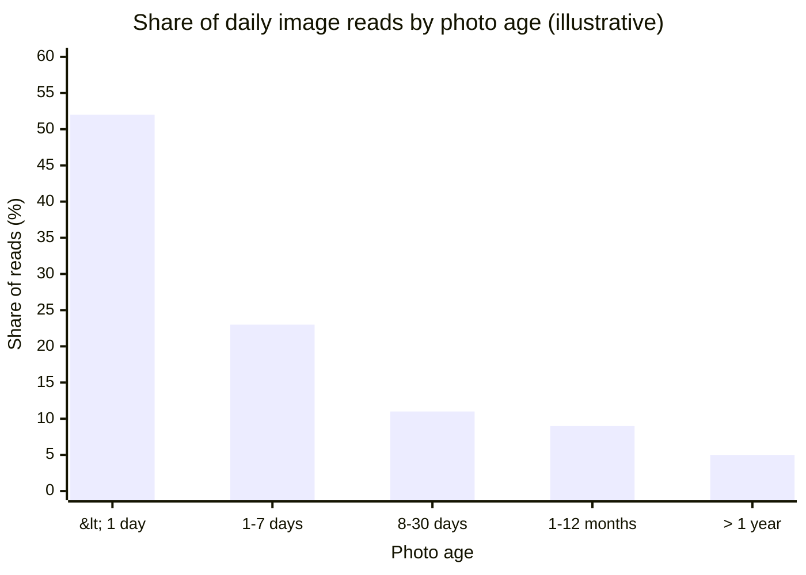
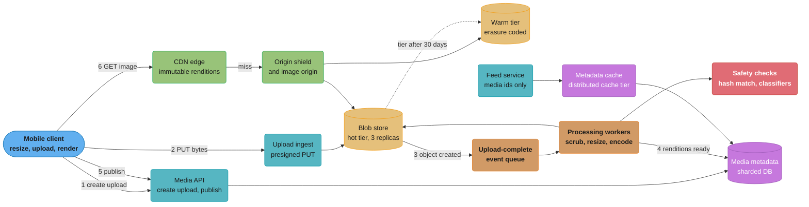
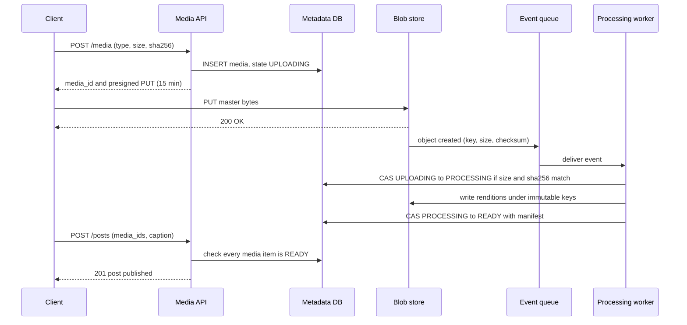
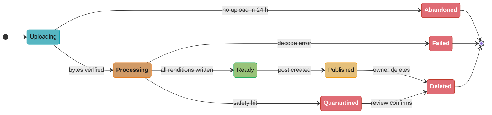
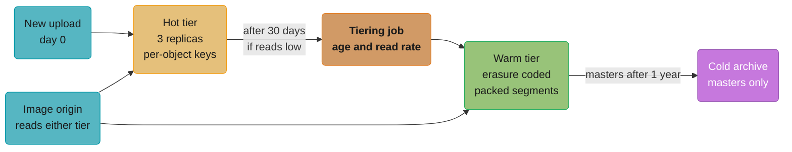
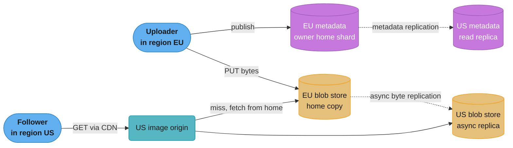

# System Design: Instagram Photo Sharing (Media Pipeline Focus)
## Intuition

> **Design intuition**: Instagram looks like a social network, but most of its bytes, its storage bill and its hardest failure modes belong to a media system. A post is a few hundred bytes of metadata and several hundred kilobytes of image, stored as half a dozen renditions, read billions of times a day through a CDN, and kept for years after the author has forgotten it. The design is therefore two systems joined at one narrow seam. The **metadata plane** (posts, media records, likes, the feed) is small, mutable and transactional. The **byte plane** (originals, renditions, CDN copies) is huge, immutable and append-only. The seam is the media record's state: a post must never become visible until every byte it points at exists, and a deleted post must stop being reachable even though copies of its bytes are sitting in hundreds of CDN edge caches.

**Key insight**: treat every image byte as **immutable and content-addressed**, and put all mutability in the metadata. A rendition's URL names exactly one sequence of bytes forever, so the CDN can cache it with an unlimited lifetime and never needs an invalidation for correctness. Edits, deletes, privacy changes and format upgrades are metadata operations that change *which* URLs a client is given, not what any URL returns. Facebook's Haystack paper (OSDI 2010) supplies the other half of the insight for the storage tier: at the scale of hundreds of billions of small files, the bottleneck is not reading bytes but **finding** them, so the storage layout must keep the "where is this photo" index in memory.

**What this case study is, and what it is not.** It designs Instagram as a **media system**: upload, processing, renditions, storage tiering, delivery, privacy and deletion for photos (with short-form video as a contrast). It deliberately links rather than repeats four neighbours:

- **Timeline fan-out and the celebrity problem** (push vs pull vs hybrid, timeline caches) are designed in [`./design_twitter.md`](./design_twitter.md), and the production implementation of a feed service (Redis ZSET feeds, cursor pagination, hydration) is [`../../backend/case_studies/design_feed_service/design_feed_service.md`](../../backend/case_studies/design_feed_service/design_feed_service.md). Here a feed entry is just a `media_id`, and this study starts where those end: turning that id into pixels on a phone.
- **The general large-blob pattern** (presigned URLs, multipart and resumable upload, upload-completion events, orphan garbage collection, metadata-to-blob consistency) is the HLD pattern page [`../large_blobs_and_media_pipelines/large_blobs_and_media_pipelines.md`](../large_blobs_and_media_pipelines/large_blobs_and_media_pipelines.md). This study applies it to one product and goes deep only where photos differ.
- **Video transcoding** (the encoding ladder, the transcode DAG, per-title encoding) is [`./design_youtube_upload_pipeline.md`](./design_youtube_upload_pipeline.md). §4.9 covers only what is specific to short Instagram video.
- **The metadata cache tier** that hydration reads from is [`./design_distributed_cache.md`](./design_distributed_cache.md).

---

## 1. Requirements Clarification

### Functional Requirements

- **Upload a post** of 1 to 10 photos (a carousel), with a caption, location tag and audience (public or followers-only). Upload must survive flaky mobile networks: a dropped connection resumes instead of restarting.
- **View** posts in a feed, on a profile grid, and on a single-post page. Every view needs the right rendition for the device: a 150-pixel grid thumbnail, a 640-pixel feed image on a small phone, a 1080-pixel image on a large one.
- **Fast first paint**: a placeholder (dominant colour or a tiny blurred preview) appears immediately; the full image follows.
- **Edit** caption and tags; **delete** a post; **archive** a post (hidden from others, kept for the owner).
- **Private accounts**: only approved followers may fetch the images, even if a URL is copied out of the app.
- **Stories**: photos visible for 24 hours, then hidden from viewers and kept in the owner's archive.
- **Safety**: images are checked against known-abuse hash lists and classifiers; flagged media is held back or removed.

### Non-Functional Requirements

- **Upload latency**: p95 under 3 seconds from "Share" to "post visible to the author", for a single photo on a 10 Mbps uplink (design target, assumption).
- **Time to ready for followers**: p95 under 10 seconds from upload completion to all renditions available.
- **Read latency**: p95 image time-to-first-byte under 100 ms from the CDN edge for cached renditions (assumption).
- **Durability**: an acknowledged upload is never lost. The blob store must replicate or erasure-code an object before it acknowledges the `PUT`, and the client keeps its local copy until the API confirms the upload.
- **Availability**: reads at 99.99%; uploads may degrade (queue, retry) but must not lose data.
- **Privacy**: GPS and other location metadata embedded in a photo's EXIF block must never be served to viewers unless the user tagged the location explicitly.
- **Deletion**: a deleted post disappears from all app surfaces within seconds, and its URLs stop working within a bounded time (minutes) even for someone who saved them.

### Out of Scope

- **Feed ranking and fan-out**: see [`./design_twitter.md`](./design_twitter.md) and the feed service study above.
- **Direct messages**: see [`./design_whatsapp.md`](./design_whatsapp.md).
- **Search and Explore recommendation**: separate retrieval and ranking systems.
- **Long-form video and live**: see [`./design_youtube_upload_pipeline.md`](./design_youtube_upload_pipeline.md) and [`./design_live_streaming.md`](./design_live_streaming.md).
- **Ads**: separate serving and auction systems.

### The Question to Ask the Interviewer First

"Do we keep the original upload, or only the renditions?" Keeping the original costs storage forever but lets the system re-encode the whole library later (a new format, a sharper downscaler, a new screen size) from the best available source. Dropping it saves bytes but freezes quality at today's encoders. This design keeps the client-uploaded image as the master and moves it to a cheaper warm tier after 30 days (§4.5).

---

## 2. Scale Estimation

Instagram's own engineering blog reported **more than 2 billion monthly active users** in November 2022. Every other figure in this section is a design assumption chosen for round arithmetic, not a published Instagram number.

### Uploads

- Photo posts: **100 million per day**, averaging **1.3 photos per post** (carousels), so **130 million photos per day**.
- Average rate: `130,000,000 / 86,400` = **~1,500 photos/sec**; peak at 3x average = **~4,500 photos/sec**.
- Uploaded master size: the client resizes before upload (Instagram's help centre says it uploads shared photos "at the best quality resolution possible (up to 1080x1080 pixels)"), so the master averages **~500 KB** as a high-quality JPEG (assumption).
- Upload ingress: `130M x 500 KB` = **65 TB/day**, about **0.75 GB/s** average and **2.3 GB/s** at peak.

### Renditions and Storage

Each photo is stored as the master plus a rendition ladder (§4.3):

| Rendition | Long side | Formats | Approx bytes (both formats) |
|---|---|---|---|
| Master | up to 1080 px | JPEG | 500 KB |
| Large | 1080 px | AVIF, JPEG | 300 KB |
| Medium | 640 px | AVIF, JPEG | 130 KB |
| Small | 320 px | AVIF, JPEG | 40 KB |
| Thumbnail | 150 px | AVIF, JPEG | 12 KB |
| **Total per photo** | | | **~980 KB** |

All byte figures are assumptions for illustration.

- Logical bytes per day: `130M x 980 KB` = **~127 TB/day**, about **46 PB/year**.
- Raw bytes with 3 replicas on the hot tier: **~382 TB/day** for the first 30 days.
- After tiering to an erasure-coded warm tier (§4.5) at an effective replication factor of 2.1: **~97 PB/year** raw for a year's worth of photos, instead of ~139 PB at 3 replicas.

### Reads

- Daily active users (assumption): **1 billion**, each loading **100 image renditions per day** across feed, profile grids and stories.
- Image requests: `100 billion / 86,400` = **~1.16 million/sec** average, **~3.5 million/sec** at peak.
- Bytes per delivered image (mostly medium and small AVIF on phones): **~60 KB** average (assumption).
- CDN egress: `1.16M x 60 KB` = **~70 GB/s** (about **560 Gbps**) average, **~1.7 Tbps** at peak.
- Read-to-write ratio by request count: `1.16M / 1,500` = **~770:1**.

### Origin Load

- CDN hit ratio target: **92%** of requests (assumption). Origin then serves `3.5M x 0.08` = **~280,000 requests/sec** at peak, about **17 GB/s**.
- Haystack's authors observed the same shape a decade earlier: CDNs serve the hottest photos well (profile pictures and recent uploads), but a social site also produces a large **long tail** of requests for older, less popular photos that typically miss the CDN and land on the storage hosts. The origin must be designed for that long tail, not just for cache misses on new content.

### Read Concentration by Age

Photo reads are heavily concentrated on recent uploads. The curve below is an illustrative shape for planning, not a published Instagram distribution; Haystack's authors describe the same qualitative pattern (recent photos and profile pictures are hot, a long tail of older photos is read rarely but in aggregate significantly).



The planning consequence: about 86% of reads in this illustrative curve hit photos under 30 days old, which is the hot tier. The remaining 14% of reads touch the 90%+ of stored bytes that are older, which is the warm tier's job (§4.5): cheap per byte, adequate per read.

### Metadata

- Media row: ~600 bytes (ids, owner, dimensions, rendition manifest, placeholder, state, timestamps).
- `130M x 600 B` = **~78 GB/day**, about **28 TB/year** before indexes and replicas. Small next to the bytes, but every feed render reads it, so it lives in a sharded database behind the cache tier.

### Processing Compute

- CPU per photo (decode, EXIF scrub, 4 resizes, AVIF and JPEG encode, perceptual hash): **~600 ms** of one core (assumption; AVIF encoding dominates).
- `1,500 photos/sec x 0.6 s` = **~900 cores busy** on average, **~2,700** at peak, before classifier inference (which runs on separate GPU pools).

---

## 3. High-Level Architecture



### Request Flow

1. **Create upload.** The client asks the Media API for an upload slot. The API creates a media row in state `UPLOADING` with a new 64-bit time-ordered `media_id` (see [`./design_distributed_unique_id.md`](./design_distributed_unique_id.md)), and returns a short-lived presigned URL that allows exactly one `PUT` of the master to a key derived from the id.
2. **Upload bytes.** The client sends the already-resized master straight to the blob store's ingest endpoint. Application servers never proxy image bytes, which keeps them small and stateless.
3. **Upload-complete event.** The blob store emits an "object created" event. A consumer verifies size and checksum against what the API recorded and moves the media row to `PROCESSING`.
4. **Process.** Workers decode the image, strip location metadata, generate the rendition ladder, compute a perceptual hash and placeholder, write every rendition under immutable keys, and run safety checks. When every rendition exists, the row moves to `READY` with a manifest of rendition keys.
5. **Publish.** The client's "Share" call creates the post. The API refuses to make the post visible to others until every media item in it is `READY` (§4.2). The author sees an optimistic local copy at once.
6. **Read.** The feed service returns media ids; hydration reads rendition manifests from the metadata cache and builds URLs for the device's screen. The client fetches images from the CDN. Misses go through an origin shield to the image origin, which reads the hot or warm tier.

### Where the Seam Is

Every arrow on the byte plane (2, 4, 6) carries immutable objects. Every arrow on the metadata plane (1, 3, 5) carries small state transitions. The publish check in step 5 is the only place the two planes must agree, and it is a single conditional read: "are all media items in this post `READY`?" Getting that one check wrong is War Story 1 in §9.

---

## 4. Component Deep Dives

### 4.1 Client-Side Preparation and the Upload Session

**Resize on the phone, not on the server.** A modern phone camera produces a 12-megapixel or larger image of several megabytes. The product shows at most a 1080-pixel image, and Instagram's help centre says shared photos are uploaded at up to 1080x1080 pixels. Resizing on the device before upload cuts upload bytes several-fold, which is the single biggest lever on upload latency on a mobile uplink. The server still treats the upload as untrusted input (§4.4): the client is a hint, never a guarantee.

**Direct-to-blob upload with a presigned URL.** The Media API never touches image bytes. It returns a presigned `PUT` URL scoped to one key, one content type and one maximum size, with a short expiry. On Amazon S3, for example, a presigned URL can be valid for up to 7 days when signed with an IAM user's long-term credentials under Signature Version 4, and only as long as the underlying credentials when signed with temporary credentials; it can be used repeatedly until it expires, and an upload to an existing key replaces that object. Both facts shape the design:

- **Expiry**: this design issues 15-minute upload URLs. A URL valid for days is a free upload credential for anyone who extracts it from the app.
- **Repeat use and overwrite**: because a presigned `PUT` can be replayed and overwrites, the key must be unique per upload attempt (`masters/<media_id>/<upload_nonce>`), and the upload-complete consumer must accept exactly one object per media row (§4.2). Otherwise a replayed URL can swap the bytes under a post that has already been processed.

**Single `PUT` vs multipart.** A 500 KB photo is one `PUT`; a retry resends 500 KB, which is cheaper than any resumable protocol's bookkeeping. Multipart and resumable uploads matter for video and large originals: S3's own guidance is to consider multipart once an object reaches 100 MB, with parts from 5 MiB to 5 GiB, at most 10,000 parts, and objects up to 48.8 TiB. The resumable mechanics (offsets, idempotent chunk commits, orphan cleanup) are covered in [`./design_youtube_upload_pipeline.md`](./design_youtube_upload_pipeline.md) §4.1-§4.2 and the large-blob pattern page; this design uses them only for video (§4.9).



### 4.2 The Media State Machine and the Publish Check

Every media item moves through a small state machine stored on its metadata row. All transitions are compare-and-set on the current state, so duplicate or reordered events cannot move an item backwards.



***Broken:*** creating the post as soon as the client says "Share", on the assumption that processing is fast:

```java
// BROKEN: the post becomes visible before its renditions exist.
public Post publishBroken(long ownerId, List<Long> mediaIds, String caption) {
    Post post = postDao.insert(ownerId, mediaIds, caption, Visibility.PUBLIC);
    fanout.enqueue(post.id());   // followers' feeds now reference these media ids
    return post;
}
```

Processing p50 is about 1.5 s, but its p99 under a queue backlog is minutes. Every follower whose feed is hydrated in that window gets a media id whose manifest is empty. Clients either render a broken image or, worse, request a predictable rendition URL that does not exist yet; the CDN caches the origin's `404` for its negative-caching TTL, and the image stays broken for that viewer's edge even after processing finishes. At 4,500 photos/sec at peak, a 2-minute backlog is 540,000 posts in that state.

***Fix:*** publish is a two-step contract. The post row is created immediately in a `PENDING` state (so the author sees it, optimistically, from local state), and it becomes visible to others only when every media item is `READY`. The transition is driven by whichever event happens last, "post created" or "last media item ready", and both paths run the same idempotent check:

```java
public final class PublishCoordinator {
    private final PostDao postDao;
    private final MediaDao mediaDao;
    private final FanoutQueue fanout;

    public PublishCoordinator(PostDao postDao, MediaDao mediaDao, FanoutQueue fanout) {
        this.postDao = postDao;
        this.mediaDao = mediaDao;
        this.fanout = fanout;
    }

    /** Called from POST /posts. Visible to the author at once, to others only when ready. */
    public Post createPost(long ownerId, List<Long> mediaIds, String caption) {
        Post post = postDao.insertPending(ownerId, mediaIds, caption);
        tryPublish(post.id());
        return post;
    }

    /** Called by the processing worker after it moves a media item to READY. */
    public void onMediaReady(long mediaId) {
        Long postId = postDao.findPendingPostFor(mediaId);
        if (postId != null) tryPublish(postId);
    }

    /** Idempotent: safe to call any number of times from either path. */
    void tryPublish(long postId) {
        Post post = postDao.get(postId);
        if (post.state() != PostState.PENDING) return;
        if (!mediaDao.allReady(post.mediaIds())) return;      // not yet: the last READY event will retry
        // Conditional update: only one caller wins the PENDING -> PUBLISHED transition.
        boolean won = postDao.compareAndSetState(postId, PostState.PENDING, PostState.PUBLISHED);
        if (won) fanout.enqueue(postId);                       // fan-out happens exactly once
    }
}
```

Two details make it correct. The compare-and-set on `PENDING -> PUBLISHED` means two concurrent callers (the API thread and the worker) cannot both enqueue fan-out. And rendition URLs are never guessable: a client only ever learns a URL from a `READY` manifest, so no edge can cache a `404` for a key that will exist later.

### 4.3 The Rendition Ladder and Format Negotiation

A phone showing a 3-column profile grid needs nine 150-pixel thumbnails, not nine 1080-pixel images. Serving the right size is worth more bandwidth than any codec choice:

```
Bytes delivered for one profile-grid screen (9 tiles), by rendition chosen

  1080 px JPEG  |##################################################| 9 x 180 KB = 1,620 KB
  640 px JPEG   |##################                                | 9 x  80 KB =   720 KB
  320 px AVIF   |###                                               | 9 x  15 KB =   135 KB
  150 px AVIF   |#                                                 | 9 x   5 KB =    45 KB
```

Caption: choosing the 150-pixel AVIF thumbnail instead of the full image cuts a grid screen from about 1.6 MB to about 45 KB, a 36x reduction (illustrative byte sizes from §2's table). Size selection comes first; format choice is the second, smaller multiplier.

**Pre-generate or resize on demand?** Two models exist:

| | Pre-generate a fixed ladder (chosen) | Resize on demand at an image proxy |
|---|---|---|
| Storage | Every rendition stored (~2x the master here) | Master only, plus a cache of popular outputs |
| First-view latency | Constant, cache hit or origin read | Cold sizes pay a decode-resize-encode (tens to hundreds of ms) |
| CPU | Fixed, at upload time, for every photo | Proportional to *distinct* (photo, size, format) requests |
| Flexibility | New size or format means a backfill job | Any size, any time |
| Abuse surface | None | Arbitrary size parameters can be used to exhaust CPU unless sizes are allow-listed |

At a 770:1 read-to-write ratio with a small, stable set of client screen classes, pre-generating a fixed ladder is cheaper and more predictable. On-demand resizing is the right choice for long-tail sizes (a web embed, a partner integration) behind an allow-list of sizes.

**Format negotiation without breaking caches.** Newer clients accept AVIF; some older clients accept only JPEG. Two ways to choose:

- **Explicit in the URL** (chosen): hydration knows the client's capabilities from its app version and builds `.../m640.avif` or `.../m640.jpg`. The CDN cache key is just the URL. Nothing can go wrong at the edge.
- **`Accept`-header negotiation at the edge**: one URL, and the edge or origin picks the format from the request's `Accept` header. This only works if the cache key includes the negotiated format (or the response varies on `Accept` and the CDN honours it). Forgetting that serves AVIF bytes to a JPEG-only client from cache (War Story 3).

**Placeholders.** The processing worker stores a dominant colour and a tiny (about 20-30 byte) blurred preview in the media row itself. Hydration returns it inline with the feed page, so the client paints a placeholder in the same frame as the caption, before any image request leaves the phone.

### 4.4 Treating Uploads as Hostile: Privacy and Safety

Every uploaded file is untrusted input to a decoder. The processing pipeline runs these checks before anything is written under a public key:

1. **Container and size checks.** The declared type must match the magic bytes; the byte size must match what the API recorded at upload creation; the sha256 must match the client's declaration.
2. **Decompression-bomb guard.** A file of a few hundred kilobytes can declare dimensions of 50,000 x 50,000 pixels, which is 2.5 billion pixels and about 10 GB of RGBA memory once decoded. Read the header first and reject anything above a pixel budget (this design: 40 megapixels) before decoding.
3. **Strip metadata.** Remove the EXIF block, including GPS coordinates, camera serial numbers and timestamps, from every rendition. Copy the orientation flag into the pixel data (rotate) before stripping, so images do not appear sideways. Location is shown only when the user tags it explicitly, from the post's metadata, never from the file.
4. **Re-encode everything.** Never serve the uploaded bytes as-is, even for the "large" rendition: re-encoding through a known-good encoder removes malformed structures that could exploit viewers' decoders, and guarantees the format the URL claims.
5. **Safety checks.** Compute a perceptual hash and match it against hash lists of known abusive content; run classifiers asynchronously. A match moves the item to `Quarantined` before `READY`, so it is never published. Classifier results that arrive after publication take the deletion path (§4.8).

Steps 2-4 run in a sandboxed worker pool with per-task memory and CPU limits, because image decoders are a long-standing source of memory-safety bugs. A crash in one decode must kill one task, not a worker host.

### 4.5 Blob Storage Layout and Tiering

**The small-file problem.** Haystack's authors describe Facebook's earlier photo storage on NFS appliances: each photo was a file, and looking up a file's metadata (directory entries, inodes) cost disk operations before the photo's own bytes could be read. Their key observation was that this traditional design "incurs an excessive number of disk operations because of metadata lookups". Haystack's answer was to pack many photos into large append-only volume files (about 100 GB each in the paper's example) and keep a compact per-photo index in memory, so a read needs at most one disk operation. The paper reports an average of **10 bytes of main memory per photo** for that index.

At this design's scale the lesson still holds even on a modern object store: billions of individual small objects stress the store's metadata layer, not its disks. Practical consequences for this design:

- Renditions are written as separate objects for simplicity on the hot tier, where the object store absorbs the metadata cost.
- The warm tier packs a photo's whole rendition set (and many photos) into large immutable segments with an in-memory or SSD-resident index of `(media_id, rendition) -> (segment, offset, length)`, the Haystack layout.

**Hot and warm tiers.** Access to a photo decays steeply with age: most views happen in the first days after posting. Facebook's f4 paper (OSDI 2014) describes splitting BLOBs into temperature zones and moving warm BLOBs from Haystack to f4, reporting **over 65 PB** of logical BLOBs in f4 and an **effective replication factor reduced from 3.6 to either 2.8 or 2.1**.



The savings are large enough to justify the complexity. A year of this design's photos is about 46 PB logical (§2). At 3 replicas that is about 139 PB raw; at an effective 2.1 it is about 97 PB, saving roughly **42 PB of raw disk per year of uploads**, every year, for as long as the photos are kept.

**Tiering is a metadata operation.** Moving a photo changes where its bytes live, not its URL. The origin resolves `(media_id, rendition)` through the metadata row's `tier` field, so CDN URLs issued years ago keep working.

**Do not tier on age alone.** An old photo can become hot again (a profile picture, a post that resurfaces). The tiering job uses age *and* the recent read rate reported by the origin, and the origin promotes a warm photo's renditions back to the hot tier when its read rate crosses a threshold.

### 4.6 Delivery: URLs, CDN and Origin

**Immutable, content-addressed URLs.** A rendition URL looks like:

```text
https://img.example-cdn.net/v1/<shard>/<media_id>/<rendition>.<format>?h=<content_hash>&sig=<signature>&exp=<expiry>
```

The path plus `h` identifies exactly one byte sequence forever. If the photo is re-encoded (a better encoder, a new format), the new bytes get a new hash and therefore a new URL; old URLs keep returning old bytes until they expire. So the origin sends `Cache-Control: public, max-age=31536000, immutable` and the CDN never needs to purge for correctness. The edge caching mechanics are in [`../cdn/cdn.md`](../cdn/cdn.md).

| Response | `Cache-Control` from origin | Reason |
|---|---|---|
| Rendition, public account | `public, max-age=31536000, immutable` | Bytes behind a content-hashed URL never change |
| Rendition, private account | `public, max-age=31536000, immutable` at the edge; the edge strips it to `private` towards the client | The edge caches by path and hash and checks the signature on every request |
| `404` for an image path | `max-age=5` | Short negative caching so a transient miss cannot stick (War Story 1) |
| Hydration API response (JSON) | `no-store` | Visibility and signatures are per viewer and per moment |
| Placeholder data | Inline in the hydration response | No separate request at all |

**Signed URLs for private accounts.** For a followers-only account, a copied URL must stop working. Hydration signs each URL with a short expiry (this design: 6 hours) after checking that the viewer may see the post. The CDN verifies the signature at the edge, without calling back to the application. Two consequences:

- The signature and expiry must be **excluded from the CDN cache key**, or every viewer gets a different cache key for the same bytes and the hit ratio collapses. The edge validates the signature, then looks up the cache by path and content hash only.
- Revocation is bounded by the expiry: unfollowing someone stops new URLs at once, but URLs already handed out work until they expire. A 6-hour expiry is the product's accepted worst case; shorter expiries cost more signing work and fewer client-side cache hits.

**Origin shield and the long tail.** CDN misses go first to a small number of regional shield caches, then to the image origin. Haystack's authors made a pointed observation about this tier: in their NFS-era design, a cache placed *behind* the CDN was ineffective, because a request that misses at the CDN is unlikely to hit in an internal cache either. They kept an internal cache only for requests that come directly from a user rather than the CDN *and* fetch a photo from a write-enabled machine (where recent uploads live), and planned to push recently uploaded photos into that cache proactively. The modern equivalent in this design:

- The **shield** collapses concurrent misses for the same object from many edges into one origin read (request coalescing), which matters most in the first minutes after a popular account posts.
- The **origin** keeps a small cache of *recent uploads only*, warmed by the processing worker when it writes the renditions, because new photos are exactly the ones that are about to be requested from every edge at once.
- Old long-tail reads go straight to the warm tier. Caching them again would only evict the recent uploads.

### 4.7 From Feed Entry to Pixels: Hydration

The feed service ([`../../backend/case_studies/design_feed_service/design_feed_service.md`](../../backend/case_studies/design_feed_service/design_feed_service.md)) returns a page of post ids. Hydration turns each into what the client needs to draw it:

1. **Batch-read post and media rows** from the metadata cache tier ([`./design_distributed_cache.md`](./design_distributed_cache.md)), one multi-get per page, with misses filled from the sharded metadata database.
2. **Filter by visibility**: drop posts whose media is not `PUBLISHED`, and posts the viewer may not see (private account, blocked user). This check happens on every hydration, not only at fan-out time, because a block or a deletion after fan-out must take effect immediately.
3. **Choose renditions** per item from the viewer's screen width, pixel density and format support: a 393-point-wide phone at 3x density shows a full-width feed image at about 1,179 physical pixels, so it gets the 1080-pixel rendition; the same phone's grid tile at about 130 points (about 390 pixels) gets the 320-pixel rendition.
4. **Build URLs**, signing them for private accounts, and attach the inline placeholder.

**Prefetching.** The client prefetches the next 3-5 posts' images while the user reads the current one. Prefetch requests use the same immutable URLs, so a prefetched image is a CDN hit when the user scrolls to it. Prefetch is cancelled when the user leaves the feed, so a fast scroller does not spend their data plan on images they never see.

### 4.8 Deletion, Stories Expiry and Garbage Collection

Immutable bytes make deletion a multi-step process, and each step has a different deadline.

| Step | Mechanism | Deadline |
|---|---|---|
| Hide everywhere in the app | Media and post rows move to `Deleted`; hydration filters it (§4.7) | Seconds (cache delete plus CDC invalidation in the cache tier) |
| Stop URLs for private content | Signed URLs expire | At most the signing expiry (6 hours) |
| Stop URLs for public content | CDN purge by URL list for that media's renditions | Minutes |
| Remove bytes from hot tier | Async delete job after a short grace window (accidental-delete recovery) | Days |
| Remove bytes from warm segments | Mark deleted in the segment index; reclaim on compaction | Weeks (compaction cycle) |

Two rules keep this correct. First, **metadata first, bytes last**: the moment the row says `Deleted`, nothing can hand out a new URL, so every later step is cleanup of copies that are already unreachable through the app. Second, the purge list is **computed from the manifest**, not guessed, so every rendition and format variant is purged, not just the one a support engineer happened to test.

**Stories.** A story is media plus a visibility window. At 24 hours the story row's state moves to `Expired` (hidden from viewers, still in the owner's archive). The bytes do not move: archiving is a metadata change, and the photo tiers to warm storage on the normal schedule.

**Orphans.** Some uploads never get published: the user cancels, the app is killed, the network drops after the `PUT`. Two sweepers handle them. A lifecycle rule aborts incomplete multipart uploads after 1 day (video only, since photos are single `PUT`s). A daily orphan sweeper finds media rows still in `Uploading` or `Ready` with no post after 24 hours, deletes their blobs, and marks them `Abandoned`; it also lists blob keys with no media row (the rare case where the `PUT` succeeded after the row was cleaned up) and deletes them. At even a 3% abandonment rate, orphans are `130M x 0.03 x 980 KB` = **~3.8 TB/day** of storage that nobody can see.

### 4.9 Short Video: What Differs from Photos

Instagram short video shares the same upload session, state machine, deletion and delivery design. Two things differ: uploads use resumable multipart transfers (§4.1), and processing is a transcode pipeline rather than an image resize. The general transcode DAG and encoding ladder are in [`./design_youtube_upload_pipeline.md`](./design_youtube_upload_pipeline.md).

Instagram's engineering team published a concrete example of how much the encoding plan matters (November 2022). Instagram produced two classes of encodings for each video: **minimum functionality** encodings compatible with every client, and **advanced** encodings using newer compression. More than **80%** of video compute went to minimum functionality encodings, while advanced encodings covered only **15%** of watch time. Their fix was to stop transcoding the basic adaptive-bitrate (ABR) encodings separately and instead **repackage the frames of the existing progressive encoding into an ABR-capable structure**. Their example: transcoding a 23-second video to 720p took **86.17 s** of CPU time, while generating the manifest and repackaging took **0.36 s**. The change cut the cost of basic ABR encodings by **94%**, and the freed compute raised advanced-encoding watch-time coverage by **33%**.

The design lesson carries over to photos: **measure where processing compute goes against where viewing time goes**, and spend encode effort on the renditions people actually see. For photos that means the medium and small AVIF renditions on phones, not the 1080-pixel JPEG that only old clients and desktop web request.

### 4.10 Carousels: Atomic Multi-Item Posts

A carousel post holds up to 10 media items, uploaded in parallel. The post must appear with all of its items or not at all; a carousel that shows 7 of 10 photos is a broken post.

- **Upload in parallel, publish as a unit.** Each item has its own upload session and state machine. The post row lists all `media_ids` in order, and `tryPublish` (§4.2) requires every item to be `READY`, so ordering and completeness come from the post row, not from upload timing.
- **Partial failure.** If one item fails processing (`Failed` or `Quarantined`), the post stays `PENDING` and the client is told which item failed. The user can retry that item (a new upload session replacing the failed `media_id` in the post row) or remove it. The post never publishes with a gap.
- **Ordering.** Item order lives only in the post row's `media_ids` array. Reordering before publication is a metadata edit; nothing about the bytes changes.
- **Abandonment.** If the client never retries, the orphan sweeper (§4.8) collects the whole post's media after 24 hours, including the items that succeeded.

### 4.11 Multi-Region Uploads and Reads

Users upload to the nearest region, and followers read from everywhere. Three rules keep this simple:

1. **Bytes are written in the uploader's region and replicated asynchronously** to a second region for durability and to regions with heavy read demand. Because bytes are immutable, replication never conflicts: a key either exists in a region or it does not.
2. **The origin can read across regions.** If a follower's nearest origin does not yet have a rendition (replication lag of seconds to minutes), the origin fetches it from the home region recorded in the media row and caches it locally. This costs cross-region bandwidth only for fresh content that is read far from where it was uploaded.
3. **Metadata has one home region per owner.** Media and post rows live in the owner's home shard and region; other regions read replicas through the metadata cache. The publish check (§4.2) runs in the home region, so it never reads a stale replica.



**Read-your-own-upload.** The author's own client never waits for replication: it shows the local copy optimistically, and the author's own hydration requests are served from the home region for 60 seconds after a publish. Everyone else may see the post a few seconds later, which the product accepts. Data residency rules, where they apply, constrain rule 1 (bytes may only be replicated to permitted regions); see [`../multi_region_and_data_residency/multi_region_and_data_residency.md`](../multi_region_and_data_residency/multi_region_and_data_residency.md).

---

## 5. Design Decisions & Tradeoffs

### Synchronous vs Asynchronous Safety Checks

| Check | Runs | Why |
|---|---|---|
| Pixel budget, type check, checksum | Synchronously, before decode | Cheap, and protects the workers themselves |
| Perceptual-hash match against known-abuse lists | Synchronously, before `READY` | A known match must never be published, even for seconds |
| ML classifiers | Asynchronously, after `READY`, for accounts in good standing; synchronously for new or flagged accounts | Inference latency on every upload would double time to ready; risk-based gating spends it where it matters |
| Human review | After a classifier or user report | Removes via the deletion path (§4.8) |

The rule underneath: anything that can harm the platform's own workers, or that has a known-bad answer, blocks publication; anything probabilistic is gated by account risk so the median upload stays fast.

### Client-Side Resize vs Server-Side Only

| | Resize on device, then upload (chosen) | Upload camera original, resize on server |
|---|---|---|
| Upload bytes | ~500 KB per photo | Several MB per photo |
| Upload latency on a 10 Mbps uplink | ~0.4 s | Several seconds |
| Server trust | Must still validate and re-encode | Same |
| Future re-encodes | Limited to the uploaded master's quality | Full camera quality available |

The product never displays more than about 1080 pixels, so the extra quality of the camera original buys nothing a viewer can see, while its upload time is the most visible latency in the product.

### Fixed Ladder vs On-Demand Resizing

Covered in §4.3. Fixed ladder for the app's known screen classes; an allow-listed on-demand resizer only for web embeds and partner sizes.

### JPEG vs AVIF (and WebP)

| | JPEG only | AVIF plus JPEG fallback (chosen) |
|---|---|---|
| Bytes per rendition | Baseline | Smaller at similar visual quality (the exact ratio depends on content and encoder settings; measure it on your own corpus before quoting it) |
| Encode CPU | Low | Much higher; AVIF encoding dominates §2's 600 ms per photo |
| Client support | Universal | Newer clients only, so JPEG stays as the fallback rendition |
| Storage | 1 copy per size | 2 copies per size |

At a 770:1 read-to-write ratio, paying more CPU once at upload to save bytes on every one of hundreds of reads is the right trade, and §4.9's Instagram video example is the same argument with numbers.

### Replication vs Erasure Coding

| | 3 replicas (hot tier) | Erasure coding (warm tier) |
|---|---|---|
| Raw bytes per logical byte | 3.0 | ~2.1 effective in f4's reported configuration |
| Read cost | Any replica, one read | Normal reads hit one data block; a degraded read must reconstruct from several blocks |
| Write and repair cost | Low | Encoding on write; reconstruction traffic on disk loss |
| Fits | New, frequently read photos | Old, rarely read photos |

### Signed URLs vs Public URLs

| | Public immutable URL | Signed URL with expiry |
|---|---|---|
| Who | Public accounts | Private accounts, archived and expired content shown to its owner |
| CDN hit ratio | Highest | Same, if the signature is excluded from the cache key |
| Revocation | Only by CDN purge | Automatic at expiry, purge for faster removal |
| Cost | None | A signature per URL at hydration time |

### Keep the Original Master Forever?

Yes, on the cold tier. A year of masters is about `130M x 365 x 500 KB` = **~24 PB** logical. It is the only input from which the whole library can be re-encoded when a better format or encoder arrives, and re-encoding from a 640-pixel rendition would bake today's artefacts into tomorrow's images.

---

## 6. Real-World Implementations

| System | What was published | Lesson for this design |
|---|---|---|
| **Facebook Haystack** (OSDI 2010, Beaver et al.) | Over 260 billion images, over 20 PB; users uploaded over 65 billion photos and each was stored in four sizes; one billion new photos (about 60 TB) uploaded each week; over one million images served per second at peak. The earlier NFS design spent too many disk operations on metadata lookups; Haystack keeps per-photo metadata in memory (an average of 10 bytes per photo) so a read needs at most one disk operation. Components: Store, Directory, Cache. CDNs served the hottest photos; the long tail mostly missed the CDN | Finding a small object costs more than reading it; keep the location index in memory and design the origin for the long tail (§4.5, §4.6) |
| **Facebook f4** (OSDI 2014, Muralidhar et al.) | Warm BLOB storage that splits BLOBs by temperature; over 65 PB of logical BLOBs; effective replication factor reduced from 3.6 to 2.8 or 2.1 | Tier by temperature; erasure-code the warm majority of bytes (§4.5) |
| **Instagram video encoding** (Meta engineering blog, November 2022) | More than 2 billion monthly active users; over 80% of video compute spent on minimum functionality encodings that covered most watch time while advanced encodings covered 15%; repackaging progressive encodings as ABR cut basic ABR cost by 94% and raised advanced-encoding watch-time coverage by 33%; 86.17 s of CPU to transcode a 23 s clip to 720p vs 0.36 s to repackage | Align processing spend with viewing time (§4.9) |
| **Instagram photo resolution** (Instagram help centre) | Shared photos are uploaded "at the best quality resolution possible (up to 1080x1080 pixels)" | Resize on the device; the ladder tops out at 1080 pixels (§4.1, §4.3) |
| **Instagram and mcrouter** (Meta engineering blog, September 2014) | Instagram used mcrouter as a standalone binary on AWS before fully moving to Facebook's infrastructure | The metadata cache tier is shared infrastructure, see [`./design_distributed_cache.md`](./design_distributed_cache.md) |
| **Amazon S3** (documentation) | Multipart: parts 5 MiB to 5 GiB, up to 10,000 parts, objects up to 48.8 TiB, multipart advised from 100 MB; presigned URLs up to 7 days with IAM user credentials under SigV4, reusable until expiry, and an upload to an existing key replaces the object | The upload-session rules in §4.1 come straight from these limits |

### What the Published Systems Agree On

Haystack and f4 together describe the arc this design follows: a hot tier optimized for throughput and fast lookup for new photos, a warm tier optimized for bytes per photo for the long tail, and a CDN in front that is excellent for the head of the distribution and of little help for the tail. Instagram's 2022 video post adds the processing-side version of the same lesson: the cheapest compute is the compute you stop spending on renditions nobody watches.

---

## 7. Technologies & Tools

| Tool | Role | Notes |
|---|---|---|
| Amazon S3 | Hot-tier object store, presigned uploads, event notifications | Any object store with presigned writes and object-created events fits |
| Amazon CloudFront | CDN with signed URLs and an origin shield option | Equivalents: Akamai, Fastly, Cloudflare |
| Akamai | CDN | Named in the Haystack paper as the CDN serving the majority of Facebook's photo reads at the time |
| libvips | Image decode, resize and encode in the processing workers | Run inside the sandboxed worker pool (§4.4) |
| libavif | AVIF encoding | Encode-time CPU is the main processing cost |
| FFmpeg | Video transcode for short video | See [`./design_youtube_upload_pipeline.md`](./design_youtube_upload_pipeline.md) |
| MP4Box | Repackaging encodings into DASH adaptive-bitrate structure | Used in Instagram's published repackaging example |
| Apache Kafka | Upload-complete and media-ready event streams | Partition by `media_id` so one item's events stay ordered |
| Redis | Metadata cache tier and hot-key near caching | Design in [`./design_distributed_cache.md`](./design_distributed_cache.md) |
| PostgreSQL | Sharded media and post metadata | Shard by owner user id; see [`../database_sharding/database_sharding.md`](../database_sharding/database_sharding.md) |

### Build vs Buy

Buy the object store and the CDN: both are commodity at any size below the very largest platforms, and the Haystack and f4 layouts only pay for themselves at hundreds of petabytes. Build the parts that encode product decisions: the state machine and publish check, the rendition ladder and hydration logic, the privacy scrubbing, the deletion workflow and the tiering policy. Those are where the correctness bugs live, and no vendor product knows the product's rules.

---

## 8. Operational Playbook

### Key Metrics

| Metric | Target | Alert |
|---|---|---|
| Upload success rate (create to `READY`) | >= 99.5% | < 99% over 10 minutes |
| Time to `READY`, p95 | < 10 s | > 30 s for 5 minutes |
| Processing queue oldest-event age | < 5 s | > 60 s |
| Posts stuck in `PENDING` > 5 minutes | ~0 | > 1,000 |
| Client broken-image rate (beacon) | < 0.05% of image loads | > 0.2% |
| CDN hit ratio (requests) | >= 92% | < 88% |
| Origin requests/sec | ~280k at peak | > 400k |
| Decode failures and pixel-budget rejections | Stable | 5x baseline (bad client release or attack) |
| Orphan bytes created per day | ~3.8 TB | 3x baseline |
| Deletion purge lag (delete to CDN purge complete) | < 5 minutes | > 30 minutes |

### Runbook: Time-to-Ready Rising

1. Check the processing queue's oldest-event age and the worker fleet's CPU. A rising age with saturated CPU is a capacity problem: scale workers, and temporarily skip the AVIF renditions (serve JPEG) to cut per-photo CPU, then backfill AVIF later.
2. A rising age with idle CPU means workers are blocked: check blob-store latency and the safety service; the safety call must time out and fall back to "publish, then scan" only for accounts in good standing, never skip the hash match.
3. Confirm posts are waiting in `PENDING`, not published with empty manifests. If any published post has a non-`READY` item, page immediately (the publish check regressed).

### Runbook: Broken-Image Rate Spike

1. Split the beacon by app version, format and rendition. A spike on one format and old app versions points at format negotiation (War Story 3).
2. Split by edge location. A spike at a few edges points at the CDN (bad cache entries, certificate or signing-key rotation).
3. If signed URLs are failing everywhere, check signing-key rotation: the edge must accept both the old and new key during the overlap window.

### Runbook: Signing-Key Rotation

1. Publish the new signing key to every CDN edge configuration and wait for confirmation from all regions before any service signs with it.
2. Switch hydration to sign with the new key. Edges accept both keys during the overlap window, which must be at least as long as the longest URL expiry (6 hours here) plus client cache time.
3. Retire the old key only after the overlap window, and watch the broken-image rate for private accounts during each step.

### Runbook: Mass Deletion (Account Takedown or Legal Request)

1. Mark all affected media `Deleted` in one batch job; hydration hides them at once.
2. Throttle CDN purges to the provider's documented rate limits; queue the rest. Private content is safe once signatures expire.
3. Record the purge list and completion time per media id; legal requests need proof of completion.

---

## 9. Common Pitfalls & War Stories

The war stories are **composite, illustrative incidents** built from common failure patterns in media systems. The figures follow from §2's assumptions; they are not reported by Instagram or another named company.

| Pitfall | Symptom | Prevention |
|---|---|---|
| Publishing before renditions exist | Broken images in followers' feeds, cached `404`s | `PENDING` posts and the publish check (§4.2) |
| Serving uploaded bytes as-is | Location leaks, decoder exploits | Strip metadata, re-encode everything (§4.4) |
| Format negotiation without cache-key discipline | AVIF served to JPEG-only clients | Format in the URL, or format in the cache key |
| Signature in the cache key | CDN hit ratio collapses for private accounts | Validate the signature, cache by path and hash |
| Predictable rendition URLs | Edges cache `404` before processing finishes | Only hand out URLs from a `READY` manifest |
| No pixel budget | Workers killed by out-of-memory on tiny files | Header check before decode (§4.4) |
| Tiering by age only | Old but popular photos served slowly from warm tier | Age plus read rate, with promotion (§4.5) |
| Carousel published with a failed item | Post shows a gap or a broken tile | Publish only when every listed item is `READY` (§4.10) |
| Orphan sweeper disabled or missing | Storage grows with no visible content | Orphan-bytes metric and alert (§8) |
| Signing key rotated without overlap | Private photos break for everyone at once | Two-key overlap window (§8) |

### War Story 1: The Fast Path That Published Empty Posts

**Broken**: to cut perceived upload latency, a release moved fan-out to the moment the client tapped "Share", before processing finished. In normal conditions processing completed in about 1.5 s and fan-out took longer than that, so nobody noticed.

**Impact**: two weeks later a safety-classifier deploy added 40 s of latency to every processing task during the evening peak. For about 25 minutes, about 4,500 posts per second were fanned out with empty manifests, around 6.7 million posts in total. Clients built the medium rendition's URL from a predictable pattern, requested it, and received `404`s, which edges cached for their 10-minute negative-caching TTL. Broken-image beacons went from 0.03% to 9% of image loads. Even after processing caught up, viewers behind those edges kept seeing broken images until the cached `404`s expired.

**Fixed**: posts became `PENDING` until every item is `READY` (§4.2); rendition URLs became unguessable (content hash in the URL, only returned from a `READY` manifest); and negative caching for image paths was cut to 5 seconds.

### War Story 2: The Photo That Told Everyone Where You Live

**Broken**: a new "original quality" option for a subset of users served the uploaded master directly for the 1080-pixel view, skipping the re-encode to save CPU. The master still carried its EXIF block, including GPS coordinates.

**Impact**: for 9 days, about 2.1 million photos were served with embedded coordinates. A researcher reported that a third-party tool could extract home locations from photos posted by accounts that had never tagged a location. The incident required a privacy regulator notification in two jurisdictions, a forced re-encode of the affected photos, a purge of about 12.6 million CDN objects (photos times formats and sizes), and a published postmortem.

**Fixed**: no code path may serve uploaded bytes; every served rendition comes from the scrubbing re-encoder, enforced by the origin refusing keys outside the rendition namespace. A continuous canary uploads photos with known EXIF tags every minute and alerts if any served rendition contains an EXIF block.

### War Story 3: AVIF for Everyone, Including Clients That Cannot Decode It

**Broken**: the web team switched image URLs to a single format-neutral URL with `Accept`-header negotiation at the origin, so browsers that advertise `image/avif` would get AVIF. The CDN configuration still keyed the cache on the URL only, and the origin did not send `Vary: Accept`.

**Impact**: whichever client first requested an image at each edge decided the format for everyone behind that edge. About 7% of web sessions (older browsers) received AVIF bytes they could not decode. The broken-image rate on web rose from 0.04% to 6.8% for 3 hours until the change was rolled back, with an estimated 4% drop in web session length that day.

**Fixed**: the format went back into the URL for app clients; for web, the CDN cache key now includes a normalized format class (AVIF, WebP, JPEG) derived from the `Accept` header, and a synthetic check fetches the same URL with three `Accept` values from every edge region every 5 minutes.

### War Story 4: The Ten-Kilobyte File That Took Down a Worker Fleet

**Broken**: processing workers decoded uploads with no dimension check, trusting the client-side resize.

**Impact**: a scripted client uploaded a few hundred PNGs of about 10 KB each, declaring 40,000 x 40,000 pixels of a single colour. Each decode tried to allocate about 6.4 GB. Workers were killed by the out-of-memory killer, the scheduler retried the poisoned events on other workers, and within 15 minutes about 60% of the worker fleet was crash-looping. Time to `READY` for legitimate uploads rose to 14 minutes for about 40 minutes.

**Fixed**: a header-only dimension check against a 40-megapixel budget before decode (§4.4); per-task memory limits in the sandbox; a poison-event rule that moves an event to a dead-letter queue after 2 task crashes instead of retrying it forever.

### War Story 5: The Orphan Sweeper That Was Never Turned On

**Broken**: the orphan sweeper (§4.8) shipped behind a feature flag during a storage migration and was never enabled in the new region. Uploads that were cancelled, retried with a new session, or abandoned after the `PUT` left blobs with no published post.

**Impact**: the region handled about a third of all uploads, its abandonment rate was about 4%, and nothing alerted on orphan bytes. Over 7 months (about 210 days) the region accumulated `43M x 0.04 x 980 KB x 210` = about 360 TB of logical orphaned renditions (about 1.1 PB raw, because the tiering job only moved published media and left orphans on the 3-replica hot tier). The storage bill for that region ran about 9% above forecast for two quarters before a finance review found it. Cleaning up took 3 weeks of throttled deletes so the bulk delete would not compete with live traffic.

**Fixed**: orphan bytes per day became a first-class metric with an alert at 3x baseline (§8); the sweeper's last successful run is now part of the region's readiness checklist; and the tiering job now deletes never-published media instead of leaving it on the hot tier.

---

## 10. Capacity Planning

### Storage

| Item | Per day | Per year |
|---|---|---|
| Photos | 130 million | ~47 billion |
| Logical bytes (master plus ladder) | ~127 TB | ~46 PB |
| Hot tier raw (3 replicas, first 30 days) | ~382 TB | ~11.5 PB steady state (30 days x 382 TB) |
| Warm tier raw (effective 2.1) | n/a | ~97 PB per year of uploads |
| Masters on cold tier | ~65 TB | ~24 PB logical |
| Metadata rows | ~78 GB | ~28 TB before indexes and replicas |

### Upload and Processing

- Ingress at peak: **~2.3 GB/s** (4,500 photos/sec x 500 KB).
- Processing at peak: `4,500 x 0.6 s` = **2,700 cores** busy. With 60% target utilization and a 2x margin for a failed region's traffic, provision about **9,000 cores** of processing capacity per region pair.
- Event queue: 4,500 upload-complete events/sec at peak plus the same number of media-ready events, partitioned by `media_id` across 256 partitions (about 35 events/sec per partition at peak).

### Delivery

| Item | Value |
|---|---|
| Image requests | ~1.16M/s average, ~3.5M/s peak |
| CDN egress | ~560 Gbps average, ~1.7 Tbps peak |
| Origin requests at 92% hit ratio | ~280k/s peak |
| Origin egress | ~17 GB/s peak |
| Each point of CDN hit ratio lost | ~35k/s more origin requests at peak |

The last row is the planning number to remember: a CDN configuration change that costs 5 points of hit ratio adds about **175,000 origin requests/sec** at peak, more than 60% on top of the origin's planned load.

### Metadata Reads

- Hydration reads 1 post row and 1.3 media rows per item; with 100 image renditions viewed per user-day, about 77 items per user-day.
- `1B x 77 x 2.3 rows / 86,400` = **~2.0M row reads/sec** on average, served almost entirely by the cache tier at a 98% hit ratio, leaving about **40k/sec** for the sharded metadata database.

### Failure Headroom

- **Losing one region's processing fleet**: uploads in that region keep landing in the blob store (bytes are safe), and upload-complete events queue up. At 1,500 photos/sec per region pair at peak (a third of global peak), a 30-minute outage queues about **2.7 million** items; draining them in 15 minutes on the surviving pair needs about `2.7M x 0.6 s / 900 s` = **1,800 extra cores**, which the 2x margin above covers.
- **Losing a CDN provider**: with two CDN providers sharing traffic, the survivor must absorb about **1.7 Tbps** at peak, and its hit ratio starts cold for the moved traffic. Expect origin load to rise towards 2-3x its normal **280k requests/sec** for the first hour; the origin shield's request coalescing is what keeps that survivable.
- **Losing the metadata cache tier in a region**: hydration falls back to the metadata database at up to **2M row reads/sec** instead of 40k. That is not survivable, so hydration sheds load (serves the cached feed page without refreshing it) rather than falling through; the cache tier's own failure handling is in [`./design_distributed_cache.md`](./design_distributed_cache.md).

### Re-encoding the Library (Format or Encoder Upgrade)

Keeping masters (§5) only pays off if a library-wide re-encode is affordable. The arithmetic for one year of photos:

- Photos: about **47 billion** (130M/day x 365).
- CPU per photo for a new AVIF ladder only (no JPEG, no hashing): about **0.4 s** (assumption).
- Total: `47B x 0.4 s` = about **18.8 billion CPU-seconds**, about **5.2 million core-hours**.
- On 9,000 cores of off-peak processing capacity used 12 hours a day: `5.2M / (9,000 x 12)` = about **48 days**.

So a re-encode is a scheduled, months-long backfill, prioritized by read rate: re-encode the photos that are actually viewed first (the hot tier and the most-read warm photos), and let the long tail keep its old renditions until they are read again or the backfill reaches them. Each re-encoded rendition gets a new content hash and URL, so the backfill needs no CDN purge: hydration simply starts returning the new URLs.

### Deployment Notes for a Rollout

| Change | Rollout gate |
|---|---|
| New encoder or quality setting | Shadow-encode 1% of uploads; compare bytes and a perceptual quality score against the current encoder before switching |
| New rendition size | Backfill hot-tier photos first; hydration starts returning the size only when the media row lists it |
| New CDN cache-key rule | Synthetic multi-`Accept` checks from every edge region (War Story 3) |
| New signing key | Two-key overlap window (§8 runbook) |

---

## 11. Interview Discussion Points

**Q: Why should image bytes never pass through the application servers?**
**Short:** App servers are sized for small requests; direct-to-blob uploads with presigned URLs keep them stateless and move bulk bytes to infrastructure built for them.

At 4,500 photos/sec of 500 KB each, proxying uploads means 2.3 GB/s through the API tier, long-lived connections on slow mobile links, and memory pressure on every host. A presigned `PUT` scoped to one key, type, size and a 15-minute expiry gives the client direct access without credentials. The API only creates the media row and later verifies what arrived.

**Q: What can go wrong if the post is published as soon as the user taps Share?**
**Short:** Followers receive media ids whose renditions do not exist yet, so they see broken images, and edges can cache the 404s.

Processing is usually fast but has a long tail under backlog. Keep the post `PENDING` until every item is `READY`, drive the transition idempotently from whichever event comes last, and never give clients guessable rendition URLs. Show the author an optimistic local copy, so the user-facing latency stays low.

**Q: Why make every rendition URL immutable and content-addressed?**
**Short:** An immutable URL can be cached forever at every edge, so correctness never depends on CDN invalidation.

Re-encodes and format upgrades produce new bytes, new hashes and new URLs; old URLs keep returning old bytes. Deletion and privacy become metadata changes plus bounded cleanup (signature expiry or targeted purge). Mutable URLs would require purging hundreds of edges on every change and would still race with in-flight requests.

**Q: How do you keep private photos private when URLs can be copied?**
**Short:** Sign each URL after checking the viewer's access, give it a short expiry, and verify the signature at the edge without putting it in the cache key.

Signing at hydration means only authorized viewers get working URLs. The edge validates the signature and then looks up the cache by path and content hash, so the hit ratio stays high. Revocation is bounded by the expiry, a product decision (6 hours here), with a CDN purge for faster removal.

**Q: Should you pre-generate renditions or resize on demand?**
**Short:** Pre-generate a fixed ladder for the app's few known screen classes; resize on demand only for long-tail sizes, behind an allow-list.

At a 770:1 read-to-write ratio, encoding once at upload is cheaper than encoding on many cold reads, and latency stays predictable. On-demand resizing saves storage and adds flexibility, but cold sizes cost tens to hundreds of milliseconds and unrestricted size parameters are a CPU-exhaustion vector.

**Q: Why strip EXIF metadata, and why re-encode instead of just deleting the EXIF block?**
**Short:** EXIF can hold GPS coordinates and device identifiers; re-encoding also removes malformed structures and guarantees the served format.

A photo's embedded GPS location can reveal where someone lives even if they never tagged a place. Re-encoding through a known-good encoder removes that block, normalizes orientation, and removes crafted structures aimed at viewers' decoders. Enforce it structurally: the origin serves only keys from the rendition namespace that the scrubber writes.

**Q: What did Haystack teach about storing billions of small photos?**
**Short:** The bottleneck was metadata lookups, not data reads, so Haystack packed photos into large volumes and kept a tiny per-photo index in memory.

The NFS design spent disk operations finding a file before reading it. Haystack's in-memory index (about 10 bytes per photo on average, per the paper) made each read at most one disk operation. The same pressure appears today as object-store metadata load from billions of tiny objects, which is why the warm tier here packs photos into segments.

**Q: Why tier storage, and what goes wrong with age-only tiering?**
**Short:** Most reads hit recent photos, so old ones can live on cheaper erasure-coded storage; age-only rules strand old photos that become popular again.

f4 reported reducing the effective replication factor of warm BLOBs from 3.6 to 2.1 or 2.8. Here moving from 3 replicas to an effective 2.1 saves about 42 PB of raw disk per year of uploads. Use age plus measured read rate, and promote renditions back to the hot tier when an old photo resurfaces.

**Q: Is an internal cache behind the CDN useful for photos?**
**Short:** Mostly no for the long tail, because a CDN miss rarely hits an internal cache; yes for recent uploads and for coalescing concurrent misses.

Haystack's authors found a post-CDN cache ineffective for the same reason. The useful pieces are an origin shield that merges concurrent misses for one object, and a small origin cache warmed with brand-new uploads, which every edge is about to request at once.

**Q: How do you delete a photo whose bytes are cached in hundreds of CDN edges?**
**Short:** Hide it in metadata first, let signed URLs expire or purge the manifest's URLs from the CDN, then delete bytes asynchronously.

Once the row says `Deleted`, hydration stops returning it and no new URL can be issued. Public URLs are purged from the CDN using the rendition manifest (every size and format); private URLs stop working at signature expiry. Hot-tier bytes go after a short grace window; warm-tier space is reclaimed at compaction.

**Q: Where does compute go in a media pipeline, and how would you cut it?**
**Short:** Measure encode CPU per rendition against how much viewing each rendition serves, and stop spending on renditions people rarely see.

Instagram reported that over 80% of video compute went to minimum functionality encodings while advanced encodings covered 15% of watch time; repackaging existing frames as ABR cut basic ABR cost by 94%. For photos the equivalent is focusing AVIF effort on the medium and small renditions phones actually request.

**Q: How is this design different from designing Twitter's timeline?**
**Short:** Twitter's design is about fan-out and timeline storage; this one is about turning a media id into the right bytes safely, cheaply and privately.

Feed fan-out, the celebrity problem and timeline caches are in the Twitter and feed-service studies. Here the hard parts are the upload session, the publish check, the rendition ladder, privacy scrubbing, storage tiering and deletion. An interviewer asking for "Instagram" usually wants both, so name the split and go deep on the media half.

**Q: How do you make a 10-photo carousel appear all at once, never with gaps?**
**Short:** Upload items independently but publish the post as one unit: the post row lists every media id and only publishes when all are ready.

Each item has its own upload session and state machine, so items can upload in parallel and retry independently. The post stays `PENDING` until every listed item is `READY`; a failed item blocks publication and is retried or removed by the user. Order lives in the post row, so reordering is a metadata edit.

**Q: A follower in another region requests a photo uploaded seconds ago. What happens?**
**Short:** The nearest origin misses because byte replication lags, fetches the rendition from the uploader's home region, caches it, and serves it.

Immutable bytes make cross-region replication conflict-free, so lag is the only issue. The media row records the home region, so the origin knows where to fetch. The author never waits: their client shows the local copy and their own reads go to the home region for a short window after publishing.

**Q: How would you roll out a new image format across years of existing photos?**
**Short:** Run a read-rate-prioritized backfill from the stored masters, give every new rendition a new content-hashed URL, and switch hydration per photo as it completes.

A year of photos is about 47 billion images and roughly 5 million core-hours to re-encode, so it is a scheduled backfill over weeks, not a migration. Prioritize photos people actually view. Because URLs are content-addressed, no CDN purge is needed: the media row lists the new renditions and hydration starts handing out the new URLs.

### Numbers to Remember

| Fact | Value | Source |
|---|---|---|
| Instagram monthly active users | More than 2 billion (Nov 2022) | Meta engineering blog |
| Instagram photo upload resolution | Up to 1080x1080 pixels | Instagram help centre |
| Haystack scale | 260B+ images, 20+ PB, 1M+ images/s at peak, 4 sizes per photo | OSDI 2010 |
| Haystack index memory | ~10 bytes per photo | OSDI 2010 |
| f4 effective replication | 3.6 to 2.8 or 2.1, over 65 PB logical | OSDI 2014 |
| Instagram basic ABR cost reduction | 94% | Meta engineering blog, Nov 2022 |
| S3 multipart limits | 5 MiB to 5 GiB parts, 10,000 parts, 48.8 TiB objects | AWS documentation |
| S3 presigned URL maximum | 7 days (IAM user credentials, SigV4) | AWS documentation |
| CDN egress in this design | ~1.7 Tbps peak | §2 assumption |

---

## Cross-References

- **Timeline fan-out, celebrity handling and timeline storage, which this study links instead of repeating** -> [`./design_twitter.md`](./design_twitter.md)
- **Production feed service implementation: Redis ZSET feeds, cursor pagination, post hydration** -> [`../../backend/case_studies/design_feed_service/design_feed_service.md`](../../backend/case_studies/design_feed_service/design_feed_service.md)
- **The general large-blob pattern: presigned URLs, resumable uploads, completion events, orphan GC, metadata-blob consistency** -> [`../large_blobs_and_media_pipelines/large_blobs_and_media_pipelines.md`](../large_blobs_and_media_pipelines/large_blobs_and_media_pipelines.md)
- **Video transcode DAG, encoding ladder and resumable chunk commits (§4.9)** -> [`./design_youtube_upload_pipeline.md`](./design_youtube_upload_pipeline.md)
- **Object storage durability, multipart mechanics and storage classes (§4.5)** -> [`./design_object_storage_s3.md`](./design_object_storage_s3.md)
- **Chunked upload, dedup and sync for user files, the nearest upload-side neighbour** -> [`./design_google_drive.md`](./design_google_drive.md)
- **Metadata cache tier used by hydration (§4.7)** -> [`./design_distributed_cache.md`](./design_distributed_cache.md)
- **CDN edge caching, cache keys and invalidation (§4.6)** -> [`../cdn/cdn.md`](../cdn/cdn.md)
- **Caching patterns behind the metadata cache** -> [`../caching/caching.md`](../caching/caching.md)
- **Time-ordered 64-bit media ids (§3)** -> [`./design_distributed_unique_id.md`](./design_distributed_unique_id.md)
- **Sharding media and post metadata by owner (§7)** -> [`../database_sharding/database_sharding.md`](../database_sharding/database_sharding.md)
- **Event queues for upload-complete and media-ready events** -> [`../message_queues/message_queues.md`](../message_queues/message_queues.md)
- **Signed URLs, access checks and secrets for signing keys (§4.6)** -> [`../security_and_auth/security_and_auth.md`](../security_and_auth/security_and_auth.md)
- **Delivery-side video: CDN and adaptive streaming at the player** -> [`./design_netflix.md`](./design_netflix.md)
- **Back-of-envelope method behind §2 and §10** -> [`../capacity_estimation/capacity_estimation.md`](../capacity_estimation/capacity_estimation.md)
