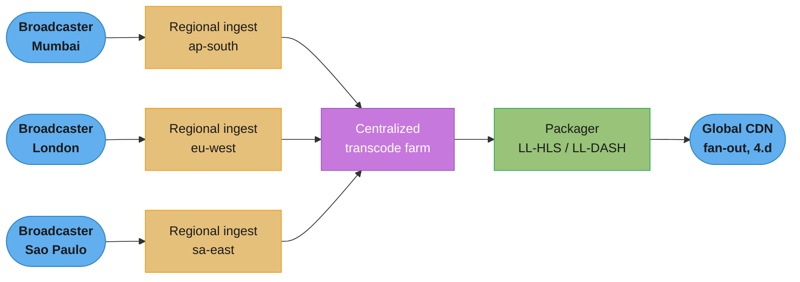
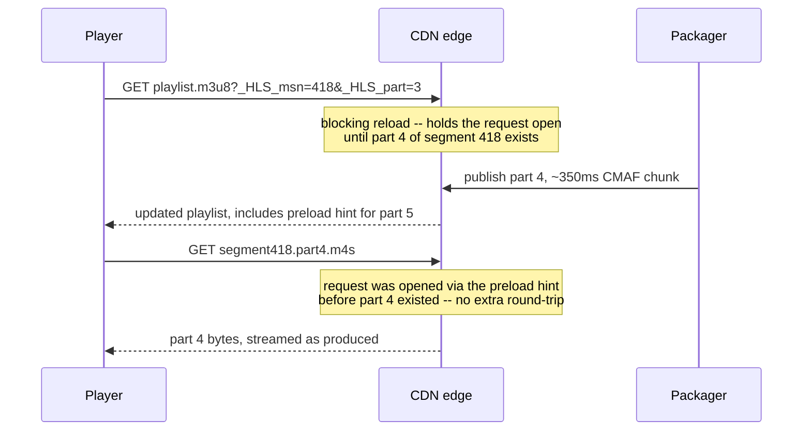
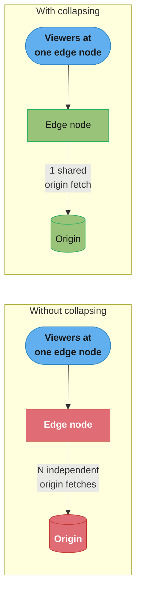
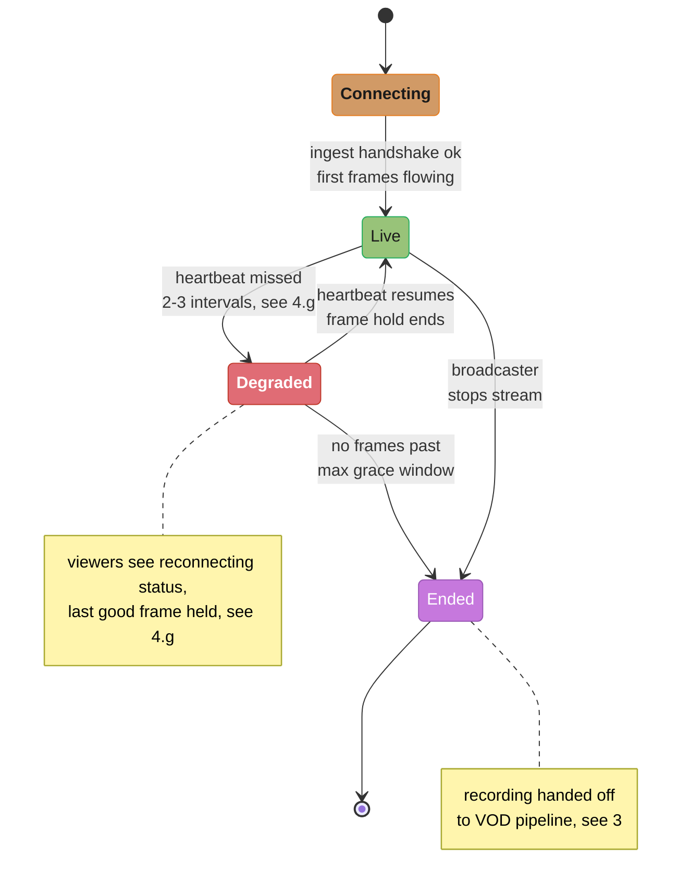
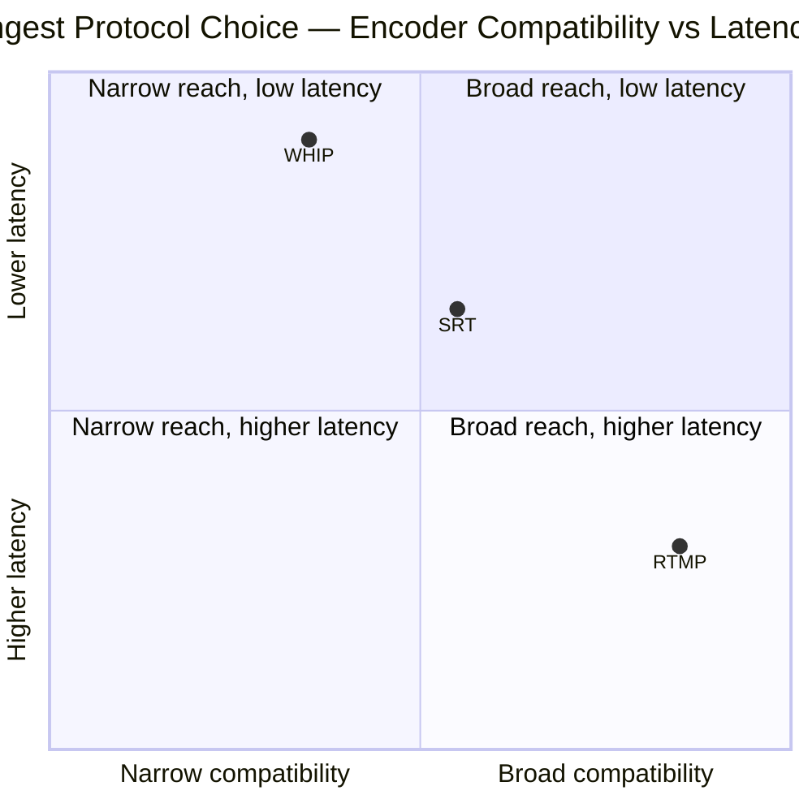

# System Design: Live Streaming Platform
## Intuition

> **Design intuition**: [`./design_netflix.md`](./design_netflix.md) solves delivery of a catalog that already exists — every byte was encoded hours or days before anyone asks for it, so the entire design can be built around *pre-positioning*: push popular titles to the edge overnight, encode at leisure with per-scene optimization, and let a viewer's request always find the answer already sitting nearby. Live streaming inverts every one of those assumptions. The video does not exist until the instant before it is watched; there is no overnight window to pre-position anything; and encoding happens under a hard, ticking deadline instead of a leisurely batch job. Netflix's own §11 names this directly: live is "architecturally a *different* system sharing the same delivery fleet," not a variant of VOD.

**Key insight**: a VOD platform's hardest problem is a **caching** problem — get the right bytes to the right edge before they're asked for. A live platform's hardest problem is a **synchronization** problem — tens of millions of viewers are all watching the *same few seconds* of video at the *same moment*, which means every one of them asks for the next chunk within the same sub-second window, forever, for the duration of the stream. VOD's 80/20 rule (§2 of the Netflix design) — most requests hit a small hot set, spread across time — simply does not apply here: live concentrates effectively 100% of the audience's demand onto the same handful of seconds of content, repeated every segment interval. That single difference is why this design needs its own admission-and-fan-out mechanics (§4.d) that Netflix's pre-positioned CDN never had to solve, and why "you cannot re-encode yesterday" (§1) makes ingest redundancy a correctness requirement here in a way it never is for an already-durable source file.

---

## 1. Requirements Clarification

### Functional Requirements
- **Broadcaster ingest**: accept a live encoder's outgoing stream over RTMP, SRT, or WebRTC-WHIP (§4.a), authenticate the stream key, and hand it to the transcode farm within the sub-second budget the rest of the pipeline depends on.
- **Real-time transcode ladder**: produce a full adaptive-bitrate ladder (multiple resolutions/bitrates) from the single incoming ingest stream, continuously, for as long as the broadcaster is live — not a one-time batch job like [`./design_youtube_upload_pipeline.md`](./design_youtube_upload_pipeline.md)'s transcode DAG, but a standing pipeline with a deadline on every frame (§4.b).
- **Low-latency packaging and playback**: package the ladder as LL-HLS and/or LL-DASH (§4.c) so a viewer's player can join the stream, adapt quality, and stay within a **sub-3-second glass-to-glass budget** (§2) from camera to screen.
- **CDN fan-out to a synchronized audience**: serve the live edge to millions of concurrent viewers who are all requesting the same handful of seconds of content at the same time (§4.d) — the defining difference from VOD delivery.
- **DVR window and rewind**: let a viewer pause, rewind, and resume within a bounded trailing window (commonly hours, not the show's full duration) without falling back to the live edge or losing their place (§4.e).
- **Live chat**: accept, moderate, and fan out chat messages to every viewer of a given stream in near-real-time, at a scale where a single popular stream's viewer count can exceed a small country's population (§4.f).
- **Stream lifecycle and moderation**: start/stop/reconnect a broadcast, detect a dead or degraded ingest within seconds, and expose stream health (bitrate, frame drops, ingest connectivity) to the broadcaster and to internal tooling.
- **Post-stream VOD handoff**: once a broadcast ends, the recorded stream becomes an on-demand asset — this design stops at "the recording lands in durable storage," and [`./design_youtube_upload_pipeline.md`](./design_youtube_upload_pipeline.md)'s transcode DAG and [`./design_netflix.md`](./design_netflix.md)'s delivery model take over from there; neither is re-derived here.
- **Graceful degraded reconnect**: a broadcaster's brief network blip must not be treated the same as an intentional stream end — the platform holds viewers through a short outage rather than forcing every transient hiccup into a full disconnect-and-reconnect cycle (§4.g).
- **Multi-protocol playback fallback**: a viewer on a constrained or unstable network can fall back from LL-HLS to a standard, larger-buffer HLS stream without the broadcaster or platform doing anything extra, because both are packaged from the same underlying segments (§4.c, §4.g).

### Non-Functional Requirements
- **Sub-3-second glass-to-glass latency is the headline target**, budgeted explicitly across every stage in §4.c — not "as low as reasonably achievable," but a number every component is sized against, the same way Netflix's design is sized against a 2-second startup target for a *different* kind of latency.
- **A dropped ingest is unrecoverable data loss, not a slow retry.** [`./design_youtube_upload_pipeline.md`](./design_youtube_upload_pipeline.md) can resume a stalled upload from its last committed byte because the source file still exists on the creator's device; a live stream's source is a physical event happening once, and once a frame has passed without being captured, ingested, and encoded, it is gone — there is no "re-encode yesterday's frame" the way Netflix can always re-encode a title from its studio master. This is why ingest redundancy (§4.a, §8) is treated as a correctness requirement, not an availability nicety.
- **The segment-boundary thundering herd is structural, not occasional.** Every VOD case study in this section deals with request bursts that are, in some sense, avoidable by better caching; live streaming's burst repeats every segment interval, for the life of the stream, because the audience is synchronized by construction (§4.d).
- **Chat fan-out at 1M+ concurrent viewers on a single stream** must not become the thing that falls over first — chat is a secondary feature by product importance but a primary scaling problem, because its fan-out factor (one message to every viewer) is far worse than the video path's (one segment fetched once per edge node, not once per viewer).
- **Graceful quality degradation over stream interruption.** A viewer dropping from 1080p to 480p under CDN pressure is an acceptable, expected outcome of adaptive streaming; a full stream freeze or disconnect is not — the ladder (§4.b) and the CDN tier (§4.d) are both designed so quality is the shock absorber, never availability.
- **Known-mega-event pre-scaling**, the live-streaming analog of [`./design_flash_sale_ticketing.md`](./design_flash_sale_ticketing.md)'s "pre-shaped ahead of a known T+0" principle — a World Cup final or a marquee match has a known kickoff time, and the capacity plan (§10) is built against that vertical-line arrival shape, not a smoothed daily-active-user curve.

### Out of Scope
- **VOD catalog browsing, recommendations, and per-title offline encoding** — [`./design_netflix.md`](./design_netflix.md)'s territory entirely; this design cross-references it for the post-stream handoff and does not re-derive adaptive bitrate theory, CDN architecture, or the quality ladder mechanics that page already covers in depth.
- **Resumable large-file upload, thumbnail/caption generation, and content-ID scanning for pre-recorded video** — [`./design_youtube_upload_pipeline.md`](./design_youtube_upload_pipeline.md)'s territory; this design's only contact with that pipeline is handing off a finished recording.
- **Monetization mechanics** (subscriptions, bits/cheering, ad insertion logic) — a product-layer concern built on top of this delivery design, not part of it.
- **Video call / conferencing (many-to-many, all-participants-talk) systems** — WebRTC-WHIP is used here strictly for one-to-many ingest from a single broadcaster; a conferencing product's many-to-many SFU/MCU topology is a different design.

---

## 2. Scale Estimation

### The Shape That Makes Live Different From Every Read-Heavy Case Study in This Section
Every read-heavy system in this section — [`./design_netflix.md`](./design_netflix.md), [`./design_search_autocomplete.md`](./design_search_autocomplete.md), [`./design_leaderboard.md`](./design_leaderboard.md) — benefits from **temporal spread**: requests for the same hot object arrive scattered across seconds or minutes, which is exactly what makes a cache effective. A live stream's audience has **zero temporal spread on the object that matters**: every viewer's player is locked to the same live edge, requesting the newest segment within the same few-hundred-millisecond window, every single segment interval, for as long as the stream runs. This is the design constraint that shapes §4.d.

### Concurrent-Viewer Scale — the Publicly Disclosed High End
- **JioCinema (Viacom18), IPL 2023 final (CSK v. GT, May 2023)**: **32M+ concurrent viewers**, certified as a Guinness World Record for the most concurrent viewers of a live-streamed event (source: [TechCrunch, "India's JioCinema sets world record with free cricket streaming"](https://techcrunch.com/2023/05/29/jiocinema-concurrent-global-record/); corroborated by [Business Standard](https://www.business-standard.com/cricket/news/jiocinema-breaks-world-record-with-over-32-mn-viewers-during-ipl-final-123053000170_1.html) and [Inc42](https://inc42.com/buzz/jiocinema-breaks-concurrent-viewership-record-during-ipl-2023-final/)).
- **Disney+ Hotstar, ICC World Cup semifinal (India v. New Zealand, July 2019)**: **25.3M concurrent viewers**, the previous record, unchallenged for nearly four years (source: [The News Minute](https://www.thenewsminute.com/article/hotstar-sees-record-253-million-concurrent-viewers-india-nz-world-cup-semifinal-105256); [Digital TV News](https://www.digitaltvnews.net/?p=33217)).
- **Disney+ Hotstar, ICC World Cup final (India v. Australia, November 2023)**: **over 50M concurrent viewers**, the record broken again within the same year the JioCinema mark was set (source: [TechCrunch, "India and Australia World Cup final shatters streaming records on Hotstar"](https://techcrunch.com/2023/11/19/india-and-australia-world-cup-final-shatters-streaming-records-on-hotstar/)).
- **Twitch**: publicly reported figures put peak concurrent viewership at **6M+ across 70,000+ simultaneously live channels** (source: Twitch's own engineering commentary, as summarized in [Twitch's 2021 CDN engineering post, "Low Latency, High Reach"](https://blog.twitch.tv/en/2021/10/25/low-latency-high-reach-creating-an-unparalleled-live-video-streaming-network-at-twitch/)) — a structurally different shape from a single mega-event: many mid-size concurrent streams rather than one audience concentrated on one broadcast.
- **Netflix, Jake Paul v. Mike Tyson fight (November 2024)**: **over 100M viewers tuned in**, Netflix's largest live event to date, streamed to its then-~280M subscriber base at no extra cost (source: [NBC News](https://www.nbcnews.com/sports/boxing/netflix-streaming-problems-tyson-paul-event-frustration-jokes-rcna180443); [NPR](https://www.npr.org/2024/11/21/nx-s1-5198106/is-video-streaming-infrastructure-up-to-par)). §9 War Story 1 covers what happened to a meaningful slice of that audience.

**This design's working numbers**: a single marquee broadcast reaching **30-50M concurrent viewers** at peak, arriving over a **2-3 minute pre-match window** rather than instantaneously (unlike the flash-sale's single vertical line, a match start is a known but softer ramp), sustained for a **2-3 hour broadcast**.

### Arrival Shape — a Softer Ramp Than a Flash Sale's Vertical Line, but Still Not a Diurnal Curve
[`./design_flash_sale_ticketing.md`](./design_flash_sale_ticketing.md) §2 models flash-sale demand as a near-vertical step function, with 55% of a million-buyer surge arriving in the first 5 seconds after T+0. A live mega-event's arrival curve is real but softer: viewers begin joining in the minutes before a known kickoff time and the audience continues climbing through the first several minutes of the broadcast as word spreads and casual viewers tune in mid-event, rather than the entire audience arriving in a single opening burst the way ticket buyers do. That softer ramp is exactly why §8's pre-event scaling window runs from T-24h through T+15min rather than concentrating everything into the first few seconds the way the flash-sale runbook does — the risk window here is measured in minutes, not seconds, even though the underlying principle (provision ahead of a known arrival, don't react to it) is identical.

### Ingest Is a Fan-In Problem; Delivery Is a Fan-Out Problem — and the Ratio Between Them Is Extreme
- A single professionally-produced mega-event has **one ingest stream** (or a small handful, for redundancy — §4.a) feeding **30-50M viewer connections**. The fan-out ratio at the CDN edge is on the order of **10-50 million to one**, several orders of magnitude past even Netflix's most popular title on its most popular night, because Netflix spreads its 24M concurrent streams (§2 of the Netflix design) across a 17,000-title catalog while a mega-event concentrates the *entire* platform's peak viewership onto **one** live object.
- At the smaller end of the platform (a mid-tier Twitch-style streamer), the ratio is the opposite problem: **thousands of simultaneous low-single-digit-viewer streams**, each needing its own real-time transcode ladder (§4.b) regardless of audience size — a mega-event's transcode cost is a rounding error against its viewer count; a long tail of small streams pays the *full* transcode cost per stream with none of the audience to amortize it against. Twitch's own reporting of 70,000+ simultaneously live channels at peak (above) is this long tail in aggregate.

### Bandwidth at Mega-Event Scale
- Using a blended live bitrate of **~4 Mbps** (a mix of 1080p/720p/480p renditions under adaptive selection, deliberately lower than Netflix's ~7 Mbps blend in §2 of the Netflix design because live viewers skew toward mobile and lower buffer tolerance pushes the ABR algorithm toward a more conservative rung more often): 40M concurrent viewers × 4 Mbps = **160 Tbps ≈ 20 TB/sec** of peak egress — the same order of magnitude as Netflix's entire global peak (§2, Netflix design), concentrated into a single 2-3 hour window on a single piece of content, rather than spread across Netflix's always-on, catalog-wide traffic.
- Unlike Netflix's Open Connect, which pre-positions the bytes before the request arrives, **none of this can be pre-positioned** — every byte crossing that 20 TB/sec figure was encoded within the last few seconds and has never been requested before. The CDN's entire job here is a live-fill-and-fan-out problem (§4.d), not a cache-hit-rate problem.

### Segment Cadence and the Herd
- A **2-second segment cadence with ~0.33-second partial parts** (LL-HLS's recommended part-to-segment ratio, §4.c) means a new part is published roughly **3 times per second**. At 40M concurrent viewers, **each publication event is a synchronized request wave of up to 40M player requests landing within the part's production window** — repeating three times a second, for the length of the broadcast. §4.d exists specifically because this shape has no VOD analog: even Netflix's most-watched season premiere sees its 24M concurrent streams start at scattered times across an evening, not synchronized to a shared clock.

### Live vs. VOD Peak Shape, Side by Side
Putting this design's working numbers next to [`./design_netflix.md`](./design_netflix.md) §2's directly makes the structural difference concrete, not just asserted in prose:

| | Netflix (VOD) | This design (live mega-event) |
|---|---|---|
| Peak concurrent viewers | ~24M (§2, Netflix design, an assumption not a disclosure) | 30-50M, against publicly verified records (above) |
| Peak egress | ~21 TB/sec | ~20 TB/sec — comparable order of magnitude |
| Spread across | ~17,000 titles, 80/20 popularity skew | 1 object (the live edge), effectively 100% concentration |
| Request timing | Scattered across an evening/catalog | Synchronized to a shared clock, every segment interval (§4.d) |
| Can pre-position bytes before the request? | Yes, overnight (§4, Netflix design) | No — every byte is seconds old when first requested |
| Dominant scaling mechanism | Cache hit rate at the edge | Request collapsing at the segment boundary (§4.d) |

Two platforms with **similar peak egress figures** end up needing almost entirely different engineering investments, because the *shape* of the demand — spread across a catalog versus concentrated on one live object — determines which mechanism actually does the work.

### Chat Fan-Out Multiplier
- Video fan-out multiplies **stream count**, not **viewer count**, at any tier below the viewer's own edge node — one segment is fetched from origin once per edge node, however many viewers that edge serves (§4.d). Chat fan-out has no equivalent amortization: **every chat message sent by any viewer is, in the worst naive design, one write multiplied by every other viewer's connection** — at 1M concurrent viewers on one stream, a chat rate of even 50 messages/sec naively fanned out is **50M message deliveries/sec** from that one stream alone, which is why §4.f treats coalescing and sampling as load-bearing, not optional polish.

### Cost Shape — Continuous, Not Catalog-Amortized
[`./design_netflix.md`](./design_netflix.md) §10 shows encoding cost is a **one-time, per-title** expense — a 2-hour movie is transcoded once and then served an effectively unlimited number of times, so cost amortizes toward zero per view as the title's audience grows. Live transcode cost has the opposite shape: it is a **continuous, per-active-stream** expense, billed by the second for as long as the broadcast runs, whether the audience is 40M or 4. Using Twitch's own published per-stream figure (§6, §10) of **~4-6 CPU cores per 1080p60 stream** for a full ABR ladder, a platform's aggregate transcode bill scales with **total concurrent broadcast-hours across every live stream on the platform**, not with total viewer-hours the way a VOD platform's *serving* cost does — a single mega-event with 40M viewers and a long tail of 70,000 small streams with a handful of viewers each pay very different per-viewer transcode economics, even though both cost roughly the same to transcode per stream.

---

## 3. High-Level Architecture

```mermaid
flowchart LR
    classDef io      fill:#61afef,stroke:#2e86c1,color:#1a1a1a,font-weight:bold
    classDef frozen  fill:#c678dd,stroke:#9b59b6,color:#fff
    classDef train   fill:#98c379,stroke:#27ae60,color:#1a1a1a
    classDef mathOp  fill:#d19a66,stroke:#e67e22,color:#1a1a1a,font-weight:bold
    classDef lossN   fill:#e06c75,stroke:#c0392b,color:#fff,font-weight:bold
    classDef req     fill:#56b6c2,stroke:#0097a7,color:#1a1a1a
    classDef base    fill:#e5c07b,stroke:#f39c12,color:#1a1a1a

    Broadcaster(["Broadcaster<br/>encoder"]) -->|"RTMP / SRT /<br/>WHIP, primary"| Ingest["Ingest edge<br/>fan-in + failover"]
    Broadcaster -.->|"backup path"| Ingest
    Ingest --> Transcode["Live transcode farm<br/>real-time ABR ladder"]
    Transcode --> Packager["Packager<br/>LL-HLS / LL-DASH CMAF"]
    Packager --> Origin[("Origin<br/>chunk store")]
    Origin --> Shield["Origin shield<br/>request collapsing"]
    Shield --> EdgeCDN["CDN edge tier<br/>synchronized fan-out"]
    EdgeCDN --> Viewers(["30-50M viewers<br/>at the live edge"])
    Packager -.->|"records"| VODStore[("Recording archive<br/>object storage")]
    VODStore -.->|"post-stream handoff"| VODPipe["VOD transcode DAG"]

    Viewers -->|"chat send"| ChatGW["Chat WS gateway<br/>fleet"]
    ChatGW --> Bus(("Pub/sub<br/>fan-out bus"))
    Bus --> ChatGW
    ChatGW --> Viewers

    class Broadcaster io
    class Ingest base
    class Transcode,Packager mathOp
    class Origin,VODStore train
    class Shield req
    class EdgeCDN frozen
    class Viewers io
    class VODPipe req
    class ChatGW base
    class Bus mathOp
```


*Video and chat are two structurally different fan-out problems sharing one viewer population: the video path amortizes cost per edge node (§4.d), while chat's naive fan-out scales with every sender-viewer pair (§4.f) and needs its own bus. The recording archive is a strictly downstream, best-effort artifact — losing it does not affect anyone currently watching, unlike a break anywhere upstream of the CDN edge.*

### The Isolation Principle, Borrowed From Flash-Sale Ticketing, Applied to a Different Axis
[`./design_flash_sale_ticketing.md`](./design_flash_sale_ticketing.md) §3 isolates a known-spike event onto dedicated infrastructure so it cannot cascade into the rest of the platform. This design applies the same principle along a different axis: **a single mega-event's ingest, transcode, and packaging pipeline is provisioned and, where the platform's scale justifies it, isolated per stream or per small cohort of streams**, so a codec bug or an overload condition on one broadcast's transcode fleet cannot degrade every other concurrent stream on the platform. The CDN fan-out tier (§4.d) is the one layer that is *not* isolated per-stream — it is shared infrastructure by necessity, because building dedicated CDN capacity per stream would defeat the purpose of a CDN — which is exactly why §4.d's request-collapsing mechanism has to work at that shared tier specifically.

### Why Ingest Sits Behind a Failover Boundary, Not a Load Balancer
An ordinary read-heavy service load-balances across replicas because any replica can answer any request equally well. Live ingest cannot be load-balanced the same way: **one broadcaster's stream has exactly one source of truth at any instant**, so "ingest infrastructure" here means a **primary path with a hot-standby failover path** (§4.a, §8), not a horizontally-scaled pool answering interchangeable requests. This is the direct architectural consequence of §1's "a dropped ingest is unrecoverable" requirement — redundancy has to exist *before* the drop, because there is no retry-after-the-fact the way [`./design_youtube_upload_pipeline.md`](./design_youtube_upload_pipeline.md)'s resumable upload has.

### Regional Ingest, Centralized Transcode
§5 resolves the ingest-latency-vs-pipeline-complexity tradeoff by keeping the *ingest edge* regional while the transcode farm (§4.b) stays centralized — the topology looks like a funnel, narrowing from many regional entry points down to one processing pipeline before fanning back out globally at the CDN tier:


*Each broadcaster's geographically expensive leg — encoder to ingest edge — is minimized locally; the pipeline narrows to one transcode farm because a broadcaster's ladder (§4.b) only needs to be produced once regardless of how globally distributed the eventual audience is.*

---

## 4. Component Deep Dives

### (a) Ingest Fan-In — RTMP, SRT, and WHIP

The broadcaster's encoder pushes one continuous stream into the platform; this component's job is accepting that stream reliably and handing it to the transcode farm (§4.b) without adding latency the rest of the pipeline's budget (§4.c) can't afford to lose.

| Protocol | Transport | Typical latency add | Why a platform picks it |
|---|---|---|---|
| RTMP | TCP | ~1-3s | The oldest and still the most widely deployed ingest protocol; Adobe's original 2012 specification (H.264/AAC only, unmaintained for over a decade) is still what most encoder software speaks by default. Adobe, YouTube, and Twitch back **Enhanced RTMP (E-RTMP)**, maintained since 2023 by the not-for-profit **Veovera Software Organization**, which adds HEVC/AV1/VP9 and HDR signaling on top of the original wire format (source: [Veovera, Enhanced RTMP v2](https://veovera.org/docs/enhanced/enhanced-rtmp-v2.html); [Streaming Media Blog coverage](https://www.streamingmediablog.com/2023/07/enhanced-rtmp.html)). RTMP is dead as a *delivery* protocol (no modern player speaks it) but remains the dominant *ingest* protocol industry-wide precisely because encoder software already speaks it. |
| SRT | UDP, with ARQ | ~200ms-1s, tunable | Haivision's Secure Reliable Transport, open-sourced in 2017 and governed by the SRT Alliance; a UDP-based protocol with automatic repeat request and encryption purpose-built for **sub-second** live contribution over unreliable public networks (source: [SRT Alliance](https://srtalliance.org/haivision-publishes-srt-specs/); [Haivision's SRT Protocol Technical Overview](https://www.haivision.com/products/srt-secure-reliable-transport/)). The latency/reliability tradeoff is a tunable buffer, not a fixed cost — a smaller latency buffer means less time to recover a lost packet via retransmission. |
| WebRTC-WHIP | UDP (SRTP over ICE/DTLS) | Sub-second | The WebRTC-HTTP Ingestion Protocol, standardized as **RFC 9725** (March 2025): a single HTTP POST carries the SDP offer/answer to set up an ICE/DTLS session, after which media flows over standard WebRTC transport with no renegotiation supported (source: [RFC 9725](https://www.rfc-editor.org/rfc/rfc9725.html)). Lowest achievable ingest latency, at the cost of WebRTC's operational complexity (STUN/TURN, ICE negotiation) that RTMP and SRT don't carry. WHIP's companion protocol, **WHEP**, is the corresponding *egress* (playback) side — out of scope here since this design's playback path is LL-HLS/LL-DASH (§4.c), not WebRTC end-to-end. |

**Redundant ingest is the direct answer to §1's "a dropped ingest is unrecoverable."** A broadcaster's encoder is configured to push to a **primary and a backup ingest endpoint simultaneously** (or fails over to backup within a few seconds of primary health-check failure); the transcode farm (§4.b) subscribes to whichever path is currently healthy. This is the live-streaming equivalent of Netflix's multi-AZ replication (§8, Netflix design) applied to a single-writer stream rather than a replicated datastore — there is no quorum here, just "is the primary path currently delivering frames," checked on a sub-second health-check interval:

```java
public final class IngestFailoverMonitor {
    private static final int MAX_MISSED_HEARTBEATS = 3; // §4.g's grace-period threshold
    private final Duration heartbeatInterval = Duration.ofMillis(500);
    private volatile Instant lastPrimaryFrameAt = Instant.now();
    private volatile IngestPath activePath = IngestPath.PRIMARY;

    /** Called by the ingest edge on every frame received from either path. */
    public void onFrame(IngestPath path, Instant receivedAt) {
        if (path == IngestPath.PRIMARY) {
            lastPrimaryFrameAt = receivedAt;
            if (activePath == IngestPath.BACKUP) {
                activePath = IngestPath.PRIMARY; // primary recovered -- switch back
            }
        }
        transcodeFarm.subscribeIfNeeded(activePath); // §4.b reads from whichever path is active
    }

    /** Polled on the heartbeatInterval; the mechanical trigger the failover runbook (§8) describes. */
    public void checkHealth() {
        long missed = Duration.between(lastPrimaryFrameAt, Instant.now()).dividedBy(heartbeatInterval);
        if (activePath == IngestPath.PRIMARY && missed >= MAX_MISSED_HEARTBEATS) {
            activePath = IngestPath.BACKUP; // no human approval gate -- same reasoning as
            alerting.pageOnCall("Ingest failover: primary -> backup"); // the flash-sale kill switch
        }
    }
}
```

### (b) Real-Time Transcode Ladder Under a Live Clock — Broken, Then Fixed

[`./design_netflix.md`](./design_netflix.md) §4 encodes a title once, offline, with as much compute as the quality target demands — a 2-hour movie can spend hours in the encoding farm because nobody is waiting on any specific frame. A live transcode job has **no such luxury**: frame N must be encoded, packaged, and published before frame N's position in the live clock passes, or the stream's advertised latency drifts upward with no way to catch back up short of restarting the encode.

***Broken:*** an unbounded work queue between frame capture and the encoder looks correct under normal load and fails silently under a codec-heavy scene or a transient CPU contention spike:

```java
// BROKEN -- unbounded queue, no deadline awareness
public final class LiveTranscodeWorkerBroken {
    private final BlockingQueue<Frame> queue = new LinkedBlockingQueue<>(); // unbounded!

    public void onFrameCaptured(Frame frame) {
        queue.offer(frame); // always accepted, never rejected, never shed
    }

    public void encodeLoop() throws InterruptedException {
        while (true) {
            Frame frame = queue.take();
            encoder.encode(frame); // if this call falls behind real time, the queue just grows
        }
    }
}
```

The failure mode is silent because every frame still gets encoded, correctly, in order — the bug is not a crash or a dropped frame, it's a **latency drift with no ceiling**. A scene that briefly needs more encode time than a frame interval allows pushes the queue's tail further behind the live clock; unlike a VOD job where "it took 10% longer" is invisible to anyone, here every frame that leaves the queue late makes the *entire downstream pipeline* — packaging, CDN publish, viewer playback — that much further behind the actual live moment, and the gap only grows, because nothing in this code path ever catches up on its own.

***Fixed:*** bound the queue and make staleness an explicit, checked condition, so the system sheds load instead of drifting:

```java
// FIXED -- bounded, deadline-aware queue that sheds instead of drifting
public final class LiveTranscodeWorker {
    private static final Duration MAX_STALENESS = Duration.ofMillis(1500); // hard deadline budget
    private final BlockingQueue<Frame> queue = new ArrayBlockingQueue<>(60); // ~1s of buffer at 60fps
    private final RenditionShedder renditionShedder;

    public void onFrameCaptured(Frame frame) {
        if (!queue.offer(frame)) {
            // Queue is full -- the encoder cannot keep up at the current ladder width.
            // Shed the most expensive rendition first (1080p60 before 480p30), never
            // silently let every rendition drift together.
            renditionShedder.dropLowestPriorityRendition();
        }
    }

    public void encodeLoop() throws InterruptedException {
        while (true) {
            Frame frame = queue.take();
            if (Duration.between(frame.capturedAt(), Instant.now()).compareTo(MAX_STALENESS) > 0) {
                continue; // an old frame encoded late is worse live than a frame skipped outright
            }
            encoder.encode(frame);
        }
    }
}
```

The fix costs a small, deliberate quality reduction (a shed rendition, or an occasionally dropped frame within a bounded staleness window) in exchange for a **hard ceiling on how far behind live the stream can ever get** — the same shape as [`./design_flash_sale_ticketing.md`](./design_flash_sale_ticketing.md) §4.b's atomic-decrement fix: trade a narrow, bounded cost for eliminating an unbounded failure mode entirely, rather than merely narrowing its window.

### (c) LL-HLS and LL-DASH — Packaging Mechanics and the Latency Budget

Both low-latency protocols solve the same problem the same way: shrink the unit of work a player can fetch from a full multi-second segment down to a sub-second chunk, and let the player start consuming a chunk before the server has finished producing it.

**LL-HLS** is Apple's 2020 extension to HLS, introduced at WWDC that year and now folded into the actively-maintained IETF successor to the original HLS spec (`draft-pantos-hls-rfc8216bis`, currently at revision 22, intended to obsolete RFC 8216 — source: [IETF Datatracker](https://datatracker.ietf.org/doc/draft-pantos-hls-rfc8216bis/)). Five mechanisms work together (source: Apple's WWDC20 sessions [10229](https://developer.apple.com/videos/play/wwdc2020/10229/), [10231](https://developer.apple.com/videos/play/wwdc2020/10231/)):

| Mechanism | Tag | What it does |
|---|---|---|
| Partial segments | `#EXT-X-PART` | Splits each 2-4s segment into ~200-500ms parts the player can fetch as soon as each is produced, instead of waiting for the whole segment |
| Preload hints | `#EXT-X-PRELOAD-HINT` | Advertises the URL of the *next* part before it exists; the player opens the request early and the server holds it open until the part is ready, saving a full round-trip |
| Blocking playlist reload | `#EXT-X-SERVER-CONTROL:CAN-BLOCK-RELOAD=YES`, triggered by `?_HLS_msn=N&_HLS_part=M` | The player asks for a playlist state that doesn't exist yet; the server holds the request open and responds the instant that part publishes, instead of the player polling on a fixed interval |
| Rendition reports | `#EXT-X-RENDITION-REPORT` | Lets the player check another quality rendition's state cheaply, without fetching that rendition's full playlist, so a mid-stream quality switch doesn't cost an extra round-trip |
| Playlist delta updates | `#EXT-X-SKIP`, `CAN-SKIP-UNTIL` | Lets the server send only what changed since the player's last playlist fetch, instead of the whole (potentially DVR-window-length, §4.e) playlist every time |

**LL-DASH** (the DASH-IF Low-Latency profile) achieves the same effect with CMAF-chunked segments delivered over an open HTTP/1.1 chunked-transfer connection: each segment is a series of `moof`+`mdat` fragment pairs, and the origin streams each fragment to the CDN and player as soon as the encoder produces it, never closing the response until the full segment completes. Two manifest attributes make this legible to the player — `@availabilityTimeOffset` (how much earlier a segment's chunks are available than its computed availability time) and `@availabilityTimeComplete=false` (signals the segment is being streamed, not yet whole) (source: [DASH-IF Low-Latency documentation](https://dashif.org/news/low-latency-dash/); [DASH-IF IOP Change Request, Low-Latency Live](https://dashif.org/docs/DASH-IF-IOP-CR-Low-Latency-Live-Community-Review.pdf)).

**The latency budget — an illustrative breakdown, not a disclosed figure from any single vendor**, built from the public claims each stage is individually capable of: Apple states LL-HLS's mechanisms cut glass-to-glass latency from a legacy HLS floor of 20-30s down to **2-5s**; DASH-IF states the LL-DASH equivalent lands at **2-4s**; Cloudflare Stream's own LL-HLS documentation states glass-to-glass latency "as low as three seconds," with sub-second latency reachable only by dropping to SRT/RTMPS playback instead of LL-HLS (source: [Cloudflare Stream Low-Latency HLS blog](https://blog.cloudflare.com/cloudflare-stream-low-latency-hls-open-beta/)):

| Stage | Illustrative budget | Where the time goes |
|---|---|---|
| Encode + first-part packaging | ~500ms-1s | Bounded by the part duration itself (§4.b's shedding keeps this from growing) |
| CMAF chunk transfer to origin | ~100-300ms | Network + the chunked-transfer publish, not a full-segment wait |
| Origin -> CDN edge propagation | ~100-300ms | With request collapsing (§4.d) rather than a cache-fill round-trip per viewer |
| Player buffer (jitter protection) | ~500ms-1s | LL-HLS commonly targets a player buffer of roughly 3 part durations |
| **Total, illustrative** | **~1.5-3s** | Consistent with the 2-5s (Apple) and 2-4s (DASH-IF) ranges each spec claims independently |

**Sliding playlist-window bookkeeping** — the packager's core job is maintaining a media playlist that always reflects the live edge, with just enough history behind it for the DVR window (§4.e):

```python
class LivePlaylistWindow:
    """LL-HLS media playlist state: the live edge's partial segments plus
    a bounded run of full segments behind it for DVR rewind (§4.e)."""

    DVR_SECONDS = 4 * 3600      # 4-hour rewind window, tunable per stream
    SEGMENT_SECONDS = 2
    PART_SECONDS = 0.33         # roughly 3 parts per segment, per LL-HLS guidance

    def __init__(self):
        self.segments: list[Segment] = []   # oldest first, evicted from the front
        self.current_parts: list[Part] = [] # parts of the segment still being built

    def on_part_published(self, part: "Part") -> None:
        self.current_parts.append(part)
        if part.completes_segment:
            self.segments.append(Segment(parts=self.current_parts, published_at=part.published_at))
            self.current_parts = []
            self._evict_outside_dvr_window()

    def _evict_outside_dvr_window(self) -> None:
        cutoff = self.segments[-1].published_at - timedelta(seconds=self.DVR_SECONDS)
        while self.segments and self.segments[0].published_at < cutoff:
            self.segments.pop(0)  # drops from the live playlist / CDN cache -- not from cold archive

    def render_playlist(self) -> str:
        lines = [
            "#EXTM3U",
            f"#EXT-X-TARGETDURATION:{self.SEGMENT_SECONDS}",
            f"#EXT-X-PART-INF:PART-TARGET={self.PART_SECONDS}",
            "#EXT-X-SERVER-CONTROL:CAN-BLOCK-RELOAD=YES",
        ]
        for seg in self.segments[-6:]:          # only the trailing few need full EXTINF detail
            lines.append(seg.to_extinf())
        for part in self.current_parts:
            lines.append(part.to_ext_x_part())
        if self.current_parts:
            lines.append(f'#EXT-X-PRELOAD-HINT:TYPE=PART,URI="{self._next_part_uri()}"')
        return "\n".join(lines)
```

The end-to-end request flow, showing why blocking reload plus a preload hint removes a full round-trip compared to fixed-interval polling:



### (d) CDN Fan-Out and the Segment-Boundary Thundering Herd — Broken, Then Fixed

§2 established the core scale problem: at a segment or part boundary, a meaningful fraction of a stream's entire concurrent audience requests the same new object within the same sub-second window — three times a second under LL-HLS's part cadence, for the whole broadcast. Mux's own engineering documentation names this explicitly as a defining LL-HLS operational challenge, distinct from ordinary CDN cache-miss handling (source: [Mux, "An update on Low Latency HLS live streaming"](https://www.mux.com/blog/low-latency-hls-part-2)).

***Broken:*** each viewer's request at an edge node independently triggers its own origin fetch:

```java
// BROKEN -- every concurrent request is an independent origin round-trip
public byte[] fetchSegmentBroken(String segmentPath) {
    return originClient.get(segmentPath); // no dedup: N concurrent viewers = N origin hits
}
```

At a part boundary, tens of thousands of viewers attached to a single edge node ask for the same new part within the same window; without deduplication, that is tens of thousands of near-simultaneous origin fetches **per edge node**, multiplied across however many edge nodes exist globally. The origin doesn't see a cache-miss spike shaped like an occasional unlucky burst — it sees a spike shaped exactly like the part cadence, three times a second, for the entire length of the broadcast, and at mega-event scale that spike is large enough to take the origin down outright.

***Fixed:*** single-flight request collapsing — the first request for a given segment path triggers the fetch; every concurrent request for the same path waits on that same in-flight future instead of issuing its own:

```java
// FIXED -- single-flight collapsing: first request fetches, the rest attach to it
public final class SegmentRequestCollapser {
    private final ConcurrentHashMap<String, CompletableFuture<byte[]>> inFlight =
        new ConcurrentHashMap<>();

    public CompletableFuture<byte[]> fetchSegment(String segmentPath) {
        return inFlight.computeIfAbsent(segmentPath, path ->
            originClient.getAsync(path)
                .whenComplete((body, err) -> inFlight.remove(path)) // clear once resolved either way
        );
    }
}
```



Collapsing turns "N viewers behind an edge node" into "1 origin fetch per edge node per part," which is the same order-of-magnitude reduction [`./design_flash_sale_ticketing.md`](./design_flash_sale_ticketing.md) §4.a achieves by routing 1,000,000 buyers through a stateless waiting room before anything stateful sees them — a many-orders-of-magnitude collapse happening at the layer best positioned to absorb it, rather than letting the full volume reach the tier that can least afford it. It does not eliminate the herd at the *edge* tier (viewers still all arrive within the same window) — it eliminates the herd's amplification **through** each additional tier behind the edge, which is where an uncollapsed herd would otherwise compound.

### (e) DVR Window and Rewind

A viewer who pauses or rewinds during a live broadcast needs the playlist to keep serving segments the viewer has already fallen behind on, without those segments ever leaving the CDN's cache window early. This reuses the same `LivePlaylistWindow` bookkeeping from §4.c — the DVR window is simply "how far back `_evict_outside_dvr_window` is allowed to let the segment list grow before trimming."

The tradeoff is almost entirely storage and cache footprint, not new mechanism: extending the DVR window from 30 minutes to 4 hours does not change any of §4.c's low-latency mechanics for a viewer watching at the live edge — it changes how much of the segment history the CDN and origin have to keep addressable, and for how long. Unlike Netflix's catalog, where every title is durably retained forever by design, a live platform's default posture is the opposite: **segments outside the DVR window are evicted from the hot/cache path** and either discarded or handed off to the VOD archive (§3) — retaining them indefinitely in the live-serving path would mean paying live-tier storage and cache costs for content nobody at the live edge will ever request again.

### (f) Chat Fan-Out at 1M+ Concurrent Viewers

Chat's fan-out shape is fundamentally different from video's. A video segment is fetched once per CDN edge node no matter how many viewers that edge serves (§4.d) — the cost is roughly flat in the number of *edge nodes*, not the number of *viewers*. A naive chat implementation has no equivalent amortization: every message from any sender is, in the worst case, delivered individually to every connected viewer, so cost scales with **senders × viewers**, not with a fixed infrastructure tier.

The architecture reuses two primitives already covered elsewhere in this section rather than inventing new ones:
- **Connection management**: each viewer holds one persistent connection (WebSocket, per [`../../backend/websockets_and_sse/websockets_and_sse.md`](../../backend/websockets_and_sse/websockets_and_sse.md)) to a stateless gateway fleet, load-balanced the same way [`./design_whatsapp.md`](./design_whatsapp.md) §4 manages its own large persistent-connection fleet.
- **Fan-out transport**: a pub/sub bus (per [`../message_queues/message_queues.md`](../message_queues/message_queues.md) and [`../../backend/kafka_deep_dive/kafka_deep_dive.md`](../../backend/kafka_deep_dive/kafka_deep_dive.md)), one topic per active stream, that every gateway instance serving that stream's viewers subscribes to — the same shape as [`./design_notification_system.md`](./design_notification_system.md)'s per-channel fan-out topics, applied to one stream's chat instead of one user's notification channels.

What's specific to live-chat scale is the mitigation layered on top once naive fan-out stops being affordable, following the [`../realtime_updates/realtime_updates.md`](../realtime_updates/realtime_updates.md) framing of trading strict real-time delivery for fan-out cost at extreme connection counts:
- **Client-side batching**: the gateway coalesces messages arriving within a short window (commonly ~100-250ms) into one delivery frame per viewer connection instead of one frame per message, cutting the number of discrete pushes by the coalescing factor without meaningfully changing perceived latency for a chat feed.
- **Sampling under extreme burst**: at rates where every viewer receiving every message is not the product goal anyway (a fast-scrolling firehose no human reads message-by-message past a few thousand concurrent senders), the gateway can sample or rate-cap the visible stream per viewer rather than guarantee delivery of every message to every connection — an explicit, product-level tradeoff, not a silent drop, and one video's segment path never has to make because every viewer genuinely needs every video frame.
- **Moderation in the write path, not the fan-out path**: a message is checked against moderation rules once, at ingest into the topic, so the cost of moderation does not multiply by viewer count the way naive per-delivery moderation would.

### (g) Stream Health, Reconnect, and Viewer-Side Recovery

§4.a's primary/backup ingest failover handles a *platform-side* path failure; it does not, by itself, cover the far more common case of the **broadcaster's own uplink** dropping for a few seconds — a home encoder's Wi-Fi hiccup, a mobile broadcaster passing through a dead zone. Treating every such blip as "the stream ended" would make live streaming from anything less than a wired studio connection unreasonably fragile, so this component sits between §4.a's failover and §4.b's transcode farm as a **grace-period buffer**, not a third redundant path:

| Signal | Grace period | Behavior |
|---|---|---|
| Ingest heartbeat missed once | 0 -- no action | Single missed heartbeat is expected jitter, not a signal |
| Ingest heartbeat missed 2-3 consecutive intervals | A few seconds | Transcode farm holds the last good frame (repeats it, does not freeze the player mid-frame) rather than ending the stream |
| Heartbeat still missing past the grace period | Stream marked degraded | Failover to backup ingest path (§4.a) if configured; otherwise stream is marked "reconnecting" to viewers, not ended |
| No frames for a platform-configured maximum (commonly 30-60s) | Stream ends | Beyond this point, holding viewers on a frozen frame does more harm than an explicit "stream ended" state |

**On the viewer side**, the player applies its own independent recovery ladder, layered on top of ABR's ordinary quality-switching (§4 of the Netflix design covers the quality-switching mechanism itself, not re-derived here): a player experiencing repeated stalls first drops rendition (the ordinary ABR response), then — if LL-HLS's tighter buffer tolerance (§4.c) is itself the problem on a degraded network, not the bitrate — falls back to standard (non-low-latency) HLS with a larger buffer, trading the sub-3-second budget for playback stability. This fallback is why the packager (§4.c) publishes a standard-HLS-compatible playlist alongside the LL-HLS one from the same underlying segments, rather than requiring a separate encode: the same CMAF chunks satisfy both a low-latency player and a large-buffer fallback player.

A stream's lifecycle, from the broadcaster's first connection through the eventual VOD handoff, ties §1's functional requirement, §4.a's failover, and §4.g's grace period into one state machine:


*Only the `Degraded` state is new relative to an ordinary request/response service's lifecycle — it exists specifically to absorb the transient broadcaster-side network blips §4.g describes, without forcing every blip through a full `Connecting` restart.*

### (h) Codec and Hardware Encode Strategy Under a Real-Time Constraint

§4.b's deadline-aware queue assumes the encoder itself can, most of the time, keep pace with the live clock — this component is about the choice that determines how much headroom the encoder actually has.

- **Software encode (e.g., x264/x265 on CPU)** gives the most control over the quality/bitrate curve and is what §6's Twitch figure (4-6 CPU cores per 1080p60 stream) reflects, but that CPU cost is paid **per concurrent stream**, so it is the direct driver of §10's long-tail transcode bill.
- **Hardware encode (ASIC/GPU-accelerated, e.g., NVENC-class silicon)** trades a small amount of compression efficiency (a hardware encoder typically needs a modestly higher bitrate than a well-tuned software encoder for the same visual quality) for a large reduction in per-stream compute cost and a tighter, more predictable encode-time ceiling — directly relevant to §4.b's deadline budget, since a hardware encoder's worst-case latency is far more consistent scene-to-scene than a software encoder's.
- **The live-specific consequence**: [`./design_netflix.md`](./design_netflix.md) §4 can afford the CPU-heavy, quality-maximizing per-scene analysis of its Dynamic Optimizer because encoding happens once, offline, with no deadline. A live pipeline at platform scale (§10's tens of thousands of concurrent streams) cannot afford that per-scene analysis cost multiplied across every active stream, every few hundred milliseconds — which is why live platforms lean more heavily toward hardware encode and simpler, faster bitrate-ladder heuristics than VOD's exhaustive per-scene optimization, accepting a modest efficiency cost for a compute bill and a latency ceiling that both stay bounded at scale.
- **GOP/keyframe interval** is the other real-time-relevant encode knob, and it is coupled directly to §5's segment-duration choice: each segment boundary (§4.c) has to land on a keyframe so a player joining mid-stream or switching renditions has a clean decode point, so the keyframe interval is set to match the segment duration, not chosen independently — a live platform running 2-second segments runs a 2-second GOP, shorter than a VOD ladder's typical GOP, which is a further small efficiency cost paid specifically for the low-latency segment structure §4.c depends on.

---

## 5. Design Decisions & Tradeoffs

### RTMP vs. SRT vs. WHIP for Ingest
- **Choice**: support all three, chosen per broadcaster tier — RTMP for the long tail of existing encoder software, SRT for professional broadcast contribution over unreliable networks, WHIP for the lowest-latency browser-based ingest.
- **Reason**: no single protocol is dominant across both "what encoders already speak" and "what achieves the lowest latency" — RTMP wins the former by installed base, WHIP wins the latter by design.
- **Trade-off**: three ingest code paths to operate and health-check (§4.a, §8) instead of one, in exchange for not forcing every broadcaster onto whichever protocol is easiest for the platform to support.



### LL-HLS/LL-DASH vs. WebRTC for the Playback Path
- **Choice**: LL-HLS/LL-DASH for viewer-facing playback at platform scale; WebRTC reserved for ingest (WHIP) and for narrow interactive use cases, not general viewer delivery.
- **Reason**: HTTP-chunked delivery is **cacheable by an ordinary CDN** the same way any HTTP object is (§4.d's collapsing works because it's still HTTP GETs); WebRTC's peer-connection-per-viewer model has no equivalent CDN cacheability story and does not scale to tens of millions of simultaneous viewers on commodity CDN infrastructure the way HLS/DASH does.
- **Trade-off**: LL-HLS/LL-DASH's floor is roughly 1.5-3s (§4.c) versus WebRTC's sub-second floor — this design accepts a few hundred milliseconds to a couple of seconds of extra latency in exchange for CDN-scale fan-out, which is the correct trade for a broadcast audience and the wrong trade for a two-way call.

### Per-Stream Transcode Isolation vs. a Shared Transcode Pool
- **Choice**: isolate a mega-event's transcode farm from the platform's general-purpose pool (§3), while letting the long tail of small streams share a common pool.
- **Reason**: a single misbehaving codec path or an overload condition on one broadcast must not degrade every other concurrent stream's ladder — the same [`../cell_based_architecture/cell_based_architecture.md`](../cell_based_architecture/cell_based_architecture.md) blast-radius argument [`./design_flash_sale_ticketing.md`](./design_flash_sale_ticketing.md) §3 makes for its sale-specific infrastructure.
- **Trade-off**: dedicated capacity for known mega-events costs more per stream than a shared pool would, accepted because the alternative — one bad stream degrading thousands of unrelated ones — is a platform-wide incident, not a contained one.

### Fixed DVR Window vs. Unbounded Retention
- **Choice**: a bounded, per-stream-configurable DVR window (§4.e), not indefinite live-tier retention.
- **Reason**: live-tier storage and cache costs are far higher per byte-hour than cold VOD archive storage; retaining every segment in the hot path indefinitely pays that premium for content the live audience, by definition, has already moved past.
- **Trade-off**: a viewer cannot rewind past the configured window during the live broadcast — they have to wait for the post-stream VOD handoff (§1, §3) to watch an earlier portion, which is an acceptable product limitation almost every major platform in §6 makes the same way.

### Short Parts and Segments vs. Longer Ones
- **Choice**: ~2-second segments split into ~0.33-second parts (§4.c), rather than the 6-10 second segments a VOD-tuned ladder (§4 of the Netflix design) commonly uses.
- **Reason**: the segment/part duration is a direct knob on both ends of a tradeoff — shorter units mean less time buffered in flight (lower latency, §4.c's budget) and finer-grained ABR quality switching, at the cost of more total objects to request, more playlist churn, and a *smaller* absolute margin for network jitter per object.
- **Trade-off**: this design accepts the smaller-jitter-margin cost because live's latency budget (§1) leaves no room for a VOD-length segment's multi-second floor; a VOD platform makes the opposite trade deliberately, favoring encoding efficiency and fewer requests over a latency budget nobody is asking it to hit.

### Regional Ingest Points vs. a Single Global Ingest Endpoint
- **Choice**: multiple geographically distributed ingest points, with a broadcaster routed to the nearest healthy one, rather than one global ingest endpoint every broadcaster connects to regardless of location.
- **Reason**: ingest latency (§4.a's protocol-level latency figures) compounds with the broadcaster's own network distance to the ingest point — a broadcaster in Mumbai pushing to a single ingest endpoint in Virginia adds tens to low-hundreds of milliseconds of pure geographic transit before the stream even reaches the transcode farm, eating directly into the §4.c latency budget before packaging has done anything.
- **Trade-off**: regional ingest points mean the transcode farm (§4.b) either also runs regionally (adding cross-region complexity for a global audience watching a single regional broadcaster) or the transcode farm stays centralized and only the ingest *edge* is regional, forwarding the accepted stream onward — the second option is the more common real-world choice, treating regional ingest purely as a latency-reduction front door rather than a fully distributed pipeline.

---

## 6. Real-World Implementations

- **Twitch** — ingests broadcaster streams over RTMP, transcodes with a C/C++ and Go pipeline into an ABR ladder, and packages to HLS; a 1080p60 source stream needs roughly **4-6 CPU cores** to transcode into a typical multi-rung ladder (1080p/720p/480p/360p/240p). Delivery runs over Twitch's own private Backbone Network of nearly 100 points of presence, with **98% of all Twitch traffic staying on that private network** rather than crossing the public internet (source: [Twitch, "Low Latency, High Reach: Creating an Unparalleled Live Video Streaming Network at Twitch"](https://blog.twitch.tv/en/2021/10/25/low-latency-high-reach-creating-an-unparalleled-live-video-streaming-network-at-twitch/)).
- **YouTube Live** — offers three explicit latency tiers a broadcaster chooses before going live, each trading quality/feature support for delay: **Normal** (15-60s delay, all resolutions and features), **Low** (5-15s, most viewers under 10s), and **Ultra-low** (2-5s, most viewers under 5s) — and the setting cannot be changed mid-broadcast (source: [YouTube Help, "Understand live streaming latency"](https://support.google.com/youtube/answer/7444635)).
- **JioCinema / Disney+ Hotstar** — the two platforms holding the two highest publicly-verified concurrent-viewer counts for any live-streamed event (§2): 32M+ (JioCinema, IPL 2023 final, Guinness World Record) and 50M+ (Hotstar, ICC World Cup final, November 2023), both against a cricket audience concentrated in a single country and largely on mobile networks.
- **Cloudflare Stream** — publishes LL-HLS glass-to-glass latency "as low as three seconds" through its standard low-latency pipeline, with sub-second latency reachable only by switching the *playback* leg to SRT or RTMPS instead of LL-HLS — an explicit acknowledgment that HTTP-chunked delivery has a latency floor SRT/WebRTC-class transports don't share (source: [Cloudflare Blog, "Cloudflare Stream Low-Latency HLS support now in Open Beta"](https://blog.cloudflare.com/cloudflare-stream-low-latency-hls-open-beta/)).
- **Mux** — documents distinct latency modes for its live product (a "reduced" latency mode in the 12-20s range and a "low" latency mode as low as ~5s), and its own engineering writing names the segment-boundary thundering herd explicitly as a first-class LL-HLS operational concern, not an edge case (source: [Mux, "An update on Low Latency HLS live streaming"](https://www.mux.com/blog/low-latency-hls-part-2)).
- **Netflix** — the Jake Paul v. Mike Tyson fight (November 2024) is the platform's own admission that live at this scale is a genuinely different problem than the VOD delivery its architecture (§6, Netflix design) was built around: over 100M viewers tuned in, and roughly **85,000 DownDetector reports** of buffering and outage issues surfaced before and during the broadcast — Netflix acknowledged the issues publicly and stated it was applying what it learned toward its subsequent live NFL broadcasts (source: [NBC News](https://www.nbcnews.com/sports/boxing/netflix-streaming-problems-tyson-paul-event-frustration-jokes-rcna180443); [ESPN](https://www.espn.com/boxing/story/_/id/42418997/netflix-experiences-streaming-delays-leading-tyson-paul-fight); [NPR](https://www.npr.org/2024/11/21/nx-s1-5198106/is-video-streaming-infrastructure-up-to-par)). §9 War Story 1 uses this as its worked example.

**Two structurally different shapes of "live at scale," both covered by this design:**
- **Sports-broadcast-scale live** (JioCinema, Hotstar, Netflix's boxing/NFL events) is one broadcast, one audience, concentrated into a known window — the shape §2's scale estimation and §10's mega-event sizing are built around, and the shape that makes §4.d's thundering-herd mitigation load-bearing rather than optional.
- **Creator-platform-scale live** (Twitch, and the bulk of YouTube Live's daily traffic) is a long tail of thousands of small, independent, always-on streams — the shape §2's "cost shape" discussion and §10's long-tail transcode bill are built around, where the dominant engineering cost is running many small real-time pipelines efficiently rather than surviving one enormous synchronized spike. A platform serving both shapes (most large platforms do) needs both halves of this design, sized against genuinely different peak conditions.

---

## 7. Technologies & Tools

| Component | Technology | Why |
|---|---|---|
| Ingest (broadcaster-side) | RTMP / Enhanced RTMP, SRT, WebRTC-WHIP | Covers the encoder-compatibility-vs-latency spectrum (§5); no single protocol wins both axes |
| Real-time transcode | FFmpeg / GStreamer pipelines on a bounded, deadline-aware job queue (§4.b) | Open, widely-instrumented encode toolchains; the deadline discipline is the design contribution, not the codec library |
| Packaging | LL-HLS (CMAF + `#EXT-X-PART`/preload hints), LL-DASH (CMAF + HTTP chunked transfer) | Both formats stay CDN-cacheable HTTP objects, unlike WebRTC's per-viewer connections |
| Origin / chunk store | Object storage with a short-TTL hot tier in front | Chunks are read many times in the seconds after publish, then cold — the same cache-aside-over-durable-store shape as [`../caching/caching.md`](../caching/caching.md) |
| CDN fan-out | Multi-tier CDN with an origin-shield request-collapsing layer (§4.d) | Collapsing has to sit at the tier closest to origin, or the herd simply reforms one hop later |
| Chat transport | Persistent WebSocket gateway fleet + Kafka/Redis-pub-sub fan-out bus | Matches [`../../backend/websockets_and_sse/websockets_and_sse.md`](../../backend/websockets_and_sse/websockets_and_sse.md) and [`../message_queues/message_queues.md`](../message_queues/message_queues.md) primitives already covered elsewhere |
| DVR / rewind bookkeeping | Sliding playlist-window service (§4.c, §4.e), backed by the same origin/hot-tier store | No new storage tier — DVR is a retention-window policy over the same chunks the live edge already serves |
| Post-stream handoff | Object storage archive feeding [`./design_youtube_upload_pipeline.md`](./design_youtube_upload_pipeline.md)'s transcode DAG | Reuses an existing pipeline rather than building a second one |
| Hardware encode | ASIC/GPU-accelerated real-time encode (§4.h) | Bounded, predictable per-frame latency at a fraction of software encode's per-stream CPU cost |
| Ingest health monitoring | Sub-second heartbeat checks driving automatic primary/backup failover (§4.a, §8) | The mechanical, no-human-in-the-loop trigger §1's unrecoverable-ingest requirement demands |
| Multi-CDN steering | DNS- or client-side health-based traffic reweighting (§8) | Removes a single CDN provider's regional capacity as the platform's hard ceiling |
| Observability | Second-level glass-to-glass latency and rebuffer-ratio dashboards | Per [`../observability/observability.md`](../observability/observability.md) — a 1-minute rollup cannot support the on-call reaction time this design's §8 runbooks assume |

---

## 8. Operational Playbook

### Pre-Event Scaling for a Known Mega-Event
Applying [`./design_flash_sale_ticketing.md`](./design_flash_sale_ticketing.md)'s "pre-shaped ahead of a known T+0" principle directly: a marquee match's kickoff time is known days in advance, so capacity is provisioned *ahead* of the traffic curve, not reactively scaled once it arrives.

1. **T-24h**: pre-warm the CDN edge fleet and origin-shield tier to the forecast peak concurrency (§10), based on the prior comparable event's actual measured peak, not the current event's ticket/registration numbers alone.
2. **T-2h**: verify redundant ingest paths (§4.a) for the specific broadcaster/venue are live and health-checked; a mega-event's primary/backup ingest failover has to be *tested*, not merely configured, before the one moment it matters.
3. **T-30min**: confirm the isolated transcode farm (§3, §5) allocated to this event is running at target capacity and is not sharing a fault domain with any other concurrent broadcast.
4. **T-0 to T+15min**: the highest-risk window — viewer ramp is steepest here, and any latent capacity gap in the CDN or origin-shield tier surfaces within the first few segment-boundary cycles (§4.d), not gradually.

### Ingest Failover Runbook
1. Primary ingest path's health check (frame-arrival heartbeat) fails for **more than 2-3 consecutive intervals**.
2. Transcode farm automatically switches its subscription to the backup ingest path (§4.a) — no human decision required for the switch itself, matching [`./design_flash_sale_ticketing.md`](./design_flash_sale_ticketing.md) §11's framing that a pre-agreed, mechanical trigger beats a real-time judgment call under time pressure.
3. On-call is paged **after** the switch, to investigate the primary path's failure — troubleshooting happens off the critical path, not gating it.
4. If both primary and backup are down simultaneously, this is the one scenario this design cannot route around — §1's "a dropped ingest is unrecoverable" is the honest framing for what happens next: the frames during that gap are gone, and the operational response is entirely about minimizing time-to-recovery for the *remaining* broadcast, not about recovering what was lost.

### Alerting Thresholds

| Metric | Threshold | Why |
|---|---|---|
| Glass-to-glass p50/p99 latency | p99 > 5s sustained 30s | Direct violation of the §1 headline target |
| Ingest frame-arrival gap | > 2-3 heartbeat intervals | Triggers the failover runbook above |
| Origin-shield collapse ratio | < 100:1 during a known mega-event | A falling collapse ratio means §4.d's mitigation is losing ground to the herd before the origin does |
| Rebuffer ratio | > 1% of active sessions | Live's tolerance for rebuffering is tighter than VOD's — a live rebuffer means the viewer misses something that will never repeat |
| Chat delivery lag (p99) | > 2s | Chat feeling "behind" the video breaks the live-interaction product promise, even though chat isn't on the glass-to-glass critical path itself |

### Multi-CDN Strategy for Mega-Events
A single-CDN dependency means a single CDN's regional capacity limit or transient degradation becomes the platform's ceiling, regardless of how well §4.d's origin-shield collapsing performs upstream of it — the same single-point-of-failure argument [`./design_netflix.md`](./design_netflix.md) §9 War Story 1 makes for Netflix's own multi-region failover, applied to the CDN layer instead of the compute layer. For a known mega-event (§8's pre-event scaling), traffic is split across two or more commercial CDN providers (or a mix of commercial CDN and owned/peered points of presence, the way Twitch's Backbone Network — §6 — reduces reliance on any third-party CDN at all) using DNS- or client-side steering, with real-time health signals feeding the steering decision rather than a static split decided in advance. If one CDN's edge tier degrades mid-event, traffic is reweighted toward the healthy provider(s) within the DNS TTL window — commonly under a minute, the same order of magnitude as the cross-region traffic shift in [`./design_netflix.md`](./design_netflix.md) §9 War Story 1's regional failover.

### On-Call Runbook: Origin-Shield Saturation at a Segment Boundary
1. Check the collapse ratio (requests reaching origin / total edge requests) — a healthy value should be orders of magnitude below 1:1 during a mega-event.
2. If the ratio is degrading, check whether a recent deployment changed cache-key construction (a cache key that accidentally includes a per-viewer parameter defeats collapsing outright — §9 War Story 3).
3. If the origin itself is saturated despite healthy collapsing, add origin-shield capacity or shorten the segment/part duration temporarily (smaller, more frequent objects spread the same total load more evenly, at a small latency cost) rather than accepting an outright origin outage.

### Dashboard Ownership During a Mega-Event
Following the same second-level-observability discipline [`./design_flash_sale_ticketing.md`](./design_flash_sale_ticketing.md) §11 argues for its own T+0 window: the metrics in the alerting table above are displayed on a single shared dashboard for the duration of the pre-scaling window through the post-event wind-down, not scattered across each tier's own default view. Glass-to-glass latency (§4.c), the origin-shield collapse ratio (§4.d, §9), ingest heartbeat health (§4.a, §4.g), and chat delivery lag (§4.f) are watched together specifically because a genuine incident during a mega-event rarely shows up in only one of them — an origin-shield saturation event, for instance, typically shows a degrading collapse ratio a few seconds before rebuffer ratio and glass-to-glass latency both move, and the dashboard's job is making that lead time visible to on-call rather than requiring someone to notice it by switching between four separate views.

### On-Call Runbook: Broadcaster-Side Ingest Degradation Mid-Event
1. §4.g's heartbeat-monitoring layer flags a broadcaster's ingest as degraded (missed heartbeats past the initial grace period, but not yet past the stream-end threshold).
2. Check whether the degradation is isolated to this one broadcaster's uplink (most common — a network blip on their end) or correlated with other broadcasters at the same regional ingest point (§5), which would point at the platform's own ingest infrastructure instead.
3. If isolated to the broadcaster: no platform-side action beyond the automatic frame-hold behavior (§4.g) — this is expected, transient, and self-resolving in the overwhelming majority of cases.
4. If correlated across multiple broadcasters at one regional ingest point: treat as a platform-side incident, page on-call, and consider directing new connections to a neighboring regional ingest point while the affected one is investigated.

### Post-Event Wind-Down
1. Once the broadcast ends, the isolated transcode farm (§3, §5) allocated to the event is torn down on the same "provisioned for the window, released after" principle [`./design_flash_sale_ticketing.md`](./design_flash_sale_ticketing.md) §10 uses for its own sale-specific fleet — a mega-event's peak capacity has no reason to sit idle in the platform's steady-state baseline once the audience has left.
2. The recording (§3) is handed off to the VOD pipeline ([`./design_youtube_upload_pipeline.md`](./design_youtube_upload_pipeline.md)) for processing into an on-demand asset; this handoff is asynchronous and does not block tearing down the live-specific infrastructure.
3. Post-event metrics (actual peak concurrency, actual collapse ratio, actual glass-to-glass p99) are published and become the baseline the *next* comparable event's pre-scaling plan (§8, above) is built against — directly mirroring [`./design_flash_sale_ticketing.md`](./design_flash_sale_ticketing.md) §11's practice of using a prior sale's measured telemetry to size the next one's headroom.

---

## 9. Common Pitfalls & War Stories

### Pitfall Summary

| Pitfall | Impact | Fix |
|---|---|---|
| Single ingest path, no failover | A transient network blip on the broadcaster's uplink ends the entire stream, and the lost seconds are gone forever | Primary + hot-standby ingest with sub-second health checks (§4.a, §8) |
| Unbounded transcode work queue | Latency drifts upward with no ceiling under any transient overload | Bounded, deadline-aware queue with explicit rendition shedding (§4.b) |
| Per-viewer origin fetches at segment boundaries | Origin sees a request spike shaped like the segment cadence, repeating for the whole broadcast | Single-flight request collapsing at the origin-shield tier (§4.d) |
| Naive 1:1 chat fan-out | Delivery cost scales with senders x viewers, not with a fixed infrastructure tier | Pub/sub fan-out bus + coalescing/sampling under extreme load (§4.f) |
| Unbounded live-tier segment retention | Hot-tier storage and cache costs grow indefinitely for content nobody at the live edge requests anymore | Bounded DVR window with post-window eviction to cold archive (§4.e) |
| Treating a mega-event like ordinary daily traffic | Capacity plan under-provisions for a known, forecastable peak | Pre-event scaling runbook against the prior comparable event's measured peak (§8, §10) |
| Widening the DVR window without re-sizing the cache tier | Live-edge cache-miss rate rises as older, less-popular segments crowd out the live edge | Treat DVR window length as a capacity-planning input, not a free product toggle (§9 War Story 4, §10) |
| Single-CDN dependency for a mega-event | One CDN's regional saturation becomes the platform's ceiling regardless of upstream mitigations | Multi-CDN steering with health-based reweighting (§8) |

Reading the table top to bottom, a pattern repeats that is worth naming explicitly for an interview: **almost every pitfall here is a mechanism that works correctly under moderate load and fails specifically at the scale and synchronization live streaming introduces** — an unbounded queue, a per-request origin fetch, a naive fan-out, an unbounded retention policy are all reasonable-looking defaults that a general-purpose backend engineer would reach for first, and every one of them is the wrong default *specifically* because of the segment-boundary synchronization (§2) and unrecoverable-ingest (§1) properties this design's Intuition section opens with. That's the throughline connecting this section back to the rest of the design: live streaming's hard problems are rarely exotic new algorithms, they're ordinary mechanisms meeting a demand shape those mechanisms were never built to survive.

*The war stories below use named, publicly reported incidents where one exists (War Stories 1 and 2), and illustrative walk-throughs elsewhere, in the same spirit as [`./design_netflix.md`](./design_netflix.md) §9's framing.*

### War Story 1: A Mega-Event's Audience Outgrows the CDN Fan-Out Tier (Netflix, Tyson v. Paul, November 2024)
**Scenario**: Netflix's largest live event to date — over **100M viewers** tuned in for a single broadcast on a platform whose architecture (§6, Netflix design) was built primarily around a pre-positioned VOD catalog, not a synchronized live audience at this scale.

**What happened**: in the run-up to and during the fight, viewers widely reported buffering, error messages, and outright stream failures; **DownDetector logged roughly 85,000 problem reports** tied to the event. Netflix did not dispute the issues publicly and stated it was applying the operational lessons toward its subsequent live NFL broadcasts (source: [NBC News](https://www.nbcnews.com/sports/boxing/netflix-streaming-problems-tyson-paul-event-frustration-jokes-rcna180443); [ESPN](https://www.espn.com/boxing/story/_/id/42418997/netflix-experiences-streaming-delays-leading-tyson-paul-fight); [NPR](https://www.npr.org/2024/11/21/nx-s1-5198106/is-video-streaming-infrastructure-up-to-par)).

**Why this maps directly onto §2-§4 of this design**: a platform whose CDN tier is tuned against a VOD traffic shape (requests scattered across a large catalog, §2 of the Netflix design) meets, for the first time at this scale, the segment-boundary thundering herd this design's §4.d exists specifically to absorb. The public reporting does not disclose Netflix's internal root cause, so the honest lesson to draw is structural, not a specific bug: **a platform's steady-state architecture does not automatically generalize to a live audience concentrated on one object**, which is exactly the distinction this design's Intuition section opens with.

**Quantified impact**: ~85,000 DownDetector reports against a 100M+ tuned-in audience — a small fraction by percentage, but at absolute scale, tens of thousands of individually-reported failures during a single marquee broadcast, on a platform with among the deepest CDN engineering resources in the industry.

### War Story 2: A Mega-Event Launch on a New Platform (JioCinema, IPL 2023 Opening Day)
**Scenario**: JioCinema's first day carrying the IPL — one of the highest-profile live sports rights in the country — drew widespread, immediate viewer complaints.

**What happened**: within minutes of the opening match starting, **#JioCrash trended on social media** as viewers reported app crashes and buffering; the pattern repeated across the first several matches before stabilizing. JioCinema's public response acknowledged the issue directly and asked affected users to report device/app details for troubleshooting (source: [Business Today](https://www.businesstoday.in/latest/trends/story/ipl-2023-jiocrash-starts-trending-on-twitter-on-day-1-as-viewers-complain-of-buffering-issues-375662-2023-04-01); [Cricket Times](https://crickettimes.com/2023/04/ipl-2023-jio-cinema-faces-backlash-as-fans-complain-of-app-crashing-and-buffering-issues-on-opening-day/)).

**Why this is a distinct lesson from War Story 1**: this was a first-time platform launch at a scale it had never previously served in production, whereas War Story 1 was an established platform's architecture meeting a live shape it had not been built around. The operational lesson is the pre-event scaling discipline in §8: capacity provisioned against the *previous* comparable event's measured peak is safer than capacity provisioned against a forecast alone, precisely because a brand-new platform has no prior comparable event of its own to measure against — which is also why the same platform's subsequent broadcasts (§2's later JioCinema figures) improved as each event became the baseline for the next one's provisioning.

**Quantified impact**: no official viewer-loss figure was published, but the trending hashtag and multi-outlet coverage across the opening match and the following two matches indicate the issue was not a brief, isolated blip.

### War Story 3: A Cache Key That Silently Defeats Request Collapsing
**Scenario, illustrative**: a deployment adds a per-viewer analytics parameter to the segment request URL (for downstream A/B-test attribution) without excluding it from the CDN's cache-key construction.

**Behavior**: §4.d's request-collapsing mechanism keys on the request path — if the path now includes a unique-per-viewer query parameter, every viewer's request is, from the collapsing layer's point of view, a *different* key, and collapsing silently stops working even though the code path itself is unchanged and no error is ever raised. The origin sees close to the full uncollapsed herd (§2's segment-boundary math) the very next time the platform serves a mega-event, and the failure is invisible in any pre-event load test that doesn't specifically vary the analytics parameter the way real distinct viewers would.

**Fix**: cache-key construction is normalized to strip any parameter not needed to identify the *object* being requested (as distinct from parameters used only for client-side attribution), and this normalization is covered by an automated test asserting that two requests differing only in a known-analytics parameter collapse to the same cache key — turning a silent regression into a build-time failure instead of a mega-event-time one.

### War Story 4: A DVR Window Extended Mid-Broadcast Without Sizing the Cache Footprint
**Scenario, illustrative**: an operator extends a marquee match's DVR window (§4.e) from the platform's usual 30 minutes to 4 hours mid-broadcast, in response to a product request to let viewers rewind to the start of the match at any point — a reasonable-sounding, purely configuration-level change to `LivePlaylistWindow.DVR_SECONDS` (§4.c).

**Behavior**: the change is safe from a *correctness* standpoint — the eviction logic (§4.c) handles an arbitrary window length without modification. What it silently changes is the **cache footprint the CDN edge and origin-shield tier (§4.d) now have to hold addressable** — a 4-hour window at mega-event bitrates is roughly 8x the segment history a 30-minute window would ever need to keep hot, all of it now competing for the same edge cache capacity that was sized against the smaller window. Edge nodes that were comfortably within capacity begin evicting *live-edge* segments to make room for older DVR-window segments a smaller fraction of viewers are actually requesting — the rewind feature works, but new-viewer joins at the live edge start seeing elevated cache-miss rates exactly because far-less-popular older segments are crowding out the ones almost everyone actually wants.

**Fix**: DVR window length is treated as a capacity-planning input (§10), not a purely product-facing toggle — any change to it during a live, high-concurrency broadcast goes through the same pre-scaling discipline (§8) a viewer-count forecast does, sizing the edge cache tier for the *new* footprint before the window is widened, not after.

### Quantified Impact, Compared
The two named incidents above sit at different points on the maturity spectrum, and reading them side by side is more instructive than either alone:

| Incident | Platform maturity at the time | Reported impact | What it demonstrates |
|---|---|---|---|
| War Story 1 — Tyson v. Paul fight (Nov 2024) | An established platform's largest-ever live event, on VOD-tuned infrastructure | ~85,000 DownDetector reports against 100M+ tuned in | Even deep CDN engineering resources don't automatically generalize from a VOD traffic shape to a live one (§9) |
| War Story 2 — JioCinema IPL opening day (Apr 2023) | A brand-new platform's first exposure to top-tier live sports traffic | #JioCrash trending; multi-outlet reported buffering/crashes across the first several matches | No prior comparable event to size pre-event scaling against (§8) is itself a risk factor, independent of engineering quality |

Both incidents involve genuinely large, resourced organizations — the lesson for an interview is not "these teams were careless," it's that **the live shape described in §2-§4 is hard enough that it has visibly tripped up well-resourced platforms at both ends of the maturity spectrum**, which is exactly why this design treats mechanisms like request collapsing (§4.d) and pre-event scaling (§8) as load-bearing rather than optional hardening.

---

## 10. Capacity Planning

### Sizing the Ingest Tier
- Ingest concurrency is bounded by **the number of simultaneously active broadcasts**, not viewer count — a platform running 70,000+ simultaneous streams (Twitch's own reported peak, §2) needs ingest capacity for 70,000 concurrent RTMP/SRT/WHIP sessions, each individually cheap relative to any single stream's downstream fan-out.
- Redundant (primary + backup) ingest paths (§4.a, §8) roughly double the ingest tier's connection count relative to a single-path design — a deliberate, bounded cost accepted because the alternative is unrecoverable data loss on any primary-path failure (§1).

### Sizing the Transcode Farm
- Using Twitch's own published figure of **~4-6 CPU cores per 1080p60 stream** for a full ABR ladder (§6): a platform running 70,000 concurrent streams at a conservative average (most streams below 1080p60, so well under the peak-per-stream figure) implies a transcode fleet sized in the tens of thousands of CPU cores at any given moment — an always-on cost that scales with **active stream count**, unlike Netflix's transcode farm (§10, Netflix design), which is a bursty, schedule-driven cost against new-title arrival rate.
- A single isolated mega-event's transcode farm (§3, §5) is sized against that one broadcast's ladder width and redundancy requirement — small in absolute compute relative to the platform-wide long-tail total above, but provisioned with headroom and isolation specifically because its failure mode (§4.b, §9) affects tens of millions of viewers simultaneously rather than one small stream's audience.

### Sizing the CDN and Origin-Shield Tier
- Peak egress at 40M concurrent viewers and a ~4 Mbps blended bitrate (§2) is **~20 TB/sec** — the CDN edge tier is provisioned the same way any CDN provisions for a known traffic ceiling, with the origin-shield tier's collapsing (§4.d) being what keeps the *origin* itself sized for a small fraction of that figure rather than anywhere close to it.
- The origin-shield tier's own sizing input is **edge-node count**, not viewer count, precisely because collapsing (§4.d) reduces "one origin fetch per viewer" to "one origin fetch per edge node per part" — the collapse ratio in §8's alerting table is the number worth watching, because it is the multiple standing between the origin's actual sizing and what an uncollapsed herd would otherwise demand.

### Sizing the Chat Fan-Out Bus
- At 1M concurrent viewers on one stream and even a modest sustained chat rate, naive fan-out (§2) implies tens of millions of message deliveries/sec from that single stream; the coalescing and sampling mitigations (§4.f) are what keep the pub/sub bus's actual sizing input to a bounded multiple of the *coalesced* delivery rate, not the raw naive one — the same order-of-magnitude-collapse principle §4.d applies to video applies here to chat, using a different mechanism because the fan-out shape (senders x viewers vs. edge-nodes x parts) is different.

### Sizing the DVR/Cache Footprint (War Story 4, Worked)
- One rendition of a 2-second segment at a representative single-rendition live bitrate of **~2 Mbps** is `2 Mbps x 2 sec / 8 bits/byte` ≈ **0.5 MB** per segment for that rendition.
- A **5-rung ABR ladder** (§4.b) multiplies that to roughly **2.5 MB/sec** of new segment data across all renditions combined, for one stream.
- A **30-minute DVR window** (§4.e's original default) therefore needs `2.5 MB/sec x 1,800 sec` ≈ **4.5 GB** of addressable segment history per stream, comfortably within an edge node's cache capacity alongside many other concurrent streams.
- Extending that same stream's window to **4 hours** (War Story 4, §9) needs `2.5 MB/sec x 14,400 sec` ≈ **36 GB** — an **8x** increase in footprint for the *one* stream, which is exactly the multiplier that crowded out live-edge segments in the war story once it was applied without re-sizing the cache tier first.
- The lesson generalizes directly into a sizing rule: **DVR footprint scales linearly with window length and ladder width**, so any change to either is a capacity-planning input (§9 War Story 4's fix), not a cost-free product toggle.

### Worked Sizing Table — a Single 40M-Concurrent-Viewer Mega-Event

| Tier | Peak load | Sizing basis | Provisioned capacity |
|---|---|---|---|
| Ingest (this event) | 1 primary + 1 backup stream | Redundancy, not throughput | Two dedicated, health-checked ingest endpoints |
| Transcode farm (this event) | Full ABR ladder, isolated (§3, §5) | ~4-6 cores/1080p60 rendition x ladder width x redundancy | A dedicated, isolated fleet, small in absolute terms |
| Origin | Collapsed fetch rate, not raw viewer count | Edge-node count x part cadence (§4.d) | Sized for the collapsed rate, with headroom for a degrading collapse ratio |
| CDN edge tier | ~20 TB/sec at 40M viewers x ~4 Mbps | Pre-scaled ahead of T-0 (§8), not reactive | Full peak capacity live before kickoff |
| Chat fan-out bus | Coalesced/sampled delivery rate (§4.f), not raw senders x viewers | Bounded multiple of the coalesced rate | Sized against the mitigation's output, not the naive input |

Reading this table against [`./design_flash_sale_ticketing.md`](./design_flash_sale_ticketing.md) §10's equivalent table makes the shared thesis explicit: in both designs, **each tier is provisioned against a number that a mitigation upstream has already collapsed**, not against the raw arrival volume — the mitigation itself, not any single tier's raw hardware, is what the capacity plan is really buying.

### Numbers to Remember
- Concurrent-viewer records: 25.3M (Hotstar, 2019) -> 32M+ (JioCinema, IPL 2023 final, Guinness World Record) -> 50M+ (Hotstar, World Cup final, Nov 2023)
- Netflix's largest live event: 100M+ tuned in (Tyson v. Paul, Nov 2024), ~85,000 DownDetector reports
- Twitch: 6M+ peak concurrent viewers across 70,000+ simultaneously live channels; ~4-6 CPU cores per 1080p60 stream for a full ABR ladder
- LL-HLS/LL-DASH glass-to-glass latency: 2-5s (Apple) / 2-4s (DASH-IF) / "as low as three seconds" (Cloudflare), down from a legacy 20-30s floor
- LL-HLS part duration: ~200-500ms; this design's working segment/part cadence: 2s segments, ~0.33s parts
- Peak egress at 40M concurrent viewers, ~4 Mbps blended: ~20 TB/sec — the same order of magnitude as Netflix's entire global VOD peak (§2, Netflix design)
- WHIP standardized as RFC 9725 (March 2025); RTMP's original Adobe spec dates to 2012 and is unmaintained; Enhanced RTMP (2023-2024, Veovera) is ingest-only

### Cost Envelope — Illustrative, Not a Disclosure

*No platform in §6 publishes a per-event infrastructure cost breakdown; the figures below are order-of-magnitude planning estimates built from this design's own sizing above, in the same spirit as [`./design_netflix.md`](./design_netflix.md) §10's equivalent disclaimer.*

- **CDN egress for one 3-hour mega-event** at ~20 TB/sec average-during-broadcast (§2, conservatively assuming the full peak rate holds for a meaningful fraction of the broadcast rather than only its instantaneous peak) and a representative commercial CDN egress rate of $0.02-0.05/GB at high-volume negotiated pricing: `20,000 GB/sec x 10,800 sec x $0.02-0.05/GB` is **on the order of $4M-$11M** for CDN egress alone across the single broadcast — the reason every platform in §6 either negotiates steep volume discounts, operates points of presence on owned/peered infrastructure the way Twitch's Backbone Network does (§6), or both.
- **Transcode compute for the isolated mega-event fleet** (§10, above) is small by comparison — tens of thousands of CPU-core-hours across a 3-hour broadcast is a low-single-digit-percent fraction of the CDN egress figure, reinforcing §10's framing that **egress, not compute, is the dominant cost line for a live mega-event**, the same conclusion Netflix's own cost breakdown (§10, Netflix design) reaches for steady-state VOD delivery.
- **The long-tail transcode bill** (§2's cost-shape discussion) is the inverse case: thousands of small concurrent streams each paying the full per-stream transcode cost (§10) against a tiny fraction of a mega-event's egress — at platform scale, this long tail's *aggregate* compute cost can rival or exceed any single mega-event's transcode cost, even though no individual small stream is expensive, because unlike egress, transcode cost does not amortize with audience size at all (§2).

---

## 11. Interview Discussion Points

### How to Structure a 45-Minute Answer
1. **Clarify requirements** (5 min) — establish this is *live*, not VOD, and name the sub-3-second latency target and the "a dropped ingest is unrecoverable" constraint up front (§1); both shape almost every later decision.
2. **Scale estimation** (5 min) — concurrent-viewer scale against publicly verified records (§2), and the segment-boundary herd math that VOD case studies never need.
3. **High-level architecture** (5 min) — ingest fan-in, real-time transcode, low-latency packaging, CDN fan-out, and chat as a separate fan-out problem (§3).
4. **Ingest and transcode deep dive** (8 min) — protocol choice (§4.a), the deadline-aware queue and why an unbounded one fails silently (§4.b).
5. **Low-latency packaging and the thundering herd** (10 min) — LL-HLS/LL-DASH mechanics and budget (§4.c), request collapsing (§4.d) — this pairing is usually the interview's centerpiece, since it's the part with no VOD analog.
6. **Chat, DVR, and operational concerns** (7 min) — fan-out shape contrast with video (§4.f), DVR window as a capacity input not a free toggle (§4.e, §9), pre-event scaling (§8).
7. **Trade-offs and cost** (5 min) — protocol and playback-path choices (§5), why egress dominates transcode at mega-event scale but not for the long tail (§10).

**Q: Why can't this design just reuse Netflix's CDN and adaptive-bitrate architecture?**
**Short:** Netflix pre-positions content overnight; live has no overnight window, so nothing can be cached before it's requested.
Netflix's entire delivery model (§6, Netflix design) depends on knowing what will be popular hours or days in advance and pushing it to the edge before the first request arrives — live video does not exist until the instant before it's watched, so there is nothing to pre-position. The problems that remain — real-time transcoding under a deadline (§4.b), low-latency packaging (§4.c), and a synchronized-audience thundering herd (§4.d) — simply don't arise in a pre-positioned VOD architecture, which is why Netflix's own §11 calls live "architecturally a different system sharing the same delivery fleet."

**Q: Why is a dropped ingest treated as unrecoverable, when a dropped upload in the YouTube pipeline design just resumes?**
**Short:** The upload's source file still exists on the creator's device; a live event happens once and is gone.
[`./design_youtube_upload_pipeline.md`](./design_youtube_upload_pipeline.md)'s resumability works because the source bytes still exist somewhere and can be resent. A live broadcast's "source" is a physical event unfolding in real time — once a frame's moment has passed without being captured and ingested, there is no copy anywhere to resend. That's why this design treats ingest redundancy (§4.a) as a correctness requirement enforced *before* any failure, rather than a retry mechanism triggered *after* one.

**Q: Walk through why the segment-boundary thundering herd doesn't happen the same way in VOD delivery.**
**Short:** VOD viewers start at scattered times; live viewers are locked to the same clock, so requests synchronize.
A VOD audience for even a very popular title starts playback at times scattered across hours, so requests for any given segment trickle in rather than arriving together — that spread is exactly what makes ordinary CDN caching effective. A live audience's players are all locked to the same live edge, so every viewer requests the newest part within the same sub-second production window, repeating every part interval for the whole broadcast (§2, §4.d) — there is no temporal spread for a cache to exploit, which is why request collapsing (§4.d), not caching alone, is the mechanism that has to do the work.

**Q: What does the bounded, deadline-aware transcode queue in §4.b actually buy you over an unbounded one, given both eventually encode every frame?**
**Short:** It caps how far behind live the stream can ever drift; an unbounded queue has no ceiling.
An unbounded queue does encode every frame correctly and in order — the failure isn't corruption, it's that under any transient overload, the queue's tail falls further behind the live clock with nothing in the system to ever catch it back up, so "live" latency can silently drift from seconds to minutes over the course of a broadcast. Bounding the queue and checking frame staleness converts that unbounded drift into a bounded, deliberate quality cost (a shed rendition or a dropped stale frame) — the same "eliminate the failure mode rather than narrow its window" shape as the flash-sale design's atomic-decrement fix.

**Q: Why does chat need its own fan-out bus instead of riding on the same CDN path as video?**
**Short:** Chat's fan-out cost scales with senders times viewers; video's scales with edge-node count.
Video's cost at the CDN tier is roughly flat in viewer count per edge node, because one fetched segment serves every viewer behind that node (§4.d). Chat has no equivalent amortization in a naive design — every message from any sender is, in the worst case, delivered individually to every viewer, so the fan-out multiplier is senders times viewers, not a fixed per-edge-node cost. That different shape is why chat needs its own pub/sub bus with coalescing and sampling (§4.f), rather than piggybacking on the video CDN path.

**Q: How would you decide the length of the DVR rewind window for a given stream?**
**Short:** Trade live-tier storage/cache cost against how far back viewers realistically want to rewind.
The mechanism (§4.e's eviction against `LivePlaylistWindow`) doesn't change with the window length — only the cost does, because every extra hour of DVR window means that much more segment history has to stay addressable in the live-tier hot cache rather than being evicted to the cold VOD archive. A short-form, high-churn stream (a quick update stream) needs little to no DVR window; a multi-hour sports broadcast where viewers frequently want to rewind a controversial moment justifies a multi-hour window — it's a per-stream product decision layered on a fixed mechanism, not a fixed platform-wide constant.

**Q: RTMP's underlying spec hasn't been meaningfully updated by Adobe in over a decade — why is it still in this design at all?**
**Short:** It's dead for delivery but still the most widely supported ingest protocol by installed encoder software.
RTMP is genuinely obsolete as a *delivery* protocol — no modern player speaks it, which is exactly why this design's playback path is LL-HLS/LL-DASH (§4.c), not RTMP. But on the *ingest* side, the overwhelming majority of existing encoder software already speaks RTMP, and Enhanced RTMP (backed by Adobe, YouTube, and Twitch through the Veovera organization) extends the wire format with modern codec support without breaking that installed base — supporting it costs one ingest code path in exchange for not forcing every broadcaster to re-tool their encoder.

**Q: The design claims a sub-3-second glass-to-glass budget — where exactly does that number come from, and how confident should you be defending it in an interview?**
**Short:** It's an illustrative sum of independently-published per-stage figures, not one vendor's disclosed number.
No single company publishes a full stage-by-stage breakdown; the ~1.5-3s figure in §4.c is built by summing illustrative per-stage costs (encode/packaging, CMAF transfer, origin-to-edge propagation, player buffer) and checking that sum against three independent claims that converge on the same range: Apple's stated 2-5s for LL-HLS, DASH-IF's stated 2-4s for LL-DASH, and Cloudflare's stated "as low as three seconds" for its production LL-HLS pipeline. The honest framing in an interview is "this is a defensible illustrative budget consistent with every public spec's claimed range," not "this is Twitch's or YouTube's actual measured number," which none of them publish.

**Q: What's the actual difference between LL-HLS's blocking playlist reload and a player that just polls the playlist on a fast fixed interval?**
**Short:** Blocking reload responds the instant new content exists; polling wastes a round-trip either way.
A fixed-interval poller either polls too slowly (adds latency waiting for the next poll after content is already ready) or too fast (wastes requests when nothing has changed yet) — there's no interval that's simultaneously efficient and low-latency. Blocking reload (`CAN-BLOCK-RELOAD=YES`, triggered by the `_HLS_msn`/`_HLS_part` query parameters) lets the player ask for a specific future playlist state and has the server hold the request open until exactly that state exists, so the response always arrives the instant it's ready — no wasted requests, no waiting past readiness.

**Q: Why is the origin-shield collapse ratio called out specifically as an alerting metric in §8, rather than just watching origin request volume directly?**
**Short:** A degrading collapse ratio is the leading indicator; raw origin volume is the lagging one.
By the time raw origin request volume itself looks abnormal, the collapsing mechanism has likely already been failing for some window of the broadcast — the collapse ratio (edge requests reaching origin, versus total edge requests) is the earlier signal, because it can show degradation while absolute origin volume is still within normal bounds simply because current viewer count happens to be lower than peak. Watching the ratio catches a cache-key regression (§9 War Story 3) well before it becomes an origin-saturation incident during the actual peak.

**Q: How does the "isolate the mega-event's infrastructure" principle in §3 differ from ordinary horizontal autoscaling?**
**Short:** Isolation is about blast radius and pre-provisioning, not elastic capacity that reacts to load.
Autoscaling reacts to load that has already arrived, adding capacity to a shared pool over seconds to minutes — useful for gradual traffic growth, and, per [`./design_flash_sale_ticketing.md`](./design_flash_sale_ticketing.md) §11, structurally too slow for a near-vertical arrival shape. Isolation is a different lever entirely: it's about ensuring a mega-event's transcode and ingest failure modes (§4.a, §4.b, §9) cannot cascade into every other concurrent stream on the platform, and it's provisioned *ahead* of the known kickoff time (§8), not elastically in response to it — the two techniques are complementary, not substitutes for each other.

**Q: A stakeholder asks why chat can't just guarantee delivery of every message to every viewer, the way video guarantees every viewer sees every segment — why is chat allowed to sample under load but video isn't?**
**Short:** Every viewer needs every video frame to play; no viewer reads every message in a firehose-scale chat.
Video correctness has a hard requirement — a viewer missing a segment sees a stall or a corrupted frame, which is a product failure. Chat at extreme scale (thousands of concurrent senders on one stream) produces a message rate no individual human reads message-by-message regardless of whether every message is technically delivered, so sampling under that specific condition is a deliberate, disclosed product tradeoff (§4.f) rather than a hidden defect — the two features have genuinely different correctness bars, not just different current implementations.

**Q: Why does a broadcaster's brief network drop get a grace period (§4.g) instead of ending the stream immediately and letting the broadcaster reconnect fresh?**
**Short:** Ending the stream on every blip would make live streaming unreasonably fragile over normal networks.
A home or mobile encoder's uplink is expected to hiccup occasionally — treating every missed heartbeat as a stream end would mean the overwhelming majority of broadcasts on anything less than a wired studio line end and restart repeatedly, each restart costing viewers a reconnect and a fresh ramp back up the ABR ladder. The grace period (§4.g) absorbs the common, transient case (a few seconds of held frames) and only escalates to an actual stream-end state once the outage has run long enough that holding viewers on a frozen frame is doing more harm than an honest "reconnecting" status would.

**Q: Why does the packager produce both an LL-HLS playlist and a standard-HLS-compatible playlist from the same segments, instead of just serving LL-HLS to everyone?**
**Short:** It gives a struggling player a fallback to a larger buffer without a second encode.
LL-HLS's latency advantage comes from a deliberately small player buffer (§4.c) — great on a stable network, but that same tight buffer is exactly what turns ordinary network jitter into visible rebuffering on a degraded connection. Publishing a standard-HLS-compatible playlist over the same underlying CMAF chunks (§4.g) lets a struggling player fall back to a larger buffer and trade the sub-3-second budget for stability, without the platform paying for a second, separately-encoded stream to support that fallback.

**Q: How would this design change for a platform that is mostly a long tail of small streamers rather than occasional mega-events, like Twitch's day-to-day traffic shape?**
**Short:** The bottleneck shifts from CDN fan-out at one object to transcode cost across many streams.
Most of this design's hardest problems (§4.d's thundering herd, §10's CDN egress cost) are specifically mega-event problems — a stream with a few hundred viewers never generates a segment-boundary herd large enough to threaten an origin, and its egress cost is a rounding error. For a long-tail-shaped platform, the dominant cost and engineering focus shifts to §2's "cost shape" discussion and §10's long-tail transcode bill: efficiently running tens of thousands of independent, small, always-on transcode jobs (§4.b) becomes the central problem, while §4.d's collapsing mechanism, still present, is rarely under enough pressure to be the thing anyone is paged about.

**Q: Why is the DVR window eviction in §4.e described as a capacity-planning input rather than a pure product setting, per War Story 4?**
**Short:** Widening it silently multiplies the CDN edge cache footprint the tier has to hold hot.
The mechanism itself (§4.c's `LivePlaylistWindow`) handles any window length correctly — the risk isn't correctness, it's that a wider window means proportionally more segment history has to stay addressable in the CDN's hot cache tier, competing with the live edge for the same finite cache capacity. Treating a DVR-window change as a capacity input means sizing the cache tier for the new footprint *before* widening the window, rather than discovering the contention live, the way War Story 4 (§9) describes.

**Q: Regional ingest points reduce latency for a broadcaster, but why not also run the transcode farm regionally, close to each ingest point?**
**Short:** A single broadcaster's global audience makes a centralized transcode farm the simpler default.
A fully regional pipeline (ingest and transcode both local to the broadcaster) minimizes ingest-to-transcode latency, but a broadcaster's *viewers* are typically distributed globally regardless of where the broadcaster themselves is located, so the packaged output (§4.c) has to reach a global CDN fan-out (§4.d) either way. Keeping the ingest edge regional (for the broadcaster-to-platform leg) while centralizing the transcode farm (§5) captures most of the latency benefit — the geographically expensive leg — without the added complexity of coordinating a fully distributed encode pipeline for an audience that's global regardless.

**Q: The cost envelope in §10 shows CDN egress dominating transcode compute for a mega-event, but the long tail dominates the opposite way — how do those two facts fit together?**
**Short:** Egress cost scales with audience size; transcode cost doesn't scale down with a small audience.
A mega-event's egress cost is enormous precisely because tens of millions of viewers are each pulling the same bytes, while its transcode cost stays roughly fixed regardless of audience size (§2) — so at that scale, egress dwarfs transcode. A small stream's transcode cost is identical in kind (§10) but its egress cost is proportionally tiny, because there's almost no audience pulling those bytes — so for the long tail in aggregate, transcode is the cost nobody amortizes away, while egress barely registers per stream. Both facts describe the same underlying asymmetry (§2's "cost shape") viewed from opposite ends of the audience-size spectrum.

**Q: Why does the ingest failover monitor in §4.a switch back to the primary path automatically once it recovers, instead of staying on the backup for the rest of the broadcast?**
**Short:** Staying on backup indefinitely treats a redundant path as if it were an equally-provisioned primary.
The backup path exists specifically to absorb a transient primary failure, not to serve as a permanent equal-capacity alternative — many real deployments size the backup path more conservatively than the primary, on the assumption that failover is rare and short. Switching back once the primary's heartbeat resumes (§4.a's code) keeps the system in its normal, fully-provisioned operating mode as much as possible, rather than quietly running the rest of a multi-hour mega-event on a path that was only ever sized to bridge a gap.

**Q: How would you extend this design to support a broadcaster who wants to simultaneously restream to multiple platforms (this one plus others) from a single encoder?**
**Short:** It changes nothing on this platform's ingest side — it looks like one ordinary ingest connection.
Multi-platform restreaming is entirely a broadcaster-side concern: the encoder (or a restreaming service sitting in front of it) opens one independent ingest connection per destination platform, each indistinguishable from any other single-destination broadcaster as far as this design's ingest tier (§4.a) is concerned. Nothing about §4.a through §4.h changes — the platform has no visibility into, or dependency on, what else the broadcaster's encoder is simultaneously sending elsewhere, which is exactly why this is out of scope rather than a hidden complexity this design has to absorb.

**Q: Why is chat's moderation check performed once at ingest into the pub/sub topic (§4.f) rather than once per delivery to each viewer?**
**Short:** Moderating once at write time keeps the check's cost independent of viewer count.
Per-delivery moderation would multiply the moderation check's cost by the same senders-times-viewers factor that makes naive chat fan-out expensive in the first place (§2, §4.f) — a single popular message moderated freshly for each of a million viewers is a million redundant evaluations of the same content. Moderating once, at the point a message enters the fan-out topic, means the cost scales with message volume alone, matching the fan-out bus's own sizing basis (§10) rather than compounding it.

**Q: Why does the design keep transcode isolated per mega-event (§3, §5) instead of just always running every stream, small or large, through one shared pool?**
**Short:** A shared pool lets one broadcast's overload or bug degrade every other unrelated stream.
A shared pool is cheaper to operate day-to-day and is exactly what the long tail of small streams uses (§5) — the problem is specifically at mega-event scale, where a codec bug or a resource-contention spike on one broadcast's transcode jobs (§4.b, §4.h) would otherwise compete for the same capacity thousands of unrelated small streamers depend on. Isolating a known mega-event's fleet is the same blast-radius argument [`../cell_based_architecture/cell_based_architecture.md`](../cell_based_architecture/cell_based_architecture.md) makes generally, applied only where the potential blast radius (tens of millions of viewers on one broadcast) actually justifies the extra provisioning cost.

**Q: The regional-ingest-funnel diagram in §3 shows every broadcaster's stream converging on one centralized transcode farm — doesn't that centralized farm become a single point of failure for every live stream on the platform globally?**
**Short:** The farm is horizontally scaled and geographically replicated; centralized means one logical tier, not one machine.
"Centralized" here describes the *topology* (all regional ingest edges hand off to the same processing tier, §4 introduction) rather than a literal single instance — the transcode farm itself is a horizontally-scaled, typically multi-region-deployed fleet, the same way [`./design_netflix.md`](./design_netflix.md)'s "Encoding Farm" (§4, Netflix design) is a large EC2 Spot fleet rather than one server. The distinction that matters for this design is that one *broadcaster's* stream is processed by one logical pipeline instance (so its own frames stay in order, §4.b), not that the platform runs its entire transcode capacity on a single physical location.

**Q: How would you know, from the metrics in §8's alerting table, that the segment-boundary thundering herd (§4.d) is actually the thing currently hurting viewers, rather than something else entirely?**
**Short:** A falling collapse ratio paired with rising origin latency, specifically at segment boundaries, is the signature.
The distinguishing signature is the *timing correlation*: origin request volume and latency spiking in a pattern that lines up with the segment/part cadence (§2, roughly three times a second under LL-HLS) rather than a flat or gradually-rising load — a general capacity shortfall looks different in the metrics from a shortfall that specifically pulses at every segment boundary. Pairing the collapse-ratio metric (§8) with that timing signature is what separates "the origin-shield tier is failing to collapse the herd" from a broader, unrelated capacity problem that happens to be occurring at the same time.

**Q: What's the single most important number to get right when capacity-planning a mega-event, and why?**
**Short:** The forecast peak-concurrency figure, because every tier in §10's sizing table derives from it.
Every other number in §10 — CDN egress, origin-shield sizing, chat fan-out bus capacity, DVR cache footprint — is computed as a function of expected peak concurrent viewers (§2). Under-forecasting means the pre-scaling runbook (§8) leaves the platform under-provisioned for exactly the window (T+0 to T+15min, §8) where a capacity gap surfaces fastest and hardest; over-forecasting is a bounded cost (idle capacity, refunded or absorbed), which is why, given uncertainty, the same asymmetric-risk framing [`./design_flash_sale_ticketing.md`](./design_flash_sale_ticketing.md) §11 applies to its own admission rate applies here too — err toward the safer side of the estimate.

**Q: Why does this design treat "graceful quality degradation" as an explicit non-functional requirement (§1) rather than just an emergent property of adaptive bitrate streaming?**
**Short:** Naming it explicitly makes every downstream shedding decision (§4.b, §4.d) a deliberate design choice, not an accident.
ABR (§4 of the Netflix design) gives a mechanism for quality to drop under bandwidth pressure, but this design's own components — the deadline-aware transcode queue's rendition shedding (§4.b) and the origin-shield tier's behavior under saturation (§4.d, §8) — need their own explicit policy for *when* to trade quality for continuity, because those decisions happen upstream of the player's own ABR logic entirely. Stating the requirement up front is what justifies §4.b's frame-dropping and rendition-shedding behavior as intentional engineering rather than an emergent side effect nobody actually designed.

**Q: Why does the dashboard in §8 watch glass-to-glass latency, the collapse ratio, ingest health, and chat lag together instead of each team owning its own metric independently?**
**Short:** A single incident's symptoms usually surface across several of those signals with a short lead time between them.
Per-team ownership of a single metric works well for steady-state operations, where each tier's failure modes are mostly independent of the others. During a mega-event, a single root cause — most often an origin-shield collapse-ratio degradation (§4.d, §9) — tends to cascade into rebuffer ratio and glass-to-glass latency within seconds, and watching the metrics together surfaces that lead time to on-call instead of requiring someone to correlate four separately-owned dashboards after the fact, by which point the mechanical failover/scaling responses (§8) have already lost their head start.

**Q: A junior engineer proposes solving the segment-boundary thundering herd (§4.d) by just caching more aggressively at the edge with a longer TTL, instead of building request collapsing — what's wrong with that suggestion?**
**Short:** A longer TTL doesn't help the very first request for a not-yet-cached object; collapsing does.
A cache with any TTL, however long, still has to fetch an object from origin the first time it's requested after being produced — and at a segment boundary, that "first request" is effectively simultaneous across tens of thousands of viewers behind one edge node (§2, §4.d), so a longer TTL changes nothing about the herd itself, only how long the *subsequent* cache hits last before the next boundary repeats the problem. Request collapsing solves the actual bottleneck — the many-simultaneous-misses moment — which a TTL knob, tuned in either direction, cannot touch.

**Q: Why does the arrival shape in §2 describe live mega-event traffic as a "softer ramp" than a flash sale's vertical line, and does that actually change anything about the design?**
**Short:** It changes the pre-scaling window's length (§8), not any of the core mechanisms elsewhere.
A flash sale's demand genuinely arrives in a single opening burst because every buyer is reacting to the identical advertised instant; a live audience trickles in over the minutes before and after a known kickoff as word spreads and casual viewers join mid-broadcast, so the risk window is minutes wide rather than seconds. The mechanisms that matter once traffic *has* arrived — request collapsing (§4.d), the deadline-aware transcode queue (§4.b), chat fan-out mitigation (§4.f) — are unaffected by how quickly the audience assembled; only the pre-event scaling runbook's timing (§8) is shaped by the difference.

**Q: If you had to cut one component from this design to ship an MVP live-streaming platform fastest, which would it be, and what would you tell stakeholders about the risk?**
**Short:** DVR/rewind (§4.e) — it's the only component whose absence doesn't break the core watch experience.
Ingest redundancy (§4.a), the deadline-aware transcode queue (§4.b), low-latency packaging (§4.c), and request collapsing (§4.d) are all load-bearing for the basic promise of "a viewer can watch this broadcast reliably, close to live" — cutting any of them either breaks playback outright or reintroduces an unbounded failure mode (§4.b, §9). DVR/rewind is additive: a viewer who can't rewind still has a fully working live-viewing experience, just without a convenience feature. The honest risk framing for stakeholders is that this is a product gap, not a reliability one, and it's the cut that costs the least in incident risk for the fastest path to a working MVP.

**Q: This design targets sub-3-second glass-to-glass latency, but YouTube's own "Normal" latency mode is 15-60 seconds and is clearly still a viable, widely-used product — when would you deliberately choose the higher-latency mode instead of chasing the lowest one?**
**Short:** When feature breadth and encode efficiency matter more than interactivity for that broadcast.
YouTube's own three-tier latency model (§6) is the industry's own admission that sub-3-second latency is a deliberate trade, not a strictly-better default: normal latency supports every resolution and every live feature with the least encoding constraint, which matters for a broadcast where two-way chat-paced interaction isn't the point — a passive announcement stream or a large-audience keynote, for instance. Ultra-low latency is worth its efficiency and feature-support cost specifically when the product depends on near-real-time interaction (live sports betting overlays, an auction, a call-in show reacting to chat), which is the scenario this design's §1 requirements are written for. Choosing the latency tier is a product decision layered on a mechanism (§4.c) that supports either.

**Q: How would this design need to change to support a genuinely interactive use case — a live auction or a call-in show — where WebRTC's sub-second floor actually matters for the core product, not just as a nice-to-have?**
**Short:** Swap LL-HLS/LL-DASH playback for WebRTC/WHEP for that stream, accepting a much lower viewer ceiling.
§5 already names the trade this question is really asking about: WebRTC's per-viewer peer-connection model doesn't share LL-HLS/LL-DASH's CDN-cacheable HTTP-object shape (§4.d), so a stream using WebRTC end-to-end for playback loses the collapsing mechanism this design's entire mega-event capacity plan (§10) depends on, and has to be served from a fleet of media servers sized roughly linearly with viewer count instead. That's a reasonable trade for a genuinely interactive format with a bounded, modest audience (a call-in segment, a small live auction) — it stops being reasonable the moment the audience approaches the tens-of-millions scale §2 is built around, which is exactly why this design's default playback path stays LL-HLS/LL-DASH and treats WebRTC playback as a narrow, explicitly out-of-scope exception rather than the general case.

**Q: Why does the codec/hardware-encode discussion in §4.h matter for an interview answer about latency, when codec choice sounds like a quality/bandwidth topic rather than a latency one?**
**Short:** A hardware encoder's tighter, more predictable per-frame time directly protects §4.b's deadline budget.
Latency and encode choice are coupled through §4.b's staleness deadline: a software encoder's per-frame time varies more scene-to-scene (a complex action sequence takes measurably longer to encode than a static shot), which is exactly the variability that risks tripping the deadline-aware queue's shedding logic under a demanding scene. A hardware encoder's bounded, more consistent per-frame latency (§4.h) gives the deadline budget more headroom against that variability, which is the concrete mechanism connecting an encode-hardware choice to a latency outcome, rather than the two being unrelated axes.

**Q: This design cites Twitch's ~4-6 CPU cores per 1080p60 stream figure in three different sections (§4.h, §6, §10) — why does the same number keep resurfacing instead of being stated once?**
**Short:** Each section uses it for a different purpose: hardware tradeoffs, real-world validation, and cost sizing.
§4.h uses the figure to establish that software encode cost is real and per-stream, motivating the hardware-encode discussion; §6 cites it as evidence that a named, public platform's engineering matches this design's own transcode-cost framing; §10 uses the same number as the actual input to a capacity estimate. Repeating a load-bearing number across the sections that each *use* it differently, rather than forcing a reader back to a single citation, is a deliberate readability choice this design shares with the reference case studies it follows (§2 and §10 of the flash-sale design repeat its headroom-multiple figure the same way).

**Q: Two candidates both correctly identify the segment-boundary thundering herd (§4.d) as the design's central problem — what separates a strong answer from an adequate one from there?**
**Short:** Naming the mitigation's mechanism and its limits, not just naming that a mitigation exists.
An adequate answer says "you'd cache aggressively" or "you'd use a CDN," which doesn't actually address why an ordinary cache doesn't help (§11's TTL question, above). A strong answer names request collapsing specifically (§4.d), explains *why* it works (the first request's future is shared rather than every request independently hitting origin), and is honest about its limit — it reduces the herd's amplification through each tier behind the edge, it does not eliminate the herd's arrival at the edge tier itself, which still has to be provisioned for the full concurrent-viewer figure (§10). That last distinction — what a mitigation removes versus what it merely moves further downstream — is usually the signal a strong systems-design answer gives that an adequate one doesn't.

**Q: Of everything covered in §1 through §10, what's the one idea worth leading with if an interviewer interrupts and asks you to summarize the design in one sentence?**
**Short:** Live has no cache-before-the-request window, so every mechanism exists to survive a synchronized audience.
Every specific mechanism in this design — the deadline-aware transcode queue (§4.b), LL-HLS/LL-DASH's partial-segment machinery (§4.c), request collapsing (§4.d), the chat fan-out bus (§4.f) — is a direct consequence of the same two facts stated in the Intuition section: nothing can be pre-positioned before it's requested, and the entire audience requests the same few seconds of content at the same moment. Leading with that framing, rather than diving straight into a component, is what signals to an interviewer that the rest of the answer follows from a coherent model of *why* live is hard, not a memorized checklist of live-streaming buzzwords.

---

## Cross-References

- **Adaptive bitrate theory, CDN edge routing, and VOD delivery architecture this design deliberately does not re-derive** -> [`./design_netflix.md`](./design_netflix.md)
- **Post-stream recording handoff into a transcode DAG for on-demand playback** -> [`./design_youtube_upload_pipeline.md`](./design_youtube_upload_pipeline.md)
- **Pre-shaping infrastructure ahead of a known-arrival-time spike, and mechanical (not real-time-judgment) failover triggers** -> [`./design_flash_sale_ticketing.md`](./design_flash_sale_ticketing.md)
- **Persistent WebSocket connection management underlying the chat gateway fleet** -> [`../../backend/websockets_and_sse/websockets_and_sse.md`](../../backend/websockets_and_sse/websockets_and_sse.md), [`./design_whatsapp.md`](./design_whatsapp.md)
- **Pub/sub fan-out bus and partitioned-topic mechanics underlying chat delivery** -> [`../message_queues/message_queues.md`](../message_queues/message_queues.md), [`../../backend/kafka_deep_dive/kafka_deep_dive.md`](../../backend/kafka_deep_dive/kafka_deep_dive.md)
- **Trading strict real-time delivery for fan-out cost at extreme connection counts** -> [`../realtime_updates/realtime_updates.md`](../realtime_updates/realtime_updates.md)
- **Blast-radius isolation for a single event's dedicated infrastructure** -> [`../cell_based_architecture/cell_based_architecture.md`](../cell_based_architecture/cell_based_architecture.md)
- **Cache-aside origin fronting underlying the hot chunk-store tier** -> [`../caching/caching.md`](../caching/caching.md)
- **Second-level alerting and SLO framing for the glass-to-glass latency budget** -> [`../observability/observability.md`](../observability/observability.md)
- **Edge caching and geo-routing fundamentals underlying the CDN fan-out tier** -> [`../cdn/cdn.md`](../cdn/cdn.md), [`../../devops/cloud_networking_and_cdn/cloud_networking_and_cdn.md`](../../devops/cloud_networking_and_cdn/cloud_networking_and_cdn.md)
- **Distributed rate limiting underlying ingest and chat abuse protection** -> [`../rate_limiting/rate_limiting.md`](../rate_limiting/rate_limiting.md)
- **Circuit breakers and graceful degradation underlying the ingest failover and CDN saturation runbooks** -> [`../resilience_patterns/resilience_patterns.md`](../resilience_patterns/resilience_patterns.md)
- **Adaptive-bitrate quality ladder and the CDN fallback hierarchy this design's playback path reuses without re-deriving** -> [`./design_netflix.md`](./design_netflix.md) §4
- **Pre-scaling ahead of a known, forecastable traffic peak, applied here to a broadcast kickoff rather than a sale's T+0** -> [`./design_flash_sale_ticketing.md`](./design_flash_sale_ticketing.md) §8, §11
