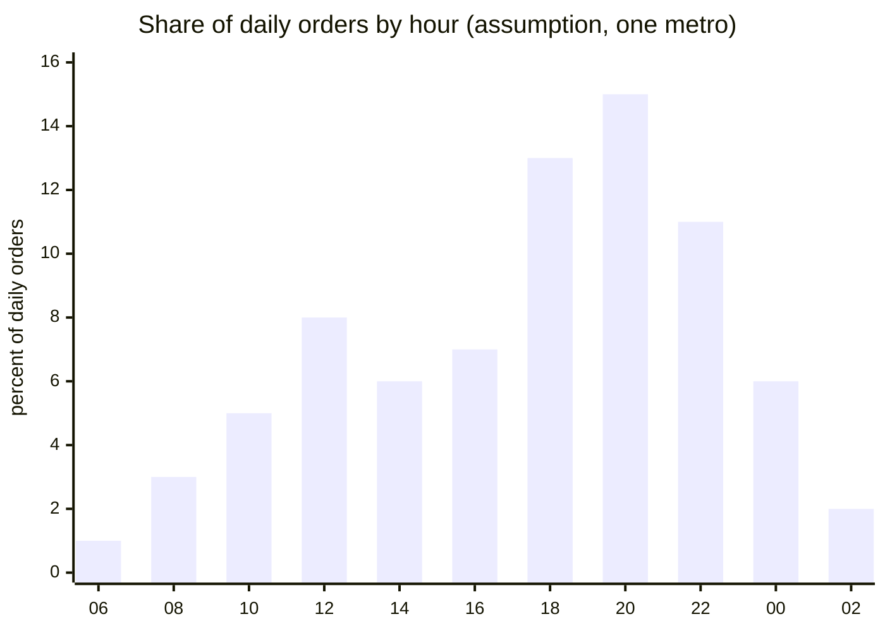
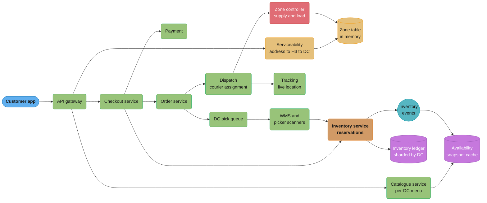
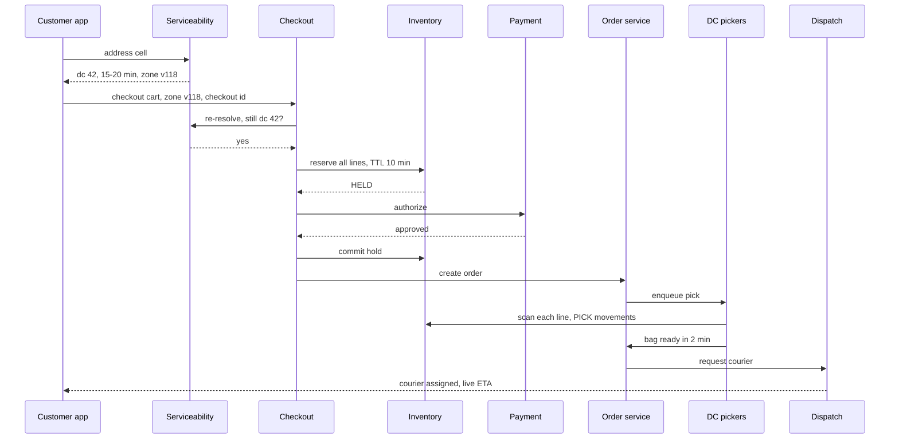
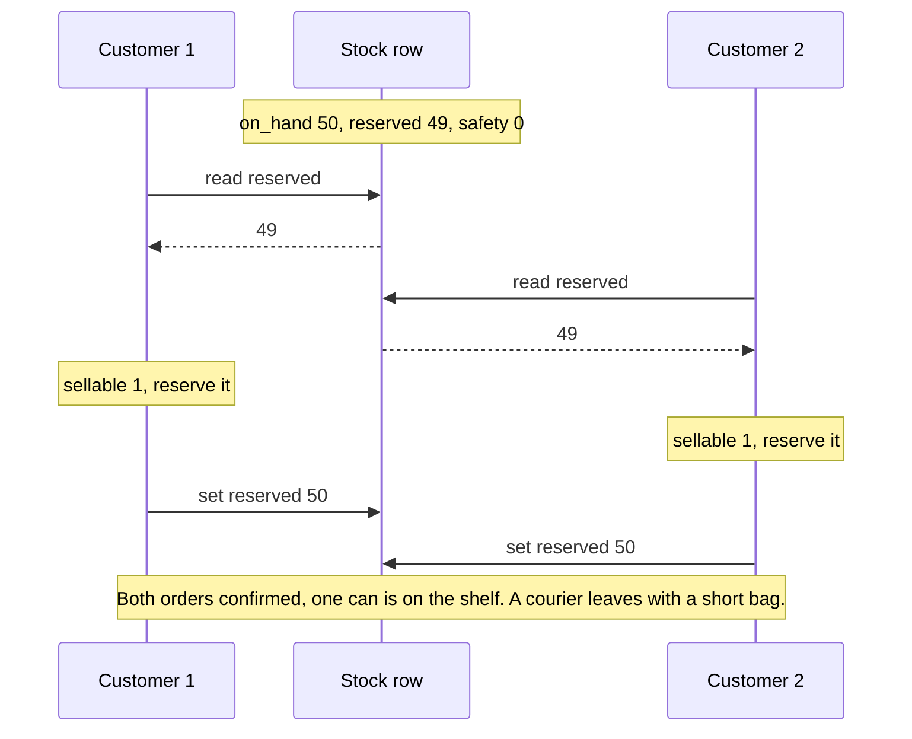
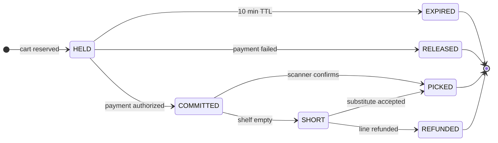
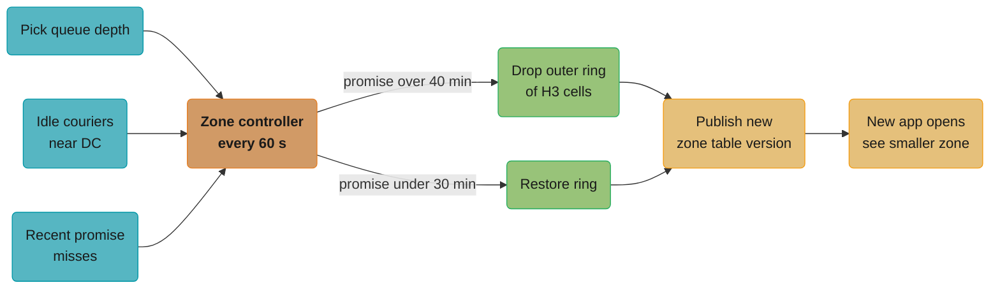

# System Design: Local Delivery Service (Gopuff-Style Dark Stores)

## Intuition

> **Design intuition**: A 30-minute convenience delivery app looks like food delivery with a different menu, but the core question is different. Food delivery asks "which restaurant can cook this, and which courier can carry it". A dark-store service owns the shelves, so it asks a harder, more literal question on every screen: **"from where you are standing right now, which of our warehouses can reach you in time, and what is physically on its shelves?"** The answer changes with your address, with the time of day, with courier supply, and every time a picker takes the last can of cold brew off a shelf.

**Key insight**: The design splits into two lookups that must never be confused. **Serviceability** (which distribution centre, or DC, serves this address, and how fast) is a geo problem that is slow-changing and precomputable: map the address to an H3 cell and read a table. **Availability** (can this DC sell this item now) is a per-DC inventory counter that is fast-changing and contended at checkout. The first is a read-mostly lookup; the second is a small, hot, write-contended ledger where an oversell is not a database inconsistency but a customer with a missing item and a courier already on the way. This study uses [`../geospatial_indexing/geospatial_indexing.md`](../geospatial_indexing/geospatial_indexing.md) for the cell math and [`../coordination_and_contention/coordination_and_contention.md`](../coordination_and_contention/coordination_and_contention.md) for the hold-with-TTL reservation. It does not re-derive courier dispatch, which [`./design_uber.md`](./design_uber.md) owns, or restaurant-marketplace ordering, which [`../../lld/system_design_problems/FoodDelivery.md`](../../lld/system_design_problems/FoodDelivery.md) models at class level.

---

## 1. Requirements Clarification

### Functional Requirements
- **Address to store**: given a delivery address, determine which DC serves it, the promised delivery window (for example "15-25 min"), and the delivery fee. If no DC serves it, say so before the customer browses.
- **Browse a per-DC catalogue**: the menu is the assortment of the serving DC, not a national catalogue. Items out of stock at that DC are hidden or greyed out.
- **Show availability honestly**: "In stock", "Only 3 left", or hidden. A displayed item must be orderable with high probability.
- **Cart and checkout**: reserve every line of the cart at checkout, all-or-nothing, then take payment.
- **Fulfilment**: the order goes to the DC's pick queue; a picker collects items, packs the bag, and hands it to a courier.
- **Substitutions and short picks**: if the shelf is empty despite the system count, offer a substitute or refund that line.
- **Dispatch and tracking**: assign a courier, show live courier location and ETA.
- **Inventory operations**: receive deliveries from suppliers, cycle count shelves, record damage and theft, transfer stock between DCs.
- **Dynamic zones**: shrink a DC's delivery zone when couriers are scarce or the DC is overloaded, and grow it back afterwards.

### Non-Functional Requirements
- **Serviceability lookup p99 under 20 ms**, because it gates the first screen.
- **Catalogue and availability page p99 under 200 ms**.
- **Checkout reservation p99 under 300 ms**, including all cart lines.
- **No oversell at reservation time**: two customers can never both reserve the last unit in the system of record.
- **Displayed availability accuracy**: at least **98%** of lines shown as available are picked successfully (target; the gap is shelf reality, §4.d).
- **Promise accuracy**: at least **90%** of orders delivered inside the promised window (target).
- **Per-DC isolation**: a broken DC (power cut, flooded stockroom) must be removable from serviceability in under 1 minute without touching other DCs.
- **Availability over consistency for browsing; consistency over availability for reservations.**

### Out of Scope
- **Courier dispatch algorithm internals**: covered by [`./design_uber.md`](./design_uber.md) and [`../../ml/case_studies/design_marketplace_matching.md`](../../ml/case_studies/design_marketplace_matching.md). We define the interface (§4.f).
- **Supplier purchasing and demand forecasting**: we consume the forecast as an input to safety stock (§4.b).
- **Payments**: authorization and capture are in [`./design_payment_system.md`](./design_payment_system.md).
- **Search ranking inside the catalogue**: a per-DC search index is assumed (§4.g).
- **Age verification for alcohol**: a compliance step at hand-off, not an architectural driver here.

---

## 2. Scale Estimation

All figures are **design assumptions** for a large national operator. They are not any company's disclosed numbers.

### Footprint
- **600 DCs** (dark stores) across **~150 metro areas**.
- **5,000 SKUs** per DC on average (a convenience assortment, not a supermarket).
- Inventory counters: 600 x 5,000 = **3 million (DC, SKU) rows**.
- Delivery zone per DC: a **15-minute drive-time** area, about **60 km²** in a suburb, smaller in a dense city.

### Customers and Orders
- **2 million daily active users**, **4 sessions** each, **6 catalogue pages** per session, **40 items** per page.
- Availability lookups/day = 2,000,000 x 4 x 6 x 40 = **1.92 billion** item lookups/day, or **~22,000/s** average.
- Most of those are served from a per-DC snapshot (§4.b), so the number that matters for the inventory store is lower: one snapshot fetch per page = 2,000,000 x 4 x 6 = 48 M/day = **~560/s**.
- **400,000 orders/day**, **8 lines** per order: **3.2 million line reservations/day**.
- Evening peak: **15%** of orders in the busiest hour = 60,000 orders/hour = **~17 orders/s**, with minute spikes of **~40 orders/s** (Sunday-night football, a storm).

### Inventory Writes
| Write type | Per day | Average rate | Notes |
|---|---|---|---|
| Reservation (checkout) | 3.2 M lines | 37/s | contended at hot SKUs |
| Release (expired or failed payment) | ~0.3 M lines | 3.5/s | about 10% of checkouts fail or time out |
| Pick confirmation (on_hand decrement) | 2.9 M lines | 34/s | from picker scanners |
| Receipts (supplier deliveries) | 600 DCs x 2 deliveries x 400 lines = 480,000 | 5.6/s | batch at fixed times |
| Cycle count adjustments | 600 DCs x 500 SKUs = 300,000 | 3.5/s | spread over the day |
| Total | ~7.2 M | ~84/s | peak ~6x: ~500/s |

### The Hot SKU
- A promotion: a new energy drink at half price, launched at 18:00 with a push notification to 500,000 users in one metro.
- One DC has **50 units**. In the first minute, **400** customers add it to the cart and **180** reach checkout.
- That is **3 checkouts/s on one counter** for a minute, and only 50 can succeed. Small in absolute terms, but it is the case where a non-atomic reservation oversells by 3x.

### Geo Tables
- H3 resolution 9 has an average hexagon area of **0.105 km²** (H3 resolution table, fetched 2026-11-25).
- One 60 km² zone = 60 / 0.105 = **~570 cells**. 600 DCs x 570 = **~342,000 cell entries**; overlapping zones add ~30% = **~445,000**.
- At ~48 bytes per entry (cell id 8 B, DC id 4 B, ETA band and fee 8 B, overhead), the whole table is **~21 MB**. It fits in the memory of every API node.

### The Daily Order Curve
Orders are not flat across the day. An assumed hourly profile for one metro (share of the day's orders):



*The evening peak at 20:00 carries about 15% of the day. Picker and courier shifts follow this curve; the software tiers are sized for it with ~2x headroom.*

### Couriers and Tracking
- **15,000 couriers** online at peak, location ping every **4 s**: 3,750 pings/s.
- Tracking viewers: ~ 1 active order per 10 DAU at peak = ~60,000 open tracking screens. See [`./design_nearby_friends.md`](./design_nearby_friends.md) for the moving-point fan-out pattern.

---

## 3. High-Level Architecture



*Serviceability and catalogue reads are served from in-memory tables and snapshots; only checkout touches the inventory ledger. The zone controller closes the loop between dispatch load and which addresses a DC accepts.*

### Request Flow
1. **Open the app**: the client sends the delivery address coordinates. Serviceability converts them to an H3 cell and returns `{dc_id, eta_band, fee}` from the in-memory zone table (§4.a). No database call.
2. **Browse**: the catalogue service returns the DC's menu joined with the DC's availability snapshot (§4.b), refreshed every few seconds from inventory events.
3. **Checkout**: the checkout service asks the inventory service to reserve every cart line atomically at that DC, with a 10-minute TTL (§4.c). On success it authorizes payment and creates the order.
4. **Fulfil**: the order enters the DC's pick queue. The picker's scanner confirms each line, which converts the reservation into an `on_hand` decrement. A missing item triggers the short-pick flow (§4.d).
5. **Deliver**: dispatch assigns a courier when the bag is about 2 minutes from ready, and tracking streams location until hand-off.

### Why Inventory Is Sharded by DC
Every reservation, pick and receipt touches exactly one DC, and a cart is always served from one DC (§4.e). Sharding the ledger by `dc_id` means every transaction is single-shard, a DC's whole inventory (5,000 rows) sits on one node, and a DC can be failed over or frozen on its own. A national sharding key such as `sku_id` would turn every cart into a cross-shard transaction.

### Why Serviceability Is Not a Radius Query
The obvious design is "find DCs within 5 km of the customer" with a geo index. It is wrong twice: a straight-line radius ignores rivers, motorways and one-way systems (a DC 2 km away across a river can be 25 minutes by road), and a radius query per app open puts a geo search on the hottest path. A precomputed drive-time zone rasterised into H3 cells answers both: the zone shape follows the road network, and the lookup is a hash-table read.

---

### Regions and Data Locality
Each metro is served from the nearest cloud region. Inventory shards are assigned so that a DC's ledger lives in the region closest to it; a checkout in Chicago never crosses to a European region. Serviceability tables are per country and replicated to every region in that country. A region outage takes down the metros it serves, which is acceptable for a local service: there is no meaningful failover for "deliver from a warehouse in Chicago" to a region in another country. See [`../multi_region_and_data_residency/multi_region_and_data_residency.md`](../multi_region_and_data_residency/multi_region_and_data_residency.md).

### The Order Path End to End



*Every step after the reservation is idempotent on the checkout id or the movement id, so a retry at any arrow is safe.*

## 4. Component Deep Dives

### (a) Serviceability: Address to H3 Cell to DC

**Building the zone table (offline, every 15 minutes or on change):**
1. For each DC, compute a drive-time isochrone polygon for the promise tier (for example 15 minutes at the current time-of-day traffic profile) from a routing engine.
2. Fill the polygon with H3 cells at resolution 9 (average 0.105 km², so an edge length of roughly 200 m).
3. For each cell, store the candidate DCs, their ETA band and fee. A cell inside two zones keeps both, ordered by ETA.
4. Apply the zone controller's current shrink factor per DC (§4.f): a DC under load drops its outer ring of cells.
5. Publish the table as an immutable versioned blob; API nodes swap it in atomically.

```java
import com.uber.h3core.H3Core;
import com.uber.h3core.util.LatLng;

public final class ZoneTableBuilder {
    private static final int RES = 9;
    private final H3Core h3 = H3Core.newInstance();

    /** Rasterise one DC's isochrone polygon into H3 cells. */
    public List<ZoneEntry> cellsFor(DcZone zone) {
        List<LatLng> ring = zone.isochrone();               // from the routing engine
        List<Long> cells = h3.polygonToCells(ring, List.of(), RES);
        List<ZoneEntry> out = new ArrayList<>(cells.size());
        for (long cell : cells) {
            LatLng c = h3.cellToLatLng(cell);
            int etaMin = zone.etaMinutesFrom(c);             // drive time from the DC to cell centre
            out.add(new ZoneEntry(cell, zone.dcId(), etaBand(etaMin + zone.prepMinutes()), zone.feeFor(etaMin)));
        }
        return out;
    }

    static String etaBand(int minutes) {
        if (minutes <= 20) return "15-20";
        if (minutes <= 25) return "20-25";
        if (minutes <= 35) return "25-35";
        return "35-45";
    }
}
```

**Serving (hot path):**

```java
public final class ServiceabilityService {
    private final H3Core h3 = H3Core.newInstance();
    private volatile ZoneTable table;                         // swapped atomically on publish

    public Serviceability resolve(double lat, double lng) {
        long cell = h3.latLngToCell(lat, lng, 9);
        List<ZoneEntry> candidates = table.get(cell);         // HashMap<Long, List<ZoneEntry>>
        for (ZoneEntry e : candidates) {
            if (table.isOpen(e.dcId())) {                     // DC kill switch, §8
                return Serviceability.served(e.dcId(), e.etaBand(), e.feeCents(), table.version());
            }
        }
        return Serviceability.notServed(table.version());
    }
}
```

The response carries the table **version**. Checkout re-resolves with the current version and rejects an order whose address dropped out of the zone since the customer opened the app (for example, because the zone shrank in a courier shortage), with a clear message rather than a late order.

**Boundary handling.** A customer whose address sits exactly on the edge of a zone gets the cell's answer, which is accurate to about 200 m. That is the deliberate tradeoff: a 200 m quantisation at the edge is invisible in a 15-minute promise, while an exact point-in-polygon test per request costs more and gains nothing. If a cell is half inside a zone, `polygonToCells` includes it based on its centre, which is the same rule for every cell and therefore explainable. The general boundary problem is covered in [`../geospatial_indexing/geospatial_indexing.md`](../geospatial_indexing/geospatial_indexing.md) §6.5.

***Broken:*** radius search on the hot path.

```sql
-- BROKEN -- straight-line radius, per request, ignores roads and puts a geo query on every app open
SELECT dc_id, ST_Distance(location, ST_MakePoint(:lng, :lat)::geography) AS d
FROM dc
WHERE ST_DWithin(location, ST_MakePoint(:lng, :lat)::geography, 5000)
ORDER BY d LIMIT 1;
```

***Fix:*** precomputed isochrone zones rasterised to H3 cells (above). The lookup becomes O(1) in memory, and the zone follows the road network. PostGIS stays in the offline builder, not on the request path.

### (b) Availability: What the Customer Sees

The inventory ledger keeps three numbers per `(dc_id, sku_id)`:

```sql
CREATE TABLE stock (
    dc_id        INT     NOT NULL,
    sku_id       BIGINT  NOT NULL,
    on_hand      INT     NOT NULL CHECK (on_hand >= 0),   -- physically on the shelf, per system
    reserved     INT     NOT NULL CHECK (reserved >= 0),  -- held by open checkouts and unpicked orders
    safety       INT     NOT NULL DEFAULT 0,              -- buffer for shelf inaccuracy
    version      BIGINT  NOT NULL DEFAULT 0,
    updated_at   TIMESTAMPTZ NOT NULL DEFAULT now(),
    PRIMARY KEY (dc_id, sku_id),
    CHECK (reserved <= on_hand)
);

CREATE TABLE stock_movement (            -- append-only ledger, the audit trail
    dc_id      INT         NOT NULL,
    sku_id     BIGINT      NOT NULL,
    movement_id UUID       NOT NULL,     -- idempotency key from the source system
    kind       TEXT        NOT NULL,     -- RESERVE, RELEASE, PICK, RECEIVE, ADJUST, TRANSFER_OUT, TRANSFER_IN
    qty        INT         NOT NULL,
    ref        TEXT,                     -- order id, PO id, count id
    at         TIMESTAMPTZ NOT NULL DEFAULT now(),
    PRIMARY KEY (dc_id, movement_id)
);
```

**Sellable** = `on_hand - reserved - safety`. The customer never sees `on_hand`.

- **Safety stock** absorbs the gap between the system count and the shelf. It is set per SKU from measured shrink (damage, theft, mis-slotting): an SKU that is short-picked 3% of the time with a typical shortfall of 1 unit gets `safety = 1`; a high-theft item (razors, energy drinks) gets more. This is how §1's 98% accuracy target is met without lying about stock.
- **Display buckets**: sellable 0 = hidden; 1-3 = "Only N left"; 4+ = "In stock". Exact counts above 3 change too often to be worth showing and leak competitive data.

**The snapshot.** The catalogue does not query the ledger per item. Each inventory change emits an event; a per-DC snapshot builder folds events into a compact map `sku_id -> bucket` and publishes it to a cache every **2 seconds** or on any transition across a bucket boundary. One catalogue page = one snapshot fetch (§2's ~560/s), not 40 row reads.

**Staleness is safe in one direction only.** A snapshot that says "in stock" for an item that just sold out produces a checkout failure for that line (§4.c), which is annoying but correct. A snapshot that says "sold out" for an item that was just received produces a lost sale, which is invisible. The 2-second refresh plus bucket-transition push keeps both small; the reservation is the only place correctness is enforced.

### (c) Checkout Reservation: Broken, Then Fixed

***Broken:*** read sellable for each line, then write.

```java
// BROKEN -- per-line check-then-act, and not all-or-nothing
public CheckoutResult reserveBroken(int dcId, List<CartLine> lines) {
    for (CartLine l : lines) {
        Stock s = stockRepo.find(dcId, l.skuId());                 // read
        if (s.onHand() - s.reserved() - s.safety() < l.qty()) {
            return CheckoutResult.unavailable(l.skuId());          // earlier lines stay reserved!
        }
        stockRepo.setReserved(dcId, l.skuId(), s.reserved() + l.qty());   // absolute write
    }
    return CheckoutResult.ok();
}
```

Two defects: two checkouts read the same `reserved` value and both write `reserved + 1`, so the last unit is sold twice; and a failure on line 5 leaves lines 1-4 reserved with nobody to release them.



***Fix (SQL):*** one transaction, conditional increments, lines locked in a fixed order to avoid deadlocks, all-or-nothing.

```sql
-- Reserve all lines of one cart at one DC, all-or-nothing, idempotent on checkout_id.
BEGIN;
-- 1. Claim the checkout id first. 0 rows inserted = a retry of a checkout that already
--    reserved: COMMIT and return the stored result without touching stock again.
INSERT INTO reservation (checkout_id, dc_id, expires_at, status, zone_version)
VALUES (:checkout_id, :dc_id, now() + interval '10 minutes', 'HELD', :zone_version)
ON CONFLICT (checkout_id) DO NOTHING;

-- 2. Lock the cart's rows in sku_id order, so two carts sharing SKUs cannot deadlock.
SELECT sku_id FROM stock
WHERE dc_id = :dc_id AND sku_id IN (:sku1, :sku2, :sku3)
ORDER BY sku_id
FOR UPDATE;

-- 3. Conditional increment. Affected rows less than the line count = some line is short:
--    ROLLBACK (which also removes the claim), re-read which line failed, tell the customer.
UPDATE stock
SET reserved = reserved + v.qty, version = version + 1, updated_at = now()
FROM (VALUES (:sku1, :q1), (:sku2, :q2), (:sku3, :q3)) AS v(sku_id, qty)
WHERE stock.dc_id = :dc_id
  AND stock.sku_id = v.sku_id
  AND stock.on_hand - stock.reserved - stock.safety >= v.qty;

-- 4. Record the lines and the ledger movements in the same transaction.
INSERT INTO reservation_line (checkout_id, sku_id, qty)
SELECT :checkout_id, v.sku_id, v.qty
FROM (VALUES (:sku1, :q1), (:sku2, :q2), (:sku3, :q3)) AS v(sku_id, qty);
INSERT INTO stock_movement (dc_id, sku_id, movement_id, kind, qty, ref)
SELECT :dc_id, v.sku_id, gen_random_uuid(), 'RESERVE', v.qty, :checkout_id
FROM (VALUES (:sku1, :q1), (:sku2, :q2), (:sku3, :q3)) AS v(sku_id, qty);
COMMIT;
```

***Fix (in-memory hot path, optional):*** for DCs with heavy promotions, the per-DC counters can live in Redis or Valkey with a Lua script that checks every line before changing any, which gives the same all-or-nothing semantics in one atomic step. The ledger write follows asynchronously through an outbox and is reconciled, the same front-and-backstop pattern as [`./design_flash_sale_ticketing.md`](./design_flash_sale_ticketing.md) §4.c.

```lua
-- KEYS: one hash per SKU at this DC, e.g. "stock:{dc42}:sku:1001" with fields on_hand, reserved, safety
-- ARGV: qty for each key, in the same order; ARGV[#KEYS+1] = checkout_id
for i, key in ipairs(KEYS) do
  local v = redis.call('HMGET', key, 'on_hand', 'reserved', 'safety')
  local sellable = tonumber(v[1]) - tonumber(v[2]) - tonumber(v[3])
  if sellable < tonumber(ARGV[i]) then
    return {'SHORT', key}          -- nothing has been changed yet
  end
end
for i, key in ipairs(KEYS) do
  redis.call('HINCRBY', key, 'reserved', tonumber(ARGV[i]))
end
return {'OK', ARGV[#KEYS + 1]}
```

The hash tag `{dc42}` keeps every key of one DC in the same Redis Cluster slot, which is required for a multi-key script and is the in-memory equivalent of "shard by DC".

**Reservation lifecycle.** A reservation is a hold with a TTL ([`../coordination_and_contention/coordination_and_contention.md`](../coordination_and_contention/coordination_and_contention.md) §4.4). It has a header row and one row per line, both on the DC's shard:

```sql
CREATE TABLE reservation (
    checkout_id UUID        PRIMARY KEY,          -- idempotency key from checkout
    dc_id       INT         NOT NULL,
    status      TEXT        NOT NULL CHECK (status IN
                  ('HELD','COMMITTED','RELEASED','EXPIRED','PICKED','SHORT','REFUNDED')),
    expires_at  TIMESTAMPTZ NOT NULL,
    zone_version BIGINT     NOT NULL              -- the serviceability table the cart was built on
);
CREATE TABLE reservation_line (
    checkout_id UUID   NOT NULL REFERENCES reservation (checkout_id),
    sku_id      BIGINT NOT NULL,
    qty         INT    NOT NULL CHECK (qty > 0),
    PRIMARY KEY (checkout_id, sku_id)
);
CREATE INDEX reservation_expiry ON reservation (expires_at) WHERE status = 'HELD';
```



- **HELD to EXPIRED**: a sweeper releases expired holds every 30 s with `UPDATE ... WHERE status='HELD' AND expires_at < now()` and decrements `reserved` in the same transaction. The status predicate makes it idempotent against a payment success arriving at the same moment: whichever commits first wins the row.
- **COMMITTED to PICKED**: one transaction decrements both `on_hand` and `reserved` by the picked quantity.
- **Payment and reservation ordering**: reserve first, then authorize payment. Authorizing first and then failing to reserve means voiding an authorization, which customers see as a phantom charge on their banking app for days.

### (d) Shelf Reality: Short Picks, Substitutions and Cycle Counts

The ledger says 1; the shelf says 0. The reasons are physical: damage, theft, an item put back in the wrong bin, a receipt keyed with the wrong quantity. No database transaction fixes these. The design makes them **cheap to detect and correct**.

| Event | System action | Customer impact |
|---|---|---|
| Picker scans bin, item missing | Mark line SHORT, create an ADJUST movement of minus the system count for that bin, trigger a targeted cycle count | Offer substitute in app (60 s timeout) or refund the line |
| Substitute offered | Reserve the substitute at the same DC (§4.c), price-match down, never up | Customer accepts or declines; default from their preferences |
| Cycle count disagrees | ADJUST movement to the counted value; recompute `safety` for the SKU weekly | None directly; fewer future shorts |
| Receipt over or under | ADJUST against the purchase order; flag the supplier | None |

```java
public final class ShortPickHandler {
    /** Called by the picker scanner when the bin is empty. Idempotent on movementId. */
    public ShortResult onShort(int dcId, long skuId, long orderId, int missingQty, UUID movementId) {
        int systemOnHand = stockRepo.onHand(dcId, skuId);
        // Trust the shelf: zero the bin, keep reserved consistent by releasing this order's line.
        ledger.append(dcId, skuId, movementId, "ADJUST", -systemOnHand, "short:" + orderId);
        ledger.release(dcId, skuId, orderId, missingQty);
        cycleCounts.schedule(dcId, skuId, Priority.HIGH);
        Optional<Long> sub = substitutes.best(dcId, skuId, orderId);
        return sub.map(s -> ShortResult.offer(s)).orElse(ShortResult.refund(skuId, missingQty));
    }
}
```

The key rule: **one short pick zeroes the system count for that bin**, not just the one missing unit. If the shelf is empty, every other open reservation for that SKU at that DC is also going to be short, and the next customers should see "sold out" now rather than after their courier leaves. The orders already holding reservations for that SKU are flagged for proactive substitution before picking starts.

### (e) Multi-DC Carts and the Single-Courier Constraint

A customer's cell can be served by two DCs (overlapping zones, §4.a). The primary DC lacks one item the other has. Options:

| Option | Behaviour | Problem |
|---|---|---|
| Split the order | Two pick queues, two couriers | Doubles delivery cost for one basket; two arrival times |
| Transfer stock | Move the item between DCs before picking | 30+ minutes; breaks the promise |
| Cart-level DC choice | Choose the one DC that can fulfil the whole cart | Must be decided before checkout, re-evaluated as the cart changes |
| Show unavailable | Keep the primary DC, mark the item unavailable | Lost line, simple |

This design uses **cart-level DC choice with a bias toward the primary DC**: the catalogue is the primary DC's menu; if the customer adds an item that only the secondary DC has, the app offers "switch to the [secondary] store for this order: +6 min" when the secondary can fulfil the whole current cart. The cart is always single-DC at checkout, which keeps the reservation single-shard (§3).

```java
public Optional<Integer> chooseDc(List<ZoneEntry> candidates, List<CartLine> cart, AvailabilitySnapshots snaps) {
    for (ZoneEntry e : candidates) {                    // ordered by ETA, primary first
        AvailabilitySnapshot s = snaps.forDc(e.dcId());
        if (cart.stream().allMatch(l -> s.sellableBucket(l.skuId()) != Bucket.HIDDEN)) {
            return Optional.of(e.dcId());
        }
    }
    return Optional.empty();                            // no single DC can fulfil the cart
}
```

### (f) Dispatch, Promise Time and the Zone Controller

The promise shown at app open is `prep_time + travel_time`:
- **Prep time** from the DC's current pick-queue depth: with 6 pickers and a median of 3 minutes per order, a queue of 24 orders adds 24 / 6 x 3 = **12 minutes**.
- **Travel time** from the zone table's ETA band.

When prep time rises, the promise widens; when it crosses the product limit (for example 45 minutes), the **zone controller** shrinks the DC's zone: it removes the outermost ring of cells (the longest travel times) from the published table. Fewer new orders arrive, the queue drains, and the zone grows back. The controller runs every 60 s with hysteresis (shrink at 40 minutes, grow back at 30) so the zone does not flap.



This is a load-shedding control loop ([`../resilience_patterns/resilience_patterns.md`](../resilience_patterns/resilience_patterns.md)) expressed as geography: rather than rejecting orders at checkout, the system stops offering service to the addresses that cost the most to serve. Courier assignment itself (batching two orders from the same DC going the same direction, nearest-available matching) is the Uber dispatch problem and is out of scope here.

### (g) The Per-DC Catalogue and Search

- **Assortment** is per DC: a DC near a university stocks different snacks than one in a retirement suburb. The national product catalogue (names, images, nutrition) is shared; the per-DC table is `(dc_id, sku_id, price, assortment_flag)`.
- **Prices** can vary by DC (local tax, alcohol rules). The price shown is the DC's price at checkout; a price change between browse and checkout is applied at checkout with a notice.
- **Search** runs against a per-metro index filtered by `dc_id`, with availability applied as a post-filter from the snapshot, not indexed, because availability changes far faster than an index can be refreshed. See [`../../database/elasticsearch_internals/elasticsearch_internals.md`](../../database/elasticsearch_internals/elasticsearch_internals.md) for refresh cost.
- **Caching**: the catalogue page for one DC is identical for every customer of that DC except for personalisation. Cache it per `(dc_id, page, snapshot_version)` with a short TTL; 600 DCs means a small, very hot key set ([`../caching/caching.md`](../caching/caching.md)).

### (h) Inventory Event Sources and Idempotency

Inventory changes arrive from four producers: checkout (reservations), picker scanners (picks and shorts), the receiving dock (receipts), and the cycle-count app (adjustments). Scanners are on warehouse Wi-Fi and retry aggressively.

- Every producer sends a **`movement_id`** generated at the source (one per scan). The ledger's primary key `(dc_id, movement_id)` makes a retried scan a no-op.
- The `stock` row and the `stock_movement` row change in **one transaction**. The snapshot builder reads movements through change data capture, not by polling `stock`, so it never misses a transition.
- Receipts arrive as one purchase order with 400 lines. They are applied as one transaction per PO per DC, so a half-applied receipt never shows half a delivery as sellable.

### (i) Replenishment and Inter-DC Transfers

Replenishment reads the movement stream to compute each SKU's sell-through per DC and orders from suppliers ahead of predicted sell-out. The architectural parts that matter here:

- **Reorder point** per `(dc_id, sku_id)`: `lead_time_days x daily_sales + safety`. A SKU selling 20 a day with a 2-day lead time and safety 4 reorders at 44 units.
- **Inter-DC transfer** moves stock from an overstocked DC to an understocked one in the same metro. It is two movements at two DCs, and the two DCs can be on **different shards**, so it is never one transaction. It is a two-step process with an in-transit state:

```sql
-- Step 1, at the source DC shard: stock leaves and is recorded in transit.
BEGIN;
UPDATE stock SET on_hand = on_hand - :qty, version = version + 1
WHERE dc_id = :src AND sku_id = :sku AND on_hand - reserved - safety >= :qty;
INSERT INTO stock_movement (dc_id, sku_id, movement_id, kind, qty, ref)
VALUES (:src, :sku, :move_out_id, 'TRANSFER_OUT', -:qty, :transfer_id);
INSERT INTO outbox (event_id, kind, payload)
VALUES (:move_out_id, 'TRANSFER_SHIPPED', json_build_object('transfer', :transfer_id, 'dst', :dst, 'sku', :sku, 'qty', :qty));
COMMIT;

-- Step 2, at the destination DC shard, only when the van is unloaded and scanned:
BEGIN;
UPDATE stock SET on_hand = on_hand + :received_qty, version = version + 1
WHERE dc_id = :dst AND sku_id = :sku;
INSERT INTO stock_movement (dc_id, sku_id, movement_id, kind, qty, ref)
VALUES (:dst, :sku, :move_in_id, 'TRANSFER_IN', :received_qty, :transfer_id)
ON CONFLICT DO NOTHING;
COMMIT;
```

Stock in the van belongs to neither DC's sellable count, which is correct: it cannot be picked. A transfer that never arrives shows up in the reconciliation of `TRANSFER_OUT` against `TRANSFER_IN` per `transfer_id`, which is exactly the outbox-plus-saga shape in [`../distributed_transactions/distributed_transactions.md`](../distributed_transactions/distributed_transactions.md).

### (j) Reconciliation: Proving the Counters

Three checks run per DC:

```sql
-- 1. reserved must equal open holds plus committed-but-unpicked lines
SELECT s.sku_id, s.reserved, COALESCE(h.open_qty, 0) AS expected
FROM stock s
LEFT JOIN (
    SELECT rl.sku_id, SUM(rl.qty) AS open_qty
    FROM reservation r JOIN reservation_line rl USING (checkout_id)
    WHERE r.dc_id = :dc AND r.status IN ('HELD', 'COMMITTED')
    GROUP BY rl.sku_id
) h ON h.sku_id = s.sku_id
WHERE s.dc_id = :dc AND s.reserved <> COALESCE(h.open_qty, 0);

-- 2. on_hand must equal the sum of all movements that change on_hand
SELECT s.sku_id, s.on_hand, m.total
FROM stock s
JOIN (
    SELECT sku_id, SUM(qty) AS total
    FROM stock_movement
    WHERE dc_id = :dc AND kind IN ('RECEIVE', 'PICK', 'ADJUST', 'TRANSFER_OUT', 'TRANSFER_IN')
    GROUP BY sku_id
) m USING (sku_id)
WHERE s.dc_id = :dc AND s.on_hand <> m.total;

-- 3. transfers shipped but not received after 24 hours
SELECT ref AS transfer_id FROM stock_movement
WHERE kind = 'TRANSFER_OUT' AND at < now() - interval '24 hours'
  AND ref NOT IN (SELECT ref FROM stock_movement WHERE kind = 'TRANSFER_IN');
```

Check 2 is only possible because `stock_movement` is append-only and every change to `on_hand` is a movement. The `stock` row is a materialised view of the ledger that is kept in the same transaction for fast reads, the same projection idea as [`../event_sourcing_cqrs/event_sourcing_cqrs.md`](../event_sourcing_cqrs/event_sourcing_cqrs.md).

---

## 5. Design Decisions & Tradeoffs

| Decision | Option A | Option B | Choice and why |
|---|---|---|---|
| Serviceability lookup | Live radius query against a geo index | Precomputed drive-time zones as H3 cells in memory | **Precomputed H3 zones.** O(1) per request, follows roads, and the zone controller can reshape it per DC. |
| Cell resolution | H3 res 8 (0.737 km² average) | H3 res 9 (0.105 km² average) | **Res 9.** About 200 m edge quantisation is invisible in a 15-minute promise; res 8 is coarse enough to misplace a street, and res 10 multiplies the table 7x for no gain. |
| Inventory sharding | By SKU | By DC | **By DC.** Every cart, pick and receipt is single-DC, so every transaction is single-shard. |
| When to reserve | At add-to-cart | At checkout | **At checkout.** Add-to-cart holds tie up stock for abandoned carts; a 10-minute hold at checkout covers payment only. |
| Reservation store | Ledger DB only | Redis Lua counters fronting the ledger | **Ledger by default, Redis for promotion-heavy DCs.** The DB handles ~500 writes/s peak easily; Redis is justified by hot-SKU bursts. |
| Availability display | Exact count | Buckets with safety stock | **Buckets plus safety stock.** Shelf error makes exact counts misleading; buckets change less often and cache better. |
| Multi-DC carts | Split orders | Single DC per cart | **Single DC per cart**, with a switch offer. One courier, one shard, one promise. |
| Load response | Reject at checkout | Shrink the zone | **Shrink the zone.** Customers outside the zone never see an offer they cannot get; customers inside keep a reliable promise. |
| Short-pick correction | Decrement by the missing unit | Zero the bin and schedule a count | **Zero the bin.** An empty bin means every later order will also be short. |

### What Changes at 10x
| Pressure | At 1x | At 10x | Change |
|---|---|---|---|
| DCs | 600 | 6,000 | zone table ~210 MB; still in memory, or split per country |
| Orders | 400,000/day | 4 M/day | ledger writes ~5,000/s peak; 32 shards, still single-DC transactions |
| Catalogue reads | 22,000 items/s | 220,000 items/s | snapshot cache scales with DCs, not users |
| Hot SKU | 3 checkouts/s | 30 checkouts/s | Redis Lua path by default for promotion DCs |
| Pickers per DC | 6 | 6 | unchanged: growth comes from more DCs, not bigger ones |

The last row is the important one. A dark-store network scales by adding buildings, and every design choice in §3 that keys on the DC (shards, zones, kill switches, snapshots) is what makes adding a building a configuration change.

### Dark Store vs. Store-Picking Marketplace
A marketplace model (shoppers pick from partner supermarkets) has no ledger to own: availability is a **prediction** from past picks, and shorts are a normal part of the flow. A dark-store model owns the shelf, so availability is a **count** with a known error. This study is the counted model. The predicted model needs an ML availability service in place of §4.b's ledger, and its substitution flow becomes the main path rather than the exception.

---

## 6. Real-World Implementations

- **Gopuff**: per its Wikipedia article (which cites company and press sources), GoBrands, Inc., doing business as Gopuff, was founded in 2013 in Philadelphia by Yakir Gola and Rafael Ilishayev, "delivers foods and goods typically found in convenience stores in more than 500 cities, suburbs, and towns across the United States as of 2025", and "owns warehouses that stock many of the products it delivers". The same article reports that in July 2022 Gopuff "announced closure of 76 of its U.S. warehouses and layoffs impacting about 1,500 employees", and that in March 2023 "Uber couriers were handling at least 4 percent of all Gopuff orders in the US to deal with a gap in the company's driver workforce". Two design lessons follow: the DC is the unit of capacity and of failure (§3, closing 76 at once is a serviceability-table change, not a migration), and courier supply can be external, so dispatch must accept third-party fleets behind an interface (§4.f). Source: [Wikipedia, "Gopuff"](https://en.wikipedia.org/wiki/Gopuff), fetched 2026-11-25. Gopuff's own site returned HTTP 403 to the fetcher, so no first-party figure is used.
- **DoorDash DashMart**: DoorDash announced DashMart on 2020-08-05 as "a new type of convenience store, offering both household essentials and local restaurant favorites", with "thousands of convenience, grocery, and restaurant items", and states "DashMart stores are owned, operated, and curated by DoorDash". At launch it was "available in 8 cities, including Chicago, Minneapolis, Columbus, Cincinnati, Dallas, Salt Lake City, the greater Phoenix area, and Redwood City, CA". The same announcement says the Convenience category already included "more than 2,500 convenience shops across more than 1,100 cities". That pairing is §5's contrast in one company: an owned-inventory dark store (DashMart) beside a partner-store marketplace (Convenience). Source: [DoorDash, "Introducing DashMart"](https://about.doordash.com/en-us/news/introducing-dashmart), 2020-08-05.
- **Uber H3 (the grid behind §4.a)**: Uber's engineering blog (2018-06-27) describes H3 as "our grid system for efficiently optimizing ride pricing and dispatch", states "we calculate surge pricing by measuring supply and demand in hexagons in each city that we serve", and explains the hexagon choice: "people in a city are often in motion, and hexagons minimize the quantization error introduced when users move through a city". Uber open-sourced H3 that year. Source: [Uber Engineering, "H3: Uber's Hexagonal Hierarchical Spatial Index"](https://www.uber.com/blog/h3/). The resolution table used in §2 and §5 (res 7 average 5.161 km², res 8 0.737 km², res 9 0.105 km², and exactly 12 pentagons at every resolution) is from [h3geo.org, "Tables of Cell Statistics Across Resolutions"](https://h3geo.org/docs/core-library/restable/), fetched 2026-11-25.

### Synthesis
Both owned-inventory operators above treat the store as the unit of the business: Gopuff opened and closed warehouses as units, and DoorDash launched DashMart city by city. That is the architectural reason this design shards inventory by DC, keys serviceability by DC, and gives each DC its own kill switch and zone controller. The H3 grid is the shared language between serviceability, pricing and dispatch, as Uber's surge-pricing use shows.

---

## 7. Technologies & Tools

| Layer | Options | Notes |
|---|---|---|
| Geo grid | H3 (Java, Go, Python, JS bindings) | Res 9 for zones; res 7 or 8 for metro-level supply and demand aggregation |
| Isochrones | OSRM, Valhalla, GraphHopper, or a commercial routing API | Offline only; per time-of-day traffic profile |
| Zone build | PostGIS for polygon operations, batch job every 15 min | Never on the request path |
| Zone table serving | In-memory hash map in every API node, versioned blob in object storage | ~21 MB |
| Inventory ledger | PostgreSQL or MySQL, sharded by `dc_id` | `CHECK (reserved <= on_hand)` as a last line of defence |
| Hot counters | Redis or Valkey with Lua, hash-tagged per DC | Optional, for promotion bursts |
| Inventory events | CDC (Debezium) into Kafka, partitioned by `dc_id` | Feeds snapshots, analytics, replenishment |
| Availability snapshot | Redis or a CDN-backed object per DC | 2 s refresh plus bucket-transition push |
| Catalogue search | Elasticsearch or OpenSearch per metro | Availability as a post-filter |
| Order workflow | Durable workflow engine (Temporal) or a state machine over the order table | Holds, pick, dispatch, refunds |
| Tracking | WebSocket or SSE fan-out of courier pings | See [`../realtime_updates/realtime_updates.md`](../realtime_updates/realtime_updates.md) |

---

## 8. Operational Playbook

### Key Metrics

| Metric | Target | Alert |
|---|---|---|
| Serviceability p99 | under 20 ms | over 50 ms |
| Zone table age | under 15 min | over 30 min |
| Reservation p99 | under 300 ms | over 800 ms |
| Reservation failure rate (line short at checkout) | under 2% | over 5% in a DC for 10 min |
| Short-pick rate per DC | under 2% of lines | over 4% |
| Expired holds per hour | ~10% of checkouts | spike over 25% (payment outage) |
| Promise accuracy | over 90% on time | under 80% for 30 min |
| `reserved` drift (sum of open holds versus `reserved` column) | 0 | any non-zero after reconciliation |

### Runbook: A DC Must Stop Taking Orders Now
1. Flip the DC's `open=false` flag in the zone table (a single key in the versioned blob, published in under 60 s).
2. The serviceability service skips the DC (§4.a); customers in overlapping cells fall back to the next DC, others see "not available right now".
3. Orders already picked continue to dispatch; orders not yet picked are offered transfer to the fallback DC if it can fulfil the whole cart, else cancelled with refund.
4. Do not touch the inventory ledger. The DC's stock is still true; it is serviceability that changed.

### Runbook: Short-Pick Rate Spikes at One DC
1. Check for a recent receipt with mis-keyed quantities (one PO can poison hundreds of SKUs).
2. Check bin-relocation activity: a re-slot without scanner updates makes every moved SKU "missing".
3. Raise `safety` temporarily for the DC by +1 on affected SKUs to stop customer-facing shorts while counts run.
4. Run a full cycle count of the affected aisles; ADJUST movements fix the ledger.

### Runbook: Reserved Counter Drift
1. Reconciliation job, every 10 minutes per DC: `SUM(qty)` of HELD and COMMITTED reservation lines versus `stock.reserved`.
2. Drift means a release or pick did not decrement `reserved` (a bug, or a manual DB edit).
3. Fix by an ADJUST-style movement on `reserved` with a reason code, never by a bare `UPDATE`.

### Runbook: Payment Provider Outage
1. Symptom: authorizations time out; HELD reservations pile up and expire after 10 minutes, so `reserved` stays inflated for the whole TTL.
2. Effect: sellable drops on popular SKUs although nothing was sold; the app shows false "sold out".
3. Action: shorten the hold TTL to 3 minutes for the outage, and put checkout behind a "payments delayed" banner so customers do not retry into new holds.
4. Failover: switch to the secondary payment provider if one is configured; the reservation step is unaffected because it happens first.

### Pre-Promotion Checklist
1. Identify the DCs that stock the promoted SKU and their current sellable counts.
2. Move those DCs' counters for the SKU to the Redis Lua reservation path and verify the outbox drain to the ledger.
3. Raise `safety` by 1 for the promoted SKU (high-theft, high-attention items short more).
4. Stagger the push notification by metro over 10 minutes, so checkouts do not land in one second.
5. Pre-compute substitutes for the promoted SKU, so a short pick has an answer ready.

### Daily Cycle
- **06:00**: supplier receipts land; the snapshot builder pushes "in stock" transitions.
- **17:00-21:00**: evening peak; the zone controller is most active.
- **23:00-02:00**: late-night convenience peak at university DCs; smaller staff, so prep time drives zone shrink.

---

## 9. Common Pitfalls & War Stories

The incidents below are **illustrative composites**; the numbers show the mechanism and its cost.

### War Story 1: The Promotion That Sold 150 Cans From a Shelf of 50
A national push for a half-price energy drink hit a DC whose checkout reserved lines with read-then-write (§4.c broken). In 90 seconds, **180 checkouts** succeeded against **50 units**. 130 orders went to pickers with an empty bin; 130 refunds, 130 apology credits at $5, and roughly **$1,950** in courier cost for bags that left short, plus a one-star review spike for the metro. Fix: conditional increment in one transaction (§4.c), plus the Redis Lua path for DCs flagged for the promotion.

### War Story 2: The River
A DC's zone was a 4 km radius. A neighbourhood 2.5 km away across a river, reachable only by a bridge 6 km upstream, was "in zone". Orders there averaged **38 minutes** against a 20-minute promise; on-time rate for those cells was **31%**. The team found it only by plotting promise misses per H3 cell. Fix: drive-time isochrones (§4.a); the neighbourhood moved to a different DC's zone and its on-time rate rose to the metro average.

### War Story 3: Phantom Stock After a Re-Slot
A DC re-organised aisles overnight without updating bin locations in the WMS. Next morning, pickers scanned old bins and found them empty: **1,100 SKUs** reported short over 3 hours, every short triggered a zero-the-bin adjustment (§4.d), and those SKUs disappeared from the app although they were on the shelves. Sales at that DC fell **40%** for the morning. Fix: a "re-slot in progress" mode per aisle that routes shorts to a supervisor instead of auto-zeroing, and bin updates as part of the re-slot checklist.

### War Story 4: Authorize, Then Reserve
An early checkout authorized payment, then reserved inventory. During a promotion, 22% of reservations failed, and each failure meant voiding an authorization. Customers saw pending charges on their banking apps for up to several days, and the support queue tripled. Fix: reserve first (cheap, internal, reversible), then authorize (§4.c).

### War Story 5: Zone Flapping
The first zone controller shrank at promise > 35 minutes and grew back at < 35. During a Friday peak, a DC's zone shrank and grew **every 60 seconds** for an hour; customers at the edge saw "available", then "not available", then "available" on refresh, and some lost carts mid-checkout when the table version changed. Fix: hysteresis (shrink at 40, grow at 30), a minimum 10-minute dwell per state, and checkout honouring the zone version the cart was built with for up to 10 minutes.

### War Story 6: The Stale Zone Table
The zone builder's publish step failed silently for 9 hours after a credentials rotation. API nodes kept serving the last good table, which was correct behaviour, but the table had been built during a morning courier shortage with **every** DC shrunk by one ring. For the whole evening peak, about **18%** of addresses that should have been served saw "not available". Lost revenue was estimated at a full evening's orders for those cells. Fix: an alert on zone-table age (§8), and the builder publishes a fresh table on a fixed schedule even when nothing changed, so age is always a meaningful signal.

### Further Pitfalls
- **Per-item availability reads**: 40 ledger reads per catalogue page at 22,000 items/s will saturate the ledger; use the per-DC snapshot.
- **Cross-DC transactions**: letting a cart span DCs turns every checkout into a distributed transaction; see [`../distributed_transactions/distributed_transactions.md`](../distributed_transactions/distributed_transactions.md) for why to avoid it.
- **Showing exact counts**: "7 left" that becomes "2 left" between page loads trains customers to distrust the display.
- **Forgetting the safety buffer for high-theft SKUs**: the most-stolen items are also the most-promoted ones.

---

## 10. Capacity Planning

### Serviceability
- ~22 MB table per node, O(1) lookup. App opens: 2 M DAU x 4 = 8 M/day, peak ~400/s. One node handles this; run **3 per region** for availability.

### Catalogue and Snapshots
- Snapshot fetches ~560/s average, ~3,000/s peak. Snapshot size per DC: 5,000 SKUs x 2 bytes (bucket plus flags) = 10 KB. Cache hit rate near 100% because there are only 600 keys.
- Snapshot builder: ~84 movements/s average, 500/s peak, partitioned by DC across **8 consumers**.

### Inventory Ledger
- Peak ~500 movements/s across 600 DCs; each touches one shard.
- **8 shards** of 75 DCs each: ~63 movements/s peak per shard, far under a single Postgres primary's capacity. Shard count is driven by blast radius (a shard failure affects 75 DCs, 12.5% of the network), not throughput.
- Storage: 7.2 M movements/day x 120 B = ~0.9 GB/day; keep 2 years hot (~630 GB), archive the rest.

### Hot-SKU Path
- Promotion burst: 3 checkouts/s on one counter, 180 in a minute. A single Postgres row handles this with conditional updates. The Redis path is for DCs running several simultaneous promotions, where many hot rows share one shard.

### Tracking
- 3,750 courier pings/s, 60,000 viewers. Fan-out per order (1 courier to about 1 viewer) is trivial; the tracking tier is sized by socket count: **2 gateway nodes** plus headroom.

| Component | Driver | Plan |
|---|---|---|
| Serviceability nodes | 400 req/s, 22 MB table | 3 per region |
| Snapshot cache | 600 keys, 3,000 req/s | small Redis cluster or CDN |
| Inventory ledger | 500 writes/s peak, blast radius | 8 shards x 75 DCs |
| Event bus | 7.2 M/day | 64 partitions by `dc_id` |
| Zone builder | 600 isochrones per 15 min | batch, 1 worker |
| Tracking gateways | 60,000 sockets | 2 + headroom |

### Worked Check: What Does Shrinking One Ring Buy?
- A 60 km² zone at res 9 is about 570 cells. A ring of H3 neighbours around a roughly hexagonal zone of radius k cells has about 6k cells; a zone of 570 cells has k of about 13, so the outer ring is about **78 cells, ~14% of the zone**.
- Those outer cells have the longest travel times, so they carry more than their share of courier minutes: if travel time grows with distance, the outer ring is roughly **20%** of courier time (illustrative).
- Removing one ring therefore cuts new-order inflow by about 14% (if demand is uniform) and courier load by about 20%, which is usually enough to bring prep time back under the threshold within 15-20 minutes. Two rings would remove about 26% of the zone, which is why the controller shrinks one ring at a time.

### The Number That Actually Limits Growth
None of the software tiers above is the bottleneck. **Pickers per DC and couriers per zone** set the order ceiling: 6 pickers at 3 minutes per order cap a DC at ~120 orders/hour. The software's job is to reflect that ceiling honestly through prep time, promise time and the zone controller, rather than accepting orders the building cannot pick.

---

## 11. Interview Discussion Points

### How to Structure a 45-Minute Answer
1. **Clarify** (3 min): owned dark stores or partner stores; promise time; single DC per order.
2. **Scale** (4 min): reads are huge and cacheable; inventory writes are small; the hot SKU is the contention case.
3. **Architecture** (6 min): serviceability, catalogue plus snapshot, checkout plus ledger, pick, dispatch.
4. **Serviceability** (7 min): isochrones to H3 cells, in-memory table, zone controller.
5. **Reservation** (10 min): broken read-then-write, conditional all-or-nothing reserve, TTL holds, lifecycle.
6. **Shelf reality** (5 min): safety stock, short picks, zero-the-bin.
7. **Tradeoffs and failure** (7 min): DC kill switch, multi-DC carts, flapping zones, capacity ceiling.

**Q: Why not find the nearest store with a radius query on every app open?**
**Short:** A straight-line radius ignores roads and rivers, and a geo query per request is wasteful; precomputed drive-time zones in H3 cells fix both.

Build each DC's zone offline as a drive-time isochrone, fill it with H3 res 9 cells, and serve the cell-to-DC table from memory. The lookup is one hash read, and the zone can be reshaped per DC by the zone controller. PostGIS stays in the offline builder.

**Q: Which H3 resolution would you use for delivery zones, and why?**
**Short:** Resolution 9, about 0.105 km² per cell on average: fine enough that edge error is invisible in a 15-minute promise, small enough to fit in memory.

Res 8 averages 0.737 km², which can misplace a street at a zone edge. Res 10 multiplies the table by about 7x for no customer-visible gain. At res 9, 600 zones of 60 km² is about 342,000 cells and around 21 MB.

**Q: Why shard inventory by DC rather than by SKU?**
**Short:** Every cart, pick and receipt touches one DC, so sharding by DC makes every transaction single-shard and lets each DC fail independently.

Sharding by SKU spreads one cart across shards and turns checkout into a distributed transaction. It also gives no per-DC isolation, while dark-store operations treat the DC as the unit of capacity and failure.

**Q: How do you stop two customers from buying the last unit?**
**Short:** Reserve with a conditional increment in one transaction (reserved + qty only where sellable >= qty), all cart lines together, in a fixed lock order.

Read-then-write lets both checkouts see the same sellable count. A conditional `UPDATE` is evaluated against the current row under the row lock, so the second one affects zero rows. Sorting lines by SKU id avoids deadlocks between carts that share items. Roll back if any line fails.

**Q: When do you reserve stock: at add-to-cart or at checkout?**
**Short:** At checkout, with a 10-minute TTL: add-to-cart holds lock stock behind abandoned carts, while a checkout hold only has to cover payment.

The hold is a lease on inventory. A sweeper releases expired holds with a status predicate, so it cannot race a payment success. Reserve before authorizing payment, because a failed reservation after authorization leaves a phantom pending charge.

**Q: What is safety stock in this design, and why not show exact counts?**
**Short:** Safety stock is a per-SKU buffer for shelf error subtracted from sellable; display buckets hide counts that are only approximately true.

The system count drifts from the shelf through damage, theft and mis-slotting. Setting safety from measured short rates keeps the displayed availability accurate. Buckets (hidden, "only N left", in stock) change less often, cache better and do not leak exact stock levels.

**Q: A picker finds an empty bin that the system says holds 3 units. What happens?**
**Short:** The line goes SHORT, the bin's system count is zeroed, other open orders for that SKU are flagged, a count is scheduled, and the customer gets a substitute or refund.

Trust the shelf: if the bin is empty, every later reservation on that SKU will also be short. Zeroing it removes the item from the app immediately. A targeted cycle count then restores the true count. Use a supervised mode during re-slots, or one bad bin map zeroes hundreds of SKUs.

**Q: How do you handle a cart where the nearest DC lacks one item but another DC has it?**
**Short:** Keep carts single-DC and offer a switch to a DC that can fulfil the whole cart, rather than splitting the order across couriers.

Splitting doubles delivery cost and gives two arrival times; transferring stock breaks the promise. A single DC per cart also keeps the reservation single-shard. The overlapping zone table already lists every DC that can serve the cell.

**Q: How do you respond when a DC is overloaded or couriers are scarce?**
**Short:** Shrink the DC's zone by removing outer H3 rings, with hysteresis, so fewer new orders arrive instead of failing orders at checkout.

The zone controller watches pick-queue depth, idle couriers and promise misses every minute. Shrink at a high threshold, grow back at a lower one, and enforce a minimum dwell time to stop flapping. Checkout honours the zone version the cart was built with for a short grace period.

**Q: How does a catalogue page show availability for 40 items without 40 database reads?**
**Short:** Read a per-DC availability snapshot, a 10 KB bucket map refreshed every 2 seconds and on bucket transitions from inventory events.

There are only 600 DCs, so the snapshot cache has 600 hot keys and a near-100% hit rate. Staleness can only cause a failed line at checkout (visible, correct) or a briefly hidden item; the reservation is the only place correctness is enforced.

**Q: How do you take one DC out of service in under a minute?**
**Short:** Flip its open flag in the versioned zone table; serviceability skips it and overlapping cells fall back to the next DC, while the ledger stays untouched.

The DC is the unit of failure, so its kill switch lives in serviceability, not inventory. Unpicked orders can move to a fallback DC that can fulfil the whole cart, or be cancelled and refunded.

**Q: How do you make picker scans idempotent on flaky warehouse Wi-Fi?**
**Short:** Each scan carries a movement_id generated on the device; the ledger's primary key on (dc_id, movement_id) turns a retried scan into a no-op.

The `stock` row and the `stock_movement` row change in one transaction, and the snapshot builder reads movements through CDC. A retried scan therefore cannot double-decrement `on_hand` or double-emit an event.

**Q: What actually limits order throughput in this system?**
**Short:** Pickers and couriers, not software: a DC with 6 pickers at 3 minutes per order caps near 120 orders per hour.

The software tiers have large headroom. Their job is to reflect the physical ceiling through prep time, promise time and zone shrinking, so the app never sells capacity the building cannot pick.

**Q: What happens to inventory when the payment provider is down?**
**Short:** Holds pile up until their TTL expires, so reserved stays inflated and popular items look sold out; shorten the TTL and stop retry storms.

Reserving before payment is still right, because the failure is reversible. During the outage, a shorter hold and a clear "payments delayed" banner keep phantom holds from hiding real stock, and a secondary provider can take over without touching the reservation step.

**Q: How would you move stock between two DCs that live on different shards?**
**Short:** As two local transactions with an in-transit state and an outbox event, reconciled by transfer id, never as one distributed transaction.

The source DC decrements `on_hand` and records `TRANSFER_OUT`; the destination records `TRANSFER_IN` when the van is scanned. Stock in the van belongs to neither DC's sellable count, which is physically true. A reconciliation query finds transfers shipped but not received.

**Q: How do you prove the inventory counters are right?**
**Short:** Keep an append-only movement ledger and check that on_hand equals the sum of movements and reserved equals the open holds, per DC.

The `stock` row is a projection kept in the same transaction as the movement for fast reads. Because every change is a movement with an idempotency key, the projection can be recomputed and compared at any time, and any drift points at a bug or a manual edit.

**Q: Why re-resolve serviceability at checkout if the app already did it at launch?**
**Short:** The zone may have shrunk since the app opened; re-resolving with the table version stops an order the DC can no longer deliver on time.

The response carries the zone-table version. Checkout honours the cart's version for a short grace period to avoid flapping, then rejects with a clear message rather than accepting an order that will be late.

**Q: How would you prepare for a national promotion on one product?**
**Short:** Move the SKU's counters at affected DCs to the atomic in-memory path, raise its safety buffer, stagger the push by metro, and pre-compute substitutes.

The contention is small in absolute terms but concentrated on one counter per DC. Staggering the notification spreads checkouts over minutes, and prepared substitutes turn the inevitable short picks into a smooth swap.

**Q: How would the design change for a store-picking marketplace instead of owned dark stores?**
**Short:** Availability becomes an ML prediction from past picks instead of a counted ledger, and substitutions become the normal path, not the exception.

There is no ledger to own, so there is nothing to reserve against with certainty. The architecture keeps serviceability and dispatch, swaps the inventory service for a prediction service, and moves effort into substitution UX and shopper tooling.

---

## Cross-References

- **Geohash, S2 and H3 cell math, boundary handling and hot cells (§4.a, §5)** -> [`../geospatial_indexing/geospatial_indexing.md`](../geospatial_indexing/geospatial_indexing.md)
- **Hold-with-TTL reservations, idempotency keys and hot keys (§4.c, §4.h)** -> [`../coordination_and_contention/coordination_and_contention.md`](../coordination_and_contention/coordination_and_contention.md)
- **Atomic decrement under burst and the in-memory front with a durable backstop (§4.c)** -> [`./design_flash_sale_ticketing.md`](./design_flash_sale_ticketing.md)
- **Inventory holds in a calmer traffic shape (§4.c)** -> [`./design_hotel_reservation.md`](./design_hotel_reservation.md)
- **Courier dispatch, H3 supply and demand, and surge (§4.f)** -> [`./design_uber.md`](./design_uber.md)
- **Moving-point location fan-out for tracking (§2, §7)** -> [`./design_nearby_friends.md`](./design_nearby_friends.md)
- **Geo plus attribute search for discovery (§4.g)** -> [`./design_proximity_service.md`](./design_proximity_service.md)
- **Restaurant-marketplace ordering at class level** -> [`../../lld/system_design_problems/FoodDelivery.md`](../../lld/system_design_problems/FoodDelivery.md)
- **Matching supply and demand in a two-sided marketplace (§4.f)** -> [`../../ml/case_studies/design_marketplace_matching.md`](../../ml/case_studies/design_marketplace_matching.md)
- **Load shedding as a control loop (§4.f)** -> [`../resilience_patterns/resilience_patterns.md`](../resilience_patterns/resilience_patterns.md)
- **Why to avoid cross-shard carts (§9)** -> [`../distributed_transactions/distributed_transactions.md`](../distributed_transactions/distributed_transactions.md)
- **Payment authorization after reservation (§4.c)** -> [`./design_payment_system.md`](./design_payment_system.md)
- **Sibling studies** -> [`./design_online_auction.md`](./design_online_auction.md), [`./design_tinder.md`](./design_tinder.md)
