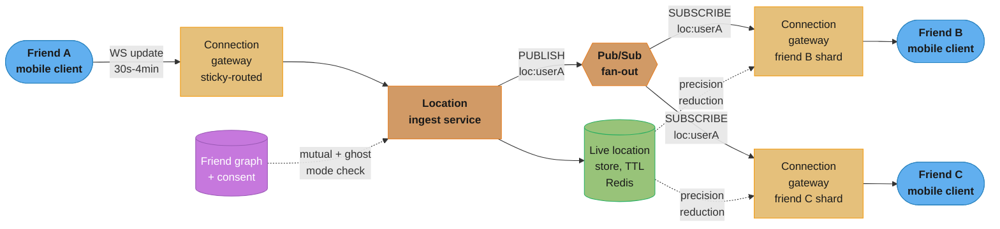
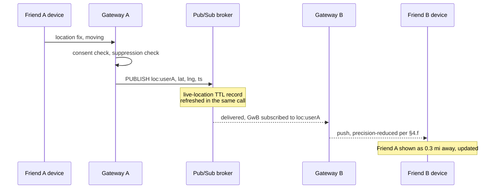

# System Design: Nearby Friends

## Intuition

> **Design intuition**: Every geospatial case study already in this section answers "what's near me" by querying a set of points that either don't move ([`./design_proximity_service.md`](./design_proximity_service.md)'s 50M businesses) or move but belong to strangers you're trying to be matched with ([`./design_uber.md`](./design_uber.md)'s drivers). Nearby Friends is neither. The points move — every friend who has the feature on is broadcasting a new location every few seconds to few minutes, all day — and you are not searching for them, because you already know exactly who they are: your friend graph is fixed, small, and given. What's new here is that **every participant is simultaneously a publisher and a subscriber**, continuously, to a set of channels defined by a mutual, revocable, per-friend consent decision, not by physical proximity. Solve the geometry wrong and friends near a cell boundary vanish from the map, exactly as in the other two case studies. Solve the *subscription* model wrong — treat this as another one-shot "find nearby X" query — and you rebuild a search index for a workload that was never a search problem, while missing the actual hard parts: a write-amplifying update firehose, a fan-out multiplier baked into every single update, and a live dataset that must forget itself by design.

**Key insight**: This is the one case study in the section where **the client, not the server, is usually the bottleneck that gets designed around**. A backend engineer can shard Redis, add gateway instances, and repartition Pub/Sub channels to absorb almost any write rate — but nothing server-side fixes a phone whose battery dies at 2pm because the location feature polled GPS every 5 seconds regardless of whether the owner was walking across a room or sitting still for six hours. The defining architectural move of this design — an **adaptive update interval driven by client-side motion detection, not a fixed timer** — exists entirely to protect a resource the server never touches. Get the client contract right and the server-side fan-out (§4) is a well-understood pub/sub problem; get it wrong and no amount of backend elegance saves a feature nobody leaves turned on.

### How This Differs From the Other Two Geo Case Studies — Stated Once, Referenced Everywhere

| Dimension | [Proximity Service](./design_proximity_service.md) | [Uber](./design_uber.md) | **Nearby Friends (this design)** |
|---|---|---|---|
| What moves | Nothing — businesses are static | Drivers, every ~4s, while on shift | Friends, every ~30s-4min, all day, adaptively |
| Who you're looking for | Anyone matching a filter — an open set | The single nearest *available* stranger — resolved once per ride | A fixed, named, mutually-consenting set you already know |
| Relationship model | None — anonymous read | One-shot match, dissolved after pickup | Persistent, bidirectional, revocable subscription |
| Dominant traffic shape | Read-heavy (100K-500K QPS search) | Write-heavy ingest, narrow read (nearest-K query) | Write-heavy ingest **and** a fan-out multiplier on every write |
| Historical trail | N/A (listings aren't trails) | Stored durably — trip receipts, ETA model training | **Deliberately not stored** — privacy plus §2's storage arithmetic |
| Index shape | Geohash grid + Elasticsearch attribute index | Geohash/H3 grid, read on demand | Geohash/S2 cell-key **as a push-suppression + privacy-precision knob**, not a search index |

This design leans on [`../geospatial_indexing/geospatial_indexing.md`](../geospatial_indexing/geospatial_indexing.md) for geohash/S2 encoding mechanics and [`../realtime_updates/realtime_updates.md`](../realtime_updates/realtime_updates.md) for the WebSocket-vs-SSE-vs-polling tradeoff — both are **cited, not re-derived**, per those modules' own scope.

Two rows of that table are worth dwelling on before moving to requirements, because they are the ones an interviewer is most likely to probe: **relationship model** and **historical trail**. Every other geo case study in this section either has no relationship between viewer and viewed (Proximity Service's anonymous business listing) or a relationship so short-lived it barely counts as one (Uber's driver-rider pairing, dissolved the moment the ride ends). Nearby Friends is the one case where the relationship *is* the product — it predates the location data, outlives any single update, and every architectural decision in §3-4 downstream of "who receives this update" traces back to that relationship being persistent and bidirectional rather than transient and one-directional. The historical-trail row follows directly from the same fact: a persistent relationship between two people, tracked continuously, is exactly the shape of data whose accumulation over time carries real privacy weight, in a way a dissolved one-off match does not.

---

## 1. Requirements Clarification

### Functional Requirements
- **Opt-in, per-friend location sharing**: a user chooses to share their live location, and separately chooses *with whom* — sharing is never global-to-all-friends by default; it is a named, revocable subset, mirroring the mechanism Facebook's own Nearby Friends shipped (§6).
- **Mutual consent**: User A only sees User B's location if **both** have location sharing turned on **and** both have each other in their active sharing set. A one-directional "I want to see them but they haven't agreed to see me" state does not exist in this design.
- **Live position of nearby friends on a map or list**: an active sharer sees the current (or recently-current) position of every friend who is mutually sharing back, updating without a manual refresh.
- **Distance display with precision tied to closeness**: a friend 8 miles away shows an approximate distance ("~8 mi"); a friend a few blocks away shows a tighter approximation; nobody sees raw lat/lng by default (§4.f).
- **Ghost Mode / pause**: a one-tap, immediate, system-wide stop to broadcasting location, distinct from turning individual friends off — the user's Bitmoji/avatar-equivalent disappears from every friend's view at once.
- **Automatic staleness handling**: a friend who closes the app, loses connectivity, or goes out of range stops updating, and the UI must reflect "last seen 12 minutes ago" rather than silently freezing a stale pin on the map forever.
- **No historical trail by default**: the product does not offer "where was my friend at 3pm yesterday" — only "where are they now, or very recently" (§4.d, §5).
- **Revocation is immediate and bidirectional-safe**: either party can end the sharing relationship at any time, and doing so takes effect for both directions at once — A un-sharing with B stops B from seeing A **and** stops A from seeing B, since the relationship (§1's "mutual") is symmetric by construction, not two independent one-way grants that could drift out of sync.
- **A new mutual-sharing grant starts from "now," never retroactively**: accepting a friend's sharing request does not surface any position data from before the grant existed — there is nothing to backfill, since §4.d's live-location store holds no history, but this is worth stating as an explicit product guarantee rather than an implementation accident.

### Non-Functional Requirements
- **Update-to-visible latency under ~5 seconds at p99** for an actively-moving, actively-viewing pair of mutual friends — this is a live map, not an eventually-consistent feed; a friend who is watching expects to see motion within a few seconds of it happening.
- **Write-path scalability dominates over read-path scalability** — unlike [Proximity Service](./design_proximity_service.md), whose 100K-500K QPS is almost entirely reads against slow-changing data, this system's defining load is the **ingest firehose**: millions of devices independently deciding to report a new fix.
- **Fan-out cost must be bounded by friend-count, not by system size** — one user's location update must never touch more infrastructure than that user's own (small) friend circle requires, regardless of how many total users are online.
- **Battery and mobile-data budget are first-class constraints**, evaluated with the same rigor as server latency (§2, §4.g) — a design that is server-cheap but client-expensive is not actually cheap, it has just moved the cost onto a device the product team doesn't operate or bill for, but whose owner absolutely notices and uninstalls the app over.
- **Privacy-by-default, not privacy-by-configuration**: the safe state (off, coarse precision, mutual-only) must be what a new user gets without touching a settings screen — [`../security_and_auth/security_and_auth.md`](../security_and_auth/security_and_auth.md)'s authZ-by-default framing, applied to a feature whose entire purpose is broadcasting a sensitive attribute.
- **Ephemerality is a correctness property, not an optimization**: a friend's location that is 40 minutes stale must stop being served as if current, and the underlying record should not exist at all past a bounded TTL — this NFR shapes §4.d directly.

### Out of Scope
- **Turn-by-turn navigation to a friend's location** — routing is [`./design_google_maps.md`](./design_google_maps.md)'s problem; this design only produces the two endpoints (viewer, friend) that a routing request would consume.
- **Discovering non-friends nearby** ("who else is at this concert") — that is [`./design_proximity_service.md`](./design_proximity_service.md)'s or a dating-app-style stranger-matching problem; this design's friend graph is closed and pre-existing, never expanded by proximity.
- **Group/event location sharing with a temporary code** (share-my-location-for-this-trip-only with a non-friend) — a related but distinct feature with its own consent model; noted in §5 as a variant, not designed here.
- **The underlying social graph / friend-request system itself** — assumed to already exist and be queryable; this design consumes "is A and B mutually friends, and has each opted the other into location sharing" as an input, per §4.f.
- **Driver/courier dispatch matching** — explicitly [`./design_uber.md`](./design_uber.md)'s problem, not this one; the two systems share geospatial mechanics and nothing else in their traffic shape (see the differentiation table above).

---

## 2. Scale Estimation

### The Population Actually Sharing Location, Not the Whole App's DAU
- **800M total registered users**, **150M DAU** for the app as a whole — but Nearby Friends is an opt-in feature layered on top, not the core product, and adoption of an always-on-location feature is historically modest (§6's Meta shutdown is direct evidence of this). Assume **8% of DAU has the feature enabled and is actively connected** at any given moment: 150M x 8% = **12M concurrently connected sharers** — this is the number that sizes the connection layer (§4.a), not DAU.
- **Average mutual-sharing friend count per active sharer: 15.** This is deliberately far smaller than a user's total friend/follower graph — Nearby Friends is a curated, per-friend opt-in list (§1), not "share with everyone I know," the same design choice Facebook's version made (§6).
- Of those 15 mutual friends, assume **40% are themselves concurrently connected** at any given moment (the rest have the app closed, are asleep, or haven't opted in that day): **6 online recipients per sender, on average** — this is the fan-out multiplier, derived, not assumed.

### Location-Update Ingest QPS — the Firehose
Movement is not uniform across the connected population; splitting into "in motion" and "stationary" and giving each its own update interval (the adaptive design, §4.b) is what makes the arithmetic tractable and is the same reason the interval is adaptive at all:

| Client state | Share of connected users | Update interval | Updates/sec per user |
|---|---|---|---|
| In motion (walking, driving, transit) | 25% | 30 seconds | 1/30 = 0.0333 |
| Stationary (backgrounded, or not moving) | 75% | 4 minutes (240s), backed off further the longer stillness persists | 1/240 = 0.00417 |

Weighted average per connected user: `0.25 x 0.0333 + 0.75 x 0.00417 = 0.00833 + 0.00313 = 0.01146 updates/sec`.

**Total ingest QPS = 12,000,000 x 0.01146 ~= 137,500 location updates/sec** — this is the number every downstream tier in §3/§4 is sized against, and it is the direct analog of [Uber](./design_uber.md) §2's 375K driver-location-updates/sec, at roughly one-third the rate despite a larger connected population, because Uber's drivers are professionally in motion essentially the whole time they're online while Nearby Friends' population is mostly stationary at any given instant.

### Fan-Out QPS — Where This Design's Arithmetic Diverges From Every Other Case Study in This Section
Every ingested update must be delivered to that sender's currently-online mutual friends — the multiplier derived above:

**Total fan-out QPS = 137,500 ingested updates/sec x 6 online recipients/update ~= 825,000 deliveries/sec.**

Restated as the number worth defending in an interview: **the system does 6x more delivery work than ingest work**, and that ratio is not a tuning knob, it is a direct function of the friend-count and online-fraction assumptions above — a viral spike in adoption that doubles average online-friend-count to 12 doubles fan-out QPS without touching ingest QPS at all, which is exactly the kind of load Redis Pub/Sub's O(subscribers) publish cost (§4.c) has to be capacity-planned against, not the ingest rate alone.

### Total Daily Volume, for Perspective
Sustaining §2's blended-average rates across a full day: `137,500 x 86,400 ~= 11.9 billion` location updates ingested/day, and `825,000 x 86,400 ~= 71.3 billion` friend-facing pushes delivered/day. These totals sit in the same order of magnitude as Ticketmaster's own reported **3.5 billion total system requests** across the entire Eras Tour on-sale campaign ([Flash-Sale Ticketing](./design_flash_sale_ticketing.md) §2) — worth noting not because the two systems are comparable in shape (a flash sale is a single-day spike; this design runs the same volume continuously, every day), but because it calibrates that this design's headline QPS numbers, while individually modest compared to [Uber](./design_uber.md)'s 375K/sec, compound into a genuinely large system at the scale of a full day.

### Live-Location Store — Memory Footprint (Trivial, Same Pattern as the Other Geo Case Studies)
- One live record per connected sharer: `{lat, lng, geohash7, accuracy_tier, updated_at}`. Estimate ~40 bytes of raw field data plus Redis hash/key overhead (~150-160 bytes for a small hash under typical Redis object overhead) -> **~200 bytes/user**.
- **12M users x 200 bytes ~= 2.4GB** — trivially small, the same conclusion [Proximity Service](./design_proximity_service.md) §2 reaches for its geo-index (~1.2GB for 50M static businesses) and [Uber](./design_uber.md)'s driver-location Redis footprint: **geo-index memory is never the bottleneck in this family of systems; connection count and update/publish rate are.**

### Connection and Subscription Fan-Out Structure
- **12M concurrent WebSocket connections.** Assuming a Netty/Node-style connection gateway holds **~50,000 stable connections per instance** (a conservative, I/O-bound-service figure — see [`./design_whatsapp.md`](./design_whatsapp.md) §3 for the far end of this range, Erlang/OTP holding ~2M connections/server at much lower per-connection overhead): **12,000,000 / 50,000 ~= 240 gateway instances.**
- **Pub/Sub subscription edges**: each connected user subscribes to the channel of every online mutual friend -> 12M x 6 ~= **72M active channel subscriptions**, distributed across the 240 gateway instances (~300K subscriptions/instance on average) — a sizing input for §4.c and §10, not a memory concern (a subscription is a lightweight in-process registration, not a stored record).

### Why This Design Does Not Persist a Location History — the Storage Arithmetic That Backs the Privacy Default
It's tempting to durably log every ingested update the way [Uber](./design_uber.md) §2 durably stores GPS trip traces (25M trips/day x 4.8KB/trip = 120GB/day, kept for trip receipts, disputes, and ETA-model training — a legitimate, bounded, per-trip need). Nearby Friends has no equivalent bounded scope — it runs continuously, all day, for every connected sharer, not just during a 20-minute trip. If this design durably logged every ingested point at a similarly compact ~16 bytes/point (§2's per-point size, matching Uber's own figure):

`137,500 updates/sec x 16 bytes ~= 2.2 MB/sec of raw point data ~= ~190 GB/day` — already 1.5x Uber's trip-trace volume, from a smaller connected population, purely because there is no "trip" to bound the logging window. Add realistic per-row overhead (primary key, foreign key to user, index entries, WAL/MVCC bookkeeping — commonly 80-150 bytes/row in a relational store once overhead is included, not just payload): `137,500 x 100 bytes x 86,400 sec ~= ~1.19 TB/day`, accumulating into hundreds of terabytes a year, of a private social circle's continuous whereabouts, with no per-trip legal or operational purpose to justify keeping it. **The storage arithmetic and the privacy argument point the same direction, which is exactly why §4.d makes ephemerality a hard design constraint rather than a nice-to-have**: nobody has to argue "should we delete this" if the record was never durably written in the first place.

### Client-Side Battery and Network Budget — the Constraint Every Other Case Study in This Section Ignores
- **Per-device daily update volume**, using §2's motion split against a representative 8 in-motion hours / 16 stationary hours: `8h x 3600s / 30s = 960` in-motion updates + `16h x 3600s / 240s = 240` stationary updates = **~1,200 outbound location updates/day/device**.
- **Payload size**: lat (8B) + lng (8B) + accuracy (4B) + timestamp (8B) ~= 28 bytes of field data, plus WebSocket frame and TLS record overhead (~20-30 bytes amortized) -> **~55-60 bytes on the wire per update**. Daily outbound: `1,200 x 60B ~= 72 KB/day` — trivial against any mobile data plan.
- **Inbound (receiving friends' updates)**: with 6 online friends averaging the same motion mix, a connected device receives on the order of **600-800 pushes/day**, another **35-50 KB/day** — combined, the entire feature's data cost is comfortably under 200 KB/day per active device, which is why **bandwidth is never the client-side constraint that matters here — battery is** (§4.g quantifies why).

### Peak vs. Average — Load Is Not Flat Across the Day Either
§2's 137,500 updates/sec and 825,000 deliveries/sec are 24-hour weighted averages, not a flat rate — the *in-motion* fraction of the connected population is itself diurnal, concentrated in commute windows (roughly 7-9am and 5-7pm local time) rather than spread evenly. If the in-motion share doubles from the assumed 25% to 50% during a commute peak (plausible — far more of the connected population is actually walking or driving during those two hours than at 3am), both the ingest and fan-out figures move with it, since the motion-weighted-average formula in §2 is linear in the in-motion fraction: `0.50 x (1/30) + 0.50 x (1/240) ~= 0.0188` updates/sec/user, **~1.6x** the 24-hour blended average of 0.01146. **Provisioning off the 24-hour average, the same trap [Flash-Sale Ticketing](./design_flash_sale_ticketing.md) §2 calls out for its own edge/CDN tier**, would under-provision the gateway and Pub/Sub tiers for exactly the two-hour windows, twice a day, when this feature is most actively used — commute-time headroom, not the 24-hour average, is the number §10's sizing should actually be checked against.

---

## 3. High-Level Architecture



*Every update is a fan-out event, not a search: the ingest service checks mutual consent once at write time, stores the fix in a self-expiring record, and publishes to a channel that only the sender's own online friends are subscribed to — no other component in the system ever scans for "who is nearby," because the recipient set is defined by the friend graph, not by geography.*

### Why There Is No Geo-Search Query Anywhere on the Hot Path
Every other geo case study in this section (§1's table) puts a "find candidates near this point" query on its hot path. This one deliberately does not: the recipient set for any given update is **already known at publish time** — it's the sender's mutual-friend list intersected with who is currently online, both of which the ingest service resolves as ordinary lookups against the friend graph and the connection-routing table, not a spatial query. The geohash/S2 machinery this design does use (§4.e) exists for two narrower jobs — **suppressing redundant pushes when a friend hasn't materially moved**, and **choosing how much precision to reveal** — not for discovering who's nearby, because nobody is being discovered; they're already friends.

### Sticky Routing and the Cross-Server Fan-Out Problem
A connection gateway instance (§2: 240 of them) only knows about the WebSocket connections it personally holds. When User A's update needs to reach User B, and B's connection lives on a *different* gateway instance than A's, the fan-out has to cross that boundary — this is exactly the problem Redis Pub/Sub (§4.c) is inserted to solve: every gateway instance subscribes, on behalf of its own connected users, to the channels of those users' online friends, regardless of which instance published the original update. [`../consistent_hashing/consistent_hashing.md`](../consistent_hashing/consistent_hashing.md)'s ring assignment is what makes "which gateway holds user X's connection" a deterministic, cheaply-computed lookup rather than a broadcast search.

### Multi-Region Shape
Unlike [Flash-Sale Ticketing](./design_flash_sale_ticketing.md)'s single-region-pinned inventory, a friend pair's location data has no natural single "home region" — two friends could be in different countries. The pragmatic split: **connection gateways and the live-location store are deployed per-region, close to where each user actually is** (minimizing update latency for the far more common same-region friend pair), while cross-region friend pairs pay a bounded extra hop — the publishing region's Pub/Sub fan-out forwards the message once to the subscriber's home region's gateway tier via a lightweight cross-region relay, rather than trying to keep one global Pub/Sub cluster with cross-continent subscribers. This is a latency tradeoff accepted deliberately: cross-region friend pairs are the minority case, and a few hundred extra milliseconds on an already-multi-second update cadence (§1's 5-second p99 target has headroom) is far cheaper than a synchronously-consistent global message bus. §4.i works through the relay mechanism this split implies in detail.

### Why the Connection Gateway Is Deliberately the Only Stateful Tier a Client Talks To Directly
A client never calls the ingest service, the live-location store, or the Pub/Sub broker directly — every request and every push passes through its assigned gateway instance (§4.a). This is a small architectural choice with an outsized payoff: it means every other tier in §4 can be treated as an internal service with a stable, small set of callers (the gateway fleet), rather than something that has to defend itself against however millions of individual mobile clients choose to call it — connection-level concerns (auth handshake, malformed frames, slow clients, abusive reconnect loops) are absorbed once, at the edge, instead of being a concern every downstream tier has to reimplement.

---

## 4. Component Deep Dives

### (a) The Persistent Connection Layer — Sticky Routing, Not Re-Derived Transport Theory

The choice of WebSocket over SSE or long-polling, the heartbeat/keepalive mechanics, and the gap-fill-on-reconnect pattern are all covered in depth by [`../realtime_updates/realtime_updates.md`](../realtime_updates/realtime_updates.md) — **cited here, not re-derived**. What's specific to Nearby Friends is *why* this system needs the bidirectional, low-per-message-overhead properties that module's decision table assigns to WebSocket over its alternatives: every connected client is both sending (location updates) and receiving (friends' pushes) on the same connection, continuously, at the update rates in §2 — a pattern SSE (server-to-client only) can't carry alone, and plain polling would multiply into exactly the write-amplification problem §2 already quantifies, once for the poll request itself on top of the location update it's trying to retrieve.

The one number this design layers on top of that module's general heartbeat guidance is specific to it: the transport-level ping/pong interval is set to match §4.h's presence-heartbeat cadence (25 seconds) rather than being chosen independently, so a single frame serves double duty — proving the connection is alive at the transport layer and refreshing the presence registry's TTL are the same event, not two separately-scheduled timers that could drift out of step with each other.

**Sticky routing** assigns each user's connection to a specific gateway instance via consistent hashing on `userId` ([`../consistent_hashing/consistent_hashing.md`](../consistent_hashing/consistent_hashing.md)), so that a reconnect after a brief network blip lands the client back on the same instance whenever possible, preserving in-memory subscription state instead of rebuilding it from scratch on every reconnect:

```java
public final class ConnectionRouter {
    private final ConsistentHashRing<GatewayNode> ring; // per-region ring, §3

    /** Called by the edge load balancer before the WS upgrade completes. */
    public GatewayNode routeFor(String userId) {
        return ring.getNode(userId); // deterministic; same user -> same instance
                                      // across reconnects, unless that node left the ring
    }
}
```

```java
public final class FriendSubscriptionManager {
    private final PubSubClient pubsub;

    /** Called once a user's WS connection is established -- subscribes this
     *  gateway instance to every mutual, currently-active friend's channel. */
    public void onConnect(String userId, List<String> mutualOnlineFriendIds) {
        for (String friendId : mutualOnlineFriendIds) {
            pubsub.subscribe("loc:" + friendId, message -> forwardToClient(userId, message));
        }
    }

    /** Called on disconnect, and incrementally whenever the friend-online-set
     *  changes (a friend opens/closes the app) -- keeps subscription count
     *  bounded to this user's actual online mutual friends, not their whole graph. */
    public void onFriendWentOnline(String userId, String friendId) {
        pubsub.subscribe("loc:" + friendId, message -> forwardToClient(userId, message));
    }

    public void onDisconnect(String userId, List<String> subscribedFriendIds) {
        for (String friendId : subscribedFriendIds) {
            pubsub.unsubscribe("loc:" + friendId);
        }
    }
}
```

Subscriptions are opened and closed dynamically as friends come online and go offline — not statically at app-install time — which is exactly why §2's "72M active subscriptions" figure moves with the online population rather than sitting fixed at `12M x 15 total friends`.

### (b) Location Ingest — the Adaptive-Interval Client Contract

The server does not tell the client "send every 30 seconds, always" — that fixed-interval policy is precisely what §9's first war story shows going wrong. Instead, the **client** decides its own send interval from local motion signals, and the server's only job on ingest is validate, check consent, and route:

```java
public final class LocationIngestService {
    private final FriendConsentStore consent;   // mutual opt-in + ghost-mode state, §4.f
    private final LiveLocationStore liveStore;   // TTL-backed record, §4.d
    private final GeoSuppressionFilter suppression; // §4.e -- skip redundant pushes
    private final PubSubClient pubsub;

    public void ingest(String userId, LocationFix fix) {
        if (consent.isGhostMode(userId)) {
            return; // dropped before it is stored or published, not just hidden downstream
        }
        boolean materiallyMoved = suppression.hasMovedSignificantly(userId, fix);
        liveStore.upsert(userId, fix); // always refresh the TTL record -- staleness detection
                                        // (§1) depends on this even when we suppress the push
        if (!materiallyMoved) {
            return; // §4.e -- same cell as last push, nothing new for friends to see
        }
        List<String> onlineMutualFriends = consent.onlineMutualFriendsOf(userId);
        pubsub.publish("loc:" + userId, fix.toWireFormat());
        // fan-out delivery itself (§2's 825K/sec) happens via the gateways' existing
        // subscriptions (§4.a) -- this publish call does not iterate friends itself
    }
}
```

**The client-side interval logic**, which is what actually controls §2's 25%/75% motion split — a simplified sketch of the adaptive policy, built on the platform primitives in §4.g:

```java
public final class AdaptiveLocationScheduler {
    private Duration currentInterval = Duration.ofSeconds(30);
    private static final Duration MOVING_INTERVAL = Duration.ofSeconds(30);
    private static final Duration STATIONARY_INTERVAL_MAX = Duration.ofMinutes(4);

    /** Called on each accelerometer-significant-motion or GPS-delta event. */
    public void onMotionSignal(boolean isMoving, double metersSinceLastFix) {
        if (isMoving || metersSinceLastFix > 50) {
            currentInterval = MOVING_INTERVAL;
        } else {
            // exponential back-off while stationary, capped at STATIONARY_INTERVAL_MAX --
            // a user who hasn't moved in 20 minutes should not still be polled every 30s
            currentInterval = currentInterval.multipliedBy(2).compareTo(STATIONARY_INTERVAL_MAX) > 0
                ? STATIONARY_INTERVAL_MAX
                : currentInterval.multipliedBy(2);
        }
    }

    public Duration nextSendDelay() { return currentInterval; }
}
```

### (c) Pub/Sub Fan-Out — the One-to-K Delivery §2 Sizes For

The publish call in §4.b does not know or care how many subscribers exist on `loc:{userId}` — that is precisely what makes Pub/Sub the right primitive here rather than, say, a database write each recipient polls: **fan-out cost is paid once, by the broker, proportional to actual online friend-count (§2's ~6 average), not by the publisher iterating a list.**

```
PUBLISH loc:userA {"lat":37.7750,"lng":-122.4193,"ts":1735689600,"accuracy":"precise"}
```

Every gateway instance holding a connection for one of userA's online mutual friends has already issued `SUBSCRIBE loc:userA` (§4.a) — the broker delivers to all of them in one broadcast, and a gateway with zero subscribed connections for that channel (no online friend of userA on this instance right now) simply never receives the message, at zero marginal delivery cost to that instance.



*Redis Pub/Sub delivers at-most-once with no backlog for a disconnected subscriber — an intentional tradeoff §9's third war story examines directly, because for a live position feed, a missed intermediate update is harmless (the next one supersedes it) as long as reconnect logic re-fetches current state rather than waiting on a queue that was never durable to begin with.*

### (d) The Live-Location Store — TTL Is the Correctness Mechanism, Not a Cleanup Convenience

Unlike [Flash-Sale Ticketing](./design_flash_sale_ticketing.md) §4.c's in-memory tier, which fronts a durable store as backstop, this store **has no durable backstop by design** (§2's storage-arithmetic argument) — the TTL isn't there to save memory, it is what makes "stale" a real, enforced state rather than a UI-layer guess:

```java
public final class LiveLocationStore {
    private final RedisTemplate redis;
    private static final Duration STALENESS_TTL = Duration.ofMinutes(10);

    /** Every ingest call refreshes both the value and the expiry -- a friend
     *  who stops sending simply falls out of the keyspace after 10 minutes,
     *  with no explicit delete and nothing left to reconcile against. */
    public void upsert(String userId, LocationFix fix) {
        String key = "loc:live:" + userId;
        redis.hset(key, Map.of(
            "lat", String.valueOf(fix.lat()),
            "lng", String.valueOf(fix.lng()),
            "geohash7", fix.geohash7(),
            "updatedAt", String.valueOf(fix.timestampEpochSeconds())
        ));
        redis.expire(key, STALENESS_TTL); // reset on every write, per Redis EXPIRE semantics
    }

    /** Used by the client-facing read path to distinguish "friend went quiet
     *  10 seconds ago" from "record doesn't exist" -- both look like a miss
     *  to a naive GET, but the UI's copy ("Live" vs "Last seen 4m ago") needs
     *  the distinction, so the last-known value is cached client-side and the
     *  server only needs to say whether the live record still exists. */
    public Optional<LocationFix> get(String userId) {
        String key = "loc:live:" + userId;
        Map<String, String> raw = redis.hgetall(key);
        return raw.isEmpty() ? Optional.empty() : Optional.of(LocationFix.fromRedisHash(raw));
    }
}
```

A 10-minute TTL is a deliberate middle point: short enough that "Ghost Mode" (§4.f) and simply closing the app produce the same visible outcome to friends within a bounded, short window, long enough that a momentary network drop (a subway tunnel, an elevator) doesn't flicker a friend's pin to "offline" and back every few minutes.

**A side benefit worth naming, though not the primary reason for the design (§2's storage/privacy arithmetic is): a user data-deletion request against this system is unusually simple to fulfill correctly.** Because §4.d holds no durable record and §4.b's ingest path never writes one, a request to delete a user's location data is satisfied by the TTL expiring on its own — there is no durable table to issue a `DELETE` against, no backup to purge, no async job to verify completed. A system that *did* durably log every fix (§2's counterfactual arithmetic) would need a real deletion pipeline reaching into backups and any downstream analytics copies; this design's ephemerality-by-default choice sidesteps that entire class of operational obligation as a structural consequence, not a feature built to satisfy it.

### (e) Geospatial Cell-Key Lookup — Broken, Then Fixed

Because Nearby Friends never runs a "who is near this point" search (§3), the geohash cell-key's actual job is narrower than in [Uber](./design_uber.md) or [Proximity Service](./design_proximity_service.md): **deciding whether a friend's location changed enough to be worth pushing** (§4.b's suppression filter) and **computing an approximate on-screen distance without leaking exact coordinates** (§4.f). Both still require correctly finding "is this new fix in the same neighborhood as the last one," and that computation has the exact same cell-boundary trap the other two case studies document — reusing it here, not re-deriving the general theory, which lives in [`../geospatial_indexing/geospatial_indexing.md`](../geospatial_indexing/geospatial_indexing.md) §6.1-6.2.

**Broken**: comparing only the exact geohash string of the new fix against the exact geohash string of the last one treats a friend who nudges 13 meters across a cell edge as having "moved cells" even though, for suppression purposes, they haven't gone anywhere meaningful — and the mirror-image bug (checking only the self cell when computing "is this friend within my search radius" for a radar-style view) misses a friend who is genuinely close but sits just across a boundary, the same failure [Uber](./design_uber.md) §9 War Story 4 documents for driver matching.

The following is real, executable Python (standard library only) demonstrating both the failure and the fix, using the exact geohash encode/decode mechanics [`../geospatial_indexing/geospatial_indexing.md`](../geospatial_indexing/geospatial_indexing.md) §6.1 specifies, applied to this design's friend-filtered variant:

```python
import math

BASE32 = "0123456789bcdefghjkmnpqrstuvwxyz"

def geohash_encode(lat, lng, precision=7):
    lat_range, lng_range = [-90.0, 90.0], [-180.0, 180.0]
    geohash, bit, ch, even_bit = [], 0, 0, True
    while len(geohash) < precision:
        if even_bit:
            mid = (lng_range[0] + lng_range[1]) / 2
            if lng >= mid: ch |= (1 << (4 - bit)); lng_range[0] = mid
            else: lng_range[1] = mid
        else:
            mid = (lat_range[0] + lat_range[1]) / 2
            if lat >= mid: ch |= (1 << (4 - bit)); lat_range[0] = mid
            else: lat_range[1] = mid
        even_bit = not even_bit
        if bit < 4: bit += 1
        else: geohash.append(BASE32[ch]); bit, ch = 0, 0
    return "".join(geohash)

def geohash_decode_bbox(gh):
    lat_range, lng_range = [-90.0, 90.0], [-180.0, 180.0]
    even_bit = True
    for c in gh:
        for mask in (16, 8, 4, 2, 1):
            bit = 1 if (BASE32.index(c) & mask) else 0
            if even_bit:
                mid = (lng_range[0] + lng_range[1]) / 2
                lng_range[0 if bit else 1] = mid
            else:
                mid = (lat_range[0] + lat_range[1]) / 2
                lat_range[0 if bit else 1] = mid
            even_bit = not even_bit
    return lat_range, lng_range

def neighbors(gh, precision):
    lat_range, lng_range = geohash_decode_bbox(gh)
    lat_c, lng_c = (lat_range[0]+lat_range[1])/2, (lng_range[0]+lng_range[1])/2
    height, width = lat_range[1]-lat_range[0], lng_range[1]-lng_range[0]
    out = set()
    for dlat in (-1, 0, 1):
        for dlng in (-1, 0, 1):
            out.add(geohash_encode(lat_c + dlat*height, lng_c + dlng*width, precision))
    return out

def haversine_m(lat1, lng1, lat2, lng2):
    R = 6371000.0
    p1, p2 = math.radians(lat1), math.radians(lat2)
    dphi, dlambda = math.radians(lat2-lat1), math.radians(lng2-lng1)
    a = math.sin(dphi/2)**2 + math.cos(p1)*math.cos(p2)*math.sin(dlambda/2)**2
    return 2*R*math.asin(math.sqrt(a))

PRECISION = 7  # ~153m x 153m cells, per geospatial_indexing.md sec.6.2
self_lat, self_lng = 37.775000, -122.419400
gh_self = geohash_encode(self_lat, self_lng, PRECISION)

friend_lat, friend_lng = self_lat, self_lng
for step_m in range(1, 200):
    cand_lat = self_lat + step_m/111320.0
    if geohash_encode(cand_lat, self_lng, PRECISION) != gh_self:
        friend_lat = cand_lat
        break

dist = haversine_m(self_lat, self_lng, friend_lat, friend_lng)
gh_friend = geohash_encode(friend_lat, friend_lng, PRECISION)
print(f"self   geohash7={gh_self}   friend geohash7={gh_friend}   true distance={dist:.1f} m")
```

**Actual output of this script, run as-is:**

```
self   geohash7=9q8yyk8   friend geohash7=9q8yykb   true distance=13.0 m
```

***Broken*** — a suppression or radar check that compares only the self-cell bucket:

```python
cell_members = {gh_friend: ["friend_42"]}
hits = cell_members.get(gh_self, [])
# hits == []  -- friend_42 is invisible despite being 13 meters away
```

***Fixed*** — the 9-cell block (self + 8 neighbors), plus the friend-graph intersection that has no equivalent in [Uber](./design_uber.md) or [Proximity Service](./design_proximity_service.md) (both operate over strangers or businesses, never a pre-known friend set):

```python
nine = neighbors(gh_self, PRECISION)
candidate_ids = [fid for gh in nine for fid in cell_members.get(gh, [])]
mutual_friends = {"friend_42", "friend_99"}  # this viewer's actual consented friend graph
result = [(fid, round(dist, 1)) for fid in candidate_ids if fid in mutual_friends and dist <= 100]
```

**Actual output:**

```
9-cell block (9 cells): ['9q8yyhr', '9q8yyhx', '9q8yyhz', '9q8yyk2', '9q8yyk3', '9q8yyk8', '9q8yyk9', '9q8yykb', '9q8yykc']
raw candidates across 9-cell block: ['friend_42']
final result (friend-filtered, radius<=100m): [('friend_42', 13.0)]
```

Two things worth naming about this fix in an interview: first, the true separation here is **13 meters**, not a contrived edge case — geohash cell boundaries are grid lines with no relationship to where people actually stand, so any two people close enough to see each other can straddle one; second, the **friend-graph intersection step is what this design adds** on top of the generic 9-cell fix — a stranger 13 meters away in the same 9-cell block is correctly never surfaced, because they were never a candidate to begin with.

**Why this design doesn't reach for H3 the way [Uber](./design_uber.md) §7 does.** Uber's own war story (§9 War Story 4 there) is the direct motivation for its move to H3's hexagonal, uniform-6-neighbor grid — dispatch matching runs the 9-cell-equivalent expansion constantly, at high volume, against a population of genuinely unknown strangers, so geohash's corner-case distortion (a diagonal neighbor's true adjacency varying with latitude) is a recurring, load-bearing cost worth engineering around. This design's use of the same underlying trap is narrower: the 9-cell check only has to run against a friend's own last-few-pushed positions for suppression purposes (§4.e's first job), and the precision tiers a viewer actually sees (§4.f's table) are coarse enough — 0.1-mile steps at the tightest non-exact tier — that geohash's corner distortion at precision 7 is well within the noise the bucketing already introduces. H3 would work here too and isn't wrong; it simply isn't buying enough at this design's scale and use pattern to justify the added operational surface of a second geospatial library alongside plain geohash string comparison.

### (f) Privacy — Mutual Consent, Ghost Mode, and Precision Reduction

Three distinct controls, each closing a different exposure:

1. **Mutual, per-friend opt-in** (§1, §4.b's `consent.isGhostMode`/`onlineMutualFriendsOf` calls) — a user is never visible to anyone who has not been explicitly, individually granted access, and that grant is revocable per-friend without disabling the feature entirely. This is checked at publish time (§4.b), not filtered out at read time, so an unauthorized recipient's gateway never even subscribes to the channel — there is no "hidden but technically delivered" state to worry about.
2. **Ghost Mode** — an immediate, system-wide broadcast stop, independent of any per-friend setting, for the case where a user wants to be unreachable to everyone at once without renegotiating fifteen individual toggles. Checked first, before consent lookup, in §4.b's `ingest()` — cheapest check, evaluated earliest, on the hot path.
3. **Precision reduction** — the default view a friend sees is **not** raw coordinates, it's a distance bucket computed server-side from the two live positions and revealed at a granularity that shrinks as the friend gets closer, mirroring the real product behavior described in §6:

| True distance | Displayed precision | Why |
|---|---|---|
| > 5 miles | City / region name only | Exact distance at this range carries little useful information and needless exposure |
| 1-5 miles | Rounded to nearest 0.5 mi | Useful for "should I head that way," not enough to locate a building |
| 0.1-1 mile | Rounded to nearest 0.1 mi | Enough for "we're close, let's meet up," still not a street address |
| < 0.1 mile | Exact pin, **only if the friend has separately granted "precise location"** | The one tier where exact coordinates are shown, and it requires a second, explicit grant beyond ordinary Nearby Friends sharing — Facebook's own design made this same two-tier distinction (§6) |

The point of bucketing by default is specifically **anti-triangulation**: a viewer who could query a friend's exact position repeatedly over time could, in principle, extract far more (patterns, home address, routine) than any single query reveals — coarsening the response removes the raw material triangulation needs, independent of any rate limit on the query itself. [`../rate_limiting/rate_limiting.md`](../rate_limiting/rate_limiting.md)'s per-identity limiting is layered on top of this, not instead of it, for the same defense-in-depth reasoning [Flash-Sale Ticketing](./design_flash_sale_ticketing.md) §4.e uses for bot defense — no single control is airtight, the combination is what raises the cost of misuse.

**Why this is worth taking as seriously as an authZ bug, not a UX nicety.** A location-sharing relationship is, by construction, granted between two people who trust each other at the moment the grant is made — the risk this design's controls exist for is what happens *after* that trust changes (a relationship ends badly, an account is compromised, a device is shared without the owner's knowledge) while the sharing grant is still technically active. Ghost Mode (§1, above) and immediate, symmetric revocation (§1's NFR) are the product-level answers; mutual consent enforced at the ingest choke point (§4.b) and precision bucketing (this table) are the technical ones. This is the same category of risk the industry-level "Detecting Unwanted Location Trackers" cooperation between Apple and Google (§6) exists to address for a physical Bluetooth tag rather than an app-based share — a different mechanism, the same underlying concern that a location-sharing capability, once granted, can outlive the relationship that justified granting it.

**Consent-change auditability, separate from the live-location ephemerality (§4.d).** While the position data itself is deliberately not retained past its TTL, *when a consent grant was created or revoked* is a different kind of record — small, low-volume (consent toggles are rare, per §2), and genuinely useful for the user themselves ("did I actually turn off sharing with them, and when") as well as for investigating a `ConsentDriftAuditor` finding (§9) after the fact. This design keeps a durable, append-only log of consent state *transitions* (who granted or revoked sharing with whom, and when) entirely separate from the live position data — a small, bounded log of a rare event, not a location trail, and one that never contains a single lat/lng value.

### (g) The Battery Budget — Why the Client Design Is Not an Afterthought

§2 already showed the wire-bandwidth cost of this feature is trivial (well under 200KB/day). The real cost is that **acquiring a GPS fix wakes radios that idle-power modes deliberately keep asleep**, and that wake cost is paid once per fix regardless of how small the resulting payload is — sending 1,200 fixes/day at 60 bytes each is not "1,200 x 60 bytes of battery cost," it is roughly 1,200 radio-wake events, each dominated by acquisition and settling time, not transmission time. This is why the adaptive interval (§4.b) is a battery lever, not a bandwidth one: halving the stationary-state update rate from every 4 minutes to every 8 minutes barely moves §2's already-trivial data usage, but it roughly halves the number of GPS wake events during the 75% of the day this design assumes users are stationary.

Two platform-native mechanisms make the adaptive policy possible without hand-rolled sensor fusion, and this design uses the current, non-deprecated form of each:

- **Android**: `FusedLocationProviderClient` with `Priority.PRIORITY_BALANCED_POWER_ACCURACY` (city-block-level, ~100m accuracy, sourced from WiFi/cell rather than GPS) for the stationary state, escalating to `PRIORITY_HIGH_ACCURACY` only once motion is independently detected — the priority level is a request, not a guarantee, and Play Services chooses the actual provider mix (source: [Android Developers, "Change location settings"](https://developer.android.com/develop/sensors-and-location/location/change-location-settings) and [`Priority`](https://developers.google.com/android/reference/com/google/android/gms/location/Priority) reference).
- **iOS**: `CLLocationManager.startMonitoringSignificantLocationChanges()` for the backgrounded/stationary case — Apple's own guidance is explicit that this service, not continuous standard-accuracy updates, is the correct choice "if GPS-level accuracy isn't critical for your app" and that significant-change monitoring runs continuously and energy-efficiently by relying on cell/WiFi changes rather than polling GPS (source: [Apple Developer Documentation, `startMonitoringSignificantLocationChanges()`](https://developer.apple.com/documentation/corelocation/cllocationmanager/startmonitoringsignificantlocationchanges())).

Life360's own publicly stated battery-impact figure — **"about 10% shorter battery life in a 24-hour period"** for its always-on Circle sharing, with high-precision GPS specifically reserved for "when the device is in transit" (source: [Life360 Support, "Life360 and Battery Usage"](https://support.life360.com/hc/en-us/articles/23053716563223-Life360-and-Battery-Usage)) — is direct, named-company evidence that even a mature, widely-deployed version of this exact feature treats "high accuracy only while actually moving" as the load-bearing mitigation, not an optional refinement; §9's first war story shows what happens when a design skips it.

### (h) Presence — What "Online Mutual Friend" Actually Means at the Data Layer

Every fan-out decision in §4.b/§4.c depends on a call to `consent.onlineMutualFriendsOf(userId)` — a function this design has been citing without yet showing where "online" comes from. It is not derived from the WebSocket connection's mere existence, because a connection can go stale (a phone that lost signal without a clean TCP close) well before the transport layer notices — [`../realtime_updates/realtime_updates.md`](../realtime_updates/realtime_updates.md) covers the WS ping/pong heartbeat mechanics generally; this design's presence registry is what turns that heartbeat into an answer to "is this specific user currently reachable."

```java
public final class PresenceRegistry {
    private final RedisTemplate redis;
    // Longer than the heartbeat interval (so one missed ping doesn't flip a
    // user offline), shorter than the 10-minute live-location TTL (sec.4.d) --
    // presence must go stale well before the location record does, otherwise
    // a disconnected client would keep looking "online" for minutes after
    // the connection actually dropped.
    private static final Duration PRESENCE_TTL = Duration.ofSeconds(45);

    /** Called on WS connect and on every subsequent heartbeat frame. */
    public void heartbeat(String userId, String gatewayInstanceId, String region) {
        boolean wasOffline = !redis.exists("presence:" + userId);
        redis.hset("presence:" + userId, Map.of("gateway", gatewayInstanceId, "region", region));
        redis.expire("presence:" + userId, PRESENCE_TTL);
        if (wasOffline) {
            // fired only on the leading edge of an offline -> online transition,
            // never on every routine heartbeat -- this is what drives
            // FriendSubscriptionManager.onFriendWentOnline (sec.4.a), and firing
            // it every ~25s per connection would itself be a QPS problem larger
            // than the fan-out this design is trying to bound.
            redis.publish("presence:online:" + userId, gatewayInstanceId);
        }
    }

    public void onDisconnect(String userId) {
        redis.delete("presence:" + userId);
        redis.publish("presence:offline:" + userId, "");
    }

    public boolean isOnline(String userId) {
        return redis.exists("presence:" + userId);
    }
}
```

**The load this adds, and why it belongs in §2/§10's arithmetic, not just this subsection.** A heartbeat interval has to be shorter than `PRESENCE_TTL` with margin — say every 25 seconds — which means **12,000,000 connections / 25 seconds ~= 480,000 heartbeat writes/sec** against the presence store, a figure comparable in order of magnitude to the 137,500 location-ingest writes/sec §2 derives, and one easy to overlook if capacity planning stops at "location updates" and forgets that liveness itself has to be tracked continuously for the same population. §10's worked sizing table accounts for this as its own line, sized independently of the location-ingest figure it happens to resemble.

`onlineMutualFriendsOf(userId)` itself stays cheap despite the presence store's high write rate: it's an intersection of the (small, ~15-entry) friend list against `isOnline()` checks — 15 Redis `EXISTS` calls per resolution, not a scan over the 480K/sec write stream.

### (i) Cross-Region Friend Pairs — Targeted Relay, Not Global Broadcast

§3 states the multi-region shape at a high level: gateways and the live-location store are regional, and a cross-region friend pair pays a bounded extra hop. The mechanism is a **targeted relay**, forwarding a publish only to the specific regions that actually hold an online, subscribed friend — never a blind broadcast to every region, which would multiply §2's fan-out cost by region-count for no benefit to the (assumed) ~90% of friend pairs who share a region and never need it:

```java
public final class CrossRegionRelay {
    private final CrossRegionBus crossRegionBus; // a thin, low-volume forwarding channel --
                                                   // not the same Pub/Sub cluster serving
                                                   // in-region fan-out (sec.4.c), so a
                                                   // cross-region incident cannot degrade
                                                   // the majority same-region path

    /** Invoked alongside the local PUBLISH (sec.4.b) -- forwards to a region
     *  only if this update's set of online, subscribed friends actually
     *  includes someone whose presence record (sec.4.h) says they're homed
     *  there. */
    public void relayIfCrossRegion(String publisherId, String publisherRegion,
                                    LocationFix fix, Set<String> onlineFriendRegions) {
        for (String region : onlineFriendRegions) {
            if (region.equals(publisherRegion)) {
                continue; // same-region fan-out is already handled by the local broker
            }
            crossRegionBus.forward(region, "loc:" + publisherId, fix.toWireFormat());
        }
    }
}
```

Because the relay only fires for the minority cross-region case, it can run on a deliberately smaller, separately-provisioned bus than the in-region Pub/Sub tier (§7) — sized for perhaps 10% of §2's fan-out volume rather than the full 825,000/sec, with the explicit acceptance that a cross-region pair's update-to-visible latency (§1) includes one extra network hop's worth of headroom against the 5-second p99 target, which the same-region majority never needs.

### (j) Reconnect and State Resync — Why "Missed a Push" Is Never a Real Problem

§4.c's caption and several of §9's pitfalls assert that a client treats every reconnect as "re-fetch current state," never "resume a missed stream" — this is the actual mechanism, and it is what makes Redis Pub/Sub's lack of a backlog (§5) a genuinely safe tradeoff rather than a hidden gap:

```java
public final class ReconnectResyncHandler {
    private final LiveLocationStore liveStore;         // sec.4.d
    private final FriendConsentStore consent;           // sec.4.f
    private final FriendSubscriptionManager subscriptions; // sec.4.a

    /** Called once, immediately after a WS connection (re-)establishes --
     *  regardless of whether this is a first connect or a resume after a
     *  brief drop. There is deliberately no branch for "was this a clean
     *  disconnect or a dirty one" -- the resync is identical either way. */
    public NearbyFriendsSnapshot onConnectionEstablished(String userId) {
        List<String> onlineMutualFriends = consent.onlineMutualFriendsOf(userId); // sec.4.h
        subscriptions.onConnect(userId, onlineMutualFriends); // re-subscribe fresh, sec.4.a

        // Bulk-read current state for every online friend in one pass, rather
        // than waiting for each friend's next scheduled push (sec.4.b) to
        // arrive naturally -- closes the gap between "reconnected" and
        // "showing correct data" to a single round trip instead of up to a
        // full adaptive-interval cycle (as long as 4 minutes, sec.4.b).
        Map<String, LocationFix> currentPositions = onlineMutualFriends.stream()
            .collect(Collectors.toMap(fid -> fid, fid -> liveStore.get(fid).orElse(LocationFix.STALE)));

        return new NearbyFriendsSnapshot(currentPositions, Instant.now());
    }
}
```

The property this buys, stated plainly: **a client that was disconnected for any length of time — a second or an hour — ends up in an identical, correct state after reconnecting**, because it always rebuilds from the live-location store's current truth rather than trying to reconstruct what it might have missed on the Pub/Sub channel while it was away. This is the same reasoning [`../realtime_updates/realtime_updates.md`](../realtime_updates/realtime_updates.md) frames generally as "gap-fill and resume," applied here in its simplest possible form — a full resync rather than a partial catch-up — because the data being resynced is small (a handful of friends' current positions, not a message history) and the old messages carry no value once a newer position supersedes them.

---

## 5. Design Decisions & Tradeoffs

| Decision | Option A | Option B | Choice & Why |
|---|---|---|---|
| Recipient discovery | Geo-search: query "who is near me" and filter to friends | Friend-graph fan-out: publish to a channel only online mutual friends subscribe to | **Friend-graph fan-out (§3, §4.c).** The recipient set is already known at publish time; running a spatial search to rediscover it on every update wastes the one advantage this problem has over [Uber](./design_uber.md)'s and [Proximity Service](./design_proximity_service.md)'s stranger-matching. |
| Live-location durability | In-memory, TTL-expiring, no durable backstop | In-memory fronting a durable store, per [Flash-Sale Ticketing](./design_flash_sale_ticketing.md) §4.c's pattern | **No durable backstop, by design (§2, §4.d).** Unlike a flash sale's inventory, there is no reconciliation need for a value that is supposed to disappear — durability here would be a liability (§2's storage arithmetic and §1's privacy NFR), not a safety net. |
| Update cadence | Fixed interval (e.g., always 30s) | Adaptive, client-driven from motion signals (§4.b, §4.g) | **Adaptive.** A fixed interval either wastes battery when stationary or is too slow when moving; §9 War Story 1 shows the real cost of getting this wrong, and Life360's own disclosed battery figures (§4.g) reflect the same industry conclusion. |
| Fan-out transport | Redis Pub/Sub (at-most-once, no backlog) | A durable queue per user (Kafka topic, or an outbox pattern per [Flash-Sale Ticketing](./design_flash_sale_ticketing.md) §4.f) | **Redis Pub/Sub.** A missed intermediate position update is harmless — the next one supersedes it, and reconnect re-fetches current state (§4.d) rather than draining a backlog. Durability would add latency and operational cost for a guarantee this data doesn't need, unlike an order or a payment. |
| Default location precision shown to a friend | Exact coordinates always | Distance-bucketed by default, exact only on a second explicit grant (§4.f) | **Bucketed by default.** Precision is the anti-triangulation defense, not just a UI choice — Facebook's own design (§6) reached the identical two-tier conclusion independently. |
| Historical location trail | Retained for some period ("see where a friend was yesterday") | Never stored past the live TTL record (§4.d) | **Never stored.** No legitimate per-request purpose parallel to [Uber](./design_uber.md)'s trip receipts exists for a friend's day-long whereabouts, and §2's storage arithmetic shows the cost would be substantial even before weighing the privacy exposure. |
| Geo-index shape for cell comparisons | R-tree / heavyweight spatial database (as PostGIS/GiST can be, per [Proximity Service](./design_proximity_service.md) §4.6) | Geohash/S2 cell-key string comparison (§4.e) in a flat KV store | **Geohash/S2 cell-key.** An R-tree-family index maintains balance invariants under insert/delete — fine at [Proximity Service](./design_proximity_service.md)'s ~6 writes/sec listing-edit rate, actively wrong at this design's 137,500 updates/sec (§2): every update would be a delete-and-reinsert against a structure that has to rebalance, not an O(1) key overwrite. A cell-key string requires no rebalancing because it isn't a tree — recomputing and overwriting it is the entire "update." |
| Presence detection | Infer "online" from WebSocket connection existence | A separate, heartbeat-refreshed TTL registry (§4.h) | **Separate registry.** A dropped connection that hasn't triggered a TCP close (a phone that lost signal mid-session) still "exists" as a connection object on the gateway for some time — a heartbeat-refreshed presence key with its own short TTL fails safe (defaults to offline) faster and more predictably than waiting on transport-layer close detection. |
| Cross-region fan-out | Broadcast every update to every region, filter on arrival | Targeted relay only to regions holding an online, subscribed friend (§4.i) | **Targeted relay.** Broadcasting to every region multiplies §2's fan-out cost by region-count for the ~90%-assumed majority of friend pairs who share a region and never need cross-region delivery at all. |

### Why "Geo-Search Every Time" Is the Attractive-Looking Wrong Answer Here

It's a natural first instinct to reach for the same two-phase geo-search pattern [Proximity Service](./design_proximity_service.md) uses — index everyone's live location, then query "who's near user X" on each refresh. It would even work correctly. The reason it's the wrong default is cost, not correctness: querying "who's near me" and then filtering to friends does the geo lookup's work (touching a radius' worth of the *entire* connected population, most of whom are strangers) to answer a question that a friend-list intersection already answers in O(friend-count) — 15 lookups, not a radius scan over up to 12M concurrently-online users. The geo-search shape is right for [Proximity Service](./design_proximity_service.md) precisely because that system's recipient set is genuinely unknown in advance; it is the wrong shape here precisely because it is not.

### The Out-of-Scope Variant, and Why It Would Change the Architecture Rather Than Extend It

§1 scopes out "group/event location sharing with a temporary code" — a non-friend sharing a live location with a stranger via a time-limited link, the shape Google Maps' "share until you arrive" flow and some ride-coordination features use. It's worth being explicit about why this is a separate design rather than a small addition to this one: the entire architecture here (§3, §4.a-c) is built around a **known-in-advance, mutually-consenting, persistent** recipient set resolved from a friend graph. A temporary-code share has none of those properties — the recipient is unknown until they open the link, the relationship is one-directional and single-use, and "mutual" doesn't apply because there's no reciprocal friendship to check. The live-location store (§4.d) and precision-reduction defaults (§4.f) could be reused largely as-is; the friend-graph-driven subscription model (§4.a, §4.c) could not, and would need to be replaced with a short-lived, link-scoped channel with its own, much simpler consent model (possession of the link *is* the consent) — a genuinely different enough shape that bolting it onto this design would compromise the friend-graph assumption baked into §3's core architecture rather than cleanly extend it.

This is a useful pattern to name explicitly in an interview when a variant requirement comes up mid-discussion: the right response is not always "extend the existing design," and correctly identifying *which* piece of an architecture a new requirement is actually incompatible with — here, the fan-out mechanism's core assumption that the recipient set is known and mutual, not the storage or precision layers underneath it — is what separates a design that bends cleanly from one that accretes special cases until no single assumption holds cleanly anywhere.

---

## 6. Real-World Implementations

- **Snap Inc. — Snap Map** launched June 21, 2017 as a core Snapchat feature: friends' Bitmojis appear on a shared map, with location updating "when you open Snapchat" and in near-real-time during active use (source: [TechCrunch, "Snapchat launches location-sharing feature Snap Map"](https://techcrunch.com/2017/06/21/snap-map/); [CNBC, "Snapchat has a new feature called 'Snap Map'"](https://www.cnbc.com/2017/06/21/snapchat-snap-map-first-look.html)). Snap Map shipped **Ghost Mode on day one**, not as a later privacy retrofit — direct precedent for treating the pause-everything control (§4.f) as core to the feature's initial design, not an add-on.
- **Meta (Facebook) — Nearby Friends**, launched April 2014, built by the team behind Facebook's 2012 acquisition of location-sharing app Glancee: opt-in, showed **distance in rounded increments (<0.5 mi, 0.7 mi, 1.8 mi)** rather than exact position by default, required mutual opt-in between both parties, and offered **exact location as a separate, explicit, time-limited share** on top of the ambient bucketed distance (source: [TechCrunch, "Hands On With Facebook Nearby Friends"](https://techcrunch.com/2014/04/20/how-does-facebook-nearby-friends-work/)). This is the direct real-world precedent for §4.f's two-tier precision model — Meta's product independently reached the same "bucketed by default, exact by separate grant" structure this design argues for. Meta **discontinued Nearby Friends on May 31, 2022**, citing low usage, after eight years — direct, named-company evidence that an opt-in, always-on-location social feature faces real adoption headwinds, which is exactly why §2 sizes this design off an 8%-of-DAU adoption assumption rather than treating the whole user base as the connected population (source: [TechCrunch, "Facebook to shutter its Nearby Friends service"](https://techcrunch.com/2022/05/09/facebook-to-shutter-its-nearby-friends-service-having-lost-the-friend-finding-market/)).
- **Life360** runs the always-on, Circle-based (family/close-friend group) version of this pattern continuously rather than on open-and-close cadence, and is explicit in its own support documentation that it engages high-precision GPS specifically "when the device is in transit" and discloses an approximate **"10% shorter battery life in a 24-hour period"** cost, alongside per-member battery-level visibility as its own feature (source: [Life360 Support, "Life360 and Battery Usage"](https://support.life360.com/hc/en-us/articles/23053716563223-Life360-and-Battery-Usage); [Life360 Support, "See a Circle Member's Location"](https://support.life360.com/hc/en-us/articles/23053527071255-See-a-Circle-Member-s-Location)) — the primary, named-company data point this design's §4.g battery-budget argument leans on.
- **Apple — Find My**, via "Share My Location" in Family Sharing, shows near-real-time status indicators ("Live," "Now," "1 minute ago") and, on supporting hardware (iPhone 15 and later on both ends), offers **Precision Finding** for exact short-range location — the same "coarse-by-default, precise on a stronger mutual signal" shape as §4.f, implemented with UWB rather than a software precision tier (source: [Apple Support, "Share your location with your Family Sharing group"](https://support.apple.com/en-us/105107)). Separately, Apple and Google jointly published the cross-platform **"Detecting Unwanted Location Trackers"** specification in May 2024, enabling either OS to alert a user when an unknown Bluetooth tracker is moving with them regardless of which platform it's paired to (source: [Apple Newsroom, "Apple and Google deliver support for unwanted tracking alerts"](https://www.apple.com/newsroom/2024/05/apple-and-google-deliver-support-for-unwanted-tracking-alerts-in-ios-and-android/)) — industry-level evidence that location-sharing's misuse-for-stalking risk (§9) is treated as a first-class problem worth cross-competitor cooperation to solve, reinforcing why this design treats mutual consent and Ghost Mode (§4.f) as non-negotiable defaults rather than settings a user has to discover.
- **Google Maps — "Share your real-time location"** lets a user share with a specific named contact (not a broadcast-to-all-friends model) and explicitly choose a duration, including **"Until you turn this off"** for indefinite sharing, with the recipient's copy of Maps periodically refreshing the shared position (source: [Google Maps Help, "Share your real-time location with others"](https://support.google.com/maps/answer/15437054)). Google's own support documentation does not publish an exact refresh interval — a useful reminder for an interview that not every real production system discloses the internal number this design derives in §2, and that a reasonable design still has to pick one even where the precedent is silent.

### Synthesis Across §6's Examples

Read together, Snap, Meta, Life360, Apple, and Google converge on the same handful of defaults from different starting points: **mutual or family-scoped consent, a precision tier below "exact" as the default, an immediate all-at-once pause control, and adaptive-not-fixed GPS usage** — none of these companies built on a shared codebase, and Meta's own discontinuation is itself informative (an opt-in, always-on-location social feature is a hard product to sustain adoption for, independent of how well it's engineered). The convergence on the *privacy and battery* defaults, in particular, looks like a constraint of the problem rather than a stylistic choice, in the same way [Flash-Sale Ticketing](./design_flash_sale_ticketing.md) §6 finds independent convergence on admission control across unrelated companies solving a different problem.

It's also worth noting what these five examples *don't* converge on, since a real interview conversation should be able to name the genuine variation, not just the pattern: Snap and Google both default to a broadcast-to-a-named-group or named-individual model rather than Facebook's and this design's per-friend mutual-opt-in list, Apple's precision tier is hardware-gated (UWB) rather than a pure software bucket, and only Life360's public documentation discloses an actual battery-cost figure — the others describe their adaptive behavior qualitatively without publishing a number. None of that variation undermines the core convergence on consent-first, coarse-by-default design; it's evidence that companies arrived at the same *defaults* through different specific mechanisms, which is a stronger form of validation than if they'd all shipped identical implementations.

---

## 7. Technologies & Tools

| Layer | Technology Options | Notes |
|---|---|---|
| Persistent connections | WebSocket via a Netty/Node-based gateway, or a managed service | See [`../realtime_updates/realtime_updates.md`](../realtime_updates/realtime_updates.md) §11 for the full transport comparison; not re-derived here. |
| Sticky routing | Consistent hash ring over `userId`, per [`../consistent_hashing/consistent_hashing.md`](../consistent_hashing/consistent_hashing.md) | Keeps reconnects landing on the same gateway instance where possible, preserving subscription state. |
| Live-location store | **Valkey** (Linux Foundation fork) or Redis for the TTL hash records (§4.d) | Both AWS ElastiCache and Google Cloud Memorystore default new clusters to Valkey; Redis moved to AGPLv3 as of Redis 8 (May 2025) — the licensing distinction affects procurement, not the `HSET`/`EXPIRE` mechanics this design relies on (see [Flash-Sale Ticketing](./design_flash_sale_ticketing.md) §7 for the same note in more depth). |
| Fan-out broker | Redis/Valkey Pub/Sub | At-most-once, no backlog for a disconnected subscriber — the correct tradeoff for §5's reasoning; see [`../message_queues/message_queues.md`](../message_queues/message_queues.md) for when a durable-queue alternative would be the right call instead. |
| Geo cell-key encoding | Geohash (simplicity, string-prefix neighbor lookup) or S2/H3 (uniform-adjacency, per [Uber](./design_uber.md) §7's reasoning for switching) | Either works for §4.e's suppression/precision use — this design doesn't need H3's uniform-neighbor property as urgently as Uber's dispatch matching does, since precision tiers (§4.f) are coarse enough to absorb ordinary geohash corner distortion. |
| Friend graph / consent store | A relational store (PostgreSQL/MySQL) or a graph-native store, read-through cached | Low write rate (friend adds/removes, consent toggles are rare relative to §2's location-update rate) — optimized for correctness and read latency, not throughput. |
| Client location APIs | Android `FusedLocationProviderClient` (`Priority.PRIORITY_BALANCED_POWER_ACCURACY` / `PRIORITY_HIGH_ACCURACY`); iOS `CLLocationManager` standard + significant-change service | Current, non-deprecated platform APIs (§4.g) — the adaptive-interval logic (§4.b) is application code layered on top of these, not a replacement for them. |
| Privacy / consent enforcement | Application-layer check in the ingest path (§4.b, §4.f), backed by [`../security_and_auth/security_and_auth.md`](../security_and_auth/security_and_auth.md)'s authZ patterns | Consent is enforced before publish, not filtered at read time — an unauthorized viewer's gateway is never subscribed in the first place. |
| Presence registry | A separate small-key Redis/Valkey cluster (§4.h), isolated from the live-location store | Heartbeat-refreshed TTL keys, ~480K writes/sec (§10) — high volume but trivially small per-write, so it is provisioned for command throughput, not memory, exactly like the live-location store it is deliberately kept separate from. |
| Cross-region relay | A lightweight internal forwarding bus (SQS/Pub/Sub-style, or a dedicated internal RPC fan-out) — deliberately not the same broker as in-region Pub/Sub (§4.i) | Low relative volume (§10's ~10% assumption); isolation here means a cross-region incident cannot degrade the majority same-region delivery path. |

---

## 8. Operational Playbook

### Pre-Launch Readiness Checklist (Before Enabling for a New Cohort)
1. **Load-test the fan-out multiplier, not just ingest** — a test that only measures ingest QPS misses §2's finding that fan-out runs at ~6x ingest; validate the Pub/Sub tier and gateway fleet against the *fan-out* number, not the ingest number.
2. **Verify Ghost Mode and consent revocation take effect within one TTL cycle (§4.d), end to end** — including confirming an already-open WebSocket connection actually gets unsubscribed (§4.a's `onDisconnect`/consent-change path), not just that new connections respect the new state.
3. **Confirm the TTL expiry actually removes stale records under load** — a Redis `EXPIRE` reset on every write (§4.d) needs to be verified against a genuinely stopped client, not just a slow one, so "friend closed the app" and "friend's connection is just laggy" produce visibly different states within the TTL window.
4. **Dry-run the adaptive-interval client logic against real accelerometer/GPS noise**, not a simulator — false "stationary" detection from a phone left on a moving train, or false "moving" detection from being carried while walking around a room, both degrade either battery or freshness in ways a scripted test won't surface.
5. **Rate-limit the precise-location read path independently from the ordinary bucketed-distance path** (§4.f) — the anti-triangulation defense depends on this being a genuinely separate, more tightly limited endpoint, not a parameter on the same call.
6. **Run the `ConsentDriftAuditor` (§9) against a deliberately-seeded bad state before trusting it in production** — the same "dry-run against a synthetic mismatch" discipline [Flash-Sale Ticketing](./design_flash_sale_ticketing.md) §8 applies to its own reconciliation job, confirming the detector actually catches a known-bad subscription rather than assuming it works because it hasn't fired yet.
7. **Verify the consent-change audit log (§4.f) actually captures every code path that can grant or revoke sharing**, not just the primary in-app toggle — a bulk account-deletion flow, an internal support-tooling override, or an automated policy-driven revocation are all plausible second paths that need to write to the same log, and a path that bypasses it silently defeats the log's purpose of answering "when did this consent state actually change" during an investigation.

A minimal harness that generates the *sustained fan-out* load item 1 calls for — not just a burst of connections, but connections that actually publish at §2's derived rate and measure delivery latency to their own subscribed peers — is worth having as a standing script:

```java
public final class NearbyFriendsLoadTest {
    /** Opens `connectionCount` WS connections, has each publish at the
     *  §2-derived motion-weighted rate (~0.0115 updates/sec/connection), and
     *  measures publish-to-delivery latency against each connection's own
     *  registered "friend" peers -- validating the FAN-OUT path end to end,
     *  not just connection-open throughput. */
    public void simulateSustainedLoad(int connectionCount, int friendsPerUser,
                                       Duration testDuration, String wsEndpoint) {
        ExecutorService pool = Executors.newVirtualThreadPerTaskExecutor();
        List<TestClient> clients = openConnections(connectionCount, wsEndpoint, pool);
        wireUpMutualFriendGroups(clients, friendsPerUser); // small groups, per sec.2's 15-friend average

        Instant deadline = Instant.now().plus(testDuration);
        for (TestClient client : clients) {
            pool.submit(() -> client.runAdaptivePublishLoop(deadline)); // sec.4.b's scheduler, simulated
        }
        pool.awaitTermination(testDuration.plusMinutes(1).toMillis(), TimeUnit.MILLISECONDS);

        reportFanOutLatencyPercentiles(clients); // p50/p95/p99 against sec.1's 5s bound
        reportSubscriptionChurnRate(clients);    // sec.9 War Story 3's failure mode
    }
}
```

The property worth calling out in an interview: this harness validates **delivery latency between actual subscribed peers**, not just "can the gateway accept N connections" — a connection-count-only load test would pass even with a completely broken Pub/Sub fan-out layer, because opening a connection and successfully routing a message through it are different capabilities this design depends on separately (§4.a vs §4.c).

### What's ON, What's OFF, and What to Watch
- **ON**: consent checks on every ingest call (§4.b), TTL refresh on every write (§4.d), adaptive-interval client logic (§4.g).
- **Monitored continuously**: fan-out delivery latency (p50/p99, target under §1's 5-second bound), subscription count per gateway instance (a runaway number signals a leak in the unsubscribe path, §4.a), and TTL-expired-without-explicit-disconnect rate (a proxy for "how often are we relying on the timeout instead of a clean signal," which should be a minority of disconnects, not the majority — a majority would suggest the client isn't sending clean disconnect/backgrounding signals).
- **Kill-switch-equivalent**: a per-region **"pause all fan-out"** flag that stops publish without dropping ingested writes to the TTL store — friends stop receiving live pushes, but a client that later asks "what's my friend's current location" (a direct `get()`, §4.d) still gets a correct, fresh answer once fan-out resumes; this isolates a Pub/Sub-tier incident from the underlying data's correctness, the same isolation principle [Flash-Sale Ticketing](./design_flash_sale_ticketing.md) §8's kill-switch levels use.

### Incident Response Priorities, in Order
1. **A consent or precision-reduction bug that could leak exact location to an unauthorized viewer** is the only Sev-1 in this system — everything else (delayed updates, stale pins, dropped pushes) degrades UX; this degrades safety, and is treated with the urgency [`../security_and_auth/security_and_auth.md`](../security_and_auth/security_and_auth.md)'s incident-response guidance assigns to an authZ failure, not a normal availability incident.
2. **Fan-out latency regression** (approaching or exceeding §1's 5-second p99) — check Pub/Sub broker health and gateway subscription counts (§4.a) before assuming an ingest-side problem, since §2's arithmetic means fan-out is usually the tighter constraint.
3. **TTL/staleness display bugs** ("friend shown as live when they've been offline for 20 minutes") — a correctness bug in the UI's freshness logic, not a data-loss incident, but one that directly undermines the product's core promise if left unresolved.

### Roles During a Live Incident

| Role | Responsibility | Authority |
|---|---|---|
| On-call engineer | Watches fan-out latency, subscription-churn, and consent-drift-auditor (§9) dashboards; executes the pause-fan-out kill switch above if a threshold is crossed | Can pull the per-region pause-fan-out flag unilaterally |
| Privacy/security on-call | Paged automatically on any consent-drift-auditor finding (§9), independent of the general on-call rotation | Owns the decision on user-facing disclosure after a leak is contained — a policy call, not a mechanical one |
| Platform/infra on-call | Owns the connection-gateway and Pub/Sub tiers specifically — the two components §10 identifies as most likely to need reactive scaling under a real commute-peak surge (§2) | Can scale gateway/Pub/Sub fleets without waiting on the feature on-call's sign-off |

Splitting privacy/security on-call from the general on-call rotation, rather than routing a consent-drift finding through the same queue as a latency alert, is a deliberate choice: §9's ConsentDriftAuditor findings are this system's only Sev-1, and routing them through a generalist on-call queue risks the same triage delay a security incident should never have to wait through.

---

## 9. Common Pitfalls & War Stories

Both stories below are **composite, illustrative incidents** — recurring failure patterns across location-sharing systems of this shape, written as concrete narratives with quantified impact derived from this design's own §2/§4 arithmetic, in the same spirit as [Flash-Sale Ticketing](./design_flash_sale_ticketing.md) §9's own disclaimer. §6 above carries this design's sourced, named-company facts; these two do not claim to be verbatim accounts of any single company's specific incident.

### War Story 1: The Fixed-Interval Client That Emptied Batteries by Mid-Afternoon

**What happened**: An early client implementation sent a location update every 30 seconds unconditionally, with no motion detection — the same interval §2 assumes only for the *moving* 25% of the connected population, applied to 100% of it, all day, including users sitting at a desk for six straight hours.

**Impact**: Recomputing §2's client-side arithmetic under this policy: `8h moving + 16h "stationary but still polled at 30s" = 24h x 3600s / 30s = 2,880 updates/day`, roughly **2.4x** the ~1,200/day this design's adaptive policy produces — and because each update requires a fresh GPS acquisition (§4.g), the radio-wake cost scales with that same 2.4x factor, not with the (still-trivial) extra bandwidth. Within the first week of a wider rollout, battery-complaint volume in app-store reviews rose sharply enough that the feature was pulled back to a smaller test cohort while a fix was built — a direct illustration of §1's framing that a server-cheap, client-expensive design is not actually cheap.

**Fixed**: The adaptive scheduler in §4.b/§4.g, using platform-native significant-motion and significant-location-change signals (§4.g's Android/iOS APIs) rather than a timer, cutting stationary-state update frequency by roughly 8x (30s to 240s) relative to the broken fixed policy, while leaving actively-moving users' freshness unchanged. The generalizable point: **any always-on mobile feature that touches GPS needs its update cadence to be a function of client-observed motion, not a server-dictated constant** — the server has no way to know a phone is sitting still, and a constant tuned for the worst case (always moving) punishes the common case (mostly stationary) every time.

### War Story 2: The Un-Bucketed Distance Endpoint That Made Triangulation Trivial

**What happened**: A debug/internal endpoint that returned raw lat/lng for a mutual friend — built for troubleshooting map-rendering bugs — was left reachable from the production client after the bucketed-distance UI (§4.f) shipped, on the reasoning that "the UI doesn't call it, so it doesn't matter." The endpoint had no additional rate limit beyond the platform's ordinary per-user API ceiling.

**Impact**: A client capable of calling the raw endpoint repeatedly over time could reconstruct a friend's actual movement pattern at much finer granularity than the bucketed UI ever exposed — exactly the triangulation risk §4.f's precision-reduction table exists to close, except the closure only covered the UI path, not every path capable of returning the underlying data. The gap was found during a routine security review, not through an actual reported misuse, but the finding was treated as the Sev-1 class of incident §8 assigns to any consent/precision leak, and the endpoint was pulled from the client build the same day.

**Fixed**: The rule that emerged, and that now governs every new endpoint touching live location: **precision reduction is enforced at the data-access layer the ingest/read services expose, not only in the UI that happens to be the primary consumer of it** — any new code path reading from the live-location store (§4.d) inherits the same bucketing (§4.f) by construction, rather than each caller being independently responsible for remembering to apply it. The generalizable point mirrors [`../security_and_auth/security_and_auth.md`](../security_and_auth/security_and_auth.md)'s core lesson about authorization checks: a control that lives in the UI layer is a control that a second, less-scrutinized code path can simply not have.

### War Story 3: Presence Flapping Turned "Online" Into Noise

**What happened**: The presence registry (§4.h) was first deployed with a TTL of 10 seconds — deliberately tight, on the reasoning that a shorter TTL means faster detection of a genuinely dropped connection. The heartbeat interval was set to a matching 10 seconds, leaving no margin: any single delayed or dropped heartbeat frame (ordinary, brief cellular jitter, not an actual disconnect) let the presence key expire before the next heartbeat could refresh it.

**Impact**: Under normal cellular network jitter, a meaningful fraction of connected users flipped between "online" and "offline" every few heartbeat cycles — each transition firing the `presence:online:*` / `presence:offline:*` events that drive `FriendSubscriptionManager`'s subscribe/unsubscribe calls (§4.a). Instead of a stable subscription set, gateway instances were churning through subscribe/unsubscribe pairs for the same friend-pairs repeatedly within seconds, driving Pub/Sub control-plane load (subscription management, not message delivery) well past what §2's steady-state 72M-subscription figure assumes for a population that is actually mostly stable. The visible symptom was friends' pins flickering to "offline" and back on the map every few seconds — worse for the product than a longer, honest staleness delay would have been.

**Fixed**: `PRESENCE_TTL` widened to 45 seconds against a 25-second heartbeat interval (§4.h's current values) — enough margin that one missed heartbeat no longer flips presence state, while still bounding "how stale can 'online' be" to well under a minute. The generalizable point: **a liveness TTL needs headroom over its own refresh interval, not equality with it** — a TTL set exactly equal to the heartbeat period guarantees that ordinary network jitter, not just genuine disconnects, will trigger the expensive state-transition path.

### Detecting a Consent Drift, If the Invariant Is Ever Broken

§1 and §8 treat "an unauthorized viewer sees a friend's location" as this system's only Sev-1, the way [Flash-Sale Ticketing](./design_flash_sale_ticketing.md) §1 treats overselling as its hard invariant — and the same design instinct applies: assume the primary control (§4.b's consent check at ingest) can fail (a deploy regression, a bug in the consent-change propagation path §9's "Further Pitfalls" describes below) and build an independent detector rather than trusting the mechanism alone.

```java
public final class ConsentDriftAuditor {
    /** Run continuously as a low-rate background sampler -- not on the hot
     *  path -- comparing actual live subscriptions (sec.4.a) against what the
     *  friend-consent graph (sec.4.f) says SHOULD exist right now. */
    public List<ConsentDriftIncident> auditSample(int sampleSize) {
        List<ConsentDriftIncident> incidents = new ArrayList<>();
        for (ActiveSubscription sub : subscriptionRegistry.sampleActive(sampleSize)) {
            boolean stillMutual = consent.isMutualAndActive(sub.viewerId(), sub.friendId());
            if (!stillMutual) {
                incidents.add(new ConsentDriftIncident(sub.viewerId(), sub.friendId(), Instant.now()));
                subscriptions.forceUnsubscribe(sub.viewerId(), sub.friendId()); // stop the bleed immediately
            }
        }
        return incidents;
    }
}
```

Any incident this finds pages on-call at the Sev-1 priority §8 assigns, and — same as [Flash-Sale Ticketing](./design_flash_sale_ticketing.md) §9's oversell detector — its job ends at "stop the leak and alert a human," not at deciding what, if anything, needs to be disclosed to the affected users; that is a policy decision, not a mechanical one, and folding it into the same automated path that fixes the technical drift is exactly the shortcut that turns a contained bug into a bigger mistake.

### Further Pitfalls (Briefly)

- **Redis Pub/Sub delivers to zero subscribers during a rolling gateway deploy without warning.** Because Pub/Sub has no backlog (§4.c), a subscriber that briefly drops during a deploy — even for milliseconds — misses whatever was published in that window, silently. The mitigation is architectural, not a broker setting: clients treat every reconnect as "re-fetch current state from §4.d's live store," never "resume from where the stream left off," so a missed Pub/Sub message is never actually consequential.
- **A friend removed from someone's sharing list mid-session keeps receiving updates until their gateway processes the unsubscribe.** §4.a's `onFriendWentOnline`/consent-change hooks need to fire on every relevant graph mutation, not just at connection time — a consent change that only takes effect on the next reconnect leaves a real, if bounded, window where an ex-friend still sees live location, which is exactly the class of bug §9 War Story 2 treats as Sev-1.
- **Suppressing "no material movement" (§4.e) can be over-tuned into suppressing real movement inside a dense urban cell.** A geohash-7 cell (~153m x 153m, per [`../geospatial_indexing/geospatial_indexing.md`](../geospatial_indexing/geospatial_indexing.md) §6.2) can contain an entire city block — a friend who walked from one end of that block to the other has "moved," in any sense a viewer cares about, without changing cell. The fix is comparing against the last *pushed* fix's exact coordinates via haversine distance (§4.e's `haversine_m`), using the cell only as a first-pass filter, never as the sole movement signal.
- **The adaptive interval (§4.b, §4.g) and the presence heartbeat (§4.h) are easy to accidentally couple, and shouldn't be.** An early implementation reused the location-update send as the heartbeat signal, on the reasoning that "if they're sending a location, they're obviously online" — which meant a stationary user backed off to a 4-minute location interval (§4.b) also silently backed off to a 4-minute presence refresh, well past the 45-second `PRESENCE_TTL` (§4.h), flipping stationary users to "offline" during exactly the state that should be the most stable. The fix: **presence heartbeats run on their own fixed cadence, independent of the adaptive location-update interval** — liveness and position are different questions with different acceptable staleness windows, and collapsing them onto one signal ties the more time-sensitive one (presence) to the less time-sensitive one's back-off schedule.
- **Precision reduction (§4.f) applied only to the served response, not to what the client caches, leaves a stale full-precision value sitting on-device after a friend downgrades from "precise" back to bucketed sharing.** If an earlier session cached an exact pin under the old grant, revoking "precise location" (while leaving ordinary mutual sharing on) needs to also signal the client to discard that cached exact value, not just stop sending new ones — otherwise a viewer who never re-opens the map for that friend keeps seeing the last exact position indefinitely, technically consistent with what the server currently sends but not with what the friend actually agreed to going forward.

---

## 10. Capacity Planning

### Sizing the Connection Gateway Tier
- **12M concurrent connections (§2) / 50,000 per instance ~= 240 gateway instances**, deployed per-region (§3) with headroom for regional imbalance (users are not evenly distributed across regions, so a single global average understates the busiest region's actual peak — provision per-region off that region's own connected-user estimate, not a global-average share).
- Combine this with the commute-peak multiplier §2 derives (~1.6x over the 24-hour blended average): a region's gateway fleet sized off its own share of the 24-hour-average connection count still needs the same 1.3-1.5x headroom multiple [Flash-Sale Ticketing](./design_flash_sale_ticketing.md) §10 makes explicit, applied on top of the regional split rather than instead of it — two independent multipliers (regional imbalance and diurnal peak), not one number that happens to cover both.

### Sizing the Pub/Sub Tier
- **825,000 fan-out deliveries/sec (§2)** is the number the Pub/Sub broker cluster has to sustain, not the 137,500/sec ingest figure — sizing off ingest alone under-provisions this tier by roughly 6x. A Redis/Valkey Pub/Sub cluster sharded by publishing-user-hash (so any one channel's fan-out is served by one shard, and load spreads across shards by user, not by message) is the standard shape; **shard count is chosen so no single shard's share of 825K/sec approaches that shard's single-threaded ceiling with headroom**, the same 1.3-1.5x headroom-multiple reasoning [Flash-Sale Ticketing](./design_flash_sale_ticketing.md) §10 makes explicit for its own admission gate.

### Sizing the Live-Location Store
- **~2.4GB of live-record data (§2)** — trivial; this tier is sized for **write rate** (137,500 upserts/sec, each an `HSET` + `EXPIRE`) and **connection/command throughput**, not memory, the same conclusion every geo case study in this section reaches independently. A primary plus 2-3 read replicas, sharded by `userId` hash across enough primaries that no single node approaches its single-threaded command-processing ceiling at 137,500 writes/sec aggregate, is a reasonable starting shape.

### Sizing the Presence Registry — the Tier §2's Headline Numbers Don't Mention
- **~480,000 heartbeat writes/sec (§4.h)** — a figure that rounds to the same order of magnitude as location-ingest QPS despite measuring something entirely different (liveness, not position), and one that is easy to leave out of a capacity plan that stops at "location updates." Because each heartbeat write is a small, single-key `HSET` + `EXPIRE` with no fan-out attached, it is cheaper per-operation than a location upsert, but the volume alone justifies its own dedicated Redis/Valkey cluster rather than sharing headroom with the live-location store (§4.d) or the Pub/Sub tier (§4.c) — a presence-tier incident should degrade "how fast we detect someone went offline," never location delivery itself.

### Worked Sizing Table

| Tier | Peak load | Sizing basis | Provisioned capacity |
|---|---|---|---|
| Connection gateways | 12M concurrent connections | ~50K stable connections/instance | ~240 instances, per-region |
| Location ingest service | 137,500 updates/sec | Stateless, CPU-bound on consent check + suppression check | Horizontally trivial; scales with ingest QPS directly |
| Pub/Sub fan-out | 825,000 deliveries/sec | O(subscriber-count) per publish; sharded by publishing user | Sized off fan-out, not ingest — the 6x multiplier from §2 |
| Live-location store | 137,500 writes/sec, ~2.4GB data | Write-rate and connection-count bound, not memory | Sharded primary + read replicas |
| Presence registry | ~480,000 heartbeat writes/sec | Write-rate bound; small per-key payload | Dedicated cluster, isolated from the live-location store |
| Cross-region relay | ~10% of fan-out volume (~82,500/sec, assumed) | Minority-case, targeted forwarding (§4.i) | Small, separately-provisioned bus |
| Friend graph / consent store | Low write rate (graph edits, consent toggles) | Read-through cached; correctness over throughput | Standard production-tier relational cluster |

Reading this table top to bottom mirrors the thesis [Flash-Sale Ticketing](./design_flash_sale_ticketing.md) §10 draws from its own version of this exercise, inverted: there, each tier sees a *smaller* number than the one before it; here, the **fan-out tier deliberately sees a larger number than ingest**, and provisioning that gap correctly — not the raw ingest rate — is the number worth defending in an interview.

### Cost Shape
Unlike a flash sale's bounded, torn-down-after-the-event infrastructure, this system runs continuously, all day, every day, for as long as any user has the feature on — there is no equivalent "provision for a few hours, tear down after" lever. The controllable cost lever instead is **adoption-shaped**: §2's 8%-of-DAU assumption is itself the biggest single input to every downstream number, so the true cost driver of this feature, more than any backend efficiency work, is the product decision of how aggressively to promote and default-enable it — a feature nobody uses costs nothing to run and a feature everyone enables multiplies every number in §2 and §10 linearly.

### Sizing for a Superapp-Scale Extreme
Scaling this same architecture from §2's 12M-concurrent-sharer assumption to a WeChat- or Snapchat-scale deployment — hundreds of millions of DAU, a meaningfully larger fraction of whom might have an always-on location feature enabled — does not change the shape of §3 through §9, the same conclusion [Flash-Sale Ticketing](./design_flash_sale_ticketing.md) §10 reaches scaling toward Alibaba's Singles' Day figures. What changes is purely the sharding factor: more gateway instances (§10's 240 scales linearly with connection count), more Pub/Sub shards (825K/sec scales linearly with fan-out volume), more presence-registry and live-location-store shards. The one number that does **not** scale linearly with user count is the average online-friend-count multiplier (§2's ~6) — that number is a property of how people use the *feature*, not of how many people use the *app*, so a 10x larger user base does not imply a 10x larger fan-out multiplier unless the product also changes how many mutual friends a typical user shares with. Confusing "more users" with "more fan-out per update" is the mistake worth naming explicitly in an interview: they are different axes, and only one of them is what actually multiplies §10's Pub/Sub sizing.

---

## 11. Interview Discussion Points

**Q: Why doesn't this design run a "find nearby friends" geo-search the way Uber or a proximity service would?**
A: Because the recipient set is already known — it's the sender's mutual, currently-online friend list, resolved by a friend-graph lookup at publish time (§3, §5), not by scanning a spatial index over the whole connected population. A geo-search would answer a question this system never needs to ask, at a cost proportional to the searched population rather than the actual friend-count.

**Q: What's the actual multiplier between ingest QPS and fan-out QPS in this design, and why does it matter for capacity planning?**
A: §2 derives it as roughly 6x — 137,500 ingested updates/sec become 825,000 delivered pushes/sec, because each update fans out to an average of 6 currently-online mutual friends. It matters because sizing the Pub/Sub and connection tiers off the ingest number alone under-provisions the actual bottleneck tier by that same 6x factor (§10).

**Q: Why is the live-location record TTL-expiring with no durable backstop, unlike the in-memory-fronting-durable-store pattern used elsewhere in this section?**
A: Two reasons pointing the same direction (§2, §4.d, §5): there is no legitimate need to reconcile a "friend's current position" against a system of record the way flash-sale inventory must reconcile against a durable count, and durably storing continuous location for a private social circle at this volume would run into the hundreds-of-gigabytes-to-terabytes-per-day range (§2's worked arithmetic) for a feature whose product requirement is explicitly "now," not "history."

**Q: Walk through what happens when a friend closes the app without any explicit "I'm leaving" signal.**
A: Nothing happens immediately — their last live-location record (§4.d) simply stops being refreshed. Once 10 minutes pass without a new write, Redis's own `EXPIRE` mechanism removes the key, and the next read for that friend returns empty, which the client displays as "last seen" rather than a frozen, stale pin. The TTL is the correctness mechanism for staleness, not a cleanup optimization.

**Q: Why does the fix for the geohash cell-boundary bug in this design include a friend-graph intersection step that Uber's equivalent fix doesn't need?**
A: Uber's driver-matching problem has no pre-existing relationship to filter by — any nearby available driver is a valid match. Nearby Friends only ever wants to surface people from an already-known, mutually-consenting friend list, so after the standard 9-cell-block fix ([`../geospatial_indexing/geospatial_indexing.md`](../geospatial_indexing/geospatial_indexing.md) §6, [Uber](./design_uber.md) §9 War Story 4) produces a set of nearby candidates, this design adds one more filter — intersect against the viewer's actual consented friend set — that has no analog in a stranger-matching system.

**Q: Why is the client's update interval adaptive rather than a server-controlled fixed value?**
A: Because only the client can observe whether the device is actually moving (§4.g's accelerometer/motion signals) — the server has no equivalent local signal, and a fixed interval tuned for the moving case burns battery unnecessarily during the (empirically larger, per §2's 75%/25% split) stationary case, while a fixed interval tuned for the stationary case is too slow once someone starts moving. §9 War Story 1 shows the measured cost of getting this wrong: roughly 2.4x more GPS-wake events than the adaptive policy produces.

**Q: How does the precision-reduction default in §4.f actually defend against triangulation, given that it's just rounding a number?**
A: Triangulation depends on collecting enough distinct, precise position samples over time to reconstruct a target's real movement — bucketing the displayed distance (§4.f's table) removes the raw material that attack needs, independent of any rate limit on how often the bucketed value can be queried. A rate limit alone would still leak exact positions, just more slowly; bucketing changes what's leaked, not just how fast.

**Q: What stops Redis Pub/Sub's lack of message durability from being a correctness problem, given that a friend could miss a location update entirely?**
A: The design treats every reconnect as "re-fetch current state from the live-location store (§4.d)," never "resume a missed stream" — so a dropped Pub/Sub message during a brief disconnect or a rolling deploy (§9's "Further Pitfalls") is invisible to the end user, because the next successful push (or the next reconnect's fresh read) supersedes whatever was missed. This tradeoff would be wrong for an order or a payment; it's the right one for a value whose only property that matters is "what is it right now."

**Q: A user asks why they can't see where a friend was an hour ago, only where they are now — how do you explain that as a deliberate choice rather than a limitation?**
A: Point to §4.d and §2: the live-location store is TTL-expiring with no durable backstop by design, both because there's no legitimate ongoing need for a friend's historical trail (unlike Uber's per-trip GPS trace, which exists for receipts and disputes) and because the storage cost of logging it (§2's worked arithmetic, upward of a terabyte a day at this design's scale) would be substantial for a feature whose entire value proposition is "right now."

**Q: Why does this design put mutual consent enforcement in the ingest path rather than filtering at read time?**
A: Enforcing at publish time (§4.b's `ingest()`) means an unauthorized viewer's gateway is never subscribed to that channel in the first place (§4.a) — there's no window where the data was technically delivered but supposed to be hidden downstream. §9 War Story 2 is exactly the failure mode of putting a privacy control somewhere other than the single choke point every code path is forced through.

**Q: How would this design change if "nearby friends" needed to support discovering non-friends nearby too (a dating-app-adjacent feature)?**
A: That's explicitly out of scope (§1) because it changes the fundamental shape of the problem: recipient discovery would stop being a known friend-graph lookup and become a genuine geo-search over an open population, closer to [Proximity Service](./design_proximity_service.md)'s architecture than this one's. The live-location store, TTL mechanics, and precision-reduction defaults (§4.d, §4.f) could largely be reused; the friend-graph fan-out (§3, §4.c) could not, and a real geo-index query would need to be added back onto the hot path this design specifically avoided.

**Q: Why choose geohash cell-keys over a heavier spatial database, when the exact same choice (Redis GEO) shows up in Uber and Proximity Service too?**
A: The reason converges from a different direction than in the other two case studies: an R-tree-family index (as PostGIS/GiST can be) maintains balancing invariants that make sense at [Proximity Service](./design_proximity_service.md)'s ~6 writes/sec listing-edit rate, but this design's 137,500 updates/sec (§2) would turn every single update into a rebalancing delete-and-reinsert. A flat cell-key string needs no rebalancing at all — recomputing and overwriting the key is the entire cost of an "update," which is the only shape that survives this design's write rate.

**Q: What's the single most consequential number in this design's capacity plan, and why?**
A: The online-friend-count multiplier (§2's derived ~6), because it drives the fan-out QPS that every downstream tier (§10) is actually sized against, not the ingest rate. A product change that raises average mutual-friend-count or online-overlap — even without touching how often people update their location — multiplies fan-out load directly, the same way [Flash-Sale Ticketing](./design_flash_sale_ticketing.md) §11 singles out its admission rate as the one number every other tier's sizing derives from.

**Q: Redis GEORADIUS is described in some older material as the way to do proximity queries — is it still usable in this design?**
A: It's functional but deprecated as of Redis 6.2.0, in favor of `GEOSEARCH` (also introduced in 6.2.0), which subsumes `GEORADIUS`'s circular-search capability and adds box-shaped search via `BYBOX`. This design doesn't run `GEOSEARCH`/`GEORADIUS`-style radius queries on its hot path at all (§3) — its own geohash usage (§4.e) is cell-key string comparison, not a Redis GEO sorted-set radius query — but for a variant that did (e.g., the "discover non-friends nearby" extension above), `GEOSEARCH` would be the current, correct command to reach for.

**Q: Why does "online" need its own dedicated presence registry instead of just checking whether a WebSocket connection object still exists on the gateway?**
A: A connection can outlive its usefulness on the transport layer — a phone that lost signal mid-session doesn't always trigger a clean TCP close, so "does the gateway still hold a connection object" can say yes well after the user is actually unreachable. A heartbeat-refreshed, short-TTL presence registry (§4.h) fails safe: silence for longer than the TTL defaults to offline, rather than requiring an explicit close signal that an already-dead connection can't reliably send.

**Q: What went wrong in §9 War Story 3, and why wasn't tightening the presence TTL further the obvious fix once flapping was noticed?**
A: The TTL was already too tight — set equal to the heartbeat interval, so a single delayed heartbeat (ordinary network jitter, not a real disconnect) was enough to expire it. Tightening further would have made flapping worse, not better; the actual fix was widening the TTL relative to the heartbeat interval (§4.h's 45s TTL against a 25s heartbeat) so the registry has margin to absorb routine jitter before concluding a user is actually gone.

**Q: How would you detect that a consent-enforcement bug has leaked a friend's location to an unauthorized viewer, and what would you do about it?**
A: Continuous background sampling (§9's `ConsentDriftAuditor`) comparing actual live subscriptions against what the consent graph says should currently exist is the detection mechanism — any subscription that no longer corresponds to a mutual, active consent relationship is a drift, and it should force-unsubscribe immediately and page the dedicated privacy/security on-call (§8's Roles table) rather than wait for a scheduled audit. What happens after containment — whether and how affected users are notified — is explicitly a human policy decision, not something the same automated path should also decide, the same separation [Flash-Sale Ticketing](./design_flash_sale_ticketing.md) §9 draws between its `OversellDetector` stopping the bleeding and a human deciding compensation.

**Q: Why does adoption rate (the 8%-of-DAU assumption in §2) matter more to this design's cost than almost any backend optimization would?**
A: Because it's a linear multiplier on every downstream number in §2 and §10 — connection count, ingest QPS, fan-out QPS, presence-heartbeat load all scale directly with how many people actually have the feature turned on, in a way no amount of gateway-instance tuning or Pub/Sub sharding changes. §10's superapp-scale extreme makes the same point from the other direction: scaling the *user base* 10x doesn't 10x the fan-out multiplier (that's a property of usage patterns, not headcount), but scaling *adoption* directly does scale every tier's load 1:1, which is why Meta's own low-adoption-driven shutdown (§6) is as relevant a data point for capacity planning as any server-side benchmark.

**Q: How does the "precision reduction on the served response" design interact with what a client might cache locally, and where can that go wrong?**
A: Bucketing at the server (§4.f) controls what's sent, not what a client already has sitting in local storage from an earlier, more permissive grant — if a friend later downgrades from "precise location" to ordinary bucketed sharing, the server correctly stops sending exact coordinates, but a client that cached the last exact value and never re-renders that friend's pin could keep displaying it. §9's "Further Pitfalls" calls this out directly: a consent downgrade needs to invalidate relevant client-side cache, not just change what new pushes contain.

**Q: This design assumes friend pairs are mostly same-region (§2, §4.i's ~90% figure) — what would you actually measure to validate that assumption in production, and what changes if it's wrong?**
A: The direct measurement is straightforward — tag every fan-out event at publish time with whether the recipient's presence record (§4.h) reports a different region than the publisher's, and track that ratio continuously rather than trusting the design-time assumption indefinitely. If the real cross-region share is meaningfully higher than assumed — a product with a more globally distributed friend graph than a typical case — §10's "~10% of fan-out volume" sizing for the cross-region relay under-provisions that tier specifically, while the same-region Pub/Sub tier is correspondingly over-provisioned; the fix is re-deriving §10's relay sizing from the measured ratio rather than the assumed one, not a change to the architecture itself.

**Q: This design's write path (§4.b) never checks whether the friend list itself changed between two consecutive updates — could that cause a stale set of recipients to receive a push?**
A: No, and the reason is what makes `onlineMutualFriendsOf()` (§4.b, §4.h) safe to call fresh on every single publish rather than cached across calls: it's resolved from the live consent graph and presence registry at the moment of that specific publish, not carried over from a previous one. A friend removed a second ago simply isn't in the list `ingest()` resolves this time — there's no stale cached recipient set to go wrong, because there's no cache in that path to begin with; the cost of resolving it fresh every time is a handful of lookups against a small (~15-entry) friend list, cheap enough that caching it would be optimizing a part of the system that was never actually slow.

**Q: If you had to cut one component from this design to ship an MVP faster, which would you cut, and what would you tell stakeholders about the tradeoff?**
A: The cross-region relay (§4.i) is the one component whose absence degrades gracefully rather than breaks anything — a first version could simply not deliver live updates to a cross-region friend pair (falling back to "last known location, tap to refresh" for that pair specifically) while every same-region pair, the assumed ~90% majority (§2, §4.i), works exactly as designed. Every other component — consent enforcement (§4.b, §4.f), the presence registry (§4.h), and the TTL-expiring live-location store (§4.d) — is load-bearing for correctness or privacy, not a scope-reduction candidate; cutting any of those doesn't ship a smaller MVP, it ships a version of the product with a real safety gap.

**Q: Does the fact that this design holds no durable location history simplify anything about handling a user's data-deletion request?**
A: Yes, structurally rather than as a bolted-on compliance feature: because §4.d's live-location record is the only place a fix is ever written, and it TTL-expires on its own with no durable backstop (§2, §5), a deletion request is satisfied by that expiry rather than requiring a deletion pipeline that reaches into backups, replicas, and any downstream analytics copies. A design that durably logged every fix (§2's counterfactual storage arithmetic) would need to build and maintain that pipeline as ongoing operational surface; this design never has that surface to maintain in the first place.

**Q: What does the consent-change audit log (§4.f) store, and why doesn't keeping it undermine the "no historical trail" privacy default?**
A: It records *when a sharing relationship changed state* — granted, revoked, precision-tier upgraded or downgraded, between which two user IDs — and never a coordinate. That's a categorically different, much smaller kind of record than a location trail: it answers "did I actually turn off sharing with them, and when" without ever reconstructing where either party was at any point, so it satisfies a real accountability need (disputing or investigating a consent-drift finding, §9) without reintroducing the storage-arithmetic or exposure risk §2 and §4.f's precision-reduction argument are built to avoid.

---

## Cross-References

- **WebSocket vs SSE vs polling transport tradeoffs, connection budgets, and reconnect/gap-fill mechanics — cited, not re-derived (§3, §4.a)** -> [`../realtime_updates/realtime_updates.md`](../realtime_updates/realtime_updates.md)
- **Geohash/S2 encoding mechanics, precision tables, and neighbor-cell theory — cited, not re-derived (§4.e)** -> [`../geospatial_indexing/geospatial_indexing.md`](../geospatial_indexing/geospatial_indexing.md)
- **The stranger-matching contrast this design's fan-out model is defined against, and the same geohash-boundary bug in its dispatch context (§9 War Story 4 there)** -> [`./design_uber.md`](./design_uber.md)
- **The static, search-shaped geo problem this design's friend-graph fan-out deliberately avoids re-deriving (§3, §5)** -> [`./design_proximity_service.md`](./design_proximity_service.md)
- **The far end of the connection-density range for a persistent-connection fleet (Erlang/OTP ~2M connections/server) (§2)** -> [`./design_whatsapp.md`](./design_whatsapp.md)
- **Consistent-hash-ring sticky routing underlying the connection gateway assignment (§3, §4.a)** -> [`../consistent_hashing/consistent_hashing.md`](../consistent_hashing/consistent_hashing.md)
- **Per-identity rate limiting layered under the precision-reduction anti-triangulation defense (§4.f)** -> [`../rate_limiting/rate_limiting.md`](../rate_limiting/rate_limiting.md)
- **AuthZ-by-default framing underlying mutual consent enforcement at the ingest choke point (§1, §4.f, §9 War Story 2)** -> [`../security_and_auth/security_and_auth.md`](../security_and_auth/security_and_auth.md)
- **Durable-queue alternative to at-most-once Pub/Sub fan-out, and when that tradeoff would flip (§4.c, §5, §7)** -> [`../message_queues/message_queues.md`](../message_queues/message_queues.md)
- **The in-memory-fronting-durable-store pattern this design deliberately does NOT use for live location, contrasted directly (§4.d, §5)** -> [`./design_flash_sale_ticketing.md`](./design_flash_sale_ticketing.md)
- **Back-of-the-envelope QPS/storage/connection estimation methodology underlying every derivation in §2** -> [`../capacity_estimation/capacity_estimation.md`](../capacity_estimation/capacity_estimation.md)

### A Note on Reading This Case Study Alongside Its Two Nearest Neighbors

[Proximity Service](./design_proximity_service.md), [Uber](./design_uber.md), and this design form a natural three-part study of geospatial system design, and reading them in that order (static, then transient-relationship, then persistent-relationship) surfaces the pattern each one adds: Proximity Service establishes the two-phase geo-search shape and the geohash/attribute-index split; Uber keeps the geo-search shape but adds write-heavy ingest and a matching decision on top of it; this design keeps the write-heavy ingest but discards the geo-search entirely, replacing it with a fan-out model that only a persistent, mutually-known relationship makes possible. An interviewer moving between these three problems in the same conversation is, in effect, testing whether a candidate can tell *when* the geo-search machinery both modules build up is actually load-bearing for the problem at hand — and this case study is the one where the correct answer is "it isn't, and here's specifically why."

That single distinction — a known, mutual, persistent recipient set versus an unknown, one-shot, or anonymous one — is worth carrying into any new geospatial problem an interviewer poses as a follow-up: it is the one question that determines whether the right starting architecture looks like §3 of this design or §3 of either of its two neighbors, before a single line of scale estimation gets written.

Getting that one question right first is, in the end, this whole case study's argument in miniature: the geometry (§4.e) is a small, well-understood piece borrowed unchanged from [`../geospatial_indexing/geospatial_indexing.md`](../geospatial_indexing/geospatial_indexing.md); the hard, distinguishing engineering is in the relationship model that decides who ever sees a location update in the first place.

Everything from §3's architecture diagram down to §9's war stories follows from getting that one decision right.
