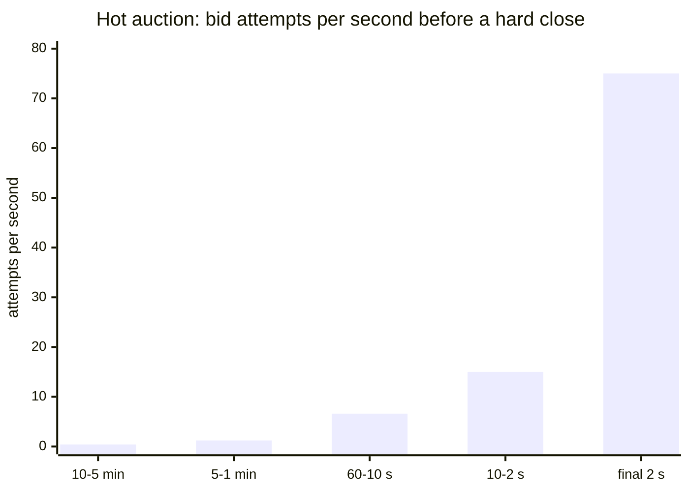
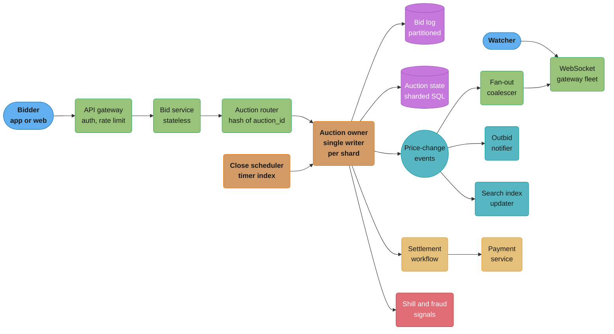
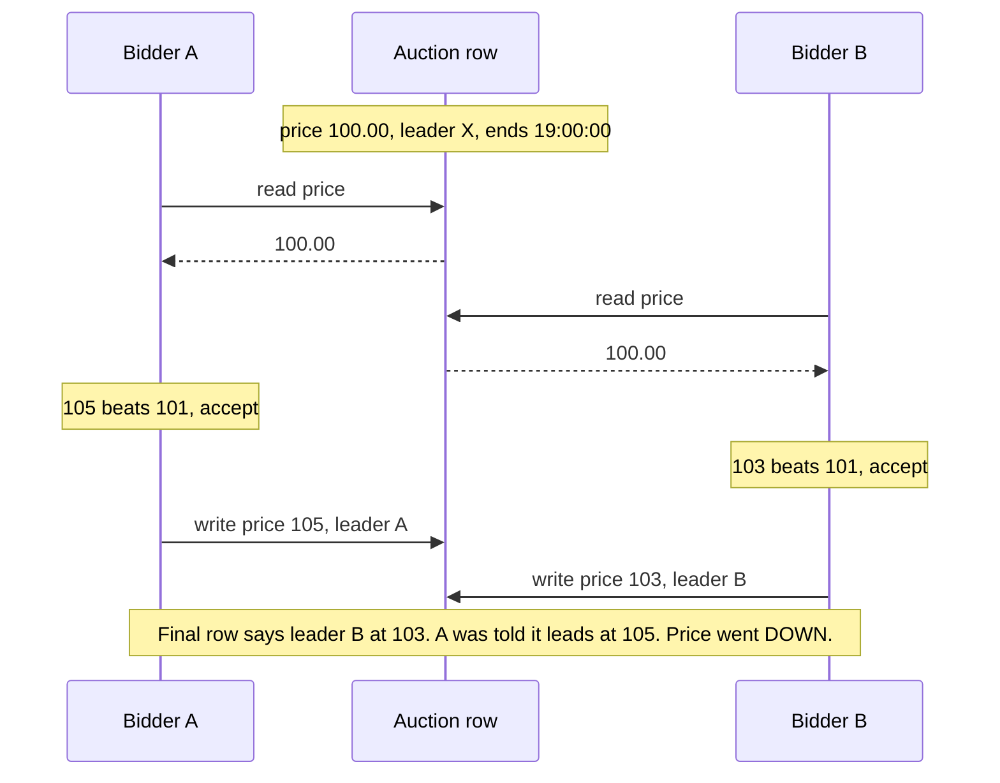
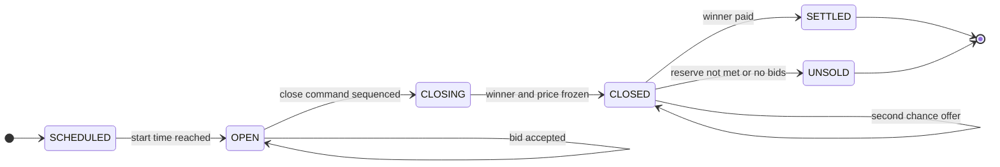
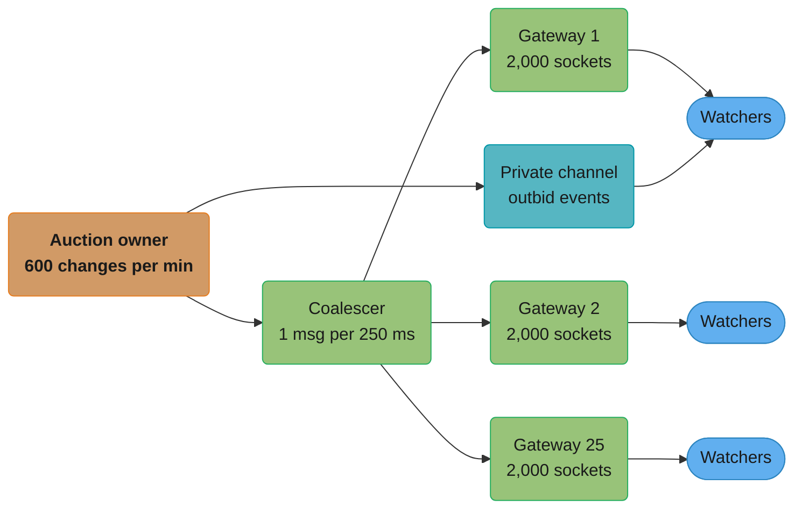

# System Design: Online Auction (eBay-Style Timed Auctions)

## Intuition

> **Design intuition**: An online auction looks like a catalogue with a "Bid" button, but the catalogue is the easy part. The hard part is that every auction is a tiny, contended, time-boxed state machine: one number (the current price), one owner (the current leader), and one instant (the end time) that decides everything. Most of the 7 days an auction runs, nobody touches it. Then, in the last 60 seconds, hundreds of people try to change that one number at once, and the system must answer two questions with zero ambiguity: **which bids were accepted, in what order, and did each one land before the end?**

**Key insight**: An auction is a **per-key total order with a deadline**. Every accepted bid is a compare-and-set against the current state of exactly one auction, and the end of the auction is a property of the server's ordering, never of the bidder's clock. Get those two rules right and the rest (proxy bidding, sniping protection, live price fan-out, settlement) is layered policy. Get either wrong and you ship the two classic auction bugs: two people both told "you won", or a bid accepted after the hammer fell. This study builds on the hot-key and fencing mechanics in [`../coordination_and_contention/coordination_and_contention.md`](../coordination_and_contention/coordination_and_contention.md) and the burst-contention playbook in [`./design_flash_sale_ticketing.md`](./design_flash_sale_ticketing.md). It must not re-derive them, and it does not duplicate the continuous double auction in [`./design_stock_exchange.md`](./design_stock_exchange.md): an exchange matches two sides continuously, while a timed auction ranks one side and closes once.

---

## 1. Requirements Clarification

### Functional Requirements
- **Create a listing**: seller sets a start price, an optional reserve price (hidden minimum), a duration (1, 3, 5, 7 or 10 days in this design), and a close policy (hard close or soft close).
- **Place a bid**: a registered, payment-verified bidder submits an amount. The system accepts it only if it beats the current price by at least the increment for that price band.
- **Proxy (automatic) bidding**: the bidder submits a **maximum** they are willing to pay. The system bids on their behalf, one increment at a time, only as far as needed to stay in the lead.
- **Live auction view**: every watcher sees the current price, the bid count, the time remaining, and whether they lead, updated within about 1 second of an accepted bid.
- **Outbid notification**: a bidder who loses the lead gets a push or email notification.
- **Close the auction**: at the end time, the system freezes the auction, determines the winner (if the reserve is met), and records the hammer price.
- **Soft close (anti-sniping)**: optional per listing. A bid in the final window extends the end time so other bidders can respond.
- **Settlement hand-off**: the winner is asked to pay. If the winner does not pay, the seller can offer the item to the runner-up.
- **Bid history**: an auditable, ordered list of accepted bids, with bidder identities masked for public display.

### Non-Functional Requirements
- **No accepted bid is ever lost.** An acknowledgement to the bidder means the bid is durable.
- **Strict total order per auction.** Two bids on the same auction are never applied concurrently, and the order is the same on every replica and every replay.
- **The server decides the end.** A bid is "before the close" only if the bid sequencer stamped it before `ends_at`. The client clock is never trusted.
- **Bid acknowledgement p99 under 150 ms** for normal auctions, and under 400 ms for a hot auction in its final minute.
- **Live price propagation p95 under 1 second** to watchers.
- **Close lag under 2 seconds**: the time from `ends_at` to the auction showing CLOSED.
- **Bid path is CP per auction; browsing is AP.** A stale price on a search result page is fine. A stale price inside the bid decision is not.
- **Exactly one winner per auction.** A close job that runs twice must not produce two winners.

### Out of Scope
- **Search and ranking of listings**: the listing catalogue is a search problem; see [`./design_proximity_service.md`](./design_proximity_service.md) for the two-phase index pattern.
- **Payment internals**: authorization holds, capture and refunds belong to [`./design_payment_system.md`](./design_payment_system.md) and [`../../fintech/card_payments_lifecycle/card_payments_lifecycle.md`](../../fintech/card_payments_lifecycle/card_payments_lifecycle.md).
- **Fraud and shill-bidding models**: we design the hooks (§4.i), not the model.
- **Live auctioneer (video) auctions**: streaming is covered by [`./design_live_streaming.md`](./design_live_streaming.md).
- **Sealed-bid and Dutch auctions**: mentioned in §5 only as contrasts.

---

## 2. Scale Estimation

All figures below are **design assumptions**, chosen to be in the range of a large consumer marketplace. They are not any company's disclosed numbers.

### Listings and Closes
- **20 million live auctions** at any moment.
- Average duration **7 days** = 604,800 s.
- Closes per day = 20,000,000 / 7 = **~2.86 million closes/day**.
- Average close rate = 2,860,000 / 86,400 = **~33 closes/s**.
- Sellers prefer evening end times, so closes cluster. Assume the busiest hour carries **12%** of the day's closes: 2,860,000 x 0.12 / 3,600 = **~95 closes/s** peak hour, with minute-level spikes of **~300 closes/s** on round minutes (19:00:00, 19:30:00).

### Bids
- Average **8 accepted bids per auction** (most auctions get few bids, a long tail gets hundreds).
- Accepted bids per day = 2,860,000 x 8 = **~22.9 million/day** = **~265 bids/s** average.
- **Rejected bid attempts** (below increment, auction closed, outbid by proxy instantly) run at about **3x** accepted ones: ~800 attempts/s average.
- **Last-minute concentration**: assume **40%** of an auction's bids arrive in its final 10 minutes. Combined with the evening close cluster, the global peak is roughly **4,000 bid attempts/s**.

### The Hot Auction
- One celebrity or limited-edition item: **50,000 watchers**, **600 bid attempts in the final 60 seconds**, and **150 attempts in the final 2 seconds**.
- That is **75 attempts/s on one key**, on average, in the last 2 seconds, with sub-second bursts several times higher.
- This is the number the bid path is sized against. The global 4,000/s spreads over thousands of auctions; the 75/s lands on one row.

### The Final Ten Minutes of the Hot Auction
The arrival shape inside one hot auction's last ten minutes (assumption, hard close) shows why the last 60 seconds are the sizing case:

| Window before close | Bid attempts | Rate |
|---|---|---|
| 10 min to 5 min | 120 | 0.4/s |
| 5 min to 1 min | 280 | 1.2/s |
| 60 s to 10 s | 330 | 6.6/s |
| 10 s to 2 s | 120 | 15/s |
| final 2 s | 150 | 75/s |



*Under a hard close the rate rises by roughly two orders of magnitude in the final two seconds. A 2-minute soft close spreads the same intent over a longer tail, because a bid at T minus 1 s no longer ends the contest.*

### Live Updates (Fan-Out)
- Naive fan-out for the hot auction: 600 accepted-or-proxied price changes x 50,000 watchers = **30 million messages in 60 seconds** = **500,000 messages/s** for one auction.
- With coalescing to at most **4 updates per second per watcher** (§4.e): 50,000 x 4 = **200,000 messages/s** peak, and only for the final minute.
- Average auction: 30 watchers x 8 bids = 240 messages over 7 days. Fan-out is a **tail problem**, not an average problem.

### Storage
- Bid row ~ **200 bytes** (ids, amount, max amount encrypted, sequence, timestamps, status).
- 22.9 M accepted + ~69 M rejected attempts logged = ~92 M rows/day x 200 B = **~18 GB/day** raw.
- Accepted bids kept **7 years** for disputes and audit: 22.9 M x 200 B x 365 x 7 = **~11.7 TB** before compression. Rejected attempts kept 90 days: ~1.25 TB.
- Live auction state (price, leader, max-bid ladder, `ends_at`, version): ~ **1 KB** each x 20 M = **20 GB**. Fits in memory across a small cluster.

### Timers
- **20 million pending close timers.** At ~33 closes/s average, a timer wheel or a DB index on `ends_at` both work; the choice is about precision and failover, not volume (§4.c).

| Quantity | Average | Peak | Notes |
|---|---|---|---|
| Live auctions | 20 M | 20 M | 1 KB hot state each |
| Closes | 33/s | ~300/s | round-minute spikes |
| Bid attempts (global) | ~800/s | ~4,000/s | evening, last-minute |
| Bid attempts (one hot auction) | n/a | 75/s avg in final 2 s | the sizing case |
| Watcher messages (hot auction) | n/a | 200,000/s coalesced | 500,000/s naive |
| Accepted bid storage | 4.6 GB/day | n/a | 7-year retention |

---

## 3. High-Level Architecture



*Every bid for one auction is routed to one owner process, which orders it, applies the compare-and-set, persists it, and only then acknowledges. Everything downstream of the owner (fan-out, notifications, search) consumes ordered price-change events and may lag without affecting correctness.*

### Request Flow for One Bid
1. The bidder submits `{auction_id, max_amount, client_bid_id}` to the gateway, which authenticates and rate-limits per account (see [`../rate_limiting/rate_limiting.md`](../rate_limiting/rate_limiting.md)).
2. The stateless bid service validates shape and does a **cheap pre-filter** against a cached price: a bid far below the current price can be rejected without touching the owner. The cache can reject; it can never accept.
3. The router hashes `auction_id` to a shard and forwards to the process that currently holds the **lease** for that shard (lease plus fencing token, per [`../coordination_and_contention/coordination_and_contention.md`](../coordination_and_contention/coordination_and_contention.md) §4.3).
4. The owner stamps the bid with a **server sequence number and server timestamp**, runs proxy resolution (§4.b), and applies a conditional write to the auction row that includes the fencing token.
5. On commit, the owner appends a price-change event, acknowledges the bidder, and the event fans out to watchers and the outbid notifier.

### Why a Single Writer Per Auction, Not Just a Database Row Lock
A conditional `UPDATE` on one row (the flash-sale fix in [`./design_flash_sale_ticketing.md`](./design_flash_sale_ticketing.md) §4.b) is correct at any load. It is the baseline here too. The single-writer owner sits in front of it for three reasons that are specific to auctions:
- **Proxy resolution is a read-compute-write over several values** (leader max, challenger max, increment band, tie order). It is simpler and faster as in-memory logic in one thread than as a large SQL statement retried under contention.
- **Ordering must be explainable.** A disputed bid needs a single, replayable sequence number. A row lock gives serializability but no human-readable sequence.
- **Hot auctions batch.** The owner can drain 20 queued bids, resolve them in order in memory, and write the final state once (§4.d). A row lock forces 20 round trips.

### Why the Close Is Owned by the Same Writer
The close is just another event in the auction's total order: "sequence 1,847: CLOSE at 19:00:00.000". If a separate job closed auctions by writing the row directly, a bid and the close could race on the database, and the outcome would depend on lock acquisition order rather than on the sequence. Routing the close through the owner makes "was this bid before the close" a comparison of two sequence numbers.

---

## 4. Component Deep Dives

### (a) Bid Acceptance: Broken, Then Fixed

The data model for live state, one row per auction, sharded by `auction_id`:

```sql
CREATE TABLE auction (
    auction_id        BIGINT PRIMARY KEY,
    seller_id         BIGINT      NOT NULL,
    status            TEXT        NOT NULL CHECK (status IN
                        ('SCHEDULED','OPEN','CLOSING','CLOSED','SETTLED','UNSOLD')),
    start_price_cents BIGINT      NOT NULL,
    reserve_cents     BIGINT,                 -- hidden from bidders
    current_price_cents BIGINT    NOT NULL,   -- the visible price
    leader_id         BIGINT,
    leader_max_cents  BIGINT,                 -- never shown publicly
    leader_seq        BIGINT,                 -- sequence of the leader's bid (tie-break)
    bid_count         INT         NOT NULL DEFAULT 0,
    ends_at           TIMESTAMPTZ NOT NULL,
    close_policy      TEXT        NOT NULL CHECK (close_policy IN ('HARD','SOFT')),
    version           BIGINT      NOT NULL DEFAULT 0,
    fence_token       BIGINT      NOT NULL DEFAULT 0
);

CREATE TABLE bid (
    auction_id    BIGINT      NOT NULL,
    seq           BIGINT      NOT NULL,       -- per-auction server sequence
    bidder_id     BIGINT      NOT NULL,
    client_bid_id UUID        NOT NULL,       -- idempotency key from the client
    max_cents     BIGINT      NOT NULL,
    outcome       TEXT        NOT NULL,       -- LEADING, OUTBID_BY_PROXY, REJECTED_LOW, REJECTED_CLOSED
    server_ts     TIMESTAMPTZ NOT NULL,
    PRIMARY KEY (auction_id, seq),
    UNIQUE (auction_id, bidder_id, client_bid_id)
);
CREATE INDEX auction_open_by_end ON auction (ends_at) WHERE status = 'OPEN';
```

***Broken:*** read the price, decide in application code, write the new state.

```java
// BROKEN -- check-then-act: two bids read the same price and both "win"
public BidResult placeBidBroken(long auctionId, long bidderId, long amountCents) {
    Auction a = auctionRepo.findById(auctionId);                 // read
    if (!a.isOpen()) return BidResult.closed();
    long minNext = a.currentPriceCents() + increment(a.currentPriceCents());
    if (amountCents < minNext) return BidResult.tooLow(minNext); // check in app code
    a.setCurrentPriceCents(amountCents);                         // write absolute values
    a.setLeaderId(bidderId);
    auctionRepo.save(a);
    return BidResult.leading(amountCents);
}
```



The row ends in a legal-looking state, so no constraint fires. Worse than the flash-sale version, the price can move **backwards**, and the bidder who offered more loses.

***Fix (database baseline):*** collapse the check into the write, and guard on status, end time and version.

```sql
-- Accept a direct bid only if it beats the current price by the increment,
-- the auction is open, and the server clock is before ends_at.
UPDATE auction
SET current_price_cents = :new_price,
    leader_id           = :bidder_id,
    leader_max_cents    = :max_cents,
    leader_seq          = :seq,
    bid_count           = bid_count + 1,
    version             = version + 1
WHERE auction_id = :auction_id
  AND status = 'OPEN'
  AND ends_at > :server_ts
  AND version = :expected_version
  AND fence_token <= :fence_token
RETURNING version, current_price_cents, leader_id;
-- 0 rows: someone else moved first, or the auction closed, or a stale owner. Re-read and re-resolve.
```

***Fix (owner path):*** inside the single-writer owner, the same rule is an in-memory comparison under one thread, and the SQL above becomes the durable commit with `expected_version` always matching (only the owner writes). The `fence_token` predicate rejects a zombie owner whose lease expired during a GC pause, which is exactly the split-brain in [`../coordination_and_contention/coordination_and_contention.md`](../coordination_and_contention/coordination_and_contention.md) §5.1.

```java
public final class AuctionOwner {
    private final long fenceToken;               // from the shard lease
    private final Map<Long, AuctionState> live;  // auctions on this shard

    /** Runs on the shard's single event-loop thread. Never called concurrently. */
    public BidResult apply(BidCommand cmd, Instant serverNow) {
        AuctionState s = live.get(cmd.auctionId());
        if (s == null) return BidResult.unknownAuction();
        BidResult dup = s.findByClientBidId(cmd.bidderId(), cmd.clientBidId());
        if (dup != null) return dup;                         // idempotent retry
        if (s.status() != Status.OPEN || !serverNow.isBefore(s.endsAt())) {
            return s.record(cmd, Outcome.REJECTED_CLOSED, serverNow);
        }
        long seq = s.nextSeq();
        ProxyResolution r = ProxyResolver.resolve(s, cmd.bidderId(), cmd.maxCents(), seq);
        if (r.rejected()) {
            return s.record(cmd, Outcome.REJECTED_LOW, serverNow);
        }
        AuctionState next = s.withResolution(r, serverNow);
        next = CloseRules.maybeExtend(next, serverNow);      // soft close, §4.c
        persist.commit(next, fenceToken);                    // conditional UPDATE + bid INSERT, one tx
        live.put(cmd.auctionId(), next);
        events.publish(PriceChanged.from(next));             // after commit, never before
        return BidResult.from(r);
    }
}
```

Two ordering rules carry the correctness: the owner commits **before** it acknowledges, and it publishes **after** it commits. Reversing either produces an acknowledged bid that a crash can erase, or a watcher who sees a price that never became durable.

### (b) Proxy Bidding: Second-Price With Increments

eBay calls this **automatic bidding**: "enter the maximum amount you'd like to pay for the item ... We'll bid in increments on your behalf to keep you in the lead but only up to your limit." The increment depends on the current price band. eBay's published table (US site, fetched 2026-11-25):

| Current price | Bid increment |
|---|---|
| $0.01 to $0.99 | $0.05 |
| $1.00 to $4.99 | $0.25 |
| $5.00 to $24.99 | $0.50 |
| $25.00 to $99.99 | $1.00 |
| $100.00 to $249.99 | $2.50 |
| $250.00 to $499.99 | $5.00 |
| $500.00 to $999.99 | $10.00 |
| $1,000.00 to $2,499.99 | $25.00 |
| $2,500.00 to $4,999.99 | $50.00 |
| $5,000.00 and up | $100.00 |

The resolution rule this design implements: the leader is the bidder with the highest maximum (earliest sequence wins a tie). The visible price is the **second-highest maximum plus one increment**, capped at the leader's maximum. This is a second-price auction with a minimum step, which is why a rational bidder's best strategy is to enter their true maximum once.

```java
public final class ProxyResolver {
    static long increment(long priceCents) {
        if (priceCents <    100) return    5;
        if (priceCents <    500) return   25;
        if (priceCents <   2500) return   50;
        if (priceCents <  10000) return  100;
        if (priceCents <  25000) return  250;
        if (priceCents <  50000) return  500;
        if (priceCents < 100000) return 1000;
        if (priceCents < 250000) return 2500;
        if (priceCents < 500000) return 5000;
        return 10000;
    }

    /** Pure function: same inputs, same output, so a replay of the bid log rebuilds state. */
    static ProxyResolution resolve(AuctionState s, long challenger, long challengerMax, long seq) {
        long price = s.currentPriceCents();
        long minNext = (s.leaderId() == null) ? s.startPriceCents() : price + increment(price);

        if (s.leaderId() != null && s.leaderId() == challenger) {
            // Leader raising their own max: price does not move, only the hidden max.
            if (challengerMax <= s.leaderMaxCents()) return ProxyResolution.rejectLow(minNext);
            return ProxyResolution.raiseOwnMax(challengerMax);
        }
        if (challengerMax < minNext) return ProxyResolution.rejectLow(minNext);
        if (s.leaderId() == null) {
            return ProxyResolution.newLeader(challenger, challengerMax, s.startPriceCents(), seq);
        }

        long leaderMax = s.leaderMaxCents();
        if (challengerMax > leaderMax) {
            // Challenger takes the lead; pays one increment over the old leader's max.
            long newPrice = Math.min(challengerMax, leaderMax + increment(leaderMax));
            return ProxyResolution.newLeader(challenger, challengerMax, newPrice, seq);
        }
        // Leader's proxy defends. Equal max: earlier sequence (the leader) wins.
        long newPrice = Math.min(leaderMax, challengerMax + increment(challengerMax));
        return ProxyResolution.leaderDefends(newPrice, challenger, challengerMax);
    }
}
```

A worked sequence on one auction, start price $10.00:

| Seq | Bidder | Max entered | Leader after | Visible price after | Why |
|---|---|---|---|---|---|
| 1 | A | $40.00 | A | $10.00 | first bid opens at start price |
| 2 | B | $25.00 | A | $26.00 | A defends: 25.00 + 1.00, below A's 40.00 |
| 3 | C | $40.00 | A | $40.00 | tie on max, A bid first, price capped at 40.00 |
| 4 | C | $55.00 | C | $41.00 | C beats 40.00, pays 40.00 + 1.00 |
| 5 | A | $41.50 | C | $41.00 | rejected low: the minimum next bid is 41.00 + 1.00 = 42.00 |
| 6 | A | $60.00 | A | $56.00 | A beats 55.00, pays 55.00 + 1.00 |

Row 5 is the case support teams get asked about most: the bidder saw $41.00, typed $41.50, and was told "too low" because the increment band requires $42.00. The rejection message must state the minimum next bid, which `rejectLow(minNext)` carries.

Three properties follow from the pure-function form:
- **Replay**: rebuilding an auction from its bid log yields the same price, leader and history, which is how a new owner recovers after failover.
- **Audit**: a dispute is answered by re-running `resolve` over the logged inputs.
- **Hidden maxima stay hidden**: the leader's max is stored, never sent to clients, and encrypted at rest because it is commercially sensitive.

### (c) Close Semantics: Hard Close, Soft Close and the Server Clock

The auction lifecycle:



**Hard close.** `ends_at` never moves. eBay's help pages describe the consequence directly: "Waiting until the last few seconds of an auction to make a winning bid is known as bid sniping. This tactic is used to try to prevent other bidders from having a chance to place a higher bid before the auction ends." A hard close rewards fast, late bids, and it concentrates load into the final seconds (§2's hot auction).

**Soft close.** Bring a Trailer states its rule as: "Sniping protection extends the auction clock by two minutes each time a bid is placed in the auction's final moments. The auction isn't over until two full minutes have elapsed since the highest bid was placed." The academic literature studies the same choice: Roth and Ockenfels, "Last-Minute Bidding and the Rules for Ending Second-Price Auctions: Evidence from eBay and Amazon Auctions on the Internet", *American Economic Review* 92(4), 2002, compares the two ending rules.

```java
public final class CloseRules {
    static final Duration SOFT_WINDOW = Duration.ofMinutes(2);

    /** Called by the owner after a bid is accepted, inside the same single-threaded step. */
    static AuctionState maybeExtend(AuctionState s, Instant acceptedAt) {
        if (s.closePolicy() != ClosePolicy.SOFT) return s;
        Instant floor = acceptedAt.plus(SOFT_WINDOW);
        if (floor.isAfter(s.endsAt())) {
            return s.withEndsAt(floor);        // close timer must be re-armed, §4.c below
        }
        return s;
    }
}
```

**Whose clock?** A bid is accepted only if the **owner's** `serverNow` is before `ends_at`. The client's countdown is a display. It is computed from the server's `ends_at` plus a measured clock offset, and it can be wrong by the round-trip time. The rule to publish to bidders: "a bid counts if our server receives and sequences it before the end time". This is the only rule that is the same for every bidder and every replay.

**The bid that arrives at T minus 40 ms.** It is in flight when the close timer fires. Both are commands to the same owner, so they are serialized: whichever the owner dequeues first wins. With hard close, a bid sequenced at 18:59:59.960 is accepted and the close at 19:00:00.000 follows it. A bid dequeued after the close is `REJECTED_CLOSED`, even if the bidder pressed the button "in time" on their screen.

**Close timers.** Two working designs:

| Design | How | Precision | Failover |
|---|---|---|---|
| Index scan | Every 250 ms, each shard owner runs `SELECT auction_id FROM auction WHERE status='OPEN' AND ends_at <= now() + interval '1 second' ORDER BY ends_at LIMIT 500` and schedules in-memory timers | ~250 ms plus queue delay | Trivial: a new owner re-scans |
| Hierarchical timer wheel | Owner keeps a wheel of `ends_at` for its shard in memory, loaded on lease acquisition | ~10 ms | Wheel rebuilt from the index on failover |

This design uses the timer wheel for precision and the index scan as the **safety net**: any `OPEN` auction with `ends_at` more than 2 s in the past raises a close-lag alert and is closed by the scan. The broader timer and scheduler problem is covered in [`./design_distributed_job_scheduler.md`](./design_distributed_job_scheduler.md).

**Soft close re-arms the timer.** When `maybeExtend` moves `ends_at` from 19:00:00 to 19:01:42, the owner must cancel the old timer entry. If it forgets, the old timer fires a close at 19:00:00 against an auction that should still be open. The fix is to make the close command carry the `ends_at` it was armed for, and have the owner ignore it if the auction's current `ends_at` is later:

```java
public CloseResult close(long auctionId, Instant armedFor, Instant serverNow) {
    AuctionState s = live.get(auctionId);
    if (s == null || s.status() != Status.OPEN) return CloseResult.alreadyClosed();  // idempotent
    if (s.endsAt().isAfter(armedFor)) return CloseResult.staleTimer();              // extended
    if (serverNow.isBefore(s.endsAt())) return CloseResult.tooEarly();             // clock guard
    AuctionState closed = s.freeze(serverNow);   // status CLOSING then CLOSED in one commit
    persist.commitClose(closed, fenceToken);     // UPDATE ... WHERE status='OPEN' AND fence_token <= ?
    events.publish(AuctionClosed.from(closed));
    return CloseResult.closed(closed.leaderId(), closed.currentPriceCents());
}
```

The `WHERE status = 'OPEN'` predicate in `commitClose` is what makes the close **idempotent at the storage layer**: a second close attempt, from a duplicate timer or a failover replay, updates zero rows and emits nothing.

### (d) The Hot Auction: Contention in the Final Minute

At 75 attempts/s on one auction (§2), a pure database approach issues 75 conditional `UPDATE`s per second against one row. Each one holds the row lock for the duration of its transaction. At ~5 ms per commit with synchronous replication (illustrative), one row tops out near **200 serialized commits/s**, so the baseline survives, but with little headroom, and every rejected-by-race attempt costs a retry round trip.

The owner reduces this in three steps:

1. **Edge pre-filter (reject only).** The bid service holds the latest price per auction from the event stream, at most ~1 s stale. A bid whose max is below `cached_price + increment(cached_price)` is rejected immediately with the minimum next bid. Because the price only goes up, a stale cache can only be **too low**, so it never rejects a bid the owner would have accepted. It removes roughly half of final-minute attempts (illustrative).
2. **Micro-batching in the owner.** The owner drains its queue every 5 ms, resolves every queued bid in sequence order in memory, and commits **one** row update plus N bid rows in one transaction. 75 attempts/s becomes ~200 commits/s ceiling shared across the whole shard rather than per attempt.
3. **Shard isolation for known hot listings.** A listing flagged hot before its final hour (watch count above 10,000) is moved to a dedicated owner shard, so its burst cannot delay closes and bids on other auctions sharing the shard. This is the cell idea from [`../cell_based_architecture/cell_based_architecture.md`](../cell_based_architecture/cell_based_architecture.md) applied to one key.

```java
// Owner event loop: one thread per shard. Batching keeps order and cuts commits.
while (running) {
    List<Command> batch = queue.drain(256, Duration.ofMillis(5));
    UnitOfWork uow = persist.begin(fenceToken);
    List<Runnable> afterCommit = new ArrayList<>();
    for (Command c : batch) {                  // FIFO = server sequence order
        Outcome o = c.applyTo(live, clock.instant(), uow);
        afterCommit.add(() -> c.reply(o));
    }
    uow.commit();                              // one durable write per touched auction
    afterCommit.forEach(Runnable::run);        // ack only after commit
    events.flush();
}
```

Why not split one auction across writers? Because the state is one number with a total order. Sharding a counter works when increments commute (likes, views). Bids do not commute: the order changes who leads and what the price is.

### (e) Live Price Fan-Out to Watchers

The fan-out pipeline subscribes to `PriceChanged` events and pushes them over WebSockets (see [`../realtime_updates/realtime_updates.md`](../realtime_updates/realtime_updates.md) and [`../../backend/websockets_and_sse/websockets_and_sse.md`](../../backend/websockets_and_sse/websockets_and_sse.md)).

- **Coalescing**: per auction, the coalescer emits at most one update every 250 ms, carrying the **latest** price, bid count, `ends_at` and sequence. Intermediate prices are skipped. Watchers see 4 updates/s at most, which is all a human can read.
- **Exception for the bidder's own status**: "you have been outbid" is a per-user event and is not coalesced away. It goes on the user's private channel and to the notifier.
- **Sequence numbers and gap fill**: each update carries the auction's `seq`. A client that reconnects with `last_seq=1,842` gets the current snapshot if more than one update was missed. It never replays every intermediate bid.
- **`ends_at` is pushed, not computed**: when soft close extends the end, the new `ends_at` must reach every watcher, or their countdowns show 00:00 while the auction is still live, which causes rage-bids and support tickets.
- **Gateway fan-out shape**: 50,000 watchers spread over 25 gateway nodes = 2,000 sockets per node for this auction. The coalescer publishes one message per gateway per tick, and each gateway fans out locally: 25 x 4 = 100 internal messages/s instead of 200,000.



### (f) Idempotency and Retries on the Bid Call

A bidder on a train taps "Bid" and the request times out. The app retries. Without protection, the second request is a second bid: harmless if it is the same max (the owner treats a leader re-bidding the same max as `REJECTED_LOW`), harmful if the app regenerated it with a different amount or if the first bid made the user leader and the retry is now interpreted as "raise my own max".

- The client generates `client_bid_id` once per bid intent and reuses it on every retry.
- The owner checks `(auction_id, bidder_id, client_bid_id)` in memory first; the database `UNIQUE` constraint is the backstop after failover.
- A duplicate returns the **original** outcome, including "you were outbid by proxy", not a fresh evaluation against the current state.

This is the same pattern as [`../coordination_and_contention/coordination_and_contention.md`](../coordination_and_contention/coordination_and_contention.md) §4.5 and [`../../fintech/idempotency_and_exactly_once_money_movement/idempotency_and_exactly_once_money_movement.md`](../../fintech/idempotency_and_exactly_once_money_movement/idempotency_and_exactly_once_money_movement.md). The difference here is that the idempotency key lives **inside** the per-auction state, so the lookup costs no extra network call.

### (g) Settlement: From Hammer Price to Paid

Closing the auction is a fact. Getting paid is a workflow that can take days and can fail, so it runs as a durable workflow ([`../../backend/durable_execution_and_workflows/durable_execution_and_workflows.md`](../../backend/durable_execution_and_workflows/durable_execution_and_workflows.md)), triggered by the `AuctionClosed` event through an outbox.

| Step | Action | Timeout | On failure |
|---|---|---|---|
| 1 | Check reserve: `current_price >= reserve` | n/a | mark UNSOLD, notify seller |
| 2 | Notify winner, open checkout | 0 | retry notification |
| 3 | Winner pays | 4 days (policy) | unpaid-item case |
| 4 | Payment authorized and captured | n/a | retry, then unpaid-item case |
| 5 | Optional second-chance offer to runner-up | 3 days (policy) | relist |
| 6 | Mark SETTLED, release funds to seller per payout schedule | n/a | escalate |

Two details that interviewers probe:
- **Bid commitment**: eBay's help page states that bidding "is a contractual obligation". Bring a Trailer goes further and places "a hold on the credit card on file for the amount of the buyers fee" when a bid is placed, releasing it "for all bidders who didn't win". A pre-authorization at bid time reduces unpaid items but costs an authorization call on the bid path. This design places the hold **asynchronously after the first bid** per bidder per auction, not on every bid.
- **Second-chance offer**: the runner-up's price is **their** maximum, not the winner's hammer price, because the runner-up never agreed to more than their own max.

### (h) The Read Path: Listing Page and Bid History

The listing page is read thousands of times for every bid, so it must never touch the owner.

| Element | Source | Freshness | Why |
|---|---|---|---|
| Title, photos, description | CDN-cached listing document | minutes | changes only on seller edit |
| Current price, bid count, `ends_at` | price snapshot cache fed by `PriceChanged` | under 1 s | must match the live socket stream |
| "You are the high bidder" | per-user query to the owner's committed state | read-your-writes | the bidder must see their own bid |
| Public bid history | read replica of the `bid` table | seconds | masked bidder ids, no maxima |
| Watch count | sharded counter | minutes | commutative, approximate is fine |

Read-your-writes for the bidder's own status matters more than global freshness. A bidder who just got "bid accepted" and then reloads the page to see "you are outbid" by a 1-second-stale snapshot files a support ticket. The fix is to route the per-user status query to committed owner state (or to include the bidder's last known `seq` and wait until the snapshot reaches it), while everyone else reads the snapshot cache. See [`../caching/caching.md`](../caching/caching.md) for the general cache-aside tradeoff.

### (i) Shill Bidding and Abuse Hooks

The owner emits every bid, including rejected ones, to a risk stream ([`../stream_processing/stream_processing.md`](../stream_processing/stream_processing.md)). Signals computed there:
- Seller and bidder share a device fingerprint, payment instrument or address.
- A bidder who bids on one seller's auctions far more than on others, and rarely wins.
- Retractions in the final hour after the bidder pushed the price up.
- Bursts from new accounts on one listing.

The bid path stays synchronous and simple. Risk decisions arrive asynchronously as commands to the owner ("void bids from bidder X on auction Y"), which applies them in sequence and recomputes the price by replaying the log without the voided bids. Replay is cheap because `resolve` is pure (§4.b).

---

## 5. Design Decisions & Tradeoffs

| Decision | Option A | Option B | Choice and why |
|---|---|---|---|
| Ordering primitive | Conditional `UPDATE` per bid on the auction row | Single-writer owner per shard, committing with a fence token | **Owner with conditional commit underneath.** The SQL guard is the safety net; the owner adds replayable sequence numbers, batching for hot auctions, and one thread for proxy logic. |
| End-time authority | Client timestamp | Server sequence and timestamp | **Server.** Client clocks drift and are user-controlled; only the owner's order is the same on every replay. |
| Close policy | Hard close | Soft close (2-minute extension) | **Per listing, default soft for high-value categories.** Hard close is simpler and predictable; soft close reduces sniping and spreads final-second load. |
| Price rule | First-price (pay your bid) | Second-price with increment (proxy) | **Second-price with increment.** It lets bidders enter a true max once, which cuts repeated bid traffic and disputes. |
| Live updates | Push every price change | Coalesce to 4/s per watcher | **Coalesce.** The final-minute fan-out drops from 500,000 to 200,000 messages/s for one auction, and humans cannot read faster. |
| Close trigger | Separate cron writes the DB | Close command sequenced through the owner | **Through the owner.** The bid-versus-close race becomes a comparison of two sequence numbers. |
| Pre-filter | None, every attempt reaches the owner | Stale-price reject-only filter at the edge | **Reject-only filter.** Monotonic prices make a stale cache safe for rejection and unsafe for acceptance. |
| Payment commitment | Charge on win only | Authorization hold after first bid | **Async hold after first bid** for high-value categories; none for low-value. |

### The Redis Lua Alternative to an Owner Process
A smaller team can skip the owner service and keep live state in Redis or Valkey, using one Lua script as the compare-and-set. This works because the server runs a script atomically. It is a good fit up to a few hundred thousand live auctions with modest hot-auction rates.

```lua
-- KEYS[1] = "auction:{id}" hash: price, leader, leader_max, ends_at_ms, status, seq
-- ARGV[1] = bidder_id, ARGV[2] = max_cents, ARGV[3] = server_now_ms, ARGV[4] = min_next_cents
local a = redis.call('HMGET', KEYS[1], 'status', 'ends_at_ms', 'leader', 'leader_max', 'seq')
if a[1] ~= 'OPEN' or tonumber(ARGV[3]) >= tonumber(a[2]) then
  return {'REJECTED_CLOSED'}
end
if tonumber(ARGV[2]) < tonumber(ARGV[4]) then
  return {'REJECTED_LOW', ARGV[4]}
end
local seq = redis.call('HINCRBY', KEYS[1], 'seq', 1)
-- Proxy resolution is done by the caller in this variant: the caller passes min_next
-- computed from a read, and the script re-checks it. A changed price makes the
-- script reject, and the caller re-reads and retries.
redis.call('HSET', KEYS[1], 'leader', ARGV[1], 'leader_max', ARGV[2])
return {'ACCEPTED', tostring(seq)}
```

The tradeoffs against the owner: no in-process batching, proxy logic split between the caller and the script, durability tied to Redis persistence settings (an `appendfsync everysec` configuration can lose up to about one second of acknowledged bids on a crash), and a slow script blocks every other key on that node. For an auction marketplace where "no accepted bid is lost" is a hard requirement, the owner plus a synchronously replicated database is the safer default; the Lua variant fits a smaller marketplace that accepts the persistence window.

### Why Not Use the Matching Engine From the Stock Exchange Study?
[`./design_stock_exchange.md`](./design_stock_exchange.md) also uses a single writer per symbol, but its book has two sides and matches continuously at the resting order's price. A timed auction has one side (buyers), one item, and a single clearing event at close. Reusing the exchange engine would bring order types, partial fills and a market-data feed that an auction never needs. The shared idea is the **sequencer**; the price rule is different.

### What Changes at 10x
| Pressure | At 1x (this design) | At 10x | Change |
|---|---|---|---|
| Global bid attempts | 4,000/s | 40,000/s | more owner shards; the model is unchanged because load spreads over auctions |
| One hot auction | 75/s in final 2 s | 750/s | the single writer is the ceiling; pre-filter harder, add a bid-time deposit, or switch that listing to sealed-bid |
| Watchers on one auction | 50,000 | 500,000 | coalesce to 1 update/s and serve the countdown from `ends_at` only |
| Live auctions | 20 M | 200 M | 200 GB hot state; still fits in memory across owners |

The one row that does not scale by adding machines is the hot auction, because its writes are serialized by definition. The answers at 10x are product changes (soft close, deposits, sealed bids), not infrastructure.

### Sealed-Bid and Dutch Auctions, Briefly
- **Sealed-bid (first or second price)**: bids are hidden until close. No live fan-out and no sniping problem, so the hot-auction load disappears; the close becomes a single sort.
- **Dutch (descending price)**: the price falls on a timer until someone accepts. The contention is the opposite shape: the **first** accept wins, which is the flash-sale atomic decrement with a quantity of 1.

---

## 6. Real-World Implementations

- **eBay (automatic bidding)**: eBay's help centre describes automatic bidding as entering "the maximum amount you'd like to pay" and states "We'll bid in increments on your behalf to keep you in the lead but only up to your limit." It publishes the ten-band increment table reproduced in §4.b (from $0.05 below $1.00 up to $100.00 at $5,000 and above), and notes that an immediate outbid usually means "another bidder is using automatic bidding and has a maximum limit higher than yours". eBay names last-second bidding "bid sniping" in its own help pages, which describes the hard-close consequence. Source: [eBay Help, "Automatic bidding"](https://www.ebay.com/help/buying/bidding/automatic-bidding?id=4014), fetched 2026-11-25.
- **Bring a Trailer (soft close)**: BaT runs auctions that "typically run for 7 days", applies "Sniping protection [that] extends the auction clock by two minutes each time a bid is placed in the auction's final moments", and requires bidders to register with a credit card: "When a bid is placed, we place a hold on the credit card on file for the amount of the buyers fee." Buyers pay "a 5% or 10% fee on top of the final sale price ... The minimum fee is $250", capped at $4,000 for 10%-fee auctions and $7,500 for 5%-fee auctions. If the reserve is not met, "the seller and the highest bidder will have 24 hours to exchange an offer and a counteroffer". Source: [Bring a Trailer, "How BaT Works"](https://bringatrailer.com/how-bat-works/), fetched 2026-11-25. Every element of §4.c's soft close and §4.g's bid-time hold appears in this one published rule set.
- **Academic evidence on ending rules**: Alvin E. Roth and Axel Ockenfels, "Last-Minute Bidding and the Rules for Ending Second-Price Auctions: Evidence from eBay and Amazon Auctions on the Internet", *American Economic Review* 92(4): 1093-1103, September 2002 (DOI 10.1257/00028280260344632). The paper's subject is exactly §5's hard-close versus soft-close decision, studied on two real marketplaces with different ending rules. Source: [AEA article page](https://www.aeaweb.org/articles?id=10.1257/00028280260344632).
- **Redis as the in-memory owner store**: teams that put live auction state in Redis rely on the guarantee stated in the Redis docs: "Redis guarantees the script's atomic execution. While executing the script, all server activities are blocked during its entire runtime." That is what makes a Lua bid script a valid compare-and-set, and also why a slow script stalls every other auction on the node. The persistence page states the durability bound for the Lua variant in §5: with the default AOF policy of fsync every second, "you can only lose one second worth of writes". Sources: [Redis docs, "Scripting with Lua"](https://redis.io/docs/latest/develop/programmability/eval-intro/) and [Redis docs, "Redis persistence"](https://redis.io/docs/latest/operate/oss_and_stack/management/persistence/), fetched 2026-11-25. See [`../../database/redis_internals/redis_internals.md`](../../database/redis_internals/redis_internals.md).

### Synthesis
The public rule sets converge on three choices this design makes: proxy bidding with a published increment ladder (eBay), a server-defined close with an explicit sniping policy (BaT's 2 minutes, or eBay's fixed end), and a commitment mechanism that makes a bid costly to abandon (eBay's "contractual obligation", BaT's card hold). None of them publishes its internal architecture, so the single-writer owner in §3 is this design's choice, justified by the requirements in §1, not a claim about any company's implementation.

---

## 7. Technologies & Tools

| Layer | Options | Notes |
|---|---|---|
| Auction state (durable) | PostgreSQL or MySQL, sharded by `auction_id` | Conditional `UPDATE` with `version` and `fence_token`; see [`../database_sharding/database_sharding.md`](../database_sharding/database_sharding.md) |
| Auction state (hot, in memory) | Owner process memory; Redis or Valkey with Lua as an alternative | Lua runs atomically but blocks the node; keep scripts O(1) |
| Shard leases | etcd, ZooKeeper, or a lease table with fencing tokens | The fencing token must be checked by the storage write, not only by the owner |
| Bid log | Kafka (partition by shard), or the `bid` table itself | Replayable, ordered per auction; see [`../message_queues/message_queues.md`](../message_queues/message_queues.md) |
| Close timers | In-process hierarchical timer wheel plus `ends_at` partial index scan | Index scan is the safety net |
| Live updates | WebSocket gateway fleet, Redis pub/sub or Kafka as the fan-out bus | Coalesce per auction, fan out per gateway |
| Notifications | Push and email via a notification service | See [`./design_notification_system.md`](./design_notification_system.md) |
| Settlement | Temporal or another durable workflow engine | Long timers (days), retries, compensation |
| Risk | Flink or Kafka Streams over the bid stream | Async, emits void commands |
| Search | Elasticsearch or OpenSearch for listing discovery | Price in search is eventually consistent |

---

## 8. Operational Playbook

### Key Metrics

| Metric | Target | Alert |
|---|---|---|
| Bid ack latency p99 (normal auctions) | under 150 ms | over 300 ms for 2 min |
| Bid ack latency p99 (hot shard, final minute) | under 400 ms | over 1 s for 30 s |
| Close lag (now minus `ends_at` for OPEN auctions) | under 2 s | any auction over 5 s |
| Owner queue depth per shard | under 200 | over 1,000 |
| Lease handoffs per hour | near 0 | over 5 per shard |
| Fence-token rejections | 0 | any (means a zombie owner wrote) |
| Fan-out lag (event to socket) p95 | under 1 s | over 3 s |
| Duplicate-winner check (CLOSED auctions with more than one winner record) | 0 | any |

### Runbook: Close Lag Rising
1. Check whether lag is on one shard or all. One shard means a hot auction or a stuck owner; all shards means the scheduler or the database.
2. For one shard: look at owner queue depth. If a single auction dominates, move it to a dedicated shard (lease transfer) and let the safety-net scan close the backlog.
3. For all shards: check database commit latency. Closes and bids share the commit path; a slow primary delays both.
4. Never close auctions by hand with a direct `UPDATE`. Send close commands through the owner, so the close is sequenced after every bid already queued.

### Runbook: Owner Failover During a Final Minute
1. The lease expires (default TTL 10 s in this design) and a new owner acquires it with fence token N+1.
2. The new owner loads state from the auction table and replays bid rows with `seq` above the stored state, rebuilding the in-memory state.
3. Bids queued at the old owner and not committed were never acknowledged; clients retry with the same `client_bid_id`.
4. If `ends_at` passed during the handoff, the new owner closes immediately. Bids that arrived during the gap are `REJECTED_CLOSED`. For soft-close auctions, the team may choose a policy of extending `ends_at` by the outage duration; that policy must be written down before the incident, not decided during it.

### Runbook: A Bidder Disputes "I Bid Before the End"
1. Pull the auction's bid log: every attempt with `seq`, `server_ts`, outcome, and the gateway receive time.
2. Find the disputed attempt by `client_bid_id`. Compare its `seq` to the close command's `seq`.
3. If it was sequenced after the close, the answer is "received after the end"; share the server timestamps, never the other bidders' maxima.
4. If it was sequenced before the close and still lost, re-run `ProxyResolver.resolve` over the log and show the bidder their maximum versus the minimum next bid at that moment.
5. If the gateway receive time is before `ends_at` but the owner sequence is after, the delay was inside the platform (queue or failover). Escalate: this is a platform fault, and the policy for compensating it must already exist.

### Runbook: Clock Skew on an Owner Host
1. Alert: the owner's clock differs from the NTP reference by more than 50 ms.
2. Effect: `ends_at` comparisons on that shard are early or late by the skew.
3. Action: drain the shard (transfer the lease) to a healthy host before fixing NTP. Do not step the clock on a live owner, because a backwards step can make `serverNow` go back past a bid already accepted.
4. Prevention: owners refuse to take a lease unless the host's clock offset is under 20 ms.

### Pre-Event Checklist for a Known Hot Listing
1. Flag the listing hot 24 hours ahead and pin it to a dedicated owner shard.
2. Pre-scale the WebSocket gateway fleet for the expected watcher count plus 50%.
3. Load test the final minute as a burst (150 attempts in 2 s), not a ramp.
4. Confirm the soft-close extension re-arms the timer (run a synthetic auction with a bid at T minus 1 s).

---

## 9. Common Pitfalls & War Stories

The incidents below are **illustrative composites**. Numbers are chosen to show the mechanism and its cost; they are not a specific company's postmortem.

### War Story 1: Two Winners From One Auction
A cron job closed auctions every minute by selecting `status='OPEN' AND ends_at <= now()` and writing `status='CLOSED'`, then publishing "you won" emails. During a database failover, the job's first run timed out after the commit but before it recorded success, and the retry re-read the replica, which had not yet applied the commit. It closed **11,400 auctions a second time**, and for 230 of them a bid that arrived between the two runs had changed the leader. 230 pairs of buyers received "you won" for the same item; refunds, goodwill credits and support time cost an estimated **$85,000**.

***Broken:***

```sql
-- BROKEN -- unconditional close; a re-run re-closes and re-announces
UPDATE auction SET status = 'CLOSED' WHERE auction_id = :id;
-- publish AuctionClosed(:id, leader_id) unconditionally
```

***Fix:*** close through the owner (§4.c) and make the storage write conditional, emitting the event only when the row actually changed:

```sql
UPDATE auction SET status = 'CLOSED', version = version + 1
WHERE auction_id = :id AND status = 'OPEN' AND ends_at <= :server_ts
RETURNING leader_id, current_price_cents;
-- 0 rows returned: already closed, publish nothing
```

### War Story 2: The Client Clock Decided the Close
An early API accepted a `placed_at` field from the client and compared it to `ends_at`. Bidders discovered that setting the phone's clock back 30 seconds let them bid after the end. In one week, **1,900 auctions** had bids accepted up to 40 seconds after close; 310 of those changed the winner. The fix was to drop `placed_at` entirely and use the owner's sequence and clock. The lesson from §1: the client clock is a display, never an input.

### War Story 3: Soft Close Extended the Auction, the Old Timer Closed It Anyway
A soft-close auction got a bid at 18:59:50, moving `ends_at` to 19:01:50. The original timer for 19:00:00 was still in the wheel and closed the auction at 19:00:00. Bidders saw a countdown at 1:50 and then "auction ended". The defect ran for 3 days before detection and affected **every** soft-close auction with a final-minute bid, about **4% of soft-close auctions**. Fix: the close command carries `armedFor`, and the owner ignores stale timers (§4.c). Detection: a synthetic auction per shard every 10 minutes that bids at T minus 5 s and asserts the close happens after T plus 115 s.

### War Story 4: The Final-Minute Fan-Out Took Down Unrelated Auctions
A limited sneaker drop drew **80,000 watchers**. Fan-out pushed every price change to every socket: about 800,000 messages/s at peak. Gateway CPU hit 100%, sockets for **all** auctions on those gateways disconnected, and 60,000 reconnects in 5 seconds overloaded the auth service. For about 90 seconds, bidders on other auctions could not see prices. Fix: coalescing to 250 ms (§4.e), per-gateway fan-out, and reconnect with jittered backoff.

### War Story 5: Replica Read in the Bid Path
To reduce primary load, a team read the auction row from a replica in the bid service and only wrote to the primary. Replica lag of **300 ms** during the evening peak meant the "current price" used to compute the visible price was stale; the conditional write caught most of these (version mismatch), but retries tripled the write load at the worst moment and pushed p99 bid latency from 120 ms to **2.4 s**. Fix: only the owner computes state; replicas serve the read-only listing page.

### War Story 6: The Increment Table Changed, Replay Did Not
Product changed the increment ladder for prices above $1,000. The new table shipped in the bid service, and the next owner failover replayed **open** auctions using the new increments against bids placed under the old ones. 140 auctions came back with a different visible price than the one bidders had seen, and 12 with a different leader. Fix: the increment table is versioned, each auction stores the table version it opened with, and `resolve` takes the version as an input. A pure function is only replay-safe if every input, including configuration, is part of the log.

### Further Pitfalls
- **Floating-point money**: store integer minor units (cents). An increment ladder in `double` produces bids like $41.0000000001.
- **Leaking the leader's max**: sending `leader_max_cents` to the client "for debugging" tells every competitor exactly what to bid.
- **Rate-limiting by IP only**: a bidder with 50 accounts behind one NAT is a shill-bidding signal, not a reason to block 50 honest users on one office network.
- **Search price as truth**: never let a "buy at this price" button use the search index price.

---

## 10. Capacity Planning

### Owner Shards
- Global peak 4,000 attempts/s. Each owner thread handles ~2,000 in-memory resolutions/s comfortably, but the binding limit is commits: assume **~200 commits/s per shard** with batching and synchronous replication (illustrative).
- With batching, the average shard commits once per touched auction per 5 ms tick. Plan **256 shards**: 4,000 / 256 = ~16 attempts/s per shard on average, leaving room for one hot auction per shard.
- Hot listings get dedicated shards: reserve **16 spare shards** for pinning.

### Database
- Accepted-bid writes: 265/s average, ~1,500/s peak (accepted is a fraction of 4,000 attempts). Rejected attempts are logged asynchronously to the log store, not the OLTP table.
- Live state: 20 GB. Bid history hot set (open auctions only): ~23 M x 8 days x 200 B ~ 37 GB. **16 database shards** of 64 GB RAM each keep the hot set in memory.

### WebSocket Gateways
- Concurrent watchers platform-wide: assume **5 M** sockets at peak.
- At ~50,000 sockets per gateway node (illustrative), plan **100 nodes**, plus 50% headroom for a hot-listing event: **150 nodes**.

### Close Scheduler
- 300 closes/s on round minutes. Each close is one owner command plus one conditional write: trivially within shard capacity. The risk is not throughput but **synchronization**: 300 closes in the same second on the same shards as final-second bids. Spreading close timers across the first 500 ms of each minute (the owner jitters local timer firing, never `ends_at` itself) keeps commit latency flat.

| Component | Sizing input | Plan |
|---|---|---|
| Owner shards | 4,000 attempts/s peak, 200 commits/s/shard | 256 + 16 spare |
| OLTP DB shards | 37 GB hot set, 1,500 writes/s | 16 x 64 GB |
| Bid log | 92 M events/day, 90-day retention | 3-broker minimum, 256 partitions |
| WebSocket gateways | 5 M sockets, 50k/node | 150 nodes |
| Coalescer | 1 msg/250 ms per active auction | colocated with gateways |
| Settlement workflows | 2.86 M/day | durable workflow cluster, async |

### Worked Check: Can One Shard Survive the Hot Auction?
- Hot auction: 150 attempts in the final 2 s, about half rejected by the edge pre-filter: **75 reach the owner in 2 s**.
- Owner tick: 5 ms. In 2 s there are 400 ticks; at most a few attempts land per tick.
- Commits: at most one auction-row commit per tick for this auction, so **at most 400 commits in 2 s = 200/s**, which is exactly the illustrative per-shard ceiling. That is why the hot listing is pinned to a dedicated shard: on a shared shard, the other auctions' commits would push it over.
- Latency: queue wait (under 5 ms) + resolution (microseconds) + commit (~5 ms) + ack: well inside the 400 ms hot-path p99 target, with the budget mostly reserved for network and failover.

### Cost Shape
The bid path is small and cheap. Most of the cost is the WebSocket fleet (provisioned for peak watchers) and 7-year bid storage. Both scale with engagement, not with auctions, which is why coalescing and cold-tier storage of closed-auction history are the main cost levers.

---

## 11. Interview Discussion Points

### How to Structure a 45-Minute Answer
1. **Clarify** (3 min): proxy bidding or not, hard or soft close, reserve prices, scale of the biggest single auction.
2. **Scale** (4 min): show that average load is small and the **hot auction's final minute** is the sizing case.
3. **Architecture** (6 min): router, single writer per auction shard, conditional commit, event fan-out.
4. **Deep dive: bid race** (8 min): broken check-then-act, then the conditional write and the owner.
5. **Deep dive: close semantics** (8 min): server clock, hard versus soft close, timer re-arm, idempotent close.
6. **Deep dive: fan-out** (6 min): coalescing and gap fill.
7. **Settlement and abuse** (5 min): durable workflow, second-chance offer, risk stream.
8. **Failure and capacity** (5 min): owner failover in the final minute, sizing table.

**Q: Why can't the bid path just read the current price and compare it in application code?**
**Short:** Two concurrent bids read the same price and both write, so the higher bidder can lose and the price can even move backwards.

Check-then-act leaves a window between the read and the write. In an auction it is worse than an oversell: the row ends in a legal state with the wrong leader. The fix is to fold the comparison into a conditional write (`WHERE version = ? AND ends_at > ?`) or to route all bids for one auction through one writer thread that does the comparison and then commits.

**Q: Who decides whether a bid arrived before the auction ended?**
**Short:** The server's sequencer does: a bid counts only if the owner sequences it before ends_at; the client clock is display only.

Client clocks drift and are user-controlled, so a client timestamp lets anyone bid after the end. The owner serializes bids and the close command in one queue, so "before the end" becomes a comparison of two sequence numbers. Publish this rule to bidders so a "too late" answer is explainable.

**Q: How does proxy bidding decide the visible price?**
**Short:** The highest maximum leads, and the price becomes the second-highest maximum plus one increment, capped at the leader's maximum.

This is a second-price auction with a minimum step. Ties on the maximum go to the earlier sequence. The increment depends on the price band (eBay publishes a ten-band table). Because the resolver is a pure function of the log, replay rebuilds the same state after failover and answers disputes.

**Q: What is sniping, and how does soft close address it?**
**Short:** Sniping is bidding in the final seconds so rivals cannot respond; soft close extends the end after any late bid.

With a hard close, the last seconds decide the auction and load spikes there. Soft close (Bring a Trailer uses 2 minutes) moves `ends_at` to at least two minutes after the latest bid, so every bidder gets a chance to respond and the burst spreads out. The cost is an unpredictable end time and a timer that must be re-armed.

**Q: What breaks when soft close extends an auction, and how do you prevent it?**
**Short:** The timer armed for the old end can still fire and close the auction early unless the close checks the end it was armed for.

Make the close command carry `armedFor`. The owner ignores the command if the auction's current `ends_at` is later, and arms a new timer for the new end. Add a synthetic per-shard auction that bids at T minus 5 s and asserts the close lands after the extension.

**Q: How do you guarantee exactly one winner if the close job runs twice?**
**Short:** Make the close a conditional state transition (WHERE status = OPEN) and emit the closed event only when a row changed.

A duplicate timer, a retry after a timeout, or a failover replay will all re-run the close. The storage-level predicate makes the second run a no-op. Routing the close through the owner also orders it after every bid already queued, so the winner cannot change between two close attempts.

**Q: Why put a single writer in front of the database if the conditional UPDATE is already correct?**
**Short:** The writer adds a replayable sequence, batches hot-auction bids into one commit, and runs proxy logic in one thread without retry storms.

The conditional write is the safety net, and the owner never removes it. At 75 attempts per second on one row, retries after version conflicts multiply load. The owner resolves bids in memory in order and commits once per tick, and its fencing token stops a zombie owner from writing after its lease expires.

**Q: Can you shard a single hot auction across writers?**
**Short:** No: bids do not commute, so their order changes the leader and the price and must be serialized on one writer.

Sharding works for commutative counters such as likes or views. An auction is one value with a total order. You can isolate the hot auction on its own shard, pre-filter low bids at the edge, and batch commits, but the auction itself stays on one writer.

**Q: Why is a stale price cache safe for rejecting bids but not for accepting them?**
**Short:** Prices only rise, so a stale cache is too low: it never rejects a bid the owner would accept, but it would accept losing bids.

A bid below `cached_price + increment` is also below the real minimum, so rejecting it at the edge is safe and cuts final-minute load. Accepting at the edge would ignore bids and proxy defences the cache has not seen yet.

**Q: How do you push live prices to 50,000 watchers in the final minute without melting the gateways?**
**Short:** Coalesce to one update per 250 ms per auction, fan out once per gateway, and let each gateway fan out locally to its sockets.

Naive fan-out is changes times watchers: 500,000 messages per second for one auction. Coalescing caps it at 4 updates per second per watcher, which is all a human can read. Outbid events stay on a private per-user channel. Each update carries the sequence number so reconnecting clients take a snapshot instead of a replay.

**Q: What happens to bids in flight when the owner for a shard fails during an auction's final minute?**
**Short:** Unacknowledged bids are lost and retried by clients with the same idempotency key; the new owner replays the log and resumes.

The lease expires, a new owner takes it with a higher fencing token, rebuilds state from the auction row plus bid rows, and accepts retries. If `ends_at` passed during the handoff, the auction closes immediately. Whether to extend soft-close auctions by the outage duration is a policy that must be decided before the incident.

**Q: How do you make a retried bid idempotent?**
**Short:** The client sends a client_bid_id per bid intent; the owner returns the original outcome for a duplicate, backed by a UNIQUE constraint.

Without it, a timeout retry can become a second bid, or be misread as the leader raising their own max. Returning the original outcome, not a fresh evaluation, keeps the user's view consistent with the log.

**Q: How would you handle a winner who never pays?**
**Short:** Run settlement as a durable workflow with a payment deadline, then open an unpaid-item case and offer the item to the runner-up at their own maximum.

The close is a fact; payment is a multi-day workflow. A second-chance offer must use the runner-up's maximum, because they never agreed to the winner's price. An authorization hold after the first bid (Bring a Trailer holds the buyer fee) reduces non-payment for high-value categories.

**Q: How do you detect shill bidding without slowing the bid path?**
**Short:** Stream every bid to an async risk pipeline that scores seller and bidder linkage, then sends void commands back through the owner.

Signals include shared devices or payment instruments, bidders who repeatedly push one seller's prices without winning, and late retractions. The owner applies voids in sequence and replays the pure resolver without the voided bids to recompute the price.

**Q: Why must the increment table be versioned per auction?**
**Short:** Replay rebuilds state from the log; if the table changes, replaying old bids with new increments yields a different price or leader.

The resolver is only deterministic if every input is fixed. Store the table version on the auction when it opens and pass it into the resolver. The same rule applies to any policy the resolver reads, such as the soft-close window.

**Q: How do you give a bidder read-your-writes on their own status while the listing page reads a cache?**
**Short:** Route the bidder's own status query to committed owner state, or make the snapshot read wait until it reaches the bidder's last sequence.

Everyone else reads a snapshot that may be a second old, which is fine. The bidder who just got "accepted" must not reload and see "outbid" from a stale snapshot. Carrying the last known `seq` lets the read path tell whether its snapshot is fresh enough.

**Q: When is Redis with a Lua script good enough instead of an owner service?**
**Short:** For a smaller marketplace that accepts Redis persistence windows and has modest hot-auction rates, since a script runs atomically.

The script is a valid compare-and-set. The costs: no batching, proxy logic split between caller and script, a slow script blocks every key on the node, and with `appendfsync everysec` a crash can lose about a second of acknowledged bids. If no accepted bid may ever be lost, use a synchronously replicated database under the owner.

**Q: What do you do when a single auction's bid rate exceeds what one writer can commit?**
**Short:** Change the product, not the cluster: harder pre-filtering, a bid-time deposit, soft close, or sealed bids for that listing.

The writes for one auction are serialized by definition, so more machines do not help. Soft close spreads the burst, a deposit removes casual bids, and a sealed-bid format removes the live race entirely, leaving one sort at close.

**Q: How does this design differ from a stock exchange matching engine?**
**Short:** Both use a sequencer, but an exchange matches two sides continuously while a timed auction ranks one side and clears once at close.

An exchange has bids and asks, partial fills, order types and a market-data feed. A timed auction has one item, one side and one clearing event, plus a deadline and proxy logic. Reuse the single-writer idea, not the engine.

---

## Cross-References

- **Hot keys, leases, fencing tokens and the GC-pause split-brain behind the owner design (§3, §4.a, §4.d)** -> [`../coordination_and_contention/coordination_and_contention.md`](../coordination_and_contention/coordination_and_contention.md)
- **Burst contention on one key and the atomic decrement it shares with Dutch auctions (§4.d, §5)** -> [`./design_flash_sale_ticketing.md`](./design_flash_sale_ticketing.md)
- **Hold-with-TTL and the search-to-book race in a calmer traffic shape (§4.a)** -> [`./design_hotel_reservation.md`](./design_hotel_reservation.md)
- **Sequencer and single writer per symbol, the continuous two-sided contrast (§5)** -> [`./design_stock_exchange.md`](./design_stock_exchange.md)
- **Price-time matching at the class level** -> [`../../lld/system_design_problems/OrderMatchingEngine.md`](../../lld/system_design_problems/OrderMatchingEngine.md)
- **WebSocket fan-out, coalescing and gap fill (§4.e)** -> [`../realtime_updates/realtime_updates.md`](../realtime_updates/realtime_updates.md)
- **Close timers at scale (§4.c)** -> [`./design_distributed_job_scheduler.md`](./design_distributed_job_scheduler.md)
- **Outbid and won notifications (§3, §4.g)** -> [`./design_notification_system.md`](./design_notification_system.md)
- **Payment authorization and capture in settlement (§4.g)** -> [`./design_payment_system.md`](./design_payment_system.md)
- **Idempotency keys for money-moving retries (§4.f)** -> [`../../fintech/idempotency_and_exactly_once_money_movement/idempotency_and_exactly_once_money_movement.md`](../../fintech/idempotency_and_exactly_once_money_movement/idempotency_and_exactly_once_money_movement.md)
- **Ordered, replayable event log for bid history (§3, §4.i)** -> [`../event_sourcing_cqrs/event_sourcing_cqrs.md`](../event_sourcing_cqrs/event_sourcing_cqrs.md)
- **Isolating a hot listing on its own shard (§4.d)** -> [`../cell_based_architecture/cell_based_architecture.md`](../cell_based_architecture/cell_based_architecture.md)
- **Sibling studies with the same contention-under-geo shape** -> [`./design_local_delivery_service.md`](./design_local_delivery_service.md), [`./design_tinder.md`](./design_tinder.md)
- **Class-level design of one auction: bid validation, proxy bidding and the close (the LLD twin)** -> [`../../lld/system_design_problems/OnlineAuction.md`](../../lld/system_design_problems/OnlineAuction.md)
