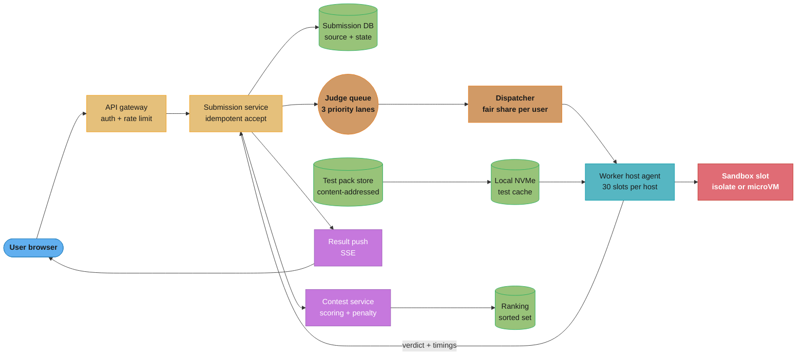
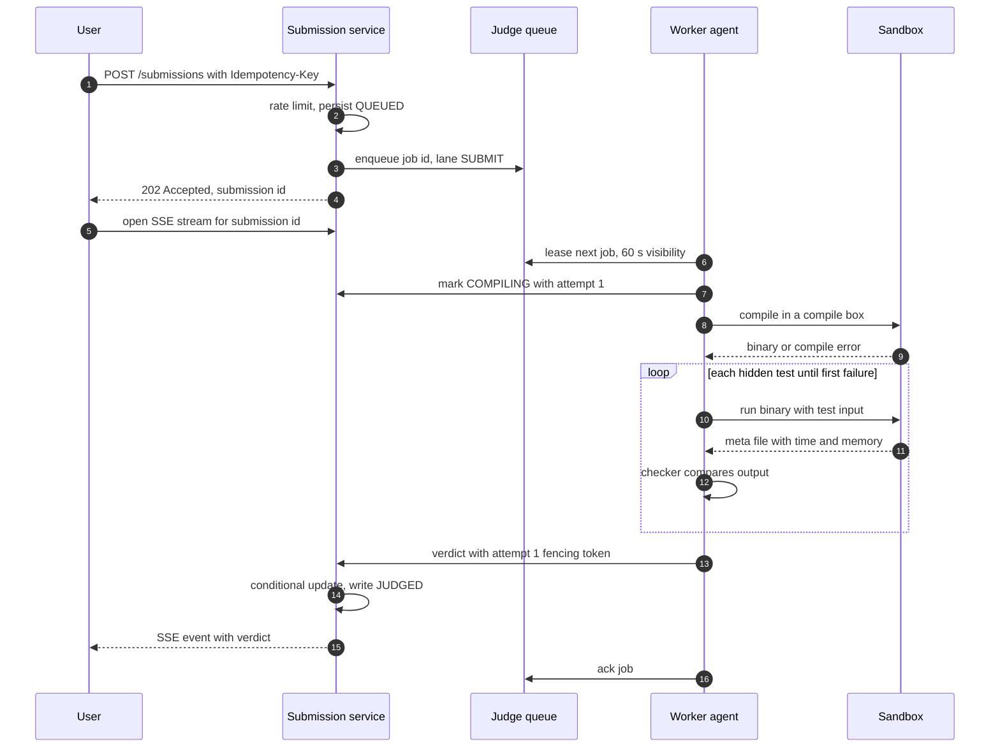
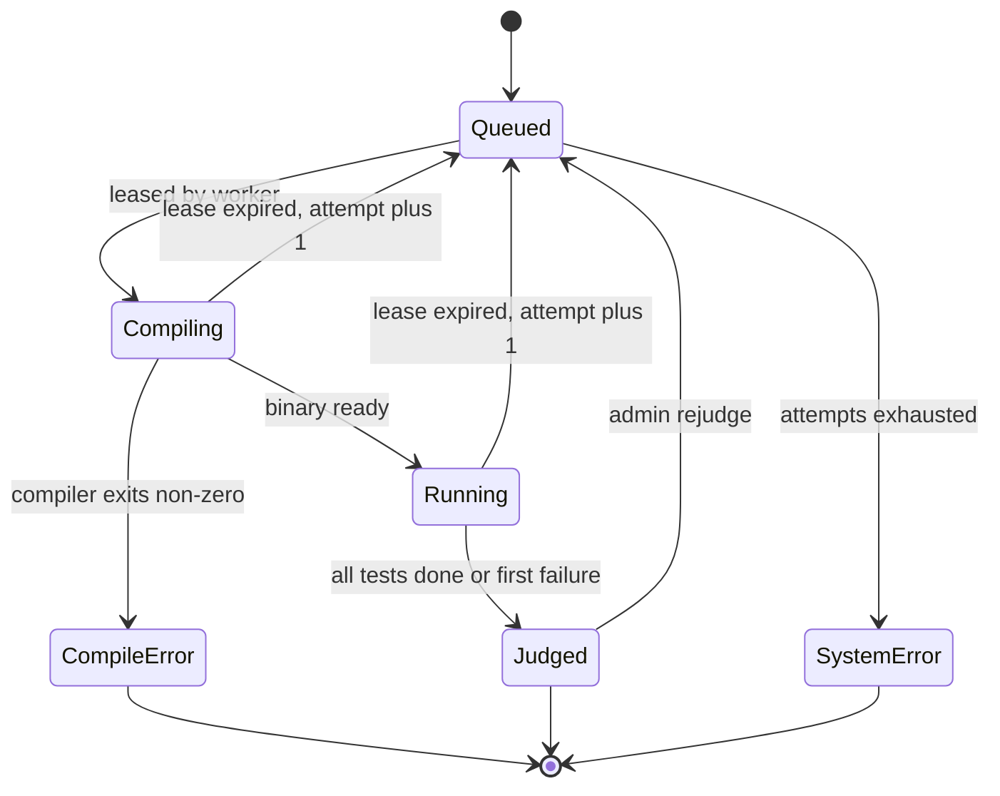
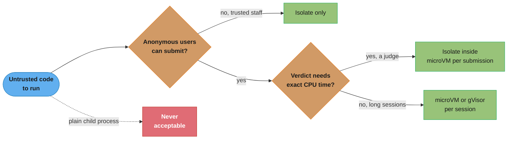

# System Design: Online Judge (LeetCode-Style Code Execution Platform)
## Intuition

> **Design intuition**: [`./design_distributed_job_scheduler.md`](./design_distributed_job_scheduler.md) runs jobs that the platform's own engineers wrote and trust. An online judge runs jobs that strangers wrote, and some of those strangers are trying to break out, read the hidden answers, or take the fleet down with a fork bomb. Every submission is a hostile program that must be compiled, run against dozens of hidden test cases, measured to the millisecond, and then thrown away. The queueing half of this design is a familiar job-scheduler problem. The other half, running hostile code so that it can neither escape nor lie about its own speed, is what makes the judge its own study.

**Key insight**: an online judge has two correctness contracts, and only one of them is about security. The first is **isolation**: user code must never touch the network, the host filesystem, the hidden test outputs, or another user's sandbox. The second is **measurement determinism**: the same source code submitted twice must get the same verdict. A judge that is perfectly secure but returns `Accepted` at 0.94 s and `Time Limit Exceeded` at 1.06 s for the same program under a 1.0 s limit is broken in a way users notice faster than an escape. Most of the hard engineering in §4 is about the second contract: dedicated cores, CPU time instead of wall time, frequency scaling turned off, and a re-run policy near the limit.

This study does not re-derive general job scheduling (leases, retries, fencing) from [`./design_distributed_job_scheduler.md`](./design_distributed_job_scheduler.md), the leaderboard data structure from [`./design_leaderboard.md`](./design_leaderboard.md), or the long-lived agent sandboxes in [`../../llm/agents_and_tool_use/sandboxed_code_execution.md`](../../llm/agents_and_tool_use/sandboxed_code_execution.md). An agent sandbox lives for minutes and cares about a rich environment. A judge sandbox lives for milliseconds, runs one binary against one input, and cares about a reproducible number.

---

## 1. Requirements Clarification

### Functional Requirements
- **Problem catalog**: each problem has a statement, a time limit, a memory limit, 2-3 public sample tests, and a hidden test pack (typically 20-100 cases, assumption) that is never shown to the user.
- **Run**: compile the user's code and run it against the sample tests or a custom input the user typed. Returns output and timing, no verdict. This is the high-volume, low-stakes path.
- **Submit**: compile and run against the full hidden test pack and return a verdict: `Accepted`, `Wrong Answer`, `Time Limit Exceeded`, `Memory Limit Exceeded`, `Runtime Error`, `Compile Error`, or `Output Limit Exceeded`. On failure, show the first failing test only if that test is public.
- **Multiple languages**: C++, Java, Python, Go, JavaScript, Rust and more (assumption: 20 languages), each with a pinned compiler or runtime version.
- **Custom checkers**: problems whose answers are not unique (any valid path, any permutation) or floating point (tolerance 1e-6) need a checker program instead of a byte diff. Interactive problems need the user program and a judge program talking over pipes.
- **Contests**: timed rounds with a live ranking, penalty time, a scoreboard freeze, and post-contest rejudge.
- **Submission history**: every submission, its source, its verdict and per-test timing, kept for the user and for plagiarism review.
- **Rejudge**: an admin can rerun every submission of a problem after a test-data or checker fix, without blocking new submissions.

### Non-Functional Requirements
- **Isolation is a correctness requirement, not hardening.** User code gets no network, no write access outside a small scratch directory, a bounded process count, bounded memory, bounded output, and no read access to the expected outputs. A single escape exposes every hidden test pack and the host.
- **Deterministic verdicts.** Re-submitting identical code must give the identical verdict in at least 99.9% of cases (assumption, the target this design sizes against). Timing noise has to be engineered out, not averaged out (§4.d).
- **Verdict latency.** Run: p95 under 3 s. Submit: p95 under 8 s outside contests, under 20 s during a contest peak (assumptions). Users wait at the screen, so these are product numbers.
- **Contest spikes are known in advance.** A round starts at a published time, and the last 10 minutes produce the heaviest submit rate (§2). Capacity is pre-provisioned, as in [`./design_flash_sale_ticketing.md`](./design_flash_sale_ticketing.md).
- **Fairness.** One user who clicks Run 50 times must not delay another user's submit. Contest submits must not wait behind practice runs.
- **Durability.** An accepted submission is never lost or silently re-graded to a different verdict without an audit record.
- **Hidden test confidentiality.** Test inputs and expected outputs never leave the judge workers and the test-data store.

### Out of Scope
- Problem authoring UI, editorial content, discussions, and payments.
- The browser code editor and its language servers.
- AI hint generation and AI code review: see [`../../llm/case_studies/design_ai_code_review.md`](../../llm/case_studies/design_ai_code_review.md).
- Long-running, stateful agent sandboxes: see [`../../llm/agents_and_tool_use/sandboxed_code_execution.md`](../../llm/agents_and_tool_use/sandboxed_code_execution.md).
- Deep plagiarism detection (token fingerprinting such as MOSS-style winnowing). §4.h names where it plugs in and stops there.

---

## 2. Scale Estimation

No online judge publishes its traffic, so every number below is an **assumption** chosen to be in a realistic range for a large practice-and-contest platform. The point of the section is the method, not the inputs.

### Daily Load
- **2M daily active users** (assumption).
- Each DAU does **4 Runs and 2 Submits** a day (assumption): 8M runs and 4M submits, **12M judge jobs a day**.
- Average: 12M / 86,400 s = **139 jobs/s** (93 runs/s, 46 submits/s).
- Diurnal peak factor 2.5 (assumption): **~231 runs/s and ~116 submits/s** at the daily peak.

### Contest Load
- **40,000 participants** in a 90-minute round with 4 problems (assumption).
- Opening burst: 30,000 solve the easy problem between minutes 3 and 12 and submit it 1.5 times each: 45,000 submits in 540 s = **83 submits/s**.
- Closing rush: 30% of the round's ~200,000 submits land in the last 10 minutes: 60,000 / 600 s = **100 submits/s**.
- Runs during a contest run at about 3 per submit (assumption): **~300 runs/s** on top of the daily peak.

### CPU Cost Per Job
Judge cost is CPU time, not requests. These are blended assumptions across languages:

| Step | Run | Submit |
|---|---|---|
| Compile (C++ `-O2`, Java `javac`; 0 for Python) | 0.6 core-s blended | 0.6 core-s blended |
| Execute tests | 3 samples x 0.05 s = 0.15 core-s | 60 tests x 0.035 s = 2.1 core-s |
| Sandbox setup and teardown per test | 3 x 0.015 s = 0.05 core-s | 60 x 0.015 s = 0.9 core-s |
| Early exit on first failure (40% of submits fail near test 20) | - | saves ~0.4 core-s blended |
| **Total** | **~0.8, round to 1.0 core-s** | **~3.2, round to 3.5 core-s** |

Rounding up is deliberate. A judge that runs out of cores does not degrade gracefully: queued jobs wait, and a job that waits too long makes the contest ranking look unfair.

### Core Demand
- **Daily peak**: 231 x 1.0 + 116 x 3.5 = 231 + 406 = **637 busy cores**.
- **Contest peak on top**: 100 x 3.5 + 300 x 1.0 = 350 + 300 = **650 more busy cores**, so **1,287 busy cores**.
- Judge cores run at **50% target utilization** in normal hours and **70% during contests** (assumption; §4.d explains why a judge cannot run hot like a web tier).
- Normal hours: 637 / 0.5 = **1,274 cores**. Contest: 1,287 / 0.7 = **1,839 cores**.
- With 32 physical cores per host, SMT off, 30 judge slots and 2 cores for the host agent: **43 hosts** normally, **62 hosts** during a contest.

### Storage
- Source code: 4M submits x 2 KB = **8 GB/day**, about **2.9 TB/year**. Run sources are kept 7 days only.
- Verdict and per-test timing rows: 12M x 300 B = **3.6 GB/day**.
- Test packs: 3,500 problems x 60 tests x 150 KB average = **31.5 GB** total. The hot set (current contest problems plus the 500 most-submitted problems) is about **4.5 GB**, small enough to sit on every worker's local NVMe.

### Latency Budget for One Submit (p50, assumption)

| Stage | Time |
|---|---|
| API accept, persist, enqueue | 30 ms |
| Queue wait at 50% utilization | 100-300 ms |
| Fetch test pack (cache hit) | 5 ms |
| Compile | 600 ms |
| 60 tests in a single slot, sequential | 3.0 s |
| Checker and verdict write | 50 ms |
| Push to client | 50 ms |
| **Total** | **~4 s** |

The test phase dominates. §4.d covers running tests of one submission across several slots in parallel, which cuts the 3 s but makes timing noise harder to control.

---

## 3. High-Level Architecture



**Read path versus write path.** The submission service is the only writer of submission state. Workers never write to the database directly. They return results to the submission service, which applies them with a fencing check (§4.b). This keeps the trust boundary simple: the worker host is the most exposed machine in the system (it runs hostile code), so it holds no database credentials.

**Trust zones.** The design has three zones, and the boundaries between them carry most of the security:

1. **Public zone**: API gateway, submission service, result push. Sees user identity and source code.
2. **Judge zone**: dispatcher and worker host agents. Sees source code, compiled binaries, and the hidden test packs. Has no route to the user database and no outbound internet access.
3. **Sandbox zone**: one slot per running test. Sees one input file and the binary. Has no network namespace with a route anywhere, and no view of the expected output.

### Submission Lifecycle



### Submission State Machine



`SystemError` is a verdict the user sees as "Judge error, resubmitted automatically" or "Judge error, please retry". It must never be reported as `Runtime Error`. A sandbox internal failure (isolate status `XX`, §4.c) is the platform's fault, not the user's.

---

## 4. Component Deep Dives

### (a) Submission Intake: Idempotency and Rate Limits

Two failure modes hit the intake path every day. A user double-clicks Submit, or the browser retries a `POST` after a network blip. Without an idempotency key, each retry becomes a new submission, costs another 3.5 core-seconds, and, in a contest, can add a wrong-answer penalty for a submission the user only made once.

```java
public final class SubmissionService {
    private static final Duration KEY_TTL = Duration.ofHours(24);
    private final SubmissionRepository repo;
    private final JudgeQueue queue;
    private final RateLimiter limiter;   // token bucket per (userId, lane)

    public SubmissionId accept(UserId user, String idempotencyKey, SubmitRequest req) {
        // 1. Replay: the same key returns the same submission, never a new one.
        Optional<SubmissionId> existing = repo.findByIdempotencyKey(user, idempotencyKey);
        if (existing.isPresent()) {
            return existing.get();
        }
        // 2. Rate limit per lane. Runs: 10 per minute. Submits: 6 per minute.
        Lane lane = req.isContest() ? Lane.CONTEST : (req.isRun() ? Lane.RUN : Lane.SUBMIT);
        if (!limiter.tryAcquire(user, lane)) {
            throw new TooManyRequests(lane.retryAfter());
        }
        // 3. Size guard before anything is stored or compiled.
        if (req.sourceBytes() > 64 * 1024) {
            throw new PayloadTooLarge("source over 64 KB");
        }
        // 4. Persist first, enqueue second. The unique index on
        //    (user_id, idempotency_key) makes a concurrent duplicate fail here.
        SubmissionId id = repo.insertQueued(user, idempotencyKey, req, KEY_TTL);
        queue.enqueue(new JudgeJob(id, lane, req.problemId(), req.language(), 1));
        return id;
    }
}
```

**Persist, then enqueue.** If the process dies between the insert and the enqueue, the submission sits in `QUEUED` with no job. A sweeper finds `QUEUED` rows older than 30 s with no live lease and re-enqueues them. The opposite order (enqueue first) can produce a job whose row does not exist yet, and a worker that picks it up has nothing to update. The general pattern is the transactional outbox in [`../distributed_transactions/distributed_transactions.md`](../distributed_transactions/distributed_transactions.md). A sweeper is the cheap version of it and is enough here, because a duplicate enqueue is harmless (§4.b fences it).

**Rate limits are per lane.** A user who spams Run must not burn their Submit budget, and the reverse. The limiter is a token bucket per `(user, lane)` from [`../rate_limiting/rate_limiting.md`](../rate_limiting/rate_limiting.md). The 64 KB source cap stops a cheap attack: a 50 MB "source file" that is mostly a comment still has to be stored, hashed, and shipped to a worker.

### (b) The Judge Queue: Lanes, Fairness and Fencing

A single FIFO queue fails in two ways that §9 War Story 3 describes in detail. Practice Runs crowd out contest Submits at the start of a round. And one user with a script can fill the queue in front of everyone else. The fix is three lanes plus a per-user cap on jobs in flight.

| Lane | Weight | Per-user in-flight cap | Why |
|---|---|---|---|
| `CONTEST` | 6 | 2 | Ranking fairness depends on contest verdict latency |
| `SUBMIT` | 3 | 2 | The verdict is what the user came for |
| `RUN` | 1 | 1 | High volume, low stakes, cheapest to shed |

```java
public final class FairDispatcher {
    private final Map<Lane, Deque<JudgeJob>> lanes = new EnumMap<>(Lane.class);
    private final Map<UserId, Integer> inFlight = new ConcurrentHashMap<>();
    private final int[] weights = {6, 3, 1};           // CONTEST, SUBMIT, RUN
    private int cursor = 0;
    private int creditsLeft = weights[0];

    /** Weighted round robin across lanes, skipping users already at their cap. */
    public synchronized Optional<JudgeJob> next() {
        for (int scanned = 0; scanned < Lane.values().length; scanned++) {
            Lane lane = Lane.values()[cursor];
            Optional<JudgeJob> job = pollEligible(lanes.get(lane), lane);
            if (job.isPresent()) {
                if (--creditsLeft == 0) {
                    advance();
                }
                return job;
            }
            advance();  // empty or blocked lane gives its turn away
        }
        return Optional.empty();
    }

    private Optional<JudgeJob> pollEligible(Deque<JudgeJob> q, Lane lane) {
        for (Iterator<JudgeJob> it = q.iterator(); it.hasNext(); ) {
            JudgeJob j = it.next();
            if (inFlight.getOrDefault(j.user(), 0) < lane.perUserCap()) {
                it.remove();
                inFlight.merge(j.user(), 1, Integer::sum);
                return Optional.of(j);
            }
        }
        return Optional.empty();
    }

    public void onFinished(JudgeJob j) {
        inFlight.merge(j.user(), -1, Integer::sum);
    }

    private void advance() {
        cursor = (cursor + 1) % weights.length;
        creditsLeft = weights[cursor];
    }
}
```

The scan in `pollEligible` is linear, which is fine for a dispatcher that holds a few thousand jobs per partition. At larger depth, keep one sub-queue per user and a round-robin ring of users with work, which is the deficit round robin shape. Either way the dispatcher is partitioned by `problemId` hash across a few instances, so no single process holds the whole backlog.

**At-least-once delivery, exactly-once verdict.** A worker leases a job with a 60 s visibility timeout. If the worker host dies, the lease expires and another worker gets the job with `attempt + 1`. Now two workers may both finish the same submission: the dead one was only slow. The submission service accepts a result only for the current attempt:

```sql
-- Fenced verdict write. A late result from attempt 1 cannot overwrite attempt 2.
UPDATE submissions
   SET state = 'JUDGED',
       verdict = :verdict,
       max_time_ms = :maxTimeMs,
       max_memory_kb = :maxMemoryKb,
       judged_at = now()
 WHERE id = :submissionId
   AND attempt = :attempt
   AND state IN ('COMPILING', 'RUNNING');
-- 0 rows updated means a newer attempt owns the submission: drop this result.
```

This is the fencing-token pattern from [`../coordination_and_contention/coordination_and_contention.md`](../coordination_and_contention/coordination_and_contention.md). The attempt number is the token. After 3 attempts the job moves to `SystemError` and an alert fires, because three worker deaths on one submission usually means the submission itself kills workers (a kernel bug trigger, or a sandbox escape attempt), and it needs a human.

### (c) The Sandbox: Isolation Layers, Broken Then Fixed

The obvious first implementation runs the user's binary as a child process with a timeout.

***Broken:*** a plain child process with a wall-clock timeout.

```java
// BROKEN -- runs untrusted code as a normal child process of the worker
public final class NaiveRunner {
    public RunResult run(Path binary, Path inputFile, Duration limit) throws Exception {
        Process p = new ProcessBuilder(binary.toString())
                .redirectInput(inputFile.toFile())
                .redirectErrorStream(true)
                .start();
        boolean finished = p.waitFor(limit.toMillis(), TimeUnit.MILLISECONDS);
        if (!finished) {
            p.destroyForcibly();                     // kills the parent only
            return RunResult.timeLimitExceeded();
        }
        byte[] out = p.getInputStream().readAllBytes(); // unbounded read
        return RunResult.of(p.exitValue(), out);
    }
}
```

Every line of this is exploitable or unmeasurable:

- **Network.** The program can open a socket and send the test input to a server the attacker controls. After 60 submissions on a problem, the attacker has the whole hidden pack.
- **Filesystem.** The program runs as the worker's user. It can read `/judge/tests/<problem>/*.out`, the expected outputs, and print the right answer.
- **Fork bomb.** `while(1) fork();` fills the host process table. `destroyForcibly()` kills only the direct child. The grandchildren keep running and take down every other slot on the host.
- **Memory.** There is no limit. A program that allocates 60 GB pushes the host into swap or the host OOM killer, which may kill the worker agent instead of the user program.
- **Output.** `readAllBytes()` on a program that prints in an infinite loop fills the worker's heap.
- **Time.** `waitFor` measures wall time. A program that is descheduled by a noisy neighbour gets `TLE`. A program that sleeps uses no CPU but holds the slot.

***Fixed:*** launch the binary through a sandbox manager that puts it in fresh namespaces and a cgroup, and read the result from the manager's meta file. This example uses Isolate, the sandbox built for programming contests and used by the CMS contest system (§6). The flags below are from the Isolate manual.

```java
// FIXED -- every limit is enforced by the kernel, not by the worker's patience
public final class IsolateRunner {
    private final int boxId;   // one box per judge slot, so 30 boxes per host

    public RunResult run(Path binaryInBox, Limits lim) throws Exception {
        List<String> cmd = List.of(
            "isolate", "--box-id=" + boxId,
            "--cg",                                         // cgroup v2 mode
            "--cg-mem=" + lim.memoryKb(),                   // whole-group memory cap, KB
            "--time=" + lim.cpuSeconds(),                   // CPU time limit
            "--extra-time=0.5",                             // report real time a bit past the limit
            "--wall-time=" + (lim.cpuSeconds() * 3 + 1),    // catches sleep() and blocked reads
            "--processes=" + lim.maxProcesses(),            // 1 for C++, 64 for JVM threads
            "--fsize=" + lim.outputKb(),                    // each file the program writes
            "--stdin=input.txt", "--stdout=output.txt",
            "--meta=" + metaPath(),
            "--run", "--", binaryInBox.toString());
        Process p = new ProcessBuilder(cmd).redirectErrorStream(true).start();
        p.getInputStream().transferTo(OutputStream.nullOutputStream()); // status line only
        int rc = p.waitFor();
        Map<String, String> meta = MetaFile.parse(metaPath());  // key:value lines
        if (rc > 1 || "XX".equals(meta.get("status"))) {
            return RunResult.systemError(meta.get("message"));   // the sandbox failed, not the user
        }
        return RunResult.fromMeta(meta);
    }
}
```

What each piece buys, per the Isolate manual:

| Threat | Mechanism | Isolate behaviour |
|---|---|---|
| Network exfiltration | New network namespace | "contains no network devices except for a per-namespace loopback"; `--share-net` is the opt-out, never used here |
| Reading expected outputs | Mount namespace, box directory as root | Only the box directory and listed `--dir` mounts are visible; expected outputs are never mounted |
| Fork bomb | `--processes` | Default is 1 process; past the limit, process creation fails with `EAGAIN` |
| Memory bomb | `--cg` plus `--cg-mem` | Whole cgroup is capped; `cg-oom-killed` in the meta file when the OOM killer fires |
| Output flood | `--fsize` | Writes past the cap fail with `EFBIG` and the program gets `SIGXFSZ` |
| CPU hog | `--time` | Counts CPU time only; the program is killed past the limit (after `--extra-time`) |
| Sleep or blocked read | `--wall-time` | Wall-clock limit, set "to a much higher value" than `--time`, as the manual recommends |

The kernel enforces all of these, so a program cannot dodge them by forking or by ignoring signals. Underneath, the same cgroup v2 files are available to any sandbox: `memory.max` (hard limit, OOM killer invoked in the cgroup when reached), `memory.peak` (the highest usage recorded), `pids.max` (hard limit on processes), and `cpu.max` (`$MAX $PERIOD`, default `max 100000`), all documented in the kernel's cgroup v2 guide.

**Layered isolation.** Namespaces and cgroups share one kernel with the host. A kernel bug reachable from inside the sandbox is a host compromise. So production judges stack layers, and the outer layer is chosen by threat model:

```
   Strongest  +-------------------------------------------------------------+
              | microVM (Firecracker): own guest kernel, KVM boundary        |
              |   +-----------------------------------------------------+   |
              |   | user-space kernel (gVisor runsc): syscalls served   |   |
              |   | by a Go kernel, not the host                        |   |
              |   |   +---------------------------------------------+   |   |
              |   |   | namespaces + cgroup v2 + seccomp (Isolate)  |   |   |
              |   |   |   +-------------------------------------+   |   |   |
              |   |   |   | user binary, 1 input, 1 output      |   |   |   |
              |   |   |   +-------------------------------------+   |   |   |
              |   |   +---------------------------------------------+   |   |
              |   +-----------------------------------------------------+   |
   Weakest    +-------------------------------------------------------------+
```

*Each ring is a separate escape an attacker must chain. The inner ring (Isolate) gives the exact time and memory numbers the verdict needs, the outer rings protect the host kernel. Most judges run one or two rings, not all three, because each ring adds start-up cost (§5).*

**Per-language limits.** One set of flags does not fit every runtime. The values below are this design's assumptions; the point is which knob each runtime needs to move.

| Language | `--processes` | Memory limit source | Extra flags | Why |
|---|---|---|---|---|
| C, C++, Rust | 1 | cgroup, problem limit | none | Single-threaded binary, the strictest box |
| Java | 64 | cgroup, problem limit + 64 MB | `-Xss` sized for deep recursion, `-XX:+UseSerialGC` | JVM threads for GC and JIT; serial GC keeps CPU time single-core |
| Go | 32 | cgroup, problem limit + 32 MB | `GOMAXPROCS=1` | Runtime threads; one P keeps CPU time comparable to C++ |
| Python | 1 | cgroup, problem limit | `-S` to skip site imports | Interpreter start-up is the main fixed cost |
| JavaScript (Node) | 16 | cgroup, problem limit + 64 MB | `--max-old-space-size` below the cgroup limit | V8 helper threads; heap cap so V8 fails before the OOM killer |

The pattern: managed runtimes need more processes (their own helper threads) and a little memory slack, and every runtime with a parallel garbage collector is pinned to one core so that "CPU time" means the same thing it means for C++. Without `GOMAXPROCS=1` or a serial collector, a Go or Java program uses 2-4 cores of CPU time for 1 core of wall time, and a CPU-time limit punishes it for work the user did not write.

**Seccomp inside the namespace ring.** Isolate's manual notes that it does not, in general, limit which operations the program performs; it places the process in namespaces so the objects it can reach are restricted ("it is allowed to create network sockets, but there is nowhere else to connect them to"). A judge adds a seccomp-bpf profile per language on top, which removes kernel attack surface rather than reachable objects: a C++ solution that reads stdin and writes stdout needs a few dozen system calls, not several hundred. A violation kills the program and is reported as `Runtime Error (restricted system call)`, never silently ignored, so a legitimate solution that trips the filter is visible in metrics and the profile can be fixed.

### (i) Worker Host Agent and Slot Lifecycle

The worker host agent is the only long-lived process on a judge host. It leases jobs, prepares boxes, runs the compile and test steps, and reports results. It runs outside every box and holds no database credentials (§3).

| Slot state | Entered when | Leaves when |
|---|---|---|
| `IDLE` | Box cleaned, core verified quiet | Agent leases a job |
| `PREPARING` | Job leased; binary and input copied in | Box ready |
| `RUNNING` | Sandbox manager started | Meta file written |
| `CLEANING` | Run finished | Box directory and cgroup removed |
| `QUARANTINED` | Cleanup failed, or 3 consecutive `XX` statuses | Operator or host replacement |

Three rules keep the agent safe:

1. **Cleanup is verified, not assumed.** After every run the agent checks that the cgroup has no processes left (`pids.current` is 0) and the box directory is empty. A slot that fails the check is quarantined rather than reused, because a surviving process from the last user is exactly the cross-test leak §5 forbids.
2. **The agent never reads unbounded data from a box.** Output files are opened with a size check against `--fsize`, and the checker streams tokens rather than loading the file.
3. **Drain before maintenance.** A host leaving the pool stops leasing, lets running jobs finish (at most the wall limit of the longest problem), then exits. Killing the agent mid-job only costs a lease timeout and a retry (§4.b), but in a contest that retry adds 60 s to a participant's verdict.

### (d) Measuring Time and Memory So Verdicts Repeat

The verdict depends on two numbers, CPU time and peak memory, compared against limits. The engineering problem is that both numbers vary between runs of the same binary on the same input, and a variance of a few percent turns into flipped verdicts for any program close to the limit.

**Sources of timing noise and their fixes.** The Isolate manual's REPRODUCIBILITY section lists the kernel settings; the right-hand column is that list applied to a judge fleet.

| Noise source | Effect | Fix |
|---|---|---|
| Dynamic frequency scaling | Same code runs slower on a cold core | cpufreq governor set to `performance` |
| Turbo or boost | Speed depends on how many other cores are busy | Disable boost (`intel_pstate/no_turbo` or `cpufreq/boost`) |
| Task migration between cores | Cache refill cost on each migration | Pin each slot to one core |
| SMT sibling sharing a core | A neighbour on the same physical core steals cycles | SMT off, or never schedule two slots on sibling threads |
| P-cores and E-cores on one CPU | Same program, different speed per core type | Pin to a homogeneous subset of cores |
| Address space randomization | Different cache and TLB behaviour per run | `kernel.randomize_va_space=0` on judge hosts |
| Transparent huge pages | Memory compaction pauses | THP to `madvise` or `never` |
| Swap | Memory limit no longer a hard wall | Swap off, or cgroup swap accounting with `memory.swap.max` at 0 |

**CPU time, not wall time, is the limit.** CPU time does not count time the program spent waiting for the CPU, so a busy host does not turn a fast program into a `TLE`. Wall time is still enforced, at about 3x the CPU limit plus 1 s, only to catch programs that sleep or block on input.

**Calibrate each hardware class.** A fleet always contains more than one CPU model. The judge keeps a calibration set per problem (the reference solution plus a deliberately slow solution) and runs it on every new host class. If the reference solution's CPU time on the new class differs from the baseline class by more than 5% (assumption), either the host class gets its own time multiplier or it is kept out of the contest pool. The alternative, letting the limit mean different things on different hosts, is what users call "the judge is unfair".

**Re-run near the boundary.** A program whose measured CPU time lands within 10% of the limit (either side) is re-run up to 2 more times, and the verdict uses the minimum time. The minimum is the right statistic because noise only ever adds time: nothing makes a deterministic program run faster than its true cost.

```java
public final class VerdictPolicy {
    private static final double BOUNDARY_BAND = 0.10;  // re-run inside +/- 10% of the limit
    private static final int MAX_EXTRA_RUNS = 2;

    public TestResult judgeTest(Runner runner, TestCase tc, Limits lim) throws Exception {
        RunResult best = runner.run(tc, lim);
        int extra = 0;
        while (extra < MAX_EXTRA_RUNS && nearLimit(best, lim)) {
            RunResult again = runner.run(tc, lim);
            if (again.cpuMillis() < best.cpuMillis()) {
                best = again;                            // noise only adds time
            }
            extra++;
        }
        return classify(best, lim);
    }

    private boolean nearLimit(RunResult r, Limits lim) {
        double ratio = (double) r.cpuMillis() / lim.cpuMillis();
        return ratio > 1.0 - BOUNDARY_BAND && ratio < 1.0 + BOUNDARY_BAND;
    }

    private TestResult classify(RunResult r, Limits lim) {
        if (r.isSystemError())                    return TestResult.SYSTEM_ERROR;
        if (r.oomKilled())                        return TestResult.MEMORY_LIMIT;
        if (r.cpuMillis() > lim.cpuMillis())      return TestResult.TIME_LIMIT;
        if (r.wallTimedOut())                     return TestResult.TIME_LIMIT;
        if (r.outputTruncated())                  return TestResult.OUTPUT_LIMIT;
        if (r.exitSignal() != 0 || r.exitCode() != 0) return TestResult.RUNTIME_ERROR;
        return TestResult.RAN_OK;                 // the checker decides AC or WA
    }
}
```

The order inside `classify` is deliberate. A program killed by the OOM killer also exits on a signal, so the memory check must come before the runtime-error check, or every `MLE` is reported as `RE`. The extra runs cost little: only the small fraction of tests near the limit are re-run, so the fleet-wide overhead is a few percent (assumption).

**Language multipliers.** A 1 s limit that suits C++ is unfair to Python. Platforms choose between per-language limits (the problem setter sets a Python limit explicitly) and a multiplier (Java x2, Python x5, assumptions). Per-language limits are more honest because the ratio between languages differs per problem. The JVM adds one more trap: start-up and JIT warm-up cost 100+ ms before `main` runs (assumption), so the JVM's start-up is measured once per host class and either subtracted or included consistently.

**Memory: peak, not final.** The memory verdict uses the cgroup's peak usage (`memory.peak`, or Isolate's `cg-mem`), not the usage when the program exits, because a program that allocates 900 MB and frees it before exit still exceeded a 512 MB limit. Isolate's `--mem` (address space) is the wrong tool for managed runtimes: the JVM and Go reserve large virtual ranges they never touch, so an address-space limit kills them at start-up. Use the cgroup limit for those.

**Parallel tests, carefully.** Spreading the 60 tests of one submission over 4 slots cuts the test phase from 3 s to under 1 s. It is safe only if each slot is a pinned physical core with no SMT sibling in use, because otherwise the four tests of one submission become each other's noisy neighbours. This design runs tests in parallel during normal hours and sequentially within a slot during contests, where verdict stability matters more than latency.

### (e) Compilation as a Separate Sandboxed Step

Compilation is untrusted code execution too. A compiler is a large program fed hostile input:

- C++ template recursion or `constexpr` loops can make the compiler run for minutes and use gigabytes.
- `#include "/dev/zero"` or `#include "/dev/random"` makes the preprocessor read forever.
- A compiler bug can crash the compiler.

So compilation runs in its own box with its own limits: 10 s CPU, 30 s wall, 2 GB memory, 64 processes (the compiler forks its sub-processes), 16 MB output binary (assumptions). The box sees the toolchain as a read-only mount and the source file, nothing else. A compile timeout is reported as `Compile Error: compilation timed out`, not as a system error.

**Compiled-artifact cache.** Many submissions are byte-identical (copied editorial solutions, resubmissions after a judge error). Cache the binary keyed by `sha256(source) + language + toolchain image digest`. The toolchain digest belongs in the key: upgrading GCC must not serve a binary built by the old one. Expect a modest hit rate (assumption: 5-10%); the larger win is rejudges, where every submission of a problem is recompiled otherwise.

**Interpreted languages.** Python and JavaScript skip the compile step but pay interpreter start-up on every test (30-50 ms, assumption). A warm pool of pre-started interpreter boxes that `exec` the user code is tempting, but a warm process can carry state from the previous user. Each test therefore starts a fresh interpreter in a fresh box, and the start-up time is measured per host class and folded into the per-language limit.

### (f) Test Data Distribution and Checkers

**Content-addressed test packs.** A test pack is stored as a tarball named by its SHA-256 hash, and each problem version points to one hash. A worker fetches a pack once into its local NVMe cache and verifies the hash. Updating a test means publishing a new pack with a new hash and moving the problem's pointer, so a worker can never mix old inputs with new expected outputs. The cache is LRU over the ~4.5 GB hot set from §2.

**Expected outputs stay outside the box.** The sandbox gets `input.txt` only. After the run, the worker's checker reads the program's `output.txt` from the box directory and compares it with the expected output from the cache. The expected output is never mounted into the box, not even read-only.

**Three checker kinds.**

| Checker | Use | Cost |
|---|---|---|
| Token compare | Default: compare whitespace-separated tokens, ignore trailing spaces and final newline | Cheap, runs in the worker |
| Float tolerance | Absolute or relative error at most 1e-6 per token | Cheap, runs in the worker |
| Special judge | Problem-specific program (any valid path, any valid permutation) | Runs in its own sandbox, because problem setters make mistakes too |

```java
public final class TokenChecker implements Checker {
    private final double epsilon;   // 0 for exact problems, 1e-6 for float problems

    @Override
    public CheckResult check(Path expected, Path actual) throws IOException {
        try (Scanner exp = new Scanner(expected); Scanner act = new Scanner(actual)) {
            int token = 0;
            while (exp.hasNext()) {
                if (!act.hasNext()) {
                    return CheckResult.wrong("output ended early at token " + token);
                }
                String e = exp.next();
                String a = act.next();
                if (!tokensEqual(e, a)) {
                    return CheckResult.wrong("mismatch at token " + token);
                }
                token++;
            }
            return act.hasNext() ? CheckResult.wrong("extra output") : CheckResult.ok();
        }
    }

    private boolean tokensEqual(String e, String a) {
        if (e.equals(a)) return true;
        if (epsilon == 0) return false;
        try {
            double x = Double.parseDouble(e);
            double y = Double.parseDouble(a);
            if (Double.isNaN(y) || Double.isInfinite(y)) return false;   // NaN never matches
            double diff = Math.abs(x - y);
            return diff <= epsilon || diff <= epsilon * Math.abs(x);
        } catch (NumberFormatException ex) {
            return false;
        }
    }
}
```

The `NaN` line closes a real class of bug. In IEEE 754 every comparison with `NaN` is false, so a checker written as `if (diff > epsilon) return wrong` accepts a program that prints `nan` for every answer. §9 War Story 4 is this bug.

The checker's failure message mentions the token index only. It never echoes the expected token, because that string is shown to the user on a failed public sample and is easy to leak by accident on a hidden test.

**Interactive problems.** The user program and a judge-side interactor run in two separate boxes connected by two pipes. The interactor's own CPU time is not charged to the user. Both processes share a wall-time limit, because a deadlock (each waiting for the other) shows up only as wall time.

### (g) Delivering the Verdict

A submit takes 4-20 s (§2). Clients learn the result one of three ways:

| Option | Cost at 350 jobs/s peak | Verdict delay | Verdict |
|---|---|---|---|
| Short polling every 1 s | ~4 polls per job, so 1,400 req/s of mostly empty answers | up to 1 s | Simple, wasteful |
| Long polling | 1 held request per waiting client | near zero | Fine, awkward behind some proxies |
| Server-Sent Events | 1 stream per waiting client, a few events per job | near zero | Chosen |

SSE wins because the stream is one-directional (server to client), carries 3-4 events per job (`QUEUED`, `RUNNING test 17/60`, verdict), and reconnects with `Last-Event-ID` after a blip. The trade-offs are the ones in [`../realtime_updates/realtime_updates.md`](../realtime_updates/realtime_updates.md). The push tier subscribes to verdict events by submission id. It does not read the database on every event. A client that reconnects after the verdict was written gets it from the submission row, which is why the row, not the event, is the source of truth.

### (h) Contest Mode, Ranking and Rejudge

**Scoring.** ICPC-style scoring ranks by problems solved, then by penalty time: the minutes from contest start to each accepted submission plus a fixed penalty (commonly 20 minutes, assumption) per rejected submission before it. `Compile Error` and `SystemError` usually do not add penalty. The penalty rule is the reason idempotent intake (§4.a) matters: a duplicate submit created by a retry would add 20 minutes the user did not earn.

**Ranking structure.** The live ranking is a sorted set keyed by a composite score (`solved * 10^7 - penaltyMinutes`), updated on every `JUDGED` event. The data structure, its sharding, and the read-path caching are those of [`./design_leaderboard.md`](./design_leaderboard.md), not re-derived here. The scoreboard freeze (hide changes in the last hour) is a read-path filter: the contest service keeps updating the real ranking and serves a snapshot taken at freeze time.

**Rejudge.** A rejudge enqueues every submission of a problem into a fourth lane, `REJUDGE`, with a weight below `RUN`, so a rejudge of 200,000 old submissions never delays live traffic. A rejudge writes a new verdict row linked to the old one rather than overwriting, so a user can see "Accepted, changed to Wrong Answer by rejudge on <date>" and the audit trail survives.

**Plagiarism hook.** After a contest, accepted sources per problem go through a similarity job (token fingerprints). It runs offline from the submission store and never sits on the verdict path.

---

## 5. Design Decisions & Tradeoffs

### Isolation Technology

| Option | Start-up | Escape boundary | Timing accuracy | When to choose |
|---|---|---|---|---|
| Plain process plus rlimits | ~1 ms | None worth the name | Good | Never for untrusted code |
| Isolate (namespaces, cgroup v2) | ~10-20 ms (assumption) | Host kernel | Best: direct CPU accounting | Contest judges; the default inner ring |
| Docker or runc container | ~100s of ms (assumption) | Host kernel, plus a large runtime | Good if pinned | Familiar tooling; see §9 War Story 1 for the runtime's own CVEs |
| gVisor `runsc` | Fast (process-like, per gVisor docs) | User-space Go kernel | Syscall-heavy code slows down | Syscall surface is the main fear |
| Firecracker microVM | `<= 125 ms` to guest `/sbin/init` (Firecracker spec) | KVM, separate guest kernel | Good with pinned vCPUs | Strongest boundary; run many tests inside one VM to amortize boot |



The working answer: Isolate as the measuring ring, inside a Firecracker microVM per submission (not per test) as the escape ring. One VM boot (125 ms or less, per the Firecracker specification) is paid once per submission and amortized over 60 tests; Isolate inside the guest still gives per-test limits and timing.

### Per-Test Box Versus Per-Submission Box

| | Fresh box per test | One box reused across tests |
|---|---|---|
| Cross-test leakage | None | A program can write a file in test 1 and read it in test 2 to cache answers |
| Cost | ~15 ms setup per test (assumption) | Paid once |
| Decision | Chosen | Rejected: the leakage turns "too slow" solutions into accepted ones |

### Early Exit Versus Run All Tests

| | Stop at first failure | Run every test |
|---|---|---|
| CPU cost on failing submits | Saves the remaining tests | Full cost |
| Information to the user | First failing test only | Pass count, partial score |
| Fits | Practice mode, ICPC-style contests | IOI-style subtasks with partial scoring |

Both are needed. The problem definition carries a flag, so the judge does not guess.

### Dedicated Cores Versus Shared Cloud vCPUs

A cloud vCPU is often one hyperthread of a physical core shared with an unknown neighbour. That neighbour is invisible noise in the time measurement. Judge pools use bare-metal or dedicated-host instances with SMT disabled, at a higher price per core, because the alternative is non-repeatable verdicts. Compile boxes and Run (no verdict) jobs can use cheaper shared capacity: their timing is informational.

### Push Versus Poll for Verdicts
Covered in §4.g. SSE, with the submission row as the source of truth for reconnects.

---

## 6. Real-World Implementations

- **Isolate and CMS.** Isolate is "a sandbox built to safely run untrusted executables, like programs submitted by competitors in a programming contest". It uses Linux namespaces and control groups, was developed by Martin Mares and Bernard Blackham, and is used most prominently by CMS (source: [Isolate README](https://github.com/ioi/isolate)). CMS, the Contest Management System, "has been explicitly build to be used in the 2012 International Olympiad in Informatics, held in September 2012 in Italy" (source: [CMS README](https://github.com/cms-dev/cms)). The Isolate manual's reproducibility checklist (performance governor, no boost, pinned cores, no ASLR, no THP, no swap) is the basis of §4.d (source: [Isolate manual](https://github.com/ioi/isolate/blob/master/isolate.1.txt)).
- **Judge0.** An open-source online code execution system, established in August 2016, with "support for 90+ languages", sandboxed compilation and execution, per-submission time and memory limits, and webhooks for results. Its architecture is described in the IEEE paper "Robust and Scalable Online Code Execution System" (source: [Judge0 README](https://github.com/judge0/judge0)). Many smaller practice and assessment platforms embed Judge0 rather than build the judge layer.
- **Firecracker.** Built at AWS "to accelerate the speed and efficiency of services like AWS Lambda and AWS Fargate". Its specification commits to a VMM memory overhead of `<= 5 MiB` and `<= 125 ms` from the InstanceStart API call to the guest's `/sbin/init`, for a 1 vCPU, 128 MiB microVM, enforced by integration tests (sources: [Firecracker README](https://github.com/firecracker-microvm/firecracker), [Firecracker SPECIFICATION.md](https://github.com/firecracker-microvm/firecracker/blob/main/SPECIFICATION.md)).
- **gVisor.** "An application kernel that implements a Linux-like interface", written in Go and running in user space, with an OCI runtime `runsc` for Docker and Kubernetes. Its docs state it is "not a syscall filter" and "not a VM", but a third approach (source: [gVisor docs](https://gvisor.dev/docs/)).
- **AI code-execution sandboxes** use the same building blocks (Firecracker, gVisor) for a different job: long-lived, stateful environments for agents. The vendors and their trade-offs are in [`../../llm/agents_and_tool_use/sandboxed_code_execution.md`](../../llm/agents_and_tool_use/sandboxed_code_execution.md).
- **LeetCode, Codeforces, HackerRank** do not publish judge architecture or traffic numbers. Every LeetCode-scale number in §2 is an assumption, and an interview answer should say so rather than quote a figure from memory.

---

## 7. Technologies & Tools

| Component | Technology | Why |
|---|---|---|
| Sandbox, measuring ring | Isolate (namespaces, cgroup v2) | Exact CPU time and peak memory, per-test limits, contest-proven |
| Sandbox, escape ring | Firecracker microVM, or gVisor `runsc` | Second boundary against host-kernel exploits |
| Resource limits | Linux cgroup v2 (`memory.max`, `memory.peak`, `pids.max`, `cpu.max`) | Kernel-enforced, cover every process in the box |
| Syscall filter | seccomp-bpf profile per language | Cuts kernel attack surface inside the namespace ring |
| Toolchains | One pinned, read-only image per language version | Reproducible builds; image digest in the artifact cache key |
| Judge queue | Kafka or a Redis-backed queue with leases | Partitioned lanes; see [`../message_queues/message_queues.md`](../message_queues/message_queues.md) |
| Submission store | PostgreSQL, partitioned by month | Conditional updates for fencing (§4.b) |
| Source and artifact store | Object storage | Cheap, immutable, content-addressed |
| Test pack store | Object storage plus local NVMe LRU cache | Hidden data stays in the judge zone |
| Verdict push | Server-Sent Events | One-way, resumable (§4.g) |
| Contest ranking | Redis sorted set | See [`./design_leaderboard.md`](./design_leaderboard.md) |
| Rate limiting | Token bucket per user and lane | See [`../rate_limiting/rate_limiting.md`](../rate_limiting/rate_limiting.md) |
| Judge hosts | Bare metal or dedicated hosts, SMT off | Timing determinism (§4.d) |
| Observability | Per-host-class CPU-time histograms of reference solutions | Detects timing drift before users do |

---

## 8. Operational Playbook

### Before a Contest
1. **T-24h**: freeze the test packs and checkers of the contest problems. Run every reference and every known-slow solution on every host class in the contest pool. Any class whose reference time differs from baseline by more than 5% leaves the pool.
2. **T-2h**: scale the judge pool to the contest number from §2 (62 hosts for a 40,000-person round). Pre-fetch all contest test packs into every worker cache, so the first submit never pays a cold fetch.
3. **T-30m**: raise the `CONTEST` lane weight, lower `RUN` per-user limits for contest participants, pause `REJUDGE`.
4. **T+0 to T+15m**: watch queue wait for the `CONTEST` lane. If p95 wait passes 5 s, shed `RUN` traffic from non-participants first (429 with `Retry-After`).
5. **Last 10 minutes**: the closing rush (§2). No deploys, no host maintenance, no rejudges.

### Rejudge Runbook
1. Fix the test pack or checker and publish it as a new pack hash.
2. Run the fixed pack against the reference solutions first. A rejudge with a broken fix is worse than no rejudge.
3. Enqueue affected submissions in the `REJUDGE` lane. Write new verdict rows, never overwrite.
4. Diff old and new verdicts. If more than 1% of verdicts change (assumption), pause and get a second human to review before publishing to users.
5. For a contest problem, recompute the ranking from the new verdicts and publish a notice.

### Suspected Sandbox Escape
1. Signals: a box that writes outside its directory, unexpected outbound connection attempts from a worker host, a worker agent killed by a user program, three `SystemError` attempts on one submission (§4.b).
2. Drain the host (stop leasing), keep it running for forensics, do not reboot it.
3. Quarantine the submission and every other submission by the same user.
4. Rotate the test packs the host could reach, if the escape got past the box: the hidden data must be assumed leaked.
5. Patch, rebuild the host image, return hosts to the pool one class at a time.

### Alerting Thresholds

| Metric | Threshold | Why |
|---|---|---|
| `CONTEST` lane queue wait p95 | over 5 s for 1 min | Ranking fairness depends on it |
| `SUBMIT` lane queue wait p95 | over 15 s for 5 min | Users abandon |
| `SystemError` rate | over 0.1% of jobs in 5 min | Sandbox or host failure, not user code |
| Reference-solution CPU time drift per host class | over 5% from baseline | Timing determinism (§4.d) is broken |
| Same-source verdict disagreement (sampled re-judge) | over 0.1% | Direct measure of the determinism contract |
| Worker OOM kills of the agent itself | any | User memory is escaping its cgroup |
| Outbound connection attempts from judge zone | any | Possible escape or misconfiguration |

### Continuous Determinism Check
A sampler re-judges 0.1% of yesterday's submissions on a different host class every night and compares verdicts. Disagreement is the single best health metric for a judge: it catches noisy hosts, a bad kernel upgrade, and a toolchain change before a contest exposes them.

---

## 9. Common Pitfalls & War Stories

### Pitfall Summary

| Pitfall | Impact | Fix |
|---|---|---|
| Running user code as a plain child process | Network exfiltration, host fork bomb, hidden tests read | Kernel-enforced sandbox (§4.c) |
| Wall time as the limit | Busy hosts produce false `TLE` | CPU time limit, wall time only as a backstop (§4.d) |
| Shared cloud vCPUs with SMT | Non-repeatable verdicts near the limit | Dedicated cores, SMT off (§5) |
| One FIFO queue | Practice runs delay contest submits | Lanes plus per-user caps (§4.b) |
| Address-space limit for the JVM or Go | Every Java submission fails at start-up | cgroup memory limit instead (§4.d) |
| `MLE` checked after `RE` | Memory failures reported as runtime errors | Check OOM kill first (§4.d) |
| Same box reused across tests | Answers cached in files between tests | Fresh box per test (§5) |
| Checker that accepts `NaN` | Garbage output accepted | Reject `NaN` and infinity explicitly (§4.f) |
| Compile step not sandboxed | `#include "/dev/zero"` hangs a worker | Compile in its own box with limits (§4.e) |
| Overwriting verdicts on rejudge | No audit trail; user disputes unresolvable | New verdict row per rejudge (§4.h) |

### War Story 1: Container Isolation and a Container-Runtime CVE

**What happened (real CVE, impact illustrative).** A judge ran each submission in a Docker container and treated the container as the only boundary. In February 2019 NVD published CVE-2019-5736: "runc through 1.0-rc6, as used in Docker before 18.09.2 and other products, allows attackers to overwrite the host runc binary (and consequently obtain host root access)" from a container where the attacker can run a command as root, via file-descriptor mishandling related to `/proc/self/exe`. NVD scores it 8.6 HIGH (CVSS 3.1). In January 2024 CVE-2024-21626 followed: in runc 1.1.11 and earlier an internal file-descriptor leak let a container process get a working directory in the host filesystem namespace, fixed in runc 1.1.12 (source: [NVD API, CVE-2019-5736](https://services.nvd.nist.gov/rest/json/cves/2.0?cveId=CVE-2019-5736), [NVD API, CVE-2024-21626](https://services.nvd.nist.gov/rest/json/cves/2.0?cveId=CVE-2024-21626)).

**Why it matters for a judge.** A judge is the ideal attacker setup: anyone can create an account and run arbitrary code inside the container thousands of times a day. Illustrative impact for this design's fleet: one escaped host exposes the 4.5 GB hot test-pack cache, which is every hidden test of every contest problem on that host.

**Fix.** Never rely on one ring. Run user code as an unprivileged UID inside the namespace ring (CVE-2019-5736 needed root inside the container), keep the runtime patched, and add an escape ring (microVM or gVisor) whose kernel is not the host's.

### War Story 2: SMT Siblings and Flipping Verdicts (illustrative)

**What happened.** To save money, a judge pool moved from dedicated hosts to general-purpose cloud instances and ran 2 judge slots per physical core (one per hyperthread). Median times barely changed. But the spread did: a reference solution that took 0.82 s on a quiet core took up to 1.05 s when its sibling thread ran a memory-heavy program.

**Impact (illustrative).** During the next contest, 3.1% of submissions on two problems with tight limits were rejected with `TLE` and then accepted on resubmit with identical source. About 600 participants filed complaints, the round was declared unrated, and the next round's sign-ups dropped.

**Fix.** SMT off on judge hosts, one slot per physical core, and the nightly determinism check (§8) on every new instance type before it joins the contest pool.

### War Story 3: The Run Button Starves the Contest (illustrative)

**What happened.** The judge had one FIFO queue. At contest start, 40,000 participants pressed Run on sample tests about 3 times for every Submit. Runs and submits sat in the same line, so a contest submit waited behind roughly 3 runs. Separately, one participant's browser extension retried Run every second and kept 200 jobs queued.

**Impact (illustrative).** Contest submit p95 wait climbed from 0.4 s to 38 s in the first 12 minutes. Penalty time is measured at submit, not at verdict, so the ranking was correct, but participants could not see verdicts, resubmitted in confusion, and drove the queue deeper.

**Fix.** Lanes with weights (§4.b), per-user in-flight caps, and per-lane token buckets. A user cannot hold more than 1 Run in flight no matter how often they click.

### War Story 4: The Checker That Accepted NaN (illustrative)

**What happened.** A geometry problem used a float checker written as `if (Math.abs(expected - actual) > 1e-6) return WRONG; else continue`. Any comparison with `NaN` is false, so `nan` passed every test.

**Impact (illustrative).** 1,900 submissions that printed `nan` (divide by zero on degenerate input) were accepted over 6 weeks. The rejudge flipped all of them to `Wrong Answer`, and the problem's acceptance rate dropped from 41% to 33% overnight.

**Fix.** Check that the parsed value is finite before comparing (§4.f), and add a `nan` output to the checker's own test suite. Every checker gets a test suite of deliberately wrong outputs, run before the problem is published.

### War Story 5: Hidden Tests Leaked Through Error Messages (illustrative)

**What happened.** To be helpful, the judge showed "Input / Expected / Your output" for the first failing test, hidden tests included, truncated to 200 characters. A user submitted a program that ran correctly up to test k and deliberately failed on test k+1, then repeated for each k.

**Impact (illustrative).** In 70 submissions the user had every hidden input of a 70-test problem and posted them. The problem had to be retired from the interview-preparation set it belonged to.

**Fix.** Show full details only for public sample tests. For hidden tests show the verdict and the test number. Rate-limit submits per problem per user (6 per minute from §4.a is not enough on its own, so add a daily cap per problem in interview sets).

---

## 10. Capacity Planning

### Judge Fleet

| Scenario | Busy cores | Utilization target | Cores provisioned | Hosts (30 slots) |
|---|---|---|---|---|
| Daily average (139 jobs/s) | 93 x 1.0 + 46 x 3.5 = 254 | 50% | 508 | 17 |
| Daily peak (§2) | 637 | 50% | 1,274 | 43 |
| Contest peak (§2) | 1,287 | 70% | 1,839 | 62 |

The gap between 17 hosts at the daily average and 62 hosts at a contest peak is a factor of 3.6. Contests are scheduled, so the extra hosts are rented for a window (T-2h to T+1h) rather than kept all week, the same "provisioned for the window, released after" practice as [`./design_live_streaming.md`](./design_live_streaming.md) §8.

### Why 50% and Not 80%
A judge slot is a pinned core. At 80% utilization, a burst means queued jobs, and the only way to drain faster is more slots, which take minutes to add. More importantly, high utilization on a host raises memory-bandwidth and cache contention between neighbouring cores even with SMT off, which feeds back into timing noise. The queueing side follows [`../../backend/queueing_theory_for_capacity/queueing_theory_for_capacity.md`](../../backend/queueing_theory_for_capacity/queueing_theory_for_capacity.md): wait time grows sharply past the knee, and a judge's service time (3.5 s) is long, so the knee costs seconds, not milliseconds.

### Queue Depth by Little's Law
At the contest peak, about 450 jobs/s enter (100 contest submits + 116 daily submits + 231 daily runs, rounded). With an average service time of about 2.9 core-s per job (1,287 busy cores / ~450 jobs/s), Little's Law gives about **1,300 jobs in service** at any moment, matching the busy-core count. If the queue wait target is 2 s, at most 900 jobs may be waiting (450 jobs/s x 2 s). The dispatcher alerts when depth passes 900.

### Test Data Cache
4.5 GB hot set per worker on a 100 GB NVMe volume leaves room for the full 31.5 GB catalog on hosts that serve practice traffic. Contest hosts only need the contest's packs, a few hundred MB.

### Submission Storage
2.9 TB/year of source plus about 1.3 TB/year of verdict rows (3.6 GB x 365). Keep 13 months in PostgreSQL partitions for user history and plagiarism checks, move older partitions to object storage as Parquet.

### The Price of Determinism (illustrative)

| Choice | Cores needed at daily peak | Relative cost per core | Relative fleet cost | What it buys |
|---|---|---|---|---|
| Shared vCPUs, SMT on, 80% utilization | 637 / 0.8 = 796 | 1.0 | 1.0 | Cheapest; verdicts flip near the limit |
| Dedicated cores, SMT off, 50% utilization | 1,274 | 1.6 | 2.6 | Repeatable verdicts (§4.d) |
| Split: Runs on shared, Submits on dedicated | 231 / 0.8 + 406 / 0.5 = 1,101 | mixed | ~2.0 | Determinism only where a verdict is issued |

The split row is the one most platforms should pick. A Run returns output and a timing number but no verdict, so noise there costs nothing worse than a slightly misleading timing. Moving Runs to cheaper capacity removes more than a third of the determinism premium (from 1.6 to 1.0 over the shared baseline) while keeping the determinism contract intact for every verdict.

### Headroom Rules
- Contest pool: at least 30% idle capacity at the forecast peak.
- Practice pool: autoscale on `SUBMIT` lane queue wait, not on CPU, because CPU at 50% looks healthy while the queue is already growing.
- Never borrow contest-pool hosts for practice traffic during a round: a host that has not passed calibration must not judge a contest submission.

---

## 11. Interview Discussion Points

### How to Structure a 45-Minute Answer
1. **Requirements** (5 min): separate Run from Submit, name the verdict list, and state the two contracts: isolation and repeatable verdicts.
2. **Estimation** (5 min): convert submissions to core-seconds (§2). Requests per second alone do not size a judge.
3. **Architecture** (8 min): intake, lanes, dispatcher, worker agent, sandbox, push (§3). Draw the trust zones.
4. **Sandbox deep dive** (10 min): broken child process, then namespaces, cgroups, process and output limits, then the escape ring (§4.c).
5. **Measurement deep dive** (8 min): CPU time vs wall time, noise sources, re-run near the limit (§4.d).
6. **Contest and failure handling** (6 min): fencing, rejudge, ranking, contest pre-scaling (§4.b, §4.h, §8).
7. **Trade-offs** (3 min): isolation technologies, per-test boxes, early exit (§5).

**Q: Why is running the user's binary with a timeout in a child process not enough?**
**Short:** It leaves network, filesystem, process count, memory and output unbounded, and a wall-clock timeout kills only the direct child.
The child runs as the worker's user, so it can read the expected outputs or send the inputs over the network. A fork bomb's grandchildren survive `destroyForcibly()`, which kills only the direct child. Memory and output have no limit, so one submission can take down the host. Every limit has to be enforced by the kernel (namespaces, cgroups, rlimits) so it applies to every process the program creates (§4.c).

**Q: Why does the judge limit CPU time instead of wall time?**
**Short:** CPU time does not count time spent waiting for the CPU, so a busy host cannot turn a fast program into a false TLE.
Wall time includes every moment the program was descheduled because of another process, so the same program gets different numbers on a busy and a quiet host. CPU time measures the program's own work. Wall time is still enforced, at a much higher value, only to catch programs that sleep or block on input and use no CPU while holding a slot, as the Isolate manual recommends (§4.d).

**Q: The same code got Accepted, then Time Limit Exceeded. Where do you look?**
**Short:** Timing noise near the limit: frequency scaling, boost, SMT siblings, core migration, or mixed host classes.
First check the host class of each run: different CPU models make the limit mean different things unless calibrated. Then check host settings against the reproducibility list: performance governor, boost off, pinned cores, SMT off, no ASLR, no THP, no swap. Finally check the re-run policy: a measurement within 10% of the limit should be re-run and judged on the minimum, because noise only adds time (§4.d).

**Q: Why judge on the minimum of the re-runs and not the average?**
**Short:** Noise from the host only ever adds time to a deterministic program, so the minimum is the closest estimate of its true cost.
Nothing on a host makes a deterministic program finish faster than its real work: interrupts, cache misses from neighbours and migrations all add time. The average mixes that noise into the verdict, so a program at 0.97 s true cost can average 1.02 s and fail. The minimum filters the noise. Only programs near the limit are re-run, so the extra cost is small.

**Q: How do you stop one submission from reading another user's output or the hidden expected answers?**
**Short:** A fresh box per test with its own mount namespace, the expected output never mounted, and the checker running outside the box.
Each test runs in a box that sees only its input file and the binary. The expected output stays in the worker's cache, outside every box, and the checker reads the program's output file after the program has exited. A fresh box per test also stops a program from writing a file in test 1 to read in test 2. The network namespace has only loopback, so nothing can be sent out (§4.c, §4.f).

**Q: Containers are already isolated. Why add a microVM or gVisor?**
**Short:** Namespaces and cgroups share the host kernel, so one kernel or runtime bug reachable from inside is a host compromise.
Container isolation is a set of kernel features over one shared kernel. runc itself has had escapes: CVE-2019-5736 let a root process in a container overwrite the host runc binary, and CVE-2024-21626 leaked a host working directory into a container. A judge gives every stranger thousands of tries a day, so the design adds a ring with a different kernel: a Firecracker guest kernel behind KVM, or gVisor's user-space kernel (§4.c, §9).

**Q: Firecracker boots in up to 125 ms. Isn't that too slow per test?**
**Short:** Boot one microVM per submission, not per test, and run Isolate inside it for per-test limits.
Firecracker's specification puts guest boot at 125 ms or less, and 60 tests per submission would make that 7.5 s per submit if paid per test. Paying it once per submission and amortizing over 60 tests adds about 2 ms per test. Inside the guest, Isolate still creates a fresh box per test, so per-test isolation and accurate timing are kept while the stronger kernel boundary covers the whole submission (§5).

**Q: A worker died mid-judge and the job was retried. How do you stop two verdicts?**
**Short:** Fence the verdict write with the attempt number, so only the current attempt can move the submission to JUDGED.
The queue is at-least-once: when the lease expires, another worker gets the job with attempt + 1. The original worker may still be alive and slow. The verdict write is a conditional update `WHERE attempt = :attempt AND state IN (COMPILING, RUNNING)`. A late result from the old attempt updates 0 rows and is dropped. After 3 attempts the job goes to `SystemError` for a human (§4.b).

**Q: Why do contests need separate queue lanes if total capacity is enough?**
**Short:** Without lanes, practice Runs and one user's retry loop sit in front of contest submits, even when the fleet is not full.
Capacity on average is not latency at the head of the queue. At contest start, Runs arrive at about 3 per Submit, and a FIFO puts each contest submit behind them. Weighted lanes give contest jobs most of the dispatch turns, and per-user in-flight caps stop one user from holding hundreds of jobs. The RUN lane is the one to shed when capacity runs short (§4.b, §9).

**Q: How would you handle problems with multiple correct answers or floating-point output?**
**Short:** Use a checker per problem: token compare by default, an epsilon compare for floats, and a sandboxed special judge for many valid answers.
A byte diff rejects correct answers that differ in whitespace or in the last digit of a float. The float checker accepts absolute or relative error up to 1e-6 and must reject `NaN` and infinity, because every comparison with `NaN` is false. Problems with many valid answers need a special judge program that validates the output. It is written by a problem setter, so it runs in its own sandbox too (§4.f).

**Q: Why does memory use the peak and not the usage at exit?**
**Short:** A program that allocates past the limit and frees memory before exit still broke the limit, so only the peak is a fair test.
The usage at exit can be near zero for a program that used 900 MB in the middle. The cgroup records the highest usage since the box was created (`memory.peak` in cgroup v2, `cg-mem` in Isolate's meta file), and the cgroup's hard limit triggers the OOM killer as soon as the limit is reached. An address-space limit is the wrong tool for the JVM and Go, which reserve large virtual ranges they never use (§4.d).

**Q: How do you size the judge fleet for a 40,000-person contest?**
**Short:** Convert the submit and run rates into core-seconds, divide by a 70% utilization target, and pre-provision before the start.
At the closing rush, 100 contest submits per second at 3.5 core-s each and 300 runs per second at 1 core-s each add 650 busy cores on top of the 637-core daily peak. At 70% utilization that is 1,839 cores, or 62 hosts with 30 slots. The hosts are added at T-2h with test packs pre-fetched, because adding hosts during the rush takes minutes the contest does not have (§2, §10).

**Q: A problem's test data had a bug. How do you rejudge without hurting live traffic?**
**Short:** Publish a new test-pack hash, verify it on reference solutions, and rejudge in a low-weight lane that writes new verdict rows.
The fixed pack gets a new content hash, so no worker can mix old and new files. The reference solutions run against it first. Then every affected submission goes into a `REJUDGE` lane with the lowest weight, so live submits never wait behind it. New verdict rows keep the old verdict for audit, and if more than about 1% of verdicts change, a second person reviews before users see it (§4.h, §8).

**Q: How would this design change if the judge had to run AI-generated code for an agent?**
**Short:** The isolation layers stay, but the box becomes long-lived and stateful, so timing determinism matters less and session lifetime more.
An agent sandbox runs many commands over minutes against a filesystem it builds up, so a fresh box per command breaks the use case. The escape ring (microVM or gVisor) stays, network policy becomes an allow list instead of no network, and the verdict contract disappears because there is no limit to compare against. That is a different product, covered in [`../../llm/agents_and_tool_use/sandboxed_code_execution.md`](../../llm/agents_and_tool_use/sandboxed_code_execution.md).

---

## Cross-References

- **Leases, retries, fencing and the general job-scheduler shape this judge's queue reuses** -> [`./design_distributed_job_scheduler.md`](./design_distributed_job_scheduler.md), [`../coordination_and_contention/coordination_and_contention.md`](../coordination_and_contention/coordination_and_contention.md)
- **Contest ranking data structure, sharding and read caching** -> [`./design_leaderboard.md`](./design_leaderboard.md)
- **Pre-provisioning ahead of a known start time** -> [`./design_flash_sale_ticketing.md`](./design_flash_sale_ticketing.md), [`./design_live_streaming.md`](./design_live_streaming.md) §8
- **SSE versus polling for verdict delivery** -> [`../realtime_updates/realtime_updates.md`](../realtime_updates/realtime_updates.md)
- **Per-user, per-lane token buckets** -> [`../rate_limiting/rate_limiting.md`](../rate_limiting/rate_limiting.md)
- **Queues, lanes and at-least-once delivery** -> [`../message_queues/message_queues.md`](../message_queues/message_queues.md)
- **Persist-then-enqueue and the outbox alternative** -> [`../distributed_transactions/distributed_transactions.md`](../distributed_transactions/distributed_transactions.md)
- **Why utilization above the knee costs seconds of wait** -> [`../../backend/queueing_theory_for_capacity/queueing_theory_for_capacity.md`](../../backend/queueing_theory_for_capacity/queueing_theory_for_capacity.md), [`../capacity_estimation/capacity_estimation.md`](../capacity_estimation/capacity_estimation.md)
- **Agent code-execution sandboxes (Firecracker, gVisor, Wasm) for long-lived sessions** -> [`../../llm/agents_and_tool_use/sandboxed_code_execution.md`](../../llm/agents_and_tool_use/sandboxed_code_execution.md)
- **Container runtimes, OCI and runtime classes** -> [`../../devops/container_runtimes_and_oci/container_runtimes_and_oci.md`](../../devops/container_runtimes_and_oci/container_runtimes_and_oci.md), [`../../devops/kubernetes_security/kubernetes_security.md`](../../devops/kubernetes_security/kubernetes_security.md)
- **Namespaces, cgroups and process limits on Linux** -> [`../../devops/linux_and_os_fundamentals/linux_and_os_fundamentals.md`](../../devops/linux_and_os_fundamentals/linux_and_os_fundamentals.md)
- **Noisy neighbours and isolating tenants on shared hardware** -> [`../../backend/multi_tenancy_and_isolation/multi_tenancy_and_isolation.md`](../../backend/multi_tenancy_and_isolation/multi_tenancy_and_isolation.md)
- **Blast-radius containment for a contest's dedicated pool** -> [`../cell_based_architecture/cell_based_architecture.md`](../cell_based_architecture/cell_based_architecture.md)
- **Metrics, SLOs and alerting for queue wait and determinism** -> [`../observability/observability.md`](../observability/observability.md)
- **The other real-time product in this set, where latency rather than isolation is the hard constraint** -> [`./design_video_conferencing.md`](./design_video_conferencing.md)
