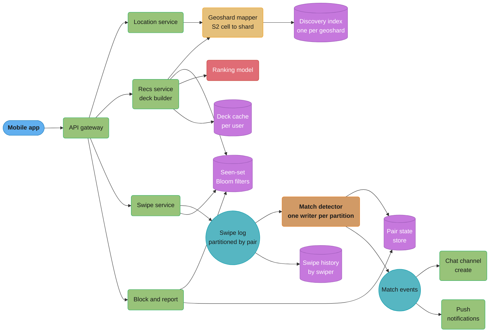
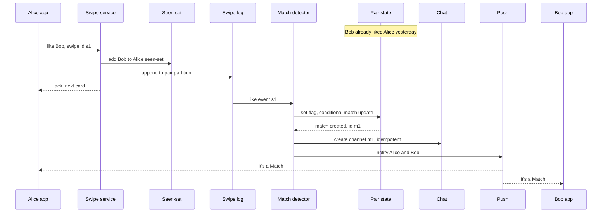
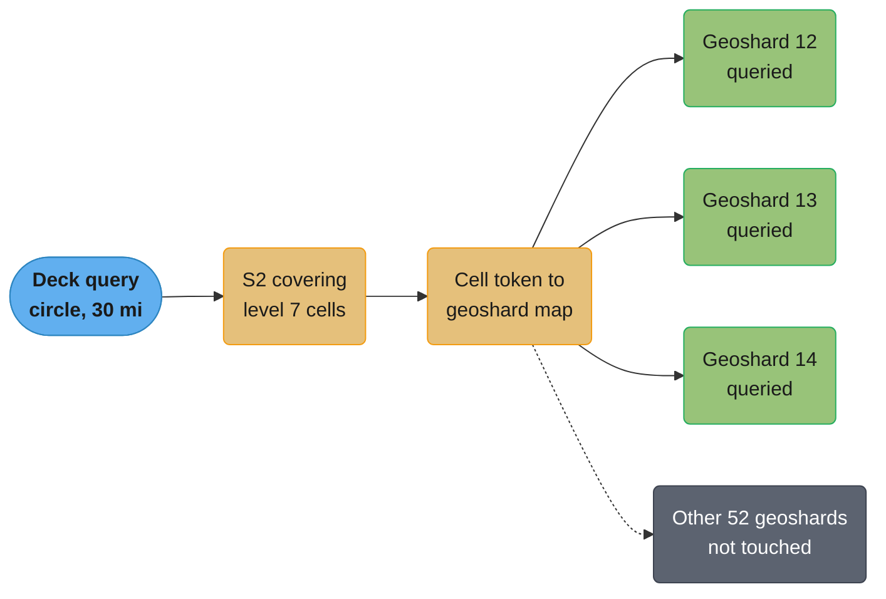
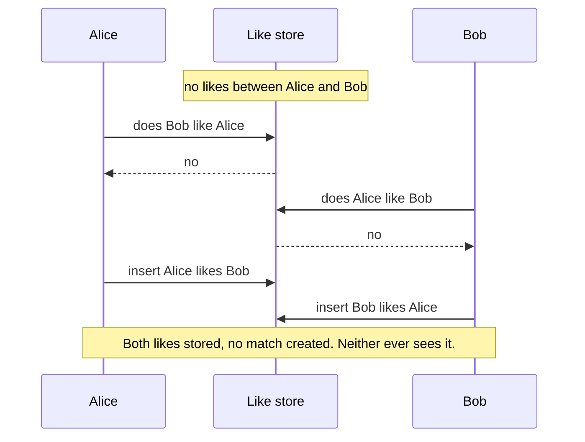
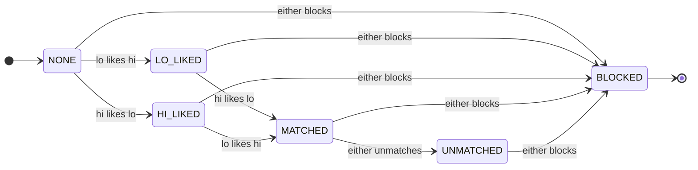

# System Design: Tinder (Geo-Based Swipe Matching)

## Intuition

> **Design intuition**: Tinder looks like a feed with two buttons, but it hides two systems with opposite shapes. The **read side** is a geo search: "show me people within 30 miles, aged 27 to 35, who might like me back, whom I have not seen yet", answered from a population that moves around all day. The **write side** is a firehose of tiny events: billions of swipes a day, almost all of which change nothing visible, and a small fraction of which must produce exactly one "It's a Match!" for two people at once. The read side fails by being slow or showing the same face twice. The write side fails by losing a match, or by creating it twice.

**Key insight**: A match is a **conditional state transition on an unordered pair**, not a lookup. When Alice likes Bob, the question "has Bob already liked Alice?" must be answered and acted on atomically with recording Alice's like, or two people who like each other within the same second both miss the match. Key everything about the pair by `(min(id), max(id))` and serialize per pair; then match creation is a single compare-and-set that fires exactly once. On the read side, the key insight is Tinder's own: queries are geo-bounded, so **shard the search index by geography** and let each query touch only the few shards that cover its circle. This study uses [`../geospatial_indexing/geospatial_indexing.md`](../geospatial_indexing/geospatial_indexing.md) for S2 cells and [`../coordination_and_contention/coordination_and_contention.md`](../coordination_and_contention/coordination_and_contention.md) for the per-key serialization. It does not re-derive chat ([`./design_whatsapp.md`](./design_whatsapp.md)) or the ranking model ([`../../ml/recommender_systems/recommender_systems.md`](../../ml/recommender_systems/recommender_systems.md)).

---

## 1. Requirements Clarification

### Functional Requirements
- **Profile**: photos, bio, age, gender, orientation preferences, and a discovery setting (maximum distance, age range, genders shown).
- **Location**: the app reports the device location on open and periodically while active. The server keeps the latest location per user.
- **Deck (recommendations)**: return a stack of candidate profiles that match the viewer's filters, are inside the viewer's distance, whose own filters include the viewer (mutual eligibility), and that the viewer has not already swiped.
- **Swipe**: like (right), pass (left), and a premium "super like". A swipe is final for that candidate unless the product offers an undo.
- **Match**: when two users have liked each other, both see a match within seconds, a chat channel opens, and both get a notification.
- **Unmatch, block and report**: removes the match and the chat, and guarantees the two users never see each other in decks again.
- **"Likes you" list** (premium): show the users who liked me and whom I have not swiped yet.
- **Distance display**: "5 miles away", never an exact location.

### Non-Functional Requirements
- **Deck fetch p99 under 300 ms** (candidate retrieval, filtering, ranking).
- **Swipe acknowledgement p99 under 100 ms**. The UI moves on immediately; the swipe must be durable once acknowledged.
- **Match latency p95 under 2 seconds** from the second like to both users seeing the match.
- **Exactly one match per mutual pair.** Never zero when both liked; never two.
- **No repeats**: a profile already swiped should almost never reappear (target under 0.1% of cards).
- **Blocks take effect immediately**: a blocked user must not appear in the blocker's next deck or be able to send another chat message.
- **Location privacy**: no API response may allow a client to compute another user's position more precisely than about 1 mile.
- **Availability over consistency for decks** (a slightly stale candidate is fine); **consistency for match state and blocks**.

### Out of Scope
- **Chat delivery**: covered by [`./design_whatsapp.md`](./design_whatsapp.md). We create the channel; WhatsApp-style infrastructure delivers messages.
- **Ranking model internals**: covered by [`../../ml/recommender_systems/retrieval_and_ranking.md`](../../ml/recommender_systems/retrieval_and_ranking.md). We define where the model plugs in (§4.e).
- **Photo storage and moderation pipelines**: see [`./design_youtube_upload_pipeline.md`](./design_youtube_upload_pipeline.md) for the media pipeline shape.
- **Payments and subscriptions**: a standard entitlement check.
- **Trust and safety ML** (fake profiles, scams): we provide hooks.

---

## 2. Scale Estimation

Tinder publishes a few aggregate figures (§6): more than 630 million downloads since launch, over 100 billion total matches, availability in 190 countries. It does not publish daily active users or swipe rates, so every rate below is a **design assumption**.

### Users and Swipes
- **25 million daily active users** (assumption).
- **80 swipes** per DAU per day (assumption): **2 billion swipes/day**.
- Average rate: 2,000,000,000 / 86,400 = **~23,000 swipes/s**.
- Evening peak in each region at about **3x** average: **~70,000 swipes/s** globally at the overlap of two regions' evenings.
- Like share: **40%** of swipes (assumption) = **800 million likes/day**.
- Matches: assume **4%** of likes are reciprocated within the like's lifetime: **~32 million matches/day** = **~370 matches/s** average, ~1,100/s peak.

### Decks
- A deck fetch returns **50 cards**; the client refills when fewer than 10 remain. Roughly one fetch per 40 swipes: 2 B / 40 = **50 M deck fetches/day** = **~580/s** average, **~1,750/s** peak.
- Each fetch over-fetches **200 candidates** from the search tier to survive filtering (seen, blocked, mutual eligibility, ranking cut). See §4.c.

### Profiles and the Search Index
- **150 million** profile documents in total; **40 million** "active in the last 30 days" are kept in the discovery index (assumption).
- Search document ~ **2 KB** (location, age, gender, preferences, ranking features, photo ids): 40 M x 2 KB = **80 GB** of primary data, before replicas.

### Location Updates
- **4 location updates** per DAU per day (app opens plus periodic refresh): 100 M/day = **~1,160/s** average.
- Assume **2%** of updates move a user across a geoshard boundary (a commute across a metro does not, a flight does): ~2 M geoshard migrations/day = **~23/s**.

### S2 Levels Near the Search Radius
The level used for geosharding should have cells somewhat smaller than a typical search circle, so a covering needs a handful of cells, not hundreds. Average areas from the S2 statistics table:

| S2 level | Average cell area | Rough edge | Fit for a 50-mile (80 km) radius search |
|---|---|---|---|
| 6 | 20,754.64 km² | ~144 km | too coarse: one cell is larger than most searches |
| 7 | 5,188.66 km² | ~72 km | Tinder's choice, about 45 miles |
| 8 | 1,297.17 km² | ~36 km | Tinder's alternative, about 22.5 miles |
| 9 | 324.29 km² | ~18 km | fine; more cells per covering |
| 13 | 1.27 km² | ~1.1 km | location snapping for privacy (§4.h), not sharding |

A 50-mile radius circle is about 20,300 km². At level 7 that is roughly 4 cells plus the partial cells on its edge; at level 9, roughly 63 plus edges. The geoshard mapping then collapses those cells to a few geoshards.

### Swipe Storage
- Swipe record: swiper id 8 B, target id 8 B, action 1 B, timestamp 8 B, overhead: ~**40 bytes**.
- 2 B swipes/day x 40 B = **80 GB/day** raw; replicated 3x: **240 GB/day**.
- Likes are kept indefinitely (they can still become matches); passes are kept **90 days** (a product decision: after that, a profile may reappear). Steady state: likes ~29 TB/year raw, passes ~7.2 TB rolling.

### Seen-Set Filters
- Average active user's swipe history used for dedup: **10,000** ids (assumption).
- Bloom filter at **1%** false-positive rate: bits = -n ln p / (ln 2)^2 = 10,000 x 4.605 / 0.4805 = **~95,800 bits = ~11.7 KB**, with 7 hash functions.
- 25 M DAU x 11.7 KB = **~293 GB** of filters for active users, held in a sharded cache keyed by user id.

| Quantity | Average | Peak | Notes |
|---|---|---|---|
| Swipes | 23,000/s | 70,000/s | 40 B each |
| Likes | 9,300/s | 28,000/s | pair-keyed (§4.d) |
| Matches | 370/s | 1,100/s | exactly once |
| Deck fetches | 580/s | 1,750/s | 200 candidates each |
| Location updates | 1,160/s | 3,500/s | 2% cross a geoshard |
| Discovery index | 40 M docs | 80 GB primary | geosharded |
| Seen-set filters | 25 M | ~293 GB | Bloom, 1% FPR |

---

## 3. High-Level Architecture



*Reads (decks) go through the geoshard mapper to a few small indices; writes (swipes) go to a log partitioned by the unordered pair, where one consumer per partition decides matches. The two paths share only the seen-set filters and the block list.*

### Request Flows
1. **App open**: the client posts its location. The location service computes the user's S2 cell, maps it to a geoshard (§4.a), and upserts the user's document in that geoshard's index. If the geoshard changed, it deletes the document from the old one (§4.b).
2. **Deck fetch**: the recs service maps the viewer's discovery circle to the geoshards that cover it, queries them in parallel for 200 candidates with hard filters, removes seen and blocked ids with the viewer's Bloom filter and block list, ranks, and returns 50 cards. The rest are cached as the next deck.
3. **Swipe**: the swipe service validates the swipe, adds the target to the viewer's seen-set, appends a swipe event to the log keyed by the pair, writes the swiper's history row, and acknowledges. Match detection is asynchronous but fast (§4.d).
4. **Match**: the match detector, the single consumer for that pair's partition, applies the like to the pair state; if both sides now like each other and no match exists, it creates the match and emits a match event. Chat and notifications consume it.

### The Match Path End to End



*Alice's swipe is acknowledged after two writes (seen-set and log). The match appears about a second later as an event, created exactly once by the single consumer for the Alice-Bob partition.*

### Why the Read Path and the Write Path Are Separate
Deck building is a geo-plus-filter search over profiles; it scales with **active users per area** and tolerates seconds of staleness. Swiping is an append workload that scales with **engagement** and needs per-pair consistency. Putting both in one store forces one of them into the wrong consistency model. The only state they share is the seen-set (written by swipes, read by decks) and the block list (written by safety, read by both), and both are designed for that sharing (§4.c, §4.g).

---

## 4. Component Deep Dives

### (a) Geosharding the Discovery Index

**The problem Tinder hit.** Tinder's engineering blog describes the starting point: "one Elasticsearch cluster with one index and the default five shards", grown with "more replicas and more powerful nodes" until high CPU and cost showed the design would not hold. The observation that fixed it: "Tinder's recommendation use cases are location-based, with a maximum distance of 100 miles. When serving a user in California, there is no need to include the users in London." And in their tests, "performance increases linearly when index size decreases".

**The approach.** Split the index into geoshards, each covering a contiguous area with roughly equal load:

1. Map the world onto S2 cells at a chosen level. Tinder found "most users' preferences are within a 50-mile range", so it evaluated S2 Level 7 (~45 miles) and Level 8 (~22.5 miles). The S2 statistics table gives average cell areas of **5,188.66 km²** at level 7 and **1,297.17 km²** at level 8.
2. Give each cell a **load score** (unique users, active users, queries per hour, or a combination).
3. Walk the cells in Hilbert-curve order (S2's cell ordering preserves locality) and pour each cell's load into a "container" until the next cell would overflow it; then start a new geoshard. Tinder's analogy is a 1,000 ml container filled with water proportional to each cell's load.
4. Try many container sizes and keep the configuration whose geoshard loads have the **smallest standard deviation**. Tinder reports that "40-100 geoshards around the globe results in a good balance of P50, P90, P99 performance under Tinder's average production load".
5. Store the result as a mapping from S2 cell token to geoshard. Tinder chose string **tokens** over 64-bit ids because different language libraries produced different long ids for the same cell, while tokens were consistent.

```java
import com.google.common.geometry.*;

/** Offline: build a balanced geoshard mapping from per-cell load scores. */
public final class GeoshardBuilder {

    /** cellsInHilbertOrder: all level-7 cells with load, sorted by S2CellId (Hilbert order). */
    public static Map<String, Integer> build(List<CellLoad> cellsInHilbertOrder, int minShards, int maxShards) {
        double total = cellsInHilbertOrder.stream().mapToDouble(CellLoad::load).sum();
        Map<String, Integer> best = null;
        double bestStd = Double.MAX_VALUE;
        for (int target = minShards; target <= maxShards; target++) {
            double capacity = total / target;                       // the "container size"
            Map<String, Integer> mapping = new HashMap<>();
            List<Double> shardLoads = new ArrayList<>();
            double current = 0;
            int shard = 0;
            for (CellLoad c : cellsInHilbertOrder) {
                if (current > 0 && current + c.load() > capacity) { // would overflow: close this shard
                    shardLoads.add(current);
                    shard++;
                    current = 0;
                }
                mapping.put(c.token(), shard);
                current += c.load();
            }
            shardLoads.add(current);
            double std = stdDev(shardLoads);
            if (std < bestStd) { bestStd = std; best = mapping; }
        }
        return best;
    }

    static double stdDev(List<Double> xs) {
        double mean = xs.stream().mapToDouble(d -> d).average().orElse(0);
        double var = xs.stream().mapToDouble(d -> (d - mean) * (d - mean)).average().orElse(0);
        return Math.sqrt(var);
    }

    public record CellLoad(String token, double load) {}
}
```

**Serving: indexing and querying.** Two operations, exactly as Tinder describes them:
- **Indexing**: given a user at (lat, lng), take the S2 cell that contains it, map the cell to a geoshard, write to that geoshard's index.
- **Query**: given a circle (lat, lng, radius), take the S2 cells that cover the circle, map each to a geoshard, and query the distinct set. In Tinder's 55-geoshard example, a 100-mile circle touched **3 of 55** geoshards.

```java
public final class GeoshardMapper {
    private static final int LEVEL = 7;
    private static final double EARTH_RADIUS_MILES = 3958.8;
    private volatile Map<String, Integer> cellToShard;          // loaded from the published mapping

    public int shardFor(double lat, double lng) {
        S2CellId leaf = S2CellId.fromLatLng(S2LatLng.fromDegrees(lat, lng));
        return cellToShard.get(leaf.parent(LEVEL).toToken());
    }

    public Set<Integer> shardsFor(double lat, double lng, double radiusMiles) {
        S2Point center = S2LatLng.fromDegrees(lat, lng).toPoint();
        S2Cap cap = S2Cap.fromAxisAngle(center, S1Angle.radians(radiusMiles / EARTH_RADIUS_MILES));
        S2RegionCoverer coverer = new S2RegionCoverer();
        coverer.setMinLevel(LEVEL);
        coverer.setMaxLevel(LEVEL);
        coverer.setMaxCells(500);
        Set<Integer> shards = new HashSet<>();
        for (S2CellId cell : coverer.getCovering(cap).cellIds()) {
            Integer s = cellToShard.get(cell.toToken());
            if (s != null) shards.add(s);
        }
        return shards;
    }
}
```

**Why not many tiny geoshards?** Tinder gives the arithmetic: "if the geoshard is 100 square miles, one query would need to hit 314 geoshards" for a 100-mile radius (the circle's area, pi x 100², is about 31,400 square miles). Fanning one deck request out to 314 searches wrecks P90 and P99 ([`../../backend/tail_latency_and_fan_out/tail_latency_and_fan_out.md`](../../backend/tail_latency_and_fan_out/tail_latency_and_fan_out.md)). **Why not a few huge ones?** Then each index is large again, and a dense city becomes a hot shard. The load-balanced Hilbert walk is the middle path: physically large geoshards where few people live, small ones in dense cities.



**Results reported.** Tinder states that "the geosharded search index is capable of handling 20 times more computations compared to the single index setup", and that resharding, when needed, runs "two parallel indices-sets with two shard mappings at the same time", re-indexes offline, then cuts over.

### (b) Location Updates and Geoshard Migration

When a user moves across a geoshard boundary, the document must move from one index to another. Tinder notes that "these operations aren't atomic so more moves will result in more inconsistencies in the system". The design accepts that and bounds the damage:

| Order of operations | Failure window | Visible effect |
|---|---|---|
| Delete from old, then insert into new | between the two | user invisible in both for a moment |
| Insert into new, then delete from old | between the two | user visible in both; might appear twice in a deck spanning both |
| Insert new, delete old, plus dedup by user id in the deck builder | none visible | a duplicate is removed before ranking |

This design uses **insert-then-delete with dedup**: invisibility is a worse failure (a lost match opportunity) than a duplicate that the deck builder removes anyway. A periodic sweeper deletes any document whose stored geoshard differs from the user's current geoshard, catching failed deletes.

```java
public void onLocation(long userId, double lat, double lng, Instant at) {
    UserLocation prev = locationStore.get(userId);
    if (prev != null && prev.at().isAfter(at)) return;          // out-of-order update, ignore
    int newShard = mapper.shardFor(lat, lng);
    ProfileDoc doc = profiles.discoveryDoc(userId).withLocation(snap(lat, lng), newShard, at);
    index.upsert(newShard, doc);                                // 1. visible in the new geoshard
    locationStore.put(userId, new UserLocation(lat, lng, newShard, at));
    if (prev != null && prev.shard() != newShard) {
        index.delete(prev.shard(), userId);                     // 2. removed from the old one
    }
}
```

**Throttling location writes.** Re-indexing a 2 KB document on every GPS fix is waste: a move of 200 m does not change any deck. The client sends location at most every few minutes while active, and the server skips the index write unless the user moved more than **1 mile** or crossed a geoshard. That cuts index writes by an estimated 70% (illustrative) without changing results.

### (c) Deck Building: Filter, Dedup, Rank

A deck request runs four stages:

1. **Candidate retrieval** (search tier): query each covering geoshard for documents inside the viewer's circle that pass the viewer's hard filters (age range, genders) **and** whose own filters include the viewer (the candidate's age range contains the viewer's age, the candidate's distance setting covers the viewer). Return the top 200 by a cheap score (recency of activity, distance).
2. **Seen filter**: remove ids in the viewer's seen-set Bloom filter. A false positive removes a candidate the viewer has not seen; that is the safe direction (a missed card, never a repeat).
3. **Safety filter**: remove ids on the viewer's block list or that have blocked the viewer. This is an exact, durable set, not the Bloom filter: a block is a safety guarantee, so it must not depend on a cache that can be evicted or rebuilt late, and an unblock needs deletion, which a Bloom filter cannot do.
4. **Ranking**: score the survivors with the ranking model and take the top 50.

```json
{
  "query": {
    "bool": {
      "filter": [
        { "geo_distance": { "distance": "30mi", "location": { "lat": 37.77, "lon": -122.42 } } },
        { "range": { "age": { "gte": 27, "lte": 35 } } },
        { "terms": { "gender": ["F"] } },
        { "term":  { "seeking_gender": "M" } },
        { "range": { "pref_age_min": { "lte": 31 } } },
        { "range": { "pref_age_max": { "gte": 31 } } },
        { "range": { "last_active": { "gte": "now-7d" } } }
      ]
    }
  },
  "sort": [ { "last_active": "desc" } ],
  "size": 200
}
```

**Why over-fetch 200 for 50?** For an active viewer in a small town, most nearby candidates are already seen. If retrieval returned exactly 50, the seen filter could leave 5. The deck builder tracks the survival rate per viewer and adapts: if fewer than 50 survive, it pages deeper with `search_after` before ranking, up to a cap, then widens nothing on its own (the viewer's distance setting is the viewer's choice).

**The Bloom filter.** Sized in §2 at ~11.7 KB for 10,000 ids at 1%. It is rebuilt from the swipe history if lost, and grows by doubling (a scalable Bloom filter) when a user passes 10,000 swipes. It is updated **synchronously by the swipe service** before acknowledging the swipe, so a swiped card cannot reappear in the next deck even though match detection is asynchronous.

```java
public Deck build(Viewer v) {
    Set<Integer> shards = mapper.shardsFor(v.lat(), v.lng(), v.maxDistanceMiles());
    List<Candidate> pool = search.parallelQuery(shards, CandidateQuery.from(v), 200);  // fan-out
    BloomFilter seen = seenSets.get(v.userId());
    Set<Long> blocked = safety.blockedEitherWay(v.userId());
    List<Candidate> fresh = new ArrayList<>();
    Set<Long> dedup = new HashSet<>();
    for (Candidate c : pool) {
        if (!dedup.add(c.userId())) continue;            // migration duplicates, §4.b
        if (seen.mightContain(c.userId())) continue;     // false positive = skipped card, safe
        if (blocked.contains(c.userId())) continue;      // exact check
        fresh.add(c);
    }
    List<Candidate> ranked = ranker.score(v, fresh);     // model, §4.e
    return Deck.of(ranked.subList(0, Math.min(50, ranked.size())));
}
```

### (d) Swipes and Exactly-Once Match Creation: Broken, Then Fixed

***Broken:*** each like checks whether the reverse like exists, then writes its own.

```java
// BROKEN -- two concurrent likes each miss the other's write: the match is never created
public SwipeResult likeBroken(long from, long to) {
    boolean reverse = likes.exists(to, from);   // read: has 'to' liked 'from'?
    likes.insert(from, to);                     // write my like
    if (reverse) {
        matches.create(from, to);               // only the second liker creates the match
    }
    return SwipeResult.recorded();
}
```



The reverse race also exists: with retries, both sides can see the other's like and both call `matches.create`, producing two match records and two chat channels. A non-atomic read-then-write fails in **both** directions: zero matches or two.

***Fix:*** key the state by the **unordered pair** and make the match a conditional transition on one row.

```sql
CREATE TABLE pair_state (
    lo          BIGINT      NOT NULL,     -- min(user_a, user_b)
    hi          BIGINT      NOT NULL,     -- max(user_a, user_b)
    lo_likes_hi BOOLEAN     NOT NULL DEFAULT false,
    hi_likes_lo BOOLEAN     NOT NULL DEFAULT false,
    match_id    UUID,                     -- set exactly once
    matched_at  TIMESTAMPTZ,
    blocked     BOOLEAN     NOT NULL DEFAULT false,
    PRIMARY KEY (lo, hi),
    CHECK (lo < hi)
);

-- Record a like from :from to :to. Run in one transaction.
-- :lo = least(:from, :to), :hi = greatest(:from, :to), :from_is_lo = (:from < :to)
INSERT INTO pair_state (lo, hi, lo_likes_hi, hi_likes_lo)
VALUES (:lo, :hi, :from_is_lo, NOT :from_is_lo)
ON CONFLICT (lo, hi) DO UPDATE
SET lo_likes_hi = pair_state.lo_likes_hi OR EXCLUDED.lo_likes_hi,
    hi_likes_lo = pair_state.hi_likes_lo OR EXCLUDED.hi_likes_lo;

-- Fire the match exactly once: only the transaction that sees both flags true and
-- no match yet updates the row. Row locking serializes the two likers.
UPDATE pair_state
SET match_id = :deterministic_match_id, matched_at = now()
WHERE lo = :lo AND hi = :hi
  AND lo_likes_hi AND hi_likes_lo
  AND match_id IS NULL
  AND NOT blocked
RETURNING match_id;
-- 1 row returned: this like created the match, emit MatchCreated through the outbox.
-- 0 rows: no match yet, or it already existed. Emit nothing.
```

**Serializing per pair in the log.** At 28,000 likes/s peak, routing every like through one relational table works only if the table is sharded by `(lo, hi)`. This design goes one step further: swipe events go onto a log **partitioned by the pair key**, so Alice's like of Bob and Bob's like of Alice land on the same partition, in order. One consumer per partition applies them sequentially, so there is never a concurrent writer for a pair, and the conditional `UPDATE` above becomes a safety net rather than a contention point.

```java
public final class SwipeService {
    public SwipeAck swipe(long from, long to, Action action, UUID swipeId) {
        long lo = Math.min(from, to), hi = Math.max(from, to);
        seenSets.add(from, to);                                         // synchronous, §4.c
        String pairKey = lo + ":" + hi;
        log.append(pairKey, new SwipeEvent(swipeId, from, to, action, Instant.now()));  // acks=all
        return SwipeAck.ok(swipeId);                                    // durable before ack
    }
}

public final class MatchDetector {                // one instance per log partition, single thread
    public void onEvent(SwipeEvent e) {
        if (e.action() == Action.PASS) return;      // passes never change pair state
        long lo = Math.min(e.from(), e.to()), hi = Math.max(e.from(), e.to());
        UUID matchId = UUID.nameUUIDFromBytes((lo + ":" + hi).getBytes());   // deterministic
        Optional<UUID> created = pairs.applyLike(lo, hi, e.from() == lo, matchId);  // SQL above
        created.ifPresent(id -> outbox.emit(new MatchCreated(id, lo, hi, Instant.now())));
    }
}
```

**Deterministic match id.** `match_id` is derived from the pair, not random. If the detector crashes after the database commit and before the log offset commit, it reprocesses the like on restart; the conditional `UPDATE` returns zero rows, and even if a match event were emitted twice, downstream consumers (chat channel creation, notifications) dedupe on the same `match_id`. This is "exactly once" as an **effect**, built from at-least-once delivery plus an idempotent transition, the pattern in [`../message_queues/message_queues.md`](../message_queues/message_queues.md).

**Pair state lifecycle:**



`BLOCKED` is terminal and absorbing: no later like can produce a match, which is why the match `UPDATE` carries `AND NOT blocked`.

### (e) Ranking and Fair Exposure

Candidate retrieval decides **who is eligible**; ranking decides **who is shown first**. The ranking model (see [`../../ml/recommender_systems/retrieval_and_ranking.md`](../../ml/recommender_systems/retrieval_and_ranking.md)) predicts the probability of a **mutual** like, not just the viewer's like, because a deck full of people who will never like the viewer back produces likes without matches.

Two system-level concerns sit around the model:

- **Exposure concentration.** A two-sided market tends to route attention to a small set of very popular profiles. Those profiles receive far more likes than they can review, and everyone else gets few impressions. The deck builder applies an **impression cap**: each profile has a per-hour budget of deck appearances that scales with its own activity. A profile that has 5,000 unreviewed likes stops being shown until it catches up. This keeps the market liquid and spreads load on the "likes you" lists (§4.f).
- **Cold start.** A new profile has no signal. Give it a short exploration budget (a bandit-style boost, see [`../../ml/recommender_systems/online_learning_and_bandits.md`](../../ml/recommender_systems/online_learning_and_bandits.md)) so the model can learn from real reactions, and cap it so new accounts cannot be used to flood decks (a spam vector).

```java
public List<Candidate> applyExposureCaps(List<Candidate> ranked, Instant now) {
    List<Candidate> out = new ArrayList<>(ranked.size());
    for (Candidate c : ranked) {
        long shownThisHour = impressions.incrementAndGet(c.userId(), now);    // sharded counter
        long budget = budgets.forUser(c.userId());   // grows with the profile's own swipe activity
        if (shownThisHour <= budget) out.add(c);
    }
    return out;
}
```

### (f) Hot Profiles and the "Likes You" List

Pair keying spreads like writes across pairs, so a very popular profile does not make one row hot. What does get hot is anything keyed **by the target alone**:

- **"Likes you" list**: a per-user list of pending likes. A popular profile can receive thousands per day. Store it as a bounded, time-ordered list per user (cap at, say, 10,000 newest), sharded by target user; the impression cap in §4.e bounds the inflow.
- **Like counters for display**: never a single counter row updated per like. Use a sharded counter (N sub-counters, summed on read) or an approximate count from the stream.
- **Removal on swipe**: when the target swipes on a pending liker (either way), remove that entry from the list in the same consumer that updates the pair, so the list does not show people already handled.

### (g) Blocks, Unmatch and Safety Hooks

A block must be **immediately** effective in three places:

| Place | Mechanism | Consistency |
|---|---|---|
| Chat | chat service checks `pair_state.blocked` (cached with write-through invalidation) on every send | strong for new messages |
| Decks | exact block set per user, checked in §4.c stage 3, both directions | read-your-writes for the blocker |
| Match creation | `AND NOT blocked` in the match `UPDATE` | serialized per pair |

The block write goes to the pair state (through the same per-pair partition, so it is ordered with likes), to both users' exact block sets, and invalidates any cached deck containing the other user. Reports feed a trust-and-safety queue; an account suspension removes the user's document from the discovery index and marks every pair involving them as hidden.

### (h) Location Privacy: Distance Without Position

Showing "2 miles away" seems harmless, but a client that can request the distance repeatedly while pretending to stand at different points can solve for the target's position (trilateration). The defences are in the server:

- **Snap before compute**: the server stores and indexes a location snapped to a grid (for example the centre of an S2 cell around 1 km across, level 13 averages 1.27 km² in the S2 statistics), never the raw GPS fix, and computes displayed distances from the snapped point.
- **Round the output**: return whole miles with a floor of "1 mile", never decimals.
- **Rate-limit viewer movement**: a viewer whose reported location jumps across a city several times a minute is not a commuter; freeze their location and flag the account ([`../rate_limiting/rate_limiting.md`](../rate_limiting/rate_limiting.md)).
- **Never return coordinates**, not even for the user's own matches.

```java
public int displayedMiles(GeoPoint viewerSnapped, GeoPoint targetSnapped) {
    double miles = haversineMiles(viewerSnapped, targetSnapped);   // both already snapped
    return (int) Math.max(1, Math.round(miles));                   // whole miles, floor of 1
}
```

### (i) Swipe History and Undo

The swiper's history is a time-ordered log per user, used to rebuild seen-set filters, to support undo, and for analytics. It is a wide-row access pattern:

```sql
-- CQL (Cassandra), one partition per swiper, newest first
CREATE TABLE swipe_history (
    swiper_id  bigint,
    swiped_at  timeuuid,
    target_id  bigint,
    action     tinyint,        -- 0 pass, 1 like, 2 super like
    PRIMARY KEY ((swiper_id), swiped_at)
) WITH CLUSTERING ORDER BY (swiped_at DESC)
  AND default_time_to_live = 0;

-- Passes expire after 90 days so a profile may reappear later; likes are kept.
INSERT INTO swipe_history (swiper_id, swiped_at, target_id, action)
VALUES (?, now(), ?, 0) USING TTL 7776000;
```

A heavy swiper (100,000 lifetime swipes x ~40 B = ~4 MB) is a large but valid partition; to bound it, the table can bucket by month: `PRIMARY KEY ((swiper_id, yyyymm), swiped_at)`.

**Undo (rewind).** A premium undo reverses the last swipe. It is the one operation that can go backwards on the pair state, so it must be ordered with likes on the same pair partition:

- **Undo a pass**: remove the target from the seen-set (rebuild the user's filter without it, since a Bloom filter cannot delete), delete the history row, and put the card back on the deck. Pair state never changed, so nothing else to undo.
- **Undo a like with no match yet**: append an `UNLIKE` event to the pair partition; the detector clears the flag. Because it is ordered after the like and before any later like from the other side, there is no race.
- **Undo a like that already matched**: not allowed as undo; it is an **unmatch**, which has its own semantics (removes chat for both). Product rules must say this explicitly, because the user who pressed undo sees "It's a Match!" first.

```java
public void onUnlike(SwipeEvent e) {              // runs in the pair's single consumer
    long lo = Math.min(e.from(), e.to()), hi = Math.max(e.from(), e.to());
    boolean fromIsLo = e.from() == lo;
    int changed = pairs.clearFlagIfNotMatched(lo, hi, fromIsLo);   // WHERE match_id IS NULL
    if (changed == 0) {
        events.emit(new UndoRejected(e.swipeId(), "already matched"));
    }
}
```

---

## 5. Design Decisions & Tradeoffs

| Decision | Option A | Option B | Choice and why |
|---|---|---|---|
| Discovery index layout | One global index | Geosharded indices balanced by load | **Geosharded.** Queries are bounded at 100 miles, and Tinder measured 20x more compute capacity after the change. |
| Geoshard granularity | Many small geoshards | 40-100 load-balanced geoshards | **Load-balanced, coarse.** Small shards blow up query fan-out (314 shards for a 100-mile circle at 100 sq mi each). |
| Cell system | Geohash | S2 | **S2.** Equal-area cells at a level, a mature library, and Hilbert ordering for the balancing walk. |
| Match detection | Read reverse like, then write | Pair-keyed conditional transition, serialized per pair | **Pair-keyed.** Read-then-write fails in both directions: zero matches or two. |
| Swipe ack | After match detection | After the swipe is durable in the log | **After the log write.** Detection is fast and async; the user should not wait on it. |
| Seen filter | Exact set per user | Bloom filter, 1% FPR | **Bloom.** 11.7 KB per user; false positives hide a card, which is the safe direction. |
| Block filter | Bloom filter | Exact, durable set | **Exact and durable.** The seen filter is a rebuildable cache that can be evicted; a block is a safety guarantee that must never depend on one, and unblocking needs deletion, which a Bloom filter cannot do. |
| Geoshard migration order | Delete then insert | Insert then delete, dedup in deck | **Insert then delete.** A duplicate is filtered; invisibility silently loses matches. |
| Location precision | Raw GPS | Snapped grid plus rounded distance | **Snapped plus rounded.** Defeats trilateration without hurting relevance at mile scale. |

### What Changes at 10x
| Pressure | At 1x | At 10x | Change |
|---|---|---|---|
| Swipes | 70,000/s peak | 700,000/s | more log partitions and detectors; pair keying keeps it embarrassingly parallel |
| Active profiles in the index | 40 M | 400 M | rebalance to more geoshards; dense cities split further |
| Deck fetches | 1,750/s | 17,500/s | replicas per geoshard; fan-out per query stays 1 to 4 |
| Seen-set filters | ~293 GB | ~2.9 TB | tiered: hot users in memory, others rebuilt on demand |
| Matches | 1,100/s | 11,000/s | unchanged design, more pair-state shards |

Nothing in the write path has a global serialization point, so it scales linearly. The read path's limit is the densest city: at 10x, a single metro's geoshard can outgrow one index, and the mapping must split cells below level 7 there, which is exactly what the load-balanced Hilbert walk does if it is allowed to use finer cells in dense areas.

### Why Not a Graph Database for Likes?
Likes form a directed graph, and "mutual like" is a 2-cycle. A graph database makes that query elegant, but the workload is 28,000 writes/s of single edges and one question per write about one specific reverse edge. That is a key-value access pattern on the pair, not a traversal. A graph store would pay traversal overhead for a point lookup.

### Why Not Compute Matches in Batch?
A nightly job joining likes with reversed likes would find every match, but match latency would be hours. The product promise is "It's a Match!" while both people are still in the app. Per-pair streaming detection gives seconds.

---

## 6. Real-World Implementations

- **Tinder (geosharded recommendations)**: the Tinder Tech Blog post "Geosharded Recommendations Part 1: Sharding Approach" by Frank Ren, Xiaohu Li, Devin Thomson and Daniel Geng (published 2019-05-14) is the source for §4.a: the original "one Elasticsearch cluster with one index and the default five shards", the 100-mile maximum distance, the observation that "performance increases linearly when index size decreases", load scores balanced by standard deviation, the "314 geoshards" fan-out warning, the choice of S2 Level 7 and Level 8 because "most users' preferences are within a 50-mile range", "40-100 geoshards" as the measured sweet spot, string tokens over long ids, the "3 out of 55 geoshards" query example, resharding with "two parallel indices-sets", and the headline result: "the geosharded search index is capable of handling 20 times more computations compared to the single index setup". Source: [Tinder Tech Blog, via the Internet Archive copy of medium.com/tinder](https://web.archive.org/web/20240224100251/https://medium.com/tinder/geosharded-recommendations-part-1-sharding-approach-d5d54e0ec77a), fetched 2026-11-25 (the live Medium URL refused the fetcher).
- **Tinder (scale figures)**: Tinder's press room states "More than 630M in downloads since launch", "100+ billion total matches", and "Available in 190 countries". It does not publish daily swipe or match rates, which is why §2's rates are labelled assumptions. Source: [Tinder Press Room, "About Tinder"](https://www.tinderpressroom.com/about), fetched 2026-11-25.
- **Google S2 (the cell system)**: the S2 cell statistics table gives the average areas used in §4.a and §4.h: level 7 **5,188.66 km²**, level 8 **1,297.17 km²**, level 13 **1.27 km²**. Source: [s2geometry.io, "S2 Cell Statistics"](https://s2geometry.io/resources/s2cell_statistics), fetched 2026-11-25.
- **Uber H3 (the contrast)**: Uber built H3 for "efficiently optimizing ride pricing and dispatch" and chose hexagons because "hexagons minimize the quantization error introduced when users move through a city". Tinder's problem is balancing **index load**, where S2's quadtree hierarchy makes it easy to "maintain a load score in lower levels and aggregate to a higher level", in Tinder's words; Uber's problem is **aggregating movement** in equal-neighbour cells. Same family of tool, different reason. Source: [Uber Engineering, "H3: Uber's Hexagonal Hierarchical Spatial Index"](https://www.uber.com/blog/h3/), 2018-06-27. Compare [`./design_uber.md`](./design_uber.md) and [`./design_local_delivery_service.md`](./design_local_delivery_service.md).

### Synthesis
The public material covers the read side in depth (Tinder's geosharding) and the scale only in aggregate (100+ billion matches). The write side in §4.d, pair-keyed exactly-once matching, is this design's derivation from the requirement "exactly one match per mutual pair", not a published Tinder architecture. It is the same idempotent-transition pattern this section uses for bids in [`./design_online_auction.md`](./design_online_auction.md) and for seats in [`./design_flash_sale_ticketing.md`](./design_flash_sale_ticketing.md).

---

## 7. Technologies & Tools

| Layer | Options | Notes |
|---|---|---|
| Cell system | Google S2 (Java, C++, Go), H3 as an alternative | S2 for Hilbert ordering and load aggregation |
| Discovery index | Elasticsearch or OpenSearch, one index per geoshard | `geo_point` plus filter clauses; see [`../../database/elasticsearch_internals/elasticsearch_internals.md`](../../database/elasticsearch_internals/elasticsearch_internals.md) |
| Geoshard mapping | Versioned JSON of cell token to shard, loaded in memory | Rebuilt offline from load scores |
| Swipe log | Kafka, partitioned by pair key | `acks=all` before acknowledging the swipe |
| Pair state | Sharded PostgreSQL, Cassandra with lightweight transactions, or DynamoDB with conditional writes | Conditional transition per pair |
| Swipe history | Wide-column store keyed by swiper (Cassandra, DynamoDB) | Time-ordered, TTL on passes |
| Seen-set filters | Redis or a sharded in-memory cache holding Bloom filters | Rebuildable from history |
| Deck cache | Redis lists per user | 50-card decks, refill under 10 |
| Ranking | Model server behind the recs service | See [`../../ml/recommender_systems/recommender_systems.md`](../../ml/recommender_systems/recommender_systems.md) |
| Chat | WhatsApp-style messaging infrastructure | See [`./design_whatsapp.md`](./design_whatsapp.md) |
| Notifications | Push via APNs and FCM | See [`./design_notification_system.md`](./design_notification_system.md) |

### Consistency by Store

| Store | Consistency needed | Why |
|---|---|---|
| Pair state | linearizable per pair | exactly one match; blocks absolute |
| Swipe log | durable, ordered per partition | replay rebuilds pair state |
| Seen-set filters | read-your-writes for the swiper | no repeat of a card just swiped |
| Block sets | durable, read-your-writes | safety guarantee |
| Discovery index | eventual (seconds) | a slightly stale profile is harmless |
| Swipe history | eventual | rebuilds and analytics only |
| Deck cache | best effort | rebuilt on miss |

---

## 8. Operational Playbook

### Key Metrics

| Metric | Target | Alert |
|---|---|---|
| Deck fetch p99 | under 300 ms | over 600 ms for 5 min |
| Geoshards queried per deck (mean) | 1 to 4 | over 8 (mapping or radius drift) |
| Per-geoshard query load (max over mean) | under 1.5 | over 2.5 (hot geoshard) |
| Swipe ack p99 | under 100 ms | over 250 ms |
| Swipe log consumer lag (match detector) | under 1 s | over 10 s |
| Match latency p95 | under 2 s | over 10 s |
| Repeat card rate | under 0.1% | over 0.5% |
| Orphan documents (stored geoshard differs from current) | near 0 | over 0.5% of index |
| Duplicate match ids | 0 | any |

### Runbook: One Geoshard Is Hot
1. Confirm with per-geoshard query rate and CPU: one shard well above the others.
2. Common causes: a festival or a major event concentrating users in one city, or a load-score model that drifted since the last rebalance.
3. Short-term: add replicas to that geoshard's index (reads scale with replicas).
4. Long-term: recompute load scores and build a new mapping; reshard with two parallel index sets and an offline re-index, then cut over, as Tinder describes.

### Runbook: Match Detector Lag
1. Lag on one partition: a hot pair key is unlikely (pairs are spread), so suspect a slow consumer or a stuck transaction on one pair-state shard.
2. Lag on all partitions: the pair-state database is slow. Swipes still ack (they only need the log), so users notice delayed matches, not errors.
3. Never skip events to catch up. A skipped like is a lost match. Scale consumers up to the partition count, or fix the database.

### Runbook: Repeat Cards Reported
1. Check seen-set cache health: an evicted or rebuilt-empty Bloom filter shows everything again.
2. Rebuild affected filters from swipe history; until rebuilt, the deck builder falls back to an exact history check for those users (slower, correct).
3. Confirm the swipe service writes the seen-set **before** acknowledging the swipe.

### Runbook: Regional Outage
1. Users are served by the region nearest them; geoshards are regional by nature, so a European region outage affects European decks only.
2. Swipes: clients buffer swipes locally (with their swipe ids) and replay on reconnect; the idempotent swipe ids make replay safe.
3. Matches created in the outage window are delayed, not lost: the swipe log replays from the last committed offset when the region returns.
4. Do not fail European decks over to another region's index: the documents are not there, and an empty deck is worse than a "try again" screen.

### Rebalancing Cadence
Recompute geoshard load scores weekly and compare the standard deviation of geoshard load with the current mapping. Reshard only when the imbalance crosses a threshold, because every reshard costs a full re-index of 40 M documents.

---

## 9. Common Pitfalls & War Stories

The incidents below are **illustrative composites**; numbers show the mechanism and cost.

### War Story 1: The Missing Matches
An early like handler used read-then-write (§4.d broken). Pairs who liked each other within about 100 ms of each other, common when two people are both swiping in the same bar, never matched. A reconciliation job later found **0.3% of mutual pairs** with no match record: at 32 M matches/day that would be **~96,000** lost matches per day. Fix: pair-keyed conditional transition, and partitioning the swipe log by pair so the two likes are never concurrent.

### War Story 2: Two Chats for One Match
After the first fix, a retry path re-emitted match events with a fresh random `match_id`. Chat created a second channel for **1.2%** of matches; users saw two identical conversations and messages split between them. Fix: deterministic `match_id` from the pair, and the chat service creates channels idempotently on `match_id`.

### War Story 3: The Festival Hot Shard
A large music festival put about **200,000** active users into one small area for a weekend. Their geoshard, sized for a quiet rural region, took about **6x** its normal query load; deck p99 for every user mapped to that geoshard, including the nearest city, rose from 250 ms to **2.8 s**. Fix: emergency replicas for that index, and an event calendar that feeds expected load into the next rebalance.

### War Story 4: Bloom Filter Eviction
A cache cluster resize evicted **15%** of seen-set filters. For two hours, affected users saw profiles they had already passed on; repeat-card complaints rose 40x and swipe rates dropped as users closed the app. Fix: filters are persisted (snapshotted to object storage) and rebuilt from swipe history on miss, with an exact-history fallback while rebuilding.

### War Story 5: Trilateration
A researcher showed that distances returned with one decimal place, computed from raw GPS, let a scripted client locate a target to within about **100 m** using three fake viewer positions. Fix: snapped storage, whole-mile rounding with a 1-mile floor, and rate limits on viewer location jumps (§4.h).

### War Story 6: The Shard Mapping Deploy
A new geoshard mapping shipped to the location service before the recs service. For 20 minutes, users were indexed into new geoshards while decks queried old ones; about **30%** of decks in rebalanced regions came back nearly empty. Fix: a mapping is a versioned artifact; both services read the same version, and a new version is activated only after the parallel index set is fully built (two-phase cutover).

### War Story 7: Undo After Match
The first undo implementation cleared Alice's like flag even when the pair had already matched. Bob kept a match and a chat channel that Alice's side no longer had; **0.8%** of undos produced a one-sided match, and Bob's messages went nowhere. Fix: undo is allowed only while `match_id IS NULL` (§4.i); after a match, the only path is an explicit unmatch that removes it for both.

### Further Pitfalls
- **Using the seen-set Bloom filter for blocks**: it is a cache that can be evicted and cannot delete; a block must survive both.
- **Indexing every GPS fix**: index churn with no change in results.
- **Ranking for one-sided likes**: inflates likes, not matches.
- **Exact like counts on one row**: a popular profile turns it into a hot key.

---

## 10. Capacity Planning

### Discovery Index
- 40 M documents x 2 KB = 80 GB primary. With **60 geoshards**, about 1.3 GB per geoshard on average (dense cities larger, by design of load balancing the **load**, not the size).
- Each geoshard: 1 primary shard plus replicas sized to its query load. Deck queries: 1,750/s peak x ~3 geoshards = **~5,250 geoshard queries/s**. At ~250 queries/s per replica (illustrative, filter-only queries on a 1.3 GB index), that is ~21 replicas worth of query capacity, spread by load: plan **3 replicas minimum per geoshard** (180 replicas), with extra on the hottest 10.

### Swipe Log
- 70,000 events/s peak x ~100 B on the wire = 7 MB/s. Plan **256 partitions** so match detection parallelism can grow; retention 7 days for replay.

### Pair-State Store
- Rows: every pair with at least one like. 800 M likes/day; most pairs see one like only. Assume 700 M new pair rows/day, kept while either like is alive: tens of billions of rows. At ~60 B per row: ~42 GB/day of new rows. A wide-column store or a heavily sharded SQL tier (64+ shards) is needed; the access is always a point read-modify-write on one key.
- Peak writes: 28,000 likes/s plus blocks and unmatches. At 64 shards: ~450 writes/s per shard, comfortable.

### Seen-Set Cache
- ~293 GB of filters for 25 M DAU, plus growth: **12 nodes of 32 GB**, replicated (24 nodes), with snapshot backup.

### Deck Cache
- 25 M users x 50 cards x 16 B (id plus score) = 20 GB.

| Component | Driver | Plan |
|---|---|---|
| Discovery index | 5,250 geoshard queries/s, 80 GB | 60 geoshards, 3+ replicas each |
| Swipe log | 70,000 events/s | 256 partitions, 7-day retention |
| Match detectors | 28,000 likes/s | up to 256 consumers |
| Pair state | 28,000 writes/s, billions of rows | 64+ shards, point access |
| Seen-set cache | 293 GB | 24 nodes of 32 GB (replicated) |
| Deck cache | 20 GB | small Redis cluster |
| Swipe history | 80 GB/day raw | wide-column store, TTL on passes |

### Worked Check: Deck Latency Budget
- Geoshard mapping and covering: in memory, under 1 ms.
- Parallel search on 3 geoshards: each filter-only query ~40 ms p50, ~120 ms p99 (illustrative). The deck waits for the slowest: with 3 parallel calls, the chance that at least one hits its own p99 is 1 - 0.99³ = **~3%**, so the deck's p99 sits somewhat above a single search's p99. With 10 geoshards it would be 1 - 0.99¹⁰ = **~10%**, which is why fan-out width matters.
- Seen and block filtering of 200 ids: under 2 ms.
- Ranking 150 candidates in one model call: ~30 ms.
- Total p99 budget: ~120 + 30 + network ~50 = **~200 ms**, inside the 300 ms target with room for one hedged request on a slow geoshard ([`../../backend/tail_latency_and_fan_out/tail_latency_and_fan_out.md`](../../backend/tail_latency_and_fan_out/tail_latency_and_fan_out.md)).

### What Grows Fastest
Pair state and swipe history grow with **engagement**, not users: they are append-mostly and dominate storage. The discovery index grows only with **active** users and is the latency-critical part. Cost planning should keep these apart: cheap, dense storage for history, and memory-rich, replicated nodes for the index.

---

## 11. Interview Discussion Points

### How to Structure a 45-Minute Answer
1. **Clarify** (3 min): max distance, mutual-eligibility filters, match latency, privacy constraints.
2. **Scale** (4 min): swipes dominate writes; decks dominate latency; matches are small but must be exact.
3. **Architecture** (6 min): split read path (geosharded search, decks) and write path (pair-partitioned swipe log, match detector).
4. **Deep dive: geosharding** (8 min): why one index failed, S2 cells, load scores, the Hilbert walk, fan-out arithmetic.
5. **Deep dive: matching** (8 min): broken read-then-write, pair key, conditional transition, deterministic match id.
6. **Deck building** (6 min): over-fetch, Bloom seen-set, exact block set, ranking for mutual likes.
7. **Failures and privacy** (6 min): hot geoshard, migration order, trilateration, bloom eviction.
8. **Capacity** (4 min): the sizing table.

**Q: Why can't a like just check whether the other person already liked you and then write?**
**Short:** Two concurrent likes each read "no" before either writes, so the match is lost; with retries both can also create it, giving two matches.

Read-then-write on two different rows has no single point of serialization. Key the state by the unordered pair `(min, max)` and make the match a conditional update on that one row, so exactly one transaction sees both flags set and no match yet.

**Q: How do you guarantee exactly one match per mutual pair?**
**Short:** Serialize per pair (log partitioned by pair key, one consumer) and create the match with a conditional update WHERE match_id IS NULL, using a deterministic match id.

The conditional update fires once; replays return zero rows. A match id derived from the pair makes any duplicate event harmless, because chat and notifications dedupe on it. This is exactly-once effect from at-least-once delivery.

**Q: Why did Tinder geoshard its search index?**
**Short:** Queries are bounded at 100 miles, so users far away only inflate the index; smaller geo-bounded indices made search faster and gave about 20x more capacity.

Tinder started with one Elasticsearch index and five shards and kept adding replicas and bigger nodes. Their tests showed performance rising linearly as index size fell, and geosharding let each query touch only the few shards covering its circle.

**Q: How do you choose geoshard boundaries so shards are balanced?**
**Short:** Score each S2 cell's load, walk cells in Hilbert order filling fixed-size containers, try many container sizes, and keep the lowest standard deviation of shard load.

Hilbert order keeps each shard geographically contiguous. Balancing load rather than area gives large shards in empty regions and small ones in dense cities, which avoids hot shards.

**Q: Why not use many small geoshards?**
**Short:** Query fan-out explodes: at 100 square miles per shard, a 100-mile radius covers about 314 shards, and tail latency grows with every parallel search.

Tinder found 40 to 100 geoshards globally balanced P50, P90 and P99 best. Fewer and the shards get big and hot; more and every deck request fans out too wide.

**Q: Why S2 rather than geohash for this?**
**Short:** S2 cells at one level cover roughly equal areas, the library is mature, and its quadtree hierarchy makes aggregating load scores across levels easy.

Geohash cells get very skewed toward the poles. Tinder also needed to cover a circle with cells and to walk cells in a locality-preserving order, both built into S2.

**Q: What happens when a user moves across a geoshard boundary?**
**Short:** Insert into the new geoshard first, then delete from the old, and dedupe by user id in the deck builder, so the user is never invisible.

The two writes are not atomic. Delete-first risks a window where the user appears nowhere, silently losing match chances. Insert-first risks a duplicate, which the deck builder removes. A sweeper deletes leftover documents.

**Q: How do you avoid showing someone a profile they already swiped?**
**Short:** Keep a per-user Bloom filter of swiped ids, updated before the swipe is acknowledged, and filter over-fetched candidates through it.

At 10,000 ids and 1% false positives a filter is about 11.7 KB. A false positive hides a card the user has not seen, which is the safe direction. Over-fetching 200 candidates for 50 cards keeps decks full after filtering.

**Q: Why is a Bloom filter fine for seen profiles but not for blocks?**
**Short:** The seen filter is a lossy, rebuildable cache where a miss only causes a repeat card; a block is a safety guarantee that must be durable, exact and deletable.

A Bloom filter has false positives but no false negatives while it is intact, so in steady state it would not leak a blocked id. The danger is its lifecycle: it can be evicted, rebuilt empty, or rebuilt from a lagging source, and it cannot delete an entry when someone unblocks. A repeat card is an annoyance; a blocked person reappearing is a safety failure, so blocks live in an exact, durable set.

**Q: How do you rank a deck so it produces matches rather than just likes?**
**Short:** Predict the probability of a mutual like and apply exposure caps, so popular profiles do not absorb all attention and everyone gets seen.

Ranking only for the viewer's likes fills decks with people who will not like back. Impression budgets per profile keep the market liquid and bound the inflow to "likes you" lists; a capped exploration boost handles new profiles.

**Q: How do you stop someone from locating another user from the distance shown?**
**Short:** Store a snapped location, compute distance from snapped points, round to whole miles with a 1-mile floor, and rate-limit jumps in the viewer's location.

Precise distances from raw GPS allow trilateration from three fake viewer positions. Snapping and rounding remove the precision, and limiting location jumps blocks the measurement loop.

**Q: Why acknowledge a swipe before match detection finishes?**
**Short:** The swipe only needs to be durable; match detection runs from the log within about a second, and making the user wait would slow every swipe for a rare event.

Only about 4% of likes create a match. Writing the swipe to the log with `acks=all` and the seen-set synchronously gives durability and no repeats; the match arrives as a push and an in-app event moments later.

**Q: Why not store likes in a graph database and query for mutual edges?**
**Short:** The workload is tens of thousands of single-edge writes per second, each checking one specific reverse edge, which is a key-value pattern on the pair, not a traversal.

A pair-keyed row answers "both liked and no match yet" in one atomic point update. A graph store adds traversal machinery that this access pattern never uses.

**Q: How do you make a block take effect immediately?**
**Short:** Write it to the pair state through the same per-pair partition, to both users' exact block sets, and invalidate cached decks and chat permissions.

Ordering the block with likes in the pair partition prevents a race where a like creates a match just after a block. The match update also checks `NOT blocked`, and the chat service checks pair state on every send.

**Q: How would you implement undo for the last swipe?**
**Short:** Send it as an event on the same pair partition; allow it only while no match exists, and treat undoing a matched like as an explicit unmatch.

Ordering the undo with likes on the pair partition removes races with the other user's like. Undoing a pass needs a seen-set rebuild because a Bloom filter cannot delete. Undoing a like after a match would leave a one-sided match, so it must be refused.

**Q: How does the number of geoshards a deck queries affect tail latency?**
**Short:** The deck waits for the slowest shard, so the chance of hitting a slow one grows with fan-out: about 3% at three shards versus 10% at ten for per-shard p99.

That is the arithmetic behind keeping geoshards coarse enough that a typical circle touches one to four. Hedging the slowest call recovers more of the tail when fan-out is wider.

**Q: Where does the read path stop scaling first, and how do you fix it?**
**Short:** The densest city's geoshard; fix it by letting the balancing walk use finer S2 cells there so one metro splits across several geoshards.

The write path is partitioned by pair and scales linearly. The read path's unit is a geoshard, and load balancing by load score already gives dense areas smaller shards; at higher scale the mapping must go below level 7 in those places.

**Q: How do you roll out a new geoshard mapping safely?**
**Short:** Build a parallel index set for the new mapping, re-index offline, then switch both the indexer and the deck builder to the new version together.

A mapping is a versioned artifact. Switching one service before the other sends writes and reads to different shard layouts and empties decks. Tinder describes resharding with two parallel index sets and a cutover.

---

## Cross-References

- **S2 and H3 cells, coverings, boundary handling and hot cells (§4.a, §4.h)** -> [`../geospatial_indexing/geospatial_indexing.md`](../geospatial_indexing/geospatial_indexing.md)
- **Per-key serialization, conditional writes and idempotency (§4.d, §4.g)** -> [`../coordination_and_contention/coordination_and_contention.md`](../coordination_and_contention/coordination_and_contention.md)
- **Geo search plus attribute filters, the two-phase pattern (§4.c)** -> [`./design_proximity_service.md`](./design_proximity_service.md)
- **Moving users and location fan-out (§4.b)** -> [`./design_nearby_friends.md`](./design_nearby_friends.md)
- **H3 and dispatch, the contrasting grid use (§6)** -> [`./design_uber.md`](./design_uber.md)
- **Chat after a match** -> [`./design_whatsapp.md`](./design_whatsapp.md)
- **Match and like notifications** -> [`./design_notification_system.md`](./design_notification_system.md)
- **At-least-once delivery with idempotent consumers (§4.d)** -> [`../message_queues/message_queues.md`](../message_queues/message_queues.md)
- **Tail latency of parallel fan-out to geoshards (§4.a)** -> [`../../backend/tail_latency_and_fan_out/tail_latency_and_fan_out.md`](../../backend/tail_latency_and_fan_out/tail_latency_and_fan_out.md)
- **Elasticsearch shards, replicas and refresh (§4.a, §7)** -> [`../../database/elasticsearch_internals/elasticsearch_internals.md`](../../database/elasticsearch_internals/elasticsearch_internals.md)
- **Ranking, retrieval and exploration (§4.e)** -> [`../../ml/recommender_systems/recommender_systems.md`](../../ml/recommender_systems/recommender_systems.md), [`../../ml/recommender_systems/online_learning_and_bandits.md`](../../ml/recommender_systems/online_learning_and_bandits.md)
- **Two-sided marketplace matching as an ML problem** -> [`../../ml/case_studies/design_marketplace_matching.md`](../../ml/case_studies/design_marketplace_matching.md)
- **Rate limiting abusive location jumps (§4.h)** -> [`../rate_limiting/rate_limiting.md`](../rate_limiting/rate_limiting.md)
- **Sibling studies with the same exactly-once transition** -> [`./design_online_auction.md`](./design_online_auction.md), [`./design_local_delivery_service.md`](./design_local_delivery_service.md), [`./design_flash_sale_ticketing.md`](./design_flash_sale_ticketing.md)
