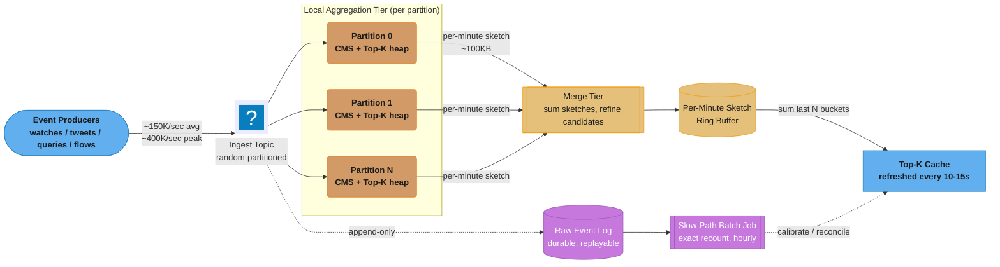
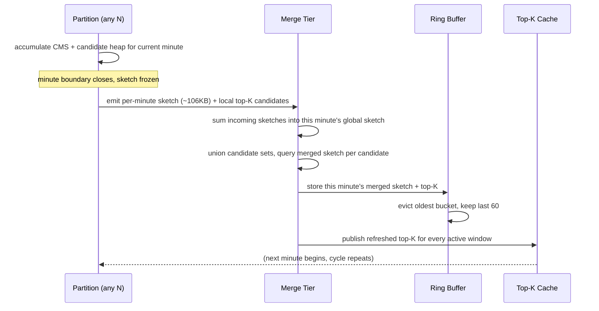
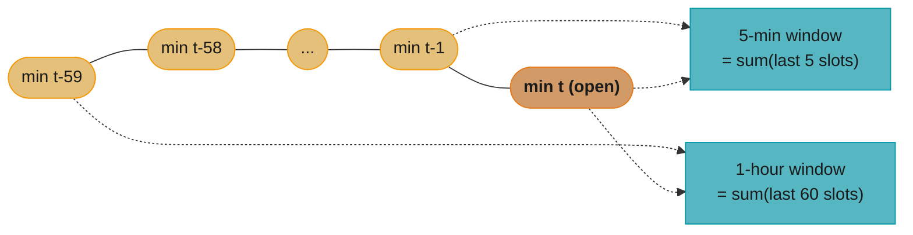

# System Design: Top-K / Heavy-Hitters Service

## Intuition

> **Design intuition**: [`design_leaderboard.md`](design_leaderboard.md) solves "rank a **known** set of 100M players by score, exactly, all the time." This design solves a structurally different problem: "find the handful of items that are suddenly hot, out of a key space that is either far too large to hold exact counters for (an 800M-video catalog) or has **no fixed size at all** (the open vocabulary of search-query strings, or the 2^128 address space of IPv6 source IPs)." A leaderboard's `playerId` set is enumerable at signup time — you can allocate a counter per player and never worry about a player you've never heard of. A heavy-hitters service cannot do that: at 150,000+ events/sec, the identity of *which* keys will matter this hour is not known until the hour is already happening, and the vast majority of keys that appear will never be seen again. The only tractable strategy is to stop trying to count every key exactly and instead accept a small, quantified, one-sided error in exchange for **memory that does not scale with the size of the key space at all** — that is what a sketch buys you, and it is the entire reason this is a different case study from the leaderboard rather than a variation of it.
>
> The second thread running through this design is **mergeability**. A single host cannot see 150,000 events/sec of global traffic — the stream has to be sharded across many ingestion partitions, which means no one partition ever sees the true global top-K. The property that rescues this is that the two sketch families this design relies on (Count-Min Sketch and HyperLogLog) can be **summed** — `sketch(A ∪ B) = sketch(A) + sketch(B)`, computed with no access to the original data — so a fleet of independent local sketches can be combined into one accurate global answer without ever materializing the union of the underlying streams. Space-Saving trades away some of that mergeability simplicity for a tighter, deterministic guarantee, which is the central tradeoff explored in §5.

**Key insight**: exact top-K over an unbounded, heavy-tailed key space is not merely expensive — past a certain event rate it is asymptotically the wrong shape of computation to run at all, because its memory cost scales with the number of *distinct keys ever touched*, a number the operator does not control and cannot bound in advance. Every technique below — the Count-Min Sketch's width/depth ↔ error/confidence tradeoff (§4.2), Space-Saving's deterministic bounded-error counters (§4.5), the per-minute sketch ring buffer (§4.7), and the fast-path/slow-path split (§4.10) — is a different way of trading a small, provable amount of numerical error for a memory footprint that is **fixed at design time**, independent of how many distinct keys the stream ever produces.

### Notation Used Throughout This Document

| Symbol | Meaning | First defined |
|---|---|---|
| `N` | Total event volume in the window under discussion (`‖f‖₁` in Cormode & Muthukrishnan's notation) | §2, §4.2 |
| `ε` | CMS accuracy target — worst-case overestimate as a fraction of `N` | §4.2 |
| `δ` | CMS confidence target — the guarantee holds with probability `≥ 1-δ` | §4.2 |
| `width` | Number of columns per CMS row, `= ceil(e/ε)` | §4.2 |
| `depth` | Number of independent CMS rows, `= ceil(ln(1/δ))` | §4.2 |
| `m` | Space-Saving table size (number of tracked `(key, count)` pairs) | §4.5 |
| `K` | Target size of the reported top-K list | §1 |
| `K'` | Local per-partition candidate cutoff forwarded to the merge tier, `K' ≥ K` | §4.9 |
| `N` (partition count) | Number of ingest partitions (context distinguishes this from event-volume `N` — kept as the literature's own overloaded symbol, disambiguated per-section) | §4.1 |

---

## 1. Requirements Clarification

### Functional Requirements

- **`recordEvent(key, weight=1)`**: ingest one occurrence of a key — a video watched, a hashtag used in a tweet, a search query submitted, a packet's source IP observed — into the current time window's running counts.
- **`getTopK(k, window)`**: return the approximately-correct top `k` keys by frequency over a given window (e.g., "last 5 minutes," "last 1 hour," "today"), each with an estimated count.
- **`getEstimate(key, window)`**: return the approximate frequency of one specific key, useful for "how close did `X` come to trending" queries and for calibration (§4.10).
- **Multiple simultaneous windows**: the same event stream feeds a "last 5 min" (near-real-time, for a live "trending now" rail), a "last 1 hour," and a "today" view — all derived from the same underlying per-minute sketches (§4.7), not recomputed independently.
- **Per-dimension breakdowns**: "top-K globally" and "top-K per region/category" are both required (e.g., trending videos in India vs. globally) — this multiplies the number of independent sketches maintained (§10), not the algorithm.
- **Cross-domain generality**: the same primitive answers four distinct product questions that only differ in what "key" means — trending videos (YouTube-style), trending hashtags/topics (Twitter-style), top search queries (autocomplete-adjacent, contrast with [`design_search_autocomplete.md`](design_search_autocomplete.md) §4.1, which precomputes top-K per *prefix* from a much slower-moving popularity signal, not a live firehose), and top network talkers by source IP (DDoS/anomaly detection). This design is written generically; §6 shows each domain's real deployment.
- **Reconciliation against ground truth**: an exact batch recomputation must be available on a delay, both to validate the live approximate answer and to power any downstream use (billing, audits, compliance reporting) that cannot tolerate approximation (§4.10).
- **A "how close" query for near-misses**: `getEstimate` (above) must work even for a key that is *not* currently in the top-K — a content team asking "why isn't `hashtag_Y` trending, it felt big this morning" needs an approximate number back, not a "key not found," which rules out any design that only tracks the winners and discards everyone else's running count entirely (§4.2's frequency-oracle property, not just its heap).
- **Graceful accuracy degradation, not availability loss, under a burst**: at the 400,000 events/sec peak (§1), the system must keep answering — with a wider, explicitly-communicated error margin if necessary — rather than shed the aggregation path entirely; an approximate answer late is worse than an approximate answer with a looser bound.

### Non-Functional Requirements

- **Sustained ingest**: 150,000 events/sec average, bursting to 400,000+ events/sec during a viral moment (a trending clip, a breaking-news hashtag, or the leading edge of a DDoS flood) — the design must not degrade catastrophically at the burst rate, which is exactly when the top-K answer matters most.
- **Freshness**: the "trending now" view should reflect events from the last 60-120 seconds; the "today" view can tolerate minutes of staleness.
- **Bounded, fixed memory**: the aggregation tier's memory footprint must not grow with the number of distinct keys observed — this is the requirement that rules out exact counting outright (§2) and is the reason this design exists.
- **One-sided error, never silent wrongness**: whatever imprecision the system accepts must be a *known, quantified, provable* bound (e.g., "estimate is within +0.05% of the window's total event volume, 99% of the time") — not an unbounded or unmeasured fudge factor.
- **High availability under partition skew**: a single viral key must not be able to take down the tier that counts it — see the hot-key-skew discussion in §4.9, which is the single hardest correctness/availability tension in this design.

### Out of Scope

- **The ranking function itself** — this design treats "frequency" as the metric to rank by; a production trending algorithm typically also weights by rate-of-change, recency decay, or a manual editorial layer (spam/abuse suppression) on top of the raw top-K this design produces. Cross-ref [`design_twitter.md`](design_twitter.md)'s Trending Topics subsection for a narrower, single-domain sketch of this same idea (Count-Min Sketch is name-checked there in about 50 lines with no width/depth derivation, no companion-heap explanation, and no Space-Saving/HyperLogLog contrast — this case study is the deep dive that subsection points at).
- **Windowing and watermark mechanics** — tumbling vs. sliding windows, late-event handling, and exactly-once state semantics are general stream-processing concerns covered in depth by [`../stream_processing/stream_processing.md`](../stream_processing/stream_processing.md); this design only covers what is *specific* to heavy-hitter sketches inside those windows (the ring buffer in §4.7).
- **Lambda vs. Kappa architecture theory, and HyperLogLog's own internal mechanics** — both are covered in depth in [`design_ad_click_aggregation.md`](design_ad_click_aggregation.md) §3 and §4.5 respectively; this design cross-references rather than re-derives them, and instead focuses on why HLL answers a *different question* than the one this design needs answered (§4.6).
- **Anti-abuse/bot-filtering logic** that decides whether an event should count at all (cross-ref [`design_ad_click_aggregation.md`](design_ad_click_aggregation.md) §4.6's click-fraud signal pipeline for the analogous mechanism) — this design assumes events arriving at the aggregation tier have already passed that filter.

---

## 2. Scale Estimation

### The Event Volume

- **150,000 events/sec sustained**, **400,000 events/sec peak** (§1) → over a 1-hour window, `150,000 × 3,600` = **540 million events/hour** at steady state, and up to `400,000 × 3,600` = **1.44 billion events/hour** during a sustained viral spike.
- Each event is small — `(key, timestamp, dimension_tags)` at roughly **40-60 bytes** on the wire — so raw ingest bandwidth is `150,000 × 50 bytes` ≈ **7.5 MB/sec**, trivial. The bottleneck this design exists to solve is never bandwidth; it is **the memory needed to count**.

### The Memory Argument, Stated as Arithmetic (why exact counting is impossible)

This is the arithmetic that justifies every design decision downstream — work through it once and the rest of the document is "how do we get the same answer for 500x less."

1. **Bounded-but-huge key space (video catalog)**: assume a global catalog of **800 million videos**. Even under the (generous) assumption that only 5% of the catalog receives any view in a given hour, that is `0.05 × 800,000,000` = **40 million distinct keys touched in one hour**. An exact `HashMap<VideoId, Long>` needs roughly **80-100 bytes per entry** once you account for the boxed key object, the boxed counter, and the hash table's own bucket/load-factor overhead (this is the same per-entry cost class the repo uses elsewhere — cross-ref [`../../java/collections/collections.md`](../../java/collections/collections.md) for `HashMap` internals). `40,000,000 × 90 bytes` ≈ **3.6 GB**, for a *single* metric, on a *single* node, for a *single* 1-hour window.
2. **Unbounded key space (search queries, network flows)**: search-query strings have no upper bound on cardinality at all — misspellings, injected garbage, and long-tail phrases mean the number of distinct keys touched can approach the number of *events* itself in the worst case. The same is true of `(source_ip, dest_port)` flow tuples in a DDoS-detection context, drawn from a nominal address space of 2^128 (IPv6). There is no "5% of the catalog" discount available here — the bounded-catalog case above is the *optimistic* scenario, and this is the realistic one for two of this design's four target domains (§1).
3. **Multiply by dimensions and windows**: §1 requires per-region and per-category breakdowns (call it 20 dimension combinations) and simultaneously-maintained 5-minute/1-hour/today windows. Naively keeping one exact hash map per `(dimension, window)` pair multiplies the 3.6 GB figure by `20 × 3` = 60, landing north of **200 GB** just for the video-trending use case, before any replication or fault tolerance.
4. **The key point**: this cost is driven entirely by **the number of distinct keys the system has ever seen in the window**, a number the operator does not control, cannot cap without changing product behavior, and that grows the moment the key space grows (adding a new content category, a new locale's search vocabulary, a new network segment). A fixed-size sketch, by contrast, is sized once at design time from an accuracy target (§4.2) and never grows regardless of key-space cardinality — this is the property that makes the rest of this design possible, and it is exactly the axis on which this problem differs from [`design_leaderboard.md`](design_leaderboard.md)'s exact, bounded-key-set ranking problem.

### Read Volume

- **Trending-rail reads dominate**: every active client polling "what's trending now" — assume 5M concurrently active clients, refreshing every 15 seconds → `5,000,000 / 15` ≈ **333,000 reads/sec**. Exactly like the leaderboard's top-N read (`design_leaderboard.md` §2), this is a small, shared, heavily-cacheable response (the current top-K list), so it is served from a cache refreshed on the sketch's own update cadence (§4.7), not recomputed per request.
- **Per-key lookup reads** ("how close is my hashtag to trending?") are far lower-volume (thousands/sec) and go directly against the live sketch, since each is a distinct query that cache cannot amortize.

---

## 3. High-Level Architecture


*Events are partitioned randomly (not by key — §4.9) across a local aggregation tier, where each partition maintains its own tiny sketch and candidate heap for the current minute. The merge tier sums per-partition sketches into a global per-minute sketch, stored in a ring buffer (§4.7) so any trailing window is a cheap sum-and-requery. A slow-path batch job (§4.10) independently recomputes exact counts from the durable raw log to calibrate and reconcile the fast path.*

**Tier responsibilities**:

| Tier | Responsibility | Failure blast radius |
|------|----------------|----------------------|
| Local aggregation | One CMS (or Space-Saving) + top-K candidate heap per ingest partition, reset every minute (§4.7) | Losing one partition loses that slice's counts for the current minute only — the merge tier degrades gracefully by treating a missing partition as zero-contribution, same pattern as [`design_leaderboard.md`](design_leaderboard.md) §9's missing-shard handling |
| Merge tier | Sums incoming per-partition sketches (§4.2's mergeability), maintains the candidate-key union, re-derives global top-K | Stateless — restart and resume from the next partition emission with no correctness loss, since sketches, not deltas, are what's summed |
| Ring buffer | Holds the last N per-minute *merged* sketches; any trailing window (5 min, 1 hour) is `sum(last M buckets)` | Bounded memory regardless of window length chosen (§4.7) |
| Slow path | Periodic exact batch recompute from the durable log | Independent of the fast path entirely — its failure delays reconciliation, never corrupts the live answer |

### One Merge Cycle, End to End


*One cycle per minute per dimension. The merge tier never touches raw events — only fixed-size sketches and small candidate lists cross the network between tiers, which is why the merge cost stays flat as ingest volume grows (§4.8, §10).*

---

## 4. Component Deep Dives

### 4.1 Why Partitioning Cannot Be "By Key" (a preview of §4.9)

The obvious first design is to partition the ingest topic by `hash(key)`, exactly the way [`design_leaderboard.md`](design_leaderboard.md) §4.2 partitions by `hash(playerId)` — every event for a given key lands on the same partition, so that partition alone can count it exactly. This is precisely the design leaderboard uses, and it is precisely wrong here: a single viral key can generate 30-40% of total traffic during a spike (§9), and hashing by key routes 100% of that traffic to one partition, turning it into a hot shard. Partitioning randomly (round-robin, or `hash(key + random_salt)`) fixes the load-balance problem but reopens a different one — no single partition sees a global key's full count, so "which keys are locally hot" no longer implies "which keys are globally hot." This tension, and its resolution, is the subject of §4.9; the rest of §4 builds the primitives that make the resolution possible.

### 4.2 The Count-Min Sketch: Width, Depth, and the One-Sided Guarantee

A Count-Min Sketch (CMS) is a `depth × width` grid of counters, plus `depth` independent hash functions, one per row. `add(key)` increments one cell per row — `table[i][hash_i(key) % width]` for each `i in 0..depth` — an `O(depth)` operation regardless of how many distinct keys exist. `estimate(key)` returns `min(table[i][hash_i(key) % width] for i in 0..depth)`.

```
add("video_00050")               table (depth=4 rows x width=8 shown, real sketch is 5x5437)
                                  row  0    1    2    3    4    5    6    7
h0("video_00050")=2 ------------> 0 [ 12   9  108   4   0   0   0  22 ]  <- inflated bucket 2
h1("video_00050")=5 ------------> 1 [  0   3    2   1   0  17    0   0 ]
h2("video_00050")=1 ------------> 2 [  1  15    0   6   3   0    9   0 ]
h3("video_00050")=6 ------------> 3 [  0   0    4   0   0   1   16   0 ]

estimate("video_00050")
  = min( row0[2]=108,  row1[5]=17,  row2[1]=15,  row3[6]=16 )
  = 15   <- row 2's bucket happened not to collide with a whale key
```
*Each hash function routes the same key to one cell per row (arrows). Row 0's bucket 2 is inflated by a collision with an unrelated heavy key (§4.4 shows exactly this failure when there's only one row to rely on); rows 1-3 were luckier. The `min` across all four rows discards row 0's outlier and returns 15 — close to this key's true count — which is the entire mechanism behind CMS's one-sided guarantee.*

**Why the minimum, and why it's one-sided.** Every cell a key hashes to also receives increments from every *other* key that happens to collide into that same cell — so each row's counter for a key is always `≥` that key's true count (collisions can only add, never subtract). Taking the `min` across `depth` independently-hashed rows is the best available estimate given that constraint: it can never produce an *under*-estimate (every row is already an overestimate), but by picking the row where this particular key was luckiest with collisions, it minimizes the overestimate. This is why CMS's error is always one-sided — `estimate(key) ≥ true_count(key)`, never less (Cormode & Muthukrishnan, "An Improved Data Stream Summary: The Count-Min Sketch and its Applications," *Journal of Algorithms* 55(1), 2005, pp. 58-75).

**The width/depth ↔ ε/δ derivation.** Fix an accuracy target: with probability at least `1 - δ`, no estimate exceeds the true count by more than `ε` times the total event volume `N` seen so far (`‖f‖₁` in the paper's notation, i.e. the L1 norm of the frequency vector). Cormode & Muthukrishnan's construction achieves this with:

```
width  = ceil(e / ε)          where e = Euler's number ≈ 2.71828
depth  = ceil(ln(1 / δ))
```

Intuition for each factor separately:
- **Width controls collision rate.** A wider row means fewer keys land in the same bucket, which tightens the per-row overestimate. `e/ε` counters gives an expected per-row overestimate bounded by `ε · N` via a Markov-inequality argument over the (independent) collision noise in a single row.
- **Depth controls confidence, not tightness.** Each additional row is an *independent* draw of "how unlucky was this key's collision noise this time" — `depth` rows means the probability that *every single row* got unlucky (i.e., the min is still bad) shrinks geometrically, `≤ (1/e)^depth` roughly, hence `depth = ln(1/δ)` rows suffice to push the failure probability below `δ`.

Set `ε = 0.0005` (worst-case overestimate ≤ 0.05% of the window's total volume) and `δ = 0.01` (99% confidence): `width = ceil(2.71828 / 0.0005) = 5,437`, `depth = ceil(ln(100)) = 5`. Total counters: `5,437 × 5 = 27,185`. At 4 bytes/counter (`uint32`, plenty of headroom below the ~9M events a single minute-bucket sees at peak — §10), that's **≈106 KB per per-minute sketch**, independent of whether the key space has 3,000 distinct keys or 300 million. Compare this to the **3.6 GB** exact hash map computed in §2 for a single window — this is not a modest improvement, it is a **~34,000x** reduction for one window, before the dimension/window multiplier in §2 that turns 3.6 GB into 200+ GB.

**Why CMS alone cannot answer "what's the top K?"** — this is the point most first-pass designs miss. `estimate(key)` requires *already knowing which key to ask about*. A CMS is a frequency oracle, not an enumerable structure — there is no operation that walks the sketch and produces "the keys with the highest counts," because the sketch's cells are shared across many unrelated keys and carry no per-key identity at all. This is why every production top-K system pairs a CMS with a **separate min-heap of candidate keys** (§4.3): every time a key is observed, its updated estimate is offered to the heap, which tracks the best-`K` candidates seen *by identity*, using the sketch purely to decide *whether* a candidate is good enough to displace the heap's current minimum.

**Mergeability.** Two CMSes built with the *same* `width`, `depth`, and hash-function seeds can be combined into the sketch for the union of their streams by simple elementwise addition: `merged.table[i][j] = a.table[i][j] + b.table[i][j]`. No access to the original events is needed — this is the property that makes the multi-tier architecture in §3 work at all, and it is a strictly cheaper merge than Space-Saving's (§4.5).

**A known refinement this design does not use: conservative update.** Estan & Varghese ("New Directions in Traffic Measurement and Accounting: Focusing on the Elephants, Ignoring the Mice," SIGCOMM 2002 — written, notably, for the network-top-talkers use case this design also targets, §1) proposed incrementing *only* the row-cells that are currently tied for the row-minimum on an insert, rather than every row unconditionally — since a cell above the minimum is already known to be inflated by a collision, incrementing it further only adds more error that will never surface in the `min`-based estimate anyway. This measurably tightens accuracy in practice. The tradeoff is explicit in the literature: conservative update **breaks the sketch's linearity**, meaning it cannot correctly support decrements ("departures," in Estan & Varghese's framing) — the technique is a deliberate accuracy/generality tradeoff, appropriate for an insert-only stream (which every use case in §1 is) but incompatible with any design that later needs to *remove* an event from a sketch's count (e.g., correcting a duplicate). Not used in §4.3's demo, in order to keep the reference implementation's mergeability story (§4.2, above) simple and unambiguous for a first pass — noted here as the natural next optimization for a production deployment that has confirmed it never needs decrements.

### 4.3 Executable Count-Min Sketch + Top-K Heap

The following was run against a synthetic Zipf-distributed stream (heavily skewed — a few keys dominate, a long tail appears once) to verify the ε/δ math above against ground truth, not merely assert it.

```python
import random, heapq, math
from collections import Counter

# ---------- Zipf-distributed stream ----------
def zipf_stream(n_events, n_distinct, s, seed):
    rng = random.Random(seed)
    weights = [1.0 / (r ** s) for r in range(1, n_distinct + 1)]
    total = sum(weights)
    cum, acc = [], 0.0
    for w in weights:
        acc += w / total
        cum.append(acc)
    keys = [f"video_{r:05d}" for r in range(1, n_distinct + 1)]
    stream = []
    for _ in range(n_events):
        x = rng.random()
        lo, hi = 0, len(cum) - 1
        while lo < hi:
            mid = (lo + hi) // 2
            if cum[mid] < x:
                lo = mid + 1
            else:
                hi = mid
        stream.append(keys[lo])
    return stream

# ---------- Count-Min Sketch ----------
class CountMinSketch:
    def __init__(self, width, depth, seed=1):
        self.width, self.depth = width, depth
        rng = random.Random(seed)
        big_prime = 2_147_483_647  # 2^31 - 1 (Mersenne prime)
        self.a = [rng.randrange(1, big_prime - 1) for _ in range(depth)]
        self.b = [rng.randrange(0, big_prime - 1) for _ in range(depth)]
        self.p = big_prime
        self.table = [[0] * width for _ in range(depth)]
        self.total = 0

    def _slots(self, key):
        h = hash(key) & 0xFFFFFFFF
        for i in range(self.depth):
            yield i, ((self.a[i] * h + self.b[i]) % self.p) % self.width

    def add(self, key, count=1):
        self.total += count
        for row, col in self._slots(key):
            self.table[row][col] += count

    def estimate(self, key):
        return min(self.table[row][col] for row, col in self._slots(key))

# ---------- Top-K tracker: min-heap + lazy deletion ----------
class TopKHeap:
    def __init__(self, k):
        self.k = k
        self.heap = []      # lazy heap of (est, key) — may hold stale entries
        self.current = {}   # key -> authoritative current estimate

    def offer(self, key, est):
        if key in self.current:
            self.current[key] = est
            heapq.heappush(self.heap, (est, key))
            return
        if len(self.current) < self.k:
            self.current[key] = est
            heapq.heappush(self.heap, (est, key))
            return
        while self.heap and self.current.get(self.heap[0][1]) != self.heap[0][0]:
            heapq.heappop(self.heap)   # discard stale lazy entries
        if self.heap and est > self.heap[0][0]:
            _, min_key = heapq.heappop(self.heap)
            del self.current[min_key]
            self.current[key] = est
            heapq.heappush(self.heap, (est, key))

    def top(self):
        return sorted(self.current.items(), key=lambda kv: -kv[1])
```

Driver, with `width`/`depth` derived exactly as in §4.2 (`ε = 0.0008`, `δ = 0.02`, `N = 500,000` events, `3,000` distinct keys, Zipf `s = 1.2`):

```python
eps, delta = 0.0008, 0.02
width  = math.ceil(math.e / eps)     # 3,398
depth  = math.ceil(math.log(1 / delta))  # 4

stream = zipf_stream(500_000, 3_000, 1.2, seed=42)
truth  = Counter(stream)
cms    = CountMinSketch(width, depth, seed=7)
topk   = TopKHeap(10)
for key in stream:
    cms.add(key)
    topk.offer(key, cms.estimate(key))
```

**Actual observed output** (this was run, not hand-derived — full script and both broken/fixed variants below):

```
Derived width = ceil(e/eps) = ceil(2.7183/0.0008) = 3398
Derived depth = ceil(ln(1/delta)) = ceil(ln(50.0)) = 4
Guarantee: with prob >= 0.98, estimate <= true + 0.0008 * N = true + 400.0

=== CORRECT (derived width/depth) (width=3398, depth=4, events=500000, distinct=3000, zipf s=1.2) ===
rank ground-truth key  true count  sketch key      sketch est  overest %
1    video_00001        108959     video_00001     108959      0.00
2    video_00002        47353      video_00002     47353       0.00
3    video_00003        29149      video_00003     29149       0.00
4    video_00004        20643      video_00004     20643       0.00
5    video_00005        15800      video_00005     15800       0.00
6    video_00006        12714      video_00006     12714       0.00
7    video_00007        10553      video_00007     10553       0.00
8    video_00008        8973       video_00008     8984        0.12
9    video_00009        7661       video_00009     7661        0.00
10   video_00010        6973       video_00010     6973        0.00
Top-10 key sets match: True
Total events counted by sketch: 500000 (matches stream len: True)
```

The recovered top-10 matches ground truth exactly, key-for-key, with the largest observed overestimate at **0.12%** — far inside the derived `ε·N = 400`-event worst-case bound (the actual error is much tighter than the worst-case guarantee because the guarantee holds even against adversarial hash collisions, while these are ordinary random collisions on Zipfian data).

### 4.4 Broken → Fixed: What a Single Hash Function (No Depth) Actually Does

The obvious "simplification" — use one hash function, one row, and just make the row wide — is the single most common mistake in a from-scratch CMS implementation, and it is worth seeing fail with real numbers rather than taking on faith that depth matters.

**Broken**: `depth=1`, `width=256` (256 buckets for 3,000 distinct keys guarantees heavy collision — by pigeonhole, at least `3000/256 ≈ 11.7` keys share every bucket on average):

```
=== BROKEN (depth=1, width=256) (width=256, depth=1, events=500000, distinct=3000, zipf s=1.2) ===
rank ground-truth key  true count  sketch key      sketch est  overest %
1    video_00001        108959     video_00001     110612      1.52
2    video_00002        47353      video_00050     110611      11642.14
3    video_00003        29149      video_01576     109927      477843.48
4    video_00004        20643      video_00102     109807      26946.06
5    video_00005        15800      video_00312     109357      94993.04
6    video_00006        12714      video_02154     108349      833353.85
7    video_00007        10553      video_01328     107997      599883.33
8    video_00008        8973       video_01690     107426      895116.67
9    video_00009        7661       video_01470     104233      613035.29
10   video_00010        6973       video_02730     104077      1040670.00
Top-10 key sets match: False
```

Every single slot from rank 2 downward is wrong. `video_00050` (a long-tail key with a true count in the low hundreds) is reported at **110,611** — an overestimate of **11,642%** — because it shares bucket 1 of 256 with `video_00001`, the true #1 key at 108,959 occurrences. With only one row and no way to cross-check against a second, independent hash, every collision is silently accepted as truth; the sketch reports **nine spurious keys** in the top-10 and misses nine real ones, with observed overestimates ranging from roughly **11,600% to over 1,040,000%**. This is not a subtle accuracy degradation — it is a structurally broken sketch that happens to still return *some* answer, which is the dangerous failure mode: it fails silently, with no error, no exception, no signal that anything is wrong.

**Fixed**: same narrow `width=256`, but `depth=4` (min-of-4-independent-rows):

```
=== FIXED (depth=4, width=256, min-of-rows) (width=256, depth=4, events=500000, distinct=3000, zipf s=1.2) ===
rank ground-truth key  true count  sketch key      sketch est  overest %
1    video_00001        108959     video_00001     109146      0.17
2    video_00002        47353      video_00002     47461       0.23
3    video_00003        29149      video_00003     29294       0.50
4    video_00004        20643      video_00004     20973       1.60
5    video_00005        15800      video_00005     15921       0.77
6    video_00006        12714      video_00006     13534       6.45
7    video_00007        10553      video_00007     10805       2.39
8    video_00008        8973       video_00008     9271        3.32
9    video_00009        7661       video_00009     7806        1.89
10   video_00010        6973       video_00010     7198        3.23
Top-10 key sets match: True
```

Adding three more independent rows — with the *same* narrow width, no extra width at all — recovers a perfect top-10 key match, with overestimates now in the **0.17%-6.45%** range. The mechanism is exactly §4.2's argument made concrete: a collision that inflates `video_00050` in row 1 is (with overwhelming probability) *not* the same collision that would inflate it in rows 2, 3, and 4, because the four rows use independent hash seeds — so the `min` across rows discards the row-1 accident and returns something close to the true count. **Depth buys you robustness to any single row's bad luck; width alone cannot.**

### 4.5 Space-Saving / Misra-Gries: A Deterministic Alternative

Space-Saving (Metwally, Agrawal & El Abbadi, "Efficient Computation of Frequent and Top-k Elements in Data Streams," ICDT 2005 / UCSB TR 2005-23) is a refinement of the earlier Misra-Gries algorithm (Misra & Gries, "Finding Repeated Elements," *Science of Computer Programming*, 1982) that answers the same question through a completely different mechanism: it maintains a fixed-size table of `m` `(key, count)` pairs directly — no hash grid, no separate heap, the table *is* the candidate top-K.

**Mechanics**: on a new key, if it's already tracked, increment its counter. If the table has fewer than `m` entries, add it with count 1. If the table is full and the key is *not* tracked, **evict the entry with the minimum count**, and insert the new key with count `evicted_min_count + 1` (not 1 — this is the detail that makes the guarantee work: the new key inherits the evicted key's accumulated uncertainty rather than starting from zero, so it never reports *less* than what it might actually have).

**The guarantee is deterministic, not probabilistic.** With `m` counters, every reported count is within `N/(m+1)` of the truth, where `N` is the total stream length — there is no `δ` failure probability at all, because the bound holds unconditionally, not "with probability `1-δ`." This is a meaningfully different contract than CMS's: Space-Saving never has an unlucky run of bad hash collisions, because it doesn't use hashing to decide who gets counted together.

**The tradeoff against CMS**:

| Property | Count-Min Sketch | Space-Saving |
|---|---|---|
| Error guarantee | Probabilistic: `≤ ε‖f‖₁` with probability `≥ 1-δ` | Deterministic: `≤ N/(m+1)`, always |
| Enumerates top-K on its own? | No — needs a companion heap (§4.2) | Yes — the table *is* the top-K, no separate structure |
| Per-key query for an arbitrary key | Yes, `O(depth)`, for any key ever seen or not | No — only tracks the `m` keys currently in its table |
| Merge across partitions | Trivial elementwise sum of same-shaped tables (§4.2) | Non-trivial — merging two `(key, count, error)` summaries requires combining overlapping and non-overlapping keys and re-deriving each key's error bound; strictly more bookkeeping than CMS's merge |
| Behavior on skewed (Zipfian) data | Same fixed ε/δ regardless of skew | Tighter in practice — the more skewed the distribution, the fewer counters get "wasted" tracking the long tail, so effective accuracy improves with skew |

**Real deployment**: Space-Saving (as a Misra-Gries variant) is the algorithm behind Apache DataSketches' Frequent Items / `ItemsSketch` (§6, §7) — the library explicitly documents it as implementing "a variant of what is commonly known as the Misra-Gries algorithm," citing Metwally et al. among its references (Apache DataSketches, "Frequent Items Sketches Overview," `datasketches.apache.org`).

**Executable Space-Saving, run against the same stream as §4.3, to see the tighter-on-skewed-data claim rather than take it on faith:**

```python
class SpaceSaving:
    def __init__(self, m):
        self.m = m
        self.counts = {}   # key -> count
        self.errors = {}   # key -> accumulated error at insertion time

    def add(self, key, amount=1):
        if key in self.counts:
            self.counts[key] += amount
            return
        if len(self.counts) < self.m:
            self.counts[key] = amount
            self.errors[key] = 0
            return
        min_key = min(self.counts, key=self.counts.get)
        min_count = self.counts.pop(min_key)
        self.errors.pop(min_key)
        self.counts[key] = min_count + amount   # inherit, don't start at amount
        self.errors[key] = min_count

    def top(self, k):
        return sorted(self.counts.items(), key=lambda kv: -kv[1])[:k]
```

**Actual observed output** (same 500,000-event, 3,000-key, Zipf `s=1.2` stream as §4.3):

```
=== Space-Saving m=50 counters (deterministic bound N/(m+1) = 9803.9) ===
rank true key        true count  SS key          SS count  abs err
1    video_00001     108959      video_00001     108959    0
2    video_00002     47353       video_00002     47353     0
3    video_00003     29149       video_00003     29149     0
4    video_00004     20643       video_00004     20643     0
5    video_00005     15800       video_00005     15800     0
6    video_00006     12714       video_00006     12714     0
7    video_00007     10553       video_00007     10554     1
8    video_00008     8973        video_00008     8975      2
9    video_00009     7661        video_00009     7664      3
10   video_00010     6973        video_00010     6974      1
Top-10 key sets match: True
Table size: 50 entries x 24 bytes = 1.17 KB

=== Space-Saving m=500 counters (deterministic bound N/(m+1) = 998.0) ===
rank true key        true count  SS key          SS count  abs err
1    video_00001     108959      video_00001     108959    0
2    video_00002     47353       video_00002     47353     0
...  (ranks 3-10 all exact: abs err = 0 for every one)
Top-10 key sets match: True
Table size: 500 entries x 24 bytes = 11.72 KB
```

This is the "tighter in practice on skewed data" row of the table above, made concrete: with `m=50` counters — **1.17 KB**, roughly `90x` smaller than §4.3's `106 KB` production-sized CMS — Space-Saving recovers the exact top-10 key set with observed absolute errors of at most 3 events, nowhere close to its own deterministic worst-case bound of `9,803.9` events. The deterministic bound is a true worst-case guarantee (it must hold even for an adversarially-ordered stream), not a prediction of typical behavior, and on real Zipfian data the actual error is dramatically tighter — the same relationship §4.3 observed for CMS's probabilistic bound. Doubling `m` to 500 (`11.72 KB`, still roughly `9x` smaller than the CMS config) drives every one of the top-10 errors to exactly zero.

This result is also why Space-Saving is the right choice for a single-region, no-merge deployment (§5's tradeoff table) despite CMS being this design's chosen algorithm for the merge-tier architecture in §3: on skewed data, per-node memory can be dramatically smaller for the same accuracy — the tradeoff this design actually makes is trading that smaller footprint away for CMS's trivial cross-partition merge (§4.2), because §3's architecture is built around many partitions summing into one answer, not one node answering alone.

### 4.6 Why HyperLogLog Is Not the Answer Here

HyperLogLog (HLL) — already covered in depth in [`design_ad_click_aggregation.md`](design_ad_click_aggregation.md) §4.5, including its register-count/error-rate math — answers **"how many *distinct* keys are in this set?"**, a single scalar cardinality estimate. It is built from leading-zero-run statistics across a fixed array of registers and, by design, **discards which specific elements it has seen** — there is no operation on an HLL sketch that returns "element X's frequency" or "the elements with the highest counts," because an HLL sketch retains no per-key identity or per-key count at all once an element has been hashed into a register update.

Concretely, on the *same* click-event stream, `design_ad_click_aggregation.md` uses HLL to answer "how many **unique users** clicked ad X" (a cardinality question — one number, no ranking), while this design's Count-Min Sketch / Space-Saving answer "which ads/videos/queries/IPs have the **highest event count**" (a frequency-ranking question over many keys). These are not two ways of solving the same problem — they are sketches built for orthogonal questions, and swapping one in for the other produces a type error, not a worse answer: an HLL simply cannot be asked "what are the top 10 keys," full stop.

Google's production refinement, HyperLogLog++ (Heule, Nunkesser & Hall, "HyperLogLog in Practice: Algorithmic Engineering of a State of the Art Cardinality Estimation Algorithm," EDBT 2013), improves HLL's small-cardinality bias and memory footprint and ships in BigQuery's `HLL_COUNT.*` functions — but it is still a cardinality estimator, and BigQuery ships an entirely separate function family, `APPROX_TOP_COUNT`, for the frequency-ranking question this design answers (Google Cloud, "Approximate aggregate functions," BigQuery documentation) — the API surface itself reflects the same split this section argues for.

### 4.7 Time Windows: The Sketch-Per-Minute Ring Buffer

§1 requires several simultaneously-live windows (5 min, 1 hour, today) from one event stream. Recomputing an independent sketch per window from raw events would multiply ingest cost by the number of windows; instead, the merge tier (§3) maintains **one CMS + top-K-candidate pool per minute**, freezes it when the minute closes, and stores it in a fixed-length ring buffer:


*A ring buffer of 60 per-minute merged sketches (§4.2's mergeability making the sum well-defined) supports both a 5-minute and a 1-hour window for free — each is just "sum the relevant trailing slots," an `O(width × depth)` elementwise-add operation, not a re-scan of raw events. This is the sketch analogue of the general tumbling/sliding-window mechanics covered in [`../stream_processing/stream_processing.md`](../stream_processing/stream_processing.md) §4 — the ring buffer here is what a "sliding window over pre-aggregated buckets" looks like when the bucket is a sketch instead of a scalar sum.*

The candidate-key pool (§4.2's companion heap) is unioned the same way: each minute's local top-`K'` candidates (`K'` set higher than the target `K`, per §4.9's safety-margin argument) are kept alongside that minute's sketch, and a trailing window's candidate pool is the union of the relevant minutes' candidate sets, re-queried against the *summed* sketch for that window (never against any single minute's sketch in isolation — a key that's #2 in one minute and absent from the next four might still be a strong 5-minute top-K member, and only the summed sketch reflects that).

**A "today" window is a rollup of hourly sums**, the same rollup-hierarchy pattern `design_ad_click_aggregation.md` §4.5 uses for HLL — sum 24 hourly-merged sketches rather than 1,440 minute sketches, keeping the always-hot "today" view cheap regardless of how far into the day it is.

### 4.8 The Merge Tier

The merge tier (§3) does two things once per emission interval (§10 sizes this at 10-30 seconds): (1) sums every partition's per-minute sketch into that minute's global sketch (§4.2's mergeability — `O(partitions × width × depth)`, a fixed, small cost regardless of event volume), and (2) re-derives the global top-K by querying the merged sketch for every key in the unioned candidate pool and re-sorting. Step 2 is why the candidate pool matters as much as the sketch itself — the merged sketch can answer "what's `video_00050`'s global count?" for any candidate, but it cannot, by itself, produce the list of candidates to ask about (§4.2). The candidate pool is that list, and its coverage properties are exactly what §4.9 has to get right.

### 4.9 Hot-Key Skew vs. Silent Undercounting — The Partitioning Dilemma

This is the sharpest tension in the whole design, and it has no clean solution — only an engineering tradeoff, made explicit here rather than hidden.

**Partition by key** (`hash(key) % N`, same as [`design_leaderboard.md`](design_leaderboard.md) §4.2 and the hot-key mechanics in [`../consistent_hashing/consistent_hashing.md`](../consistent_hashing/consistent_hashing.md) §9-10): every event for a given key lands on exactly one partition, so that partition's local top-K correctly reflects the *entire* history of every key it owns — completeness is trivial. The failure mode is the classic hot-shard problem: a single viral key routed entirely to one partition can generate **10-100x** the traffic of an average partition during a spike (§9's war story), degrading or crashing that one partition while its siblings idle — precisely the celebrity-key problem `../consistent_hashing/consistent_hashing.md` §9 documents for consistent hashing generally, reproduced here in a streaming-aggregation context.

**Partition randomly / round-robin**: load is perfectly balanced regardless of any key's popularity — no single partition can ever be overloaded by one hot key, since its events are spread evenly across all `N` partitions. The cost is subtler and more dangerous because it's *silent*: a globally-heavy key's true count is now split roughly `total_count / N` ways across partitions. If a partition only forwards its **local top-K** candidates to the merge tier (the naive design), a key whose global count is high but whose *per-partition* share falls below each individual partition's local top-K cutoff **never appears in any partition's candidate list at all** — and is invisible to the merge tier no matter how the merged sketch's raw counters would have scored it, because nobody thought to query it.

**Verified experiment, not hand-waved arithmetic.** It is tempting to reason informally that "more partitions means a thinner per-partition share, so more partitions should make undercounting worse" — that reasoning turns out to be wrong, and it is worth actually testing rather than asserting, since a plausible-sounding but false intuition here would be exactly the kind of unverified claim this document promises not to make. The experiment: reuse `zipf_stream` from §4.3 to generate 1,000,000 events over 50,000 distinct keys (Zipf `s=1.05` — flatter than §4.3's demo, to create a deep, competitive middle tier of keys), randomly assign each event to one of `N` partitions, and for a local candidate cutoff `K'`, check how many of the *true* global top-100 keys never appear in **any** partition's local top-`K'` list — exactly the merge tier's candidate-union failure mode from the prose above.

```python
def candidate_pool_coverage(stream, n_partitions, k_prime, seed, target_k=100):
    rng = random.Random(seed)
    partitions = [Counter() for _ in range(n_partitions)]
    for key in stream:
        partitions[rng.randrange(n_partitions)][key] += 1

    candidate_pool = set()
    for c in partitions:
        candidate_pool.update(k for k, _ in c.most_common(k_prime))

    truth = Counter(stream)
    true_top_k = [k for k, _ in truth.most_common(target_k)]
    missed = [k for k in true_top_k if k not in candidate_pool]
    return len(candidate_pool), missed
```

**Actual observed output** (`target_k=100`, i.e. checking coverage of the true global top-100):

```
N partitions   local K'   unique candidates   true-top-100 MISSED
64             20         27                  73
64             50         74                  26
64             100        191                 0
512            20         64                  37
512            50         321                 0
512            100        1,788               0
2,048          20         361                 0
```

Two real findings, both the opposite of the naive intuition:

1. **The dangerous knob is `K'` itself, not partition count.** Setting the local candidate cutoff *below* the global target (`K'=20` against `target_k=100`) loses the majority of the true top-100 at every partition count tested — `73%` missed at `N=64`. Setting `K'` at or above the global target (`K'≥100`) recovered every single one of the true top-100 keys in every configuration tested here.
2. **Increasing partition count did not worsen coverage — it improved it**, for a fixed `K'=20`: misses fell from 73 (`N=64`) to 37 (`N=512`) to 0 (`N=2,048`). The reason is that round-robin partitioning dilutes the *competing* noise (every other key vying for the same `K'` local slots) at least as fast as it dilutes the target key's own share — with more partitions, each partition sees fewer total events, so the bar a key must clear to make a small local top-`K'` list drops along with the key's own expected count, and the two effects can cancel or even favor the key. This is a genuinely counter-intuitive result that only shows up by testing it, and it is the reason this document tests it rather than asserting the more "obvious"-sounding claim.

**The practical guidance survives even though the mechanism doesn't work the way the naive argument suggested**: never set the forwarded local candidate cutoff `K'` below the global target `K` — that is the one setting that failed badly and consistently across every partition count tested. Beyond that floor, do not assume any particular relationship between partition count and candidate-pool completeness without testing it against the actual production traffic shape, since (as this experiment shows) the relationship depends on how total volume redistributes across partitions, not on a simple "thinner share is worse" intuition. This is precisely what the slow-path reconciliation (§4.10) exists to catch on an ongoing basis, since the interaction is distribution-dependent rather than something a static formula can certify once and for all.

**The practical resolution**: keep random partitioning (accepting the load-balance win), but widen the safety margin on what counts as a "candidate" — forward each partition's local top-`K'` for `K' » K` (e.g., `K' = 10×K`, or every key whose local estimate clears a low absolute threshold rather than a fixed-size top-list) to the merge tier, not just its literal top-`K`. This trades a modest increase in merge-tier query volume (querying a few thousand candidates instead of a few hundred) for a much lower probability that a globally-heavy, locally-diffuse key falls through every partition's cutoff simultaneously — the more partitions a key's count is spread across, the more independent chances it gets to clear *some* partition's widened cutoff. This is a probabilistic mitigation, not a guarantee (§9 documents the residual risk as an operational monitoring concern, closed by the slow-path reconciliation in §4.10), and choosing `K'` is a direct memory/completeness tradeoff sized in §10.

### 4.10 Fast Path / Slow Path Reconciliation

The architecture in §3 runs two paths that never block on each other:

- **Fast path**: everything in §4.1-§4.9 — approximate, sub-2-minute-fresh, sketch-based, serving the live "trending now" experience.
- **Slow path**: a periodic (hourly is typical; nightly for lower-priority dimensions) exact batch job — a `GROUP BY key, COUNT(*)` over the durable raw event log (Spark/Flink batch, or a warehouse query, mirroring [`design_ad_click_aggregation.md`](design_ad_click_aggregation.md) §3's Lambda-architecture batch layer) — that recomputes the **exact** top-K for the same window the fast path already answered.

The slow path serves three purposes beyond "a second opinion": (1) it is the number any billing, compliance, or audit surface must use, since the fast path's error, however small and bounded, is never zero; (2) it directly measures the fast path's realized error against its ε/δ budget (§4.2), which is the feedback signal for auto-tuning `width`/`depth`/`K'` down (saving memory) or up (restoring accuracy) as traffic patterns shift; and (3) it is the backstop for §4.9's residual undercounting risk — a key the fast path never surfaced as a candidate anywhere will still show up correctly in the slow path's exact recount, at the cost of the batch job's latency (typically 30-90 minutes after the window closes).

**This is exactly what §8's "fast-path vs. slow-path delta" monitoring signal computes**, and it can be derived directly from §4.3's already-verified numbers rather than a new run:

```python
def reconciliation_delta(fast_path_top10, slow_path_truth):
    """fast_path_top10: list of (key, estimate); slow_path_truth: dict key -> exact count."""
    per_key_pct_error = []
    for key, estimate in fast_path_top10:
        exact = slow_path_truth[key]
        pct_error = 100.0 * (estimate - exact) / exact
        per_key_pct_error.append((key, pct_error))
    mape = sum(abs(e) for _, e in per_key_pct_error) / len(per_key_pct_error)
    return per_key_pct_error, mape

# §4.3's CORRECT-config output, reused directly (not re-run — same verified numbers):
fast_path_top10 = [
    ("video_00001", 108959), ("video_00002", 47353), ("video_00003", 29149),
    ("video_00004", 20643), ("video_00005", 15800), ("video_00006", 12714),
    ("video_00007", 10553), ("video_00008", 8984), ("video_00009", 7661),
    ("video_00010", 6973),
]
slow_path_truth = {
    "video_00001": 108959, "video_00002": 47353, "video_00003": 29149,
    "video_00004": 20643, "video_00005": 15800, "video_00006": 12714,
    "video_00007": 10553, "video_00008": 8973, "video_00009": 7661,
    "video_00010": 6973,
}
errors, mape = reconciliation_delta(fast_path_top10, slow_path_truth)
```

**Output** (arithmetic on the already-observed §4.3 numbers, not a new stream generation):

```
per-key %error: [0.00, 0.00, 0.00, 0.00, 0.00, 0.00, 0.00, 0.12, 0.00, 0.00]
mean absolute %error (MAPE) across top-10: 0.012%
```

This is the number §8's alert threshold watches — a persistent MAPE well above what §4.2's `ε` budget predicts (here, comfortably under the `0.0008 × N`-derived worst case) is the signal that something is wrong with the live sketch, not ordinary approximation noise.

### 4.11 Hash Function Choice in Production

§4.3's demo uses a random affine function (`(a·h(x) + b) mod p) mod width`) seeded from Python's `random.Random`, which is adequate for a demonstration but not what a production CMS reaches for. Two practical concerns the demo glosses over:

- **Speed at 400,000+ events/sec peak (§2)**: each `add()` call computes `depth` independent hashes, so the hash function's per-call cost is multiplied directly into the hot path's CPU budget. Production CMS implementations (Redis's RedisBloom module, Apache DataSketches) use fast non-cryptographic hash families — MurmurHash3 or xxHash — rather than a general-purpose language hash or a cryptographic hash (SHA-family), which are needlessly slow for a use case that needs statistical independence across `depth` seeds, not collision-resistance against an adversary.
- **Python's built-in `hash()` is salted per-process by default** (hash randomization, `PYTHONHASHSEED`), which is why §4.3's demo masks it (`hash(key) & 0xFFFFFFFF`) and layers its own seeded affine transform on top rather than relying on `hash()` alone across `depth` independent rows — a production implementation derives all `depth` row-hashes from one fast base hash plus `depth` fixed, versioned seeds (not re-salted per process restart), because the *same* key must hash to the *same* buckets across every partition's sketch for the summed rows to actually correspond to the same logical counters when merged (§4.2) — a per-process-random seed would silently break mergeability the moment two partitions restart with different seeds.

### 4.12 Decay as an Alternative to Hard Window Boundaries

§4.7's ring buffer answers "top-K in the last hour" with a *hard* boundary — an event from 61 minutes ago counts zero, an event from 59 minutes ago counts fully, and the transition between the two happens instantaneously as the oldest bucket rotates out. §6 notes that Redis's `TOPK` module takes a different approach entirely: **HeavyKeeper**, which ages every tracked count down by a small decay factor on each new observation rather than maintaining discrete time buckets at all, so "how much this key counts toward trending" smoothly fades with time instead of falling off a cliff at a bucket boundary.

The tradeoff is real, not cosmetic: a hard-windowed ring buffer gives an *exact*, auditable answer to "what happened in the last N minutes" (useful for the slow-path reconciliation in §4.10, which is also computing an exact answer over a precisely-bounded window) and composes cleanly across multiple simultaneous window lengths (§4.7's 5-min/1-hour/today reuse of the same buckets). A decay-based sketch has no such precise window semantics — "how heavily does the last hour count" is governed by a continuous decay curve, not a boundary — which makes it a better fit for a single, continuously-refreshed "what's hot right now" signal (Redis's `TOPK` use case) and a poorer fit for a system that must simultaneously answer several precisely-defined window lengths and reconcile each one exactly against a batch recompute. This design chose the ring buffer for the latter reason — the multi-window and slow-path-reconciliation requirements in §1 are easier to satisfy with buckets that have an exact, nameable boundary.

### 4.13 Why Not Just Sample the Stream?

A plausible-sounding alternative to sketching entirely: keep 1-in-`R` events (a random sample) and scale up the observed counts by `R` to estimate true frequencies, avoiding the sketch machinery altogether. This does reduce the *volume* the aggregation tier has to process, but it does not solve the problem this design exists to solve, for two reasons:

1. **The memory problem was never about event volume — it was about the number of distinct keys (§2)**. A 1-in-100 sample of 400,000 events/sec is still 4,000 events/sec touching a still-effectively-unbounded key space; an exact hash map over the *sampled* stream still needs one entry per distinct key the sample happens to include, which for a heavy-tailed distribution is still a large fraction of the full distinct-key count (the long tail is, definitionally, mostly singletons — sampling barely shrinks a set whose elements mostly appear once anyway). Sampling shrinks the numerator (events processed) without shrinking the denominator (distinct keys that need a counter), which is the dimension §2's memory argument is actually about.
2. **Relative error for tail items gets worse, not better, under sampling** — a key with a true count of 20 in the full stream has an expected sampled count of `20/R`, which at `R=100` rounds to essentially zero-or-one observations, making its scaled-up estimate wildly unstable (a single extra sampled occurrence doubles or triples the estimate). A sketch's error, by contrast, is an *additive* bound relative to total stream volume (§4.2, §4.5) — worse in absolute terms for a big key, but far more stable in relative terms for a moderate one, which is exactly the "is this borderline key really trending" question §1's `getEstimate` requirement cares about.

Sampling and sketching are not mutually exclusive — a sketch can itself be fed a sampled stream to trade some accuracy for even less compute, and this is a reasonable knob to add under sustained overload (cross-ref [`../resilience_patterns/resilience_patterns.md`](../resilience_patterns/resilience_patterns.md)'s load-shedding pattern) — but sampling alone, without a sketch or exact counter underneath it, does not eliminate the distinct-key memory problem that motivates this entire design.

---

## 5. Design Decisions & Tradeoffs

### Sketch Family Selection

| Dimension | Count-Min Sketch (chosen for the live tier) | Space-Saving | HyperLogLog |
|---|---|---|---|
| Question answered | "How frequent is key X?" (needs companion heap for top-K) | "What are the top-K keys and their approximate counts?" (self-contained) | "How many distinct keys are there?" (no frequency, no ranking) |
| Error guarantee | Probabilistic, `≤ ε‖f‖₁` w.p. `≥ 1-δ` (§4.2) | Deterministic, `≤ N/(m+1)`, always (§4.5) | Probabilistic, relative std error `≈1.04/√m` (`design_ad_click_aggregation.md` §4.5) |
| Merge cost across partitions | Trivial elementwise sum (§4.2) | Non-trivial `(key, count, error)` reconciliation (§4.5) | Trivial elementwise max-per-register |
| Memory vs. accuracy dial | `width` (accuracy) × `depth` (confidence), independent knobs | Single knob `m` (table size) | Single knob `m` (register count) |
| Chosen for this design because | Cheapest merge (dominant cost at the merge tier's fan-in, §4.8) and works for *arbitrary* per-key queries the candidate pool needs (§4.9's widened `K'`) | Considered for a single-region deployment with no partition-merge requirement — the deterministic bound is attractive when mergeability doesn't matter | Wrong question entirely (§4.6) — kept in the architecture only for the orthogonal "unique users" metric alongside top-K, exactly as in `design_ad_click_aggregation.md` |
| Verified accuracy-per-byte on Zipfian data (§4.3, §4.5) | `0.00%-0.12%` observed error at `106 KB` | `0%-0.03%` observed error at `1.17 KB` (`90x` smaller) | N/A — different question entirely |
| Real production system citing it (§6) | Twitter Algebird, Redis `CMS.*` | Apache DataSketches `ItemsSketch`, Databricks `approx_top_k` | Google BigQuery `HLL_COUNT.*` |

### Exact vs. Approximate, Stated as a Spectrum

This is the same "exact-but-expensive vs. approximate-but-cheap" spectrum [`design_leaderboard.md`](design_leaderboard.md) names as its own central tension (`design_leaderboard.md` Intuition) — reused here in a structurally different setting (unbounded key space vs. leaderboard's bounded one):

| Point on the spectrum | Memory | Freshness | Correctness | Where used here |
|---|---|---|---|---|
| Exact, real-time, per-key hash map | Scales with distinct keys (§2) — infeasible at target scale | Immediate | Exact | Never, at this event rate |
| Exact, batch, deferred | Scales with distinct keys, but amortized over a wide time window and run once | Minutes to ~90 min lag | Exact | Slow path (§4.10) |
| Approximate, sketch-based, real-time | Fixed, ε/δ-derived (§4.2) | Sub-2-minute | Bounded, quantified error | Fast path (§4.1-§4.9) — the entire live tier |

### Partition Strategy (the §4.9 tradeoff, tabulated)

| | Partition by key | Partition randomly + widened candidates |
|---|---|---|
| Load balance under a viral key | Poor — one partition absorbs the spike | Excellent — spike spread evenly |
| Completeness of local top-K | Exact, per partition | Approximate — a globally-heavy, locally-diffuse key can be missed (§4.9) |
| Operational risk from scaling partition count | None — completeness unaffected by `N` | Distribution-dependent, not simply monotonic in `N` (§4.9's tested result) — the one reliable floor is `K' ≥ K`; anything beyond that must be validated against real traffic, not assumed from `N` alone |
| Chosen here because | — | Sustained/burst ingest (§1, §2) makes a hot-shard outage the more likely and more severe failure; the residual undercounting risk is bounded and monitored via the slow path (§4.10) |

### Ring-Buffer Bucket Granularity

The choice of "one bucket per minute" (§4.7) is itself a tradeoff, not a given:

| Bucket size | Merge-tier emission frequency | Ring-buffer length for a 1-hour window | Freshness | Memory (per dimension) |
|---|---|---|---|---|
| 1 second | Very high — 60x more emissions/merges than per-minute | 3,600 buckets | Sub-2-second | 3,600 × 106KB ≈ 382MB — impractical at the §10 dimension count |
| 1 minute (chosen) | Moderate (§8's 15s emission cadence covers several buckets per emission for headroom) | 60 buckets | Sub-2-minute (§1's NFR) | 60 × 106KB ≈ 6.4MB (§10) |
| 5 minutes | Low | 12 buckets | 5-10 minute lag | 12 × 106KB ≈ 1.3MB |

Finer buckets buy freshness at a direct, linear memory and merge-frequency cost; §1's sub-2-minute NFR is exactly what pins this design to 1-minute buckets rather than either extreme.

### Counter Width: `uint32` vs. `uint64`

| | `uint32` (chosen, §10) | `uint64` |
|---|---|---|
| Max value per counter | ~4.29 billion | ~1.8 × 10^19 |
| Overflow risk at this design's scale | None for a per-minute bucket (§10: worst case ~24M events/minute, ~180x below the ceiling) | None, with enormous headroom to spare |
| Memory cost | 4 bytes/counter — the §10 sizing | 8 bytes/counter — doubles every figure in §10 |
| Where it would matter | A bucket accumulated over a much longer un-reset interval (e.g., a naive "just keep one sketch forever instead of a ring buffer" implementation) could plausibly approach the `uint32` ceiling over months of continuous accumulation | Any design that intentionally never resets its counters |
| Chosen here because | The ring buffer (§4.7) resets every bucket every minute — the counters never accumulate long enough for `uint32` to be a real constraint, so paying 2x memory for `uint64` headroom the design never needs would be pure waste | — |

---

## 6. Real-World Implementations

- **Twitter — Algebird, Count-Min Sketch for trending topics on the tweet firehose.** Twitter's open-sourced Algebird library ships a `CountMinSketch` monoid explicitly designed to be summed across parallel Spark/Storm partitions, with documented usage computing windowed and global top-K estimates of the most frequent elements (hashtags, user IDs) in a live tweet stream — the same local-sketch-then-merge pattern this design's §3/§4.8 generalizes (Twitter, `algebird` documentation, `twitter.github.io/algebird/datatypes/approx/countminsketch.html`; Apache Spark's own `TwitterAlgebirdCMS` streaming example demonstrates the identical pattern against the live Twitter API).
- **Redis / Redis Ltd. — RedisBloom's `CMS.*` and `TOPK.*` commands.** RedisBloom ships a production Count-Min Sketch as first-class Redis commands (`CMS.INITBYDIM`, `CMS.INCRBY`, `CMS.QUERY`) for frequency estimation at scale, and a separate `TOPK.*` command family for maintaining a live top-K list. Notably, Redis's own documentation states that `TOPK` is implemented with the **HeavyKeeper** algorithm rather than a plain CMS-plus-heap, specifically because HeavyKeeper decays old counts over time (better matching "what's hot *now*" semantics) where a raw CMS "never forgets" (Redis, "Count-Min Sketch: The Art and Science of Estimating Stuff," `redis.io/blog`) — a real-world instance of §4.7's "which window am I actually answering for" concern driving an algorithm choice, not just a sizing choice.
- **Apache DataSketches (originated at Yahoo, now an Apache Software Foundation project) — the Frequent Items / `ItemsSketch`.** This is the Misra-Gries/Space-Saving family sketch discussed in §4.5, and the project's own documentation explicitly names Misra-Gries and cites Metwally, Agrawal & El Abbadi among its references (`datasketches.apache.org/docs/Frequency/FrequentItemsOverview.html`).
- **Databricks / Apache Spark SQL — `approx_top_k`.** Spark SQL's `approx_top_k`/`approx_top_k_estimate` aggregate functions are built directly on the Apache DataSketches `ItemsSketch` from the previous bullet, with Databricks' own documentation stating the per-count error bound as `≤ 2.0 × numRows / maxItemsTracked` — a Space-Saving-shaped guarantee, tunable via the `maxItemsTracked` (i.e., `m`) parameter exactly as in §4.5 (Databricks, `approx_top_k` function documentation, `docs.databricks.com`).
- **Google — HyperLogLog++ in BigQuery, and a separate function family for top-K.** BigQuery ships `HLL_COUNT.*` functions built on Google's own HyperLogLog++ refinement (Heule, Nunkesser & Hall, EDBT 2013, §4.6), used purely for cardinality estimation, and a structurally separate `APPROX_TOP_COUNT` function for the frequency-ranking question — the product's own API surface enforces exactly the §4.6 distinction between "how many distinct" and "which are most frequent" (Google Cloud, "Approximate aggregate functions" and "HyperLogLog++ functions," BigQuery documentation, `docs.cloud.google.com/bigquery`).
- **Apache Druid — TopN queries, and its documented approximation.** Druid's `TopN` query type is exactly this design's local-top-K-then-merge pattern (§4.8, §4.9) implemented inside an OLAP engine: Druid's own documentation states plainly that "the current TopN algorithm is an approximate algorithm" — each data segment returns its own top-1,000 local results (the default `druid.query.topN.minTopNThreshold`), which are then merged to produce the global answer, and the docs explicitly warn the result is "approximate in both rank and results" once a dimension has more than that many distinct values (Apache Druid, "TopN queries," `druid.apache.org/docs/latest/querying/topnquery`). This is independent, real-production confirmation of exactly the §4.9 tension this design tests directly: a widened-but-still-finite local candidate cutoff, merged across shards, trading a small amount of completeness for speed.

---

## 7. Technologies & Tools

| Need | Technology | Why |
|---|---|---|
| Ingest transport | Apache Kafka, randomly/round-robin partitioned (§4.1, §4.9) | Same partitioned-log durability model as [`../../backend/kafka_deep_dive/kafka_deep_dive.md`](../../backend/kafka_deep_dive/kafka_deep_dive.md) — this design's ingest topic is a conventional Kafka deployment; what's non-standard is the partitioning *key* choice (random, not by heavy-hitter key) |
| Stream processing | Apache Flink or Kafka Streams | General windowing/state-management substrate — see [`../stream_processing/stream_processing.md`](../stream_processing/stream_processing.md) for the engine-level mechanics this design's per-minute buckets (§4.7) run on top of |
| Frequency sketch | Custom Count-Min Sketch (§4.2-§4.4), or Apache DataSketches' `ItemsSketch` for Space-Saving (§4.5) | Build vs. buy: a from-scratch CMS is genuinely small (§4.3's ~150 lines); DataSketches is the standard off-the-shelf choice when Space-Saving's deterministic bound or its Apache-maintained merge logic is preferred |
| Cardinality (unique-X) sketch | HyperLogLog / HyperLogLog++ | For the orthogonal "how many unique users" metric — never for top-K itself (§4.6) |
| Off-the-shelf sketch + top-K in one store | Redis + RedisBloom (`CMS.*`, `TOPK.*`) | When the deployment already leans on Redis for the trending-rail cache (below), keeping the sketch in the same store avoids a second system for small/medium deployments (§6) |
| Trending-rail cache | Redis (`ZSET` per window/dimension) | Same top-N caching pattern as [`design_leaderboard.md`](design_leaderboard.md) §3/§5 — the merge tier's derived top-K list is small and heavily read, so it is written into a `ZSET` refreshed on the merge cadence (§10), not queried live per-request |
| Durable raw log / slow-path source | Object storage (Parquet/ORC) or a wide-column store | Feeds the exact batch recompute (§4.10); same role [`design_ad_click_aggregation.md`](design_ad_click_aggregation.md) §3 assigns its raw-event tier |
| Batch exact recompute | Apache Spark (batch), or a warehouse (BigQuery, Snowflake) `GROUP BY` | The slow path (§4.10) is an ordinary batch aggregation job — nothing sketch-specific about its implementation |
| OLAP-native approximate top-N | Apache Druid `TopN` queries | When the dimension the merge tier ranks by (§4.8) is already a Druid column for other reporting purposes, Druid's built-in `TopN` implements the same local-top-K-then-merge pattern natively (§6) — worth evaluating before building a bespoke merge tier if the deployment already runs Druid |
| Fast, non-cryptographic hash for sketch rows | MurmurHash3 or xxHash | §4.11's production hash-function note — fast, well-distributed, and (crucially) deterministic across process restarts when seeded from a fixed, versioned constant rather than per-process randomization |
| Metrics/alerting on fast-path vs. slow-path delta | Prometheus + Grafana, or the deployment's existing metrics stack | Feeds the §8 monitoring signal directly; no sketch-specific tooling needed, cross-ref [`../observability/observability.md`](../observability/observability.md) |

---

## 8. Operational Playbook

### Deploying / Resizing the Sketch

1. Set the accuracy target (`ε`, `δ`) from the product requirement — e.g., "the reported count for any top-10 item should be within 1% of truth, 99% of windows" translates directly to `ε`, `δ` via §4.2's formulas (work backward: pick `ε` such that `ε × expected_window_volume` is an acceptable absolute error).
2. Compute `width`/`depth`, verify the resulting per-sketch memory against the ring-buffer budget (§10) before rolling out — a `width`/`depth` chosen without checking the ring-buffer multiplier is the single most common sizing mistake (§9).
3. Roll the new sketch dimensions out **alongside** the old ones for one full window cycle (run both, serve from the old one, log the delta) rather than a hard cutover — because sketch resizing is not a hot-swap: a mid-window resize invalidates any in-flight per-minute sketch that was accumulated at the old dimensions, and the ring buffer's older buckets remain at the old size until they age out.

### Monitoring

- **Fast-path vs. slow-path delta**, per window, per dimension — the single most important signal in this system. Alert when the observed delta between the live top-K and the reconciled exact top-K (§4.10) exceeds the ε/δ budget's theoretical bound by a wide margin (a persistent, growing gap indicates either an undersized sketch or the §4.9 undercounting failure mode, not ordinary sampling noise).
- **Candidate-pool size at the merge tier** — a sudden drop (fewer distinct candidates being forwarded than the historical baseline) can indicate a partition outage silently starving the candidate pool, not just quiet traffic.
- **Per-partition load skew** — even with random partitioning, monitor the coefficient of variation across partitions' event counts; a sustained skew despite random assignment usually means the "random" key includes something non-random (e.g., salting by a low-cardinality field by mistake).

### Runbook: A Single Key Goes Viral Mid-Window

1. Confirm via the merge-tier candidate pool that the key is present and its estimate is climbing sharply — this should already be visible without any manual intervention, since §4.9's widened `K'` is designed exactly for this case.
2. Check per-partition load distribution — if random partitioning (§4.9) is working as intended, no single partition should show anomalous CPU/memory pressure from this one key's volume, since its events are spread across all `N` partitions. If one partition *is* visibly hot, that is a signal the "random" partitioner has a bug (e.g., accidentally hashing on the event key after all), not that this design's approach has failed.
3. If the spike is large enough to threaten the per-minute sketch's `ε · N` bound (recall `N` is the window's *total* volume, so a viral spike inflates the absolute error budget for every key in that window, not just the viral one) — temporarily widen `width` for the affected window's sketches, accepting a short memory bump, rather than let every key's precision degrade for the duration of the spike.

### Runbook: Adding or Removing Partitions

1. Changing partition count changes the traffic-volume-per-partition characteristics that §4.9's candidate-pool coverage depends on — per §4.9's tested result, this relationship is *not* reliably predictable from `N` alone, so treat any partition-count change as something to validate, not something to reason about abstractly.
2. Before rolling the change out broadly, run the fast-path/slow-path delta (§8 Monitoring) at the new partition count against a replayed sample of recent traffic (the durable raw log, §4.10, makes this replay possible) and confirm the delta stays within the historical baseline.
3. Roll out gradually (a canary subset of the ingest topic's traffic routed to the new partition count) rather than a full cutover, since the failure mode this guards against (§4.9, §9) produces no error signal of its own on the fast path — the canary's slow-path reconciliation is the only thing that would catch a regression before it reaches every dimension.

### Runbook: Cold Start (New Dimension or New Deployment)

1. A freshly-created per-minute sketch starts at all-zero counters — for the first several minutes, its top-K candidate pool is necessarily incomplete (it has only seen a few minutes of traffic, not the full trailing window §4.7 expects), so the trending-rail cache (§3, §7) should surface a "warming up" state rather than a confidently-wrong short window's top-K.
2. Backfilling a new dimension's ring buffer from the durable raw log (§4.10's slow-path source) — replaying the last hour's events through a freshly-initialized sketch — gives the new dimension a populated ring buffer immediately, rather than waiting a full hour for it to fill organically; this is a one-time batch job, not a standing dependency.

---

## 9. Common Pitfalls & War Stories

- **The garbage single-hash-function sketch (§4.4, quantified).** Building a "Count-Min Sketch" with `depth=1` because "one wide hash table should be enough" is the most common from-scratch implementation bug, and it fails silently — no exception, no error, just wrong answers with high confidence. The §4.4 experiment measured this precisely: at `width=256`, `depth=1`, against 3,000 real Zipfian-distributed keys, **9 of the top-10 reported keys were wrong**, with individual overestimates ranging from **11,642% to 1,040,670%** — a key with a true count in the low hundreds was reported at over 100,000. Adding depth (to 4, same width) collapsed every one of those errors to under 6.5%, with zero code changes to the underlying width. **Quantified impact**: an under-provisioned single-hash-function sketch does not degrade gracefully — it produces a top-K list that is systematically populated by whichever keys got unlucky hash collisions with the true heavy hitters, which in production terms means the "trending now" rail can be dominated by essentially random long-tail content, indistinguishable from a working system until someone checks against ground truth.
- **Partitioning by key, "because that's how the leaderboard case study did it."** §4.9's hot-shard failure mode is not hypothetical — it is the *default* outcome of copying [`design_leaderboard.md`](design_leaderboard.md)'s `hash(playerId)` partitioning strategy into a heavy-hitters context without noticing the key-space difference (bounded, evenly-distributed `playerId`s vs. an unbounded, heavy-tailed key space where the whole point is that a few keys dominate). **Quantified impact**: a key responsible for 30-40% of a viral-moment's total traffic (§1's burst scenario), routed entirely to one of `N=512` partitions by key-hash, gives that single partition `0.30 × 512 ≈ 154x` to `0.40 × 512 ≈ 205x` its fair share of load (`1/N` per partition) relative to its idle peers — a near-certain cause of partition-level backpressure or crash exactly when the system is under the most product-critical load.
- **Evaluating a sketch resize "per sketch" instead of "per deployment" (§4.7, §8, §10).** Doubling `width` to tighten accuracy looks trivial at the single-sketch level — `106KB → 212KB` reads as "another 106KB, who cares" — but that same sketch shape is replicated across every ring-buffer bucket and every dimension: 60 buckets (§4.7) × ~20 region/category combinations (§2) = **1,200 independent sketch instances** in the live deployment. The *incremental* cost of the doubling is therefore `1,200 × 106KB` ≈ **127MB** system-wide, not the 106KB the single-sketch view suggests — the mistake is not doing the arithmetic wrong, it's doing it at the wrong unit of analysis and never multiplying back out to the full fleet.
- **Treating the slow path as optional once the fast path "looks accurate."** The fast path's error is provably bounded but never zero (§4.2, §4.5), and §4.9's undercounting failure mode has no error signal of its own — a key that never made it into any partition's candidate pool doesn't show up as a *low-confidence* estimate, it simply never appears at all, which looks identical to "this key genuinely wasn't popular." Skipping the slow-path reconciliation (§4.10) because the live numbers have looked fine removes the only mechanism that would ever catch this class of failure.
- **Per-process-random hash seeds silently breaking mergeability (§4.11).** A CMS row's hash seed must be fixed and identical across every partition instance for the merge tier's elementwise sum (§4.2, §4.8) to mean anything — summing two sketches whose row `i` used different seeds does not average out to a valid combined sketch, it produces numbers that look like counts but correspond to no coherent set of buckets. This is easy to introduce by accident: seeding a sketch's hash functions from Python's or Java's default per-process hash randomization (exactly the trap §4.3's demo deliberately avoids by masking and re-seeding) works perfectly in a single-process test and fails only in production, the moment two partition instances restart with different process-level seeds — a bug that is invisible in any unit test that only exercises one sketch instance in isolation.
- **Confusing `ε` (error as a fraction of window volume) with error as a fraction of the *reported key's own count*.** §4.2's guarantee is `estimate ≤ true + ε‖f‖₁` — the absolute error budget is a fraction of the *entire window's* event volume, not of any individual key's count. This means the *relative* error is far worse for a long-tail key than for the #1 key: at `ε·N = 400` events (§4.3's demo config) an overestimate of 400 events is invisible noise against the #1 key's 108,959, but would be a 400%+ relative error against a key with a true count of 90. A dashboard that reports "estimated count ± X%" for every row in a top-100 list using the *same* percentage is misrepresenting the guarantee — the correct framing is a fixed absolute bound, tightest in relative terms for the biggest keys and loosest for the smallest ones still inside the top-K.
- **Bucketing by local receive time instead of event time near a minute boundary.** §4.7's ring buffer assumes every partition agrees on which minute a given event belongs to, but if a partition assigns an event to "the current minute" based on when its local clock received it rather than the event's own timestamp, clock skew or network delay near a minute boundary can smear the same real-world instant across two adjacent buckets differently on different partitions — a key's count near a boundary can land partially in minute `t` on one partition and partially in minute `t+1` on another, and the merge tier's per-minute sum silently double-counts or under-counts nothing globally (conservation still holds) but misattributes *which* minute got the credit. This is the sketch-specific instance of the general late-event/watermark problem [`../stream_processing/stream_processing.md`](../stream_processing/stream_processing.md) covers in depth — the fix (bucket by event timestamp, buffer briefly for near-boundary events) is standard stream-processing practice, not a sketch-specific mechanism, which is exactly why this design defers to that module rather than re-solving it here (§1's Out of Scope).

---

## 10. Capacity Planning

### Per-Sketch and Ring-Buffer Memory

- Single per-minute CMS at the §4.2 production sizing (`ε=0.0005`, `δ=0.01`): `width = ceil(e/0.0005) = 5,437`, `depth = ceil(ln(100)) = 5`, `27,185` counters. At `4` bytes/counter (`uint32` — a single minute-bucket at 400,000 events/sec peak sees at most `400,000 × 60 = 24,000,000` events, comfortably under the `~4.29B` `uint32` ceiling): **≈106 KB** per sketch.
- Ring buffer for a 1-hour trailing window: `60` buckets × `106 KB` ≈ **6.4 MB** per dimension.
- Across the `~20` region/category dimension combinations from §2: `20 × 6.4 MB` ≈ **128 MB** for the entire global-plus-regional ring-buffer fleet, at the merge tier — versus the **200+ GB** exact-hash-map equivalent computed in §2 for the same dimension count. That is a **~1,560x** memory reduction, delivered by a data structure whose size is fixed regardless of how the underlying key space grows.

### Candidate Pool Sizing (§4.9's `K'`)

- Target global `K = 100` (a generous "top 100 trending" product surface). Widened local `K' = 10 × K = 1,000` per partition, per minute, per dimension.
- At `512` partitions (§4.9): `512 × 1,000 = 512,000` raw candidate entries forwarded per minute *before* dedup — after dedup against the true underlying popularity distribution (heavily overlapping candidate sets across partitions for genuinely popular keys), the realistic unique-candidate count the merge tier must re-query the summed sketch for is in the **low tens of thousands**, each query an `O(depth) = O(5)` sketch lookup — trivially cheap compared to the `27,185`-counter merge itself (§4.8).

### Ingest Fleet Sizing

- `400,000` events/sec peak (§2) across `512` partitions → **≈780 events/sec per partition**, comfortably within a single stream-processing task's throughput budget (a Flink/Kafka Streams task handling low-single-digit-thousands of events/sec per core is a conservative, well-inside-headroom assumption) — the partition count here is driven by the load-balancing need from §4.9, not by raw per-partition throughput limits.

### Merge Tier Cadence vs. Freshness

- Emitting per-partition sketches to the merge tier every **15 seconds** (§3, §8) against a 60-second freshness target (§1) leaves a 4x safety margin for one missed or delayed emission cycle before the trending-rail cache (§3, §7) goes stale beyond its NFR — sized deliberately loose, since the cost of an extra emission cycle (a `106 KB`-scale sketch transfer) is negligible next to the cost of a stale "trending now" experience.

### Merge Tier Network and Compute Footprint

- **Network**: `512` partitions × `106 KB`/sketch × `20` dimensions, every 15 seconds → `512 × 106KB × 20 / 15sec` ≈ **72 MB/sec** of sketch traffic converging on the merge tier at peak — small relative to the ~1.5 GB/sec top-N egress figure [`design_leaderboard.md`](design_leaderboard.md) §2 computes for its own cached top-N reads, and entirely internal (partition-to-merge-tier), never reaching an end client.
- **Merge compute**: summing `512` sketches of `27,185` counters each, every 15 seconds, per dimension: `512 × 27,185` ≈ **13.9 million counter additions** per dimension per cycle — a single modern core sustains this in low tens of milliseconds, so the merge tier's CPU budget is dominated by the candidate-pool requery step (§10's "low tens of thousands" of `O(depth)` lookups), not the raw sketch summation.

### High Availability

- The merge tier is stateless (§3's tier-responsibility table) — running `2-3` replicas behind a leader-election or simple active/standby scheme (cross-ref [`../consensus_algorithms/consensus_algorithms.md`](../consensus_algorithms/consensus_algorithms.md) for the general leader-election mechanics) is sufficient, since any replica can rebuild the current minute's merged sketch from the next round of partition emissions with no state to recover.
- The ring buffer (§4.7) is the one component that benefits from durable backing (e.g., periodically checkpointed to the same object store holding the raw event log, §7) — losing it loses the trailing-window history for any window not yet reconstructable from raw events without a slow-path-speed replay, which is an availability degradation (stale windows) rather than a correctness one (the underlying raw events are still intact).

### Rough Cost Napkin Math

- Ring-buffer memory (**~128 MB**, above) and merge-tier CPU (low-double-digit-milliseconds per cycle) are both trivial line items next to the ingest and stream-processing fleet's cost, which is driven by the `400,000` events/sec peak throughput requirement (§2) rather than anything sketch-specific — this is the headline argument for the whole design: the *sketch* layer is nearly free, and the cost that remains is the cost any streaming-ingest system would carry regardless of whether it counted exactly or approximately.
- The counterfactual **200+ GB** exact-hash-map footprint from §2, had it been built instead, would require a fleet of large-memory nodes purely to hold counters — the sketch-based design's entire capacity argument is that this cost category is designed out of existence, not merely optimized.

### Formula Quick Reference

| Quantity | Formula | This design's production value |
|---|---|---|
| CMS width | `ceil(e / ε)` | `5,437` (`ε=0.0005`) |
| CMS depth | `ceil(ln(1 / δ))` | `5` (`δ=0.01`) |
| CMS memory | `width × depth × bytes_per_counter` | `27,185 × 4B ≈ 106 KB` |
| CMS error bound | `estimate ≤ true + ε‖f‖₁`, w.p. `≥ 1-δ` | `≤ true + 0.0005N` |
| Space-Saving memory | `m × bytes_per_entry` | `50 × 24B ≈ 1.17 KB` (§4.5's alternative sizing) |
| Space-Saving error bound | `≤ N / (m+1)`, always | `≤ 9,803.9` at `m=50` (§4.5) |
| Ring-buffer total (one dimension) | `buckets × sketch_size` | `60 × 106KB ≈ 6.4 MB` |
| Full deployment total | `buckets × dimensions × sketch_size` | `60 × 20 × 106KB ≈ 128 MB` |

---

## 11. Interview Discussion Points

**Q: Why can't you just use a `HashMap<Key, Long>` for top-K counting the way you would for a leaderboard?**
**Short:** A leaderboard's key set is known and bounded; a heavy-hitters key space is unbounded or too large to hold exact counters for.
A leaderboard's `playerId`s are enumerable at signup — the operator controls and bounds the key set, so an exact counter per key is a fixed, plannable cost (`design_leaderboard.md` §2). A heavy-hitters key space (video IDs across an 800M catalog, or unbounded search-query strings) is not enumerable in advance, and §2's arithmetic shows even the *bounded-but-huge* case (40M distinct keys touched in an hour) costs ~3.6 GB for a single window on a single node before any dimension/window multiplier — a cost that scales with a number the operator doesn't control, which is exactly the property a sketch is designed to eliminate.

**Q: What does the Count-Min Sketch's error guarantee actually promise, precisely?**
**Short:** With probability at least 1-δ, no key's estimate exceeds its true count by more than ε times the window's total event volume.
Formally: `estimate(key) ≤ true_count(key) + ε‖f‖₁` with probability `≥ 1-δ`, where `‖f‖₁` is the total number of events in the window, not the number of distinct keys (§4.2). The guarantee is one-sided — a CMS can overestimate but never underestimate, because every cell it reads is a sum of the true count plus non-negative collision noise from other keys, and taking the minimum across independent rows can only reduce that noise, never invert its sign.

**Q: Derive the width and depth of a Count-Min Sketch from an accuracy target.**
**Short:** width = ceil(e/ε) controls collision-driven overestimate; depth = ceil(ln(1/δ)) controls confidence via independent retries.
Per Cormode & Muthukrishnan (2005): `width = ceil(e/ε)` where `e ≈ 2.71828`, and `depth = ceil(ln(1/δ))`. Width is the "how tight" knob — more buckets means fewer keys collide per row, tightening the expected per-row overestimate to `ε‖f‖₁` via a Markov-inequality argument. Depth is the "how confident" knob — each row is an independent draw of collision luck, so `depth` independent rows drive the probability that *every* row was unlucky down geometrically, giving the `1-δ` confidence. §4.3 verified this exactly: `ε=0.0008, δ=0.02` derived `width=3398, depth=4`, and the resulting sketch matched ground truth top-10 exactly with a max observed overestimate of 0.12%, well inside the derived 400-event bound.

**Q: Why does Count-Min Sketch need a separate top-K heap — can't it answer "what are the top K keys" by itself?**
**Short:** No — a CMS can only answer "how frequent is key X" for an X you already have in hand; it stores no per-key identity to enumerate.
A CMS's cells are shared across many unrelated keys via hashing; there's no operation that walks the table and recovers "which keys hashed here," because that information was never retained (§4.2). Every production top-K-over-CMS system pairs the sketch with a min-heap of candidate keys, updated on every observed event: the sketch decides *how good* a candidate's estimate is, the heap decides *which* candidates are worth tracking at all. This is exactly the gap Space-Saving (§4.5) closes by design — its table of `(key, count)` pairs *is* the top-K list, with no separate structure needed.

**Q: What breaks if you build a Count-Min Sketch with only one hash function (depth=1)?**
**Short:** A single collision silently inflates a cold key's estimate with no cross-check, and it can rank above real heavy hitters.
Every cell's count is the true count plus collision noise from every other key hashed into that cell, and with one row there is no second, independently-hashed estimate to compare against — whatever that one row says is accepted as final. §4.4's measured result: at `width=256, depth=1` over 3,000 Zipfian-distributed keys, 9 of the top-10 reported keys were wrong, with overestimates from roughly 11,600% to over 1,040,000% for keys that had collided with the true #1 key. Adding 3 more independent rows (`depth=4`, same width) fixed every one of those errors to under 6.5%, because a collision that inflates a key in one row is very unlikely to inflate the same key in three other independently-hashed rows, and the `min` across rows discards the outlier row.

**Q: How is Space-Saving's guarantee different from Count-Min Sketch's, and when would you pick it instead?**
**Short:** Space-Saving's error bound is deterministic (≤ N/(m+1), always); CMS's is probabilistic (bounded only with probability 1-δ).
Space-Saving (Metwally, Agrawal & El Abbadi 2005, refining Misra & Gries 1982) maintains `m` `(key, count)` pairs directly, evicting the minimum on overflow and having the new key inherit the evicted count — this gives an unconditional `N/(m+1)` bound with no failure probability at all, and the table doubles as the top-K answer with no companion heap (§4.5). The tradeoff is mergeability: CMS's merge is a trivial elementwise sum of identically-shaped tables, while combining two Space-Saving summaries requires reconciling overlapping and non-overlapping keys and re-deriving bounds — a real cost in a multi-partition architecture like this one's (§4.8), which is why this design's live merge tier is built on CMS despite Space-Saving's tighter guarantee.

**Q: Why is HyperLogLog not the right tool for a top-K trending service?**
**Short:** HyperLogLog estimates how many distinct keys exist; it has no notion of per-key frequency or ranking at all.
HLL is built to answer a cardinality question — "how many unique elements" — using leading-zero-run statistics across fixed registers, and it discards per-element identity in the process, so there is no query it supports that returns "the most frequent elements" (§4.6). This is not a precision limitation, it's a category mismatch: it is the correct tool for `design_ad_click_aggregation.md`'s "how many unique users clicked this ad" question on the very same event stream, running alongside — not instead of — this design's frequency sketches.

**Q: How does partitioning the ingest stream by key (as the leaderboard case study does) break down for a heavy-hitters service?**
**Short:** It routes a viral key's entire traffic to one partition, turning it into a hot shard exactly when load matters most.
`hash(playerId)` partitioning works for a leaderboard because no player generates a disproportionate share of write traffic (`design_leaderboard.md` §4.2). A heavy-hitters key space breaks that assumption by definition — the whole point is that a few keys dominate, and a viral key can be 30-40% of total traffic during a spike (§1, §9), all of which key-hash partitioning would send to one partition, reproducing the celebrity-key hotspot problem documented generally in [`../consistent_hashing/consistent_hashing.md`](../consistent_hashing/consistent_hashing.md) §9-10.

**Q: If you partition randomly instead to fix the hot-shard problem, what new failure mode does that introduce?**
**Short:** A globally-heavy key's count gets split thin across all partitions and can fall below every partition's local top-K cutoff.
Random partitioning spreads any key's events across every partition, so if the merge tier only collects each partition's literal local top-K, a globally-significant key whose local share never clears any single partition's cutoff is invisible to the global answer with zero error signal — it looks identical to "this key just wasn't popular." §4.9's tested experiment measured this directly: forwarding a local cutoff `K'` set *below* the global target `K` lost 73% of the true top-100 keys; forwarding `K' ≥ K` recovered all of them, at every partition count tested. The mitigation is a floor of `K' ≥ K` (ideally with margin) on every partition's forwarded candidate set (§4.9), backstopped by the slow-path exact reconciliation (§4.10) for whatever residual risk remains.

**Q: How do you serve "top-K in the last hour" without re-scanning an hour of raw events on every query?**
**Short:** Maintain one merged sketch per minute in a ring buffer, and sum the trailing 60 buckets — an O(1)-in-events operation.
Because CMS sketches are mergeable (§4.2), a trailing window's sketch is just the elementwise sum of the relevant per-minute buckets already sitting in the ring buffer (§4.7) — an `O(width × depth)` operation independent of how many raw events occurred in that hour. The candidate-key pool is unioned the same way across the same trailing buckets, then re-queried against the summed sketch to produce the final ranked list. This is the sketch-specific instance of the general tumbling/sliding-window pre-aggregation pattern covered in [`../stream_processing/stream_processing.md`](../stream_processing/stream_processing.md).

**Q: What role does the slow, exact batch path play if the fast path is already provably bounded in error?**
**Short:** It supplies the exact numbers billing/audits require, calibrates the live sketch's real-world accuracy, and catches undercounting the fast path can't self-detect.
A CMS's `ε‖f‖₁` bound is a worst-case guarantee, not a promise of zero error — anything downstream that cannot tolerate *any* approximation (billing, compliance) must read from the exact recomputation instead (§4.10). The slow path also measures the fast path's realized error against its theoretical budget, the feedback loop for tuning `width`/`depth`/`K'`, and it is the only mechanism that can surface §4.9's silent-undercounting failure, since a key missing from every partition's candidate pool produces no error signal of its own on the fast path.

**Q: You need to add a new "top-K per city" dimension to an already-running system. What's the actual cost of that change?**
**Short:** One additional independent sketch-plus-ring-buffer per city, multiplying the existing per-dimension memory footprint linearly.
Each dimension combination requires its own per-minute sketch and ring buffer (§10) — the algorithm doesn't change, but the memory and merge-tier query cost scale linearly with the number of dimension combinations, exactly as §9's ring-buffer-multiplier pitfall describes for a width change. At `hundreds` of cities, this could plausibly rival or exceed the cost of the existing global/regional dimensions combined, which is why a dimension-cardinality budget (analogous to the cardinality-explosion concern in [`../observability/observability.md`](../observability/observability.md)'s metrics-labeling discussion) should gate adding high-cardinality dimensions like "per city" rather than "per region."

**Q: What is "conservative update," and why doesn't this design use it by default?**
**Short:** It only increments a row's counter when that row is at the current minimum, tightening accuracy at the cost of breaking decrements.
Estan & Varghese (SIGCOMM 2002) observed that incrementing a row-cell already known to be above the row-minimum on an insert only adds error that will never surface in a `min`-based estimate anyway — so only updating the minimum row(s) tightens real-world accuracy for free (§4.2). The cost is that this breaks the sketch's linearity: a conservatively-updated CMS can no longer correctly support decrements, which matters if a use case ever needs to *remove* a previously-counted event (e.g., a detected duplicate). Every use case in §1 is insert-only, so this is a safe optimization to layer on in production, just not one §4.3's reference implementation includes, to keep its mergeability story unambiguous.

**Q: Why does the ring buffer use hard 1-minute windows instead of an exponentially-decayed running count?**
**Short:** Hard windows give an exact, auditable boundary that composes across multiple simultaneous window lengths and matches the slow path's exact recompute.
A decay-based sketch (like Redis's HeavyKeeper, §6) has no precise "what happened in exactly the last hour" answer — decay is continuous, not bounded — which fits a single always-on "trending now" signal well but poorly fits this design's requirement (§1) to answer several precisely-defined windows (5 min, 1 hour, today) simultaneously and reconcile each one exactly against the slow path's batch recompute (§4.10, §4.12). The ring buffer's hard boundaries are what make "sum the last M buckets" an exact operation with a nameable window, at the cost of a discrete transition at each bucket's edge rather than a smooth fade.

**Q: A viral key's true count briefly exceeds the window's total volume assumption baked into your ε/δ sizing. What actually happens to accuracy?**
**Short:** Nothing breaks — the guarantee is stated relative to N, the window's actual total volume, so it self-adjusts, but the absolute error in events grows with N.
§4.2's bound is `estimate ≤ true + ε‖f‖₁`, where `‖f‖₁` is *whatever* the window's total event volume actually was — it is not a fixed constant baked in at sizing time, so a burst that pushes `N` from 9M to 24M events in a minute (§10's peak figure) doesn't violate the guarantee, it just widens the absolute error bound proportionally (`ε × 24M` vs. `ε × 9M`). This is exactly why §8's viral-key runbook step 3 calls out temporarily widening `width` during a large spike — not because the guarantee breaks, but because the *absolute* error every key in that window is now entitled to has grown, and a wider `width` is how you claw that back down.

**Q: Why is a leaderboard's read pattern (poll the cached top-N) reused almost unchanged here, when the write/aggregation side is completely different?**
**Short:** The read problem — serve a small, shared, popular ranked list to enormous concurrent demand — is identical regardless of how the ranking underneath was computed.
[`design_leaderboard.md`](design_leaderboard.md) §3/§5 solves "serve a cached top-N to hundreds of thousands of req/sec" with a `ZSET` refreshed on a short cycle, and §7 of this design reuses that exact mechanism for the trending-rail cache — because once the merge tier (§4.8) has produced this window's top-K, serving it to readers is a completely ordinary heavily-cached small-list-read problem with no connection to how approximate the underlying computation was. The interesting, non-reusable engineering in this design is entirely upstream of the cache (§4.1-§4.10); the read side is a solved problem borrowed wholesale.

**Q: You're asked to support "top-K excluding a blocklist of spam accounts" — does that change the sketch design?**
**Short:** No — filtering happens before events reach the sketch, not inside it; the sketch has no notion of exclusion after the fact.
A CMS or Space-Saving sketch has no delete/exclude operation (§4.2, §4.5) — once an event has been counted, there is no way to retroactively remove just that key's contribution without conservative update's linearity tradeoff (above) working against you, and even then only for exact removal of a specific increment, not a blanket per-key exclusion. The correct place for a blocklist is upstream, in the same anti-abuse filtering stage §1's Out of Scope points to (cross-ref [`design_ad_click_aggregation.md`](design_ad_click_aggregation.md) §4.6's click-fraud signal pipeline) — a blocked key's events simply never reach `recordEvent` (§1), so the sketch never has anything to un-count.

**Q: How would you extend this design to detect a *sudden change* in the top-K (something newly trending), rather than just report the current top-K?**
**Short:** Compare the current window's merged top-K against the previous window's, and rank by the delta in estimated rank or count, not by absolute count.
Because the ring buffer (§4.7) already retains several trailing per-minute merged sketches, computing "how much did key X's estimate change between two adjacent windows" is another cheap sketch query (§4.2), not a new subsystem — the merge tier can query the current 5-minute window's sketch and the prior 5-minute window's sketch for every current candidate and rank by the delta. This is the mechanism behind "what's trending" as distinct from "what's currently most popular" (a chart-topping evergreen video is #1 by absolute count every day; the *newly* trending item is the one whose estimate just spiked relative to its own recent history) — a refinement this design's Out of Scope (§1) explicitly defers to the ranking-function layer, but one the existing sketch infrastructure supports without new data structures.

**Q: Twitter's Algebird and Redis's RedisBloom both ship Count-Min Sketch implementations — when would you build your own instead of using one of these?**
**Short:** When you need control over hash-seed consistency across partitions (§4.11) or a merge-tier integration an off-the-shelf library doesn't expose cleanly.
§4.3 demonstrates that a correct, verified CMS is genuinely small (roughly 150 lines including the top-K heap) — the off-the-shelf libraries in §6/§7 (Algebird, RedisBloom, Apache DataSketches) exist primarily for their operational maturity (battle-tested hash functions, language bindings, merge/serialization helpers) rather than algorithmic complexity the sketch itself doesn't already have. Build your own when the deployment's merge-tier protocol (§4.8) needs a specific wire format for sketch transfer that an off-the-shelf library's serialization doesn't match, or when §4.11's hash-seed-consistency requirement needs tighter control than a library default provides; reach for the library first otherwise, the same "off-the-shelf unless it doesn't fit" judgment call this repo makes throughout §7 tables generally.

**Q: Why does the fast-path/slow-path delta (§8's key monitoring signal) matter more than just watching for a raw error spike?**
**Short:** A delta near zero on average can still hide a systematic problem in one dimension or one key range that an aggregate metric averages away.
§4.10's reconciliation computes a per-key error alongside the aggregate MAPE (its verified example: `0.012%` MAPE, with every key at `0.00%` except one at `0.12%`, §4.10) precisely so a single misbehaving dimension or key range doesn't hide inside a healthy-looking aggregate — a dimension-level breakdown of the same metric (§8's monitoring section) catches a regional sketch that's silently undersized (§4.2) even while the global aggregate stays within budget, the same reason [`../observability/observability.md`](../observability/observability.md) generally warns against alerting on an aggregate that can average away a localized failure.

**Q: If Space-Saving (§4.5) gets a tighter accuracy-per-byte ratio on skewed data than Count-Min Sketch, why does this design's live merge tier use CMS at all?**
**Short:** Because the architecture's dominant cost is cross-partition merging, and CMS's merge is a trivial elementwise sum where Space-Saving's is not.
§4.5's executable comparison shows Space-Saving reaching the exact top-10 with `50` counters (`1.17 KB`) against CMS's `27,185`-counter (`106 KB`) production sizing — roughly `90x` smaller for the same accuracy on this Zipfian stream. But this design's architecture (§3) is built around summing many partitions' sketches into one global answer every merge cycle (§4.8), and CMS's merge is a one-line elementwise table addition (§4.2) while Space-Saving's merge requires reconciling overlapping `(key, count, error)` triples across partitions and re-deriving bounds (§4.5's tradeoff table) — the memory Space-Saving would save gets spent back, and then some, on merge-tier complexity and correctness risk. Space-Saving is the better choice for a single-node or single-region deployment with no cross-partition merge requirement (§5's tradeoff table); CMS is the better choice once merging is the architecture's central operation, which it is here.

**Q: What's the single biggest structural difference between designing this system and designing the ad-click-aggregation system?**
**Short:** Ad-click aggregation asks "how many" for a small set of known ad IDs; this design asks "which keys" out of an unbounded space.
[`design_ad_click_aggregation.md`](design_ad_click_aggregation.md) counts events *per known dimension value* (a specific `ad_id`, already known in advance) — its hard problem is exactness and timeliness of a sum, not discovering which keys matter (§1's cross-domain generality bullet explicitly separates these). This design's hard problem is the opposite: the *set of keys worth reporting on at all* is not known in advance and changes minute to minute, which is why a companion heap or Space-Saving's self-enumerating table (§4.2, §4.5) has no counterpart in the ad-click design's architecture — that design never needs to ask "what are the top keys," only "what is the count for this key I already know I care about."

**Q: Apache Druid's `TopN` query documents itself as approximate once a dimension has more than 1,000 distinct values — is that the same limitation as this design's §4.9 undercounting risk?**
**Short:** Same root cause (a finite per-shard candidate cutoff merged across shards), applied inside a query engine instead of a purpose-built streaming pipeline.
Druid's documented behavior — each segment contributes its own local top-1,000, merged for the global answer, "approximate in both rank and results" beyond that threshold (§6) — is structurally identical to this design's local-`K'`-then-merge pattern (§4.8, §4.9): both trade a bounded local candidate list for merge speed, and both carry the same theoretical risk that a globally-significant value with a thin per-shard footprint could be under-represented in the merge. The practical difference is context: Druid's TopN is a general-purpose OLAP query type applied to arbitrary dimensions with no domain-specific tuning, while this design's `K'` (§4.9, §10) is deliberately sized and empirically validated (§4.9's tested experiment) against this specific workload's skew — the same underlying tension, addressed with more workload-specific care here than a general-purpose query engine can afford to apply by default.

---

## Cross-References

- [`design_leaderboard.md`](design_leaderboard.md) — the structural contrast this entire design is built against: exact ranking over a known, bounded key set vs. approximate ranking over an unbounded, heavy-tailed one.
- [`design_ad_click_aggregation.md`](design_ad_click_aggregation.md) — Lambda-architecture fast/slow-path split (§3) and HyperLogLog mechanics (§4.5) this design cross-references rather than re-derives; also the source of the exact-vs-approximate billing distinction reused in §4.10.
- [`design_twitter.md`](design_twitter.md) — the Trending Topics subsection this case study is the deep dive for; a ~50-line CMS name-check with no ε/δ derivation, no companion-heap explanation, and no Space-Saving/HyperLogLog contrast.
- [`../stream_processing/stream_processing.md`](../stream_processing/stream_processing.md) — general tumbling/sliding window and watermark theory underlying §4.7's per-minute ring buffer.
- [`../consistent_hashing/consistent_hashing.md`](../consistent_hashing/consistent_hashing.md) — the celebrity-key/hotspot mechanics generalized in §4.9's partition-by-key failure mode.
- [`../../backend/kafka_deep_dive/kafka_deep_dive.md`](../../backend/kafka_deep_dive/kafka_deep_dive.md) — the ingest-topic partitioning mechanics underlying §4.1/§4.9.
- [`../observability/observability.md`](../observability/observability.md) — the cardinality-explosion framing echoed in §11's dimension-budget discussion.
- [`design_search_autocomplete.md`](design_search_autocomplete.md) — the adjacent-but-distinct "precomputed top-K per prefix" problem named in §1's cross-domain generality discussion; contrast its offline, ~10-minute-batch popularity signal against this design's sub-2-minute live sketch pipeline.
- [`../consensus_algorithms/consensus_algorithms.md`](../consensus_algorithms/consensus_algorithms.md) — the leader-election mechanics underlying §10's merge-tier high-availability scheme.
