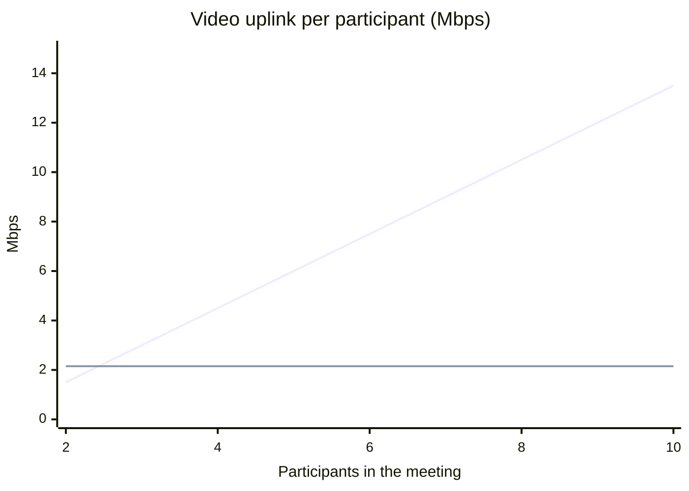
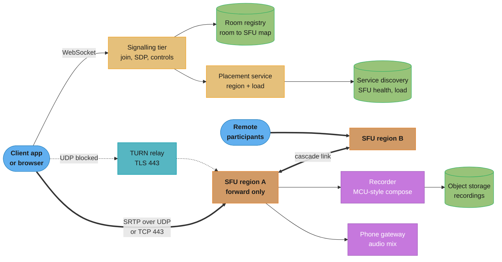
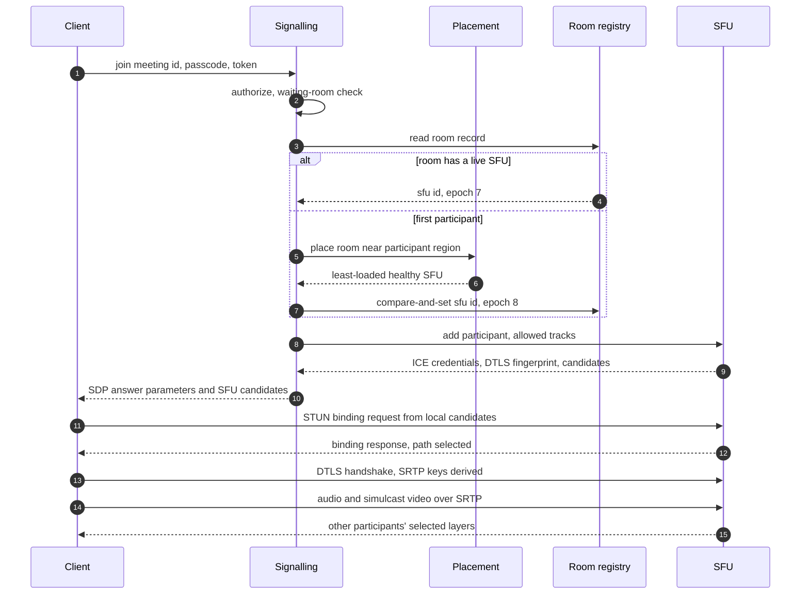
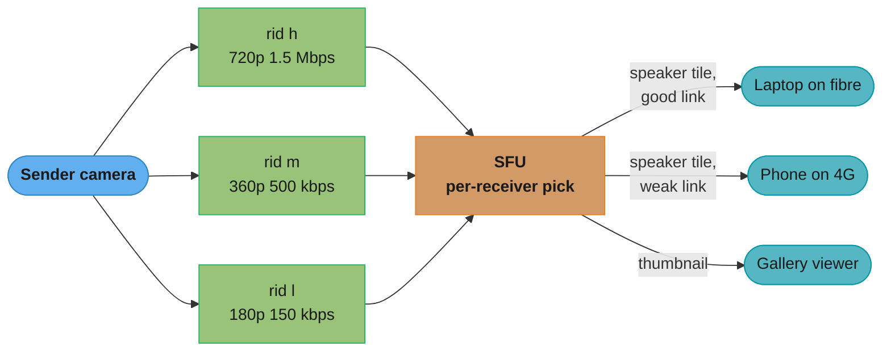
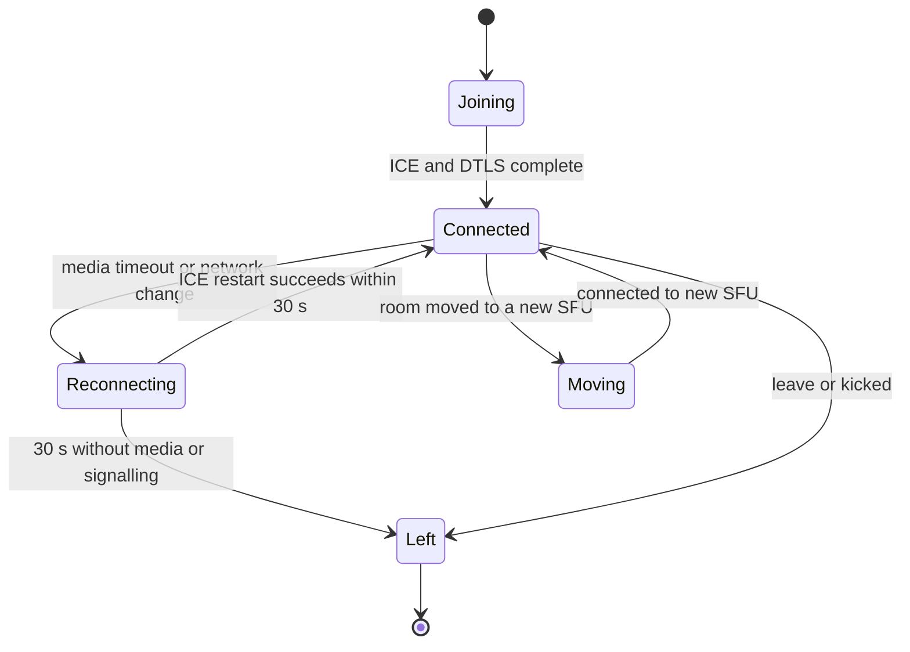

# System Design: Video Conferencing (Zoom-Style Multiparty Calls)
## Intuition

> **Design intuition**: [`./design_live_streaming.md`](./design_live_streaming.md) moves one broadcaster's video to millions of viewers, and it buys that scale with seconds of latency: segments, playlists, CDN caches, and a player buffer. Its own Out of Scope section names the design this page covers: "a conferencing product's many-to-many SFU/MCU topology is a different design." A meeting turns every assumption around. Everyone both sends and receives, the audience is 2 to 1,000 people instead of 50 million, and the latency budget is a few hundred milliseconds one way, because people interrupt each other. Nothing can be cached, nothing can be buffered for long, and a server that decodes video on the hot path cannot keep up.

**Key insight**: the media server in a modern meeting does not process media, it **routes packets and makes a per-receiver decision about which packets to send**. That server is the Selective Forwarding Unit (SFU). Each sender uploads its video once, at two or three quality levels (simulcast), and the SFU picks one level per receiver based on that receiver's bandwidth and screen layout. The hard parts of the design follow from that choice: signalling and room placement (§4.b), getting UDP through NATs (§4.c), forwarding without decoding (§4.d), choosing layers per receiver without flapping (§4.e), and congestion control that runs as two loops, one per side of the SFU (§4.f). An MCU, the older design that decodes every stream and mixes them into one, still exists for recording and phone dial-in, but off the hot path.

This study links to [`../realtime_updates/realtime_updates.md`](../realtime_updates/realtime_updates.md) for the WebSocket signalling channel and its connection budgets, and to [`./design_whatsapp.md`](./design_whatsapp.md) for presence and 1:1 messaging. It does not repeat either.

---

## 1. Requirements Clarification

### Functional Requirements
- **Create and join a meeting** by link or meeting id, with an optional passcode and a waiting room the host controls.
- **Audio, video and screen share** for every participant. Screen share is a second video source with different priorities (sharpness over frame rate).
- **Layouts**: speaker view (one large tile plus thumbnails) and gallery view (up to 25 tiles per page, assumption).
- **Active speaker detection** that switches the large tile within about a second of someone starting to talk.
- **Host controls**: mute a participant, remove a participant, lock the meeting, admit from the waiting room.
- **In-meeting chat**, reactions and raised hands. These ride the signalling channel, not the media path.
- **Large meetings** up to 1,000 participants (assumption) where only a few people speak and most watch.
- **Cloud recording** of the meeting as one composed video file.
- **Optional end-to-end encryption** where the service cannot see the media.

### Non-Functional Requirements
- **Latency.** ITU-T G.114 recommends that one-way delay should not exceed 400 ms for general network planning, and warns that highly interactive tasks, video conferencing included, "can be affected by much lower delays". This design targets **150 ms one-way mouth-to-ear at p50 and 300 ms at p95** within a continent (assumptions), and budgets every hop against that number in §2.
- **Join time.** Under 3 s from clicking the link to hearing audio (assumption).
- **Loss tolerance.** Audio stays intelligible at 10% packet loss and video degrades in resolution, not in freezes, at 5% loss (assumptions).
- **Connectivity.** A participant behind a corporate firewall that blocks all UDP must still connect, over TCP or TLS on port 443.
- **Isolation between receivers.** One participant on a bad connection must not reduce the quality anyone else receives.
- **Privacy.** Participants' IP addresses are not exposed to each other, media is encrypted in transit, and meetings cannot be joined by guessing ids.

### Out of Scope
- **One-to-many broadcast to tens of thousands of viewers** (webinars, town halls at broadcast scale). Above a few thousand passive viewers the right move is to hand the composed output to the live pipeline in [`./design_live_streaming.md`](./design_live_streaming.md); §4.h describes the hand-off.
- **Transcription, summaries and meeting AI**: see [`../../llm/case_studies/design_ai_meeting_assistant.md`](../../llm/case_studies/design_ai_meeting_assistant.md).
- **Telephony gateway internals** (SIP trunks, PSTN codecs). §4.j places the gateway, not its internals.
- **Codec design.** The design uses standard codecs (Opus, VP8, VP9, AV1, H.264) and does not tune encoders.
- **Browser-side media APIs.** The client half (`RTCPeerConnection`, reconnect, device handling) is in [`../../frontend_platform/realtime_in_the_browser/realtime_in_the_browser.md`](../../frontend_platform/realtime_in_the_browser/realtime_in_the_browser.md).

---

## 2. Scale Estimation

### Public Anchors
- **Zoom, April 2020**: "over 300 million daily meeting participants", up from 10 million daily meeting participants in December 2019. Zoom first called these "users", then corrected the wording: a participant who joins five meetings counts five times, so this is not a daily-active-user figure. In the same report Microsoft stated 200 million Teams meeting participants in a single day and Google stated over 100 million daily Meet meeting participants (source: [The Verge, 2020-04-30](https://www.theverge.com/2020/4/30/21242421/zoom-300-million-users-incorrect-meeting-participants-statement)).
- **Discord, September 2018**: more than 850 voice servers in 13 regions hosted in more than 30 data centers, serving more than 2.6 million concurrent voice users with more than 220 Gbps of egress and 120 million packets per second (source: [Discord engineering blog, "How Discord Handles Two and Half Million Concurrent Voice Users using WebRTC"](https://discord.com/blog/how-discord-handles-two-and-half-million-concurrent-voice-users-using-webrtc)).

**Arithmetic on Discord's published numbers** (fleet averages, including the redundancy Discord says it provisions):
- 220 Gbps / 850 servers = **~259 Mbps** egress per server.
- 120 Mpps / 850 servers = **~141,000 packets/s** per server.
- 2.6M users / 850 servers = **~3,060 concurrent users** per server.
- 220 Gbps / 2.6M users = **~85 kbps** egress per user, which fits a voice-first product that, by Discord's own description, does not send audio during silence.

The packet rate is the number to remember. An SFU's CPU cost scales with packets per second (each packet is decrypted or authenticated, inspected, rewritten, and encrypted again per receiver), not with bits.

### This Design's Working Numbers (assumptions)
- **10M concurrent participants** at the global peak.
- **Average meeting size 4.5**, so about **2.2M concurrent meetings**. Most meetings are small. A few are large: 1% of participants sit in meetings over 100 people.
- **40% of participants have video off** (audio only) at any moment.

### Per-Stream Bitrates (assumptions, typical WebRTC settings)

| Stream | Bitrate | Packets/s (1,200-byte video packets, 20 ms audio frames) |
|---|---|---|
| Audio, Opus mono speech | 32 kbps payload, ~48 kbps on the wire | 50 |
| Video high layer, 720p 30 fps | 1.5 Mbps | ~156 |
| Video mid layer, 360p 30 fps | 500 kbps | ~52 |
| Video low layer, 180p 15 fps | 150 kbps | ~16 |
| Screen share, 1080p 5-15 fps | 1.0-2.5 Mbps, bursty | varies |

Opus is specified to scale "from low bitrate narrowband speech at 6 kbit/s to very high quality stereo music at 510 kbit/s" (source: [RFC 6716](https://www.rfc-editor.org/rfc/rfc6716.html)), so 32 kbps for speech sits near the low end of what the codec supports.

### Topology Bandwidth for One Participant
A sender with simulcast uploads all three layers: 1.5 + 0.5 + 0.15 = **2.15 Mbps** plus audio.

```
                    N = 5 participants              N = 25 (gallery, 1 speaker + 24 tiles)
                 uplink      downlink    server     uplink       downlink      server
  Mesh (P2P)     4 x 1.5     4 x 1.5     none       24 x 1.5     24 x 1.5      none
                 = 6.0       = 6.0                  = 36.0       = 36.0
  MCU (mix)      1.5         1.5         5 decodes  1.5          1.5           25 decodes
                                         5 encodes                             25 encodes
  SFU            2.15        1.5 + 3x0.5 forward    2.15         1.5 + 24x0.15 forward
                 (simulcast) = 3.0       only       (simulcast)  = 5.1         only
                                                                 (Mbps, video only)
```

*Mesh puts the cost on the uplink, which is the scarcest link on home and mobile connections: 6 Mbps up at 5 people is already beyond many home connections, and 36 Mbps at 25 is impossible. An MCU gives every client the smallest load but makes the server decode and encode for each participant, the most expensive work in the system. An SFU keeps the uplink flat and moves only bytes, never pixels.*



*The rising line is mesh, (N - 1) x 1.5 Mbps. The flat line is SFU with three simulcast layers, 2.15 Mbps no matter how many people join. Mesh is cheaper only at N = 2, which is why many products send 1:1 calls peer to peer and switch to the SFU at the third participant (§5).*

### Fleet Bandwidth
- Blended downlink per participant, after video-off users and gallery pagination: **1.5 Mbps** (assumption). SFU egress: 10M x 1.5 Mbps = **15 Tbps**.
- Blended uplink per participant: 60% send video at 2.15 Mbps plus audio for everyone, about 0.6 x 2.15 + 0.05 = **1.34 Mbps**. SFU ingress: 10M x 1.34 = **13.4 Tbps**.
- Packet rate out: 15 Tbps / 9,600 bits per packet = **~1.56 billion packets/s**, before audio.

### SFU Server Count
- Plan each SFU server at **10 Gbps egress** (a 25 Gbps NIC kept well under line rate; the limit in practice is packet processing and encryption on the CPU, assumption), about **1.04 Mpps** of video out.
- 15 Tbps / 10 Gbps = **1,500 servers** at the global peak.
- Add 30% for regional N+1 and for meetings that cannot be packed tightly: **~2,000 SFU servers**.

### Signalling
- One WebSocket per participant: **10M concurrent connections**.
- At 50,000 connections per signalling node (assumption): **200 nodes**.
- Message rate is low: joins, leaves, mute toggles, layout changes and chat, about 1 message per participant per 10 s at peak (assumption), so **~1M messages/s** fleet-wide, small per node.

### Latency Budget, One Way, Same Continent (assumption)

| Stage | Budget |
|---|---|
| Capture and encode (one 20 ms audio frame, video frame time) | 20-35 ms |
| Sender pacing and network to SFU (nearest region) | 15-40 ms |
| SFU forwarding | 1-2 ms |
| SFU-to-SFU cascade hop, if the meeting spans regions | 0-40 ms |
| Network SFU to receiver | 15-40 ms |
| Receiver jitter buffer (adaptive) | 20-60 ms |
| Decode and render | 10-20 ms |
| **Total** | **~80-240 ms** |

The jitter buffer is the one stage the system tunes at run time: it grows when packet arrival times vary and shrinks when they settle. Everything else is set by distance and codec, which is why region placement (§4.b) matters more than server speed.

---

## 3. High-Level Architecture



**Two planes.** The **control plane** (signalling tier, placement, room registry) handles who is in which meeting, on which SFU, with which permissions. It carries small messages over WebSockets and must be strongly consistent about one thing only: each room maps to exactly one primary SFU at a time (§4.b). The **media plane** (SFUs, cascade links, TURN) carries every packet of audio and video and must be fast, but holds almost no durable state. If an SFU dies, the control plane rebuilds the room on another SFU and clients reconnect; no media history is lost because there is none to lose.

**Why the SFU has a public IP.** Every client connects to the SFU, never to another client. A server with a public IP on UDP is reachable from almost every NAT, so most clients need no relay. That also hides participants' IP addresses from each other, the privacy reason Discord gives for routing all media through its own servers (§6).

### Join Flow



The client never talks to the room registry or the placement service directly. The signalling tier is the only writer of room state, the same single-writer rule as the submission service in [`./design_online_judge.md`](./design_online_judge.md) §3.

---

## 4. Component Deep Dives

### (a) Topology: Mesh, MCU and SFU

RFC 7667, "RTP Topologies" (November 2015), maps the shapes video-conferencing vendors use onto RTP terms. Three of its topologies matter here: point to multipoint using mesh (§3.4), the RTP mixer model, which includes the media-mixing mixer that conference products call an MCU (§3.6), and the selective forwarding middlebox (§3.7), which is the SFU (source: [RFC 7667](https://www.rfc-editor.org/rfc/rfc7667.html)).

| | Mesh | MCU (media-mixing mixer) | SFU (selective forwarding) |
|---|---|---|---|
| Server work per packet | none | decode, compose, encode | read headers, rewrite, forward |
| Server CPU per participant | 0 | very high (video encode per output) | low (packet handling) |
| Client uplink | (N - 1) streams | 1 stream | 1 stream with 2-3 layers |
| Client downlink | (N - 1) streams | 1 composed stream | 1 to N selected streams |
| Per-receiver layout | yes | no (server picks the layout) or one encode per layout | yes |
| Added latency | 0 | one decode-encode cycle | ~1 ms |
| End-to-end encryption | natural | impossible (server must decode) | possible with frame encryption (§4.i) |
| Fits | 1:1 calls | recording, phone dial-in, very weak clients | everything else |

**The SFU wins on the two costs that grow.** Server CPU grows with participants for an MCU, because every output is a fresh video encode. Client uplink grows with participants for mesh. The SFU's costs grow with participants only in bandwidth and packet count on the server, which are the cheapest resources in a data center.

**The SFU's weakness is client downlink and decode.** In a 25-tile gallery, a client receives and decodes 25 streams. That is why the SFU sends small layers for thumbnails (§4.e) and why the gallery is paginated: the client only receives the tiles on the visible page.

### (b) Signalling and Room Placement, Broken Then Fixed

WebRTC does not standardize signalling. JSEP (RFC 9429, April 2024, which obsoletes RFC 8829) is explicit that "WebRTC call setup has been designed to focus on controlling the media plane, leaving signaling-plane behavior up to the application as much as possible" (source: [RFC 9429](https://www.rfc-editor.org/rfc/rfc9429.html)). So the signalling protocol is the product's own: JSON messages over a WebSocket, as in this design, or a lower-level exchange. Discord's native clients skip SDP entirely and exchange "about 1000 bytes" (server address and port, encryption method and keys, codec, stream ids), where a full SDP exchange "can be close to ten kilobytes in size round-trip" (§6).

The control-plane decision that breaks in production is **room placement**: which SFU hosts a meeting. Every participant of a meeting must land on the same SFU (or on SFUs that are cascaded, §4.h). The obvious implementation reads the room record and, if empty, picks an SFU.

***Broken:*** read, check, then write.

```java
// BROKEN -- two participants joining at the same moment can place one room on two SFUs
public final class RoomPlacementBroken {
    private final RoomRegistry registry;
    private final Placement placement;

    public SfuId sfuFor(RoomId room, Region nearest) {
        Optional<RoomRecord> rec = registry.get(room);     // both joiners read "empty"
        if (rec.isPresent() && rec.get().sfuHealthy()) {
            return rec.get().sfuId();
        }
        SfuId chosen = placement.leastLoaded(nearest);      // each picks a different SFU
        registry.put(room, new RoomRecord(chosen));         // last write wins
        return chosen;                                      // first joiner is now alone
    }
}
```

Two participants who click the link within the same 50 ms both read an empty record, each picks the least-loaded SFU in its own region, and both write. The second write wins in the registry, but the first participant has already been told to connect to the other SFU. The meeting is split: each person sees an empty room. The same race appears on failover, when two signalling nodes both notice the SFU died and each moves the room.

***Fixed:*** compare-and-set on a versioned record, with the version used as a fencing epoch.

```java
// FIXED -- one atomic winner per epoch; losers adopt the winner's SFU
public final class RoomPlacement {
    private final RoomRegistry registry;   // supports compareAndSet(room, expectedEpoch, newRecord)
    private final Placement placement;

    public Assignment sfuFor(RoomId room, Region nearest) {
        for (int attempt = 0; attempt < 3; attempt++) {
            RoomRecord cur = registry.get(room).orElse(RoomRecord.EMPTY);   // epoch 0 if absent
            if (cur.hasSfu() && cur.sfuHealthy()) {
                return new Assignment(cur.sfuId(), cur.epoch());
            }
            SfuId chosen = placement.leastLoaded(cur.hasSfu() ? cur.region() : nearest);
            RoomRecord next = new RoomRecord(chosen, cur.epoch() + 1, cur.hasSfu() ? cur.region() : nearest);
            if (registry.compareAndSet(room, cur.epoch(), next)) {
                return new Assignment(chosen, next.epoch());
            }
            // Someone else won this epoch. Loop and read their choice.
        }
        throw new PlacementContention(room);
    }
}
```

The SFU accepts a participant only if the request carries the room's current epoch. An old SFU that comes back after a network partition and still believes it hosts the room is fenced out the moment it sees a higher epoch. This is the fencing-token pattern from [`../coordination_and_contention/coordination_and_contention.md`](../coordination_and_contention/coordination_and_contention.md). The room registry can be etcd (which Discord uses for service discovery, §6), or a Redis instance with a Lua compare-and-set, as long as the compare-and-set is atomic.

**Placement policy.** The first participant's region decides the room's home region. A meeting whose participants are spread across continents is cascaded (§4.h), so placing the room where its first joiner is costs little. The placement service picks the least-loaded healthy SFU in that region from service discovery, where every SFU reports its load (packets per second, not participants: a 2-person screen share can cost more than 20 audio-only participants).

**Message types on the WebSocket.** `join`, `leave`, `offer` and `answer` parameters, `trickle-candidate`, `mute` and `unmute`, `layout` (which tiles the client shows, used by §4.e), `speaker` (server to client, from §4.g), `chat`, and `kick`. Each client message carries a client sequence number so a reconnecting client can resend without duplicating a `kick` or a chat message.

### (c) Getting Media Through NATs: ICE, STUN and TURN

Most participants sit behind a NAT, and some behind firewalls that block all UDP. WebRTC uses ICE to find a working path:

- **ICE** (RFC 8445, July 2018, obsoletes RFC 5245) gathers candidate addresses and tests pairs of them with connectivity checks (source: [RFC 8445](https://www.rfc-editor.org/rfc/rfc8445.html)).
- **STUN** (RFC 8489, obsoletes RFC 5389) lets a client discover its public address as seen from outside its NAT (source: [RFC 8489](https://www.rfc-editor.org/rfc/rfc8489.html)).
- **TURN** (RFC 8656, February 2020, obsoletes RFCs 5766 and 6156) is the relay of last resort: "it is necessary for the host to use the services of an intermediate node that acts as a communication relay" (source: [RFC 8656](https://www.rfc-editor.org/rfc/rfc8656.html)).

| Candidate type | Path | When it works |
|---|---|---|
| host | client's local IP | Same network as the SFU, rare |
| server-reflexive | client's public IP:port via STUN | Most home and mobile NATs, with an SFU on a public IP |
| relay | TURN server allocates an address | Symmetric NATs, UDP blocked, strict proxies |

**An SFU changes the NAT problem.** In a peer-to-peer call both sides are behind NATs, which is the hard case. With an SFU only one side is: the SFU has a public IP and accepts the client's connectivity checks directly, so the SFU can run as a lightweight ICE endpoint that only answers checks. The client's server-reflexive path to the SFU works for almost every NAT type that permits outbound UDP.

**When UDP is blocked.** Corporate networks often allow only TCP 443. The design offers two fallbacks in order:
1. **ICE over TCP directly to the SFU on port 443.** No relay hop. TCP adds head-of-line blocking: one lost packet stalls everything behind it, so latency spikes under loss, but the call works.
2. **TURN over TLS on port 443** when the network forces traffic through an HTTP proxy or does deep packet inspection. The TURN server sits in the same data center as the SFU, so the extra hop costs under 1 ms.

**TURN cost.** A relayed participant's media crosses the network twice (client to TURN, TURN to SFU, and back), doubling the bytes the platform carries for that participant. If 3% of participants need a relay (assumption, after the TCP-443 fallback to the SFU), that is 300,000 participants at about 2.8 Mbps of combined uplink and downlink each (1.34 + 1.5 Mbps from §2), roughly **0.85 Tbps** of extra relay traffic. Without the direct TCP-443 fallback, more participants fall back to TURN and the relay fleet grows with them.

**Discord's shortcut.** Discord's native clients skip ICE entirely: "Since every client connects to our media relay server, we do not need ICE", and clients send periodic pings to keep the firewall mapping open (§6). This works when you control the client. A browser client must use ICE, because the browser API requires it.

### (d) SFU Forwarding Internals

An SFU receives SRTP packets from each sender and, for each receiver, decides whether to forward each packet. It never decodes video. Per packet:

1. **Decrypt or authenticate** the SRTP packet with the sender's keys (hop-by-hop encryption, §4.i).
2. **Read the headers**: SSRC (which stream), sequence number, timestamp, the simulcast stream id (RID, §4.e), the audio-level extension (§4.g), and, for SVC codecs, the layer ids.
3. **For each subscribed receiver**, check whether this packet belongs to the layer chosen for that receiver.
4. **Rewrite** SSRC, sequence number and timestamp so that the receiver sees one continuous stream even when the SFU switches layers or speakers underneath it.
5. **Encrypt** with the receiver's keys and send.

**Why rewriting is needed.** Each simulcast layer is its own RTP stream with its own SSRC and sequence numbers. If the SFU switches a receiver from the 720p layer (sequence 41,200) to the 360p layer (sequence 9,850), the receiver's decoder sees a sequence jump of minus 31,350 and treats it as massive loss or reordering. The SFU keeps a per-receiver, per-track offset and rewrites every outgoing packet so the sequence continues from where the last one ended. Discord describes the same requirement from the silence side: because it stops sending audio during silence, "both client and server must be prepared to cease receiving audio data any time and rewrite audio/video packet sequence numbers" (§6).

```java
/** Per receiver, per track: keeps outgoing sequence numbers continuous across layer switches. */
public final class SeqRewriter {
    private int lastOutSeq = -1;         // 16-bit RTP sequence space, stored in an int
    private int offset = 0;
    private long currentSourceSsrc = -1;

    public int rewrite(long sourceSsrc, int inSeq) {
        if (sourceSsrc != currentSourceSsrc) {
            // Layer or speaker switch: the next outgoing packet must be lastOutSeq + 1.
            int nextOut = (lastOutSeq + 1) & 0xFFFF;
            offset = (nextOut - inSeq) & 0xFFFF;
            currentSourceSsrc = sourceSsrc;
        }
        int out = (inSeq + offset) & 0xFFFF;
        if (lastOutSeq < 0 || isNewer(out, lastOutSeq)) {
            lastOutSeq = out;
        }
        return out;
    }

    /** RFC 3550-style serial comparison over a 16-bit wrapping counter. */
    private static boolean isNewer(int a, int b) {
        int diff = (a - b) & 0xFFFF;
        return diff != 0 && diff < 0x8000;
    }
}
```

The same pattern applies to RTP timestamps (with an offset in the 90 kHz video clock) and to the codec's picture ids where the payload format carries them.

**Loss repair without decoding.** When a receiver reports a lost packet (a negative acknowledgement in RTCP), the SFU resends it from a short per-sender buffer (the last ~500 ms of packets, assumption) instead of asking the sender. That keeps repairs on the short receiver-to-SFU path and stops 25 receivers from each asking the sender for the same packet. When loss is too heavy to repair, the receiver asks for a keyframe (§9 War Story 4 covers what goes wrong).

**RTCP is per side.** The SFU terminates receiver reports and congestion feedback from each receiver and generates its own feedback to each sender. Discord describes its SFU doing exactly this: it "collects and processes RTCP reports from receivers and notifies senders how much bandwidth is available for video" (§6). §4.f explains why the two sides must stay separate.

### (e) Simulcast, SVC and Choosing a Layer per Receiver, Broken Then Fixed

**Simulcast** means the sender encodes the same camera at several resolutions and sends all of them. RFC 8853 (January 2021) defines simulcast in SDP and RTP: "multiple differently encoded versions of the same media source in different RTP streams" (source: [RFC 8853](https://www.rfc-editor.org/rfc/rfc8853.html)). Each version is named with a restriction identifier, `rid`, defined in RFC 8851 (source: [RFC 8851](https://www.rfc-editor.org/rfc/rfc8851.html)).

**SVC** (scalable video coding) produces one stream whose packets carry layers: drop the top temporal layer to halve the frame rate, drop the top spatial layer to drop resolution. The SFU removes layers by dropping packets, with no separate streams. In browsers, SVC is configured through the W3C "Scalable Video Coding (SVC) Extension for WebRTC", a Working Draft dated 14 September 2026, with modes such as `L1T3` (one spatial, three temporal layers) and `L3T3` (source: [W3C webrtc-svc](https://www.w3.org/TR/webrtc-svc/)).

| | Simulcast | SVC |
|---|---|---|
| Sender uplink | Sum of all layers (2.15 Mbps here) | About 1.2-1.5x the top layer alone (assumption) |
| Sender CPU | 2-3 independent encodes | One encode with layer structure |
| SFU switch cost | Switching streams needs a keyframe on the new layer | Dropping a layer needs no keyframe; adding a spatial layer usually does |
| Codec support | Works with VP8 and H.264 | VP9 and AV1 |
| Hardware encoders | Widely supported | Less widely supported |

This design uses **simulcast for camera video** (broad codec and hardware support) and **SVC temporal layers inside each simulcast layer** where the codec supports it, so the SFU can drop frame rate without a keyframe when a receiver's bandwidth dips briefly.



The SFU forwards `h` to the laptop, `m` to the phone and `l` to the gallery viewer, from the same three upstream streams. **The choice per receiver uses two inputs**: the receiver's estimated downlink bandwidth (§4.f) and the tile size the client says it is displaying (the `layout` message from §4.b). Sending 720p into a 160-pixel thumbnail wastes bandwidth even on a fast link.

***Broken:*** pick the best layer that fits the latest estimate, every time the estimate changes.

```java
// BROKEN -- the layer follows every wobble of the bandwidth estimate
public final class LayerSelectorBroken {
    public Layer choose(long estimateBps, TileSize tile) {
        Layer best = Layer.LOW;
        for (Layer l : Layer.valuesHighToLow()) {
            if (l.bitrateBps() <= estimateBps && l.fits(tile)) {
                best = l;
                break;
            }
        }
        return best;   // switch immediately, even if it changed 200 ms ago
    }
}
```

The bandwidth estimate moves every 100-200 ms. A receiver whose real capacity is about 1.4 Mbps sees estimates of 1.3, 1.6, 1.35, 1.55 Mbps and the selector switches between `m` and `h` several times a second. Every upward switch to a simulcast layer needs a keyframe, so the SFU asks the sender for keyframes over and over. Keyframes are 5-10x larger than normal frames (assumption), so each one causes a burst that pushes the estimate down again. The receiver sees resolution flicker and periodic freezes, and the sender's uplink fills with keyframes that every other receiver also gets.

***Fixed:*** separate thresholds for moving up and down, a hold time, and switches that wait for a keyframe already in flight.

```java
// FIXED -- hysteresis, hold time, and keyframe-aware switching
public final class LayerSelector {
    private static final double UP_MARGIN = 1.25;          // need 25% headroom to go up
    private static final double DOWN_MARGIN = 0.90;        // drop when 10% short
    private static final Duration UP_HOLD = Duration.ofSeconds(4);
    private Layer current = Layer.LOW;
    private Layer pendingUp = null;
    private Instant upEligibleSince = null;

    public Layer onEstimate(long estimateBps, TileSize tile, Instant now) {
        Layer ceiling = Layer.highestThatFits(tile);        // never exceed what the tile shows
        // Down: fast, because sending too much causes loss for this receiver right now.
        if (current.bitrateBps() > estimateBps * DOWN_MARGIN || current.above(ceiling)) {
            current = Layer.bestBelow(estimateBps * DOWN_MARGIN, ceiling);
            pendingUp = null;
            upEligibleSince = null;
            return current;                                  // temporal layers can be dropped at once
        }
        // Up: slow, only after the estimate has held with headroom for UP_HOLD.
        Layer next = current.nextUp();
        if (next != null && !next.above(ceiling) && next.bitrateBps() * UP_MARGIN <= estimateBps) {
            if (upEligibleSince == null) {
                upEligibleSince = now;
            } else if (Duration.between(upEligibleSince, now).compareTo(UP_HOLD) >= 0) {
                pendingUp = next;                            // switch on the next keyframe of `next`
            }
        } else {
            upEligibleSince = null;
        }
        return current;
    }

    /** Called by the forwarder for each packet of the pending layer. */
    public boolean shouldSwitchNow(Layer layer, boolean isKeyframeStart) {
        if (pendingUp == layer && isKeyframeStart) {
            current = layer;
            pendingUp = null;
            upEligibleSince = null;
            return true;
        }
        return false;
    }
}
```

Down is fast and up is slow, because the costs are not symmetric: staying on a layer that is too big causes loss now, while staying on a layer that is too small only costs some sharpness for a few seconds. The keyframe-aware switch means the SFU waits for the sender's next periodic keyframe on the higher layer (or asks for one, rate-limited per sender, §9 War Story 4) instead of switching at an arbitrary packet.

### (f) Congestion Control: Two Loops Around the SFU

A WebRTC sender adapts its bitrate to what the network can carry. The common algorithm in browsers is Google Congestion Control (GCC), published as the Internet-Draft `draft-ietf-rmcat-gcc-02` (intended status Experimental, latest revision 2016-07-08, never an RFC) (source: [IETF datatracker, draft-ietf-rmcat-gcc](https://datatracker.ietf.org/doc/draft-ietf-rmcat-gcc/)). It estimates capacity from changes in packet delay and from loss. The receiver tells the sender when each packet arrived using the transport-wide congestion control feedback described in `draft-holmer-rmcat-transport-wide-cc-extensions-01`, an individual draft "not endorsed by the IETF" that browsers nonetheless implement widely (source: [IETF datatracker](https://datatracker.ietf.org/doc/draft-holmer-rmcat-transport-wide-cc-extensions/)). The standardized feedback format for the same purpose is RFC 8888, "RTP Control Protocol (RTCP) Feedback for Congestion Control" (January 2021) (source: [RFC 8888](https://www.rfc-editor.org/rfc/rfc8888.html)).

**The SFU splits one congestion problem into many.** Without an SFU, a sender adapts to one receiver. With an SFU:

1. **Upstream loop (sender to SFU).** The SFU acts as the receiver. It sends feedback to the sender, and the sender adapts its total bitrate, including how many simulcast layers it can afford to send. If the sender's uplink is weak, it drops the `h` layer entirely.
2. **Downstream loops (SFU to each receiver).** The SFU acts as the sender for each receiver. It runs its own bandwidth estimate per receiver, from that receiver's feedback, and adapts by choosing layers (§4.e) instead of re-encoding.

**The rule this enables: the slowest receiver never sets the sender's bitrate.** If the SFU forwarded each receiver's congestion feedback back to the sender, the sender would adapt to the worst receiver and every participant would get the worst receiver's quality. The SFU terminates feedback on each side. The weak receiver gets the `l` layer, and everyone else keeps `h`. This is the per-receiver isolation requirement from §1, and it is the main reason simulcast exists.

**Pacing.** The SFU sends to each receiver through a pacer that spreads packets evenly over time rather than in bursts, because a burst of 30 packets from a large keyframe can overflow a small router buffer on the receiver's path even when the average rate fits.

### (g) Audio Path and Active Speaker Detection

Audio is the part of a meeting people notice first when it fails, and it is small: about 48 kbps on the wire per active speaker. Three design choices keep it cheap and robust:

1. **Forward only the loudest few.** In a meeting of 100, forwarding every participant's audio to everyone would be 99 streams per receiver, nearly all silence or background noise. The SFU forwards the **top 3 speakers by recent audio level** (assumption) to each receiver, and the client mixes those 3.
2. **Know the level without decoding.** RFC 6464 (December 2011) defines an RTP header extension that carries the audio level of each packet "in -dBov, with values from 0 to 127 representing 0 to -127 dBov", plus a voice-activity flag bit (source: [RFC 6464](https://www.rfc-editor.org/rfc/rfc6464.html)). The sender computes it, and the SFU reads one byte per packet instead of decoding Opus.
3. **Do not send silence.** Opus discontinuous transmission and, in Discord's native clients, not sending audio at all during silence (§6) reduce packets per second for the many muted or quiet participants.

```java
/** Ranks speakers from the RFC 6464 audio-level byte, without decoding audio. */
public final class ActiveSpeakerTracker {
    private static final int WINDOW = 50;              // 50 packets x 20 ms = 1 s
    private static final int SILENCE_DBOV = 127;
    private final Map<ParticipantId, Deque<Integer>> recent = new HashMap<>();

    public void onAudioPacket(ParticipantId who, int levelMinusDbov, boolean voiceFlag) {
        Deque<Integer> q = recent.computeIfAbsent(who, k -> new ArrayDeque<>());
        q.addLast(voiceFlag ? levelMinusDbov : SILENCE_DBOV);
        if (q.size() > WINDOW) {
            q.removeFirst();
        }
    }

    /** Loudness score: lower -dBov is louder, so invert to "higher is louder". */
    private double score(Deque<Integer> q) {
        return q.stream().mapToInt(v -> SILENCE_DBOV - v).average().orElse(0);
    }

    public List<ParticipantId> topSpeakers(int n) {
        return recent.entrySet().stream()
                .sorted(Comparator.comparingDouble((Map.Entry<ParticipantId, Deque<Integer>> e)
                        -> score(e.getValue())).reversed())
                .limit(n)
                .map(Map.Entry::getKey)
                .toList();
    }
}
```

The 1-second window is the dominant-speaker hysteresis: a cough or a door slam lasting 200 ms moves the score a little and does not take the large tile. The video tile follows the top audio speaker, with its own 1.5-2 s hold (assumption), so the main video does not jump between two people talking over each other.

### (h) Large Meetings and SFU Cascading

One SFU server has a ceiling (§2: about 10 Gbps out). A 1,000-person meeting where the speaker's 720p goes to everyone needs about 1.5 Gbps for that one stream alone, which fits, but packet rate, receiver count and the meeting's geographic spread push the design to **cascade**: several SFUs host one meeting, each serving the participants near it, connected to each other by server-to-server links.

**How a cascade forwards.** Each SFU forwards to its peer SFUs only the streams that at least one participant on the peer is subscribed to, and only once per peer, not once per remote receiver. If 400 participants in Europe watch a speaker in the US, the US SFU sends one copy of each needed layer to the European SFU, which fans it out to 400 receivers locally.

**Two reasons to cascade:**
1. **Capacity.** A meeting outgrows one server. Split participants across SFUs in the same region.
2. **Geography.** Participants on different continents each connect to a nearby SFU, so each person's first and last hop are short and the long-haul hop runs over the provider's backbone, server to server. This adds one SFU hop (§2 budget: 0-40 ms) but removes much more from the public-internet path.

**Large-meeting rules.** Above about 100 participants (assumption): only participants who have been admitted to speak (panelists, or the host's spotlight) send video, attendees send audio only when unmuted by the host, and the gallery shows at most 25 tiles per page. At a few thousand passive viewers, the meeting stops being a meeting: a recorder (§4.j) composes the view and hands it to the broadcast pipeline in [`./design_live_streaming.md`](./design_live_streaming.md), whose WHIP ingest (RFC 9725) accepts WebRTC directly.

**Room state in a cascade.** The room registry from §4.b holds a list of SFUs per room with one marked as the room's coordinator for host controls. Mute and kick commands go from the signalling tier to every SFU in the list, so a muted participant's packets are dropped at whichever SFU they connect to.

### (i) Security: Hop-by-Hop Encryption, End-to-End Encryption and Meeting Access

**Hop-by-hop by default.** WebRTC media is encrypted with SRTP, keys derived from a DTLS handshake between the client and the SFU (the `DTLS-SRTP` step in the join flow). The SFU decrypts every packet to read headers and re-encrypts it per receiver (§4.d). So the operator's SFU can see the media. That is acceptable for most meetings and is what makes server-side recording possible.

**End-to-end encryption with frame encryption.** For meetings where the operator must not see media, the client encrypts each encoded frame before it enters the RTP packetizer, and the SFU forwards encrypted payloads while still reading the RTP headers it needs. RFC 9605, Secure Frame (SFrame), August 2024, standardizes this: it is an end-to-end encryption mechanism for media frames in a multiparty call "in which central media servers (Selective Forwarding Units or SFUs) can access the media metadata needed to make forwarding decisions without having access to the actual media" (source: [RFC 9605](https://www.rfc-editor.org/rfc/rfc9605.html)). The cost of E2EE is everything that needs plaintext on the server: cloud recording, server-side transcription and phone dial-in mixing stop working, or move to a client.

**Key distribution is the hard part.** Who generates the key, how it reaches each participant, and how it rotates when someone leaves is a key-management protocol, not a media one. §9 War Story 1 is what happens when the server generates and distributes the key: the "encryption" is only as strong as the operator's key servers. Zoom's published cryptography whitepaper, first released as Version 1 on 22 May 2020 with a public comment period to 5 June 2020 and updated through Version 4.7 on 24 June 2025, documents how its end-to-end mode handles this (source: [zoom/zoom-e2e-whitepaper](https://github.com/zoom/zoom-e2e-whitepaper)).

**Meeting access.** Meeting ids that are short and sequential can be enumerated. The defences are long random ids, a passcode embedded in the link, a waiting room the host must admit people from, a host lock once everyone has joined, and per-account rate limits on join attempts against non-existent meetings (an enumeration signal). §9 War Story 2 is why these became defaults.

### (j) Off the Hot Path: Recording and Phone Dial-In

**Recording** is a participant-shaped bot. It joins the meeting through the normal signalling flow, subscribes to the streams it needs (active speaker at high layer, gallery at low layers, all audio), decodes them, composes the layout and encodes one output file. That is an MCU, run once per recorded meeting instead of once per participant, and placed off the forwarding path so that its CPU cost and failures never affect the live meeting. A recorder that falls behind writes a gap into the recording. It never slows the SFU.

**Phone dial-in** needs a mixed audio stream, because a phone call has one audio channel. The gateway subscribes to the top speakers' audio, mixes them, and encodes for the telephone codec. In the other direction, it injects the caller's audio into the meeting as an ordinary audio track with its own audio-level extension, so the SFU treats a phone caller like any other speaker.

### (k) Screen Share Is a Different Kind of Video

Screen share looks like a second camera to the SFU, but its priorities are the opposite of a camera's:

| | Camera | Screen share |
|---|---|---|
| What viewers need | Smooth motion, faces | Readable text, sharp edges |
| Under congestion, drop first | Resolution | Frame rate |
| Typical frame rate | 30 fps | 5-15 fps, higher only for video playback |
| Bitrate shape | Steady | Near zero on a static slide, a large burst when the slide changes |
| Layers | Simulcast by resolution | Often one high-resolution stream with temporal layers |

Three rules follow. First, the sender tags the track as content so its encoder keeps resolution and lowers frame rate when bandwidth falls. Second, the SFU gives the screen-share track priority over thumbnails in each receiver's bandwidth budget: a viewer who can afford only 1 Mbps should get a readable slide and no thumbnails, not a blurry slide and 8 thumbnails. Third, the slide-change burst is absorbed by the pacer (§4.f), not by the receiver's network, so the SFU spreads a 300 KB keyframe over 100-200 ms instead of sending it in one burst.

### (l) Reconnection and Network Handover

A participant walking from Wi-Fi to cellular changes IP address mid-call. A participant on a train loses the network for 4 seconds. Neither should be a "leave" and "rejoin", because a rejoin goes back through authorization, the waiting room, and placement, and other participants see the person drop and reappear.



**How it works.** The signalling session survives a short media outage: the WebSocket reconnects with a resume token, and the server keeps the participant in the room in a `Reconnecting` state for up to 30 s (assumption). The media path recovers with an ICE restart: the client gathers new candidates from its new network and re-runs connectivity checks against the same SFU, without a new join. Other participants see a frozen tile with a "reconnecting" badge, not a departure. Only after 30 s does the server remove the participant and tell everyone else.

**The `Moving` state** is the SFU-failover and drain path from §8: the control plane tells the client its room moved to a new SFU with a new epoch, and the client runs the same ICE restart against the new server. One mechanism serves network changes, SFU failures and SFU deploys.

---

## 5. Design Decisions & Tradeoffs

### Topology by Meeting Size

| Meeting | Topology | Why |
|---|---|---|
| 2 participants | Peer to peer, SFU fallback | No server bandwidth, lowest latency; fall back to the SFU when ICE finds no direct path |
| 3 to ~100 | Single SFU, simulcast | Flat uplink, per-receiver layers |
| ~100 to a few thousand | Cascaded SFUs, speaker-only video | Capacity and geography (§4.h) |
| Thousands of passive viewers | Compose and hand to the live pipeline | Many-to-many latency is not needed for viewers |

Switching a 2-person call from peer to peer to the SFU when the third person joins causes a short media interruption. Some products accept that; others always use the SFU and pay its bandwidth for the 1:1 case to keep one code path. This design accepts the switch, because 1:1 calls are a large share of minutes (assumption) and peer to peer removes all their server egress.

### Simulcast Versus SVC
Covered in §4.e. Simulcast as the default for camera video, SVC temporal layers within layers where supported.

### UDP Only Versus TCP and TLS Fallbacks

| | UDP only | Add ICE-TCP to the SFU on 443 | Add TURN over TLS on 443 |
|---|---|---|---|
| Join success on strict networks | Fails behind UDP-blocking firewalls | Works where TCP 443 is open | Works behind proxies and TLS inspection |
| Media quality | Best | Head-of-line blocking under loss | Same as TCP, plus a relay hop |
| Cost | Lowest | Low | Relay traffic (§4.c) |

All three are needed. Each fallback is tried only after the previous fails, and ICE does this ordering automatically from candidate priorities.

### Hop-by-Hop Versus End-to-End Encryption

| | Hop-by-hop (DTLS-SRTP to the SFU) | End-to-end (SFrame over SRTP) |
|---|---|---|
| Operator sees media | Yes | No |
| Cloud recording, transcription, dial-in mixing | Work on the server | Must move to a client or be disabled |
| Forwarding decisions | Full access to headers | Headers only, still enough (RFC 9605) |
| Key management | Per hop, automatic | Group key protocol, rotation on leave |

Offer E2EE as a per-meeting choice, off by default, and disable server-side features clearly when it is on. Never label hop-by-hop encryption as end-to-end (§9 War Story 1).

### Where Meeting State Lives

| State | Owner | Durability | Lost on SFU crash? |
|---|---|---|---|
| Room to SFU map, epoch | Room registry | Replicated, strongly consistent | No |
| Participant list, roles, mute flags | Signalling tier, backed by the room registry | Replicated | No |
| Chat history | Signalling tier to a message store | Durable | No |
| Per-receiver layer choice, bandwidth estimate | SFU memory | None | Yes, rebuilt in seconds from fresh feedback |
| Sequence-number offsets, retransmission buffer | SFU memory | None | Yes, reset on reconnect |
| Media itself | Nowhere, except the recorder | Only if recorded | Not applicable |

Everything an SFU holds can be rebuilt from the control plane plus a few seconds of new feedback. That is what makes SFU failover a reconnect (§4.l) rather than a recovery, and what lets Discord restart a crashed SFU and rebuild its state from the signalling component (§6). Any feature that wants to keep durable state on the SFU (a "meeting memory" of who said what, for example) belongs in another service.

### Build Versus Buy the SFU
Open-source SFUs (Jitsi Videobridge, LiveKit, mediasoup, Janus) and hosted platforms cover most products. Building one makes sense at Discord's scale, where Discord states its homegrown C++ SFU is "tailored to our use case offering maximum performance and thus the lowest cost" (§6), or when the product needs non-standard transport, as Discord's native clients do.

---

## 6. Real-World Implementations

- **Discord (2018).** Every audio and video call is multiparty and routed through Discord's servers, both to support large channels ("we have seen 1000 people taking turns speaking") and so "your IP address is never leaked". Signalling servers are written in Elixir. A client keeps a gateway WebSocket, and on joining a voice channel opens a second WebSocket to the assigned voice server. The guilds service assigns "the least utilized voice server in the given region" using service discovery in etcd. Each voice server runs a signalling component and "our homegrown SFU (written in C++)", which drops packets of server-muted users, bridges native and browser clients, and handles RTCP. If the SFU crashes, the signalling component restarts it and reconstructs its state "without any client interaction"; the same mechanism gives zero-downtime SFU updates. Native clients skip SDP and ICE, use Salsa20 instead of DTLS/SRTP, and stop sending audio during silence. Scale: more than 850 voice servers, 13 regions, more than 30 data centers, more than 2.6 million concurrent voice users, more than 220 Gbps and 120 Mpps of egress (source: [Discord, 2018-09-10](https://discord.com/blog/how-discord-handles-two-and-half-million-concurrent-voice-users-using-webrtc)).
- **Zoom (2020).** Reported 300 million daily meeting participants in April 2020 (a participant count, not daily active users), up from 10 million in December 2019 (source: [The Verge](https://www.theverge.com/2020/4/30/21242421/zoom-300-million-users-incorrect-meeting-participants-statement)). Citizen Lab's April 2020 analysis found that, while Zoom's documentation claimed AES-256, "a single AES-128 key is used in ECB mode by all participants to encrypt and decrypt audio and video", with keys generated by Zoom servers and in some cases delivered through servers in China (source: [Citizen Lab, 2020-04-03](https://citizenlab.ca/2020/04/move-fast-roll-your-own-crypto-a-quick-look-at-the-confidentiality-of-zoom-meetings/)). Zoom then published an end-to-end encryption design for public comment from 22 May 2020 (source: [zoom/zoom-e2e-whitepaper](https://github.com/zoom/zoom-e2e-whitepaper)).
- **Microsoft Teams and Google Meet (2020).** Microsoft stated 200 million Teams meeting participants in a single day, and Google stated over 100 million daily Meet meeting participants, in the same month (source: [The Verge](https://www.theverge.com/2020/4/30/21242421/zoom-300-million-users-incorrect-meeting-participants-statement)).
- **Jitsi Videobridge.** "A WebRTC-compatible Selective Forwarding Unit (SFU), i.e. a multimedia router", one of the backend components of the open-source Jitsi Meet stack (source: [jitsi-videobridge README](https://github.com/jitsi/jitsi-videobridge)). A Jitsi engineer co-authored RFC 6464, the audio-level extension used for speaker detection in §4.g.
- **LiveKit.** An open-source "scalable, distributed WebRTC SFU" written in Go on the Pion WebRTC implementation, now positioned for voice and video AI agents as well as human calls (source: [LiveKit README](https://github.com/livekit/livekit)).

---

## 7. Technologies & Tools

| Component | Technology | Why |
|---|---|---|
| Media transport | RTP over SRTP, UDP first | Low latency, no head-of-line blocking |
| Session setup | JSEP (RFC 9429) from browsers; compact custom exchange from native clients | Signalling is the application's choice |
| NAT traversal | ICE (RFC 8445), STUN (RFC 8489), TURN (RFC 8656) | Standard path discovery and relay |
| Media server | SFU: Jitsi Videobridge, LiveKit, mediasoup, Janus, or in-house | Forward without decoding |
| Simulcast signalling | RFC 8853 with `rid` (RFC 8851) | Names each layer for per-receiver selection |
| Scalable coding | VP9 or AV1 SVC, configured through W3C webrtc-svc | Layer dropping without keyframes |
| Audio codec | Opus (RFC 6716) | 6 to 510 kbit/s range, built for interactive speech |
| Speaker detection | RFC 6464 audio-level header extension | One byte per packet, no decode |
| Congestion control | GCC with transport-wide feedback; RFC 8888 feedback | Per-hop bandwidth estimates (§4.f) |
| End-to-end encryption | SFrame (RFC 9605) | SFU keeps headers, loses payload access |
| Signalling transport | WebSocket gateway fleet | See [`../realtime_updates/realtime_updates.md`](../realtime_updates/realtime_updates.md), [`../../backend/websockets_and_sse/websockets_and_sse.md`](../../backend/websockets_and_sse/websockets_and_sse.md) |
| Room registry | etcd or Redis with atomic compare-and-set | One SFU assignment per room epoch (§4.b) |
| Service discovery | etcd, Consul | SFU health and load for placement |
| Recording | Headless recorder bot composing an MCU-style layout | Off the forwarding path (§4.j) |
| Observability | Per-meeting quality metrics reported by clients | Packet loss, jitter, freezes, round-trip time |

---

## 8. Operational Playbook

### Deploying a New SFU Version Without Dropping Calls
1. Mark the server as draining in service discovery: placement stops sending new rooms to it.
2. Existing meetings finish naturally. Long meetings past a deadline (for example 2 hours, assumption) are migrated: the control plane picks a new SFU with a higher room epoch, tells clients to reconnect, and clients do an ICE restart to the new server. Users see a 1-2 s freeze.
3. Alternatively, follow Discord's pattern: the signalling component on the same host owns the room state, restarts the SFU process, and rebuilds the SFU's state without client involvement. Discord states it uses the crash-recovery path for "zero-downtime SFU updates" (§6). This needs the SFU's state to be fully reconstructible from the control plane, which is a design requirement worth adopting from day one.

### SFU Host Failure
1. The SFU stops answering health checks and leaves service discovery.
2. Clients notice their media and WebSocket to the SFU fail, and ask the signalling tier for a new assignment.
3. The signalling tier moves each affected room with the compare-and-set from §4.b (new epoch). Only one node wins per room, even if many clients ask at once.
4. Target: media restored within 5 s for 99% of affected participants (assumption).

### DDoS on a Media Server
Media servers are the only public-facing hosts that accept UDP from anyone, so they draw attacks. Discord's documented response is the failover procedure: remove the attacked server from service discovery, move its rooms to a new server, notify clients to reconnect, and return the server when the attack subsides (§6). Keep per-SFU public IPs out of long-lived DNS records, so a moved room is not still pointed at by an attacker's target list.

### Alerting Thresholds

| Metric | Threshold | Why |
|---|---|---|
| Join success rate | below 99.5% over 5 min | First symptom of signalling, placement or ICE failure |
| ICE failure rate | above 1% over 5 min | NAT traversal or SFU reachability problem |
| Share of participants on TURN or TCP | 2x its 7-day baseline | A network change or a UDP blockage somewhere |
| Receiver packet loss p95 | above 5% | Media quality degrading |
| Video freeze rate | above 1 freeze per participant-hour | Keyframe or congestion-control problem (§9) |
| Keyframe requests per sender | above 1 per second sustained | Keyframe storm (§9 War Story 4) |
| SFU packets/s per host | above 80% of tested capacity | Capacity headroom |
| Room placement compare-and-set conflicts | sudden spike | Split-room risk or failover storm |

### Regional Outage
1. Health checks remove every SFU and TURN server in the region from service discovery.
2. Placement maps the region's rooms to the nearest healthy region and raises each room's epoch.
3. Clients reconnect through the `Moving` path (§4.l). Latency for those participants rises by the extra distance, typically 20-60 ms within a continent (assumption), which stays inside the §2 budget.
4. Signalling capacity in the neighbouring region must absorb the reconnect burst. The 50% headroom in §10 exists for this moment, together with jittered client backoff so the burst arrives over 10-20 s rather than in one second.

### Client-Reported Quality
The server sees only half of the path. Every client reports, every 10 s (assumption), its receive loss, jitter, round-trip time, frame rate, freeze count and the layer it is receiving. Quality dashboards are built from these reports, aggregated by region, network type and client version. Discord says clients report quality metrics to its backend for the same reason (§6).

---

## 9. Common Pitfalls & War Stories

### Pitfall Summary

| Pitfall | Impact | Fix |
|---|---|---|
| Mesh for group calls | Uplink grows with N; fails past 4-5 people | SFU from the third participant (§5) |
| MCU on the hot path | CPU per participant, added latency | SFU; MCU only for recording and dial-in (§4.j) |
| Read-check-write room placement | Split meetings | Compare-and-set with epochs (§4.b) |
| Layer switching on every estimate | Flicker, freezes, keyframe storms | Hysteresis, hold time, keyframe-aware switch (§4.e) |
| Forwarding receiver feedback to the sender | Worst receiver sets everyone's quality | Terminate feedback at the SFU (§4.f) |
| No TCP or TLS fallback on 443 | Corporate users cannot join | ICE-TCP to the SFU and TURN over TLS (§4.c) |
| Forwarding every participant's audio | Bandwidth and client CPU wasted on silence | Top-N speakers from audio levels (§4.g) |
| Calling hop-by-hop encryption "end-to-end" | Trust and regulatory damage | SFrame-based E2EE and accurate wording (§4.i) |
| Short guessable meeting ids | Uninvited joiners | Random ids, passcodes, waiting rooms (§4.i) |

### War Story 1: Server-Generated Keys and ECB Mode (Zoom, 2020)

**What happened.** Citizen Lab analysed Zoom's meeting encryption in April 2020. Zoom's documentation said the app used "AES-256" where possible. The researchers found "a single AES-128 key is used in ECB mode by all participants to encrypt and decrypt audio and video", that ECB "is not recommended because patterns present in the plaintext are preserved during encryption", that the keys "appear to be generated by Zoom servers", and that in some cases keys were delivered "through servers in China, even when all meeting participants, and the Zoom subscriber's company, are outside of China" (source: [Citizen Lab, 2020-04-03](https://citizenlab.ca/2020/04/move-fast-roll-your-own-crypto-a-quick-look-at-the-confidentiality-of-zoom-meetings/)).

**Impact.** The report landed in the same month Zoom was reporting 300 million daily meeting participants (§6), so the gap between the stated and actual protection affected an enormous audience at once. Within seven weeks Zoom published a public end-to-end encryption design for comment (Version 1, 22 May 2020).

**Lesson for the design.** If the service generates and distributes the media key, the service can decrypt the media, whatever the cipher. Real end-to-end encryption needs client-held keys and a frame-level scheme the SFU cannot read (RFC 9605). Use standard primitives and modes, and describe hop-by-hop encryption as exactly that.

### War Story 2: Meeting Hijacking (2020)

**What happened.** On 30 March 2020 the FBI's Boston field office warned that "reports of VTC hijacking (also called Zoom-bombing) are emerging nationwide", describing conferences "disrupted by pornographic and/or hate images and threatening language", including two Massachusetts schools whose online classes were entered by unidentified people (source: [FBI Boston, 2020-03-30](https://www.fbi.gov/contact-us/field-offices/boston/news/press-releases/fbi-warns-of-teleconferencing-and-online-classroom-hijacking-during-covid-19-pandemic)).

**Why it happened, architecturally.** Meetings shared publicly, or with ids short enough to guess, could be joined by anyone with the id, and the host had no default gate.

**Fix.** Treat a meeting id as a capability, not a name: long random ids, a passcode carried in the link, a waiting room on by default for meetings with external participants, a host "lock meeting" control, and rate limits on joins to meetings that do not exist, which is the enumeration signal (§4.i).

### War Story 3: The Split Meeting (illustrative)

**What happened.** A recurring 9:00 all-hands with 400 participants. At 08:59:58, 150 people clicked the link within two seconds. Room placement used read-check-write (§4.b, broken). Four signalling nodes each saw an empty room record and each placed the room on a different SFU in two regions.

**Impact (illustrative).** The meeting split into four groups that could not see each other. The host restarted the meeting at 09:06, and everyone rejoined. 400 people x 7 minutes = 46 person-hours lost, in a company-wide meeting, plus a support spike.

**Fix.** Compare-and-set on a versioned room record with the epoch as a fencing token (§4.b), and SFUs that reject participants carrying an older epoch. Scheduled meetings with a large invite list are also pre-placed at T-5 minutes, so the first-joiner race never happens for them.

### War Story 4: The Keyframe Storm (illustrative)

**What happened.** A 60-person team call on a network with 3% random loss. Each receiver that lost part of a frame asked the sender for a keyframe, and the SFU forwarded every request. The sender received about 20 keyframe requests a second and produced keyframes back to back. Keyframes are many times larger than normal frames, so the sender's uplink saturated, its congestion controller cut the bitrate, and video for all 59 receivers dropped to the lowest layer and froze every few seconds.

**Impact (illustrative).** Freeze rate for the meeting rose from 0.2 to 9 freezes per participant-hour. Support tickets blamed the presenter's internet connection, which was fine.

**Fix.** The SFU answers loss with its own retransmission buffer first (§4.d), aggregates keyframe requests per sender, and forwards at most one request per sender per 500-1,000 ms (assumption). A receiver that joins mid-stream waits for the next periodic keyframe on its layer instead of forcing one.

### War Story 5: UDP-Only Deployment Meets a Corporate Firewall (illustrative)

**What happened.** A team launched a new region with SFUs listening on UDP only, and TURN servers not yet deployed. The first enterprise customer in that region blocked all outbound UDP at the firewall.

**Impact (illustrative).** 31% of that customer's join attempts failed with ICE timeouts after 10 s. Users saw "connecting" and then an error. The join success alert (§8) fired within 5 minutes, but the region had no fallback to enable.

**Fix.** A region does not go live without ICE-TCP on 443 to the SFU and TURN over TLS on 443. Join success is monitored per customer network, not only globally, because a 31% failure for one large customer can hide inside a 99.6% global average.

---

## 10. Capacity Planning

### SFU Fleet

| Input | Value | Source |
|---|---|---|
| Concurrent participants at peak | 10M | assumption (§2) |
| Blended downlink per participant | 1.5 Mbps | assumption (§2) |
| Total SFU egress | 15 Tbps | 10M x 1.5 Mbps |
| Planned egress per SFU server | 10 Gbps | assumption |
| Servers at peak | 1,500 | 15 Tbps / 10 Gbps |
| Regional N+1 and packing loss | +30% | assumption |
| **SFU servers** | **~2,000** | |

The 10 Gbps planning number must be measured, not assumed, on the real hardware with the real packet mix. A server that moves 10 Gbps of 1,200-byte video packets may move much less of 100-byte audio packets, because CPU cost is per packet. For comparison, Discord's fleet averages work out to about 141,000 packets/s and 259 Mbps per server (§2), a voice-heavy mix with redundancy built in.

### Peak Shape
Meetings follow office hours in each time zone, and they start on the hour and half hour. Joins spike in the 2 minutes around :00 and :30 (assumption: 5-8x the average join rate). The media load rises with the number of people in meetings, which changes more slowly. So:
- **Signalling and placement** are sized for the join spike at :00.
- **SFUs** are sized for the concurrent-participant peak, which is the sum of overlapping meetings during the busiest working hours across regions.

### Signalling Tier
10M WebSockets at 50,000 per node = 200 nodes, plus 50% headroom so that a node failure (and its clients reconnecting to the others) does not cascade: **300 nodes**. Reconnect storms are the risk here, handled as in [`../realtime_updates/realtime_updates.md`](../realtime_updates/realtime_updates.md): jittered backoff and resume tokens.

### TURN Fleet
At 3% of participants relayed (assumption, §4.c), about **0.85 Tbps** of relay traffic. Placed in the same data centers as the SFUs, sized at 10 Gbps per relay server: **~85 servers**, plus 30% headroom: **~110 relays**. Watch the relayed share: if it doubles because a large network starts blocking UDP, this fleet doubles with it.

### Recording
At 2% of meetings recorded (assumption), 2.2M x 0.02 = **44,000 concurrent recordings**. Each recorder decodes several streams and encodes one 1080p output, about 2-4 cores (assumption), so **~130,000 cores** at peak. This is the most CPU-intensive component in the system and it serves 2% of meetings, which is why it is kept off the SFUs and scaled separately.

### Downlink per Receiver by Layout

The blended 1.5 Mbps in §2 hides a wide spread. The layout the client reports (§4.b) decides most of it:

| Layout | Streams received | Downlink (video + audio) |
|---|---|---|
| Audio only, 3 speakers forwarded | 3 audio | ~0.15 Mbps |
| Speaker view, 1 large + 4 thumbnails | 1 x `h` + 4 x `l` | 1.5 + 0.6 + 0.15 = ~2.25 Mbps |
| Speaker view on a weak link | 1 x `m` + 4 x `l` | 0.5 + 0.6 + 0.15 = ~1.25 Mbps |
| Gallery, 9 tiles per page | 9 x `l` | 1.35 + 0.15 = ~1.5 Mbps |
| Gallery, 25 tiles per page | 25 x `l` | 3.75 + 0.15 = ~3.9 Mbps |
| Screen share plus speaker thumbnail | share + 1 x `l` | 1.0-2.5 + 0.15 + 0.15 = ~1.3-2.8 Mbps |

The 25-tile gallery costs more than speaker view, which surprises people, and it also costs the client 25 decoders. Defaulting to 9 tiles per page and letting users opt into 25 is a capacity decision as much as a design one: a 10% shift of users from speaker view to a 25-tile gallery adds about 0.165 Mbps to the blended average (0.1 x (3.9 - 2.25)), or **~1.65 Tbps** of SFU egress at the 10M-participant peak.

### Cost Sanity Check
SFU egress of 15 Tbps at peak, averaged over a day at about 40% of peak (assumption), is roughly 6 Tbps x 86,400 s / 8 = **~65 PB per day**. At any per-GB egress price, network egress dominates the bill, which is why the largest operators peer directly with ISPs and why every forwarding decision in §4.e that avoids sending an unneeded layer is a cost decision as much as a quality one.

---

## 11. Interview Discussion Points

### How to Structure a 45-Minute Answer
1. **Requirements** (5 min): many-to-many, a 150 ms one-way target, NAT and firewall reality, per-receiver isolation, E2EE as an option.
2. **Estimation** (5 min): mesh vs MCU vs SFU bandwidth for N = 5 and 25 (§2), packets per second as the SFU's cost unit.
3. **Architecture** (7 min): control plane and media plane, the join flow (§3).
4. **Topology deep dive** (6 min): why SFU, where MCU still belongs (§4.a, §4.j).
5. **Signalling and placement** (6 min): JSEP leaves signalling to you, compare-and-set placement (§4.b).
6. **Forwarding and quality** (10 min): simulcast, layer selection with hysteresis, two congestion loops, top-N audio (§4.d to §4.g).
7. **Scale and security** (6 min): cascading, TURN cost, SFrame, meeting access (§4.h, §4.i, §10).

**Q: Why does a group video call use an SFU instead of peer-to-peer mesh?**
**Short:** Mesh makes each sender upload one copy per receiver, so uplink grows with N; an SFU needs one upload per sender.
In mesh each participant sends (N - 1) copies of its video, which is 6 Mbps of uplink at 5 people and 36 Mbps at 25 with a 1.5 Mbps stream, far beyond most home and mobile uplinks. With an SFU each sender uploads once (2.15 Mbps for three simulcast layers) and the server fans out. Mesh is still the best choice for 1:1 calls, where it removes all server bandwidth (§2, §5).

**Q: What is the difference between an SFU and an MCU, and when would you still use an MCU?**
**Short:** An SFU forwards packets without decoding, while an MCU decodes, mixes and re-encodes; use an MCU only for recording and phone dial-in.
An MCU gives each client one composed stream, which is light on clients but costs a video encode per output on the server and adds a decode-encode cycle of latency. It also rules out end-to-end encryption because the server must see the media. An SFU only reads headers and rewrites them. The MCU still fits where a single mixed output is the product: cloud recording and the phone gateway, both run off the forwarding path (§4.a, §4.j).

**Q: WebRTC is a standard, so why does every product design its own signalling?**
**Short:** WebRTC standardizes the media plane and leaves signalling to the application, so the offer, answer and control messages ride your own protocol.
JSEP (RFC 9429) says call setup focuses on the media plane, "leaving signaling-plane behavior up to the application as much as possible". So the product chooses the transport (usually a WebSocket), the message format, authentication, room control, and how session parameters are exchanged. Discord's native clients exchange about 1,000 bytes of parameters instead of an SDP exchange that can approach 10 KB round trip (§4.b, §6).

**Q: Two participants join an empty meeting at the same moment and end up in different rooms. What went wrong?**
**Short:** Room placement used read-check-write, so both saw no SFU and each assigned its own; use compare-and-set with an epoch.
Both requests read an empty room record, each picked the least-loaded SFU, and each wrote its choice, so the participants were told to connect to different servers. The fix is an atomic compare-and-set on a versioned room record: one write wins per epoch, and the loser reads and adopts the winner's SFU. The epoch also fences an old SFU that reappears after a partition (§4.b, §9).

**Q: What is simulcast and why does the SFU need it?**
**Short:** The sender encodes the same video at several resolutions, so the SFU can give each receiver the layer that fits its bandwidth and tile size.
Without simulcast the SFU has one stream per sender and must either send it to everyone or drop it, so the weakest receiver forces a choice for all. With three layers (RFC 8853, named by `rid` from RFC 8851) the SFU sends 720p to a fast laptop showing the speaker, 360p to a phone on 4G, and 180p for thumbnails. It costs the sender extra uplink and encoding, 2.15 Mbps instead of 1.5 here (§4.e).

**Q: Simulcast or SVC?**
**Short:** Simulcast for wide codec and hardware support, SVC to drop layers without keyframes and save sender uplink, usually combined.
Simulcast sends separate streams, works with VP8 and H.264 and hardware encoders, but switching up to another stream needs a keyframe. SVC sends one layered stream (VP9, AV1) where the SFU drops spatial or temporal layers by dropping packets, so stepping down needs no keyframe. A common choice is simulcast across resolutions with SVC temporal layers inside each, configured in browsers through the W3C webrtc-svc extension (§4.e).

**Q: The video resolution keeps flickering between high and medium. What is the fix?**
**Short:** Add hysteresis to layer selection: drop fast, climb slowly after a hold time, and switch only on a keyframe.
A selector that follows every bandwidth estimate switches several times a second, and each upward switch on simulcast needs a keyframe, whose size then pushes the estimate down again. Use a higher threshold to go up than to go down, require the higher estimate to hold for several seconds, and switch at the next keyframe of the target layer instead of at an arbitrary packet. Rate-limit keyframe requests per sender (§4.e, §9).

**Q: Why must the SFU not forward receivers' congestion feedback back to the sender?**
**Short:** The sender would adapt to the worst receiver and degrade everyone; the SFU runs separate loops and adapts each receiver by layer choice.
Congestion control is per path. The SFU is the receiver for the upstream path and the sender for each downstream path, so it terminates feedback on both sides. The sender adapts only to its own uplink, and each receiver's estimate decides which layer it gets. The result is the isolation requirement: one participant on a weak link gets the low layer, and the other 24 keep high quality (§4.f).

**Q: How does the SFU know who is speaking without decoding audio?**
**Short:** Senders put the audio level in an RTP header extension (RFC 6464), so the SFU reads one byte per packet and ranks speakers.
RFC 6464 carries the level in -dBov from 0 to 127 plus a voice-activity flag. The SFU keeps a short window, about 1 s of packets per participant, ranks participants by average loudness, forwards audio from the top 3 to everyone, and moves the main video tile to the top speaker with a hold time. A cough does not take the tile, and silent participants cost no downstream bandwidth (§4.g).

**Q: Some corporate users cannot connect at all. Why, and what do you add?**
**Short:** Their firewall blocks UDP; add ICE over TCP 443 directly to the SFU, then TURN over TLS on 443 for proxied networks.
The default media path is UDP, which many corporate networks block. ICE over TCP to the SFU on port 443 works where TCP 443 is open, at the cost of head-of-line blocking under loss. Where traffic must pass an HTTP proxy or TLS inspection, TURN over TLS on 443 (RFC 8656) relays it. Each fallback is tried only after the previous fails, and the relayed share is monitored because it drives relay cost (§4.c, §9).

**Q: How do you offer end-to-end encryption when the SFU must read packets to forward them?**
**Short:** Encrypt each media frame on the client with SFrame (RFC 9605), so the SFU reads RTP headers but never the media.
SRTP alone is hop by hop: the SFU decrypts each packet to read headers and re-encrypts per receiver, so the operator can see media. SFrame encrypts the encoded frame before packetization and leaves the metadata the SFU needs for forwarding. The cost is every server-side feature that needs plaintext: recording, transcription and phone mixing stop or move to clients. Keys must be generated and held by clients, or it is not end to end (§4.i, §9).

**Q: How would you support a 1,000-person meeting?**
**Short:** Cascade SFUs by region and capacity, send video only from active speakers, paginate the gallery, and hand very large audiences to a broadcast pipeline.
One server cannot serve 1,000 receivers spread across continents well, so participants connect to a nearby SFU and SFUs exchange each needed layer once per peer. Only panelists or spotlighted speakers send video, audio is top-N, and the gallery shows at most 25 tiles per page at low layers. At thousands of passive viewers, compose the view once and send it to the live-streaming pipeline instead of keeping everyone in the meeting (§4.h).

**Q: An SFU host dies mid-meeting. What happens?**
**Short:** It leaves service discovery, clients ask the signalling tier for a new SFU, and placement moves each room once with a higher epoch.
Media and the client's connection to the SFU fail, so clients request reassignment over the signalling WebSocket. The signalling tier moves each room with compare-and-set, so many clients asking at once still produce one new assignment, and clients reconnect with an ICE restart. Because the SFU holds no durable state, nothing is lost but a few seconds. Discord goes further and rebuilds a crashed SFU's state from the signalling component on the same host (§8).

**Q: What is the SFU's real capacity limit: bandwidth or CPU?**
**Short:** Usually packets per second, because every packet is authenticated, rewritten and encrypted again per receiver.
A server with a 25 Gbps NIC rarely runs out of NIC first. Each forwarded packet costs SRTP processing, header rewrites and a send call per receiver, so a mix of small audio packets hits the CPU long before the bits add up. Discord's published fleet averages work out to about 141,000 packets/s and 259 Mbps per server. Capacity tests must use the real packet mix, and placement should balance packets per second, not participants (§2, §10).

---

## Cross-References

- **One-to-many broadcast, WHIP ingest and the hand-off for very large audiences** -> [`./design_live_streaming.md`](./design_live_streaming.md)
- **WebSocket signalling, connection budgets, reconnect storms and resume** -> [`../realtime_updates/realtime_updates.md`](../realtime_updates/realtime_updates.md), [`../../backend/websockets_and_sse/websockets_and_sse.md`](../../backend/websockets_and_sse/websockets_and_sse.md)
- **The browser side: `RTCPeerConnection`, reconnect and device handling** -> [`../../frontend_platform/realtime_in_the_browser/realtime_in_the_browser.md`](../../frontend_platform/realtime_in_the_browser/realtime_in_the_browser.md)
- **UDP, QUIC and transport behaviour under loss** -> [`../../backend/udp_and_quic/udp_and_quic.md`](../../backend/udp_and_quic/udp_and_quic.md)
- **Compare-and-set placement and fencing tokens** -> [`../coordination_and_contention/coordination_and_contention.md`](../coordination_and_contention/coordination_and_contention.md)
- **Presence and 1:1 messaging** -> [`./design_whatsapp.md`](./design_whatsapp.md)
- **Choosing the nearest region and steering traffic** -> [`../load_balancing/load_balancing.md`](../load_balancing/load_balancing.md), [`../multi_region_and_data_residency/multi_region_and_data_residency.md`](../multi_region_and_data_residency/multi_region_and_data_residency.md)
- **Encryption in transit, keys and access control** -> [`../security_and_auth/security_and_auth.md`](../security_and_auth/security_and_auth.md)
- **Meeting-join rate limits and enumeration defence** -> [`../rate_limiting/rate_limiting.md`](../rate_limiting/rate_limiting.md)
- **Failover, draining and degradation under failure** -> [`../resilience_patterns/resilience_patterns.md`](../resilience_patterns/resilience_patterns.md)
- **Client-reported quality metrics and SLOs** -> [`../observability/observability.md`](../observability/observability.md)
- **Voice pipelines and realtime voice agents built on the same transport** -> [`../../llm/voice_agents/voice_agents.md`](../../llm/voice_agents/voice_agents.md)
- **Transcription and meeting summaries** -> [`../../llm/case_studies/design_ai_meeting_assistant.md`](../../llm/case_studies/design_ai_meeting_assistant.md)
- **Capacity arithmetic from concurrent users to servers** -> [`../capacity_estimation/capacity_estimation.md`](../capacity_estimation/capacity_estimation.md)
