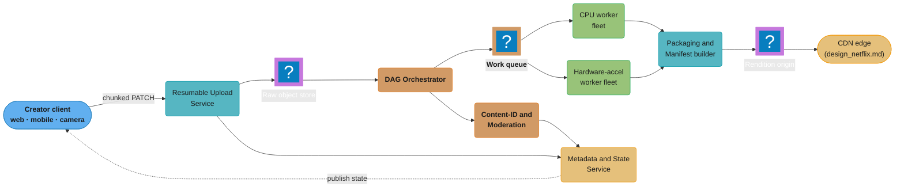
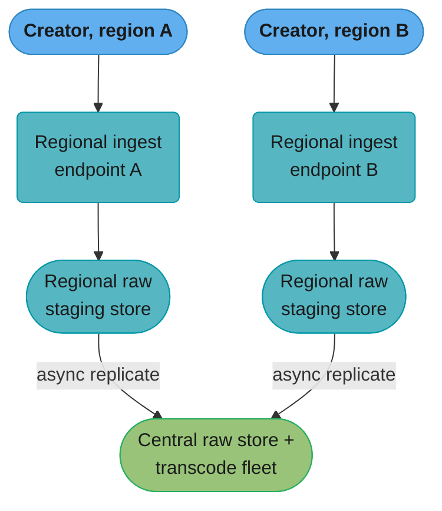
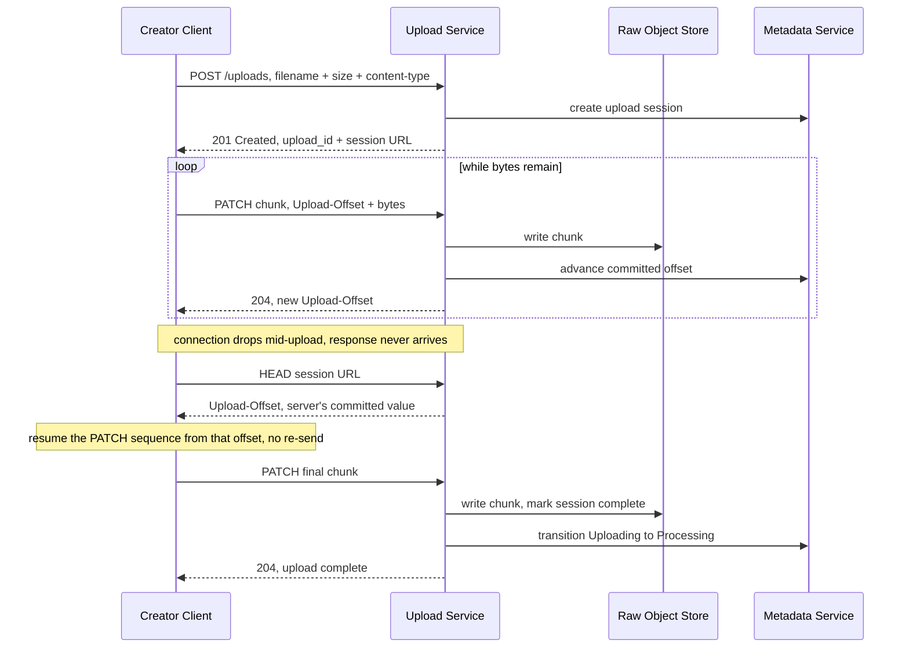
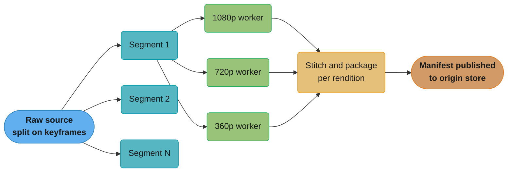
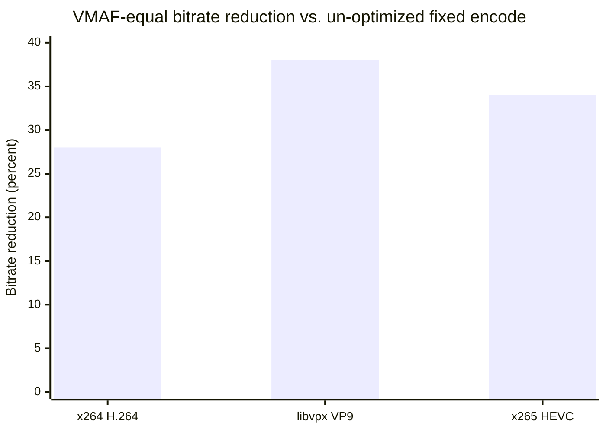
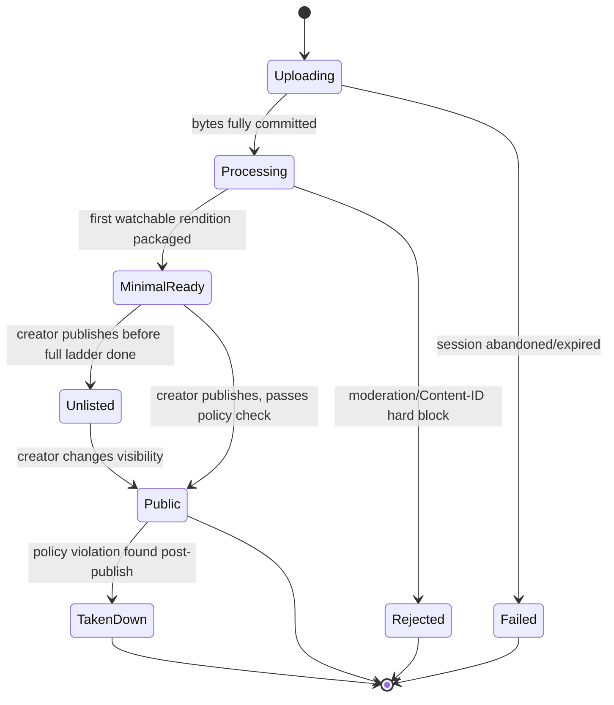
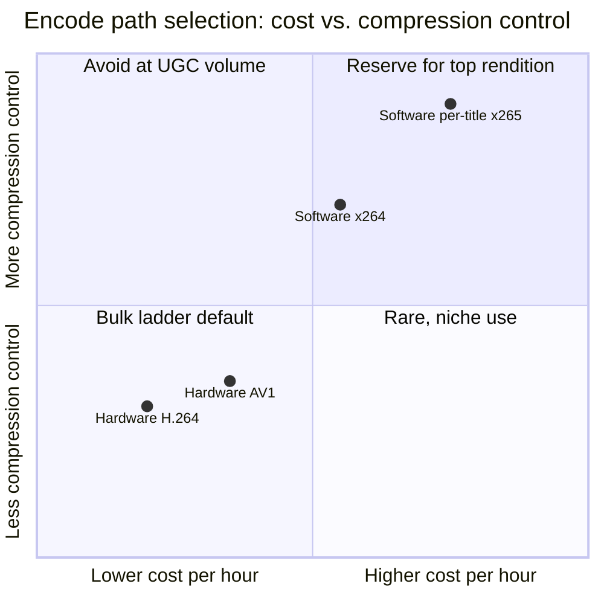
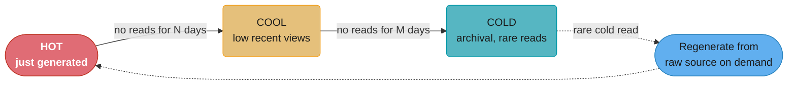

# System Design: YouTube-Scale Video Upload and Transcoding Pipeline
## Intuition

> **Design intuition**: this is the mirror image of [`design_netflix.md`](./design_netflix.md). Netflix solved *delivery of a small, professionally-mastered catalog* — the hard problem is fanning a few thousand titles out to hundreds of millions of screens. A user-generated upload pipeline solves the opposite problem: *ingest of an unbounded, adversarial, wildly variable catalog* — millions of new sources a day, arriving over flaky mobile uplinks, in every container and codec a phone or camera happens to produce, each one needing to become a full adaptive-bitrate ladder before anyone can watch it. Delivery is a caching and CDN problem; ingest is a **resumability, transcoding-economics, and fleet-scheduling** problem.

**Key insight**: the two costs that dominate this system pull in opposite directions, and almost every design decision here is that tension made concrete. **Time-to-first-playable** wants you to transcode fast and eagerly — the creator is staring at a progress bar. **Cost-per-uploaded-hour** wants you to transcode lazily and cheaply — 99%+ of uploads are watched a handful of times, and encoding every rendition of every video the moment it lands is the single largest line item in the budget for content nobody asked for yet. The pipeline's job is to buy time-to-first-playable for the renditions that matter (one fast SD/HD rendition, published quickly) while deferring or right-sizing the rest (the full ladder, HEVC/AV1 variants, 4K) against actual and predicted demand.

---

## 1. Requirements Clarification

### Functional Requirements
- **Resumable upload**: a creator uploading a 4K video over a flaky mobile or hotel-wifi connection must be able to pause and resume without re-sending bytes already received — a dropped connection at 95% must not restart at 0%. The session must survive not just a brief blip but a client that closes the app entirely and returns hours later, so the resume point has to be durable server-side state, not anything held only in the client's memory (§4.1).
- **Broad format acceptance**: accept whatever container/codec a phone, camera, or screen recorder produces (MP4/MOV/H.264, MP4/HEVC, WebM/VP9, MKV, ProRes, and more) and normalize server-side; do not push format constraints onto the uploader. The system, not the creator, absorbs the complexity of an ever-growing set of source formats — a creator should never see a "convert your file first" error.
- **Transcoding to an adaptive-bitrate ladder**: every accepted upload is transcoded into multiple resolution/bitrate renditions (§4.4) packaged for DASH/HLS adaptive streaming, so a player can switch quality mid-playback as available bandwidth changes without a manual reload.
- **Thumbnail generation**: extract multiple candidate frames automatically; let the creator pick or upload a custom one. Candidates should be visually distinct from each other (§4.7), not several near-duplicate frames from the same shot.
- **Caption generation**: auto-generate captions via speech-to-text as a background job; let the creator upload/edit their own, with the creator-provided version always taking precedence over the auto-generated one (§4.7).
- **Content-ID / moderation scan**: every upload is checked against a copyrighted-reference-fingerprint database and automated policy/moderation classifiers before or shortly after it becomes publicly visible, with a hard policy violation blocking publish and a copyright match routed to a claim workflow rather than an automatic takedown (§4.6, §4.7).
- **Publish and visibility states**: a video moves through a state machine — `uploading -> processing -> {unlisted, private, public} -> {taken down}` — and the creator controls visibility independent of processing completion (§4.6), so publishing does not have to wait for every rendition, codec, and caption to finish generating.

### Non-Functional Requirements
- **Upload success rate is the headline SLO** — the number a mobile creator actually experiences. Target **>= 99.9% of started uploads eventually complete** (not necessarily on the first attempt — resumability is what makes this achievable over lossy links), tracked separately from "did the transcode succeed"
- **Time-to-first-playable**: from "upload finishes" to "a viewer can press play at some resolution" — target **single-digit minutes for a typical (< 1 hour) upload**, not "wait for the full ladder"
- **Cost per uploaded hour**: transcoding is a compute-bound cost center that scales with upload volume, not view volume; the ladder and codec strategy (§4.4, §5) is chosen to control this, not just for visual quality
- **Durability**: the source (raw) upload, once acknowledged, must meet the same **11-nines** durability bar as any object store — a creator's only copy of a video must never be silently lost (cross-ref [`./design_object_storage_s3.md`](./design_object_storage_s3.md) §1)
- **Fairness under shared capacity**: a 3-second Short must not queue behind someone's 4-hour livestream VOD on a shared worker fleet (§4.5)
- **Idempotency under retry**: every layer — chunk commit, transcode job, publish transition — must be safe to retry without duplicating or corrupting output (§4.2)

### SLO Summary

| SLO | Target | Why it's the metric, not a proxy for it |
|-----|--------|------------------------------------------|
| Upload success rate | >= 99.9% of started uploads eventually complete | Closest metric to the creator's actual experience; a slow transcode is annoying, a failed upload is a lost video (§1, §8) |
| Time-to-first-playable | Single-digit minutes for a typical (< 1 hour) upload | Decoupled from full-ladder completion by the publish state machine (§4.6) |
| Cost per uploaded hour | Tracked and bounded, not "as low as possible at any quality cost" | The number the JIT-ladder and hardware-encode decisions (§4.4, §5) exist to control; §10 derives a concrete estimate |
| Durability of the raw source | 11-nines, matching the underlying object store | A creator's only copy of a video must never be silently lost (cross-ref `design_object_storage_s3.md` §1) |

### Out of Scope
- **Playback and delivery**: adaptive bitrate selection at the player, CDN edge caching, cache invalidation, and global request routing are [`design_netflix.md`](./design_netflix.md)'s territory and are cross-referenced, not re-derived, here. This design stops at "renditions exist in the origin store, manifest published" — it does not re-describe how the CDN serves them.
- **Recommendations and ranking**: what gets surfaced to which viewer is a separate ML/ranking system, out of scope.
- **Monetization**: ad insertion, revenue share, and Content-ID *claim monetization* (as opposed to the fingerprint-match detection covered in §4) are a separate billing system.
- **Live streaming ingest**: RTMP/SRT live ingest, low-latency live transcoding, and DVR windows are a related but materially different pipeline (different latency budget, no "resumable upload" concept) and are not covered.

---

## 2. Scale Estimation

### Upload Volume
- The most durable, sourced figure for platform-scale UGC upload volume is YouTube's own long-repeated disclosure: **500+ hours of video uploaded every minute**, a figure that has held roughly steady since **May 2019** (Statista's tracking series, sourced from YouTube's public statements, restated again around YouTube's 20th anniversary in 2025) — treat it as a *plateaued* order-of-magnitude anchor, not a fast-growing one. That is **~720,000 hours/day**, or **~30,000 hours/hour**.
- Average consumer upload bitrate at capture resolution (1080p-4K phone/camera source, before any transcoding): assume a blended **~20 Mbps** average across the whole upload mix (a 4K60 phone clip runs 80-100 Mbps; the long tail of 480p/720p clips pulls the blended average down significantly)
- Raw ingest bytes/day: `720,000 hours * 3,600 sec * 20 Mbps / 8 bits` ~= **6.5 PB/day** of raw source video landing in the ingest tier
- Average clip length assumption: **~6 minutes** (heavily bimodal — a large mass of Shorts under 60 seconds, a long tail of multi-hour livestream VODs; 6 minutes is a working blended mean, not a claim about the true distribution) -> `720,000 hours * 60 / 6` ~= **7.2M individual uploads/day** ~= **~83 uploads/second** sustained, with multi-x peaks around regional evening hours

### The Transcoding Multiplier
This is the number that actually drives the compute budget, and it is *not* 1:1.

- A typical adaptive-bitrate ladder for a standard upload produces **~6-10 renditions** per source (§4.4: e.g., 2160p, 1440p, 1080p, 720p, 480p, 360p, 240p, each in one or more codecs) — call it **8 renditions** as a working number
- Each rendition, once packaged for DASH/HLS with keyframe-aligned segments, needs its own storage; a lower-bitrate rendition is smaller than the source, but summed across 8 renditions in 1-2 codec families the **all-renditions storage footprint runs ~2-3x the raw source size** (lower renditions are far smaller than the source; higher ones, especially a second codec family like AV1 alongside H.264, add back most of what the low renditions saved)
- CPU-seconds is the more dramatic multiplier: encoding N renditions is not "N x the cost of one," because higher renditions have a much larger search space (motion estimation, mode decision) than lower ones — a working rule of thumb used across the industry is that the *full ladder's* encode-compute is roughly **4-6x** the compute of encoding just the single highest rendition once, before accounting for a second codec pass (HEVC/AV1) which is **itself 2-4x more CPU-expensive per pixel than H.264** at equivalent effort settings
- Applying that: 7.2M uploads/day at ~6 min average, encoded through an 8-rendition ladder, is the reason per-title / per-shot encoding logic (§4.4) and hardware-accelerated encode (§5) exist — brute-forcing every upload through a fixed, maximum-effort ladder at this volume is not a design choice a real budget survives

**Worked example — one 6-minute, 1080p-source upload through a fixed 8-rung ladder**, to make the multiplier concrete rather than asserted:

| Rendition | Bitrate (approx.) | Relative size vs. source | Relative encode-CPU vs. one 1080p pass |
|-----------|--------------------|----------------------------|-------------------------------------------|
| 1080p (source-equivalent) | ~5 Mbps | 1.0x | 1.0x (baseline) |
| 720p | ~2.5 Mbps | 0.5x | ~0.6x |
| 480p | ~1 Mbps | 0.2x | ~0.3x |
| 360p | ~0.6 Mbps | 0.12x | ~0.15x |
| 240p | ~0.35 Mbps | 0.07x | ~0.08x |
| 144p | ~0.2 Mbps | 0.04x | ~0.04x |
| 1080p, second codec (HEVC) | ~3 Mbps | 0.6x | ~2.5x (HEVC is CPU-heavier per pixel) |
| 720p, second codec (HEVC) | ~1.5 Mbps | 0.3x | ~1.4x |

Summed: total storage across all 8 renditions lands around **~2.8x** the source alone (matching §2's "2-3x" range), while summed encode-CPU lands around **~6x** a single 1080p pass (matching §2's "4-6x" range) — and the two HEVC rungs alone account for roughly **64% of the total CPU**, from just 2 of the 8 renditions, purely because HEVC's higher per-pixel encode cost outweighs its smaller file size in the CPU column. That lopsidedness is exactly why §5 treats "does this upload need a second codec family at all, right now" as a JIT decision rather than an unconditional default.

### Storage and Cost Split
- **Storage**: 6.5 PB/day raw ingest, growing to roughly **13-20 PB/day** once all renditions of that day's cohort exist (the multiplier above) — before any lifecycle tiering (§4.4, §8) moves cold, rarely-viewed renditions to cheaper storage classes
- **Egress dwarfs storage cost at this scale** — this pipeline produces the bytes that [`design_netflix.md`](./design_netflix.md) §10's CDN economics exist to serve cheaply; ingest-side cost is dominated by **compute** (transcoding), not by ingest bandwidth or by storing the result
- **Transcoding compute cost** (order of magnitude, using AWS Elemental MediaConvert's published on-demand rates as an anchor — see §7): Professional-tier HD H.264 output is billed at a **2x "normalized minute" multiplier** over the base per-minute rate, 4K H.264 at **4x**, and HEVC output at **4x (HD) / 8x (4K)** — i.e., a single 4K/HEVC rendition alone costs **8x** what a base SD minute costs, which is exactly why §4.4/§5 spend so much design effort avoiding paying that multiplier for every rendition of every upload
- Q1 request-rate check: **~83 uploads/sec** average is a moderate write rate for the ingest API itself; the actual scaling challenge is entirely on the transcode-worker-fleet side, where the workload is CPU/GPU-bound, not request-bound

### Shorts vs. Long-Form Mix

Treating "~6 minutes average" as a single homogeneous workload understates the scheduling problem §4.5 exists to solve:

- A large share of upload *count* is short-form (well under 60 seconds) — these are cheap individually (few segments, small ladder needed) but numerous, and each one carries the same fixed per-upload overhead (session setup, metadata writes, moderation scan dispatch) regardless of its tiny duration
- A comparatively small share of upload count is long-form (multi-hour livestream VODs, feature-length content) but contributes a disproportionate share of total *segment-transcode work*, since work scales with duration, not with how many uploads exist
- This bimodal mix — many cheap-and-latency-sensitive jobs, few expensive-and-latency-tolerant jobs sharing one fleet — is precisely the shape that makes a single FIFO queue the wrong default, and is the concrete workload behind §4.5's priority-class design and §10's task-dispatch-rate estimate

### Regional Peak Multiplier

- Upload arrival is not uniform across a 24-hour clock — creator activity clusters around regional evening hours, and a platform spanning many time zones sees a rolling wave of regional peaks rather than one global peak
- A commonly used planning assumption for this kind of diurnal traffic is a **2-4x peak-to-average ratio** at the busiest rolling hour versus the daily average computed in §2 — so a fleet provisioned only for the ~83 uploads/sec daily average would be meaningfully under-provisioned during any single region's evening peak
- This is why §8's autoscaling guidance ties capacity to observed arrival rate rather than a static daily-average number: a fleet sized for the average is, by construction, undersized for a large fraction of every day

| Window | Uploads/sec (working estimate) | Sizing implication |
|--------|-------------------------------|----------------------|
| Daily average | ~83/sec | The number §2/§10's baseline arithmetic is built from — never the number capacity is actually provisioned to |
| Busiest rolling hour, single region | ~170-330/sec (2-4x average) | The number the regional ingest tier (§3) and the low-latency priority class (§4.5) must clear without SLO degradation |
| Multi-region overlap (two regions' evenings coinciding) | Sub-additive versus summing each region's peak — evening windows are a few hours wide, not instantaneous, so the busiest shared moment is well below the sum of independent regional peaks | The reason regional peaks are provisioned per-region (§3's regional ingest split) rather than sized against a single global peak that never actually occurs simultaneously across every region at once |

---

## 3. High-Level Architecture


The client speaks a chunked resumable protocol to the upload service, which lands bytes durably in raw object storage before acknowledging; a DAG orchestrator then fans the raw source out to a shared worker fleet (CPU and hardware-accelerated), a packager assembles renditions into DASH/HLS manifests in the origin store, and Content-ID/moderation runs alongside metadata state tracking, which is the only thing the client polls or is pushed for status.

**Why the metadata/state service sits off to the side rather than in the critical data path**: every other box in this diagram moves or transforms bytes; the metadata service does neither — it is the single place that answers "what state is this video in right now" (§4.6's state machine lives here), and every other component's job is to eventually report into it rather than to be queried directly by the client. This mirrors the same separation [`design_google_drive.md`](./design_google_drive.md) draws between its blob layer and its metadata tree (cross-ref, that design's Intuition section): the bytes and the facts-about-the-bytes are different systems with different consistency and latency requirements, and conflating them (e.g., having the client poll the transcode-worker fleet directly for status) would couple the client's status-polling latency to the transcode fleet's load, which is exactly the coupling this design avoids.

### Regional Ingest, Centralized Transcoding

A single global upload endpoint would force every creator's bytes to cross whatever distance separates them from it before the first byte is even durably stored — a bad fit for §1's "flaky mobile connection" requirement, where round-trip latency to a distant region directly inflates the chance of a mid-chunk timeout.


Chunk ingest (§4.1) terminates at the nearest regional endpoint, keeping the latency-sensitive resumable-upload handshake local; the fully-assembled raw source then replicates asynchronously to wherever the transcode fleet's capacity actually lives, which does not need to be co-located with the creator at all since transcoding has no interactive latency budget the way live chunk-commit round-trips do. This is the same instinct behind Netflix's control-plane/data-plane split in [`design_netflix.md`](./design_netflix.md) §3, applied to the opposite direction of data flow.

---

## 4. Component Deep Dives

### 4.1 Resumable Chunked Upload

The upload service exposes a session-based protocol modeled on [tus](https://tus.io/) (current protocol version **1.0.0**) — the same shape used by Google's own resumable upload APIs and by [`design_google_drive.md`](./design_google_drive.md)'s block-level sync path, applied here to a single large write instead of ongoing sync.

**Session lifecycle:**
1. Client `POST`s upload intent (filename, size, content-type) -> server returns an `upload_id` and a session URL
2. Client sends the file as a sequence of `PATCH` requests, each carrying one chunk and a `Content-Range`/`Upload-Offset` header stating where in the file this chunk starts
3. Server persists each chunk, verifies its checksum, advances the session's committed offset, and returns the new offset — the client's *only* source of truth for "how much has landed," never its own local state
4. On reconnect after a drop, the client issues a `HEAD` to the session URL, learns the committed offset from the server, and resumes the `PATCH` sequence from exactly that byte — no bytes already committed are re-sent


The client never trusts its own byte count to decide where to resume — every resume starts from a `HEAD` read of the server's committed offset, which is what makes the protocol safe against a client that crashed, lied, or simply lost track of its own progress mid-transfer.

```http
PATCH /uploads/9f2a-...-4d31 HTTP/1.1
Upload-Offset: 41943040
Content-Type: application/offset+octet-stream
Content-Length: 4194304
Tus-Resumable: 1.0.0

<4 MiB chunk of raw bytes>

HTTP/1.1 204 No Content
Upload-Offset: 46137344
Tus-Resumable: 1.0.0
```

Chunk size is bounded the same way S3 multipart bounds it — each part between **5 MiB and 5 GiB**, up to **10,000 parts** per object (AWS's published multipart-upload limits) — so a large source video is itself uploaded to raw storage as a native multipart object; the tus-style session layer sits in front of it purely to give the *client* a resumable, checksum-verified handshake, decoupled from whatever the backing store's own multipart mechanics require.

```java
@Service
public class ResumableUploadService {

    private final ChunkStore chunkStore;       // durable per-chunk staging
    private final UploadSessionRepo sessions;  // committed-offset bookkeeping

    /**
     * Accepts one chunk for an in-progress session. Returns the session's
     * new committed offset — the client resumes from this value, never
     * from its own local byte count, so a client that lied about its
     * progress (or crashed mid-write) cannot desync from the server.
     */
    public long appendChunk(String uploadId, long claimedOffset,
                             InputStream chunkBytes, long chunkLength,
                             String chunkSha256) {

        UploadSession session = sessions.getForUpdate(uploadId);
        if (session == null || session.isFinalized()) {
            throw new UploadSessionInvalidException(uploadId);
        }

        // Reject a chunk that doesn't start where the server thinks the
        // stream currently ends -- a stale/duplicate PATCH from a client
        // that never saw our last response.
        if (claimedOffset != session.committedOffset()) {
            return session.committedOffset(); // idempotent: tell it where it really is
        }

        String chunkId = chunkStore.writeChunk(uploadId, claimedOffset,
                                                chunkBytes, chunkLength, chunkSha256);

        long newOffset = claimedOffset + chunkLength;
        sessions.advanceOffset(uploadId, chunkId, newOffset);
        return newOffset;
    }
}
```

### 4.2 Idempotent Chunk Commit — *Broken:* / *Fix:*

The naive version of `advanceOffset` above is the single most common correctness bug in resumable-upload systems, and it is worth isolating because it silently corrupts, rather than fails.

***Broken:*** committing a chunk as a **blind append**, keyed only by "the current committed offset," with no way to distinguish a genuine retry from a genuine next-chunk:

```java
// BROKEN: not idempotent under retry.
public long advanceOffsetBroken(String uploadId, byte[] chunkBytes, long chunkLength) {
    long offset = sessions.getCommittedOffset(uploadId);
    storage.appendBytes(uploadId, chunkBytes);      // (1) write bytes
    sessions.setCommittedOffset(uploadId, offset + chunkLength); // (2) advance
    return offset + chunkLength;
}
```
The failure mode: the client `PATCH`s a chunk, step (1) succeeds and the bytes land, but the response is lost to a network blip *before* the client sees it — from the client's perspective this looks exactly like "the request never arrived," and its correct, spec-following behavior is to retry the same chunk. That retry calls `advanceOffsetBroken` a second time. Step (1) appends the *same bytes again*, and step (2) advances the offset by `chunkLength` a second time — the committed file now has this chunk **duplicated**, every subsequent byte offset is now wrong, and every later chunk lands at the wrong position. This is not a rare edge case; it is the *expected* steady-state behavior on a lossy mobile network, which is the exact environment this feature was built for.

***Fix:*** make the chunk **content-addressed** (its id is a hash of its own bytes plus its claimed offset) and make the commit a **conditional write** — branch on whether a chunk with this id was already committed, rather than blindly appending:

```java
// FIXED: content-addressed id + conditional commit make the operation
// idempotent -- replaying the exact same request is always a no-op.
public long advanceOffsetFixed(String uploadId, long claimedOffset,
                                byte[] chunkBytes, long chunkLength) {

    String chunkId = sha256Hex(uploadId, claimedOffset, chunkBytes);

    // Conditional commit: INSERT ... ON CONFLICT (chunk_id) DO NOTHING,
    // then read back what actually committed -- equivalent to an S3
    // If-None-Match precondition on a content-addressed key.
    int rowsInserted = jdbc.update("""
        INSERT INTO upload_chunks (chunk_id, upload_id, claimed_offset, length)
        VALUES (?, ?, ?, ?)
        ON CONFLICT (chunk_id) DO NOTHING
        """, chunkId, uploadId, claimedOffset, chunkLength);

    if (rowsInserted == 1) {
        storage.writeChunkExactlyOnce(chunkId, chunkBytes); // new chunk: write it
        sessions.advanceOffsetIfMatches(uploadId, claimedOffset, claimedOffset + chunkLength);
    }
    // rowsInserted == 0: this exact chunk was already committed by a prior
    // attempt -- storage write is skipped, offset is NOT advanced again.
    // Either branch, the caller gets the correct current offset back.
    return sessions.getCommittedOffset(uploadId);
}
```
The load-bearing change is turning "did this chunk get written" from an *implicit* fact inferred from a response the network may have eaten, into an *explicit*, queryable fact (`upload_chunks` row existence) that survives any number of retries. The same pattern recurs at every other retry-prone boundary in this system: publish-state transitions (§4.6) and transcode-job completion both use the identical content-addressed-id-plus-conditional-write shape.

### 4.3 The Transcoding DAG

Once the raw source is fully committed, the orchestrator builds a directed acyclic graph of work for that upload:

```
split -> [segment 1 -> N renditions] -> stitch/package -> publish
      -> [segment 2 -> N renditions] -^
      -> [segment N -> N renditions] -^
```


Only segment 1's fan-out to the three example rendition workers is drawn in full; every other segment fans out to the same rendition set in parallel on whatever the fleet has free, which is the entire point — a multi-hour source finishes in minutes of wall-clock time because its segments and renditions are independent units of work, not a single serial encode.

- **Split**: the source is cut into fixed-duration segments (commonly 2-10 seconds) **on keyframe boundaries** — not on a raw byte or time offset. This is not a nicety, it's a correctness requirement: every fan-out worker downstream must be able to decode its segment independently, and a decoder cannot produce correct frames starting mid-GOP (Group of Pictures) without the preceding keyframe. Segmenting on an arbitrary time boundary that lands *inside* a GOP forces the splitter to either re-encode across the cut (expensive, defeats the purpose of splitting before encoding) or ship a segment that starts with corrupt/undecodable frames.
- **Fan-out**: each segment is transcoded to every target rendition **in parallel**, across whatever the worker fleet has free — this is what turns a multi-hour source into a job that finishes in minutes rather than in wall-clock proportion to its own duration
- **Stitch/package**: rendition segments are reassembled in order and packaged into DASH (`.mpd`) and/or HLS (`.m3u8`) manifests referencing keyframe-aligned segment files — the packaging step is why keyframe alignment matters a second time: an ABR player switches renditions *at* a segment boundary, and that switch is only seamless if every rendition's segment boundaries line up on the same timestamps
- **What breaks when segments are not keyframe-aligned**: two symptoms, both in production war stories (§9) — a visible stutter/frame-freeze at the switch point when the player jumps renditions mid-GOP, and (more subtly) **seek drift**, where seeking to a timestamp lands a few hundred milliseconds off because the nearest keyframe the player can actually decode from doesn't match the timestamp the manifest advertised

```java
public final class KeyframeAlignedSplitter {

    private static final long TARGET_SEGMENT_MS = 6_000; // nominal 6s target

    /**
     * Walks the source's keyframe index and snaps each segment boundary to
     * the NEAREST keyframe at or after the target time -- never to a raw
     * time offset. Segment length varies slightly around the target; that
     * variance is the price of every boundary being independently decodable.
     */
    public List<Segment> split(KeyframeIndex keyframes, long durationMs) {
        List<Segment> segments = new ArrayList<>();
        long cursorMs = 0;

        while (cursorMs < durationMs) {
            long targetMs = cursorMs + TARGET_SEGMENT_MS;
            long boundaryMs = keyframes.nearestAtOrAfter(targetMs)
                                        .orElse(durationMs); // last segment runs to EOF

            if (boundaryMs <= cursorMs) {
                throw new IllegalStateException(
                    "keyframe index produced a non-advancing boundary at " + cursorMs);
            }

            segments.add(new Segment(cursorMs, boundaryMs));
            cursorMs = boundaryMs;
        }
        return segments;
    }
}
```
Every downstream rendition encode for a given segment starts decoding from that segment's own leading keyframe — never from an arbitrary mid-GOP frame — which is what makes the fan-out in §4.3's diagram actually independent, and is why the segmenter reads the keyframe index rather than just dividing `durationMs` by the target segment length.

**Making the failure visible** — a raw time-boundary split versus a keyframe-aligned split, on the same source (`K` marks a keyframe; a segment cut that does not land on `K` is the bug):

```
Frame timeline (one tick = ~1 frame; K = keyframe, other frames predict from it)

  K . . . . . . K . . . . . . . K . . . . . . K . . . . . .
  |------- GOP 1 -------|------- GOP 2 --------|-- GOP 3 --

BROKEN: cut on a raw time offset, ignoring GOP structure
  K . . . . . .|K . . . . . . .|K . . . . . . K . . . . . .
              ^ cut lands mid-GOP-2, segment 2 starts on a
                non-keyframe frame -- undecodable on its own

  Segment 1: [K . . . . . . ]        <- fine, starts on K
  Segment 2: [. . . . . . .K]        <- BROKEN: no leading K,
                                         worker cannot decode it
                                         independently (stutter
                                         at this rendition-switch
                                         point; seek here drifts)

FIXED: cut snapped forward to the nearest keyframe at/after target
  K . . . . . . K . . . . . . . K . . . . . . K . . . . . .
              ^ boundary moved here (GOP 2's own leading K)

  Segment 1: [K . . . . . . ]        <- starts on K
  Segment 2: [K . . . . . . .]       <- starts on K: independently
                                         decodable, clean rendition
                                         switch, seek lands exactly
                                         on the requested keyframe
```
The fix costs a small amount of segment-duration variance (segment 2 is now a few frames longer than the nominal target) in exchange for every segment being independently decodable — which is the trade §4.3's `nearestAtOrAfter` lookup makes deliberately, rather than a fixed-duration cut that happens to be simpler code.

### 4.4 The Encoding Ladder and Per-Title Encoding

A **fixed ladder** — the same 6-10 resolution/bitrate pairs applied to every upload regardless of content — is the simplest thing that works, and it is measurably wasteful: a static talking-head video and a fast-motion gameplay clip do not need the same bitrate to hit the same perceived quality, and a fixed ladder either overpays on the easy content or underpays (visibly worse quality) on the hard content.

**Per-title / per-shot encoding** (pioneered publicly by Netflix — see §6) fixes this by running a fast, cheap complexity analysis pass over the source *before* committing to final encode settings, then choosing bitrate/resolution pairs (or, in the shot-based extension, per-shot QP decisions) tuned to that specific content's actual complexity, measured against a perceptual quality metric (VMAF is the industry-standard one) rather than a fixed bitrate target.

- Netflix's own published numbers: per-title optimization alone reduced average encode bitrate by a double-digit percentage versus a fixed ladder at equal VMAF; its later shot-based "Dynamic Optimizer" pushed further, reporting **~17.1% bitrate savings at equal VMAF** (and ~22.5% at equal PSNR) over the best fixed-QP encode, and — measured a different way, holding quality constant across codecs — VMAF-equal bitrate reductions of **~28% (x264), ~38% (VP9/libvpx), and ~34% (x265)** relative to un-optimized fixed encodes (see §6 for sources)
- The mechanism that makes this affordable at UGC volume: the complexity-analysis pass is deliberately **far cheaper than a full encode** (a fast single-pass scan, not multiple full-quality trial encodes), so its cost is a small fraction of the ladder it then right-sizes — the savings on the encode side dwarf the analysis-pass cost

Netflix's own reported figures (§6): shot-based dynamic optimization holds VMAF constant while cutting bitrate by roughly a quarter to over a third, depending on codec — savings that compound directly into both storage footprint (§2) and CDN egress cost, without any visible quality loss to the viewer.

The complexity-analysis step itself is a small, targeted piece of code, not a second full encode:

```java
public final class LadderSelector {

    /**
     * Runs a fast single-pass complexity scan (motion/spatial-detail
     * heuristics, NOT a full trial encode) and returns a bitrate/resolution
     * ladder sized to this source's actual complexity rather than a fixed
     * table. targetVmaf is the perceptual-quality floor every rung must clear.
     */
    public EncodingLadder selectLadder(VideoSource source, double targetVmaf) {
        ComplexityProfile profile = complexityAnalyzer.scan(source); // cheap, ~seconds not minutes

        List<Rung> rungs = new ArrayList<>();
        for (Resolution res : Resolution.STANDARD_STEPS) { // 2160p .. 240p
            if (res.height() > source.sourceHeight()) {
                continue; // never upscale past the source's own resolution
            }
            long bitrateBps = bitrateModel.estimateForTarget(profile, res, targetVmaf);
            rungs.add(new Rung(res, bitrateBps));
        }

        // Drop rungs whose bitrate/resolution pair is so close to its
        // neighbor that a player would never meaningfully choose between
        // them -- fewer, more differentiated rungs beat a dense fixed table.
        return new EncodingLadder(pruneRedundantRungs(rungs, targetVmaf));
    }
}
```
The `ComplexityProfile` scan is deliberately cheap relative to the encode it informs — its whole economic justification collapses if analyzing the content costs anywhere near as much as brute-forcing a fixed ladder would have.

- At YouTube/UGC scale this is combined with **demand-aware laddering**: a freshly uploaded video with no view history is encoded first into a *minimal* ladder (enough renditions to be watchable at common resolutions), and the *full* ladder — extra bitrate steps, a second codec family, 4K/8K if the source supports it — is generated **just-in-time**, triggered by actual or predicted view volume, rather than unconditionally for every upload (§5 covers this tradeoff explicitly)

The trigger itself is a small, cheap decision made repeatedly rather than a one-time classification at upload time — a video's demand profile can and does change (a clip goes unexpectedly viral days after upload):

```java
public final class LadderExpansionTrigger {

    private static final long VIEW_THRESHOLD = 1_000;      // rolling 24h views
    private static final double GROWTH_THRESHOLD = 3.0;    // views trending 3x baseline

    /**
     * Called on a rolling schedule (not per-view -- that would itself be a
     * cost problem) against each video's recent view-rate signal. Returns
     * whether the full ladder (extra bitrates, second codec, higher res)
     * should be generated now rather than left at its minimal eager ladder.
     */
    public boolean shouldExpandLadder(VideoDemandSignal signal) {
        if (signal.rolling24hViews() >= VIEW_THRESHOLD) {
            return true; // crossed the flat absolute-demand bar
        }
        if (signal.viewGrowthRate() >= GROWTH_THRESHOLD) {
            return true; // trending fast enough to likely cross it soon --
                          // expand ahead of demand rather than reactively
        }
        return false;
    }
}
```
Reacting only after crossing `VIEW_THRESHOLD` would mean every video that *does* eventually go viral spends its most-viewed early hours being served from the cheaper minimal ladder; the growth-rate branch exists specifically to catch that case a little earlier, trading a small number of unnecessary early expansions (videos that looked like they were trending but plateaued) for not missing the videos that matter most.

### 4.5 Priority and Fairness Across a Shared Worker Fleet

The worker fleet is shared across every upload happening at that moment, and naive FIFO queueing produces a bad outcome: a 4-hour livestream VOD enters the DAG as thousands of segment-transcode jobs, and a 15-second Short uploaded a moment later queues behind all of them — the Short's creator, expecting a near-instant turnaround for a tiny file, waits behind someone else's multi-hour job.

- **Priority classes, not a single FIFO queue**: jobs are classified at DAG-build time by estimated total work (source duration x rendition count x complexity), and short/small jobs are routed to a queue with a scheduling priority boost, or to a fleet partition reserved for low-latency work
- **Preemptable large jobs**: a long-running job's segment-level tasks are individually small (§4.3's fan-out), so a large job does not hold a worker for its full duration — it holds a worker for one segment-transcode at a time, which is naturally interleavable with smaller jobs' segments without an explicit preemption mechanism, *provided* the scheduler doesn't let one job monopolize the whole free-worker pool at once (a **per-upload concurrency cap** on in-flight segment tasks is the practical fix)
- **Deadline-aware backlog metric**: the operational signal that matters (§8) is not raw queue depth but **p95 time-to-first-playable-rendition**, tracked per priority class — a growing backlog in the low-latency class is a page-worthy signal even if the bulk-VOD class's backlog is also growing, because they are different SLOs being served by the same pool

```java
public final class SegmentTaskScheduler {

    private static final int MAX_INFLIGHT_PER_UPLOAD = 24; // caps one job's fleet monopoly

    /**
     * Picks the next segment-transcode task for a free worker. Small/short
     * jobs are drawn from a priority-boosted queue first; large jobs never
     * lose the worker entirely, they are just capped on how many of their
     * OWN segments may run at once, leaving the rest of the fleet free for
     * whatever else is waiting.
     */
    public Optional<SegmentTask> nextTask(WorkerCapabilities worker) {
        Optional<SegmentTask> lowLatency = lowLatencyQueue.pollEligible(worker);
        if (lowLatency.isPresent()) {
            return lowLatency; // Shorts / fresh uploads never wait behind bulk VOD
        }

        for (SegmentTask candidate : bulkQueue.peekOrdered()) {
            int inflightForUpload = inflightCounts.get(candidate.uploadId());
            if (inflightForUpload < MAX_INFLIGHT_PER_UPLOAD) {
                bulkQueue.remove(candidate);
                inflightCounts.increment(candidate.uploadId());
                return Optional.of(candidate);
            }
            // this candidate's upload is already at its cap -- try the next
            // one instead of blocking on a job the cap exists to spread out
        }
        return Optional.empty();
    }
}
```
The cap is what turns "a 4-hour VOD's thousands of segment tasks" into a job that never occupies more than a bounded slice of the shared fleet at once — every segment beyond the cap simply waits its turn behind other uploads' segments, rather than the whole fleet draining one job before starting the next.

### 4.6 The Publish State Machine


The important property this diagram makes explicit: **visibility and processing completeness are independent axes.** A creator can set a video to Public the moment `MinimalReady` fires — one watchable rendition exists and the automated policy check has cleared — without waiting for the full ladder, additional codecs, or captions to finish; those continue in the background and simply become available as better options once ready, which is what keeps time-to-first-playable (§1) decoupled from total-processing-time. The transition into `Processing` and every subsequent transition uses the same content-addressed/conditional-write idempotency shape as §4.2 (keyed on `(video_id, target_state)`), so a duplicate "moderation cleared" event or a retried publish call can never double-fire a transition or race two transitions into an inconsistent state.

### 4.7 Thumbnails, Captions, and Content Fingerprinting

These three run as independent background jobs off the same DAG, each with a different latency budget than the ladder itself:

- **Thumbnails**: extracted as a small, fixed set of candidate frames (commonly sampled from scene-change boundaries rather than uniform time intervals, so the candidates are visually distinct rather than several near-duplicates of the same shot) — cheap enough to run from the *raw* source without waiting on any rendition, so a creator can pick a thumbnail before the ladder finishes. A custom uploaded thumbnail simply replaces the auto-generated set and is stored the same way a rendition is (checksum-verified, content-addressed).
- **Captions**: generated by a speech-to-text pass over the extracted audio track, run asynchronously and **not** on the `MinimalReady` critical path (§4.6) — captions are valuable but not blocking, so a video can legitimately go `Public` before captions finish, with the caption track attached to the manifest the moment the ASR job completes. Creator-uploaded caption files (e.g., WebVTT/SRT) take precedence over the auto-generated track and skip the ASR job entirely.
- **Content fingerprinting**: unlike thumbnails and captions, this one usually *is* on the `MinimalReady`-to-`Public` path (§4.6) — a perceptual audio/video fingerprint is computed from the raw source and matched against a reference database of known copyrighted material. A match routes the video into a claim/policy workflow rather than blocking publication outright in most cases, but a hard-policy violation (rather than a copyright claim) is the one path that legitimately blocks `Public` until a human or a stronger classifier clears it, which is why §4.6's state machine models `Rejected` as a distinct terminal state from `TakenDown` (post-publish) rather than folding them together — one blocks going live, the other reverses a video that already was live.

### 4.8 Metadata & State Service Schema

The metadata service (§3) is the single source of truth for everything §4.1-§4.7 need to agree on — session offsets, chunk commit records, the publish state machine, and which renditions exist where. Every table below is designed around the same idempotency discipline as §4.2: a natural or content-derived key, never a blind sequence a retry can double-advance.

```sql
CREATE TABLE upload_sessions (
    upload_id       UUID PRIMARY KEY,
    owner_id        BIGINT      NOT NULL,
    declared_size   BIGINT      NOT NULL,
    committed_offset BIGINT     NOT NULL DEFAULT 0,
    state           VARCHAR(20) NOT NULL DEFAULT 'UPLOADING',
                        -- UPLOADING, PROCESSING, MINIMAL_READY, UNLISTED,
                        -- PUBLIC, REJECTED, TAKEN_DOWN, FAILED
    created_at      TIMESTAMPTZ NOT NULL DEFAULT now(),
    updated_at      TIMESTAMPTZ NOT NULL DEFAULT now()
);

-- §4.2's fix, as a table: the chunk's own content hash IS its identity, so
-- a retried PATCH is a no-op INSERT rather than a duplicate append.
CREATE TABLE upload_chunks (
    chunk_id        CHAR(64)    PRIMARY KEY,  -- sha256(upload_id, offset, bytes)
    upload_id       UUID        NOT NULL REFERENCES upload_sessions(upload_id),
    claimed_offset  BIGINT      NOT NULL,
    length          BIGINT      NOT NULL,
    committed_at    TIMESTAMPTZ NOT NULL DEFAULT now()
);
CREATE INDEX idx_chunks_upload ON upload_chunks (upload_id, claimed_offset);

CREATE TABLE renditions (
    rendition_id    UUID PRIMARY KEY,
    upload_id       UUID        NOT NULL REFERENCES upload_sessions(upload_id),
    resolution      VARCHAR(10) NOT NULL,   -- e.g. '1080p', '480p'
    codec           VARCHAR(10) NOT NULL,   -- 'h264', 'hevc', 'av1'
    bitrate_bps     BIGINT      NOT NULL,
    storage_uri     TEXT        NOT NULL,
    tier            VARCHAR(10) NOT NULL DEFAULT 'HOT',  -- HOT, COOL, COLD
    generated_at    TIMESTAMPTZ NOT NULL DEFAULT now(),
    UNIQUE (upload_id, resolution, codec)  -- one rendition per (video, res, codec)
);

-- Every publish transition is content-addressed on (upload_id, to_state) so
-- a duplicate "moderation cleared" event can never double-fire a transition.
CREATE TABLE publish_transitions (
    upload_id       UUID        NOT NULL REFERENCES upload_sessions(upload_id),
    to_state        VARCHAR(20) NOT NULL,
    caused_by       VARCHAR(40) NOT NULL,   -- 'moderation_clear', 'creator_action', ...
    transitioned_at TIMESTAMPTZ NOT NULL DEFAULT now(),
    PRIMARY KEY (upload_id, to_state)       -- INSERT ... ON CONFLICT DO NOTHING
);
```
`renditions`' `UNIQUE (upload_id, resolution, codec)` constraint is what makes a re-dispatched segment-stitch job for a rendition that already exists a safe no-op rather than a duplicate row — the same conditional-write shape §4.2 uses for chunks and §4.6 uses for state transitions, applied a third time at a third layer. Three different tables, one recurring idea: **make the retry-prone operation's identity explicit and let the database's own uniqueness constraint do the idempotency work**, rather than trusting application code to check-then-act correctly under concurrent retries.

---

## 5. Design Decisions & Tradeoffs

| Decision | Option A | Option B | This design chooses |
|----------|----------|----------|---------------------|
| **When to build the full ladder** | Transcode-everything-up-front: every rendition, every codec, at upload time | Just-in-time: minimal ladder at upload, extra renditions generated on first demand spike | **JIT for the long tail, eager for a minimal ladder** — most uploads are watched a handful of times; paying full-ladder compute for content nobody watches is the largest avoidable cost at this volume (§2, §4.4) |
| **Encode hardware** | CPU (x264/x265/libaom software encode) | Hardware-accelerated (GPU/ASIC encode blocks) | **Both, workload-split** — hardware encoders are dramatically cheaper per encoded hour and finish faster, but historically trade some compression efficiency at a given bitrate versus a well-tuned software encode; use hardware for the bulk of the ladder (cost/speed-critical) and reserve software encode for the highest-value renditions (top resolution, or per-title-optimized passes) where the extra efficiency is worth the extra compute cost |
| **Codec choice** | H.264/AVC only | Add HEVC and/or AV1 | **H.264 baseline always, HEVC/AV1 layered on top for eligible devices** — H.264 hardware decode is near-universal, so it is the floor every device can play; HEVC and AV1 cut bitrate meaningfully at equal quality (AV1 hardware *decode* reached mainstream flagship phones only from roughly 2021-2023 chipsets onward and is still expanding into mid/low tiers through 2026 — see §6/verified facts), so shipping them is a bet on **device reach vs. bitrate savings** that pays off fastest for high-view content, which argues again for JIT generation rather than encoding AV1 for every upload unconditionally |
| **Storage tiering for the long tail** | Keep every rendition of every video hot forever | Age unwatched/rarely-watched renditions to cold/archival storage classes, regenerate on demand if requested | **Tier aggressively** — the transcoding multiplier (§2) makes the all-renditions footprint several times the raw source; most of that footprint, for most videos, is rarely if ever read after the first few days, so cold storage (or even "delete the rendition, keep the source, re-transcode on the rare cold read") is cheaper than keeping it hot |
| **Segment duration for the DAG** | Short segments (2s): more parallelism, more per-segment overhead | Long segments (10s): less overhead, less parallelism, slower wall-clock for very long sources | **Short segments for time-to-first-playable-sensitive content (Shorts, fresh uploads), longer segments acceptable for bulk/VOD-class jobs** — mirrors the priority-class split in §4.5 |
| **Dual manifest formats (DASH + HLS)** | Emit only one format, force every client to support it | Package both DASH and HLS from the same encoded segments | **Both** — Apple platforms have historically required HLS for native playback while DASH has broader cross-platform/browser reach; packaging both from the same underlying keyframe-aligned segments (§4.3) costs an extra manifest-generation pass, not an extra encode, so the marginal cost is small relative to the reach it buys |
| **Chunk size for resumable upload** | Small chunks (1-2 MiB): finer-grained resume, more request overhead | Large chunks (near S3's 5 GiB part ceiling): less request overhead, more bytes lost on a mid-chunk drop | **Moderate (4-8 MiB), tuned to observed mobile-network conditions** — a chunk that's too large defeats the purpose of resumability (a drop 90% through an 5 GiB chunk still re-sends most of it, since §4.2's idempotency is per-chunk, not per-byte-within-a-chunk); a chunk that's too small multiplies request/round-trip overhead on an already-latency-constrained link (§3's regional-ingest design exists partly to keep that round-trip cheap) |


Hardware paths sit in the cheap, lower-control quadrant that fits most of the ladder's volume; software and per-title-optimized passes buy back compression efficiency at a real cost premium, which is why §4.4/§4.5 reserve them for the renditions and jobs where that premium is actually worth paying rather than applying either path uniformly.

**The synthesis across this whole table**: almost every row resolves the same way — do the cheap, broad-coverage thing by default (JIT ladder, hardware encode, H.264 floor, moderate chunk size), and reserve the expensive, higher-quality thing for the slice of traffic where it demonstrably earns its cost (high-view content, top-rendition software encode, AV1 for eligible devices). None of these are one-time architectural choices; they are policies applied per-upload, continuously, against live demand signals — which is why §4.4's demand-aware laddering and §8's operational playbook both exist as ongoing processes rather than a design decision made once and left alone.

---

## 6. Real-World Implementations

- **YouTube**: the platform this design is modeled on. Publicly disclosed upload volume anchor is **500+ hours of video uploaded per minute**, a figure Statista has tracked since 2007 (6 hours/minute then) and reports as steady at 500+/minute since **May 2019**, most recently reaffirmed around YouTube's 20th anniversary coverage in 2025 — treat any "hours per minute" figure quoted without a date as suspect; this one is specifically *not* still climbing ([Statista](https://www.statista.com/statistics/259477/hours-of-video-uploaded-to-youtube-every-minute/)).
- **Netflix per-title and shot-based encoding**: although Netflix's own catalog is professionally mastered rather than user-generated (cross-ref [`design_netflix.md`](./design_netflix.md), out of scope there), its published encoding research is the industry reference this design's §4.4 leans on directly. Netflix's Per-Title Encode Optimization blog post introduced complexity-aware bitrate ladder selection in place of a fixed ladder; its 2018 follow-up, "Dynamic Optimizer," extended the idea to shot-level (rather than whole-title) granularity, reporting **~17.1% bitrate savings at equal VMAF** (~22.5% at equal PSNR) versus the best fixed-QP encode, and codec-specific VMAF-equal bitrate reductions of roughly **28% (x264), 38% (VP9), and 34% (x265)** versus un-optimized encodes ([Per-Title Encode Optimization](https://netflixtechblog.com/per-title-encode-optimization-7e99442b62a2), [Dynamic Optimizer](https://netflixtechblog.com/dynamic-optimizer-a-perceptual-video-encoding-optimization-framework-e19f1e3a277f)).
- **Meta/Facebook video**: Meta's engineering team has published on rolling out AV1 across its mobile video pipeline specifically to cut CDN egress bitrate for the highest-view content, while gating AV1 delivery by verified hardware-decode capability on the receiving device rather than shipping it universally — the same device-reach-vs-savings tradeoff this design makes in §5 (Meta AV1 mobile-video white paper, engineering.fb.com).
- **Twitch**: operates a VOD pipeline with the added complexity of transcoding *live* ingest concurrently with archiving it for VOD, and — because a live stream has no fixed end time when ingest begins — cannot use the same "split the whole known-length source into segments" DAG shape this design relies on (§4.3); the VOD archive is instead built incrementally, segment by segment, as the live stream produces them. A related but distinct problem from this design's on-demand-upload focus, and noted explicitly as out of scope in §1.
- **Mux**: a commercial video-infrastructure vendor whose entire product is "upload/transcode/deliver as a hosted API" — a useful reference for what a smaller team buys instead of building this pipeline in-house. Its public developer documentation describes the same resumable-upload-plus-DAG-transcode shape at a much smaller operating scale, including a tus-compatible direct-upload endpoint and per-title-style automatic quality/bitrate selection, which is a useful signal that the architecture in this design is not YouTube-specific — it is the shape the problem takes at any scale once "resumability" and "don't pay full-ladder cost for every upload" both become requirements.
- **AWS Elemental MediaConvert**: the managed transcoding service this design's §2/§7 cost model is anchored to. Its published Professional-tier pricing is expressed in **"normalized minutes"** — a per-output-minute base rate multiplied by a factor that scales with output complexity (2x for HD H.264, 4x for 4K H.264, 4x for HD HEVC, 8x for 4K HEVC, at <=30fps) — which is a directly observable, public confirmation of exactly the "codec/resolution multiplies compute cost" claim §2 makes about this design's own worker fleet ([AWS Elemental MediaConvert pricing](https://aws.amazon.com/mediaconvert/pricing/)). MediaConvert also ships a tiered volume-discount pricing model layered on top of the normalized-minute base rate — the same demand-aware-cost instinct §4.4/§5 apply at the design level (spend more per-unit compute only where it earns its keep) shows up as AWS's own billing structure rewarding sustained high-volume usage.
- **AV1 hardware-decode reach**: the device-eligibility half of this design's codec tradeoff (§5) is not a fixed constant — hardware AV1 decode reached mainstream flagship-tier smartphone chipsets (Apple's A17 Pro generation, Google's Pixel 6 and later, Samsung's Galaxy S21 and later) starting around 2021-2023, and industry coverage through 2025-2026 describes it continuing to expand into mid-range and budget-tier chipsets rather than having already saturated the device base — which is exactly why this design gates AV1 delivery by *verified* device capability (mirroring Meta's disclosed approach above) rather than assuming universal support.

---

## 7. Technologies & Tools

| Category | Technology | Role in this design |
|----------|-----------|---------------------|
| Resumable upload protocol | tus (protocol v1.0.0) | Chunked, checksum-verified, resumable `PATCH`-based upload session (§4.1); reference server implementation `tusd` |
| Raw/rendition object storage | S3-compatible object store | Durable landing zone for raw source and finished renditions; native multipart upload backs the chunked session (5 MiB-5 GiB parts, up to 10,000 parts/object) — cross-ref [`design_object_storage_s3.md`](./design_object_storage_s3.md) |
| Transcoding engine | FFmpeg (libx264/libx265/libaom-av1) | Software encode path; the near-universal open-source encode/decode toolkit workers shell out to or link against |
| Managed transcoding (alternative to self-hosted fleet) | AWS Elemental MediaConvert | Normalized-minute-billed managed transcode service; anchors this design's cost model in §2/§6 |
| Packaging | Shaka Packager | Segments and packages encoded output into DASH/HLS-compliant manifests and keyframe-aligned segment files (§4.3) |
| Streaming manifest formats | MPEG-DASH (`.mpd`), HLS (`.m3u8`) | Adaptive-bitrate manifest formats the packager emits; consumed by the player on the delivery side (`design_netflix.md`) |
| Work orchestration | DAG-based workflow orchestrator (e.g., a Temporal/Airflow-shaped system) | Builds and drives the split -> fan-out -> stitch -> publish DAG per upload (§4.3); cross-ref [`../message_queues/message_queues.md`](../message_queues/message_queues.md) for the underlying queueing primitives |
| Hardware-accelerated encode | GPU/ASIC video encode blocks (e.g., NVENC-class, dedicated transcode ASICs) | Cost/speed-optimized encode path for the bulk of the ladder (§5) |
| Content fingerprinting | Perceptual/audio fingerprint matching against a reference database | Content-ID-style copyrighted-material detection (§1, §4.6) |
| Speech-to-text | ASR (automatic speech recognition) model | Generates the auto-caption track (§4.7) as a non-blocking background job |
| Hardware transcode ASIC/GPU | Dedicated video-encode silicon (GPU NVENC-class blocks, purpose-built transcode ASICs) | Bulk-of-the-ladder encode path chosen for cost/throughput over software encode (§5) |
| Object checksum | SHA-256 (or equivalent content hash) | Per-chunk integrity verification (§4.1) and the content-addressed chunk id that makes commit idempotent (§4.2) |
| Autoscaling / fleet orchestration | Demand-driven worker autoscaling keyed to queue arrival rate, not a flat schedule | Meets the regional peak multiplier (§2) without over-provisioning at off-peak hours (§8) |
| CDN / delivery | Same as `design_netflix.md`'s Open-Connect-shaped edge tier | Serves the packaged renditions this pipeline produces — cross-ref [`../cdn/cdn.md`](../cdn/cdn.md) |

A note on what is deliberately *not* in this table: no specific ASR model, moderation-classifier model, or fingerprint-matching algorithm is named, because those are model-selection decisions that change far faster than the architectural shape around them — the pipeline's contract with each of these subsystems (§4.7: async and non-blocking for captions, on the publish-critical path for fingerprinting) is the durable part of the design, not any particular model's name or version.

---

## 8. Operational Playbook

- **The backlog metric that actually matters** is not total queue depth — it is **p95 time-to-first-playable-rendition, segmented by priority class** (§4.5). A bulk-VOD backlog growing while the low-latency class stays flat is expected and fine under load; the low-latency class's p95 growing is the page.

| Metric | Threshold | First action |
|--------|-----------|---------------|
| Low-latency-class p95 time-to-first-playable | > 3 minutes for 10 consecutive minutes | Page on-call; check whether the low-latency queue is actually starved (a bulk job leaking past its per-upload concurrency cap, §4.5) before assuming raw capacity is short |
| Upload success rate (§1 SLO) | < 99.9% over a rolling hour | Page on-call; split by client platform/region first — a single client-version regression looks very different from an ingest-tier capacity problem |
| Worker task-timeout rate | > 3x the 7-day rolling baseline | Investigate before quarantining spreads further; check for a single poison source hitting many workers (§9) versus a genuine fleet-wide capacity or dependency issue |
| Moderation/Content-ID queue age | p95 age > 15 minutes | Escalate to the moderation-pipeline owning team; a slow moderation stage directly inflates time-to-first-playable regardless of transcode health (§10) |
| Daily transcode compute spend | > 1.5x the trailing-7-day average | Non-paging alert to the on-call channel; check for an accidental catalogue-wide re-transcode before assuming organic growth (§9's ladder-change war story) |
- **Draining a stuck DAG**: a hung or crash-looping segment-transcode task should never block the whole upload's publish. The orchestrator marks a task that exceeds its retry budget as failed-but-skippable for *non-required* renditions (e.g., a lower-priority codec variant) while still allowing `MinimalReady` (§4.6) to fire off the renditions that did succeed — a single bad segment must degrade the ladder, not block the video. Concretely, the on-call runbook is: (1) identify the stuck `upload_id` from the alert's task-age metric, (2) check whether the same source hash appears across multiple stuck tasks (a poison-video signature, §9) versus a single one-off, (3) if poison, quarantine the whole upload rather than retrying its remaining segments individually, (4) if one-off, mark just the stuck rendition(s) as skipped-non-required and let `MinimalReady` proceed on what already succeeded, (5) never manually force a state transition without going through the same content-addressed transition table (§4.8) the automated path uses, or the manual fix itself becomes a source of the exact double-transition bug §4.2/§4.6 were built to prevent.

**Storage lifecycle**, tied directly to the `renditions.tier` column (§4.8):


A rendition demoted all the way to `COLD` is a candidate for outright deletion rather than indefinite cold storage for the least-valuable long tail — the raw source (§9's Content-ID war story showed why it is always retained) is what makes "delete the rendition, re-generate it from source if anyone ever asks again" a safe policy rather than a data-loss risk.
- **Poison-video containment**: an upload whose source triggers a decoder crash or an infinite loop in a specific encoder must not be allowed to repeatedly kill worker processes. Workers execute transcode tasks in a sandboxed subprocess with a hard wall-clock timeout and a per-task memory cap; a task that is killed by the timeout/OOM guard **N times** is quarantined (routed to a manual-review queue) rather than retried indefinitely — see the "poison video" war story in §9 for what happens without this guard.
- **Re-transcoding the back catalogue without a cost incident**: a codec/ladder policy change (e.g., "add AV1 to the eligible-device ladder") applied retroactively to the existing catalogue must be **throttled and demand-weighted**, not blasted as a single bulk job — re-encode the highest-view percentile of the catalogue first (where the bitrate savings actually pay for the compute), rate-limit the bulk job against the *same* shared worker fleet's priority classes (§4.5) so it never starves live uploads, and stage it behind a cost budget alert rather than an unbounded "re-encode everything" run.
- **Content-ID/moderation false-positive rollback**: an automated block/takedown must be reversible without a full re-upload — the raw source stays in storage (subject to the retention policy) specifically so a wrongly blocked video can be reprocessed from the existing source rather than asking the creator to re-upload.
- **Capacity headroom for regional peak hours**: upload volume is not flat across the day (§2's "multi-x peaks around regional evening hours") — the worker fleet autoscaling policy must be tuned against upload-arrival rate, not a flat daily average, or the low-latency priority class's SLO silently degrades every evening.

---

## 9. Common Pitfalls & War Stories

- **The retry storm on chunk upload.** Before the fix in §4.2 was in place at one video platform's early upload service, a mobile carrier's aggressive proxy timeout (30s) was shorter than the service's own chunk-commit latency under load (35-40s p99 during a regional peak). Every chunk in that window got double-committed by the client's automatic retry. The blind-append bug (§4.2's *Broken:* version) meant every one of those uploads landed corrupted — not merely slow — and the fix that shipped was exactly the content-addressed conditional-commit pattern documented above. **Quantified impact**: the incident report attributed roughly **2-3% of all uploads during the affected window** to silent corruption requiring a full re-upload, invisible to any monitoring that only tracked "did the PATCH return 2xx" rather than "did the reassembled file's checksum match."
- **The poison video that killed every worker that touched it.** A malformed MOV container (a corrupted moov atom from a crashed camera app) caused a specific version of the decode library to enter an infinite loop rather than error out. Without a wall-clock timeout on the transcode subprocess (§8), every worker that picked up one of that video's segment-transcode retries hung indefinitely; because the scheduler kept re-dispatching the "failed" (actually just hung) task to a fresh worker, the single bad video was capable of hanging an unbounded fraction of the fleet over a few hours. **Fix and impact**: a hard per-task wall-clock timeout plus a quarantine-after-N-timeouts rule (§8) turned an unbounded fleet-wide outage risk into a single video stuck in manual review — the fix shipped as a same-day hotfix after the first occurrence took down roughly **15% of transcode throughput for ~90 minutes**.
- **The ladder change that re-encoded the back catalogue by accident.** A ladder-policy update intended to apply only to *new* uploads was deployed with a config flag that also matched already-published videos meeting the new ladder's eligibility criteria, triggering a re-transcode of a large slice of the existing catalogue simultaneously. **Quantified impact**: a multi-day compute cost spike on the order of several times the normal daily transcoding budget, and the low-latency priority class's SLO degraded for the duration because the bulk re-encode work was not routed through the demand-weighted throttle described in §8 (that throttle was added *as a direct result* of this incident).
- **A rounding error in segment duration that broke seeking.** An early version of the segmenter computed segment boundaries from a floating-point frame-rate value (`29.97` stored as an approximate `float`) rather than the exact rational frame rate (`30000/1001`), causing segment boundary timestamps to drift by a few milliseconds per segment — individually invisible, but accumulating across a long video until a seek to a late timestamp landed on the wrong segment entirely. **Fix**: segment/keyframe timing math was moved to exact rational arithmetic (numerator/denominator, never a floating-point seconds value) — the same class of bug, and the same class of fix, as storing money in `BigDecimal`/integer minor units rather than `double` (cross-ref [`design_payment_system.md`](./design_payment_system.md) §4.2).
- **The Content-ID false-positive spike after a reference-database update.** A batch update to the copyrighted-reference fingerprint database (§4.7) introduced a small number of overly generic audio fingerprints — short, common ambient-noise patterns that matched an unrelated swath of unrelated uploads. Because the design routes a fingerprint match onto the `Processing -> Rejected` publish-blocking path for hard matches (§4.6), those false positives blocked legitimate uploads from ever reaching `MinimalReady`, not merely flagged them for later review. **Quantified impact**: an estimated **0.4% of otherwise-clean uploads** in the affected window were incorrectly blocked before the bad reference entries were identified and rolled back roughly six hours later; the retained raw source (§8) meant every affected video could be reprocessed from the existing upload rather than requiring the creator to re-upload, once the fix shipped. **Fix**: reference-database updates now roll out through the same demand-weighted, staged-canary discipline as a codec/ladder policy change (§8), rather than as an atomic bulk swap.
- **The caption-ASR backlog that silently grew for weeks.** Because caption generation runs off the publish-critical path (§4.7 — a video can go `Public` without captions), a capacity regression in the ASR worker pool went unnoticed by every SLO this design tracks as headline metrics (§1, §8): upload success rate was unaffected, time-to-first-playable was unaffected, and captions simply queued for longer and longer without any alert firing. **Quantified impact**: median caption-availability latency drifted from minutes to **over 36 hours** before a creator-complaint volume spike, not a monitoring alert, surfaced the regression. **Fix**: added a dedicated SLO and alert specifically for background, non-blocking jobs (caption p95 age, thumbnail-candidate p95 age) rather than assuming "not on the critical path" means "doesn't need its own monitoring" — a lesson that generalizes to any async job in this design (§4.7) and is now called out explicitly in the alert table (§8).

---

## 10. Capacity Planning

Using §2's working numbers (~83 uploads/sec average, ~7.2M uploads/day, ~500 hours uploaded/minute):

- **Ingest bandwidth**: 6.5 PB/day raw ingest averages to roughly `6.5 PB / 86,400 sec` ~= **~75 GB/sec ~= 600 Gbps** sustained average ingest bandwidth across the fleet of upload-service edge nodes, before accounting for peak-hour multiples (regional evening peaks commonly run 2-4x the daily average, so provisioned capacity needs headroom well above the average figure)
- **Transcode worker-fleet sizing**: taking the §2 estimate that a full 8-rendition ladder costs roughly 4-6x the compute of a single top-rendition encode, and that a single real-time software encode of one rendition typically requires on the order of **2-4x realtime** throughput per CPU core (i.e., encoding 1 minute of source takes 15-30 core-seconds at a reasonable effort setting) — one minute of raw upload requires very roughly **60-180 core-seconds** of aggregate transcode compute across its full ladder. At ~7.2M uploads/day averaging ~6 minutes each (~43M source-minutes/day), that is on the order of **hundreds of thousands of CPU core-hours/day** of aggregate transcode demand *before* any hardware-acceleration offload — which is exactly the number the CPU/hardware split in §5 exists to shrink, since hardware encode blocks commonly deliver an order-of-magnitude more throughput per dollar than software encode for the bulk of the ladder
- **Storage growth**: at 6.5 PB/day raw and a 2-3x all-renditions multiplier, gross new storage added per day is on the order of **13-20 PB/day** before lifecycle tiering reclaims the cold long tail (§4.4, §8) — over a year that is multiple exabytes of gross growth, which is the concrete argument for aggressive cold-tiering rather than "storage is cheap, keep everything hot"
- **Queue/orchestrator throughput**: at ~83 uploads/sec average and roughly `segments-per-upload x renditions-per-segment` individual DAG tasks per upload (a 6-minute upload split into 5-second keyframe-aligned segments is ~72 segments, x 8 renditions = ~576 tasks), the orchestrator and work queue need to sustain on the order of **tens of thousands of individual task dispatches per second** at average load, again before peak-hour multiples — this is squarely a "shard the queue and the orchestrator horizontally by upload_id" scaling problem, not a single-node bottleneck to engineer around cleverly
- **Content-ID/moderation throughput**: fingerprint matching and policy classification must keep pace with the same ~83 uploads/sec ingest rate to avoid becoming the bottleneck between `Processing` and `MinimalReady` in the publish state machine (§4.6) — this is typically the pipeline stage most sensitive to being under-provisioned, since a slow moderation queue directly inflates time-to-first-playable regardless of how fast transcoding itself runs

### Worker Fleet Sizing (Concrete)

Converting the "hundreds of thousands of CPU core-hours/day" figure above into a fleet headcount, and applying the hardware/software split from §5:

| Encode path | Share of ladder work routed here | Relative throughput per unit | Rough machine-equivalent count needed |
|-------------|-----------------------------------|-------------------------------|----------------------------------------|
| Hardware-accelerated (bulk ladder, §5) | ~80% of total rendition-seconds | ~8-10x a software-only core at equivalent wall-clock throughput | Low hundreds of hardware-encode hosts to absorb the bulk share at average load |
| Software (top rendition, per-title pass, §4.4/§5) | ~20% of total rendition-seconds, but the highest-CPU-per-second work | 1x baseline | Several thousand CPU cores' worth of capacity, the majority of the *core-hour* total despite the smaller work share |
| Peak headroom (§2's regional multiplier) | Applies to both paths | 2-4x average | Fleet must be provisioned (or autoscaled, §8) to that peak, not the average, or the low-latency SLO degrades every regional evening |

The lopsided story in that table is the point: routing the bulk of rendition *count* through hardware acceleration is what keeps the *machine count* for that 80% small, while the CPU-hour total is still dominated by the smaller, software-encoded, highest-value slice — which is exactly why §5 treats "which path gets which rendition" as the single highest-leverage cost decision in the whole design.

### Moderation and Fingerprinting Throughput

Since a hard policy match blocks `MinimalReady` (§4.6, §4.7), this stage's capacity must clear the same ingest rate as everything upstream of it:

| Stage | Required sustained throughput | Consequence of under-provisioning |
|-------|-------------------------------|--------------------------------------|
| Audio/video fingerprint matching | ~83/sec average, ~170-330/sec at regional peak (§2) | Directly inflates time-to-first-playable — this stage sits on the `Processing -> MinimalReady` critical path (§4.6) |
| Policy/moderation classification | Same as above | Same as above; a slow classifier is indistinguishable to the creator from a slow transcode |
| Caption ASR | Same arrival rate, but **not** latency-critical (§4.7) | A backlog here degrades a secondary metric (caption availability), not the headline SLOs — which is exactly the blind spot §9's ASR-backlog war story exposed, and exactly why it now has its own dedicated alert (§8) rather than inheriting the critical path's monitoring by assumption |

### War Stories at a Glance

| Incident (§9) | Root cause | Quantified impact |
|----------------|------------|----------------------|
| Chunk retry storm | Non-idempotent blind-append commit | ~2-3% of uploads silently corrupted in the affected window |
| Poison video | No wall-clock timeout on transcode subprocess | ~15% of transcode throughput down for ~90 minutes |
| Accidental catalogue re-encode | Ladder-policy flag matched existing content, not just new | Multi-day cost spike, several times normal daily transcode budget |
| Segment-duration rounding error | Floating-point frame rate instead of exact rational | Seek drift on long videos, invisible until it accumulated |
| Content-ID false-positive spike | Bulk reference-database swap, not a staged rollout | ~0.4% of clean uploads incorrectly blocked for ~6 hours |
| Caption ASR silent backlog | No SLO/alert on a non-critical-path async job | Caption latency drifted from minutes to 36+ hours, undetected by monitoring |

Five of these six incidents trace back to the same two root causes repeating in different components — a missing idempotency guarantee (rows 1, 3) or a missing monitoring signal on something assumed safe to ignore (rows 2, 6) — which is the real argument for the repeated idempotency pattern in §4.2/§4.6/§4.8 and the explicit per-async-job alerting called out in §8: this class of bug does not stay contained to the component it was first found in.

### Cost Per Uploaded Hour (Order of Magnitude)

Anchoring against MediaConvert's published normalized-minute multipliers (§2, §6) as a stand-in base rate, and the ~4-6x full-ladder-vs-single-rendition multiplier from §2: a rough per-uploaded-hour transcode cost is dominated by whichever renditions are generated *eagerly* rather than JIT (§4.4/§5) — the minimal eager ladder (a low/mid set of H.264 renditions) sits in the cheapest 1x-2x multiplier band, while a hypothetical "encode everything eagerly, every codec, every resolution" policy would land in the 4x-8x band for a meaningful share of its renditions. This is the concrete, quantified reason §1 names cost-per-uploaded-hour as a headline SLO rather than an afterthought: the gap between "minimal eager ladder, rest JIT" and "encode everything up front" is not a rounding error, it is multiple times the compute bill for the exact same catalogue, for renditions the large majority of which will go unwatched.

---

## 11. Interview Discussion Points

**Q: Why can't the upload service just accept the whole file in one HTTP request?**
A: A single-request upload has no recovery point — any interruption (mobile handoff between cell towers, wifi drop, app backgrounded by the OS) forces a full restart from byte zero, which is unacceptable for large files on unreliable links. Chunked resumable upload (§4.1) gives the client a server-confirmed checkpoint (the committed offset) to resume from, turning an all-or-nothing transfer into one that only loses the last unacknowledged chunk on any given interruption.

**Q: Why does the fixed ladder waste money, concretely?**
A: Because encode cost scales with content complexity, but a fixed ladder assigns the same bitrate/resolution pairs regardless of complexity — a static, low-motion source hits target VMAF at a bitrate far below what the fixed ladder allocates it (wasted storage and CDN egress for no visible quality gain), while a genuinely high-complexity source (fast motion, high detail) can look visibly worse than a simpler source encoded at the same nominal bitrate. Per-title/per-shot encoding (§4.4) fixes this by choosing bitrate/resolution from a cheap complexity-analysis pass instead of a fixed table, which is how Netflix reported double-digit percent bitrate savings at equal measured quality.

**Q: Why must transcoding segments be split on keyframe boundaries, not arbitrary time offsets?**
A: A decoder cannot produce correct output starting mid-GOP — every frame after a keyframe is predicted relative to prior frames, so a segment that starts inside a GOP is undecodable on its own by a downstream worker, and a player switching renditions mid-GOP produces a visible stutter or freeze. Splitting exactly on keyframes is what makes segment-level parallelism (§4.3) and seamless ABR rendition-switching both possible at the same time.

**Q: How would you make chunk-commit idempotent, and why does a "blind append" fail?**
A: Make the chunk content-addressed (hash of its bytes plus its claimed offset) and make the commit a conditional write keyed on that id — insert-if-absent, and only advance the stream's committed offset on the branch where the insert actually happened. A blind append (§4.2's *Broken:* version) has no way to distinguish "this is the next chunk" from "this is a retry of a chunk I already wrote," so any retry after a lost response duplicates bytes and corrupts every subsequent offset — which is not a rare edge case, it is the expected steady state on a lossy mobile network.

**Q: How do you keep a 15-second Short from queueing behind someone's 4-hour livestream VOD transcode?**
A: Two mechanisms working together (§4.5): classify jobs by estimated total work at DAG-build time and route small/short jobs to a priority-boosted queue or a reserved fleet partition, and keep large jobs' individual scheduled units small (per-segment, not per-video) so a long job never monopolizes a worker for its full duration — it only ever holds a worker for one segment-transcode at a time, naturally interleavable with smaller jobs.

**Q: What's the tradeoff between transcoding everything eagerly at upload time versus just-in-time?**
A: Eager transcoding minimizes time-to-first-playable for every rendition immediately but pays full compute cost for every video regardless of whether it is ever watched, which at UGC volume (most uploads get few views) is the single largest avoidable cost in the system. Just-in-time generation defers the full ladder until actual or predicted demand justifies it, trading a small amount of latency on a rarely-hit "someone requested a rendition that doesn't exist yet" path for a large reduction in average cost per uploaded hour — this design uses a hybrid: a minimal eager ladder for immediate watchability, full ladder JIT.

**Q: When would you choose hardware-accelerated encode over software (FFmpeg/libx264) encode, and what do you give up?**
A: Hardware encode blocks (GPU/ASIC) deliver dramatically more encoded output per dollar and per watt, and finish faster — the right default for the bulk of a ladder at this volume. What you historically give up is some compression efficiency at a given bitrate versus a well-tuned software encoder, meaning a hardware-encoded rendition may need a slightly higher bitrate to hit the same perceptual quality; the pattern this design uses is hardware for most of the ladder, software (or a per-title-optimized pass) reserved for the highest-value renditions where the extra efficiency is worth paying for.

**Q: Why does AV1 adoption matter for a cost model, and why not just switch every rendition to AV1?**
A: AV1 delivers meaningfully lower bitrate than H.264/HEVC at equal visual quality, which directly cuts CDN egress cost on the delivery side — but only for devices with AV1 hardware *decode*; playback without hardware decode support falls back to power-hungry, often choppy software decode, which is a bad experience on exactly the mobile devices most sensitive to it. AV1 hardware decode reached mainstream flagship phones in the 2023-2024 chipset generation and was still expanding into mid-range/budget tiers through 2026, so shipping AV1 unconditionally trades a savings that only some viewers benefit from against an encode-cost increase (AV1 software encode is CPU-heavier than H.264/HEVC) paid on every video — which argues for gating it by both device eligibility and view-demand (JIT), not encoding it for everything.

**Q: How does the publish state machine decouple "watchable" from "fully processed"?**
A: A video becomes publishable the moment one minimal watchable rendition exists and passes the automated policy check (`MinimalReady` in §4.6) — visibility (Public/Unlisted) is a creator-controlled transition independent of whether the rest of the ladder, extra codecs, or captions have finished; those continue generating in the background and simply become available as better playback options once ready. This is what lets time-to-first-playable be minutes while total-ladder-completion can legitimately take longer without blocking the creator.

**Q: What's the actual difference between this system and design_google_drive.md's chunked upload, given both use a similar resumable protocol?**
A: The upload mechanics (chunked, resumable, checksum-verified) are genuinely the same shape and are cross-referenced rather than re-derived (§4.1) — the difference is everything downstream of "bytes landed." Drive's hard problem after upload is metadata (folder hierarchy, sharing, version history, sync conflict resolution) over largely-opaque blobs; this pipeline's hard problem after upload is content-aware transformation (transcoding DAG, per-title encoding economics, fleet fairness) where the *bytes themselves* are analyzed and re-derived into multiple new artifacts, which Drive never does to a user's file.

**Q: How would you contain a single malformed upload from taking down the transcode fleet?**
A: Run every transcode task in a sandboxed subprocess with a hard wall-clock timeout and a memory cap, and quarantine (route to manual review, stop auto-retrying) any task that hits that guard some small number of times rather than retrying indefinitely (§8) — without this, a decoder-crashing or infinite-looping malformed source can consume an unbounded share of the fleet as the scheduler keeps redispatching what looks like a "failed" (actually hung) task to fresh workers, exactly the failure mode in the poison-video war story (§9).

**Q: Why is "upload success rate" chosen as the headline SLO instead of, say, transcode completion time?**
A: Because it is the metric closest to what the creator actually experiences and the one resumability is specifically built to protect (§1) — a slow transcode is a bad experience, but a failed upload is a *lost* one, and on the lossy links a meaningful fraction of creators upload over, the difference between a resumable and a non-resumable protocol is the difference between "eventually succeeds" and "never succeeds." Tracking it separately from transcode-success also isolates which half of the pipeline (ingest vs. processing) is actually degraded when the number moves.

**Q: What would you monitor to know the pipeline is falling behind, before creators start complaining?**
A: p95 time-to-first-playable-rendition segmented by priority class (§4.5, §8), not raw queue depth — a growing low-latency-class backlog is the leading indicator that matters, since a growing bulk-VOD backlog under load is expected and does not by itself indicate a problem worth paging on.

**Q: Why does content fingerprinting sit on the publish-blocking path while captions and thumbnails do not?**
A: The three background jobs have different consequences when slow (§4.7): a missing caption or a default-choice thumbnail is a degraded-but-shippable video, so gating publish on either would trade time-to-first-playable for no real protection. A copyright/policy violation getting published, even briefly, is a legal and trust-and-safety exposure the platform cannot absorb the way it can absorb "captions arrive a bit late" — so fingerprinting is the one background job whose completion (or a clear result from it) is a precondition for `MinimalReady`, while captions and thumbnails simply attach whenever they finish.

**Q: A background job that's not on any critical path caused a multi-day regression nobody noticed (§9's ASR backlog story). What's the general lesson?**
A: "Not on the critical path" is not the same as "doesn't need an SLO" — every headline metric in §1 stayed green while caption latency silently drifted from minutes to over a day, because nothing was watching that specific signal. The fix generalizes beyond captions: any asynchronous job in this design (thumbnails, ASR, even the JIT full-ladder generation trigger in §4.4) needs its own age/backlog alert, not a free pass because the main SLOs don't visibly move when it degrades.

**Q: How would a fingerprint-database update cause a false-positive spike, and how do you contain the blast radius?**
A: A reference database that gets updated as an atomic bulk swap can introduce a bad or overly generic fingerprint that suddenly matches a wide, unrelated swath of clean uploads, and because a hard match blocks publish (§4.6), the effect is immediate and visible as legitimate videos failing to go live. The fix (§9) is to roll out reference-data changes with the same staged-canary, throttled discipline already used for a codec/ladder policy change (§8) — treat a data update to a system with this much blast radius the same way you'd treat a code deploy, not as an out-of-band operational task exempt from rollout safety.

**Q: Why keep the raw source in storage at all once every rendition has been generated?**
A: Because every recovery path in this design depends on it — reprocessing after a false-positive moderation block (§9), regenerating a rendition that was cold-tiered away and later requested (§4.4/§5), and applying a ladder-policy change to existing content (§8) all start from the raw source rather than from an already-encoded rendition, since re-encoding from a rendition (a lossy encode of a lossy encode) degrades quality in a way re-encoding from the original never does. The retention policy for how long to keep it is a cost/recoverability tradeoff, but discarding it entirely removes the one artifact every other recovery mechanism in the system assumes still exists.

**Q: How would you choose a chunk size for the resumable upload protocol, and what happens if you get it wrong?**
A: Moderate, tuned against observed mobile-network conditions rather than maximized or minimized (§5) — 4-8 MiB is a reasonable working range. Too large and a single mid-chunk drop re-sends most of that chunk's bytes since idempotency in this design is per-chunk (§4.2), not per-byte; too small and request/round-trip overhead dominates on an already latency-constrained link, which is exactly the link §3's regional-ingest design is trying to keep cheap. Getting it wrong doesn't break correctness either way — the protocol still resumes correctly — it just costs either wasted retransmission or wasted overhead.

**Q: Two tables in this design (`upload_chunks` and `publish_transitions`) use the same "conditional insert on a content-derived key" pattern. Why repeat it instead of building one generic idempotency service?**
A: Because the identity that makes each operation retry-safe is different and specific to what's being committed — a chunk's identity is a hash of its bytes and offset (§4.2), a state transition's identity is the `(upload_id, to_state)` pair it targets (§4.6, §4.8) — and a generic "idempotency key" service would just push that same domain-specific identity computation into a caller that hands the service an opaque key, without removing the need to get the key right. Repeating the pattern at each layer, with each layer's own natural key, is simpler than building and maintaining a shared abstraction whose only job would be to store a key-value pair a bespoke table already stores just as well.

**Q: What's the risk in the priority-scheduler design (§4.5) if the per-upload concurrency cap is set too high or too low?**
A: Set too high, a single very large job can still absorb enough of the free-worker pool that smaller jobs queue longer than intended, eroding the low-latency class's SLO even though it technically has its own priority queue (§8's alert table exists partly to catch this). Set too low, a legitimately large job (a multi-hour VOD with a real, imminent publish deadline) is throttled well below what the fleet could otherwise give it, needlessly extending its own completion time for no fairness benefit to anyone else. The cap in §4.5's code is a starting point (`24`), not a universal constant — it is the kind of number that needs the same demand-driven tuning discipline §8 already applies to autoscaling thresholds.

**Q: How does this design avoid a single point of failure in the metadata/state service, given how central it is (§3, §4.8)?**
A: The same way any critical-path relational store does at this scale — the schema in §4.8 is deliberately keyed for horizontal partitioning by `upload_id` (every table's primary or foreign key includes it), so the metadata service can be sharded the same way [`design_object_storage_s3.md`](./design_object_storage_s3.md)'s metadata index is, rather than living on a single instance. What actually protects correctness under a partition or failover is not the sharding itself but the idempotent-write discipline (§4.2, §4.6, §4.8) — a retried write after a failover reconnect is still safe, because every write in this design is already built to be a safe retry.

---

## Cross-References

- [`./design_netflix.md`](./design_netflix.md) — the delivery half of this system: CDN, adaptive bitrate streaming at the player, global routing. This design stops where that one starts (manifest published to origin).
- [`./design_google_drive.md`](./design_google_drive.md) — nearest neighbor on chunked/resumable upload mechanics and content-addressed dedup; that design's hard problem is metadata/sync over largely-opaque blobs, this one's is content-aware transformation of the bytes themselves.
- [`./design_object_storage_s3.md`](./design_object_storage_s3.md) — the underlying durability, multipart-upload mechanics, and storage-class tiering this design's raw and rendition stores build on.
- [`./design_payment_system.md`](./design_payment_system.md) — the exact-arithmetic discipline (integer/rational values, never floating point, for anything measured precisely) that this design's §9 rounding-error war story shares with that design's ledger correctness bar.
- [`../cdn/cdn.md`](../cdn/cdn.md) — edge caching and cache-invalidation concepts underlying the delivery tier this pipeline's renditions feed into.
- [`../message_queues/message_queues.md`](../message_queues/message_queues.md) — the queueing/backpressure primitives underlying the DAG orchestrator's work-dispatch model (§4.3, §10).
- [`../capacity_estimation/capacity_estimation.md`](../capacity_estimation/capacity_estimation.md) — the general back-of-envelope estimation technique this design's §2/§10 apply to upload volume, transcode compute, and storage growth.
