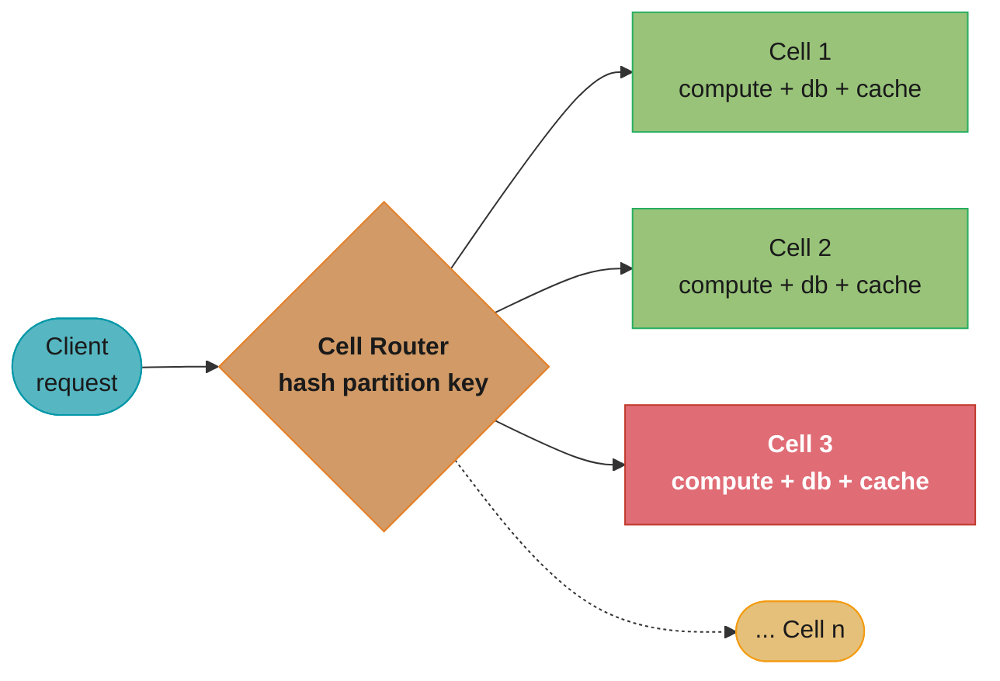
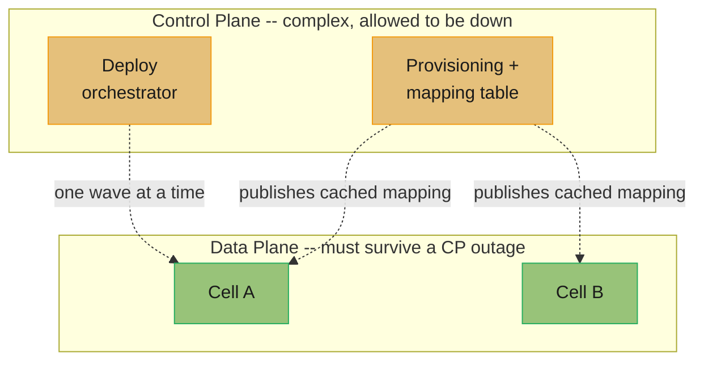
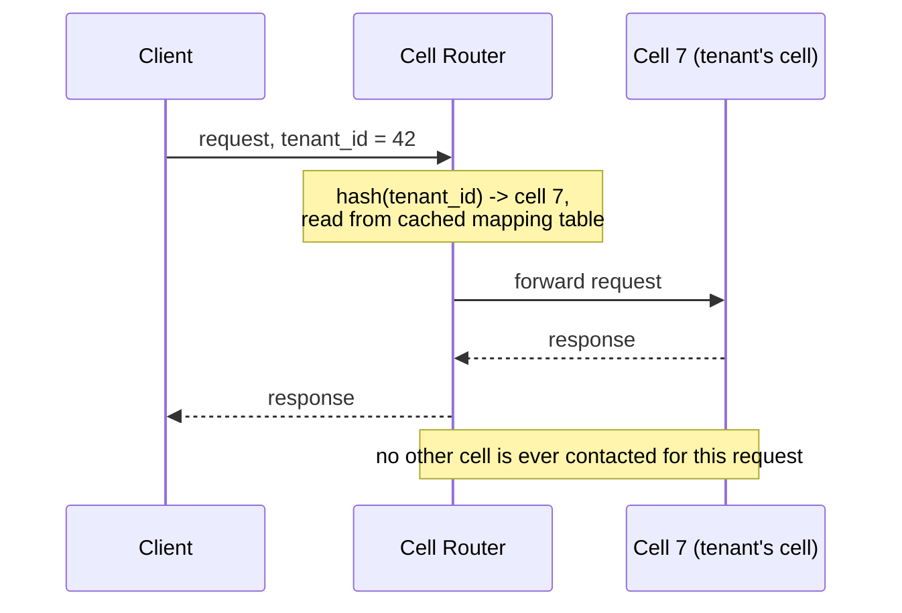
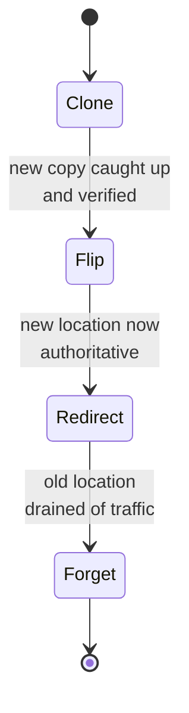

# Cell-Based Architecture

Blast radius as a first-class design parameter — bulkheads pulled up from a thread pool to the whole deployment.

---

## 1. Concept Overview

Every distributed system eventually gets asked the same question after an incident: "why did a
problem with one customer, one region, or one bad deploy take down *everyone*?" [Resilience
Patterns](../resilience_patterns/resilience_patterns.md) answers that question one dependency at
a time — timeouts, circuit breakers, and bulkheads stop a single slow call from starving every
other call sharing its thread pool or connection pool. Cell-based architecture asks the same
question one level up: not "how do we isolate one dependency call from another," but "how do we
isolate the *entire system* from a failure of any one instance of itself."

A **cell** is a complete, independent replica of the whole stack — its own compute, its own data
store, its own cache, sometimes its own message queue — serving a fixed, bounded subset of
traffic (a range of users, a set of tenants, a shard of accounts). Nothing in the request path
crosses a cell boundary: a request that lands in cell 7 is served entirely by cell 7's compute,
reads and writes entirely to cell 7's database, and never calls cell 3 to finish the job. Scale is
achieved by adding more cells, not by growing any one cell without bound — AWS's own
Well-Architected framing puts it as trading "scale up" for "scale out," where growth means more
copies of a size-capped unit rather than a bigger single unit.

The payoff is arithmetic, not qualitative. With `n` cells, a failure that would have been total
now caps out at `1/n` of the fleet. Ten cells turn what used to be a site-wide outage into a 10%
incident; a hundred cells turn it into a 1% incident. Nothing about this claim requires the
failure to be rare — it requires only that the failure domain be bounded, which is exactly what a
cell boundary buys. The price is equally concrete: `n` copies of every piece of infrastructure,
`n` sets of dashboards, and a router that becomes the one component every cell still shares — see
§10 for what happens when that price is paid carelessly.

This module treats cell-based architecture as its own topic because the reasoning it requires —
sizing a blast radius, routing without recreating a shared failure domain, migrating a tenant
between cells, reasoning about combinatorial isolation via shuffle sharding — is deep enough to
deserve a dedicated treatment beyond the compact summary in
[Resilience Patterns §4.9](../resilience_patterns/resilience_patterns.md#4-types--architectures--strategies).
The deployment pipeline that rolls a release through cells wave by wave belongs to
[DevOps: Disaster Recovery and Resilience](../../devops/disaster_recovery_and_resilience/disaster_recovery_and_resilience.md);
this module owns the architecture — the boundary, the routing, the sizing, the combinatorics —
not the pipeline that walks releases across it.

---

## 2. Intuition

**A cell-based system is a ship built with bulkheads, not a ship built with one long open hull.**
A submarine that takes a hit below the waterline doesn't sink because the hull is divided into
watertight compartments — the compartment that's holed floods, the crew seals the hatch, and the
rest of the ship stays afloat and keeps sailing. A single open hull is more efficient to build and
easier to walk through, right up until the first puncture, at which point the entire ship floods
at once. Cells are the hatch: a bad deploy, a poisoned cache entry, a control-plane bug, or an
overloaded tenant floods one compartment and stops there, not because the failure was gentle but
because there was nowhere else for it to spread.

**The mental model that matters:** a cell is not a performance optimization and not a caching
layer — it is a *containment* mechanism. You do not add cells because the system is too slow; you
add cells because you have decided in advance how much of the system you are willing to lose to
any single failure, and you are willing to pay for `n` copies of your infrastructure to guarantee
that ceiling. The key insight that trips up teams new to the pattern: **sharding your database is
not cell-based architecture.** Sharding partitions data while everything above the data layer —
the application tier, the deploy pipeline, the control plane — stays shared and singular. A cell
partitions the *entire* stack, so that a bad deploy to the application tier is exactly as
contained as a bad write to the database.

---

## 3. Core Principles

**A cell is complete.** Every layer a request touches — compute, cache, database, often the
message queue — lives inside the cell boundary. A cell that calls out to a shared cache "just for
that one lookup" is not a cell; it is a shard with a shared failure domain hiding one layer down.
The test is simple: draw a box around everything one cell owns, and check whether a request can be
served entirely inside that box. If the answer is "almost always, except for X," X is where the
next incident starts.

**No request crosses a cell boundary.** This is the rule stated in the strongest possible terms
because it is the one violated first, under the most reasonable-sounding pressure ("just this one
cross-cell join, it's read-only"). A single cross-cell call reintroduces exactly the coupling
cells exist to remove: cell 3's latency now depends on cell 7's health, and the blast radius
calculation in §6 stops being true the moment that dependency exists.

**Nothing is shared between cells except the router and the control plane, and both are
deliberately minimized.** A cell fleet has exactly two components that are *not* replicated
per-cell: the thin routing layer that maps a request to its cell, and the control plane that
provisions cells and updates that mapping. Everything else — compute, data, cache — is per-cell.
This is not an accident of implementation; it is the design. The router and control plane are
the residual shared surface, and because they are shared, they are held to a much higher
simplicity and reliability bar than anything running inside a cell (§4.2, §4.4).

**Blast radius is chosen, not discovered.** In a monolithic deployment, the blast radius of any
given failure is "however much of the system happens to be coupled to the thing that broke," which
is usually "everything," and is not a number anyone picked on purpose. In a cell architecture, the
blast radius is `1/n` by construction, where `n` is a number an engineer chose when sizing the
fleet (§4.1, §6). Cells convert blast radius from an emergent property you discover during an
incident into a design parameter you set during capacity planning.

**Cells complement, not replace, [consistent hashing](../consistent_hashing/consistent_hashing.md)
and [database sharding](../database_sharding/database_sharding.md).** Both of those patterns
answer "how do I distribute data across nodes so that each node holds a bounded slice." Cell
routing reuses exactly that math — a partition key, hashed and mapped to a bounded set of
targets — but the "nodes" it is mapping to are entire independent stacks, not database shards
inside one shared application tier. A cell router is a sharding scheme whose targets happen to be
whole systems.

---

## 4. Types / Architectures / Strategies

### 4.1 Cell Sizing

AWS's Well-Architected guidance frames cell sizing as a genuine three-way tension, not a single
knob to maximize or minimize:

- **Big enough to fit the largest single workload.** A cell that can't hold your largest tenant
  forces a special case (a dedicated cell, see §12 Q18) before the fleet has even shipped.
- **Small enough to test at full scale, and to stay clear of platform limits.** A cell you can
  load-test end to end — because "one cell's worth of traffic" is a number small enough to
  generate in a test environment — is a cell whose failure modes you've actually seen before
  production shows them to you. A cell that can never be fully loaded in a test environment is,
  for testing purposes, indistinguishable from the monolith it replaced.
- **Big enough to capture economies of scale.** More, smaller cells mean more replicas of every
  piece of infrastructure to run, patch, and monitor; fewer, larger cells mean each failure or
  drain event costs a bigger percentage of the fleet.

There is no formula that resolves this automatically — the resolving number is a **tested
capacity ceiling per cell** (a transaction rate, a tenant count, a storage volume), set from real
load tests and then held fixed. New growth adds cells rather than growing existing ones past that
ceiling; a cell that quietly grows past its tested limit is a cell operating on faith.

### 4.2 Cell Routing

The router is the one component every request touches regardless of which cell serves it, which
makes it the closest thing a cell architecture has to a single point of failure — so its design
gets disproportionate scrutiny relative to its size. AWS's own guidance names three concrete
router shapes, and a fourth is common enough in practice to name alongside them:

| Router shape | How it works | Where it fits |
|---|---|---|
| **DNS-based (Route 53)** | Partition key resolves to a DNS name whose records point at the tenant's cell; the DNS layer itself is the router. | High request volume, coarse per-tenant routing, wants to reuse Route 53's own health checks and failover. |
| **API Gateway as router** | A gateway stage inspects the request (path, header, JWT claim) and forwards to the cell's backend integration. | HTTP APIs already fronted by a gateway; routing logic stays declarative and out of application code. |
| **Compute layer + mapping table** | A thin service (EC2/ECS/EKS) holds or fetches a partition-key-to-cell mapping (often cached from S3 or a KV store) and forwards accordingly. | Needs routing logic too dynamic for DNS or a gateway rule set — e.g., cell migration in flight (§4.5). |
| **Client-side / SDK-embedded mapping** | The client (mobile app, service SDK) caches the tenant-to-cell mapping itself and calls the cell directly, bypassing a live router hop. | Removes the router from the request's critical path entirely, at the cost of a cache-invalidation problem when a tenant migrates. |

Whichever shape is chosen, AWS's own design list for the router is worth stating verbatim because
every entry is a constraint that trades away flexibility for reliability: **be as simple as
possible but no simpler; isolate request dispatch between cells; keep business logic out of this
layer; abstract the cellular structure away from the client; stay fast; and keep routing to
healthy cells working even while one cell is unreachable.** The router computes a partition-key
mapping — typically a hash plus modular arithmetic, deliberately cheap — and nothing more. A
router with retry policies, feature flags, or per-tenant business rules has stopped being a router
and started being an unbulkheaded shared service with a router-shaped name.

### 4.3 Shuffle Sharding

Plain cell routing assigns each tenant to exactly one cell — losing that cell means losing that
tenant completely. **Shuffle sharding**, the technique behind Route 53 and AWS's own throttling
infrastructure, assigns each tenant to a small, random *combination* of cells instead of one. The
combinatorics do the isolation work, and they are the one place in this module where the payoff is
a number rather than a design principle — worked in full in §6.3.

### 4.4 Control Plane vs. Data Plane Separation

Every cell fleet has two planes with opposite reliability requirements. The **control plane** —
provisioning new cells, updating the partition-key-to-cell mapping, orchestrating a deployment
wave — is allowed to be complex, and is allowed to be occasionally unavailable; nobody serving
live traffic needs the control plane to answer a health check. The **data plane** — a cell serving
an actual request — must keep working even while the control plane is completely down. The
mechanism that makes this true in practice is a **cached, locally-held mapping**: the router and
the cells hold the last-known-good mapping and keep serving from it, rather than calling the
control plane synchronously on every request. Conflating the two planes — routing a live request
through a call to the same service that also handles provisioning — recreates precisely the single
point of failure the cell boundary was built to remove, just one layer further up the stack.

### 4.5 Cell Migration

Tenants outgrow cells, cells get added or retired, and a "poison" tenant sometimes needs to be
moved off a cell it's degrading. AWS's own guidance frames a stateful migration as four ordered
phases, and the ordering is the part worth internalizing — each phase leaves the system in a
state that's safe to pause in if the next phase has to wait:

1. **Clone** — copy the tenant's data into the new cell as a non-authoritative copy; the old cell
   remains the system of record and keeps serving.
2. **Flip** — once the new copy is caught up and verified, mark the new location authoritative.
3. **Redirect** — update the router's mapping so new requests land on the new cell; in-flight
   requests to the old cell may still need a cross-cell redirect during the transition window.
4. **Forget** — once traffic has fully drained from the old location, delete the tenant's data
   there.

The transition window between Flip and Forget is the one moment in a cell architecture where a
cross-cell reference is tolerated — a redirect from the old cell to the new one for stragglers —
and it is deliberately kept as short and as rare as the migration cadence allows, because every
minute it's open is a minute two cells are coupled for one tenant's traffic.

---

## 5. Architecture Diagrams

### 5.1 Cell Topology and Routing



Cell 3 is drawn failed (red) to make the point visually: the router keeps forwarding correctly
mapped requests to cells 1 and 2 without change, and only tenants mapped to cell 3 are affected —
there is no arrow between any two cells, because none should ever exist.

### 5.2 Control Plane vs. Data Plane



The dashed arrows are deliberate: the data plane reads a *cached* copy of the control plane's
state and keeps serving from that cache when the control plane is unreachable, rather than calling
it synchronously per request.

### 5.3 A Single Request, End to End



### 5.4 Cell Migration — Clone, Flip, Redirect, Forget



Only the Redirect phase tolerates a cross-cell reference — a straggler request still arriving at
the old cell gets bounced to the new one — and it is held open only as long as draining requires.

### 5.5 Shuffle-Sharding Assignment Grid

The arithmetic in §6.3 is easiest to trust once it's visible. Eight cells, two per tenant,
`C(8,2) = 28` distinct pairs:

```
  8 cells, 2 per tenant -- C(8,2) = 28 distinct pairs

             c1  c2  c3  c4  c5  c6  c7  c8
  tenant A    X   .   .   X   .   .   .   .    pair {1,4}
  tenant B    X   .   .   .   .   .   X   .    pair {1,7}
  tenant C    X   .   .   X   .   .   .   .    pair {1,4}
  tenant D    .   X   .   .   .   X   .   .    pair {2,6}

  if tenant A goes poison and cells 1 and 4 both go dark:
    tenant B  -- shares only cell 1 with A -- degrades to cell 7, keeps serving
    tenant C  -- identical pair to A       -- fully down (1 of 28 pairs = 3.6%)
    tenant D  -- shares nothing with A     -- completely unaffected

  of any two random tenants on 8 cells, 2 each:
    P(share 0 cells)          = 15/28 = 53.6%   fully isolated from each other
    P(share exactly 1 cell)   = 12/28 = 42.9%   one shared cell, one clean fallback
    P(share both, full hit)   =  1/28 =  3.6%   the only case with no fallback
```

Tenant C is the only one whose pair is identical to tenant A's, and that identical-pair case is
the only one with no fallback — every other tenant either shares nothing or shares exactly one
cell, meaning the client still has a healthy cell to retry against. The full derivation of these
three probabilities, plus what happens as cell count scales up, is in §6.3.

---

## 6. How It Works — Detailed Mechanics

### 6.1 The Blast-Radius Arithmetic

The entire argument for cells rests on one line of arithmetic. If a service has `n` cells serving
equal shares of traffic, and a single failure event takes down exactly one cell, the fraction of
total traffic affected is:

```
scope of impact = 1 / n
```

Ten cells: any single-cell failure affects 10% of traffic. A hundred cells: 1%. This does not
change the *probability* that a bad deploy or a poisoned cache entry occurs — it changes what that
event costs when it does. AWS's own reasoning is worth stating precisely because it resolves an
objection that comes up immediately: with `n` cells you now have `n` times as many opportunities
for a failure to start, so isn't the total number of incidents higher? Yes — but each incident is
`n` times smaller and, because a cell is small enough to load-test and monitor at full scale
(§4.1), each incident is also **detected and resolved faster** than an equivalent incident in a
monolith. Higher mean time between failures per cell, plus lower mean time to recovery per
incident, together produce higher overall availability even though the raw incident count went up.

### 6.2 Availability as a Ratio, Not a Boolean

The same arithmetic reframes availability from "was the system up or down" to a ratio: successful
requests divided by total requests. A monolith that goes fully down for 6 minutes during a bad
deploy has a numerator of zero for those 6 minutes across 100% of traffic. Ten cells rolling the
same bad deploy wave by wave, one cell at a time with a bake period between waves, have a
numerator of zero only for the ~6 minutes the *first* cell was live with the bad build and only
for the 10% of traffic that cell serves — the remaining nine waves never ship, because the bad
build was caught during the first cell's bake time. The deployment-wave mechanics that make this
catch possible belong to
[DevOps: Disaster Recovery and Resilience](../../devops/disaster_recovery_and_resilience/disaster_recovery_and_resilience.md);
what matters here is that the cell boundary is what makes "catch it after 10%, not after 100%"
possible in the first place.

### 6.3 Shuffle Sharding — Full Derivation

**Setup.** `n` cells total, each tenant assigned a fixed, random combination of `k` cells (not a
single cell). The number of distinct combinations a tenant can be assigned is `C(n, k)`, and two
tenants assigned independently and uniformly at random are compared by how many of their `k` cells
coincide.

**The general overlap formula.** For two independently, uniformly assigned `k`-subsets of `n`
cells, the probability they share *exactly* `j` cells is:

```
P(share exactly j cells) = [ C(k, j) * C(n - k, k - j) ] / C(n, k)
```

`C(k, j)` counts the ways to pick which `j` of tenant A's cells are the shared ones; `C(n-k, k-j)`
counts the ways to fill the rest of tenant B's `k` cells from the `n-k` cells tenant A doesn't
hold. Setting `j = k` collapses `C(k,k) = 1` and `C(n-k, 0) = 1`, giving the simple headline
result: `P(full overlap) = 1 / C(n, k)` — the "1 in 28" number is just this formula's `j = k` case.

**Worked at n = 8, k = 2 (matches §5.5).** `C(8, 2) = 28`.

```
  j = 2 (full overlap):    C(2,2) * C(6,0) / 28 =  1 * 1 / 28 =  1/28 = 3.6%
  j = 1 (one shared cell): C(2,1) * C(6,1) / 28 =  2 * 6 / 28 = 12/28 = 42.9%
  j = 0 (no overlap):      C(2,0) * C(6,2) / 28 =  1 * 15/ 28 = 15/28 = 53.6%
                                                                sum   = 28/28 = 100%
```

That middle case — a 42.9% chance of sharing exactly one cell — is the reason shuffle sharding
outperforms plain sharding by more than the "1/28 vs 1/8" headline number suggests: it's not just
that full collisions are rarer, it's that the *majority* of collisions are partial, and a partial
collision still leaves the affected tenant a healthy cell to fail over to, provided the client (or
router) retries against the tenant's other cell. A client that doesn't retry against the surviving
cell converts every partial collision into a full outage for that tenant, which is why shuffle
sharding's isolation guarantee is conditional on retry behavior — see §12 Q16.

**Compare to plain single-cell sharding at the same `n = 8`.** With `k = 1` there is no partial
case at all — a tenant either shares its one cell with another tenant or it doesn't:

```
  plain sharding, n=8, k=1:  P(collision) = 1/8 = 12.5%, always full (no partial case exists)
```

**Generalizing — isolation grows combinatorially, cost grows linearly.** Doubling the cell count
from 8 to 16 while holding `k = 2` doubles the infrastructure, but the full-collision probability
falls far faster than by half:

```
  n=8,  k=2:  C(8,2)  =  28   P(full overlap) = 1/28  = 3.57%
  n=16, k=2:  C(16,2) = 120   P(full overlap) = 1/120 = 0.83%   (~4.3x better, 2x the cells)
  n=16, k=2:  P(share 1)  = C(2,1)*C(14,1)/120 = 28/120  = 23.3%
  n=16, k=2:  P(share 0)  = C(14,2)/120        = 91/120  = 75.8%
```

This is the property AWS's own guidance calls out as what makes shuffle sharding worth the (very
small) added routing complexity: because `C(n, k)` grows combinatorially in `n` while the number
of cells — and so the fleet's infrastructure cost — grows only linearly, a modest increase in cell
count buys a disproportionate improvement in worst-case isolation.

### 6.4 Capacity Headroom and the N+1 Spare-Cell Rule

A cell fleet sized with zero spare capacity has a specific, easy-to-miss failure mode: losing one
cell doesn't just cost that cell's users, it also risks overloading whichever cells absorb the
evacuated traffic. Ten cells, each provisioned for exactly `1/10` of peak load, lose one cell to a
hardware failure or a forced drain: the other nine must now absorb `1/9 ≈ 11.1%` of total load
each — a load they were never provisioned for, at the exact moment they're needed most.

The **N+1 rule** (the same principle as N+1 power and cooling redundancy) is to provision each
cell's capacity for `1 / (n - 1)` of peak load rather than `1 / n`, so that losing any single cell
never pushes a survivor above its tested ceiling:

```
  10 cells, sized at 1/10 of peak (no headroom):
    lose 1 cell -> survivors each absorb 1/9 = 11.1% of peak -- 11% over their provisioned size

  10 cells, sized at 1/9 of peak (N+1 headroom):
    lose 1 cell -> survivors already provisioned for exactly this load -- zero overload

  cost of the headroom: ~11% more fleet-wide capacity, purchased once, to tolerate any single
  cell's total loss without a cascading overload during the failure it exists to survive
```

The headroom is cheap relative to what it buys: roughly 11% more capacity across the whole fleet,
in exchange for guaranteeing that the worst moment for a cell to fail — while it's actively serving
traffic — is also the moment the rest of the fleet is provisioned to absorb it without a second,
self-inflicted incident stacked on top of the first.

---

## 7. Real-World Examples

- **AWS Route 53 — shuffle sharding at a scale worth naming precisely.** Route 53 arranges its
  name-server capacity into 2,048 virtual name servers and assigns each hosted zone a shuffle
  shard of 4 of them. `C(2048, 4) ≈ 730.9 billion` distinct combinations, and Route 53's assignment
  algorithm additionally enforces that no two hosted zones can overlap by more than 2 of their 4
  name servers — a stronger guarantee than random assignment alone would give. A DDoS attack
  targeting one customer's domain saturates that domain's 4 name servers; because of the overlap
  cap, no other domain notices. This is AWS's own **Builders' Library** article "Workload
  Isolation Using Shuffle-Sharding" (Colm MacCárthaigh), and the technique is also open-sourced in
  AWS's **Route 53 Infima** library.
- **AWS's Well-Architected guidance — "Reducing the Scope of Impact with Cell-Based Architecture."**
  AWS frames the pattern as a scale-out-over-scale-up decision for any service AWS itself operates
  at the scale of S3, DynamoDB, or Route 53: dividing a workload into fixed-size, independently
  testable cells trades a single unbounded-size system for `n` bounded, load-tested units, with
  the explicit design goal that "it should be similarly unlikely for a service outage to span
  multiple cells" as it already is for an outage to span multiple AWS Regions.
- **Route 53 Application Recovery Controller (ARC).** AWS's own operational tooling for
  cell-adjacent failover: a **routing control** is a simple on/off switch — hosted on a cluster of
  5 redundant Regional API endpoints for availability — that a client flips to redirect traffic
  from one cell, Availability Zone, or Region to another; a **readiness check** runs continuously
  (roughly once a minute) to verify a failover target actually has the provisioned capacity to
  take the traffic before it's needed, rather than discovering that gap during the failover
  itself.
- **Slack — cellular architecture forced by a real AZ incident.** After a June 30, 2021 incident
  where intermittent packet loss on a single AWS Availability Zone link degraded message-sending
  for users across *all three* AZs Slack's backend spanned, Slack's engineering team spent roughly
  a year and a half migrating its most critical user-facing services to a cellular architecture
  scoped to the Availability Zone: each AZ became a self-contained cell whose services only call
  other services inside the same AZ, fronted by Envoy proxies configured dynamically by Slack's own
  xDS control plane ("Rotor"). The result: a single AZ's degradation is now contained to that AZ's
  cell instead of fanning out through cross-AZ service calls to every user regardless of which AZ
  they were routed through.
- **Salesforce — pods and instances as a tenant-sharded, cell-like architecture.** Salesforce
  assigns every customer org to a named production **instance** (e.g. "NA14", "EU5") — a complete,
  independent infrastructure stack (load balancers, application servers, and its own database
  cluster) serving only the orgs assigned to it. There is no real-time cross-instance data sharing:
  two customers on different instances have their data in physically separate databases. This is
  sharding by tenant at the level of the entire stack, which is precisely the property that
  distinguishes a cell from a database shard behind a shared application tier (§3, §12 Q1).

---

## 8. Tradeoffs

| Dimension | More, smaller cells | Fewer, larger cells |
|---|---|---|
| Blast radius per failure | Smaller — each cell holds a smaller % of traffic | Larger — each cell holds a bigger % of traffic |
| Operational surface | More replicas of every dashboard, alert, and runbook to maintain | Fewer replicas, but each one matters more |
| Platform/quota limits | Less likely for any one cell to hit an account or service quota | More likely — a larger cell consumes more of every limit |
| Testability | Easier and cheaper to load-test a cell at full scale | Harder to fully load-test without an expensive environment |
| Idle capacity | Less idle headroom per cell (smaller units) | Better economies of scale, more efficient bin-packing |
| Tenant splitting | A single large tenant may not fit — needs a dedicated cell (§12 Q18) | Easier to fit large tenants without a special case |
| Router complexity | Same either way — routing logic doesn't scale with cell count | Same either way |

**Cell count vs. shuffle-sharding isolation** is a separate axis from cell size: for a fixed
number of cells, choosing a larger `k` (cells per tenant) buys more per-tenant redundancy but
shrinks `C(n, k)` back down and raises collision probability, while a larger `n` at fixed `k`
buys combinatorial isolation for linear infrastructure cost (§6.3) — the two knobs are tuned
independently, and confusing "more cells" with "more shuffle-sharding isolation" is a common
design-review mistake (§12 Q6).

---

## 9. When to Use / When NOT to Use

**Use cell-based architecture when:**
- The system has a natural partition key — tenant, account, user shard, region — that a request
  can be routed on without a cross-partition lookup.
- The blast radius of a single bad deploy, poisoned cache, or control-plane bug currently reaching
  100% of traffic is a business risk worth paying `n`x the operational surface to bound.
- Traffic or tenant count has outgrown what a single stack can be meaningfully load-tested at —
  cells make "load test at full scale" possible again by capping the unit under test.
- Regulatory or contractual isolation requirements demand that one customer's data and blast radius
  never touch another's, which cells provide structurally rather than by policy.

**Skip or defer cells when:**
- The system is single-region, under roughly 100,000 users, and has no natural per-tenant or
  per-user partition to route on — the operational cost of `n` copies buys isolation nobody is
  asking for yet.
- The product's core value proposition is cross-tenant or cross-user queries as a first-class
  feature (a global search index, a cross-account analytics product) — cells actively fight this
  requirement, since the whole point is that nothing crosses a cell boundary.
- The team does not yet have the deployment automation to run `n` waves of a release reliably —
  cells without automated wave deployment just multiply toil without multiplying safety, since a
  manually-run wave under schedule pressure is the first thing to get skipped (§10).
- The service is stateless with no tenant-isolation requirement and already scales horizontally
  behind a standard [load balancer](../load_balancing/load_balancing.md) — cells add a routing
  layer and `n` data stores to a problem that horizontal pod autoscaling already solves.

---

## 10. Common Pitfalls

- **The router becomes the new single point of failure.** Every request touches it, so any
  complexity that creeps in — retries, per-tenant business rules, a synchronous call to the
  control plane — turns the one component that was supposed to be simpler and more reliable than
  everything behind it into the least reliable component in the system. Keep the router down to a
  hash-and-lookup against a locally cached mapping, and route by a cached mapping specifically
  *because* it must keep serving during a control-plane outage (§4.4).

- **Cross-cell chatter creeps back in.** A "just this once" call from cell 3 to cell 7 — a
  read-only lookup, a shared cache hit, a convenient RPC — reintroduces the exact coupling cells
  exist to remove, and it rarely stays a single call once the precedent is set.

  *Broken:* a "global" configuration table — feature flags, pricing tiers, plan limits — lives in
  one shared datastore that every cell reads on every request, because standing up a per-cell copy
  felt like overkill for "just config." A bad write to that table, or an outage of that one shared
  store, now takes down every cell simultaneously — the exact total-outage scenario cells were
  built to prevent, reintroduced through the one path nobody classified as "the data plane."

  *Fix:* the configuration becomes per-cell replicated data, pushed through the control plane on
  its own versioned rollout schedule (ideally wave by wave, same as a code deploy) rather than read
  live from a shared store on the request path. Each cell holds its own current copy and serves
  from it even if the control plane's publishing pipeline is down; a bad config version is caught
  during that version's own bake period on the first cell, exactly like a bad code deploy.

- **A deployment wave skips its bake time under schedule pressure.** The entire operational payoff
  of cells depends on catching a bad release after the first wave, before the second wave ships —
  if the bake period between waves gets compressed to "zero" because a release is late, every cell
  effectively gets the bad release near-simultaneously, and the fleet has paid the full
  operational cost of running cells while getting none of the deployment-safety benefit. The wave
  scheduling and bake-time mechanics live in
  [DevOps: Disaster Recovery and Resilience](../../devops/disaster_recovery_and_resilience/disaster_recovery_and_resilience.md).

- **A shared cache or identity service silently "un-cells" the system.** Session storage,
  authentication token validation, or a shared Redis cluster added for "one thing that's annoying
  to replicate per cell" reproduces the global-config failure mode with a different name — if that
  shared service goes down, every cell's requests start failing at the point they hit it, even
  though every cell's own compute and database are perfectly healthy.

- **Shuffle sharding without client-side retry buys nothing.** The isolation math in §6.3 assumes
  a tenant whose cell fails still has a *surviving* cell to serve from — that only happens if the
  client, or the router on the client's behalf, actually retries against the tenant's other
  assigned cell. Shuffle sharding deployed with a client that gives up after its first cell fails
  gets the isolation math's downside (added routing complexity) with none of the upside.

- **Treating cell count as a substitute for the N+1 headroom rule.** Adding more cells lowers each
  cell's share of blast radius (§6.1), but without the capacity headroom from §6.4, losing any one
  cell still risks overloading its neighbors during exactly the failure the cells exist to survive
  — cell count and capacity headroom are two separate knobs, and only tuning one is a common
  half-finished migration.

---

## 11. Technologies & Tools

| Category | Tools | Notes |
|---|---|---|
| DNS-based cell routing | **Amazon Route 53** | Health-checked DNS records per cell; also the reference implementation of shuffle sharding at scale (§7). |
| Failover / routing control | **Route 53 Application Recovery Controller (ARC)** | On/off routing controls on a 5-endpoint redundant cluster, plus continuous readiness checks that verify failover-target capacity before it's needed. |
| API-layer cell routing | **Amazon API Gateway, Envoy Proxy** | A gateway or sidecar stage inspects the request and forwards to the mapped cell's backend; Envoy/xDS is the mechanism behind Slack's AZ-scoped cellular routing (§7). |
| Compute-layer cell router | **Amazon EC2 / ECS / EKS + S3 mapping table** | A thin service holds or fetches a partition-key-to-cell mapping; used when routing logic is too dynamic for a static DNS or gateway rule set, e.g. mid-migration (§4.5). |
| Per-cell compute isolation | **Kubernetes (one cluster or namespace set per cell), AWS accounts/VPCs per cell** | Gives each cell its own blast-radius-relevant boundary at the infrastructure level, not just the application level. |
| Shuffle-sharding reference implementation | **AWS Route 53 Infima (open source)** | The library AWS itself uses; several shuffle-sharding strategies (simple signature-based, weighted) ready to reuse rather than re-derive. |
| Chaos / failover validation | **AWS Fault Injection Service, Gremlin** | Used to actually exercise a cell drain or an AZ failure rather than trusting the design on paper — see [Resilience Patterns §12 Q20](../resilience_patterns/resilience_patterns.md) on why an unexercised failover is an untested hypothesis. |
| Deployment-wave orchestration | **AWS CodeDeploy / CodePipeline stages, Spinnaker, Argo Rollouts** | Owns the per-cell canary and bake-time mechanics — depth in [DevOps: Disaster Recovery and Resilience](../../devops/disaster_recovery_and_resilience/disaster_recovery_and_resilience.md). |

---

## 12. Interview Questions with Answers

**Q: Your service shards its database into 10 shards, but runs one shared application tier and one shared deploy pipeline in front of them — is that cell-based architecture?**
**Short:** No — sharding partitions only the data layer, while a cell partitions the entire stack including compute and deploys.

A: No, and this is the single most common conflation in the pattern. [Database sharding](../database_sharding/database_sharding.md) partitions *data* — each shard holds a bounded slice of rows — while everything above the data layer (application servers, the deploy pipeline, usually the control plane) stays shared and singular. A bad deploy, a memory leak in the application tier, or a control-plane bug in that setup still reaches all 10 shards' worth of traffic simultaneously, because the failure domain that actually matters — the application process, the deploy — was never partitioned in the first place. A cell requires the *entire* request path, compute included, to be replicated per partition, with nothing shared except the router and the control plane. Ten database shards behind one application tier caps blast radius for a bad database write; it does nothing for a bad code deploy, which is usually the more frequent failure mode in practice.

**Q: Why is the cell router the biggest risk in the whole architecture, and how do you keep it from becoming one?**
**Short:** The router is the only component every request shares, so any complexity added to it undermines the isolation every cell behind it provides.

A: Because it's the one piece of infrastructure every single request touches regardless of which cell ultimately serves it — every other component is replicated per cell and isolated by construction, but the router by definition is not. If the router adds retry logic, per-tenant business rules, or a synchronous call out to the control plane on the request path, a bug or an outage in any of that now takes down every cell at once, which is the exact total-outage scenario the cells were built to prevent. The fix is discipline, not tooling: the router computes a partition-key mapping — a hash plus modular arithmetic against a locally cached copy of the mapping table — and does nothing else. AWS's own design list for cell routers states it directly: simple as possible but no simpler, no business logic, and able to keep routing to healthy cells even while one cell is unreachable.

**Q: A team adds a small "global" feature-flag table that every cell reads on every request, arguing it's too small to be worth replicating per cell — what breaks, and how do you fix it?**
**Short:** A shared table read by every cell recreates a single failure domain that a bad write or outage takes down all at once.

A: A bad write to that table, or an outage of the datastore hosting it, now affects every cell simultaneously, because the one thing that was supposed to be isolated per cell — the request path's dependencies — has a shared link back into it. *Broken:* the flag table lives in one shared store, read live on the request path by all `n` cells; nothing about "it's small" changes that a shared read dependency is a shared failure domain. *Fix:* the configuration becomes per-cell replicated data, pushed by the control plane on its own versioned rollout — ideally wave by wave, the same discipline as a code deploy — so each cell serves from its own local copy and a bad flag version is caught on the first cell's bake period rather than reaching all cells the instant it's written.

**Q: You have circuit breakers and bulkheads inside every service — why do you also need cell-based architecture; doesn't that already solve blast radius?**
**Short:** Resilience patterns bound the blast radius of one dependency call; cells bound the blast radius of the system's own deploys and bugs.

A: They isolate different failure sources. [Resilience Patterns](../resilience_patterns/resilience_patterns.md) — circuit breakers, bulkheads, retries, timeouts — bound the blast radius of a *dependency call going bad*: a slow or erroring downstream service can't starve the calling service's resources or take down unrelated calls. None of that protects against a failure *in the calling system itself* — a bad deploy to the application code, a poisoned in-memory cache, a control-plane bug in the calling service's own configuration pipeline. Those failures don't originate in a dependency call at all, so no amount of circuit breaking around outbound calls contains them. Cells contain that class of failure by bounding how much of the system's *own* traffic any single instance of the system can affect. The two are complementary layers of the same discipline applied at different scopes — one dependency call, versus the whole deployed system.

**Q: How is shuffle sharding different from just running more, smaller cells — doesn't adding cells already improve isolation?**
**Short:** More cells shrinks each cell's blast radius linearly; shuffle sharding shrinks tenant-collision probability combinatorially on top of that.

A: They're two separate knobs solving two separate problems, and conflating them is the trap. More, smaller cells shrinks the blast radius of a *single-cell failure* — `1/n` gets smaller as `n` grows (§6.1) — but that's true whether or not tenants are shuffle-sharded; it holds even under plain single-cell assignment. Shuffle sharding is a *routing* decision layered on top: instead of assigning each tenant to one cell, assign it to a random combination of `k` cells, which turns the number of distinct tenant "failure groups" from `n` into `C(n, k)` — a combinatorial function of `n`, not a linear one. Doubling `n` from 8 to 16 at fixed `k=2` only halves the blast radius of a single-cell failure, but it drops the full-collision probability between two tenants from 1/28 to 1/120, a roughly 4.3x improvement (§6.3) — the shuffle-sharding gain outpaces the cell-count gain because it's compounding a second, independent effect on top of it.

**Q: A cell architecture skipped bake time between deployment waves under a deadline — what specifically goes wrong, and why is this worse than it sounds?**
**Short:** Skipping bake time means a bad release reaches every cell almost simultaneously, erasing the entire deployment-safety benefit cells exist to provide.

A: The entire deployment-safety argument for cells depends on a bad release being caught during the *first* wave's bake period, before the second wave ships — that's what turns "100% of traffic gets the bad release" into "10% of traffic gets it, briefly, and the rest never do." If the bake period is compressed to near-zero because a release is late, every wave ships back to back with no observation window between them, and a bad release reaches close to 100% of traffic almost as fast as it would have in a monolith — except now the team has also paid the full operational cost of running `n` cells, `n` dashboards, and a router, and received essentially none of the safety benefit that cost was meant to buy. The wave-scheduling and bake-time mechanics that make this safe belong to [DevOps: Disaster Recovery and Resilience](../../devops/disaster_recovery_and_resilience/disaster_recovery_and_resilience.md), and the discipline point is that "we're behind schedule" is exactly the condition under which the bake period matters most, not the condition under which it's safe to cut.

**Q: Derive the probability that two tenants fully collide, partially overlap, and don't overlap at all, for 8 cells with 2 cells assigned per tenant.**
**Short:** With 8 cells and 2 per tenant: 53.6% share no cells, 42.9% share one cell, and 3.6% share both.

A: Start from `C(8, 2) = 28` total distinct pairs a tenant can be assigned. The general overlap formula for two independently, uniformly assigned `k`-subsets of `n` cells is `P(share exactly j) = [C(k,j) * C(n-k, k-j)] / C(n,k)`. At `n=8, k=2`: full overlap (`j=2`) is `C(2,2)*C(6,0)/28 = 1/28 ≈ 3.6%`; one shared cell (`j=1`) is `C(2,1)*C(6,1)/28 = 12/28 ≈ 42.9%`; no shared cells (`j=0`) is `C(2,0)*C(6,2)/28 = 15/28 ≈ 53.6%`. These three sum to exactly 28/28. The practically important number isn't just the 3.6% full-collision figure quoted everywhere — it's that 42.9% of the time two tenants share exactly one cell, meaning that tenant still has a healthy second cell to fail over to, provided the client actually retries there (§12 Q16).

**Q: Generalize the shuffle-sharding formula beyond the 8-cells-2-per-tenant example — what happens to isolation as cell count grows?**
**Short:** Full-collision probability is 1/C(n,k), which falls combinatorially as n grows while infrastructure cost grows only linearly.

A: The general result is `P(full overlap) = 1 / C(n, k)`, derived by setting `j = k` in the overlap formula (§6.3), since `C(k,k) = 1` and `C(n-k, 0) = 1` collapse the formula to just the reciprocal of the total combination count. The generalization that matters operationally: holding `k` fixed and growing `n`, `C(n, k)` grows combinatorially (roughly proportional to `n^k` for fixed small `k`), so doubling the cell count from 8 to 16 doesn't halve the full-collision probability — it drops it from 1/28 (3.6%) to 1/120 (0.8%), about a 4.3x improvement for only 2x the infrastructure. This asymmetry — isolation growing faster than cost — is the whole economic argument AWS makes for shuffle sharding over either plain sharding or simply running more cells without combination-based tenant assignment.

**Q: What's the N+1 spare-cell rule, and how much extra capacity does it actually cost a fleet?**
**Short:** Sizing each cell for 1/(n-1) rather than 1/n of peak load absorbs one full cell's loss with zero overload, for roughly n%-of-1 extra capacity.

A: A cell fleet sized with zero headroom — each of `n` cells provisioned for exactly `1/n` of peak load — has a specific failure mode: losing one cell forces the survivors to absorb `1/(n-1)` of peak load each, which for `n=10` is 11.1% versus their provisioned 10%, an 11% overload precisely when the fleet is already down a cell. The N+1 rule, borrowed from N+1 power and cooling redundancy, sizes every cell for `1/(n-1)` of peak load from the start rather than `1/n`, so that losing any single cell lands the survivors exactly at their already-provisioned capacity rather than over it. For `n=10` that costs roughly 11% more capacity across the whole fleet, purchased once, in exchange for guaranteeing that a cell's total failure — the worst moment for it to happen — doesn't cascade into overloading its neighbors on top of the original incident.

**Q: Walk through the four options for building the cell router itself, and how you'd choose between them.**
**Short:** DNS, an API gateway, a compute layer with a mapping table, and client-side caching each trade routing dynamism for simplicity differently.

A: AWS's own guidance names three, and a fourth is common enough to include. **DNS-based (Route 53)**: the partition key resolves to a DNS name whose records point at the tenant's cell, reusing DNS-layer health checks for free — good for coarse, high-volume routing where the mapping changes rarely. **API Gateway as router**: a gateway stage inspects the request (path, header, JWT claim) and forwards accordingly — fits naturally when the API is already fronted by a gateway and routing stays declarative. **Compute layer plus mapping table** (EC2/ECS/EKS reading from S3 or a KV store): a thin service holds or fetches the partition-key-to-cell mapping, needed when routing logic is too dynamic for DNS or static gateway rules — mid-cell-migration (§4.5) is the canonical case, since the mapping is actively changing. **Client-side/SDK-embedded mapping**: the client caches the tenant-to-cell mapping itself and calls the cell directly, removing the router from the request's critical path entirely, at the cost of a cache-invalidation problem the moment a tenant migrates. The choice comes down to how often the mapping changes and how much you're willing to trade routing dynamism for removing a network hop.

**Q: What does "control plane vs. data plane separation" mean concretely in a cell architecture, and why must the data plane survive a control-plane outage?**
**Short:** The control plane provisions and maps cells; the data plane serves requests and must keep working from a cached mapping even if the control plane is down.

A: The control plane is everything that manages the cell fleet itself — provisioning new cells, updating the partition-key-to-cell mapping, orchestrating a deployment wave — and it's allowed to be complex and occasionally unavailable, because nobody's live request depends on it directly. The data plane is a cell actually serving a request, and it must keep working even while the control plane is completely down, because a live customer request has no relationship to whether the provisioning system happens to be healthy right now. The mechanism that makes this true in practice is that the router and the cells hold a locally cached copy of the last-known-good mapping and serve from that cache rather than calling the control plane synchronously per request. Conflating the two planes — routing a live request through the same service that also handles provisioning — recreates the exact single point of failure the cell boundary exists to remove, just relocated one layer up into the routing infrastructure.

**Q: Walk through AWS's Clone/Flip/Redirect/Forget model for migrating a tenant from one cell to another.**
**Short:** Clone copies data non-authoritatively, Flip makes the new copy authoritative, Redirect moves traffic, and Forget deletes the old copy.

A: Four ordered phases, each leaving the system in a state safe to pause in. **Clone**: copy the tenant's data into the destination cell as a non-authoritative copy while the source cell remains the system of record and keeps serving live traffic — nothing about the tenant's live experience changes yet. **Flip**: once the new copy is verified caught up, mark the destination cell authoritative for that tenant's data. **Redirect**: update the router's mapping so new requests land on the destination cell; any request still arriving at the old cell during this window gets a cross-cell redirect to the new one — the one deliberately tolerated exception to "no cross-cell calls," kept as short as the drain allows. **Forget**: once traffic has fully drained from the old cell, delete the tenant's data there. The ordering matters because each phase's precondition is the previous phase's guarantee — you don't flip authority before the clone is verified, and you don't delete the old data before traffic has actually stopped arriving there.

**Q: What are the competing forces in choosing a cell's maximum size, and what's the tie-breaker?**
**Short:** Cell size balances fitting the largest workload, staying testable at full scale, and capturing economies of scale — a tested capacity ceiling breaks the tie.

A: Three forces pull in different directions. A cell must be big enough to fit the largest single tenant or workload it might need to hold, or that tenant needs a special-case dedicated cell (§12 Q18). It must be small enough to load-test at full scale and stay comfortably under platform quota limits — a cell that can never be fully loaded in a test environment loses the "no scaling surprises in production" property that's half the point of capping cell size. And it should be big enough to capture real economies of scale, since more, smaller cells mean more replicas of every dashboard, alert, and runbook to maintain. There's no formula that resolves these automatically; the tie-breaker in practice is a **tested capacity ceiling per cell** — a transaction rate, tenant count, or storage volume validated by an actual load test — held fixed, with new growth adding cells rather than growing existing ones past that number.

**Q: Why does cell-based architecture improve overall availability even though it increases the total number of failure events (more cells means more things that can go wrong)?**
**Short:** Each cell fails independently at 1/n the impact, and smaller, testable cells also fail less often and recover faster, more than offsetting the higher event count.

A: The objection sounds right on its face — `n` cells means `n` times as many components that can independently fail, so shouldn't incident count go up? It does, but two other effects more than compensate. First, each individual incident's impact is `1/n` of what an equivalent monolith incident would be (§6.1), so the *sum* of (incident count × impact per incident) doesn't scale with `n` the way impact-per-incident alone would suggest. Second, a cell's small, fixed, tested size means it fails *less often* in the first place — a cell that's been load-tested to its actual ceiling, rather than a monolith that's never been tested past whatever traffic happened to hit it in production, has fewer of the "we didn't know this limit existed" incidents. And when a cell does fail, its bounded size means fewer hosts and less state to diagnose, giving a lower mean time to recovery per incident. Higher mean time between failures per cell, plus lower mean time to recovery per incident, together produce higher overall availability despite the higher raw incident count.

**Q: When would you tell a team NOT to adopt cell-based architecture, even though it's a well-regarded pattern at AWS scale?**
**Short:** Skip cells for single-region low-scale products with no natural tenant partition, or where cross-tenant queries are a core feature.

A: Four situations, all of them common enough to be the default rather than the exception for most teams. A single-region product under roughly 100,000 users with no obvious business risk from a total-blast-radius incident doesn't need `n`x the operational surface to bound a risk nobody's asking to bound yet. A system with no natural partition key — no tenant, account, or user-shard boundary a request can be routed on without a cross-partition lookup — has nothing to cell along in the first place. A product whose core value is cross-tenant functionality — a global search index, cross-account analytics — actively conflicts with cells, since the entire mechanism is "nothing crosses a cell boundary." And a team without the deployment automation to reliably run `n` waves of a release gets none of the deployment-safety payoff and all of the operational cost, because a manually-run wave is exactly the step that gets skipped under deadline pressure (§10). In all four cases, a well-designed horizontally-scaled service behind a standard [load balancer](../load_balancing/load_balancing.md) captures most of the scaling benefit without the routing layer and `n` data stores cells require.

**Q: Shuffle sharding is correctly configured, but a tenant with a partial collision still went fully down when its poison peer failed — what's missing?**
**Short:** The client or router isn't retrying against the tenant's surviving cell, so a partial collision degrades to a full outage anyway.

A: The isolation math in §6.3 — 42.9% of tenant pairs share only one cell, leaving a healthy second cell — is a statement about *assignment*, not about *behavior*. It only translates into actual availability if something on the request path actually retries against the tenant's other assigned cell when the first one fails; a client that gives up after its single attempt to the failed cell experiences a full outage regardless of how good the shuffle-sharding assignment is. This is the same idempotency and retry discipline covered in [Resilience Patterns §4.3](../resilience_patterns/resilience_patterns.md) applied at the cell-routing layer instead of the dependency-call layer — retries only help if the operation being retried is safe to repeat, and the retry target has to actually be the tenant's *other* assigned cell, not a blind retry against the same failed one. The fix is either client-side retry logic that's aware of the tenant's full cell set, or a router that, on detecting a failed cell, automatically re-routes to the tenant's surviving assignment rather than surfacing the failure upward.

**Q: A single enterprise tenant's traffic has outgrown what a shared cell can handle — what do you do?**
**Short:** Give the tenant a dedicated cell sized to it, migrated in with the Clone/Flip/Redirect/Forget sequence rather than growing a shared cell past its tested ceiling.

A: This is exactly the scenario cell sizing (§4.1, §12 Q11) names as one of the three competing forces — a cell has to be big enough to fit the largest single workload, and an enterprise tenant that's outgrown its current cell has become that workload. The answer is a **dedicated cell** sized specifically for that tenant, provisioned like any other cell but with a `k` of 1 (or the tenant's own reserved capacity) rather than sharing space with smaller tenants. Getting the tenant there uses the same Clone/Flip/Redirect/Forget sequence as any other cell migration (§4.5, §12 Q12): clone the tenant's data into the new dedicated cell, verify and flip authority, redirect the router's mapping, then drain and forget the old shared cell's copy. The alternative — growing the shared cell past its tested ceiling to accommodate the one large tenant — reintroduces exactly the "no longer testable at full scale" problem cell sizing exists to prevent, and now every *other* tenant sharing that cell inherits the larger blast radius the oversized cell now represents.

**Q: How do you monitor a fleet of dozens or hundreds of cells without drowning operators in per-cell dashboards?**
**Short:** Aggregate metrics fleet-wide with per-cell dimensions, and alert on cross-cell deviation from the fleet median rather than per-cell absolute thresholds.

A: The naive approach — one dashboard per cell — is exactly the operational cost §8 warns about, and it doesn't scale past a handful of cells before nobody can meaningfully watch all of them. The practical approach is a single set of fleet-wide dashboards where every metric carries a cell-id dimension, so the default view is an aggregate (p99 latency across the fleet, error rate across the fleet) with the ability to drill into any one cell's slice on demand rather than needing `n` separate dashboards to get there. The alerting strategy that actually catches per-cell problems early is comparing each cell against the *fleet median* rather than a fixed absolute threshold — a cell running at 3x the median error rate of its siblings is the signal that something specific to that cell has gone wrong, even if its absolute error rate would look unremarkable against a static threshold tuned for the whole fleet. This is also what makes a canary cell (§7) useful during a deployment wave: the comparison that matters is "this cell versus its unchanged siblings," not "this cell versus an absolute number."

---

## 13. Best Practices

- **Never let a request cross a cell boundary — treat it as close to a hard invariant as anything
  in the system gets.** Every pitfall in §10 traces back to a single exception someone made to
  this rule, and the exception rarely stays a single exception once precedent exists.
- **Keep the router down to a hash-and-lookup against a cached mapping.** No business logic, no
  synchronous call to the control plane, no per-tenant special cases — every line of logic added to
  the router is a line that can take down every cell at once.
- **Size cells from a tested capacity ceiling, not a guess.** Load-test one cell to its actual
  breaking point, cap it below that with margin, and add cells rather than growing existing ones
  past the tested number.
- **Separate the control plane from the data plane in the failure model, not just the diagram.**
  The data plane must keep serving from a cached mapping when the control plane is down; verify
  this by actually testing a control-plane outage, not by assuming the architecture diagram implies
  it.
- **Never let configuration become the un-cellularized dependency.** Feature flags, pricing tiers,
  and shared settings tables get replicated per cell and pushed through the same wave-by-wave
  rollout discipline as code, not read live from one shared store on the request path.
- **Provision N+1 headroom, not just N+1 cells.** Sizing every cell for `1/(n-1)` of peak load,
  not `1/n`, is what keeps a single cell's total loss from cascading into a second incident on its
  neighbors.
- **Pair shuffle sharding with retry logic that's aware of the tenant's full cell set.** The
  combinatorics in §6.3 only pay off if a failed cell triggers a retry against the tenant's
  surviving cell, not a blind retry against the one that just failed.
- **Rehearse the migration sequence before you need it under pressure.** Clone/Flip/Redirect/Forget
  (§4.5) is designed to be safe to pause at any phase boundary — but only if the tooling to execute
  each phase already exists and has been run at least once outside of an incident.
- **Never skip a deployment wave's bake time, especially when behind schedule.** The entire safety
  argument for cells depends on catching a bad release during the first wave; a deadline is exactly
  the condition under which that check matters most, not the condition under which it's safe to
  compress.

---

## 14. Case Study: Migrating a Single-Region Monolith to 12 Cells

### Problem Statement

A B2B SaaS platform — call it a project-management tool with ~40,000 customer organizations —
runs as a single-region monolith: one application tier behind a load balancer, one primary
PostgreSQL database with read replicas, one Redis cluster for sessions and caching. Growth has
been healthy, but so has incident frequency: three of the last six major incidents were a single
bad deploy or a single poisoned cache entry that took the *entire* platform down for every
customer simultaneously, including the platform's three largest enterprise customers, whose
contracts carry uptime penalties. Leadership has asked for a design that caps how much of the
platform any single incident can take down, without a multi-year rewrite.

### Step 1 — Choose the Partition Key

Every request already carries an `org_id` — there is no cross-organization query on the platform's
critical path (projects, tasks, and comments are always scoped to one org), which is exactly the
natural partition key §9 asks for before recommending cells at all. This single fact is what makes
the migration tractable in months rather than years: the application code barely needs to change,
because it already never joins across organizations.

### Step 2 — Size a Cell

A load test against a single application-tier + database replica pair finds it comfortably handles
3,500 organizations' worth of peak traffic with margin, validated by replaying a real day's traffic
sampled from 3,500 of the platform's actual (anonymized) organizations. Twelve cells at that size
comfortably cover the current 40,000 orgs (12 x 3,500 = 42,000) with room for near-term growth,
and — applying the N+1 rule from §6.4 — each cell is actually provisioned for `1/11` of total
fleet load (roughly 3,820 orgs' worth of capacity) rather than `1/12`, so that losing any single
cell doesn't overload the remaining eleven.

### Step 3 — Carve Out the Three Largest Enterprise Customers

The three uptime-penalty enterprise customers are, unsurprisingly, three of the platform's largest
organizations by traffic volume — each individually large enough to risk crowding out smaller
tenants if placed in a shared cell. Each gets a **dedicated cell** (§12 Q18), sized to that
customer alone with its own headroom, bringing the total to 15 cells: 12 shared cells for the
remaining ~39,700 organizations and 3 dedicated cells for the largest accounts.

### Step 4 — Build the Router

Given a routing decision that's stable per organization and rarely changes (outside of an
occasional migration), the team chooses the **compute-layer + mapping table** shape from §4.2: a
small stateless service holds a cached copy of the `org_id -> cell` mapping (source of truth in
DynamoDB, refreshed into local memory every 30 seconds), computed as `hash(org_id) mod 12` for the
shared cells plus three hard-coded overrides for the dedicated-cell customers. The router does
exactly one thing — look up the mapping, forward the request — and nothing else; no retries, no
business logic, matching the design list in §4.2 verbatim.

### Step 5 — Separate Control Plane from Data Plane

The mapping table's source of truth (DynamoDB) and the deployment orchestrator that walks releases
across the 15 cells both live in a control plane that is allowed to be down without affecting live
traffic. Each router instance and each cell's application tier keeps its own last-known-good copy
of the mapping in local memory; a DynamoDB outage stops new organizations from being onboarded and
stops the router's cache from refreshing, but every existing organization keeps being routed and
served correctly from the cached mapping already in memory.

### Step 6 — Migrate Data in Waves, Not All at Once

Rather than a single cutover, organizations are migrated cell by cell using the Clone/Flip/
Redirect/Forget sequence (§4.5): a batch of ~500 organizations' data is cloned into its destination
cell overnight (low traffic), verified against the source, flipped to authoritative, and the router
mapping updated the next morning — with the previous night's monolith remaining live and
authoritative for every organization not yet migrated. A cross-cell redirect handles any request
that lands on the monolith for an already-migrated org during the transition window, closed once
that batch's traffic is confirmed fully drained.

### Step 7 — Roll Deployments Wave by Wave

Post-migration, every release deploys to one shared cell first (a designated canary cell carrying
a mix of internal test organizations and a small slice of real traffic), bakes for 30 minutes
against fleet-median error-rate and latency comparisons (§12 Q19), then rolls to 3 more cells, then
the remaining 8, then finally the 3 dedicated cells last (since those carry the uptime-penalty
customers, and by the time their wave ships, the release has already proven itself against 9
cells' worth of real traffic).

### Results and Lessons

Post-migration, a bad deploy that previously would have taken down all 40,000 organizations now
reaches at most one shared cell — roughly 3,500 organizations, about 8.8% of the fleet — and is
typically caught during that cell's 30-minute bake window before the second wave ships at all. The
three enterprise customers, isolated in dedicated cells deployed last, have not experienced a
platform-wide incident since the migration completed. The lesson the team keeps repeating in
postmortems since: the single riskiest moment in the whole migration wasn't the data-cloning
phase — the Clone/Flip/Redirect/Forget sequence is boring by design, and boring is exactly what you
want moving customer data — it was the two weeks where a shared Redis cluster, kept "temporarily"
un-migrated for session storage across all 15 cells "because it's stateless anyway," turned into
the platform's only remaining total-outage failure domain until it, too, was replicated per cell.
