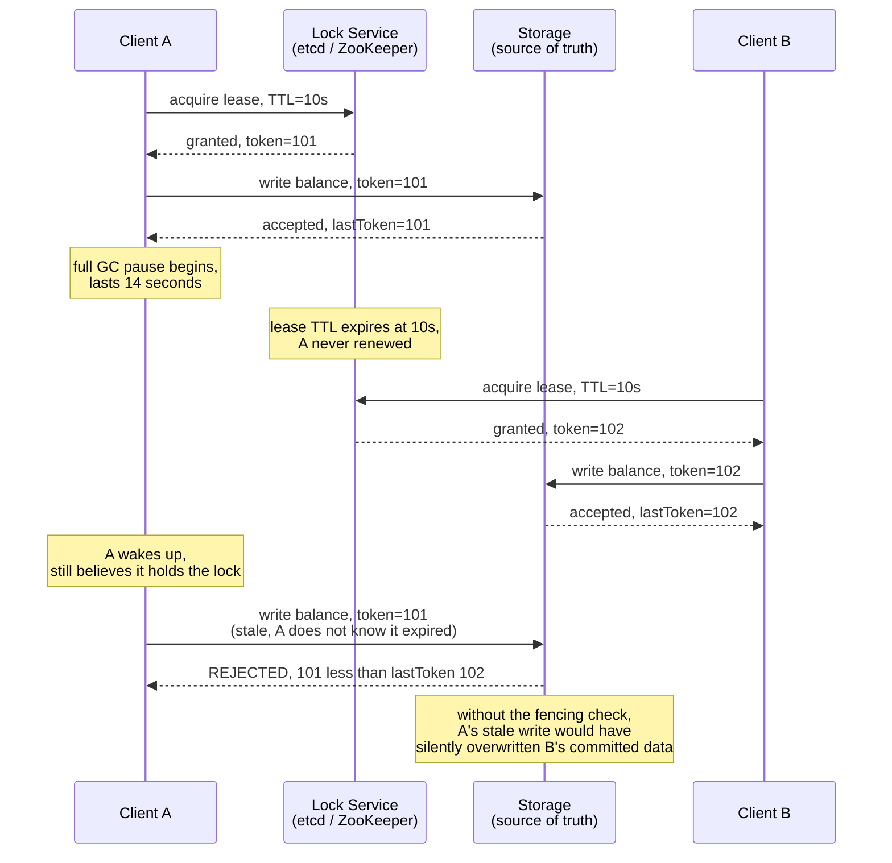
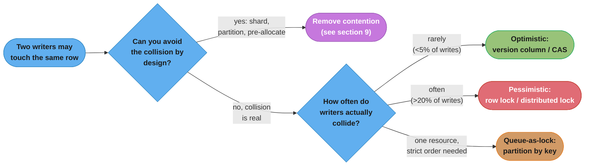
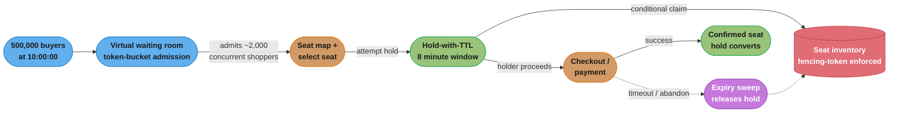

# Coordination and Contention
How independent processes agree on who goes first when everyone wants the same thing at once.

---

## 1. Concept Overview

Coordination and contention is the study of what happens when two or more independent
processes — separate machines, separate threads, separate browser tabs — try to read,
modify, or claim the same piece of shared state at (nearly) the same instant. A single
process never has this problem: its own call stack imposes an order. Distributed systems
have no shared call stack, so "who goes first" has to be manufactured deliberately, with
a mechanism, or it will be decided by accident — by whichever request's network packet
happens to arrive a few milliseconds earlier.

This module is the applied layer above [Consensus Algorithms](../consensus_algorithms/consensus_algorithms.md).
Consensus answers "how do N replicas agree on one value despite failures" — the Raft/Paxos
machinery, leader election, log replication. Coordination and contention answers a narrower,
more common interview question: "two users clicked the same button at the same time — what
happens?" The answer almost never involves running your own Raft cluster. It involves picking
the right *primitive* — a lock, a lease, a version check, a queue, a conditional write — and,
critically, making sure that primitive is enforced by the system that actually owns the data,
not merely by the application code that asked for permission first.

The single idea that this whole module keeps returning to: **a lock is a promise, not a
force field.** A lock tells other clients "please wait." It cannot physically stop a client
that never heard the message, went out to lunch mid-critical-section, or is holding a lock
it no longer legitimately owns. Only the storage layer underneath the contended resource can
enforce that — by rejecting a write that shows up with stale credentials. Everything in §4
through §6 is really one lesson told six different ways: **push the check to the data, not
the application.**

---

## 2. Intuition

**A single till vs. numbered tickets.** A bakery with one cash register and one line has no
contention problem — customers are already serialized by the physical queue. The moment the
bakery opens a second register, or lets people call in orders, two customers can reach for
the last croissant at once. The bakery's fix is never "ask nicely and hope" — it is a
mechanism: a numbered-ticket dispenser (a queue, ordering by arrival), a single employee who
locks the display case while restocking (mutual exclusion), or a rule that the register
physically cannot ring up more croissants than are on the shelf (a constraint enforced at
the point of truth, not in a clerk's head). Coordination design is choosing which of those
three shapes — order, exclusion, or a hard constraint — fits the resource you're protecting.

**Key insight:** the resource being contended for is data, and data has one final home — a
row, a key, a counter. Whoever writes there last, wins, no matter what promises were made
upstream. So the mechanism that matters most is not "who asked for the lock" but "what does
the write path actually check before it commits."

---

## 3. Core Principles

**Mutual exclusion.** At most one actor may hold the critical section (the code path that
reads-modifies-writes the shared resource) at a time. This is the oldest coordination
primitive — pessimistic locking, mutexes, `SELECT ... FOR UPDATE` — and it trades throughput
for simplicity: contenders queue up and wait rather than racing.

**Ordering.** Some problems don't need exclusion, only a deterministic order — "process
these events in the order they arrived," "this write must be visible before that one."
A single-partition queue, a sequence number, or a version column all supply ordering
without ever blocking a second writer from proceeding; they just make the *outcome*
well-defined.

**A lock without fencing is not a lock.** This is the load-bearing principle of the whole
module. A lock grants permission at time T. Nothing enforces that the holder still deserves
that permission at time T+Δ — a GC pause, a network partition, a suspended VM, or a slow
disk can all cause a holder to keep acting long after its lease has technically expired.
See [Consensus Algorithms §6](../consensus_algorithms/consensus_algorithms.md) for the
fencing-token mechanics at the lock-service layer; this module's contribution is the
application-level consequence: **every protected write must carry and check a fencing
token at the resource itself**, or the lock is theater. §6 works this example end to end.

**Idempotency is contention's cheapest insurance.** If a retried or duplicated request is
guaranteed to have the same effect as running it once, then a huge class of contention bugs
— double-charges, double-decrements, duplicate order creation — stops being a correctness
problem and becomes, at worst, a wasted round-trip. An idempotency key (§4.5) doesn't
prevent two requests from racing; it makes the race harmless.

**Prefer removing contention to managing it.** Every mechanism in §4 makes contention safe.
None of them make it fast. The highest-leverage move available to a system designer is
often to restructure the resource so fewer requests ever compete for the same row — shard a
hot counter, partition a queue by key, pre-allocate inventory into buckets. §9 covers this
in detail; keep it in mind while reading §4, because the "best" locking mechanism is
frequently the one you don't need.

---

## 4. Types / Architectures / Strategies

### 4.1 Pessimistic Locking

Acquire exclusive access *before* touching the resource; every other contender blocks or
fails fast until the lock releases. Implemented as a database row lock (`SELECT ... FOR
UPDATE`), a distributed lock (etcd/ZooKeeper lease, Redis/Valkey `SET NX PX`), or an
in-process mutex. Correct by construction — no interleaving is possible while the lock is
held — at the cost of throughput: every waiter is serialized, and a slow or crashed holder
stalls everyone behind it. Best when contention is frequent (most transactions collide) or
the cost of a wasted retry (as optimistic concurrency requires) is high.

### 4.2 Optimistic Concurrency (Version Columns / CAS)

Don't lock anything up front. Read the current state including a version number (or a
`compare-and-swap` token), do the work locally, then write back conditionally: "update this
row only if the version is still what I read." If another writer got there first, the
version has moved and the write is rejected — the caller retries from a fresh read. Cheap
in the uncontended case (no lock overhead at all) and degrades gracefully under moderate
contention, but wastes work and can starve under heavy contention, where most attempts lose
the race and retry. §6.2 and §6.3 work this pattern with a SQL version column and a
DynamoDB conditional write.

### 4.3 Leases with Fencing Tokens

A time-bounded lock: "you may act as the holder until this lease expires, unless you renew
it first." Leases solve the "holder crashed and never released the lock" problem that a
plain mutex has no answer for — a lease self-expires. But a lease alone reintroduces the
GC-pause hazard from §3: the holder can be paused past expiry and resume believing it still
owns the resource. The fix is to pair every lease grant with a monotonically increasing
**fencing token**, and to make the protected resource itself reject any write carrying a
token lower than the highest one it has already seen. See §5's timeline diagram and §6's
worked example.

### 4.4 Hold-with-TTL Reservations

A middle ground between "commit immediately" and "lock forever": reserve a resource
(a seat, a hotel room, an inventory unit) for a short window — 5 to 15 minutes is typical
for checkout flows — without a full commit. If the holder completes the transaction
(payment succeeds) before the TTL expires, the hold converts to a permanent allocation. If
it doesn't, a background sweep releases the hold back to the pool. This is the pattern
[`design_hotel_reservation.md` §4.2](../case_studies/design_hotel_reservation.md) uses for
room inventory, and it is the backbone of this module's own §14 case study — a hold row
with an expiry index is cheap to scan and cheap to abandon, which matters when a meaningful
fraction of holds never convert (an abandoned checkout, a payment decline).

### 4.5 Idempotency Keys

The client (or an upstream gateway) generates a unique key per logical operation and
attaches it to every attempt, including retries. The server records which keys it has
already processed and returns the *original* result for a repeat, without re-executing the
side effect. This doesn't prevent contention — two genuinely concurrent requests with
*different* keys still race — but it makes retries, which are a major source of accidental
double-writes under load or timeout, safe by construction. Stripe, for example, requires an
`Idempotency-Key` header on payment-creating requests specifically because a client timing
out and retrying a charge is indistinguishable, on the wire, from two real charge requests.

### 4.6 Single-Flight / Request Coalescing

When many concurrent callers ask for the same expensive computation or the same cache-miss
key at once (a "thundering herd"), single-flight collapses them into one in-flight
execution and fans the single result out to every waiter. This isn't mutual exclusion over
shared *state* — it's mutual exclusion over shared *work*. Go's `singleflight` package and
the "cache stampede lock" pattern (a short-lived lock held only by whichever request first
misses the cache, with everyone else waiting on it rather than all hitting the database) are
the canonical implementations; see [Caching §10](../caching/caching.md) for the stampede
failure mode this prevents.

### 4.7 Queue-as-Lock (Serialize by Partition Key)

Instead of contending for a lock at write time, remove the possibility of concurrent access
by routing every operation on a given resource through a single-consumer, single-partition
queue keyed by that resource's ID. A message queue partitioned by `account_id` guarantees
that all operations against one account are processed one at a time, in order, by one
consumer — mutual exclusion as a side effect of the queue's own partitioning guarantee,
with no lock object anywhere. See [Message Queues](../message_queues/message_queues.md) for
partition-key routing and ordering guarantees. The tradeoff: latency moves from "however
long the lock is held" to "however long the queue is backed up," and a single hot key still
funnels through one consumer, so this doesn't remove contention — it relocates it to a place
that's easier to reason about and to scale by adding partitions.

### 4.8 Virtual Waiting Rooms

When demand for a resource (concert tickets, a limited product drop) will vastly exceed
supply for a short burst, admit users into the *system* — not the *resource* — through a
gate that limits concurrent access to a level the backend can actually serve, typically
implemented as a token-bucket admission queue in front of the checkout path (see
[Rate Limiting §4](../rate_limiting/rate_limiting.md) for the token-bucket mechanics). Users
outside the gate see a "you're in line, position 41,203" screen instead of hammering an
inventory row that has zero chance of still being available. This is a demand-shaping
pattern, not a locking pattern — it exists precisely so that §4.1–4.4's mechanisms only ever
have to arbitrate among a manageable number of simultaneous contenders, not the full crowd.
§14 puts this in front of a 500,000-buyer onsale.

---

## 5. Architecture Diagrams

### 5.1 The GC-Pause Split-Brain — This Module's Signature Failure

The scenario every fencing discussion is really about: a lock holder pauses for longer than
its lease TTL, the lease expires and is granted to someone else, and the original holder
wakes up with no idea time has passed.



The failure is invisible from client A's point of view — it never received an error, never
saw a network partition, never knew it lost the lock. That is exactly why the check cannot
live in the client: **the storage layer is the only participant that sees both writes and
can compare their tokens.**

### 5.2 Choosing a Contention Mechanism



*The crossover between optimistic and pessimistic is a function of collision rate, not
resource type — §8 works the numbers behind the ~5%/~20% bands above.*

---

## 6. How It Works — Detailed Mechanics

### 6.1 The Flagship Broken → Fixed Pair: Redis `SETNX` Lock → Lease + Storage-Enforced Fencing Token

**BROKEN — a naive distributed lock using only `SET key value NX PX ttl`:**

```python
import redis
import time

r = redis.Redis(host="cache.example.internal", port=6379)

def acquire_lock(resource_id: str, ttl_ms: int = 10_000) -> bool:
    # NX: only set if not exists. PX: auto-expire after ttl_ms.
    return r.set(f"lock:{resource_id}", "held", nx=True, px=ttl_ms)

def release_lock(resource_id: str) -> None:
    r.delete(f"lock:{resource_id}")

def process_payout(account_id: str, amount_cents: int) -> None:
    if not acquire_lock(f"payout:{account_id}"):
        raise ContendedError("another payout is in progress")
    try:
        # BUG: nothing here ties this write back to the lock we just
        # acquired. If this thread stalls (GC pause, slow disk, a paused
        # container) past ttl_ms, the lock silently expires. A second
        # caller acquires it and runs process_payout concurrently. When
        # the first thread resumes, it has no idea it lost the lock and
        # writes anyway.
        balance = get_balance(account_id)
        set_balance(account_id, balance - amount_cents)
        issue_payout(account_id, amount_cents)
    finally:
        release_lock(f"payout:{account_id}")  # may delete B's lock, not A's
```

Two bugs compound here: (1) the lock's expiry is disconnected from the protected write —
nothing checks, at write time, whether the lock that authorized this write is still the
current one; and (2) the unconditional `DELETE` in `finally` can release a lock that a
*different* client now legitimately holds, an accidental second split-brain window on top
of the first.

**FIX — a lease that mints a fencing token, enforced at the storage layer, not the lock:**

```python
import redis
import time
import uuid

r = redis.Redis(host="cache.example.internal", port=6379)

LOCK_SCRIPT = """
-- KEYS[1] = lock key, ARGV[1] = holder id, ARGV[2] = ttl ms
local current = redis.call('GET', KEYS[1])
if current == false then
    redis.call('SET', KEYS[1], ARGV[1], 'PX', ARGV[2])
    return redis.call('INCR', KEYS[1] .. ':token')
end
return nil
"""

def acquire_lease(resource_id: str, ttl_ms: int = 10_000):
    holder_id = str(uuid.uuid4())
    token = r.eval(LOCK_SCRIPT, 1, f"lock:{resource_id}", holder_id, ttl_ms)
    if token is None:
        return None
    return holder_id, token  # token is monotonically increasing per resource_id

def process_payout(account_id: str, amount_cents: int) -> None:
    lease = acquire_lease(f"payout:{account_id}")
    if lease is None:
        raise ContendedError("another payout is in progress")
    _holder_id, token = lease

    balance = get_balance(account_id)
    # The storage layer -- not the lock service -- rejects a stale token.
    # This single statement IS the enforcement point.
    updated = apply_payout_if_current(
        account_id=account_id,
        new_balance=balance - amount_cents,
        fencing_token=token,
    )
    if not updated:
        raise StaleLeaseError(
            f"token {token} rejected; a newer lease already wrote this account"
        )
    issue_payout(account_id, amount_cents)
```

```sql
-- apply_payout_if_current: the write only succeeds if this token is
-- still the highest one this account has ever accepted. A resumed,
-- long-paused caller with an old token loses this comparison every time.
UPDATE accounts
SET balance = :new_balance,
    last_fencing_token = :fencing_token
WHERE account_id = :account_id
  AND last_fencing_token < :fencing_token;
-- 0 rows affected => the caller's lease has been superseded; abort.
```

The fix costs one extra column (`last_fencing_token`) and one extra predicate on an
existing `UPDATE`. In exchange, it closes the window completely: even a caller that is
paused for minutes and resumes with full confidence that it still holds the lock cannot
corrupt the account, because the account itself — not the lock, not the caller — is the
thing that says no.

### 6.2 Optimistic Concurrency with a Version Column

```sql
-- Read includes the current version.
SELECT quantity, version FROM inventory WHERE sku = 'WIDGET-42';
-- returns quantity=17, version=8

-- Write is conditioned on the version being unchanged.
UPDATE inventory
SET quantity = 16, version = 9
WHERE sku = 'WIDGET-42' AND version = 8;
-- 1 row affected  => success, no other writer touched this row since the read
-- 0 rows affected => someone else updated it first; re-read and retry
```

No lock is held between the `SELECT` and the `UPDATE` — any number of readers can be
mid-flight simultaneously. Only the write itself is conditional, and the database's normal
row-level atomicity guarantees the `WHERE version = 8` check and the write happen as one
indivisible step, so two concurrent `UPDATE`s racing on the same starting version can never
both succeed.

### 6.3 The Same Pattern on DynamoDB — Conditional Writes

DynamoDB has no row locks at all; every write is either unconditional or conditional. A
condition expression is DynamoDB's version of the `WHERE version = 8` clause above:

```python
import boto3
from botocore.exceptions import ClientError

table = boto3.resource("dynamodb").Table("Inventory")

def decrement_if_current(sku: str, expected_version: int) -> bool:
    try:
        table.update_item(
            Key={"sku": sku},
            UpdateExpression="SET quantity = quantity - :one, version = version + :one",
            ConditionExpression="version = :expected",
            ExpressionAttributeValues={":one": 1, ":expected": expected_version},
        )
        return True
    except ClientError as e:
        if e.response["Error"]["Code"] == "ConditionalCheckFailedException":
            return False  # someone else won the race; caller re-reads and retries
        raise
```

For a multi-item transaction — reserving three different inventory rows atomically —
`TransactWriteItems` groups up to 100 action requests (aggregate item size capped at 4MB)
into a single all-or-nothing commit, each carrying its own `ConditionExpression`; if any
one condition fails, the entire transaction is rejected and no item is touched.
[Verified: AWS DynamoDB `TransactWriteItems` API reference, docs.aws.amazon.com.]

S3 offers the same idea at the object layer: `PutObject` with an `If-None-Match: *` header
succeeds only if the key does not already exist (returns `412 Precondition Failed`
otherwise), and `If-Match: <etag>` succeeds only if the object's current ETag matches —
S3's own compare-and-swap, usable as a distributed "claim this key exactly once" primitive
without running any lock service at all. [Verified: AWS "How to prevent object overwrites
with conditional writes," docs.aws.amazon.com, 2024–2025 conditional-writes GA.]

### 6.4 Postgres Advisory Locks and `SKIP LOCKED`

Two distinct primitives, easy to conflate. An **advisory lock**
(`pg_advisory_xact_lock(key)`) is an application-defined lock on an arbitrary integer, held
in memory by Postgres and released automatically at transaction end — useful for
coordinating work that has no natural row to lock (e.g., "only one instance should run this
migration"). `SELECT ... FOR UPDATE SKIP LOCKED`, by contrast, is a row-lock modifier: it
returns only the *unlocked* rows matching the query, silently skipping any row another
transaction currently holds — the standard pattern for a job queue table where many workers
poll the same table and each should grab a different row:

```sql
-- Each worker runs this; every worker gets a DIFFERENT pending job,
-- never blocks waiting for a row another worker already grabbed.
SELECT job_id, payload
FROM jobs
WHERE status = 'pending'
ORDER BY created_at
FOR UPDATE SKIP LOCKED
LIMIT 1;
```

`SKIP LOCKED` has shipped since PostgreSQL 9.5. [Verified: PostgreSQL documentation,
`SELECT` reference, postgresql.org.]

---

## 7. Real-World Examples

**Ticketmaster / onsale queueing.** High-demand onsales route buyers through a virtual
waiting room (§4.8) before they ever reach seat selection, then hold a selected seat for a
short countdown window (§4.4) while checkout completes — the same hold-with-TTL shape as
[`design_hotel_reservation.md`](../case_studies/design_hotel_reservation.md), applied to
seats instead of rooms. §14 builds this scenario end to end.

**Amazon inventory.** Product pages show "only 3 left" derived from a count that is
decremented with an atomic conditional write, never a read-then-write pair — the same
`WHERE quantity >= 1` shape as §6.2, at a scale where the naive version would double-sell
constantly during a flash sale.

**DynamoDB conditional writes in production.** Used pervasively for "create if not exists"
semantics (idempotent resource creation), optimistic locking on frequently-updated items,
and distributed lock tables (the `amazon-dynamodb-lock-client` library implements a full
lease-with-fencing-token lock on top of conditional writes and TTL).

**S3 `If-None-Match` for exactly-once object creation.** Since the 2024 conditional-writes
launch, pipelines that previously needed an external lock service (or accepted a race) to
guarantee "only the first writer of this key wins" — checkpoint files, dedup markers, lease
files — can enforce that directly against S3 itself. [Verified: AWS "Amazon S3 now supports
conditional writes," aws.amazon.com/about-aws/whats-new, August 2024.]

**Postgres advisory locks in job schedulers.** Sidekiq, GoodJob, and River-style Postgres
job queues use `FOR UPDATE SKIP LOCKED` to let N workers poll one table without contending
on the same row, and advisory locks to guarantee singleton jobs (a nightly report that must
run on exactly one node) without a separate coordination service.

**etcd leases for leader election and locks.** etcd's lease API (grant, keep-alive, and a
`mod_revision` that increases on every write) is the fencing-token mechanism underlying
Kubernetes controller leader-election and `etcd`-backed distributed locks; see
[Consensus Algorithms §6–7](../consensus_algorithms/consensus_algorithms.md) for the
consensus layer this sits on.

---

## 8. Tradeoffs

### Optimistic vs. Pessimistic — the Crossover Is a Function of Collision Rate

| Collision rate on a write | Optimistic (version/CAS) cost | Pessimistic (lock) cost | Better choice |
|---|---|---|---|
| ~1% (rare) | ~1.01 attempts per success on average | 1 lock acquire + 1 release per write, always paid even when uncontended | Optimistic — near-zero waste, no lock overhead on the common case |
| ~10% | ~1.11 attempts per success | Same fixed lock overhead, occasional wait | Optimistic still wins — retries are cheap wasted reads |
| ~30% | ~1.43 attempts per success, retries start competing with fresh requests | Same fixed overhead, waiters queue predictably | Crossover zone — measure actual retry cost vs. lock hold time |
| ~60%+ (hot counter, flash-sale SKU) | Expected attempts approaches `1/(1-p)` — 2.5 attempts at 60%, diverging fast | Bounded: every writer waits its turn, throughput = `1 / lock_hold_time` | Pessimistic, or better — remove the contention (§9) |

The formula for expected attempts under optimistic retry with independent collision
probability `p` per attempt is `1/(1-p)`. It stays nearly free below roughly 20–30%
collision and gets expensive fast above that, which is why the crossover in §5.2's decision
diagram is drawn around that band — the number to actually measure in production is your
own read-modify-write collision rate on the hot key, not a rule of thumb.

### Locking Granularity

| Granularity | Concurrency | Complexity | Failure blast radius |
|---|---|---|---|
| Table-level lock | Lowest — one writer for the whole table | Trivial | One bad actor blocks everything |
| Row-level lock | High — only colliding rows block | Low (native to most RDBMSs) | Contained to the row |
| Partition/shard-level (queue-as-lock, §4.7) | Medium — one consumer per partition | Medium — needs partition-aware routing | Contained to the partition, but a hot partition still serializes everything routed to it |
| Field-level / CRDT-style merge | Highest — concurrent writes to different fields never conflict | High — requires commutative merge logic | None, by design, for genuinely independent fields |

### Leases vs. Permanent Locks

| | Lease (TTL-bound) | Permanent lock |
|---|---|---|
| Holder crashes | Self-heals after TTL | Deadlocks forever without an external watchdog |
| Holder pauses (GC, VM stall) | Can lose the lock without knowing — **requires fencing (§6.1)** | Keeps the lock through the pause, but still deadlocks on crash |
| Operational burden | None — no manual intervention on crash | Needs a lock-breaking / deadlock-detection process |

---

## 9. When to Use / When NOT to Use

**Use pessimistic locking when** collisions are frequent (see §8's crossover), the
work inside the critical section is cheap, or a failed/retried attempt is expensive
(e.g., it triggers an external side effect that isn't itself idempotent).

**Use optimistic concurrency when** collisions are rare, reads vastly outnumber writes, or
the resource is read far more often than it's contended for — the common case for most
"edit this document" or "update this profile" flows.

**Use a lease with fencing when** the lock must survive a client's own failure (crash,
partition, pause) without manual intervention, and the protected resource can enforce a
comparable token — a leader-election slot, a distributed cron job, a long-running
processing claim.

**Use hold-with-TTL when** the resource being claimed has real-world value that shouldn't
be permanently allocated on a mere intent to purchase — seats, rooms, promo codes — and a
meaningful fraction of holds are expected to expire unconverted.

**Prefer removing the contention entirely when** the "lock" would otherwise become the
system's throughput ceiling. A single hot counter (page views, a global sequence, a viral
post's like count) does not need a faster lock — it needs to stop being one row:

- **Shard the counter.** Split one row into N rows (`counter_shard_0` … `counter_shard_15`),
  write to a random or hashed shard, and sum across shards for reads. Contention on any one
  shard drops by roughly `1/N`.
- **Pre-allocate.** Instead of every request contending for a shared pool at claim time,
  hand out ranges up front — a distributed ID generator that gives each node a block of
  1,000 IDs to hand out locally, rather than every ID allocation touching a shared counter.
- **Batch and defer.** Accumulate increments locally (in the request path or an in-memory
  buffer) and flush periodically, trading strict real-time accuracy for near-zero
  contention — appropriate for view counts and analytics, never for money.

**Caution / anti-pattern:** reaching for a distributed lock service (etcd, ZooKeeper) as the
first tool for a problem a database's own atomic conditional write already solves (§6.2,
§6.3). A lock service earns its cost when coordination spans *multiple* resources or
services that have no single storage layer in common — not when the resource being
protected is a single row in a single database.

---

## 10. Common Pitfalls

**Holding a lock across a network call.** Acquiring a lock, then making an RPC to a
downstream service, then releasing the lock, turns the downstream service's latency (and
every one of its own retries and timeouts) into your own lock's hold time. A slow or
hanging downstream call now stalls every other contender for that lock. *Broken:* acquire
lock → call payment gateway (p99 2.5s, occasional 30s timeout) → release lock, so a single
slow gateway call serializes every other payout attempt behind it for up to 30 seconds.
*Fix:* narrow the critical section to only the local state transition (mark the row
"processing" under the lock, release immediately), make the external call outside the lock,
and reconcile the result with a second short critical section — the lock only ever
protects an in-memory or in-database state flip, never an I/O wait.

**TTL shorter than the work it protects.** A lease with a 5-second TTL protecting an
operation that sometimes takes 8 seconds guarantees periodic double-execution under
completely normal (non-failure) conditions — this isn't an edge case, it's an expected
outcome of the numbers chosen. *Broken:* fixed TTL picked as "should be enough," never
measured against p99 work duration. *Fix:* set the TTL to comfortably exceed p99.9 duration
of the protected work, or — better — use a **renewable lease** (the holder extends the TTL
periodically while still working, e.g., etcd's `KeepAlive` stream) so the timeout reflects
"the holder stopped responding," not "the work took slightly longer than average."

**Retry storms amplifying contention.** Under optimistic concurrency, a spike in collision
rate causes more retries, and if every failed attempt retries immediately, the retries
themselves become the next wave of collisions — a positive feedback loop that can turn a
transient hot-row problem into a sustained self-inflicted outage. *Fix:* exponential backoff
with jitter on every optimistic-retry loop, exactly as in
[Resilience Patterns §4.3](../resilience_patterns/resilience_patterns.md) — the same
mechanism that prevents retry storms against a failing dependency prevents them against a
contended row.

**Compensating actions that aren't commutative.** When a distributed operation fails partway
and needs to be rolled back with a compensating action (§ pattern shared with
[Distributed Transactions](../distributed_transactions/distributed_transactions.md)'s Saga
pattern), the compensation must produce the same correct end state regardless of what order
concurrent compensations run in. "Refund $10" run twice is not commutative with a single
balance and silently over-refunds; "set refunded_amount to $10" (an idempotent, absolute
assignment guarded by a version check, per §6.2) is.

**Lock in the app, race in the database.** *Broken:* the application acquires an in-process
mutex or a Redis lock before calling `UPDATE inventory SET quantity = quantity - 1`, and the
team believes this makes the decrement safe. It does — for callers that go through *this*
application instance. It does nothing at all for a second application instance, a batch
job, an admin console, or a direct database script that touches the same row without ever
asking the lock service. *Fix:* the constraint has to live where every writer, present and
future, is forced through it — a `CHECK (quantity >= 0)` constraint plus the conditional
`WHERE quantity >= 1` pattern from §6.2, enforced by the database itself regardless of which
process issued the write. This is the general form of §6.1's lesson: the application-level
lock is a convenience for well-behaved callers, never a substitute for the storage-layer
check.

---

## 11. Technologies & Tools

| Tool | Primitive | Notes |
|---|---|---|
| etcd | Leases, distributed locks, `mod_revision` fencing | Kubernetes' coordination backbone; see [Consensus Algorithms §7](../consensus_algorithms/consensus_algorithms.md) |
| ZooKeeper | Ephemeral znodes, sequential znodes, `zxid` fencing | Older but still common in Kafka-adjacent and Hadoop-ecosystem stacks |
| DynamoDB | `ConditionExpression`, `TransactWriteItems` (100 items / 4MB) | No row locks — every write is conditional or unconditional by design |
| Amazon S3 | `If-None-Match` / `If-Match` conditional `PutObject`/`CopyObject` | GA since August 2024; bucket-policy enforcement available since November 2024 |
| PostgreSQL | Row locks, `FOR UPDATE SKIP LOCKED`, advisory locks (`pg_advisory_xact_lock`) | `SKIP LOCKED` since 9.5; advisory locks need no extra schema |
| Redis / Valkey | `SET NX PX`, Lua-scripted lease + token issuance, Redlock | Redis moved off BSD-3 to a dual RSALv2/SSPLv1 license in 2024 and added AGPLv3 as a third option with Redis 8 in 2025; **Valkey** (BSD-3, Linux Foundation fork) is now the default engine for new AWS ElastiCache/MemoryDB clusters and backs Google Cloud Memorystore for Valkey — treat Valkey as the default choice for new managed deployments, with Redis a viable option only where the AGPL terms are acceptable |
| Apache Kafka | Partition-key ordering (queue-as-lock, §4.7) | One partition = one consumer = natural serialization per key |

---

## 12. Interview Questions with Answers

**Q: Why is a distributed lock without a fencing token unsafe?**
**Short:** A paused holder can resume after its lease expires and write as if it still owns the lock.

A lock only prevents corruption if every write it authorizes is checked against the
current holder. Without a fencing token, a client that stalls (GC pause, slow disk,
suspended container) past its lease TTL can resume and write with no idea that a second
client already acquired the lock and is also writing — both believe they're the sole
holder. The fix is for the lock service to issue a monotonically increasing token with
each grant, and for the *storage layer protecting the resource* — not the lock service —
to reject any write whose token is lower than the highest one it has already accepted.
See §6.1 for the worked SETNX-to-fencing fix.

**Q: What's wrong with checking "is this locked" in application code and then writing to the database?**
**Short:** An application-level lock only constrains callers that go through that lock — every other writer bypasses it silently.

This is the "lock in the app, race in the database" pitfall (§10): a mutex or Redis lock
inside one service instance does nothing to stop a second instance, a batch job, or a
direct database write from touching the same row concurrently. The enforcement has to live
at the resource itself — a conditional `UPDATE ... WHERE version = :v` or `WHERE quantity
>= 1` — because that is the one place every writer, present and future, is forced through.

**Q: Two requests hit "decrement inventory by 1" at the same instant on the last unit in stock. Walk through the safe version.**
**Short:** Both issue the same conditional UPDATE; the database's row lock lets only one succeed.

Both issue `UPDATE inventory SET quantity = quantity - 1 WHERE sku = ? AND quantity >= 1`.
The database serializes the two statements via row-level locking: the first to acquire the
lock evaluates `quantity (1) >= 1` as true and commits, leaving quantity at 0. The second
then evaluates against the *new* value — `0 >= 1` is false — and affects zero rows, which
the application reads as "sold out, reject this request." The key property: check and act
are the same statement, so there's no window where both requests can observe `quantity = 1`
simultaneously. This is the identical shape to
[`design_hotel_reservation.md` §9 War Story 1](../case_studies/design_hotel_reservation.md).

**Q: Why does Redlock's use of wall-clock timing across Redis nodes worry Martin Kleppmann?**
**Short:** Redlock assumes bounded clock drift and execution time, and a GC pause or clock jump breaks that assumption silently.

Kleppmann's 2016 analysis argued Redlock is a synchronous-system algorithm dressed as an
asynchronous-system one: it assumes that the time it takes to acquire a majority of locks,
plus clock drift across nodes, stays comfortably inside the lock's TTL. A long GC pause, a
slow network partition, or an NTP-driven clock jump can violate that assumption without
producing any visible error — two clients can then both believe they hold the lock. His
conclusion wasn't "never use Redlock," but that it's suitable for *efficiency* locks (avoid
duplicate work) and unsuitable for *correctness* locks (prevent data corruption) unless
paired with fencing tokens enforced at the resource — the same principle as §3 and §6.1.

**Q: When should you choose optimistic concurrency over a pessimistic lock?**
**Short:** When collisions are rare, since wasted retries cost less than always paying lock overhead.

Optimistic concurrency (a version column or CAS) has near-zero cost when most reads never
collide with a concurrent write — no lock is ever held, so uncontended traffic pays nothing
extra. Its cost is retries, and retries only happen on an actual collision. Under Poisson-ish
collision probability `p`, expected attempts per success is `1/(1-p)` — cheap below roughly
20–30% collision, expensive above it. Pessimistic locking pays a fixed acquire/release cost
on every single write regardless of collision rate, but bounds worst-case wait time
predictably. Choose optimistic for low-collision, read-heavy resources (user profile edits);
choose pessimistic for high-collision hot rows (a flash-sale SKU) — see §8's crossover table.

**Q: A lease's TTL is shorter than the operation it protects. What actually happens?**
**Short:** The lease can expire mid-operation and get reassigned even though the original holder is still healthy and working.

This isn't a rare failure mode — it's a guaranteed periodic double-execution under normal
load whenever the operation's duration crosses the TTL, which happens on every slow request
above that threshold, not just during an incident. The fix is either sizing the TTL well
above measured p99.9 work duration, or switching to a renewable lease where the holder
extends the TTL with periodic keep-alives while it's still actively working — so expiry
means "the holder stopped responding," not "the work happened to take longer than the
timer."

**Q: Why is holding a lock across an outbound network call dangerous?**
**Short:** The downstream call's latency and retries become the lock's hold time, stalling every other waiter.

If a critical section acquires a lock, then makes an RPC to another service, then releases
the lock, every millisecond that RPC takes — including its own timeouts and retries — is
time every other contender for that lock spends blocked. A single slow or hanging
downstream dependency turns into a queue-building outage for an otherwise-healthy resource.
The fix is to narrow the critical section to the local state transition only: flip a
"processing" flag under the lock and release immediately, make the external call outside
any lock, then reconcile with a second short critical section.

**Q: What does "idempotency key" mean and what problem does it solve that locking doesn't?**
**Short:** A client-supplied key lets the server return a duplicate request's original result instead of re-executing it.

An idempotency key is a unique identifier a client attaches to a logical operation and
resends unchanged on every retry of that same operation. The server records which keys it
has already completed and, on a repeat, returns the original result without re-running the
side effect (a charge, an order creation). This solves a different problem than locking:
locking arbitrates between *genuinely concurrent, different* requests for the same
resource; idempotency keys make a *retried, duplicate* request of the *same* logical
operation harmless. Stripe requires one on charge-creating calls specifically because a
client-side timeout and retry is indistinguishable, on the wire, from two real charge
attempts.

**Q: How does `SELECT ... FOR UPDATE SKIP LOCKED` differ from a plain row lock, and what's it used for?**
**Short:** It returns only unlocked rows, letting many workers each grab a different row without ever blocking.

A plain `SELECT ... FOR UPDATE` blocks the caller until any currently-locked matching row
becomes free. `SKIP LOCKED` instead excludes already-locked rows from the result set
entirely, so a worker polling a shared job-queue table gets whatever job is currently free
rather than waiting behind another worker's in-progress row. This is the standard pattern
for building a job queue directly on a relational database with N concurrent pollers and no
external queue service, and it has been available in PostgreSQL since version 9.5.

**Q: What's the difference between a PostgreSQL advisory lock and a row lock?**
**Short:** An advisory lock is on an arbitrary application-chosen number, not tied to any row.

A row lock (via `FOR UPDATE`) locks an actual row that exists in a table; it's implicit in
touching that row through a locking read. An advisory lock (`pg_advisory_xact_lock(key)`)
locks an arbitrary integer the application chooses to mean something — "job type 7" or a
hash of a resource name that has no corresponding row at all — held in memory by Postgres
and released automatically at transaction end for the `_xact_` variant. It's the tool for
coordinating work that has no natural row to lock, like "ensure only one node runs this
migration."

**Q: How do DynamoDB's `ConditionExpression` and `TransactWriteItems` support optimistic concurrency without row locks?**
**Short:** Every write can be conditioned on the item's current state, and transactions bundle multiple conditional writes atomically.

DynamoDB has no lock primitive at all — every `PutItem`/`UpdateItem` is either
unconditional or carries a `ConditionExpression` evaluated against the item's current
attributes before the write is applied, functionally identical to a SQL `WHERE version = ?`
clause. `TransactWriteItems` extends this across up to 100 action requests (4MB aggregate)
touching different items or tables, committing all of them or none, each with its own
condition — the multi-row equivalent of a single optimistic-concurrency check.

**Q: How do S3's `If-None-Match` and `If-Match` headers enable distributed coordination without a lock service?**
**Short:** They make S3 itself reject a write that would overwrite an existing or changed object.

`PutObject` with `If-None-Match: *` succeeds only if the key doesn't already exist,
returning `412 Precondition Failed` otherwise — a "claim this key exactly once" primitive
usable for leader-election markers or dedup checkpoints without any external lock service.
`If-Match: <etag>` succeeds only if the object's current ETag matches the one supplied — S3's
version of a compare-and-swap. Both have been generally available since S3's 2024
conditional-writes launch, with bucket-policy enforcement (`s3:if-none-match`) added later
the same year.

**Q: What's the actual cost formula behind "optimistic concurrency degrades under contention," and where's the crossover?**
**Short:** Expected attempts per success is roughly 1/(1-p), cheap under ~20-30% collision and diverging above it.

For independent per-attempt collision probability `p`, the expected number of attempts
before a success under simple retry is `1/(1-p)`: at 10% collision, ~1.11 attempts; at 60%
collision, 2.5 attempts, and climbing steeply as `p` approaches 1. Below roughly 20–30%
collision the overhead is negligible and optimistic wins outright since it pays zero lock
cost on the uncontended majority. Above that band, the wasted work (and the retries'
tendency to collide with each other, worsening `p` itself) starts to outweigh a
pessimistic lock's fixed, bounded overhead — the exact number to measure in your own
system is the real collision rate on the hot key, not this formula in the abstract.

**Q: Design a mechanism to prevent the same cron-triggered job from running twice if two nodes fire it simultaneously.**
**Short:** A short-TTL lease (Postgres advisory lock or a Redis SET NX) acquired at job start, held only for the run.

Have every node attempt to acquire a lease keyed by the job's name right before running it
— a Postgres `pg_try_advisory_lock` (non-blocking: returns immediately if already held) or
a Redis/Valkey `SET jobname:lock NX PX <ttl>`. Whichever node acquires it runs the job;
every other node's attempt fails immediately and skips this cycle. Because this is an
*efficiency* lock (avoid duplicate work, not protect money), Redlock-style caveats matter
less here than they would for a payment path — an occasional double-run from a missed
edge case is a wasted job, not corrupted data, though idempotent job logic (§4.5's
principle) is still the right insurance either way.

**Q: When should you remove contention instead of managing it?**
**Short:** When the lock or version check itself becomes the throughput ceiling on a single hot resource.

If profiling shows one row or counter is the system's bottleneck — every request funnels
through the same lock or the same optimistic-retry loop — no locking mechanism fixes that,
because the mechanism's job is safety, not throughput. The fix is structural: shard a hot
counter into N sub-counters and sum on read (contention drops by roughly `1/N`),
pre-allocate ranges instead of contending for a shared pool per request, or batch and defer
writes where strict real-time accuracy isn't required. Locking is the right tool for
*correctness* under contention; restructuring the resource is the right tool for
*eliminating* the contention in the first place.

**Q: What's the difference between mutual exclusion and ordering as coordination goals?**
**Short:** Exclusion stops two actors from acting at once; ordering only fixes what sequence they act in.

Mutual exclusion (a lock) guarantees at most one holder at a time and forces others to
wait or fail. Ordering guarantees a deterministic sequence — "these events are applied in
arrival order" — without necessarily blocking anyone; a single-partition queue or a version
number both supply ordering while letting multiple writers stay fully concurrent up until
the point their writes are sequenced. Many contention problems only need ordering, not
exclusion, and picking exclusion when ordering would do costs unnecessary blocking.

**Q: A batch job runs a compensating "refund" action twice due to a retry. What went wrong and how do you prevent it?**
**Short:** The compensation wasn't commutative — running it twice produced a different result than running it once.

"Add $10 to the balance" run twice adds $20; it isn't commutative, so retrying an
at-least-once compensation without protection double-refunds. The fix is to make the
compensating action either idempotent via a key (§4.5 — record that this specific
compensation was already applied and skip a repeat) or expressed as an absolute,
version-guarded assignment ("set `refunded_amount` to $10 if not already set," §6.2's
pattern) rather than a relative delta. This is the same discipline
[Distributed Transactions'](../distributed_transactions/distributed_transactions.md) Saga
pattern requires of every compensating step.

**Q: Why does a virtual waiting room belong in a coordination-and-contention design, even though it's not a locking mechanism?**
**Short:** It bounds how many contenders reach the lock at once, which is what keeps the lock itself viable.

None of §4's locking, leasing, or optimistic mechanisms are designed to arbitrate among
hundreds of thousands of simultaneous contenders efficiently — they're designed to make a
*manageable* number of contenders safe. A virtual waiting room (a token-bucket-style
admission gate, see [Rate Limiting §4](../rate_limiting/rate_limiting.md)) is the layer that
keeps the number of actual contenders reaching the storage layer within what any locking
mechanism can handle, by queueing demand at the edge rather than letting it all hit the
contended resource simultaneously. §14 depends on this for a 500,000-buyer onsale against
50,000 seats.

---

## 13. Best Practices

**Make the storage layer the enforcement point, always.** Every mechanism in this module
that actually holds up under failure — fencing tokens, conditional writes, `CHECK`
constraints — puts the final check at the resource itself, not in application code that
merely asked nicely first. Treat any lock, lease, or "I checked before I wrote" pattern that
doesn't end in a conditional write against the resource as provisional, not safe.

**Size TTLs from measured p99.9 duration, not intuition,** and prefer a renewable lease over
a fixed one wherever the protected work's duration is variable — a renewable lease turns
"the timer fired" back into "the holder actually stopped," which is the thing you meant to
detect.

**Keep critical sections local.** Never hold a lock across a network call to another
service; flip local state under the lock, do I/O outside it, reconcile with a second short
critical section if needed.

**Default new locking/version code to optimistic unless you've measured a collision rate
above ~20–30% on the specific resource** — most "update this record" paths are read-heavy
and low-collision, and paying a fixed lock cost on every write for a rare race is a
throughput tax most systems don't need to pay.

**Treat Redlock (and any timing-dependent distributed lock) as an efficiency mechanism, not
a correctness mechanism,** unless paired with a fencing token enforced at the resource —
Kleppmann's critique isn't "don't use it," it's "know which guarantee you're actually
getting."

**Reach for a lock service only when coordination spans multiple resources or services with
no single storage layer in common.** A single row's atomic conditional write already solves
single-resource contention without the operational cost of etcd/ZooKeeper.

**Prefer Valkey over Redis for new managed-cache deployments** unless the team has
explicitly cleared Redis's AGPLv3 terms — it's the default AWS ElastiCache/MemoryDB and
Google Cloud Memorystore now provision, and functionally equivalent for every locking
primitive in this module.

**Make every retry loop — optimistic-concurrency retries included — use exponential backoff
with jitter,** exactly as in
[Resilience Patterns §4.3](../resilience_patterns/resilience_patterns.md). An un-backed-off
retry loop on a contended resource is how a transient collision becomes a self-inflicted
storm.

---

## 14. Case Study: A 50,000-Seat Onsale Against 500,000 Concurrent Buyers

### Problem Statement

A single arena show goes on sale at 10:00:00 AM sharp. 500,000 fans are refreshing the
purchase page in the same second; the venue holds 50,000 seats. The system must sell every
seat exactly once, never oversell a seat, never leave a legitimately-purchased seat
unconfirmed, and survive the first 60 seconds — the period of maximum contention — without
falling over.

### Why Naive Locking Fails Here

A single row per seat, contended by up to 500,000/50,000 = 10 simultaneous bidders per seat
on average (and far more than 10 for the handful of best seats), makes even an optimistic
version-column approach hostile: at that collision rate, §8's `1/(1-p)` formula puts
expected attempts per successful purchase well into double digits, and every failed attempt
still cost a full round trip to the database. A pessimistic per-seat lock fares no better —
500,000 simultaneous lock-acquire attempts against 50,000 rows is still 500,000 requests
hitting the database in the same second, just queued instead of retried.

### Architecture



### Component Deep Dives

**1. Virtual waiting room (§4.8).** Every one of the 500,000 initial requests hits a
lightweight admission gate first — not the seat map, not the database. The gate uses a
token-bucket (see [Rate Limiting §4](../rate_limiting/rate_limiting.md)) sized to the
checkout system's actual sustainable throughput, admitting perhaps 2,000 concurrent
shoppers into the seat-selection experience at a time. Everyone else sees a live position
counter. This single decision is what makes every mechanism downstream tractable — the
seat inventory never sees more than a few thousand concurrent contenders instead of half a
million.

**2. Hold-with-TTL on seat selection (§4.4).** Selecting a seat doesn't buy it — it claims
an 8-minute hold via the same atomic conditional pattern as §6.2:

```sql
UPDATE seats
SET status = 'held', held_by = :session_id, held_until = NOW() + INTERVAL '8 minutes',
    fencing_token = fencing_token + 1
WHERE seat_id = :seat_id AND status = 'available';
-- 0 rows affected => seat was already held or sold; show the buyer a fresh seat map
```

**3. Fencing-token enforcement at checkout.** Payment success converts a hold to a sale, but
only if the hold's fencing token still matches — exactly §6.1's pattern, applied here to
stop a buyer whose 8-minute hold *just* expired (their browser tab was paused, or their
payment step took 8 minutes and 4 seconds) from completing a purchase against a seat that
the expiry sweep has already released to someone else:

```sql
UPDATE seats
SET status = 'sold', held_by = NULL
WHERE seat_id = :seat_id AND held_by = :session_id
  AND fencing_token = :token_from_hold AND status = 'held';
-- 0 rows affected => hold expired and was reassigned; payment must be voided, not committed
```

**4. Expiry sweep.** A background worker scans `WHERE status = 'held' AND held_until <
NOW()`, backed by an index on `held_until`, and releases expired holds back to `available`
— the same shape as
[`design_hotel_reservation.md`](../case_studies/design_hotel_reservation.md)'s hold-expiry
worker. Given real checkout abandonment (payment declines, users closing the tab), a large
fraction of holds never convert; the sweep's cadence (every few seconds) determines how
quickly an abandoned seat becomes available again to the next buyer.

**5. Idempotency on payment retry (§4.5).** Every checkout submission carries a
client-generated idempotency key. A buyer's flaky mobile connection double-submitting the
"pay" button must never risk a double-charge, and the idempotency key makes the retry return
the original result instead of processing twice — delegated in full to
[`design_payment_system.md`](../case_studies/design_payment_system.md) for the payment
mechanics themselves.

### Design Decisions and Tradeoffs

| Decision | Why | Cost accepted |
|---|---|---|
| Waiting room admits by token bucket, not FIFO ticket number | Simpler, no need to persist arrival order for 500,000 sessions | Admission order isn't strictly first-come-first-served under bursty arrival |
| 8-minute hold TTL, not shorter | Real checkout (address, payment) rarely completes faster; a too-short TTL causes routine involuntary hold loss (§10's TTL pitfall) | Legitimately interested buyers can occupy a seat for 8 minutes without paying |
| Fencing token re-checked at payment commit, not just at hold acquire | Closes the exact GC-pause-style window from §5.1 — a paused checkout tab resuming after expiry must not silently commit | One extra conditional check on the highest-value write in the whole flow |
| Seat inventory sharded by section, not a single table | 50,000 rows split across sections spreads write contention geographically instead of funneling every hold attempt through one table's lock manager | More complex cross-section "any available seat" queries for flexible buyers |

### Metrics and Results (Illustrative)

- Admission gate throughput: ~2,000 concurrent active shoppers sustained, buyers behind the
  gate see accurate position updates every few seconds.
- Hold-conflict rate at checkout: under 1% of holds fail the fencing-token re-check, nearly
  all attributable to buyers who let an 8-minute hold lapse rather than to a race.
- Zero oversells: the fencing-token-guarded `UPDATE` makes a double-sale of one seat
  structurally impossible, not merely unlikely — the invariant is enforced by the same row
  that would otherwise be corrupted, not by any upstream check.

### Lessons Learned

The mechanism that made this tractable wasn't a cleverer lock — it was admitting fewer
contenders to the lock in the first place (§4.8), then making the lock that remains
correct under failure with a fencing token that the *seat row itself* enforces (§6.1). Every
seat-selling system that skips the waiting room and relies purely on database locking to
absorb the full burst either falls over under load or, worse, appears to work until the one
night demand exceeds whatever threshold nobody load-tested — exactly the silent-until-load
failure mode that makes contention bugs so much more dangerous than crash bugs.
