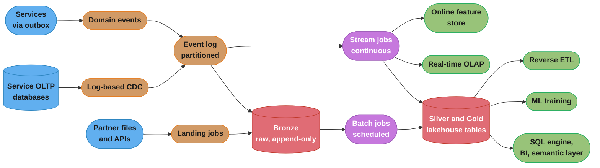
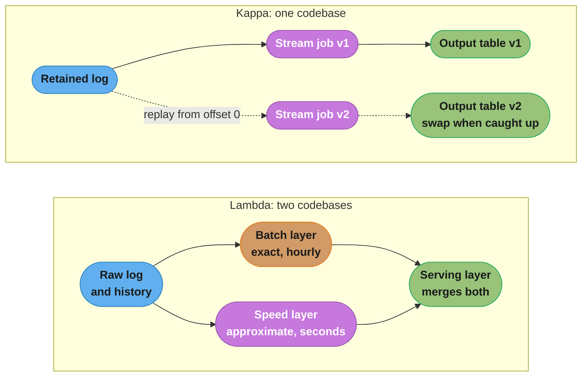
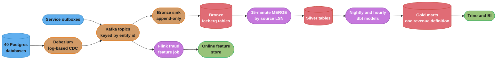

# Data Platform Architecture
Where analytics sits relative to the services that produce the data, how data gets there, and which shape — batch, stream, Lambda, Kappa, warehouse, lake or lakehouse — fits which question.

> Dates, papers and product facts on this page were checked against primary sources on 2026-11-25.
> Volumes, costs and timings in worked examples and the case study are illustrative design inputs.

---

## 1. Concept Overview

Every product that grows past one database ends up with two kinds of data system. The
**operational** side — the services and their OLTP databases — records what is happening
now, one order or one click at a time, with millisecond latency and strict correctness per
row. The **analytical** side answers questions across all of that history: revenue by
region last quarter, which features predict churn, how many fraud attempts came from one
device fingerprint this hour. Those questions scan billions of rows, join data from many
services, and run on schedules or dashboards rather than on a user's click.

A **data platform** is the architecture that connects the two:

1. **Ingestion** — getting data out of services without hurting them: change data capture
   (CDC) from database logs, published domain events, file drops, API pulls.
2. **Storage** — a durable, replayable home for raw and refined data: a warehouse, a data
   lake of files, or a lakehouse that puts table semantics on top of the files.
3. **Processing** — turning raw data into trusted tables: batch jobs over bounded inputs,
   stream jobs over unbounded ones.
4. **Serving** — handing results to people and systems: BI dashboards, real-time OLAP,
   ML feature stores, reverse ETL back into operational tools, data APIs.
5. **Governance** — ownership, schemas and contracts, quality checks, lineage, access
   control and deletion.

This module is the **HLD view**: where each layer sits, how data flows between them, and
how to choose among batch, streaming, Lambda, Kappa, warehouse, lake and lakehouse for a
given set of freshness, cost and correctness requirements. Ownership elsewhere:

- Analytical **engines** — columnar storage, vectorized execution, MergeTree, warehouses vs
  real-time OLAP — are in
  [Analytical Databases and OLAP](../../database/analytical_databases_and_olap/analytical_databases_and_olap.md).
- **Open table formats** — snapshot isolation on files, copy-on-write vs merge-on-read,
  Iceberg vs Delta vs Hudi — are in
  [Lakehouse and Table Formats](../../database/lakehouse_and_table_formats/lakehouse_and_table_formats.md).
- **Stream-processing primitives** — windows, watermarks, checkpoints, exactly-once sinks —
  are in [Stream Processing](../stream_processing/stream_processing.md).
- **Products** are taught in `technologies/`:
  [Apache Flink](../../technologies/apache_flink/apache_flink.md),
  [Apache Iceberg](../../technologies/apache_iceberg/apache_iceberg.md),
  [Trino](../../technologies/trino/trino.md),
  [Debezium](../../technologies/debezium_change_data_capture/debezium_change_data_capture.md) and
  [Apache Airflow](../../technologies/apache_airflow/apache_airflow.md).
- **ML-specific pipelines and feature stores** are in
  [Data Pipelines and Processing](../../ml/data_pipelines_and_processing/data_pipelines_and_processing.md)
  and [Feature Store Design](../../ml/ml_system_design/feature_store_design.md).

---

## 2. Intuition

**One-line analogy:** the shop floor and the back office. The till on the shop floor records
each sale instantly and must never be slow; nobody does the quarterly accounts at the till
while customers queue. Every evening the receipts go to the back office, which keeps every
receipt ever issued, reconciles them, and produces the reports. A data platform is the back
office, plus a pneumatic tube that carries receipts from the till as they are printed
(CDC and events), so the back office can also answer "what is happening right now".

**Mental model — a recomputable pipeline.** Picture the platform as a chain of tables where
each table is a function of the ones before it. The first table is the raw, immutable
history: every change, as it arrived. Every later table — cleaned, joined, aggregated — can
be rebuilt by re-running its function over that history. If the function had a bug, you fix
it and re-run; if the business redefines "active user", you re-run. A platform that keeps
raw history can always recover from its own mistakes; one that only keeps the latest
aggregates cannot.

**Why it matters:** analytics competes with production for the same data. Running reports on
the OLTP primary steals its IO; running them on a replica still adds load and gives
inconsistent snapshots across services; dual-writing from application code drifts the
moment one write fails. And every important decision a company makes — pricing, fraud
rules, model training, financial reporting — is made from the analytical copy.

**Key insight:** a data platform is defined by its **replayable source of truth**, not by
its engine. Choose the storage and the immutable raw layer first; batch versus stream,
warehouse versus lakehouse, and which query engine are decisions you can revise later,
because everything downstream can be recomputed from that layer.

---

## 3. Core Principles

**Keep analytics off the operational path.** OLTP databases are tuned for short
transactions on hot rows; a 40-minute scan for a report evicts their cache and competes for
IO. Extract data through the database's change log or through published events, and run
analytics on separate storage and compute.

**Keep the raw history immutable and replayable.** Land data as it arrived, append-only,
with enough metadata (source, source position, arrival time) to replay it. Corrections are
new data, not edits to old raw data. This layer is what makes every downstream table
recomputable.

**Make every job idempotent.** A job that is retried, re-run for a backfill, or run twice by
an over-eager scheduler must produce the same result. Overwrite a partition or `MERGE` on a
key; never blindly append the output of a re-runnable job.

**Order changes by the source's position, not by timestamps.** A CDC stream carries a log
position (an LSN, a binlog offset); applying changes in that order reproduces the source
exactly. Applying them by `updated_at` from many machines reintroduces every clock-skew bug
in [Time, Clocks and Ordering](../time_clocks_and_ordering/time_clocks_and_ordering.md).

**Separate storage from compute.** Data in object storage with an open table format can be
read by several engines (batch, interactive SQL, stream, ML training) without copies, and
each engine scales independently. Warehouses offer the same separation inside one vendor.

**Freshness is a per-use-case budget, not a platform property.** A finance close needs
correct numbers by 06:00; a fraud feature needs a value within seconds; a weekly dashboard
needs neither. Build the cheapest path that meets each budget instead of making everything
real-time.

**Treat schemas as contracts with owners.** The service that produces a table or event owns
its schema; consumers depend on it the way they depend on an API. Breaking changes go
through versioning and compatibility checks, not surprise column drops at 02:00.

**One definition per metric.** "Revenue" defined differently in two dashboards produces two
truths and a meeting. Define business metrics once, in a modelled layer or a semantic layer,
and make every consumer read that definition.

---

## 4. Types / Architectures / Strategies

### 4.1 Batch Processing

Processing over a **bounded** input — yesterday's partition, a full table snapshot — to a
complete output. Google's MapReduce paper (Dean and Ghemawat, OSDI 2004) made the model
mainstream: a map function over key-value pairs, a shuffle by key, a reduce per key, with
the runtime handling partitioning, scheduling and machine failures across commodity
clusters. Apache Spark generalized it to in-memory DAGs and SQL and is at 4.3.0 as of this
page's check date. Batch is simple to reason about, easy to re-run, and cheap per row, at
the cost of freshness measured in minutes to hours. DDIA's batch chapter
([summary](../../book/designing_data_intensive_applications/10_batch_processing/10_batch_processing.md))
is the classic treatment.

### 4.2 Stream Processing

Processing over an **unbounded** input, continuously, with results that update as data
arrives — seconds of freshness, at the cost of state management, watermarks and harder
corrections. The primitives are in [Stream Processing](../stream_processing/stream_processing.md);
the canonical engine is [Apache Flink](../../technologies/apache_flink/apache_flink.md).

### 4.3 Lambda Architecture

Nathan Marz's design ("How to beat the CAP theorem") runs **two paths over the same raw
input**: a batch layer that periodically recomputes exact views from all history, and a
speed layer that computes approximate recent views from the stream; a serving layer merges
them. It earns its complexity when a consumer needs a result that is exactly reproducible
from raw data with no trust in streaming approximations — billing, regulatory reporting —
and fast provisional numbers too. The cost is writing and keeping two implementations of
the same logic in agreement.

### 4.4 Kappa Architecture

In "Questioning the Lambda Architecture" (O'Reilly Radar, 2014-07-02), Jay Kreps, drawing on
LinkedIn's Kafka-based infrastructure, proposed one stream path and handling
**reprocessing** by replaying the retained log through a new version of the job into a new
output, then switching readers over — and wrote, "Maybe we could call this the Kappa
Architecture". It needs a log with enough retention (or a lakehouse table to replay from) and
a stream job whose results are deterministic on replay.

### 4.5 Where Analytical Data Lives

| Storage | What it is | Strengths | Weaknesses |
|---|---|---|---|
| Data warehouse | Managed columnar SQL engine with its own storage | Fast SQL, governance, concurrency, little operations | Proprietary format, cost at scale, other engines need exports |
| Data lake | Files (Parquet, ORC, JSON) in object storage | Cheap, any engine can read, holds any data | No transactions, no reliable schema evolution, "data swamp" without discipline |
| Lakehouse | Files in object storage plus an open table format (Iceberg, Delta Lake, Hudi) and a catalog | Snapshot isolation, schema evolution, time travel, many engines on one copy | Compaction and catalog operations are your job; small-file problems |
| Real-time OLAP store | Columnar engine built for fresh, high-concurrency queries (ClickHouse, Pinot, Druid) | Sub-second queries on data seconds old | Not a system of record; limited joins and updates |

The lakehouse table format — a metadata tree with an atomic pointer swap on commit — is the
mechanism that turned the lake into something with database guarantees; see
[Lakehouse and Table Formats](../../database/lakehouse_and_table_formats/lakehouse_and_table_formats.md)
and [Apache Iceberg](../../technologies/apache_iceberg/apache_iceberg.md).

### 4.6 Ingestion Patterns

| Pattern | How | Freshness | Load on source | Captures deletes | Main risk |
|---|---|---|---|---|---|
| Periodic full dump | Export whole tables | Hours | High during export | Yes, by diff | Does not scale with table size |
| Incremental query | `WHERE updated_at > :last` | Minutes | Medium | No | Misses hard deletes; clock-skew gaps |
| Log-based CDC | Read the WAL or binlog (Debezium, managed CDC) | Seconds | Low | Yes | Replication slot retention, schema history |
| Domain events | Services publish events, often via an outbox | Seconds | None extra | If modelled | Events describe intent, not full state |
| File and API drops | Partners send files, platform pulls APIs | Hours to days | External | Varies | Late, duplicated and malformed data |

CDC gives a faithful copy of **database state**; domain events give the **business meaning**
of a change ("order cancelled by fraud check"). Mature platforms take both. The outbox
pattern that makes events reliable is in
[Messaging Patterns](../../backend/messaging_patterns/messaging_patterns.md); slot and
snapshot behaviour is in the [Debezium module](../../technologies/debezium_change_data_capture/debezium_change_data_capture.md).

### 4.7 Medallion Layering

Databricks describes the **medallion** (or "multi-hop") architecture: **Bronze** tables hold
raw data as it arrived, with load metadata, for history, lineage and reprocessing;
**Silver** tables are matched, merged, conformed and cleansed; **Gold** tables hold
business-level aggregates and features for analytics and ML. The names are vendor
vocabulary, but the idea — raw, conformed, consumption-ready — appears in every platform
under some name (staging, core, marts). The rule that matters is that Bronze is immutable
and every later layer is rebuildable from it.

### 4.8 Serving Layers

| Consumer | Serving shape | Freshness target (typical) |
|---|---|---|
| BI dashboards and analysts | Warehouse or lakehouse tables through a SQL engine, plus a semantic layer for metric definitions | Hours, some minutes |
| Product analytics and user-facing stats | Real-time OLAP store fed by a stream | Seconds |
| ML training | Point-in-time-correct snapshots of features and labels | Daily |
| ML online inference | Online feature store fed by batch and stream | Seconds to minutes |
| Operational tools (CRM, support) | Reverse ETL from modelled tables into SaaS tools | Minutes to hours |
| Other services | Data APIs or published derived events | Seconds to minutes |

### 4.9 Organizational Shapes

**Centralized platform team.** One team ingests, models and serves everything. Coherent at
first; becomes a bottleneck as the number of source domains grows, because the central team
understands none of them as well as their owners do.

**Data mesh.** Zhamak Dehghani's 2019 article (martinfowler.com, 2019-05-20) proposed
domain-oriented ownership of analytical data, data treated as a product (discoverable,
addressable, trustworthy, self-describing), a self-serve data infrastructure platform, and
federated governance through global standards. It is an organizational pattern, not a
technology: a lakehouse with good catalogs can support it, and buying a tool does not
create it.

---

## 5. Architecture Diagrams

### 5.1 Reference Architecture



*Data leaves services through logs and events, never through analytics queries on the
primary. Everything lands in an append-only Bronze layer; batch and stream paths both build
from it or from the same log; serving layers read derived tables, not sources.*

### 5.2 Lambda vs Kappa



*Lambda keeps an exact batch path for consumers that cannot trust stream approximations, and
pays with two implementations. Kappa reprocesses by replaying the log into a new output and
swapping, and pays with retention and replay capacity.*

### 5.3 The Freshness Ladder

```
Freshness  Typical path                                  Relative cost  Who usually needs it
---------  --------------------------------------------  -------------  -----------------------
~1 s       Stream job -> real-time OLAP or online store  $$$$$          fraud, ops dashboards
~1 min     Micro-batch or streaming into lakehouse       $$$$           product metrics, alerts
~15 min    Incremental batch MERGE on CDC                $$$            support tools, near-RT BI
~1 h       Hourly batch partitions                       $$             internal dashboards
~1 day     Nightly batch, full recompute of marts        $              finance close, ML training

Rule: put each consumer on the cheapest rung that meets its freshness budget.
Moving a table one rung up roughly means another always-on job, more state, and more on-call.
```

*Cost labels are relative and illustrative. The point is the shape: freshness is bought per
consumer, and most consumers sit on the bottom three rungs.*

---

## 6. How It Works — Detailed Mechanics

### 6.1 Back-of-the-Envelope Sizing

Illustrative inputs for a mid-size product:

```
Clickstream:   50,000 events/s at peak, 25,000/s average, 1 KB each (JSON)
CDC:           2,000 row changes/s average across 40 service databases, 0.5 KB each

Raw ingest per day:
  clickstream  25,000 x 1 KB x 86,400 s  = about 2.16 TB/day
  CDC           2,000 x 0.5 KB x 86,400 s = about 0.09 TB/day
  total                                    = about 2.25 TB/day raw

Columnar storage (assumption: 5x compression from JSON to Parquet with zstd):
  about 0.45 TB/day, about 165 TB/year in Bronze

Peak ingest bandwidth: 50,000 x 1 KB = about 50 MB/s, about 400 Mbit/s
Log partitions (assumption: 5 MB/s per partition sustained): 50 / 5 = 10, round up to 24
for headroom and consumer parallelism
```

The compression ratio and per-partition throughput are assumptions to replace with
measurements, not facts. The useful outputs are the orders of magnitude: hundreds of
terabytes a year means object storage and lifecycle policies, and tens of partitions means
consumer groups of matching size. Retention policy is then a cost decision: keeping Bronze
forever makes every table recomputable; keeping it for 90 days caps storage but limits how
far back a bug fix can reach.

### 6.2 The Flagship Broken to Fixed Pair: A Re-runnable Daily Job

**BROKEN — append the day's result:**

```sql
-- Runs daily at 02:00 for yesterday. Retried automatically on failure.
INSERT INTO daily_revenue
SELECT order_date, region, SUM(amount_minor) AS revenue_minor
FROM silver_orders
WHERE order_date = DATE '2026-11-24'
GROUP BY order_date, region;
```

If the job fails after the insert commits but before the scheduler records success, the
retry inserts the same rows again and revenue doubles for that day. A backfill of the last
30 days appends 30 more copies. Late-arriving orders for the 24th, which land on the 25th,
are never counted, because the 24th is never recomputed.

**FIX — overwrite the partition, recompute a trailing window:**

```sql
-- Spark SQL on a lakehouse table partitioned by order_date.
-- Recompute the last 3 days on every run to absorb late data.
INSERT OVERWRITE TABLE daily_revenue
PARTITION (order_date)
SELECT region, SUM(amount_minor) AS revenue_minor, order_date
FROM silver_orders
WHERE order_date BETWEEN DATE '2026-11-22' AND DATE '2026-11-24'
GROUP BY order_date, region;
```

Re-running the job any number of times produces the same three partitions. The trailing
window is sized from the measured lateness of the source (here, 99.9% of orders arrive
within 48 hours, an illustrative figure). Money is aggregated in integer minor units, never
floats.

### 6.3 Applying CDC to a Lakehouse Table

A CDC stream carries, per row change, the operation (`c`, `u`, `d`), the new row image, and
the source log position. Applying it correctly needs two things: deduplicate within a batch
to the latest change per key, and never let an older change overwrite a newer one.

```sql
-- staged_changes: a micro-batch from the CDC topic, already deduplicated to the
-- highest source_lsn per order_id.
MERGE INTO silver_orders t
USING staged_changes s
ON t.order_id = s.order_id
WHEN MATCHED AND s.op = 'd' AND s.source_lsn > t.source_lsn
  THEN DELETE
WHEN MATCHED AND s.op <> 'd' AND s.source_lsn > t.source_lsn
  THEN UPDATE SET status = s.status, amount_minor = s.amount_minor,
                  updated_at = s.updated_at, source_lsn = s.source_lsn
WHEN NOT MATCHED AND s.op <> 'd'
  THEN INSERT (order_id, status, amount_minor, updated_at, source_lsn)
       VALUES (s.order_id, s.status, s.amount_minor, s.updated_at, s.source_lsn);
```

The `source_lsn` comparison is what makes the merge idempotent and order-safe: replaying an
old batch changes nothing, and a duplicated or reordered message cannot regress a row. The
comparison uses the **source database's log position**, assigned by one authority, rather
than `updated_at`. Two operational details follow: the initial snapshot must be stitched to
the stream without a gap (the [Debezium module](../../technologies/debezium_change_data_capture/debezium_change_data_capture.md)
covers snapshot modes), and frequent small merges produce small files that need compaction.

### 6.4 Late Data and Reprocessing Windows

Every source has a lateness profile: mobile events arrive hours late after a phone
reconnects; partner files arrive the next day; CDC is usually seconds behind but stalls
during source maintenance. Partition by **event date** (when it happened), keep an
**arrival date** column for operations, and recompute each partition for as long as
meaningful late data keeps arriving. Stream jobs make the same trade with watermarks and
allowed lateness ([Stream Processing §4.2](../stream_processing/stream_processing.md));
batch jobs make it with trailing-window overwrites (§6.2). Time zones are a classic trap:
partition on UTC dates and convert at display time, or a "daily" partition silently spans
two business days for half the world.

### 6.5 Small Files and Compaction

Streaming and frequent CDC merges write many small files. A table with 2 million 4 MB files
forces every query to plan and open 2 million objects; the same data in 512 MB files is
about 16,000 files. Table formats expose compaction (rewriting small files into large ones)
and snapshot expiry (dropping metadata and files no longer referenced); both are scheduled
maintenance with real compute cost. The economics and the commands are in
[Apache Iceberg](../../technologies/apache_iceberg/apache_iceberg.md); the HLD point is to
budget for maintenance jobs as part of the platform, not discover them when query planning
takes longer than the query.

### 6.6 Schema Contracts and Evolution

| Change at the source | Safe for consumers? | Platform handling |
|---|---|---|
| Add a nullable column | Yes | Table format adds the column by ID; old files read it as null |
| Rename a column | Breaks name-based readers | Column-ID-based formats handle it; consumers still need a migration note |
| Change a type (int to string) | Breaks most consumers | New column, backfill, deprecate the old one |
| Drop a column | Breaks consumers that read it | Deprecation period, contract check blocks the drop |
| Change meaning without changing schema | Silently wrong | Only caught by data tests and ownership |

Producers should run compatibility checks in CI (schema registries enforce compatibility
modes for event schemas), and consumers should run data-quality tests (row counts, null
rates, uniqueness, referential checks) on every load. The last row of the table is the one
no tool catches: a field whose meaning changes, such as `amount` switching from gross to
net. That needs an owner who is told.

### 6.7 Reprocessing in a Kappa Platform

```
1. Deploy job v2 with a new consumer group and a new output table (orders_enriched_v2).
2. Start v2 from the earliest retained offset (or from a lakehouse snapshot plus the log).
3. Let v2 catch up: replay rate must exceed live rate. At 4x live throughput,
   30 days of history takes about 30 / (4 - 1) = 10 days to catch up.
4. Compare v1 and v2 outputs on overlapping windows; investigate differences.
5. Switch readers to v2 (view swap or catalog pointer), keep v1 for rollback.
6. Stop v1 and expire its output after the rollback window.
```

The catch-up arithmetic is why Kappa needs both retention and spare processing capacity:
replay at 2x live throughput would take 30 days to catch up on 30 days of history.
Many platforms replay from the lakehouse Bronze layer instead of the broker, because object
storage is cheaper per terabyte-month than broker disks.

---

## 7. Real-World Examples

**Google MapReduce.** The 2004 OSDI paper described map and reduce functions over key-value
pairs with the runtime handling partitioning, scheduling and failures, and reported that
upwards of one thousand MapReduce jobs ran on Google's clusters every day. It set the shape
of batch processing that Hadoop and then Spark followed.

**LinkedIn and Kafka.** Jay Kreps' 2014 critique of Lambda came from building LinkedIn's
real-time processing on Kafka, and proposed handling reprocessing by replaying a retained
log into a new output — the pattern he suggested calling Kappa.

**Netflix and Apache Iceberg.** Iceberg started at Netflix to fix Hive tables' lack of atomic
multi-file commits and reliable schema evolution at petabyte scale, and is now an Apache
top-level project read and written by many engines; see the
[Apache Iceberg module](../../technologies/apache_iceberg/apache_iceberg.md).

**Databricks medallion architecture.** Bronze, Silver and Gold layers as a lakehouse design
pattern, with Bronze holding raw data "as-is" plus load metadata for lineage, auditability
and reprocessing.

**Data mesh at Thoughtworks clients.** Dehghani's 2019 article framed the move from a
centralized lake to domain-owned data products, served by a self-serve platform under
federated governance.

**Ad-click aggregation.** The HLD case study
[Design an Ad Click Event Aggregation System](../case_studies/design_ad_click_aggregation.md)
is a Lambda architecture driven by a billing requirement; read it as the worked example of
§4.3. [Design a Real-Time Analytics Platform](../../database/case_studies/design_realtime_analytics_platform/design_realtime_analytics_platform.md)
is the database-side counterpart, built around a real-time OLAP engine.

---

## 8. Tradeoffs

### Batch vs Stream

| Dimension | Batch | Stream |
|---|---|---|
| Freshness | Minutes to a day | Seconds |
| Correctness on late data | Easy: recompute the partition | Hard: watermarks, allowed lateness, retractions |
| Re-running after a bug | Re-run the job | Replay the log into a new output |
| Cost per processed row | Lowest; compute only while running | Higher; always-on compute and state |
| Operational burden | Scheduler, retries | 24x7 jobs, checkpoints, backpressure, state migrations |
| Typical failure | Late or missing partition | Lag, stuck watermark, state blow-up |

### Lambda vs Kappa

| Dimension | Lambda | Kappa |
|---|---|---|
| Code paths | Two (batch + speed) | One |
| Exactness for audited outputs | Batch path is exact by construction | Depends on deterministic replay |
| Reprocessing | Re-run batch | Replay log into a new version |
| Requirements | Batch engine + stream engine | Long log retention or lakehouse replay, spare capacity |
| Main risk | The two paths disagree | Replay takes too long or is not deterministic |

### Warehouse vs Lake vs Lakehouse

| Dimension | Warehouse | Lake | Lakehouse |
|---|---|---|---|
| Transactions and schema evolution | Yes | No | Yes, via table format |
| Engines that can read the data | Mostly the vendor's | Any | Any that support the format |
| Storage cost | Vendor pricing | Object storage | Object storage |
| Operations | Lowest | Low, but quality suffers | Compaction, expiry, catalog are yours |
| Lock-in | Highest | Lowest | Low (open format), moderate (catalog) |

### Ingestion Choice

| Need | Best pattern | Avoid |
|---|---|---|
| Faithful copy of a table, including deletes | Log-based CDC | `updated_at` polling |
| Business meaning of changes | Domain events through an outbox | Inferring intent from row diffs |
| Small reference tables | Periodic full dump | Building CDC for 200 rows |
| Third-party data | File or API landing with validation | Trusting the partner's schema |

---

## 9. When to Use / When NOT to Use

**Build a separate data platform when** analytical queries begin to affect OLTP latency,
when questions need data from more than one service, or when history must be kept longer
than the operational store keeps it.

**Use batch when** freshness of an hour or a day is acceptable, the output must be exactly
right (finance, billing reconciliation, ML training sets), or the logic changes often and
must be re-run over history.

**Use streaming when** a consumer acts within seconds — fraud scoring, operational
alerting, user-facing counters — and the value of freshness exceeds the cost of always-on
jobs.

**Use Lambda when** an audited, exactly reproducible output and a fast provisional output
are both required, and the team can keep two implementations in agreement.

**Use Kappa when** one stream implementation can meet all consumers, the log or lakehouse
retains enough history, and replay is deterministic.

**Use a lakehouse when** several engines (SQL, Spark, Flink, ML training) need the same data,
when storage volume makes warehouse pricing painful, or when an open format matters for
lock-in.

**Use a warehouse when** the team is small, workloads are mostly SQL and BI, and paying for
managed operations beats running compaction and catalogs.

**Do NOT** run analytics on the OLTP primary, or treat a read replica as a data platform
beyond the first few reports.

**Do NOT** make everything real-time. Each real-time table is an always-on job with state,
lag alerts and an on-call rotation.

**Do NOT** dual-write from application code to the analytics store. It drifts on the first
partial failure; use CDC or an outbox.

---

## 10. Common Pitfalls

**Reports on the primary.** *Broken:* a finance export runs a 25-minute join on the OLTP
primary at month end, evicts the working set from the buffer pool, and checkout p99 latency
jumps from 80 ms to 2 s for the duration. *Fix:* CDC into the platform and run reports there;
at minimum, a replica dedicated to reporting with its own resource limits.

**Dual writes.** *Broken:* the order service writes to its database and then publishes to the
analytics pipeline; a crash between the two loses the event, and a retry after a timeout
duplicates it. Revenue in the warehouse drifts from the ledger by about 0.3% a month and
nobody can say which rows. *Fix:* log-based CDC or a transactional outbox, plus
reconciliation counts between source and platform.

**Non-idempotent jobs.** Covered in §6.2: appends plus retries double-count. *Fix:* partition
overwrite or `MERGE` on a key, and a scheduler-level guarantee that a backfill and a regular
run never write the same partition at the same time.

**Incremental extraction by `updated_at`.** Rows updated in the same second as the last
watermark are skipped, rows whose `updated_at` came from a skewed application clock land
behind the watermark, and hard deletes are never seen. *Fix:* log-based CDC; if polling is
unavoidable, overlap windows and deduplicate, and run a periodic full reconciliation.

**Small-file explosion.** A streaming sink commits every 10 s with 64 output partitions:
about 550,000 files a day for one table. Query planning slows from seconds to minutes and
object-storage request costs climb. *Fix:* larger commit intervals where freshness allows,
fewer write tasks per partition, and scheduled compaction and snapshot expiry.

**Schema drift breaks pipelines at night.** A service drops a column in a routine release;
the 02:00 job fails, dashboards are empty by 09:00. *Fix:* producer-side compatibility checks
in CI, an explicit owner for each source table or event, and consumer data tests that fail
loudly with the source and the change named.

**Two definitions of one metric.** Marketing's "active user" excludes internal accounts,
product's does not; two dashboards disagree by 4% and both are "right". *Fix:* one modelled
definition in the Gold layer or a semantic layer, with an owner, and dashboards that read it
rather than recomputing it.

**Deletion requests against immutable history.** A user's erasure request arrives; their data
sits in years of Bronze files and derived tables. *Fix:* design for deletion from the start:
keep personal data in identifiable columns or tables, use the table format's row-level
deletes and compaction to physically remove it, track lineage so derived tables are
recomputed, and consider pseudonymous keys in history. The policy side lives in
[Privacy Engineering and Data Lifecycle](../../backend/privacy_engineering_and_data_lifecycle/privacy_engineering_and_data_lifecycle.md).

**Lambda paths that disagree.** The batch path counts by event date in UTC, the speed path by
processing time in local time; at the merge boundary numbers jump every night. *Fix:* share
the business logic as one library or one SQL definition used by both paths, and alert on the
difference between them for overlapping windows.

**Unbounded retention by default.** Bronze, every intermediate table and every snapshot are
kept forever; storage grows linearly with no one deciding it should. *Fix:* retention per
layer (for example, Bronze for as long as recomputation is required, intermediate tables for
weeks, snapshots for days), lifecycle rules in object storage, and a monthly cost report per
table owner.

---

## 11. Technologies & Tools

| Tool | Layer | Notes |
|---|---|---|
| Debezium | Ingestion (CDC) | Log-based CDC from Postgres, MySQL and others into Kafka |
| Apache Kafka | Event log | Partitioned, replayable log between producers and processors |
| Apache Spark | Batch and micro-batch processing | DataFrames, SQL and Structured Streaming; 4.3.0 latest release at check date |
| Apache Flink | Stream processing | Event time, watermarks, exactly-once state; see the technologies module |
| Apache Iceberg | Open table format | Snapshot isolation and schema evolution on object storage |
| Delta Lake | Open table format | Table format at the center of the Databricks lakehouse |
| Apache Hudi | Open table format | Upsert-oriented table format for CDC-heavy lakes |
| Trino | Distributed SQL engine | Interactive SQL across lakehouse tables and other catalogs |
| ClickHouse | Real-time OLAP | Columnar engine for fresh, high-concurrency analytics |
| Apache Airflow | Orchestration | Schedules and retries batch pipelines; see the technologies module |
| dbt | Transformation and modelling | SQL models, tests and documentation for warehouse and lakehouse tables |
| Snowflake | Cloud data warehouse | Managed warehouse with separate storage and compute |
| Google BigQuery | Cloud data warehouse | Serverless managed warehouse |

---

## 12. Interview Questions with Answers

**Q: Why shouldn't analytics queries run on the production OLTP database?**
**Short:** Large analytical scans compete with short transactions for IO, CPU and cache, so reports slow down customer-facing requests.

OLTP databases are tuned for small, indexed, highly concurrent transactions on a hot working
set. A long join or full scan evicts that working set, holds resources for minutes and
raises latency for every user. Read replicas help briefly but still share the schema, give
per-service snapshots that do not join cleanly, and add replication load. Move data out
through CDC or events and query it on storage and compute built for scans.

**Q: What is the difference between Lambda and Kappa architectures?**
**Short:** Lambda runs separate batch and stream paths and merges them; Kappa runs one stream path and reprocesses by replaying the log.

Lambda's batch layer recomputes exact results from all history while a speed layer provides
fresh approximate results, and the serving layer merges the two. It earns its cost when an
audited output must be exactly reproducible. Kappa, named in Jay Kreps' 2014 article, keeps
one implementation and handles changes by replaying the retained log through a new job
version into a new table, then switching readers. Kappa needs retention, spare replay
capacity and deterministic jobs.

**Q: Why is change data capture usually better than polling by updated_at?**
**Short:** CDC reads the database's own change log, so it sees every change including deletes, in commit order, with low load on the source.

Polling by `updated_at` misses hard deletes, can skip rows that share the boundary timestamp,
loses rows whose timestamps came from skewed clocks, and repeatedly scans the source.
Log-based CDC streams inserts, updates and deletes with their log position, so the platform
can reproduce the source exactly and apply changes idempotently. The costs are operational:
replication slots that pin log retention, initial snapshots and schema history.

**Q: How do you make a batch job safe to retry and backfill?**
**Short:** Make each run overwrite a well-defined partition or MERGE on a key, so running it again produces the same output.

Appending results means a retry after a partial failure or a backfill duplicates data.
Overwriting the partition for the dates being processed, or merging on a natural key, makes
the job idempotent. Recompute a trailing window sized from measured lateness so late data is
absorbed, and prevent concurrent runs from writing the same partition. Aggregate money as
integer minor units.

**Q: What is a lakehouse, and why did it emerge?**
**Short:** A lakehouse puts an open table format on files in object storage, giving database guarantees to a cheap, multi-engine data lake.

Plain data lakes were cheap and open but lacked atomic commits, reliable schema evolution and
consistent reads, so they decayed into swamps; warehouses had those guarantees but locked data
into one engine and pricing model. Table formats such as Iceberg, Delta Lake and Hudi add a
metadata layer with atomic snapshot commits, schema evolution and time travel. The cost is
running compaction, snapshot expiry and a catalog.

**Q: How do you apply a CDC stream to an analytical table without corrupting it?**
**Short:** Deduplicate each batch to the latest change per key and MERGE only when the change's source log position is newer than the stored one.

A CDC stream can deliver duplicates after retries and, across partitions or reprocessing,
out-of-order changes. Comparing the source log position (LSN or binlog offset) makes the
merge idempotent and prevents an older change from overwriting a newer one, including
deletes. Do not order by `updated_at`, which comes from application clocks. Stitch the
initial snapshot to the stream without a gap, and compact the small files frequent merges
produce.

**Q: What is the medallion architecture?**
**Short:** A layering of lakehouse tables into Bronze for raw data, Silver for cleaned and conformed data, and Gold for business aggregates.

Databricks uses the term for progressively improving data quality across hops. Bronze keeps
data as it arrived, with load metadata, so anything downstream can be rebuilt; Silver
matches, merges and cleans; Gold holds metrics and features ready for analytics and ML. The
names are vendor vocabulary, but the rule that matters is universal: the raw layer is
immutable and every later layer is recomputable from it.

**Q: How do you handle late-arriving data in a batch platform?**
**Short:** Partition by event date and recompute each partition for a trailing window sized from the source's measured lateness.

Mobile events, partner files and stalled CDC all arrive after their event date. Store an
arrival date for operations, partition on the UTC event date, and have each run overwrite the
last N days where N covers most late data. Beyond the window, accept the data into a
correction process or a later full recompute. Stream jobs make the same decision with
watermarks and allowed lateness.

**Q: When is streaming worth its cost over batch?**
**Short:** When a consumer acts within seconds or minutes and the business value of that freshness exceeds always-on compute and operations.

Fraud scoring, operational alerting, inventory signals and user-facing counters need fresh
data; finance close, training sets and most dashboards do not. Streaming adds always-on jobs,
state, checkpoints, watermarks and on-call load, and corrections are harder. Put each
consumer on the cheapest rung of the freshness ladder that meets its budget, and keep batch
as the default for exact outputs.

**Q: Why do small files hurt lakehouse performance?**
**Short:** Each file adds planning, metadata and open-request overhead, so millions of tiny files make queries slow and storage requests expensive.

Frequent streaming commits and many parallel writers produce many small files per partition.
Query planners must list and track them, engines must open each one, and object stores
charge per request. Use longer commit intervals where freshness allows, fewer writers per
partition, and scheduled compaction plus snapshot expiry. Budget maintenance as part of the
platform.

**Q: How do you prevent upstream schema changes from breaking the data platform?**
**Short:** Treat schemas as owned contracts with compatibility checks in the producer's CI and data tests on every consumer load.

Each source table or event has an owner, schema changes are reviewed against compatibility
rules (add a nullable column is fine; drop or retype is not), and schema registries enforce
modes for event schemas. Column-ID-based table formats absorb renames and additions. Data
tests on row counts, nulls and uniqueness catch silent changes, and the hardest case — a
field whose meaning changes — needs an owner who communicates it.

**Q: What is data mesh, and what does it not solve?**
**Short:** Data mesh assigns analytical data ownership to domains as products on a self-serve platform under federated governance; it does not remove the need for a platform.

Dehghani's 2019 article argued that a central team becomes a bottleneck and that domains
should publish discoverable, trustworthy data products. It is an operating model: domains
still need shared storage, catalogs, access control, quality tooling and global standards for
interoperability. Teams that adopt the name without a self-serve platform and governance get
many inconsistent pipelines instead of one bottleneck.

**Q: Why should business metrics be defined in one place?**
**Short:** When teams recompute a metric separately, small definitional differences produce conflicting numbers and erode trust in all of them.

"Active user" or "revenue" have many edge cases — internal accounts, refunds, time zones,
currency. Two dashboards that compute them independently will disagree, and the
disagreement costs meetings and decisions. Define each metric once in a modelled Gold table
or a semantic layer with an owner and tests, and have dashboards and reverse-ETL jobs read
it.

**Q: How do you reprocess history in a Kappa architecture?**
**Short:** Run a new job version from the earliest retained data into a new output table, compare it with the old one, then switch readers.

The new version uses its own consumer group and output, replays from the log or from a
lakehouse snapshot plus the log, and must process faster than live traffic to catch up — at
4 times live throughput, 30 days of history takes about 10 days. Once caught up and
validated against the old output, readers switch by a view or catalog pointer, and the old
version is kept until the rollback window passes.

**Q: How do you handle a user's deletion request when history is immutable?**
**Short:** Design for physical deletion with row-level deletes and compaction in the table format, lineage to recompute derived tables, and pseudonymous keys.

Immutable raw history conflicts with erasure, so keep personal data in identifiable columns
or tables, delete rows through the table format, rewrite affected files with compaction, and
expire old snapshots so the data is physically removed. Lineage tells you which derived
tables to recompute. Pseudonymous identifiers in event history reduce how much must be
rewritten.

**Q: Where do ML features fit in a data platform?**
**Short:** Features are derived tables served two ways: point-in-time-correct snapshots for training and an online store for low-latency inference.

Batch jobs compute most features from Silver and Gold tables; stream jobs compute the few
that must be fresh. The training side needs point-in-time correctness to avoid label leakage,
and the online side needs the same definitions served in milliseconds. The design of that
store is covered in the ML section's feature store material; the platform's job is to give
both sides one definition and one lineage.

**Q: How would you design the data platform for a marketplace moving off nightly database dumps?**
**Short:** CDC and outbox events into a partitioned log, an immutable Bronze layer in a lakehouse, batch marts for reporting, and streams only for fresh consumers.

Replace dumps with log-based CDC for service databases and outbox events for business
meaning, land both append-only in Bronze, and build Silver and Gold with idempotent,
partition-overwriting batch jobs orchestrated by a scheduler. Add stream jobs only for
consumers with seconds-level budgets, feeding a real-time OLAP store or online features.
Define metrics once, test data on every load, assign owners to sources, and plan retention,
compaction and deletion from day one.

---

## 13. Best Practices

**Start from the source of truth, not the engine.** Decide how data leaves services (CDC,
outbox) and where immutable raw history lives before choosing processing and query engines.

**Make every table rebuildable.** Keep Bronze append-only with source positions and load
metadata; make every downstream job a deterministic function of its inputs.

**Default to batch; buy freshness per consumer.** Use the freshness ladder to justify every
streaming table by a named consumer and budget.

**Idempotency everywhere.** Partition overwrite or key-based `MERGE` for batch, source-position
guards for CDC, exactly-once or idempotent sinks for streams.

**Contracts and owners for every source.** A named owner, compatibility checks in the
producer's CI, and data tests on every consumer load.

**One definition per metric.** Model business metrics once, test them, and serve them to every
dashboard and tool.

**Budget platform maintenance.** Compaction, snapshot expiry, statistics collection and
catalog backups are scheduled jobs with cost and on-call, not afterthoughts.

**Design for deletion and retention up front.** Know where personal data lives, how it is
deleted physically, and how long each layer keeps data and why.

**Reconcile against the source.** Daily counts and sums per table between the source and the
platform catch silent loss from ingestion bugs before a finance review does.

---

## 14. Case Study: From Nightly Dumps to a CDC-Fed Lakehouse

### Problem Statement

A marketplace (illustrative: 25 services, 40 Postgres databases, 12 million orders a month)
runs analytics on nightly `pg_dump` exports loaded into a warehouse. Symptoms:

- Exports of the three largest databases take 4 to 5 hours and slow the primaries; one ran
  into the morning peak and raised checkout p99 latency for 40 minutes.
- Deleted listings remain in reports because the incremental loads use `updated_at`.
- Finance and growth report different revenue for the same day.
- The fraud team wants device-level features within 30 seconds; the platform's freshness is
  about 26 hours.

### Target Architecture



### Component Deep Dives

**1. CDC replaces dumps.** Debezium reads each database's write-ahead log and publishes row
changes, keyed by primary key, with the source LSN. Load on primaries drops to log decoding;
deletes are captured. Replication-slot lag is monitored per database, with an alert well
before WAL retention threatens the primary's disk — the failure mode the
[Debezium module](../../technologies/debezium_change_data_capture/debezium_change_data_capture.md)
treats in depth.

**2. Bronze is append-only.** A sink writes every change as it arrived into Iceberg tables
partitioned by arrival date, with topic, partition, offset and LSN columns. Nothing in
Bronze is updated; a bad downstream table can always be rebuilt from it.

**3. Silver merges by source position.**

```sql
-- BROKEN: last write wins by application timestamp
MERGE INTO silver_listings t USING batch s ON t.listing_id = s.listing_id
WHEN MATCHED AND s.updated_at > t.updated_at THEN UPDATE SET status = s.status, updated_at = s.updated_at
WHEN NOT MATCHED THEN INSERT (listing_id, status, updated_at) VALUES (s.listing_id, s.status, s.updated_at);
-- Deletes are ignored, and two changes in the same millisecond from different
-- service hosts resolve by clock skew.

-- FIX: source log position decides, deletes are applied
MERGE INTO silver_listings t USING batch s ON t.listing_id = s.listing_id
WHEN MATCHED AND s.op = 'd' AND s.source_lsn > t.source_lsn THEN DELETE
WHEN MATCHED AND s.op <> 'd' AND s.source_lsn > t.source_lsn
  THEN UPDATE SET status = s.status, updated_at = s.updated_at, source_lsn = s.source_lsn
WHEN NOT MATCHED AND s.op <> 'd'
  THEN INSERT (listing_id, status, updated_at, source_lsn)
       VALUES (s.listing_id, s.status, s.updated_at, s.source_lsn);
```

Merges run every 15 minutes; a nightly compaction rewrites small files, and snapshots older
than 7 days are expired.

**4. One revenue definition.** Finance and growth agreed on a single Gold model: gross order
value in integer minor units, by UTC order date, excluding test and internal accounts,
refunds netted by the refund's own date. Both dashboards read it; a dbt test compares its
daily total with the payment ledger's settled total within an agreed tolerance.

**5. Streaming only where needed.** One Flink job reads the order and login topics, keyed by
device id, and maintains 5-minute and 1-hour counts per device in an online feature store.
Everything else stays batch.

### Design Decisions and Tradeoffs

| Decision | Why | Cost accepted |
|---|---|---|
| CDC over dumps and `updated_at` polling | Captures deletes, removes export load, seconds of lag | Replication slots to monitor; snapshot procedure per new table |
| Iceberg lakehouse over the existing warehouse for Bronze and Silver | Raw history at object-storage prices, multiple engines (Flink, Spark, Trino) | Compaction, expiry and catalog operations owned by the platform team |
| 15-minute Silver merges, nightly marts | Meets every consumer except fraud at low cost | Dashboards are at most about an hour behind |
| One stream job for fraud features | The only seconds-level budget | A 24x7 job with state and on-call |
| Gold revenue tested against the ledger | Ends the two-numbers problem | A dependency on the payments team's settled totals |

### Metrics and Results (Illustrative)

- Load on primaries during extraction: from 4 to 5 hours of heavy reads nightly to
  continuous log decoding; no further checkout latency incidents from exports.
- Freshness: Silver about 15 to 20 minutes behind the source, Gold about 1 hour, fraud
  features about 10 seconds.
- Deleted listings in reports: none after the first full Silver rebuild from Bronze.
- Revenue disagreement between finance and growth dashboards: from about 4% to zero
  (both read one model); ledger reconciliation within 0.05% daily.

### Lessons Learned

The engines changed, but the decisive moves were architectural: take data out through the
log instead of queries, keep an immutable raw layer so every mistake is recoverable, order
changes by the source's own position, and spend streaming budget only where a named
consumer needs seconds. Everything else — warehouse or lakehouse, which SQL engine — could
be revised later because the Bronze layer made every downstream table rebuildable.
