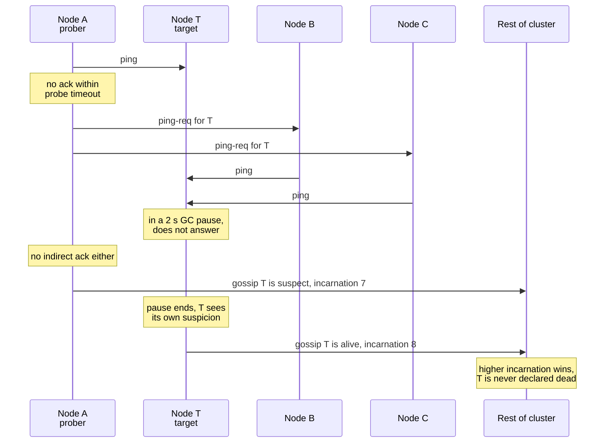
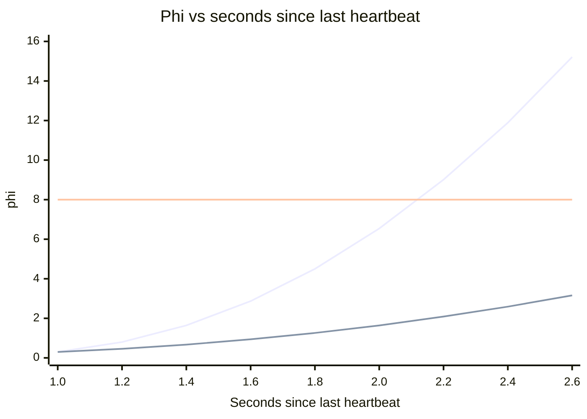
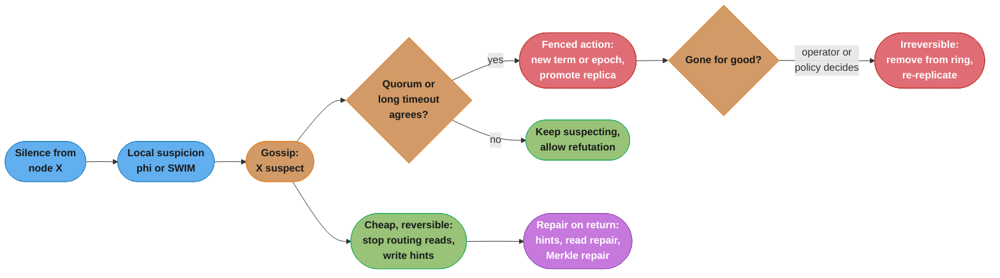
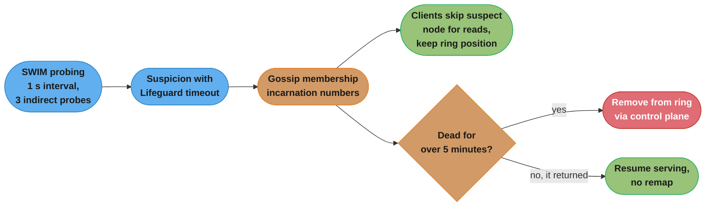

# Failure Detection and Membership
How a cluster decides that a node is gone, tells everyone else, and repairs the data that went stale while it was deciding.

> Defaults, protocol parameters and incident figures on this page were checked against primary sources on 2026-11-25.
> Cluster sizes, timings in worked examples and the case study numbers are illustrative unless a source is named.

---

## 1. Concept Overview

A distributed system keeps asking one question about every peer: **is it still there?**
Replication needs the answer to pick where writes go, a load balancer needs it to stop
routing traffic, a consistent-hash ring needs it to reassign ranges, and a leader-based
store needs it to elect a new leader. The trouble is that the network cannot tell you the
answer. A node that crashed, a node in a 4-second GC pause, a node behind a congested
switch, and a node that is fine but whose replies are being dropped all look identical
from the outside: **silence**.

So a failure detector never knows. It **suspects**, based on how long it has waited and how
long it usually waits. Every design in this module is a choice about three dials:

- **Detection time** — how long between a real crash and everyone acting on it.
- **Accuracy** — how often a healthy node is wrongly declared dead (a false positive).
- **Cost** — messages per second, which must not grow with the square of cluster size.

Faster detection means more false positives; fewer false positives means slower detection.
No configuration escapes that trade, so the real engineering is in two other places:
making the **action** taken on a suspicion safe even when the suspicion is wrong, and
**repairing** the replicas that diverged while a node was down or wrongly excluded.

This module covers the HLD application of the problem: heartbeats and timeouts, centralized
versus gossip-based detection, the phi accrual detector, the SWIM protocol and its Lifeguard
extensions, membership views, and the anti-entropy machinery (read repair, hinted handoff,
Merkle-tree repair) that brings replicas back together. Boundaries:

- The **theory** — failure-detector classes, completeness and accuracy, why consensus is
  impossible with a perfect-accuracy requirement in an asynchronous system — is owned by
  [Distributed Systems Theory](../../cs_fundamentals/distributed_systems_theory/distributed_systems_theory.md).
- **Leader election and log replication** after a detector fires are owned by
  [Consensus Algorithms](../consensus_algorithms/consensus_algorithms.md).
- **Clock behaviour** that makes timeouts lie (GC pauses, VM migration, monotonic clocks)
  is in [Time, Clocks and Ordering](../time_clocks_and_ordering/time_clocks_and_ordering.md).
- **Fencing a node that was wrongly declared dead** is in
  [Coordination and Contention](../coordination_and_contention/coordination_and_contention.md).
- **Load-balancer health checks** are in [Load Balancing](../load_balancing/load_balancing.md),
  and **service registries** are in
  [Service Mesh and Service Discovery](../../backend/service_mesh_and_service_discovery/service_mesh_and_service_discovery.md).

---

## 2. Intuition

**One-line analogy:** a phone call that goes silent. After two seconds you say "hello?";
after ten you assume the call dropped. You never *know* — the other person might be
looking something up. You pick a waiting time based on how this person usually behaves,
and you would wait longer for a friend on a bad train connection than for one on a
landline.

**Mental model — a dial with two failure modes.** Turn the timeout down and you notice real
crashes quickly, but you also "hang up" on people who were only pausing. Turn it up and you
stop hanging up on pausers, but a real dropped call keeps you waiting. The phi accrual
detector replaces the fixed number of seconds with "how unusual is this silence for this
particular caller", and SWIM replaces "I hung up" with "I asked three friends to try
calling too, and only then told everyone".

**Why it matters:** a wrong "dead" decision is not harmless. It moves data, triggers
failovers, rebalances partitions, and can leave two nodes both acting as primary. The
GitHub incident of October 2018 began with 43 seconds of lost connectivity and became 24
hours and 11 minutes of degraded service, because a failover decided on that brief silence
left writes on both coasts that could not be reconciled automatically.

**Key insight:** detection is a **guess**, membership is **who everyone currently believes
is in**, and repair is **how replicas converge afterwards**. Systems that treat these as
one mechanism tend to make the guess too aggressive, because they have no safe way to undo
it.

---

## 3. Core Principles

**A failure detector can only suspect.** In an asynchronous network there is no upper bound
on message delay, so no timeout can separate "slow" from "dead" with certainty. Every
detector produces suspicions that can be wrong; the design must be correct when they are.

**Timeouts trade detection time against false positives.** If heartbeats arrive every
interval `h` and you declare death after `k` misses, the expected detection time is about
`k x h` plus propagation. Every source of delay you did not budget for — GC pauses, CPU
saturation, packet loss, a noisy neighbour — becomes a false positive.

**Make the action safe, not the guess perfect.** A suspicion should lead to actions that are
reversible or fenced: stop routing reads, write hints, bump an epoch or term so the old
leader's writes are rejected. Irreversible actions (re-replicating terabytes, deleting a
node from the ring, promoting a replica without fencing) need stronger evidence — a quorum
of observers, a longer wait, or an operator.

**Cost must not grow with N squared.** All-to-all heartbeating sends `N x (N - 1)`
messages per interval: 1,000 nodes at 1 per second is about 1,000,000 messages per second.
Gossip and SWIM keep per-node load constant and let information spread in `O(log N)`
rounds.

**Separate detection, dissemination, and decision.** One node noticing silence is
detection. Spreading "I suspect X" is dissemination. "X is out of the group, reassign its
ranges" is a decision. Gossip can do the first two; the third often belongs to a
consensus-backed source of truth or to an operator.

**Assume replicas diverge, and repair continuously.** While a node is down, suspected, or
partitioned, it misses writes. Hinted handoff, read repair and Merkle-tree anti-entropy
exist because no detector is fast and accurate enough to prevent divergence — they make
divergence temporary.

**The observer can be the problem.** A detector running on an overloaded node sees
everyone else as slow. Lifeguard's central idea is that a node should doubt its own
judgement when it shows signs of being degraded.

---

## 4. Types / Architectures / Strategies

### 4.1 Heartbeat (Push) and Ping (Pull)

**Push:** each node sends "I am alive" every `h` seconds to a monitor or to peers; silence
for `T` seconds means suspect. **Pull:** the monitor sends a ping and expects an ack within
`T`. Push is cheaper for the monitor; pull also tests the reverse path and the target's
ability to do work. A heartbeat proves the sending thread is alive, not that the service
works — a process can heartbeat cheerfully while its request threads are deadlocked.

### 4.2 Centralized Monitors

One component watches everyone: a load balancer's health checks, a ZooKeeper or etcd
session or lease that disappears when a client stops renewing it, or the Kubernetes node
controller. In Kubernetes the controller manager's `--node-monitor-grace-period` defaults to
50 s and the API server's default not-ready and unreachable tolerations are 300 s, so pods
on a node that silently dies are, by default, evicted on the order of five to six minutes
later. Centralized monitors are simple and give one authoritative answer, but the monitor
is a dependency and its own network position defines what "reachable" means.

### 4.3 All-to-All Heartbeating

Every node heartbeats every other node. Detection is fast and does not depend on a single
observer, but message cost is quadratic. It works for a 5-node consensus group and fails
for a 1,000-node storage tier.

### 4.4 Gossip-Based Heartbeating

Each node increments its own heartbeat counter and periodically exchanges its view of
everyone's counters with a few random peers. Cassandra's gossip task runs every second on
every node: it bumps the local heartbeat version, exchanges state with one random peer,
probabilistically gossips with unreachable nodes, and talks to a seed node if it did not
already. State is versioned by `(generation, version)` — the generation is a monotonic
timestamp set at startup, the version a logical clock — so stale gossip is ignored. Each
node then runs its **own** failure detector over the heartbeats it sees; `UP` and `DOWN`
are local decisions and are not gossiped.

### 4.5 Phi Accrual Detection

Hayashibara, Défago, Yared and Katayama (SRDS 2004) replaced the binary alive/dead output
with a continuous suspicion level, **phi**:

```
phi(t) = -log10( 1 - F(t_since_last_heartbeat) )
```

`F` is the cumulative distribution of recent heartbeat inter-arrival times. A phi of 1
means about a 10% chance that declaring death now is a mistake, phi 2 about 1%, phi 8
about 0.000001%. Each application picks a threshold: Apache Pekko's cluster defaults are a
1 s heartbeat interval, a phi threshold of 8.0, a 100 ms minimum standard deviation and a
3 s acceptable heartbeat pause; Cassandra's `phi_convict_threshold` is 8. The detector
**adapts**: on a jittery network the distribution widens and the same silence produces a
lower phi.

### 4.6 SWIM and Lifeguard

SWIM (Das, Gupta and Motivala, DSN 2002) separates failure detection from dissemination and
keeps both constant-cost per node:

1. Every protocol period, a node pings **one** random member.
2. No ack in time? It asks **k** other members to ping that target on its behalf
   (indirect probe), so a single bad link does not condemn the target.
3. Still nothing? The target is marked **suspect**, and the suspicion is gossiped.
4. A suspect that is alive **refutes** by gossiping its own state with a higher
   **incarnation number**. If no refutation arrives within the suspicion timeout, it is
   declared dead.
5. Membership updates ride piggybacked on pings and acks, so dissemination costs no extra
   messages in the original protocol.

HashiCorp's memberlist library (used by Serf and Consul) adapts SWIM: a separate gossip
layer at a faster rate than probing, periodic full-state push-pull syncs over TCP, and
retained state for dead nodes. Its Lifeguard extensions (Dadgar, Phillips and Currey,
arXiv 2017) address SWIM's false positives under slow message processing: a node that
notices missing nack responses slows its own probing ("local health awareness"), and the
suspicion timeout starts long and shortens as independent confirmations arrive.

### 4.7 Membership Views

| View | How it is maintained | Consistency | Example |
|---|---|---|---|
| Local, per node | Each node's own detector | None — nodes may disagree | Cassandra `UP` / `DOWN` |
| Gossip-converged | Versioned state spread epidemically | Eventually consistent | Serf, Consul LAN pool |
| Consensus-managed | Membership changes committed to a replicated log | Linearizable | etcd member list, a Raft configuration |
| Operator-managed | Changes only on explicit command | Strong, slow | Cassandra decommission and replace |

Cassandra never removes a node from gossip state without explicit operator instruction, on
purpose: a temporarily failed node should not trigger data movement, and simultaneous range
movements can violate consistency or lose data. Detection is automatic; the irreversible
decision is not.

### 4.8 Anti-Entropy and Repair

| Mechanism | When it runs | What it fixes | Limit |
|---|---|---|---|
| Hinted handoff | During the outage, on write | Writes a down replica missed | Cassandra stops hinting after `max_hint_window` (default 3 h) |
| Read repair | On read, when replicas disagree | Keys that are actually read | Cold keys never get repaired |
| Merkle-tree repair | Scheduled or on demand | Everything, by comparing hash trees per range | Costly; must finish within the tombstone grace period |
| Full state sync (push-pull) | Periodically between random pairs | Membership state itself | Bandwidth grows with state size |

### 4.9 Leader Leases and Election Timeouts

In leader-based systems the detector is built into the consensus protocol: followers
expect a leader heartbeat and start an election if none arrives within the election
timeout. etcd defaults to a 100 ms heartbeat interval and a 1,000 ms election timeout, and
its tuning guide says the election timeout should be at least 10 times the round-trip time
between members, with 50,000 ms as the upper limit for globally distributed clusters. The
mechanics belong to [Consensus Algorithms](../consensus_algorithms/consensus_algorithms.md);
the HLD lesson is that these two numbers are a failure detector with the same speed
versus accuracy dial as everything else here.

---

## 5. Architecture Diagrams

### 5.1 One SWIM Probe Round With an Indirect Probe and a Refutation



The indirect probe protects against a bad link between A and T; the suspicion period
protects against a pause on T itself. Only if T stays silent for the whole suspicion
timeout does the cluster declare it dead.

### 5.2 Phi Grows With Silence, and Grows More Slowly on a Noisy Network

Heartbeats every 1.0 s on average. Phi computed with a normal distribution; one series
for a quiet network (standard deviation 200 ms), one for a noisy network (500 ms).



*The steep line is the quiet network: it crosses the threshold of 8 (flat line) at about
2.1 s. The shallow line is the noisy network: after 2.6 s of silence phi is only 3.2, so
the node is not convicted — the detector has learned that long gaps are normal there. A
fixed 2 s timeout would have convicted on both.*

### 5.3 Merkle-Tree Comparison Between Two Replicas

```
Replica 1                                   Replica 2
              root: 9f3a                                  root: 77c1   <- differ
            /           \                               /           \
      L: 51e0           R: c2d4                   L: 51e0           R: 0b9e   <- right differs
      /     \           /     \                   /     \           /     \
   a1f0   3c22      e8b1    4d07              a1f0   3c22      e8b1    6f30   <- one leaf differs
   [0-1k) [1k-2k)   [2k-3k) [3k-4k)          [0-1k) [1k-2k)   [2k-3k) [3k-4k)

Hashes exchanged: root (1) + two children (2) + two grandchildren of R (2) = 5
Data streamed:    only keys in token range [3k-4k)
```

*Two replicas find the one divergent range by exchanging five hashes instead of comparing
4,000 keys. Repair cost scales with the amount of difference times the tree depth, not with
the total data size — which is why anti-entropy is affordable on terabyte replicas.*

### 5.4 Detection Is Not the Decision



*The further right an action is, the more evidence it should require. Cheap reversible
actions can follow a single node's suspicion; data movement should not.*

---

## 6. How It Works — Detailed Mechanics

### 6.1 Fixed-Timeout Arithmetic

With a heartbeat every `h` and conviction after `T` of silence:

| Heartbeat `h` | Timeout `T` | Mean detection time | Survives a pause of | Messages per second, 1,000 nodes all-to-all |
|---|---|---|---|---|
| 100 ms | 500 ms | about 0.45 s | under 0.5 s | about 9,990,000 |
| 1 s | 5 s | about 4.5 s | under 5 s | about 999,000 |
| 1 s | 10 s | about 9.5 s | under 10 s | about 999,000 |
| 5 s | 30 s | about 27.5 s | under 30 s | about 199,800 |

Mean detection is roughly `T - h/2`, because the crash lands at a random point between
heartbeats. The "survives a pause" column is the whole story of false positives: a JVM with
a worst-case GC pause of 6 s will be convicted under a 5 s timeout several times a day,
however healthy it is.

### 6.2 A Phi Accrual Detector

```python
import math
from collections import deque

class PhiAccrualDetector:
    def __init__(self, window: int = 1000, min_std_ms: float = 100.0,
                 acceptable_pause_ms: float = 3000.0):
        self.intervals = deque(maxlen=window)    # recent inter-arrival times, ms
        self.last_ms: float | None = None
        self.min_std = min_std_ms
        self.pause = acceptable_pause_ms

    def heartbeat(self, now_ms: float) -> None:  # now_ms from a MONOTONIC clock
        if self.last_ms is not None:
            self.intervals.append(now_ms - self.last_ms)
        self.last_ms = now_ms

    def phi(self, now_ms: float) -> float:
        if self.last_ms is None or not self.intervals:
            return 0.0
        n = len(self.intervals)
        mean = sum(self.intervals) / n + self.pause      # tolerate known pauses
        var = sum((x - mean + self.pause) ** 2 for x in self.intervals) / n
        std = max(math.sqrt(var), self.min_std)
        z = (now_ms - self.last_ms - mean) / std
        p_later = 0.5 * math.erfc(z / math.sqrt(2))      # P(heartbeat still to come)
        return -math.log10(max(p_later, 1e-300))
```

Three details carry the design. The window of recent intervals lets the detector learn each
peer's normal rhythm. The minimum standard deviation stops a perfectly regular peer from
being convicted after one slightly late heartbeat. The acceptable pause shifts the whole
distribution right, so known pauses (GC, a slow disk flush) do not count as suspicious.
Timestamps must come from a monotonic clock — a wall-clock step would fake a long silence.

### 6.3 SWIM Parameters in Practice

memberlist's `DefaultLANConfig()`:

| Parameter | Default | Meaning |
|---|---|---|
| `ProbeInterval` | 1 s | One random member probed per second |
| `ProbeTimeout` | 500 ms | Wait for a direct ack before indirect probing |
| `IndirectChecks` | 3 | Members asked to probe on our behalf |
| `SuspicionMult` | 4 | Suspicion timeout = 4 x max(1, log10(N)) x probe interval |
| `SuspicionMaxTimeoutMult` | 6 | Lifeguard starts at up to 6 times that and shortens it with confirmations |
| `GossipInterval` / `GossipNodes` | 200 ms / 3 | Dissemination rate, separate from probing |
| `RetransmitMult` | 4 | Each update retransmitted 4 x ceil(log10(N + 1)) times |
| `PushPullInterval` | 30 s | Full state sync with a random member over TCP |
| `AwarenessMaxMultiplier` | 8 | A degraded node backs its probe interval off to at most 8 s |

Worked numbers for a 1,000-node cluster: the base suspicion timeout is
`4 x log10(1000) x 1 s = 12 s`, and Lifeguard may stretch it towards `6 x 12 = 72 s` when no
other member confirms the suspicion; each update is retransmitted `4 x ceil(log10(1001)) =
16` times. Per-node load stays at about one probe per second plus five gossip messages per
second, regardless of N. The WAN profile is far more patient: 3 s probe timeout, 5 s probe
interval and a suspicion multiplier of 6.

### 6.4 Incarnation Numbers

Each member owns an incarnation counter that only it may increment. Rules:

- `alive(X, i)` overrides `suspect(X, j)` only if `i > j`.
- `suspect(X, i)` overrides `alive(X, j)` if `i >= j`.
- `dead(X, i)` overrides anything with an incarnation at or below `i`.

A suspected node refutes by incrementing its incarnation and gossiping `alive`. Without the
counter, an old "alive" message delayed in the network could resurrect a node that really
died, and a delayed "suspect" could re-condemn a node that already refuted.

### 6.5 Merkle-Tree Repair

```python
import hashlib

def leaf_hash(rows: list[tuple[str, bytes]]) -> bytes:
    h = hashlib.sha256()
    for key, value in sorted(rows):
        h.update(key.encode()); h.update(value)
    return h.digest()

def build(leaves: list[bytes]) -> list[list[bytes]]:
    levels = [leaves]
    while len(levels[-1]) > 1:
        prev = levels[-1]
        levels.append([hashlib.sha256(prev[i] + prev[i + 1]).digest()
                       for i in range(0, len(prev), 2)])
    return levels                       # levels[-1][0] is the root

def diff(a: list[list[bytes]], b: list[list[bytes]], level: int, idx: int, out: list[int]):
    if a[level][idx] == b[level][idx]:
        return                          # identical subtree: skip all of it
    if level == 0:
        out.append(idx)                 # this leaf's key range must be streamed
        return
    diff(a, b, level - 1, 2 * idx, out)
    diff(a, b, level - 1, 2 * idx + 1, out)
```

Sizing example: a replica holds 200 GB in a token range split into 2^15 = 32,768 leaves,
about 6 MB per leaf. If 50 leaves differ, the replicas exchange at most about
`50 x 15 x 2` hashes on the way down and stream about 300 MB, instead of comparing 200 GB.
The catch is the **build** cost: computing leaf hashes means reading the data. Cassandra's
sub-range repair raises tree resolution by building more trees over smaller ranges, and
incremental repair only repairs partitions that changed since the last repair.

### 6.6 Tombstones, Hints and the Grace Period

Deletes in a replicated store are written as **tombstones**, which are themselves garbage
collected after a grace period — Cassandra's table default `gc_grace_seconds` is 864,000 s
(10 days). The repair contract follows:

```
If a replica misses a delete,
  and the tombstone on the other replicas is purged after gc_grace_seconds,
  and repair did not run in between,
then the old value on the replica that missed the delete is now the "newest" copy,
and the next repair or read repair copies it back everywhere: deleted data returns.
```

Hinted handoff narrows the window but does not close it: Cassandra only writes hints for a
replica that has been down less than `max_hint_window` (default 3 h). A node that is down for
four hours, or a hint lost with the coordinator, must be covered by Merkle repair — and every
range must be repaired at least once per `gc_grace_seconds`.

### 6.7 The Flagship Broken to Fixed Pair: Automatic Failover on One Observer's Timeout

**BROKEN — a watchdog that promotes a replica after 3 missed pings:**

```python
# Runs on one monitoring host.
misses = 0
while True:
    if ping(primary, timeout_s=1):
        misses = 0
    else:
        misses += 1
    if misses >= 3:                       # 3 s of silence from ONE vantage point
        promote(replica)                  # replica starts accepting writes
        repoint_clients(replica)
        break
    sleep(1)
```

Failure modes: the monitoring host's own link drops and it "sees" the primary die; the
primary is in a 4 s pause and wakes up still accepting writes from clients that have not
been repointed; a 43-second partition produces two primaries, each with writes the other
lacks — the shape of GitHub's October 2018 incident.

**FIX — quorum agreement, hysteresis, and fencing:**

```python
def should_fail_over(primary) -> bool:
    votes = [o.suspects(primary, min_silence_s=10) for o in observers]   # 3+ observers in different zones
    return sum(votes) >= len(observers) // 2 + 1

if should_fail_over(primary):
    epoch = coordination_store.increment("cluster-epoch")   # consensus-backed counter
    replica.promote(epoch=epoch)                            # writes carry the epoch
    storage.reject_writes_below(epoch)                      # old primary's writes now fail
    repoint_clients(replica)
```

Three changes: observers in several failure domains must agree (one bad link cannot trigger
failover); the silence threshold is longer than the worst measured pause; and promotion
bumps an epoch that the storage layer enforces, so a primary that wakes up after being
replaced cannot commit. The epoch is the same idea as a Raft term or a fencing token.

---

## 7. Real-World Examples

**Apache Cassandra.** Gossip every second with `(generation, version)` heartbeat state, a
phi accrual detector per node (`phi_convict_threshold` 8), local `UP`/`DOWN` decisions,
hinted handoff for up to 3 hours, and Merkle-tree anti-entropy repair with sub-range and
incremental variants. Nodes are never removed from the ring without an operator.

**HashiCorp Consul and Serf.** Both run on memberlist's SWIM variant with Lifeguard. Consul
uses a LAN gossip pool (port 8301 by default) for membership and distributed failure
detection inside a datacenter, and a WAN pool (port 8302) for servers across datacenters.
Serf stamps join, leave and user events with Lamport clocks so a "leave" received before
its "join" is ordered correctly.

**Apache Pekko and Akka Cluster.** Phi accrual detection with a 1 s heartbeat interval, a
threshold of 8.0 and a 3 s acceptable heartbeat pause by default; members that are
unreachable must be downed by a separate strategy, keeping detection and decision apart.

**etcd and Raft.** A 100 ms heartbeat and a 1,000 ms election timeout by default; the
tuning guide ties both to measured round-trip time.

**Kubernetes.** Kubelets renew node Lease objects as heartbeats; the node controller marks
a node unhealthy after the 50 s default grace period, and default tolerations evict its
pods 300 s after it becomes not-ready or unreachable.

**Apache Kafka consumer groups.** The classic protocol defaults to `session.timeout.ms`
45,000 and `heartbeat.interval.ms` 3,000; the newer consumer group protocol's broker-side
defaults are a 45 s session timeout and a 5 s heartbeat interval. Exceeding the session
timeout triggers a rebalance — a failure detector whose false positives show up as
rebalance storms.

**Redis Cluster.** `cluster-node-timeout` defaults to 15,000 ms; a primary unreachable for
longer than that by a majority of primaries can be failed over to a replica.

**GitHub, 2018-10-21.** Replacing failing 100G optical equipment cut connectivity between
the US East Coast hub and the primary East Coast datacenter for 43 seconds. Orchestrator
reached a quorum and failed database primaries over to the West Coast. When connectivity
returned, the East Coast held a few seconds of writes not replicated West, and the West
had taken nearly 40 minutes of new writes; neither side could fail back safely. Service was
degraded for 24 hours and 11 minutes.

---

## 8. Tradeoffs

### Detection Approaches

| Approach | Messages per node per second | Detection time | False-positive control | Single point of failure |
|---|---|---|---|---|
| Central monitor (LB, lease, node controller) | 1 per heartbeat | Fixed timeout | Fixed timeout only | The monitor's view |
| All-to-all heartbeats | N - 1 | Fast | Many observers | None, but cost is quadratic |
| Gossip heartbeats + local detector | Constant (a few) | O(log N) rounds plus timeout | Per-node phi | None |
| SWIM + Lifeguard | Constant (about 1 probe + gossip) | Probe interval plus suspicion timeout | Indirect probes, refutation, local health | None |
| Consensus heartbeats (leader to followers) | 1 per follower | Election timeout | Randomized election timeouts | Leader by design |

### Fixed Timeout vs Phi Accrual

| Property | Fixed timeout | Phi accrual |
|---|---|---|
| Configuration | Seconds | A unitless threshold plus a window |
| Behaviour on a jittery network | Many false positives | Adapts; convicts later |
| Behaviour after a sudden regime change | Same as before | Lags until the window refills |
| Explainability | "No heartbeat for 5 s" | "phi reached 8" needs a chart |

### Repair Mechanisms

| Mechanism | Latency of convergence | Cost | Coverage |
|---|---|---|---|
| Hinted handoff | Minutes after return | Coordinator disk; bounded window | Only writes during the outage |
| Read repair | At next read | Extra replica reads | Only keys that are read |
| Merkle repair | Hours, scheduled | Disk read for hashing, network for streaming | Everything in the range |

---

## 9. When to Use / When NOT to Use

**Use a central monitor when** the cluster is small, a single authority already exists
(a load balancer, a lease in etcd), and the monitor's network position matches the
clients' — health checks from the LB that also routes the traffic are exactly right.

**Use phi accrual when** heartbeat timing varies by peer or over time (cross-zone links,
JVMs with GC pauses) and you want the detector to learn what normal looks like.

**Use SWIM-style gossip when** membership spans hundreds to thousands of nodes, nodes join
and leave constantly, and no single component should decide liveness.

**Use consensus-managed membership when** a membership change must be agreed before it is
acted on — adding or removing a voting replica, reassigning a partition leader.

**Use Merkle-tree repair when** replicas accept writes independently (leaderless,
multi-master) and a missed write or delete must not stay missed.

**Do NOT** let a single observer's timeout trigger irreversible actions such as promotion
without fencing, ring removal, or bulk re-replication.

**Do NOT** set a timeout below the worst pause you have measured on the monitored process,
including GC, disk flushes and VM steal time.

**Do NOT** make a liveness check depend on downstream dependencies. A node whose database
is slow is not dead; marking it dead moves its load onto peers that share the same slow
database.

---

## 10. Common Pitfalls

**Timeouts tuned on an idle cluster.** *Broken:* a 2 s heartbeat timeout chosen in testing;
in production, full GC pauses of 3 to 4 s under peak load convict healthy nodes, which
triggers rebalancing, which adds load, which causes more pauses. *Fix:* measure the p99.9
pause and RTT under peak, set the timeout or acceptable pause above them, and track
false-positive convictions as a metric.

**The detector shares the overloaded thread.** A node's heartbeat sender runs on the same
saturated event loop as request handling; heartbeats are late because the node is busy, not
because it is dead, and the cluster removes the busiest node first. *Fix:* send heartbeats
from a dedicated thread with priority, and apply Lifeguard's idea: when a node notices it is
itself degraded, it slows its own probing and trusts its own suspicions less.

**Asymmetric partitions.** A can reach B but B cannot reach A. Each side's detector sees
something different, and a protocol that only checks one direction declares the wrong node
dead. *Fix:* indirect probes through third parties (SWIM), observers in several failure
domains, and quorum agreement before acting.

**Automatic removal on detection.** A rack loses power for 20 minutes; an automation removes
its 40 nodes from the ring and starts streaming their ranges to the survivors, saturating
the network, then the rack returns. *Fix:* follow Cassandra's rule — detection stops
routing, but removal and re-replication need a longer policy timer or an operator.

**Repair not finishing within the tombstone grace period.** *Broken:* weekly repair is
scheduled, but it takes 12 days on a grown cluster with a 10-day `gc_grace_seconds`;
tombstones are purged on some replicas before others hear about the delete, and deleted
rows come back. *Fix:* monitor time since last successful repair per range, use sub-range or
incremental repair to finish within the grace period with margin, and alert on any range
older than about 70% of the grace period.

**Outages longer than the hint window.** A node is down for 5 hours; hints stop after 3, so
the last 2 hours of writes reach it only through repair. Reads at consistency level ONE
from that node return stale data until then. *Fix:* run repair on the node before putting
it back into read rotation after any outage longer than the hint window.

**Failover without fencing.** See §6.7: a replica is promoted while the old primary still
accepts writes. *Fix:* every promotion increments an epoch that storage enforces.

**Surprise at Kubernetes eviction timing.** Teams expect pods to move within seconds when a
node dies, but defaults wait about 50 s to mark the node and 300 s more to evict. *Fix:*
decide the right values per workload (shorter tolerations for stateless services with
spare capacity, longer for stateful pods that must not double-run), and rely on
readiness at the load balancer for the fast path.

**Seed nodes as a hidden dependency.** Every Cassandra node gossips with a seed when it did
not already, so seeds become gossip hotspots, and a cluster whose seeds are all in one rack
bootstraps poorly when that rack is down. *Fix:* a few seeds per rack or datacenter.

---

## 11. Technologies & Tools

| Tool | Detection model | Notes |
|---|---|---|
| HashiCorp memberlist | SWIM with Lifeguard | Go library under Serf and Consul; LAN and WAN profiles |
| HashiCorp Consul | memberlist gossip pools | LAN pool on port 8301, WAN pool on 8302 by default |
| Apache Cassandra | Gossip heartbeats plus phi accrual | `phi_convict_threshold` 8, hinted handoff, Merkle repair |
| Apache Pekko | Phi accrual cluster failure detector | Threshold 8.0, 1 s heartbeats, 3 s acceptable pause by default |
| etcd | Raft leader heartbeats | 100 ms heartbeat, 1,000 ms election timeout by default |
| Apache ZooKeeper | Session timeouts with ephemeral znodes | A client's ephemeral nodes vanish when its session expires |
| Kubernetes | Node Leases and the node controller | 50 s node monitor grace period, 300 s default eviction tolerations |
| Apache Kafka | Consumer group heartbeats | 45 s session timeout; 3 s heartbeat (classic) or 5 s (new protocol) |
| Redis Cluster | Gossip on the cluster bus | `cluster-node-timeout` 15,000 ms by default |

---

## 12. Interview Questions with Answers

**Q: Why can't a failure detector be both fast and always correct?**
**Short:** In an asynchronous network a slow node and a dead node look identical, so any finite timeout will sometimes convict a healthy node.

Messages have no guaranteed upper delay, and GC pauses, overloaded CPUs and congested links
all produce silence. A short timeout detects crashes quickly but convicts paused nodes; a
long one avoids that but leaves real failures undetected for longer. Since accuracy cannot be
perfect, the system must make the actions taken on a suspicion safe — reversible, fenced, or
requiring agreement — and repair any divergence afterwards.

**Q: What does a phi accrual failure detector output, and why is that useful?**
**Short:** A continuous suspicion level phi equal to minus log10 of the chance a heartbeat is still coming, instead of a yes or no answer.

It keeps a window of recent heartbeat inter-arrival times and asks how unlikely the current
silence is under that distribution. Phi 1 means about a 10% chance of being wrong if you
declare death now, phi 8 about one in a hundred million. Different consumers can act at
different thresholds, and the detector adapts: on a noisy network the same silence gives a
lower phi. Cassandra and Pekko both default to a threshold of 8.

**Q: How does SWIM avoid both quadratic message cost and false positives from one bad link?**
**Short:** Each node probes one random member per period, and on a missed ack asks k other members to probe indirectly before suspecting.

Per-node load is constant — about one probe per period plus piggybacked or separate gossip —
so the cluster can grow to thousands of nodes. Indirect probes through k peers (3 in
memberlist's default) mean one broken link between prober and target does not condemn the
target. A suspected node gets a suspicion period to refute by gossiping a higher incarnation
number before anyone declares it dead.

**Q: What problem does Lifeguard solve in SWIM?**
**Short:** It stops a slow or overloaded node from wrongly declaring healthy peers dead by making nodes doubt their own judgement when degraded.

Plain SWIM assumes the local node processes messages promptly. Under CPU or network
exhaustion, a node misses acks and suspects healthy peers. Lifeguard adds nack messages so
a prober can tell it is the one falling behind and slow its own probing, and a suspicion
timeout that starts long and shortens as independent members confirm the suspicion. HashiCorp
reports it drastically reduces false positives without slowing detection of real failures.

**Q: Why are incarnation numbers needed in gossip-based membership?**
**Short:** They let a suspected node refute with newer evidence and stop delayed old messages from overriding newer state.

Only the member itself can increment its incarnation. An "alive" with a higher incarnation
overrides a "suspect" with a lower one, so a node coming out of a pause can clear its name.
Without the counter, a delayed "alive" could resurrect a node that really died, or a delayed
"suspect" could re-condemn a node that already refuted. It is a per-node logical clock for
membership state.

**Q: How does Merkle-tree anti-entropy repair work, and why is it efficient?**
**Short:** Replicas hash their data into a tree per range, compare hashes top-down, and stream only the leaf ranges whose hashes differ.

Equal subtree hashes mean equal data, so whole subtrees are skipped after one comparison.
Finding one divergent leaf among 32,768 costs about 15 hash comparisons per level of
descent, and only that leaf's key range is streamed. The expensive part is building the
tree, which requires reading the data to hash it; sub-range and incremental repair reduce
that cost.

**Q: What is hinted handoff, and why is it not enough on its own?**
**Short:** A coordinator stores writes meant for a down replica and replays them when it returns, but only within a bounded window.

It shortens the time a returning node is stale without a full repair. Cassandra only keeps
hints for a replica that has been down less than `max_hint_window`, 3 hours by default, and
hints are lost if the coordinator itself fails. Outages beyond the window and lost hints
need Merkle-tree repair, and a returning node should be repaired before it serves reads at
low consistency levels.

**Q: What goes wrong if repair does not run within the tombstone grace period?**
**Short:** A replica that missed a delete keeps the old value after other replicas purge the tombstone, and repair copies the deleted data back.

Deletes are tombstones that are themselves garbage collected after `gc_grace_seconds`
(864,000 s, 10 days, by default in Cassandra). If one replica never received the tombstone
and repair has not reconciled it before the others purge theirs, the stale value looks like
the newest copy. Every range must be repaired at least once per grace period, with margin.

**Q: Why should detection not directly trigger removing a node from a cluster?**
**Short:** Detection is a guess, and removal triggers expensive data movement that is hard to undo if the node was only paused or partitioned.

Moving a node's ranges to survivors streams large amounts of data and can overload the
cluster just as it lost capacity; if the node comes back, the movement was waste and
simultaneous range movements can even risk consistency. Cassandra deliberately never
removes a node without an operator. Act on suspicion with cheap reversible steps first and
reserve removal for a longer timer, a quorum, or a human.

**Q: How do you choose a heartbeat interval and timeout?**
**Short:** Measure RTT and the worst pauses under peak load, put the timeout above them, then choose the interval to meet the detection-time target.

Start from the longest pause you have observed — GC, disk flush, VM steal time — and the
network round-trip distribution, and set the timeout comfortably above both. Mean detection
time is about the timeout minus half an interval, so pick the interval that hits your target
without excessive traffic. etcd's guide, for example, sets the election timeout to at least
10 times the RTT. Track false convictions as a metric and revisit after every major load
change.

**Q: How does a split-brain happen after a failover, and how do you prevent it?**
**Short:** The old primary keeps accepting writes after a replica is promoted, so prevent it with quorum-based detection and epoch fencing.

A partition or a pause makes the primary look dead to the failover controller but not to
some clients. Without fencing, both nodes accept writes, producing histories that cannot be
merged automatically — GitHub's 2018 incident left writes on both coasts after a 43-second
partition. Require a majority of observers in different failure domains, wait longer than
the worst pause, and bump an epoch on promotion that the storage layer enforces.

**Q: What is the difference between failure detection and membership?**
**Short:** Detection is one node's suspicion about a peer, while membership is the shared view of which nodes are in the group.

Detection produces local opinions that can disagree. Membership aggregates opinions into a
view, either eventually consistent through gossip or agreed through consensus, and other
components (routing, replication, partition assignment) act on that view. Keeping them
separate lets you make detection fast and cheap while making membership changes deliberate
and safe.

**Q: Why is all-to-all heartbeating a bad idea for large clusters?**
**Short:** Message cost grows with N squared, so 1,000 nodes at one heartbeat per second send about a million messages every second.

Each node heartbeats N - 1 peers, so total traffic is `N x (N - 1)` per interval, and
processing those messages steals CPU from real work. Gossip and SWIM keep per-node load
constant and spread information in about `O(log N)` rounds. All-to-all remains fine for
small groups such as a 5-node consensus cluster.

**Q: A Kubernetes node loses power. How long until its pods run elsewhere by default, and why?**
**Short:** About five to six minutes: roughly 50 s to mark the node unhealthy, then 300 s of default tolerations before eviction.

The node controller waits for the node-monitor grace period (50 s by default) without a
Lease renewal, then taints the node; pods carry default not-ready and unreachable
tolerations of 300 s, after which they are evicted and rescheduled. The long tolerance
avoids evicting stateful pods during brief network blips. For stateless services, readiness
at the load balancer and spare replicas cover the gap; tolerations can be tuned per workload.

**Q: Why should a liveness check not test downstream dependencies?**
**Short:** A slow shared dependency would make every node fail its check at once, causing mass removal or restarts that worsen the outage.

If the health endpoint returns unhealthy when the database is slow, all instances fail
together, the orchestrator restarts or drains them, and the remaining capacity collapses
onto the same slow database. Liveness should answer "is this process able to work", while
dependency trouble belongs in readiness with care, in circuit breakers, and in alerts.

**Q: How do consumer-group heartbeats in Kafka relate to failure detection?**
**Short:** The group coordinator treats a consumer that misses heartbeats for the session timeout as dead and rebalances its partitions.

The classic protocol defaults to a 3 s heartbeat and a 45 s session timeout; the newer
consumer group protocol uses a 5 s broker-side heartbeat and a 45 s session timeout.
False positives show up as rebalance storms, during which partitions are not consumed.
Keep processing off the heartbeat path, size session timeouts above the worst pause, and
prefer protocols and assignors that move fewer partitions per rebalance.

**Q: How would you design failure detection for a 2,000-node storage cluster across three zones?**
**Short:** SWIM-style gossip with Lifeguard for detection, phi-style tolerance of pauses, fenced leader changes, and operator-gated range movement.

Use constant-cost probing with indirect probes from other zones, suspicion periods sized
above measured pauses, and gossip for dissemination. Act on suspicion only with reversible
steps: stop routing, write hints. Change leaders through a consensus-backed epoch so a
stale leader is fenced. Move ranges only after a long timer or an operator. Run hinted
handoff, read repair and scheduled Merkle repair that completes within the tombstone grace
period, and alert on repair age per range.

---

## 13. Best Practices

**Size every timeout from measurements.** Use p99.9 pause times and RTT under peak load,
measured per environment, and revisit them after runtime upgrades and traffic growth.

**Grade actions by reversibility.** Stop routing on a single suspicion; promote with a
quorum and an epoch; move data only after a long timer or an operator.

**Observe from more than one place.** Use indirect probes or observers in several failure
domains so one bad link or one overloaded observer cannot condemn a healthy node.

**Measure time monotonically.** Heartbeat arrival times and timeouts must use monotonic
clocks; a wall-clock step creates a fake silence.

**Keep the heartbeat path cheap and isolated.** A dedicated thread, a small message, no
dependency checks, and no shared lock with request handling.

**Repair on a schedule you can prove.** Monitor time since last repair per range against
the tombstone grace period, and repair a node before it rejoins read traffic after an outage
longer than the hint window.

**Count false positives.** Every conviction followed by a refutation or a quick return is a
false positive; graph them, alert on bursts, and treat a rise as a tuning bug.

**Decide Kubernetes eviction timing deliberately.** Defaults are tuned for safety, not speed;
choose tolerations per workload and rely on load-balancer readiness for fast traffic shifts.

---

## 14. Case Study: Ending Membership Flapping in a 1,200-Node Cache Tier

### Problem Statement

A sharded in-memory cache tier runs 1,200 JVM nodes across three availability zones behind
a client-side consistent-hash ring. Membership used all-to-all UDP heartbeats every 500 ms
with a fixed 2 s timeout; a node convicted by any peer was gossiped as dead and removed from
every client's ring. Illustrative symptoms: 20 to 60 "node dead" events per hour at peak,
each followed by a rejoin within seconds; every flap remapped that node's keys and caused a
burst of cache misses against the database behind the tier.

### Why It Failed

- Heartbeat traffic: `1,200 x 1,199 x 2` per second, about 2.9 million packets per second,
  and the receive path shared a thread pool with cache requests.
- Full GC pauses on the largest heaps reached 2.5 s under peak; any pause above 2 s was a
  conviction.
- One overloaded node missing many heartbeats would convict many healthy peers at once.
- Removal from the ring was the first and only action, so every false positive cost a key
  remap and a miss storm.

### Architecture After the Fix



### Component Deep Dives

**1. SWIM instead of all-to-all.** Each node probes one random peer per second with a
500 ms direct timeout and 3 indirect probes, as in memberlist's LAN defaults. Membership
traffic dropped from about 2.9 million to a few thousand packets per second cluster-wide.

**2. Suspicion sized above the worst pause.** With N = 1,200 the base suspicion timeout is
`4 x log10(1200) x 1 s`, about 12.3 s, far above the 2.5 s worst GC pause, so a paused node
refutes before it is declared dead. Lifeguard stretches the timeout further when no other
node confirms the suspicion.

**3. Heartbeat path isolated.** Probe and gossip handling moved to a dedicated thread with
its own small buffer pool; it no longer waits behind request handling.

**4. Suspicion is not removal.** Clients treat a suspect node as temporarily unavailable:
reads for its keys go to the database (or a secondary replica for hot keys), but the ring is
unchanged, so the node's keys do not remap. Only a node dead for more than 5 minutes is
removed, by a control-plane job that rebalances gradually.

**5. Broken to fixed: the removal rule.**

```python
# BROKEN: any single conviction removes the node from every client ring
def on_member_event(event):
    if event.state == "dead":
        ring.remove(event.node)          # remaps about 1/1200 of all keys, every flap

# FIX: suspicion changes routing only; removal is delayed and centralized
def on_member_event(event):
    if event.state in ("suspect", "dead"):
        router.mark_unavailable(event.node)       # reads bypass it, ring unchanged
    elif event.state == "alive":
        router.mark_available(event.node)

def control_plane_tick(now):
    for node in membership.dead_nodes():
        if now - node.dead_since > 300:           # 5 minutes, measured monotonically
            ring.remove_gradually(node)           # one change at a time, rate-limited
```

### Design Decisions and Tradeoffs

| Decision | Why | Cost accepted |
|---|---|---|
| SWIM over all-to-all | Constant per-node load at 1,200 nodes | Detection of a real crash takes about 13 s instead of 2 s |
| Suspicion above worst GC pause | Paused nodes refute instead of flapping | A crashed node's keys miss for longer |
| Route-around instead of ring removal | No key remaps on false positives | Database absorbs reads for one node's keys while it is suspect |
| 5-minute removal timer | Brief outages cost nothing structural | A truly dead node holds ring space for 5 minutes |

### Metrics and Results (Illustrative)

- Membership flaps: from 20 to 60 per hour at peak to fewer than 1 per day.
- Membership packets: from about 2.9 million per second to about 6,000 per second.
- Database read spikes from cache remaps: eliminated outside real failures and planned
  scale-downs.
- Mean time to route around a crashed node: about 13 s, accepted because database capacity
  covers one node's share of misses.

### Lessons Learned

The fix did not make the detector smarter at telling pauses from crashes; nothing can. It
made each layer cheaper to be wrong: constant-cost probing, a suspicion period longer than
the known pauses, routing that reacts without moving data, and a slow, deliberate removal
path for the one decision that is expensive to undo.
