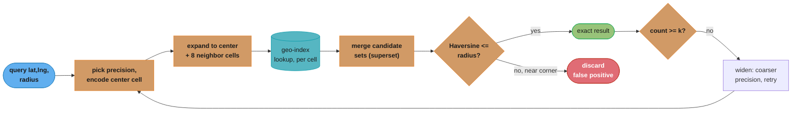
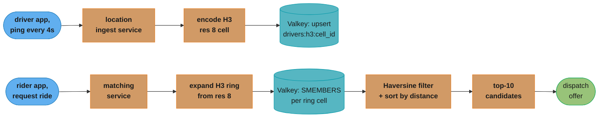

# Geospatial Indexing

Turning "what's near this point" from a geometry problem into a string-prefix or integer-range problem a database already knows how to index.

## 1. Concept Overview

A B-tree index answers "find every row where `id` is between 100 and 200" in `O(log n)` time because `id` is a single, totally-ordered value — every key has an unambiguous "before" and "after," so the tree can discard half the remaining keys at every comparison. **Latitude and longitude are two independent values, and a query like "find every point within 5km of `(lat, lng)`" is not expressible as a range on either one alone.** A `WHERE lat BETWEEN a AND b` clause selects a horizontal band that wraps the entire globe east-west; adding `AND lng BETWEEN c AND d` intersects it with a vertical band — the result is the correct *bounding box*, but a B-tree still has to evaluate both conditions independently and intersect the row sets, and neither index actually orders rows by "closeness to a point." A composite `(lat, lng)` B-tree doesn't fix this either: it sorts primarily by `lat`, so two points with the same `lng` but wildly different `lat` end up adjacent in the index while two points a metre apart with different `lat` values can land far apart in tree order.

**Geospatial indexing is the family of techniques that fold two (or three) dimensions of continuous space into a structure a conventional index — or a purpose-built spatial tree — can search efficiently.** Every technique in this module answers the same underlying question with a different tradeoff: geohash and S2 flatten 2D space onto a 1D ordered line via a *space-filling curve*, so a range/prefix query on that 1D value approximates a 2D region; H3 does the same with hexagonal cells instead of square ones; quadtrees and R-trees skip the flattening and build a tree whose *branching structure itself* mirrors 2D space, adapting to where the data actually is.

This module exists because the same derivation — geohash, encode a point, query neighbor cells, post-filter with Haversine — gets re-taught from scratch in three case studies: [Design Proximity Service](../case_studies/design_proximity_service.md) (Yelp-style local search), [Design Uber](../case_studies/design_uber.md) (real-time driver-rider matching), and [Design Google Maps](../case_studies/design_google_maps.md) (tiles, geocoding, POI search, routing). None of them is wrong, but none of them is the canonical reference either — this module is. Read it once, then read those three for how the *same* primitive gets applied to three different access patterns: a mostly-static index of businesses, a constantly-churning index of moving drivers, and a globally-sharded index backing four different subsystems.

The shared design decision underneath all three: pick a spatial index whose "query the neighborhood" primitive is cheap, use it for **candidate retrieval only**, and always finish with an exact distance filter. Every production geo-search system is a two-phase pipeline — approximate-but-fast, then exact-but-narrow — because no cell-based index can answer "is this point within exactly 5,000 metres" without also including some false positives near the cell boundary.

**Scope note — this module is 2D.** Every technique here indexes latitude/longitude (or, for S2/H3, a point on Earth's surface); none of them natively index altitude as a third continuous dimension. A system that genuinely needs 3D proximity — drone-delivery airspace separation, indoor multi-floor wayfinding, air-traffic deconfliction — typically layers a coarse discrete dimension (a floor number, an altitude band) on top of a 2D spatial index rather than replacing it with a true 3D structure (an octree, the 3D analogue of a quadtree): the "which floor" or "which altitude band" filter is cheap and exact, so there's rarely a reason to pay for 3D cell math when the underlying 2D index already does the expensive part. PostGIS supports genuine 3D and 4D geometries (`PointZ`, `PointZM`) for the minority of workloads that do need true 3D indexing (subsurface utility mapping, aviation), via a 3D-aware R-tree variant of the same `GiST` machinery §4.6/§6.10 describe.

---

## 2. Intuition

> **One-line analogy**: A geohash is a ZIP code for a point on Earth — a string that gets more specific one character at a time (`d`, `dq`, `dqc`, `dqcj`, …), the way `900`, `9021`, `90210` narrows a US ZIP code from "Los Angeles area" down to "Beverly Hills." Two points that share a long common prefix are almost certainly close together — but, just like two houses on opposite sides of a ZIP code boundary, two points that are metres apart can land in ZIP codes that share *no* prefix at all.

**Mental model — folding a plane into a line**: imagine cutting a chessboard into 2×2 blocks, numbering the blocks 0-15 in a zigzag, and then writing every square's coordinates as "which giant block, then which block within it, then which square within that." Read those two interleaved coordinates as a single number and you've built a 1D ordering over a 2D grid — nearby squares *usually* get nearby numbers, because the zigzag visits a local neighborhood before jumping elsewhere. That's a space-filling curve, and it's the entire trick behind geohash (Z-order/Morton curve) and S2 (Hilbert curve). The curve shape determines how good "usually" is.

**Why it matters**: every "find nearby X" feature — nearby restaurants, nearby drivers, nearby POIs on a map, nearby matches on a dating app — is a 2D range query at its core, and none of the indexes application engineers reach for by default (B-tree, hash index) can do it. Reaching for `SELECT * FROM drivers WHERE lat BETWEEN ... AND lng BETWEEN ...` without a spatial index means a full table scan on every single search, because the underlying B-tree cannot use a two-column range predicate to prune more than one dimension efficiently.

**Key insight — no 1D ordering preserves 2D proximity perfectly, and that is not a bug to be fixed, it's a constraint to be designed around**: you cannot losslessly compress two dimensions of continuous space into one ordered dimension while keeping every pair of nearby points nearby in the new ordering — a curve that is continuous in 2D space is necessarily discontinuous somewhere when read as a 1D sequence (§3, §5). Every family in §4 makes a different, deliberate choice about *where* that discontinuity shows up and how expensive it is to work around (geohash and S2 both pay for it with the "query 8-9 neighbor cells, not 1" pattern in §6). The families that skip the 1D flattening entirely — quadtree, R-tree — pay for it a different way: a tree that must be walked, not a string that can be prefix-matched.

---

## 3. Core Principles

**1. Space-filling curves trade a small amount of locality for a total order.**
A space-filling curve (Z-order/Morton for geohash, Hilbert for S2) maps every point in 2D space to a single number such that walking through numbers in order traces a path that visits every cell in the space. Locality is *statistical, not guaranteed*: most pairs of physically nearby cells get nearby curve values, but every curve has boundary points where physically adjacent cells get very different values (§5's diagram is the canonical example). Hilbert curves have measurably better locality than Z-order curves — a Hilbert curve never "jumps" across the full width of the grid the way Z-order does at every power-of-two boundary — which is the main reason S2 (Hilbert-based) outperforms plain geohash (Z-order-based) for large-scale systems, though neither curve is discontinuity-free.

**2. Uniform grids trade adaptivity for a globally consistent addressing scheme.**
Geohash, S2, and H3 all divide space into a fixed hierarchy of cells that exists independently of where the data actually is — the cell boundaries over the middle of the Pacific Ocean are exactly as fine-grained as the cell boundaries over Manhattan. The payoff is that any two services can compute a point's cell ID independently, with no coordination and no shared state — critical for a system sharded across many regions (§4.7 of [Design Google Maps](../case_studies/design_google_maps.md)). The cost is that a dense region and a sparse region at the same precision level produce wildly different candidate-set sizes for the same query radius (§10, hot cells).

**3. Adaptive structures trade a globally consistent scheme for data-proportional resolution.**
A quadtree or R-tree subdivides only where the data warrants it — an empty region stays one large node; a dense region recurses many levels deep. This keeps every leaf's occupancy roughly bounded regardless of density, at the cost of a structure that must be traversed as a tree (no cheap string-prefix comparison) and that two independently built instances will not agree on cell boundaries for, which complicates cross-shard merges.

**4. Precision is a knob with real memory and recall consequences on both ends.**
Every cell-based scheme (geohash length, H3 resolution, S2 level) trades cell size against cell count: coarser cells mean fewer, cheaper lookups but bigger candidate sets to post-filter (and eventually a candidate set too large to rank in real time); finer cells mean small, precise candidate sets but many more cells to store, more neighbor cells to query per lookup, and — for objects that move — far more index writes per second as an entity crosses cell boundaries more often. There is no single correct precision; production systems pick it per query (§6.5) or per subsystem, not once for the whole index.

**5. Candidate retrieval is always followed by an exact filter.**
Every technique in §4 answers "which cells overlap this approximate region" — a cell is a square, hexagon, or rectangle, and a circular query radius never aligns exactly with cell boundaries. The candidate set from any spatial index is a **superset** of the true answer; production systems always follow it with an exact distance check (Haversine, or a database's native geography-type distance function) before returning results to a caller. Skipping this step is the single most common correctness bug in geo-search code (§10).

**6. Static and moving data want different index-maintenance costs, not just different query patterns.**
A POI or business listing changes location essentially never; a driver, courier, or rideshare vehicle changes location every few seconds. The former can tolerate an index whose write path is comparatively expensive (a `GiST` node rebalance, a quadtree re-split) because writes are rare; the latter needs a write path that's `O(1)`-ish and cheap at hundreds of thousands of updates per second, which is why moving-entity systems gravitate toward a single re-encoded key upsert (geohash or H3 cell ID as a Redis/Valkey sorted-set member, §6.7, §11) rather than a tree structure that must be rebalanced on every write. This is a second, independent axis from "which curve/tree family" — it's why [Design Uber](../case_studies/design_uber.md) and [Design Proximity Service](../case_studies/design_proximity_service.md) land on different backing stores even though both start from the same candidate-retrieval-plus-exact-filter shape (§1).

---

## 4. Types / Architectures / Strategies

### Geohash — base-32 strings over a Z-order (Morton) curve

Interleave the bits of latitude and longitude (splitting the range `[-90, 90]` for lat and `[-180, 180]` for lng in half repeatedly, recording a `0` or `1` at each split, alternating which dimension contributes the next bit) and encode the resulting bitstring in a 32-character alphabet (`0123456789bcdefghjkmnpqrstuvwxyz` — digits and lowercase letters minus `a, i, l, o` to avoid visual ambiguity). The result is a string like `9q8yyk8` where **every additional character narrows the cell by roughly one more level of subdivision**, and — critically — a shared string prefix means "these two points are probably in the same small region," which is what makes geohash usable as a database index key with nothing more exotic than a B-tree on a `VARCHAR` column or a Redis sorted set. Full worked encoding in §6.1; the precision table is §6.2. **Complexity**: encoding and decoding a point are both `O(precision)` (one bisection step per character emitted, typically 5-12 characters — effectively constant time); a lookup by prefix on a B-tree or sorted-set index is `O(log n)`, same as any other indexed range query; an insert or update is a single upsert, `O(log n)`.

### Quadtree — recursive, data-density-driven subdivision

Start with one node covering the whole region. If a node holds more than a threshold number of points, split it into four quadrants (NW, NE, SW, SE) and recurse. The result is a tree whose depth varies by local density — a query descends only as far as the data requires, and an empty ocean quadrant costs one node instead of the thousands of empty geohash cells that would cover the same area at a fine, uniform precision. The cost: two independently built quadtrees over the same region generally do **not** agree on where the split boundaries fall, so quadtree cell IDs cannot be compared or merged across independently-partitioned shards the way geohash or S2 cell IDs can. See §5 for the subdivision diagram. **Complexity**: a point or range query descends the tree from root to leaf, `O(log n)` in the balanced case but degrading toward `O(n)` in a pathologically skewed distribution (every point in one tiny sub-region, forcing a deep, narrow chain of single-child splits); an insert is a root-to-leaf descent plus, occasionally, one node split, also `O(log n)` amortized.

### R-tree — bounding-box hierarchy over the actual data

Rather than subdividing *space*, an R-tree groups the *data* into a hierarchy of minimum bounding rectangles (MBRs): leaf nodes hold a handful of actual geometries with a rectangle that tightly encloses them, and each internal node holds a rectangle enclosing its children's rectangles, recursively, up to a root that encloses everything. A range query descends only into subtrees whose MBR overlaps the query region, pruning large parts of the tree in one comparison. R-trees are the structure underneath PostGIS's `GiST` spatial index (§4.6) and handle arbitrary geometries (points, lines, polygons) natively — not just points — which none of the curve-based schemes do without extra machinery. **Complexity**: a query is `O(log n)` in the well-balanced case, but — unlike a B-tree — sibling MBRs can overlap, so a single query can legally descend into more than one branch at the same level, meaning the practical constant factor is higher than a B-tree's and degrades toward `O(n)` if inserts have produced heavily overlapping bounding boxes (§6.10 covers the split heuristic that tries to prevent this); an insert is `O(log n)` amortized, occasionally `O(log n)` worse when a split cascades upward through multiple levels.

### S2 — Hilbert curve on a cube-projected sphere (Google's production choice)

S2 projects the sphere onto the six faces of a circumscribed cube, maps each face to a 2D grid, and traverses that grid with a **Hilbert curve** instead of geohash's Z-order curve, encoding the result as a 64-bit cell ID. Two properties matter: Hilbert curves have measurably better locality than Z-order (§3, principle 1), and S2 cells form a strict hierarchy (one level-`k` cell splits into exactly 4 level-`(k+1)` cells, like a quadtree, but on a grid every service can compute identically with zero coordination). The cube projection also avoids the pole-singularity and longitude-convergence distortion that a naive lat/lng grid suffers near the poles (§10). Full cell-level table in §6.3. **Complexity**: encoding a point to its 64-bit cell ID at a given level is `O(1)` (a fixed-cost cube-face selection plus a bounded number of Hilbert-curve bit operations, independent of level count); comparing, sorting, and range-querying cell IDs is native 64-bit integer comparison — cheaper per-operation than geohash's string comparison, with no encoding/decoding round-trip needed to check containment (a lower-level ancestor cell ID is a simple bitmask of a descendant's ID).

### H3 — hexagonal grid over an icosahedron (Uber's production choice)

H3 tiles the sphere (via a projected icosahedron) with **hexagonal** cells. The property that earns hexagons their place: every one of a hexagon's 6 neighbors is **equidistant from its center**, whereas a square cell has 4 edge-adjacent neighbors that are closer than its 4 corner-adjacent neighbors. For a query pattern like "expand outward ring by ring until you have enough candidates" (§6.7), hexagonal uniformity means the search behaves identically in every direction — no axis-aligned bias toward north/south/east/west the way a square grid has. H3 pays for this with more index-maintenance complexity: a hexagonal grid cannot be perfectly subdivided into smaller hexagons the way a square splits into four smaller squares (each hex resolution level uses a mix of pentagons and irregular subdivision to close the gaps), so parent/child cell math is less clean than S2's. Full resolution table in §6.4. **Complexity**: encoding a point to its H3 index is `O(1)` (fixed icosahedron-face selection plus a bounded hex-grid coordinate transform, independent of resolution); `kRing`/`gridDisk` ring expansion (§6.7) is `O(k^2)` in the ring radius `k` (the number of cells in `k` rings grows quadratically, `1 + 3k(k+1)`), which is why production systems keep `k` small — 1-2 rings, not 10 — and rely on resolution choice (§6.4) rather than a large `k` to cover a target search radius.

### "Just use the database" — PostGIS and MongoDB native geospatial types

PostgreSQL's PostGIS extension adds a `geography`/`geometry` column type plus a `GiST` index (R-tree-backed, §4's R-tree section) that supports exact, ellipsoidal-model distance queries (`ST_DWithin`, `ST_Distance`) directly in SQL, with the full power of joins, transactions, and arbitrary WHERE-clause filters alongside the spatial predicate. MongoDB's `2dsphere` index does the equivalent for its document model, internally bucketing by an S2-derived geohash-like key. Neither requires the application to implement any of §6's cell math by hand — the tradeoff is throughput ceiling and operational fit, not correctness (§8, §9).

---

## 5. Architecture Diagrams

```
Z-ORDER (MORTON) CURVE OVER A 4x4 CELL GRID — geohash's underlying curve

lat
 row 3  | 10 | 11 | 14 | 15 |
 row 2  |  8 |  9 | 12 | 13 |
 row 1  |  2 |  3 |  6 |  7 |
 row 0  |  0 |  1 |  4 |  5 |
          col0 col1 col2 col3 -> lng

Curve order (0 -> 15) traces: 0,1,2,3, 4,5,6,7, 8,9,10,11, 12,13,14,15
                               \____NW block___/ \____NE block___/
                                \____SW block___/ \____SE block___/

  Two points P (col3,row1 = cell 7) and Q (col3,row2 = cell 13):
  physically ADJACENT (share an edge, one row apart) but 13 - 7 = 6 apart
  on the curve -- and in string-prefix terms they fall in DIFFERENT halves
  of the grid (P is in the "east half, south half"; Q is in "east half,
  north half"), so their geohash strings diverge after the very first bit
  that splits row 1 from row 2.

  A lookup for "cell containing P, and nothing else" NEVER finds Q, even
  though Q is one cell-width away -- this is the boundary problem (§6.5,
  §10 Broken/Fix). It is why every production system queries P's cell
  PLUS its 8 surrounding neighbors, never P's cell alone.
```
*The grid numbers are each cell's Morton code — same construction geohash uses, just 2 bits per axis instead of geohash's 30+. The P/Q pair shows the curve's worst case: two cells that touch in 2D can sit on opposite sides of a discontinuity in the 1D ordering (§3, principle 1). A Hilbert curve (S2) reduces how often this happens but cannot eliminate it — see §12 Q6.*

```
QUADTREE: SUBDIVISION DEPTH FOLLOWS DATA DENSITY (contrast with the
fixed grid above -- a quadtree never subdivides an empty region)

root [full region], 10,004 points
 |
 +-- NW   212 points     -> depth 1, LEAF   (rural: sparse, stays coarse)
 +-- NE 9,340 points     -> subdivides (downtown: dense)
 |    +-- NE.NW 2,801 pts -> subdivides again
 |    |    +-- NE.NW.NW   612 pts  -> LEAF, depth 3
 |    |    +-- NE.NW.NE   980 pts  -> subdivides once more, depth 4 (LEAF)
 |    |    +-- NE.NW.SW   540 pts  -> LEAF, depth 3
 |    |    +-- NE.NW.SE   669 pts  -> LEAF, depth 3
 |    +-- NE.NE 3,120 pts -> subdivides ... (omitted, same pattern)
 |    +-- NE.SW 1,802 pts -> subdivides ... (omitted, same pattern)
 |    +-- NE.SE 1,617 pts -> subdivides ... (omitted, same pattern)
 +-- SW   340 points     -> depth 1, LEAF   (suburb: sparse)
 +-- SE   112 points     -> depth 1, LEAF   (farmland: sparse)
```
*Every leaf holds a comparable number of points regardless of the physical area it covers — the rural NW quadrant is one leaf spanning a huge area, while downtown NE recurses four levels deep over a tiny area. Geohash and S2 cannot do this: their cell size at a given precision is identical everywhere on Earth, so a dense downtown either gets a candidate set 10-50x larger than a rural search at the same precision, or the whole index runs at downtown's fine precision everywhere, wasting cells over the ocean (§10, hot cells).*

```
SQUARE CELL: 8 neighbors, TWO distinct distances (why H3 uses hexagons instead)

  +-------+-------+-------+
  | 1.41s |   s   | 1.41s |     4 edge-adjacent neighbors:   distance = s
  +-------+-------+-------+     4 corner-adjacent neighbors: distance = s*sqrt(2)
  |   s   |   C   |   s   |                                  (~41% farther than s)
  +-------+-------+-------+
  | 1.41s |   s   | 1.41s |     A ring-expansion search over square cells is
  +-------+-------+-------+     quietly biased -- it finds matches along the
                                 N/S/E/W axes before it finds equally-close
                                 matches sitting on a diagonal.

HEXAGON CELL: 6 neighbors, ONE distance -- no axis bias

          s       s
           \     /
        s -- C -- s          Every one of a hexagon's 6 neighbors sits at
           /     \           the SAME distance s from the center, because
          s       s          all 6 edges are congruent by construction.
                              "Expand to the next ring" (see 6.7) therefore
                              searches a true uniform annulus, in every
                              direction, with nothing to correct for.
```
*The mechanism behind §12 Q8: a square's 4 corner-adjacent neighbors sit ~41% farther from center than its 4 edge-adjacent ones, so any square-grid ring-expansion search is directionally biased; a regular hexagon's 6 neighbors are all equidistant, so H3's ring expansion is not.*

```
S2: SPHERE -> CUBE -> ONE FACE -> HILBERT CURVE (four stages, one point)

  1. SPHERE               2. CIRCUMSCRIBED CUBE        3. ONE FACE, FLATTENED
                                                            (a 2D grid)
       .--.                    +------+
     .'    '.                 /|top  /|                +---+---+---+---+
    (   *P   )   -- ray -->  +------+ |    -- pick -->  |   |   |   | * |
     '.    .'                | *  P| |     the face      +---+---+---+---+
       '--'                  |    /+     the ray hits    |   |   |   |   |
                              +---+                       +---+---+---+---+

  4. HILBERT CURVE OVER THAT FACE'S GRID (order preserved through 90-degree
     turns at every recursive sub-square, unlike geohash's Z-order jumps):

     +---+---+   +---+---+        each recursive quadrant is rotated so the
     | 1 | 2 |   |14 |13 |        curve ALWAYS exits into an adjacent cell --
     +---+---+   +---+---+        no power-of-two discontinuity (contrast
     | 0 | 3 |   |15 |12 |        with the Z-order grid earlier in this
     +---+---+---+---+---+        section)
     ...  curve continues across the whole face, then face ID + curve
          position + level pack into one 64-bit cell ID (S6.3)
```
*Six cube faces, no pole singularity: every point on Earth's surface maps to exactly one face (ties broken consistently), so there is no special-cased "north pole" cell the way a naive equirectangular lat/lng grid would need — this is the mechanism behind §12 Q4's claim that S2 sidesteps polar distortion by construction.*

---

## 6. How It Works — Detailed Mechanics

### 6.1 Geohash encoding, step by step

Encode `(lat=42.6, lng=-5.6)` to 5 characters. Each step bisects the current range for whichever dimension is next in the interleave order (longitude first, then latitude, alternating):

```
Bit  Dim   Range before        Midpoint   Value >= mid?  Bit  Range after
1    lng   [-180, 180]          0          -5.6 < 0        0   [-180, 0]
2    lat   [-90, 90]             0         42.6 >= 0        1   [0, 90]
3    lng   [-180, 0]           -90         -5.6 >= -90      1   [-90, 0]
4    lat   [0, 90]              45         42.6 < 45        0   [0, 45]
5    lng   [-90, 0]            -45         -5.6 >= -45      1   [-45, 0]
6    lat   [0, 45]              22.5       42.6 >= 22.5     1   [22.5, 45]
...  (continue interleaving lng, lat, lng, lat, ... for 25 bits total
      to get 5 base-32 characters, 5 bits each)
```

Group the resulting bitstream into 5-bit chunks and map each chunk through the base-32 alphabet (`0123456789bcdefghjkmnpqrstuvwxyz`). The result for this point, carried to 5 characters, is `ezs42` — the classic geohash worked example. Every additional bit halves the remaining uncertainty in whichever dimension it belongs to; every additional *character* adds 5 bits, which split unevenly between the two dimensions — so each character multiplies precision by 4x in one dimension and 8x in the other, and divides the cell **area by 32**.

**Decoding** runs the same bisection in reverse: split the base-32 characters back into their 5-bit chunks, walk the interleaved bitstream, and narrow the same `lat_range`/`lng_range` pair on each bit — the decoded point is simply the midpoint of whatever range remains after the last bit, and the remaining range width *is* the precision error reported in §6.2's table. This symmetry (encode bisects forward, decode bisects backward, same interleave order) is why geohash needs no auxiliary lookup table: the string alone carries everything needed to reconstruct an approximate bounding box.

```python
def geohash_encode(lat: float, lng: float, precision: int = 9) -> str:
    BASE32 = "0123456789bcdefghjkmnpqrstuvwxyz"
    lat_range, lng_range = [-90.0, 90.0], [-180.0, 180.0]
    geohash, bit, ch, even_bit = [], 0, 0, True   # even_bit: lng goes first
    while len(geohash) < precision:
        if even_bit:
            mid = (lng_range[0] + lng_range[1]) / 2
            if lng >= mid:
                ch |= (1 << (4 - bit)); lng_range[0] = mid
            else:
                lng_range[1] = mid
        else:
            mid = (lat_range[0] + lat_range[1]) / 2
            if lat >= mid:
                ch |= (1 << (4 - bit)); lat_range[0] = mid
            else:
                lat_range[1] = mid
        even_bit = not even_bit
        if bit < 4:
            bit += 1
        else:
            geohash.append(BASE32[ch]); bit, ch = 0, 0
    return "".join(geohash)
```

### 6.2 Precision -> cell dimensions (verified, Wikipedia geohash spec)

| Length | Lat error | Lng error | Cell height x width (approx, at equator) | Distance error |
|--------|-----------|-----------|-------------------------------------------|-----------------|
| 1 | ±23° | ±23° | ~5,100 km x 5,100 km | ±2,500 km |
| 2 | ±2.8° | ±5.6° | ~620 km x 1,250 km | ±630 km |
| 3 | ±0.70° | ±0.70° | 156 km x 156 km | ±78 km |
| 4 | ±0.087° | ±0.18° | 19.5 km x 39 km | ±20 km |
| 5 | ±0.022° | ±0.022° | 4.9 km x 4.9 km | ±2.4 km |
| 6 | ±0.0027° | ±0.0055° | 0.61 km x 1.22 km | ±610 m |
| 7 | ±0.00068° | ±0.00068° | 153 m x 153 m | ±76 m |
| 8 | ±0.000085° | ±0.00017° | 19 m x 38 m | ±19 m |

*Cell dimension = 2 x error x ~111.32 km/degree of latitude (the longitude conversion additionally shrinks by `cos(latitude)` away from the equator — a length-6 cell in Oslo is narrower east-west than one on the equator, even though both cover ±0.0055° of longitude). This is why [Design Proximity Service](../case_studies/design_proximity_service.md)'s §2 uses precision 6 (~1.2km x 0.6km cells) as its baseline candidate-retrieval precision, and why it is only a baseline — see §6.5.*

### 6.3 S2 cell levels (verified, s2geometry.io cell statistics)

| Level | Average cell area | Approx. edge length |
|-------|-------------------|----------------------|
| 10 | 81.07 km² | ~9 km |
| 11 | 20.27 km² | ~4.5 km |
| 12 | 5.07 km² | ~2 km |
| 13 | 1.27 km² | ~1.1 km |
| 14 | 0.32 km² | ~560 m |
| 15 | 0.0792 km² | ~280 m |
| 16 | 0.0198 km² | ~140 m |
| 17 | 0.00495 km² | ~70 m |
| 18 | 0.00124 km² | ~35 m |
| 19 | 0.000309 km² | ~18 m |
| 20 | 0.0000773 km² | ~9 m |

S2 cell IDs are 64-bit integers, so — unlike a geohash string — they sort and range-query natively as plain integers in any database, with no string-comparison overhead, and a single `uint64` column can hold the cell ID at *any* level without truncation, because the level is encoded in the trailing bits of the ID itself.

### 6.4 H3 resolutions (verified, h3geo.org resolution table)

| Resolution | Average edge length | Average hexagon area |
|------------|----------------------|-------------------------|
| 0 | 1,281.26 km | 4,357,449 km² |
| 1 | 483.06 km | 609,788 km² |
| 2 | 182.51 km | 86,802 km² |
| 3 | 68.98 km | 12,393 km² |
| 4 | 26.07 km | 1,770 km² |
| 5 | 9.85 km | 252.9 km² |
| 6 | 3.72 km | 36.1 km² |
| 7 | 1.41 km | 5.16 km² |
| 8 | 0.531 km | 0.737 km² |
| 9 | 0.201 km | 0.105 km² |
| 10 | 0.0759 km | 0.0150 km² |
| 11 | 0.0287 km | 0.00215 km² |
| 12 | 0.0108 km | 0.000307 km² |
| 13 | 0.00409 km | 0.0000439 km² |
| 14 | 0.00155 km | 0.00000627 km² |
| 15 | 0.000584 km | 0.000000895 km² |

Rideshare and delivery dispatch systems typically bucket active drivers/couriers at resolution 7-9 — cells on the order of 0.1-5 km², small enough that "expand to the ring of 6 neighbors" (§6.7) covers a search radius of a few kilometres after two or three rings, without needing hundreds of cells for a city-wide fallback search.

Ring-expansion cost grows with the *square* of the ring count (§4's `O(k^2)` note), not linearly:

| Rings (`k`) | Cells covered (`1 + 3k(k+1)`) | Approx. radius at resolution 8 (~0.53km edge) |
|-------------|-------------------------------|--------------------------------------------------|
| 0 | 1 | ~0.5 km (just the center cell) |
| 1 | 7 | ~1.5 km |
| 2 | 19 | ~2.4 km |
| 3 | 37 | ~3.3 km |
| 5 | 91 | ~5.1 km |

This is why production ring-expansion (§6.7) stops at `k=1` or `k=2` for a typical urban search and falls back to a coarser resolution rather than a larger `k` when it needs to cover more area — jumping straight to `k=5` for a citywide fallback fetches roughly 13x the cells of `k=1`, most of it wasted work the exact filter (§6.8) then has to discard, when a coarser resolution's `k=1` would cover the same physical radius far more cheaply.

H3's parent/child relationship lets code walk between resolutions without re-encoding from raw coordinates:

```python
import h3

cell = h3.latlng_to_cell(40.7484, -73.9857, 9)   # resolution 9
parent = h3.cell_to_parent(cell, 7)               # same location, coarser resolution 7
children = h3.cell_to_children(parent, 9)         # all resolution-9 cells inside that parent
```

The quirk this module's H3 section (§4) warns about: **a resolution-9 cell is not always fully contained inside its "natural" resolution-7 parent's hexagonal boundary** — because hexagons cannot be quartered evenly the way squares can, H3's subdivision uses a best-fit approximation that occasionally assigns a child cell to a parent whose boundary it slightly overlaps rather than strictly nests within, most often near one of the 12 pentagon locations. This has no effect on ring-expansion search (§6.7 never assumes strict parent/child nesting), but it does mean code that assumes "every point in a child cell is inside its parent's boundary" for anything beyond `cellToParent`/`cellToChildren` bookkeeping should verify that assumption rather than take it for granted — S2's quadtree-like cube subdivision (§6.3) has no equivalent quirk.

### 6.5 The neighbor-cell search that fixes the boundary problem

A center-cell-only lookup misses any point whose true nearest cell differs from the query point's cell — which happens for every point within the query radius that happens to fall across a cell edge (§5's P/Q example). The fix: always query the center cell **plus its 8 (or, for hexagons, 6) surrounding neighbors**, union the results, then apply an exact distance filter to discard the false positives that crept in near the far corners of that 3x3 block.

```java
List<Candidate> searchNearby(double lat, double lng, double radiusMeters) {
    int precision = precisionForRadius(radiusMeters);          // §6.2 table, coarsest cell <= 2r
    String center = Geohash.encode(lat, lng, precision);        // 3x3 ring then covers r
    Set<String> cellsToQuery = new HashSet<>(Geohash.neighbors(center)); // 8 neighbors
    cellsToQuery.add(center);

    List<Candidate> raw = new ArrayList<>();
    for (String cell : cellsToQuery) {
        raw.addAll(geoIndex.getByPrefix(cell));                  // approximate: superset
    }
    return raw.stream()
        .filter(c -> haversineMeters(lat, lng, c.lat, c.lng) <= radiusMeters) // exact filter
        .collect(Collectors.toList());
}
```

`precisionForRadius` is a direct lookup against §6.2's table, picking the **coarsest** (shortest) precision whose smaller cell dimension is no larger than **twice** the requested radius. That is the condition that makes the 3x3 neighbourhood cover the whole circle: the ring reaches +/-1.5 cells from the centre, so a cell of at most 2r guarantees +/-3r of coverage. Coarser than that and the 9 cells can miss part of the circle; finer and you fetch more cells than you need:

```java
int precisionForRadius(double radiusMeters) {
    // §6.2, smallest cell dimension per precision (meters), coarsest-first
    double[] cellSizeMeters = {156_000, 19_500, 4_900, 610, 153, 19};  // precisions 3..8, smaller dimension
    for (int p = 3; p <= 8; p++) {
        if (cellSizeMeters[p - 3] <= radiusMeters * 2) return p;  // cell no bigger than 2x radius
    }
    return 8;  // radius smaller than the finest supported cell; use max precision
}
```

### 6.6 Computing a geohash's 8 neighbors

Because odd and even bit positions belong to different dimensions (§6.1), a geohash cell's neighbor to the north/south only ever needs its *latitude* bits incremented or decremented, and its neighbor to the east/west only needs its *longitude* bits changed — but doing that correctly on a base-32-encoded string means decoding to the interleaved bitstream, adjusting the right half of it, and re-encoding, since a naive string-level "increment the last character" does not respect the interleaving and breaks at every base-32 alphabet wraparound. Libraries implement this once and cache it; the 8 neighbors of a cell are simply north, south, east, west, and the four diagonal combinations of those:

```python
def neighbors(geohash: str) -> list[str]:
    n, s = adjacent(geohash, "top"), adjacent(geohash, "bottom")
    e, w = adjacent(geohash, "right"), adjacent(geohash, "left")
    return [n, s, e, w,
            adjacent(n, "right"), adjacent(n, "left"),   # NE, NW
            adjacent(s, "right"), adjacent(s, "left")]   # SE, SW
```

`adjacent()` decodes the bit-level lat/lng ranges for the current cell, shifts the appropriate range by one cell-width in the requested direction, and re-encodes — the same bisection machinery as §6.1's encoder, just seeded from an existing cell's boundary instead of a raw coordinate. This is also where the antimeridian and pole special-casing (§12 Q4) has to live: "west of the westmost cell" wraps around to `+180°` rather than continuing past `-180°`, and "north of the northmost cell" has no valid neighbor at all (the pole itself has no single geohash cell above it).

### 6.7 k-nearest-neighbour via expanding-ring search

"Find the 10 closest drivers" has no radius given up front, so the naive fix — "just pick a big radius" — either misses results (radius too small, fewer than k candidates found) or wastes work scanning a huge candidate set (radius too large in a sparse area). The standard pattern instead starts small and **expands ring by ring** until enough candidates are found:

```python
def k_nearest(lat, lng, k, index, start_precision=8):
    precision = start_precision
    while True:
        ring = neighbor_cells(geohash_encode(lat, lng, precision))  # center + ring
        candidates = [c for cell in ring for c in index.get(cell)]
        if len(candidates) >= k or precision <= 3:      # 3: give up, area is that sparse
            exact = sorted(candidates, key=lambda c: haversine(lat, lng, c.lat, c.lng))
            if len(exact) >= k or precision <= 3:
                return exact[:k]
        precision -= 1   # coarser precision = bigger cells = wider ring, same 9-cell shape
```

**Termination**: the loop stops the first time the 9-cell block yields `>= k` post-filter results, or once `precision` bottoms out at 3 (§6.2's coarsest supported precision, ~156km cells — at that point the area genuinely has fewer than `k` entries and no amount of further widening helps, so the loop returns whatever it found rather than spinning forever). **Why a naive "just double the radius each time it comes up short" approach over-fetches**: doubling a *radius* quadruples the *area* searched (area scales with radius squared), so two doublings from an initial too-small guess already searches 16x the necessary area — and every one of those extra candidates still has to run through the Haversine filter (§6.8) even though the vast majority will be discarded. Stepping down one geohash precision level at a time instead grows the searched area by only the ~3x per step that one fewer character actually represents (§6.2), which converges just as reliably (2-4 steps typically, §6.7 below) while fetching a much smaller candidate set at each step along the way — the cost of "one too many" radius-doubling attempt is 4x the entities to Haversine-check versus one too many precision-step's roughly 3x, but radius-doubling starts from a much larger base guess in the first place, compounding the difference.

Each step down in precision multiplies the covered area by about 32 (§6.2), so this typically converges in 2-4 iterations even in sparse regions, and never over-fetches by more than one ring's worth of extra candidates in dense ones.

### 6.8 Haversine — the exact filter every cell-based index needs

```python
import math

def haversine_meters(lat1, lng1, lat2, lng2):
    R = 6371000  # Earth's mean radius, meters
    p1, p2 = math.radians(lat1), math.radians(lat2)
    dphi = math.radians(lat2 - lat1)
    dlambda = math.radians(lng2 - lng1)
    a = math.sin(dphi / 2) ** 2 + math.cos(p1) * math.cos(p2) * math.sin(dlambda / 2) ** 2
    return 2 * R * math.asin(math.sqrt(a))
```

Haversine treats Earth as a perfect sphere, which is accurate to roughly 0.5% versus the true (oblate-spheroid, WGS84) distance — good enough for "is this within 5km" but not for survey-grade work, where a full ellipsoidal formula (Vincenty, or PostGIS's `geography` type) is used instead. Both are far cheaper than a naive equirectangular approximation once you're near a pole (§10).

### 6.9 Hot-cell handling

A fixed-precision cell over Manhattan can hold orders of magnitude more entities than the same precision over rural Montana — the §6.2 table's cell sizes are geometric, not population-normalized. A concrete sense of the skew: Manhattan's residential population density is roughly 28,900 people/km² (2020 census); a single geohash length-6 cell (0.61km x 1.22km, ~0.74 km², §6.2) over a Manhattan block therefore covers on the order of **21,000 residents** by population alone, before adding daytime commuters, tourists, and every business's customer traffic — versus a same-precision cell over most of the contiguous US, where county-level density rarely exceeds a few hundred people/km², putting three to four orders of magnitude between a "normal" cell and a Manhattan cell at identical geohash length. Two production fixes, usually combined: **(1) adaptive precision** — pick a finer precision for known-dense regions and a coarser one elsewhere, either statically (a lookup table of region -> precision) or dynamically at query time based on the size of the first candidate set returned; **(2) split a hot cell's backing store** — if a single cell's entry list becomes a hot key in a sharded cache or database (every request for that neighborhood lands on the same shard), sub-key it by appending one more geohash character server-side, turning one hot key into up to 32 cooler ones that the query layer fans out to and merges.


*The pipeline every cell-based geo-index runs: approximate candidate retrieval (blue/orange), exact filtering (the Haversine gate), and an expanding-ring retry when the first pass under-fills — the same shape whether the backing cells are geohash, S2, or H3.*

### 6.10 R-tree insertion and MBR splitting

An R-tree's insert has to answer a question none of the curve-based schemes face: *which existing subtree should this new geometry join?* The standard heuristic — used by PostGIS's `GiST` implementation — picks, at each level, the child whose bounding rectangle would need to grow **least** to include the new entry, breaking ties by picking the child with the smaller resulting area (this keeps sibling rectangles from overlapping more than necessary, which is what keeps queries fast: overlapping MBRs mean a query might have to descend into multiple siblings to find one matching leaf). If a leaf node exceeds its capacity (a typical `GiST` page fits on the order of dozens to a few hundred entries depending on entry size), it **splits**: the entries are partitioned into two new nodes chosen to minimize the total area of the two resulting MBRs — the "quadratic split" heuristic picks the two entries that would waste the most area if forced into the same rectangle as the two new seeds, then assigns every remaining entry to whichever seed's rectangle grows least. The split can cascade upward exactly like a B-tree page split: the parent's entry for this child now needs updating (a new, larger or additional rectangle), which can in turn overflow the parent.

```sql
-- PostGIS: create a GiST spatial index, then run a radius query through it
CREATE INDEX idx_businesses_geom ON businesses USING GIST (geom);

SELECT id, name, ST_Distance(geom, ST_MakePoint(-73.9857, 40.7484)::geography) AS meters
FROM businesses
WHERE ST_DWithin(geom, ST_MakePoint(-73.9857, 40.7484)::geography, 2000)  -- 2km, exact
ORDER BY geom <-> ST_MakePoint(-73.9857, 40.7484)::geography              -- KNN operator
LIMIT 10;
```

`ST_DWithin` uses the `GiST` index to prune to candidate MBRs overlapping the 2km circle's bounding box, then applies the exact `geography`-type distance check server-side — the same candidate-retrieval-then-exact-filter shape as §6.5/§6.8, just implemented inside the database rather than in application code. The `<->` operator (K-nearest-neighbor distance operator) lets the same index answer "closest N" queries via an index-ordered scan instead of a full sort.

### 6.11 Quadtree range query, in code

```python
class QuadNode:
    def __init__(self, bounds, capacity=4):
        self.bounds = bounds        # (min_lat, min_lng, max_lat, max_lng)
        self.capacity = capacity
        self.points = []
        self.children = None        # None until this node splits

    def insert(self, point):
        if not self.bounds.contains(point):
            return False
        if len(self.points) < self.capacity and self.children is None:
            self.points.append(point)
            return True
        if self.children is None:
            self._split()           # NW/NE/SW/SE, §5's subdivision diagram
        return any(child.insert(point) for child in self.children)

    def query_range(self, query_bounds, results):
        if not self.bounds.intersects(query_bounds):
            return                                        # prune: no overlap, skip subtree
        results.extend(p for p in self.points if query_bounds.contains(p))
        if self.children:
            for child in self.children:
                child.query_range(query_bounds, results)  # recurse into overlapping children
```

`query_range` prunes an entire subtree the instant its bounds don't intersect the query region. An empty ocean quadrant is pruned in one comparison at depth 1; a query over a dense downtown descends however deep the local data pushed that quadrant, and no deeper.

### 6.12 R-tree range query traversal

```python
def range_query(node, query_bounds, results):
    if not node.mbr.intersects(query_bounds):
        return                                        # prune: MBR doesn't overlap query
    if node.is_leaf:
        results.extend(e for e in node.entries if query_bounds.contains(e.point))
        return
    for child in node.children:
        range_query(child, query_bounds, results)      # may descend into MULTIPLE children
```

The one structural difference from §6.11's quadtree traversal: an R-tree's sibling MBRs can legally overlap (§6.10), so a single query can descend into more than one child at the same level, whereas a quadtree's non-overlapping quadrants never require that — the price of fitting bounding boxes to the actual data instead of subdividing a predetermined grid.

---

## 7. Real-World Examples

**Uber (H3)**: Uber open-sourced H3 in 2018 to solve dispatch-zone and surge-pricing aggregation at rideshare scale — bucketing drivers and demand into hexagonal cells so that "how much demand is in this neighborhood" becomes a cell lookup rather than a radius query, and so that ETA/dispatch heuristics that depend on uniform neighbor distance (§4, §12 Q8) don't carry an axis-aligned bias toward matches that happen to sit due north or due east of a rider. See [Design Uber](../case_studies/design_uber.md) §4 for the full dispatch pipeline built on it, and §14 of this module for a scoped-down version of the same index. **Design lesson**: when the core query is inherently radial ("who's nearest, in any direction") and the indexed entities move constantly, the cell shape itself is worth choosing deliberately rather than defaulting to whatever a database ships with — hexagons solve a bias problem squares can't, and it was worth building and open-sourcing an entire library for it.

**Google (S2)**: S2 backs Google Maps' tile serving, geocoding, POI search, and road-graph partitioning — one spatial index reused across four subsystems because S2 cell IDs are globally consistent and coordination-free across roughly 200 sharded regions. See [Design Google Maps](../case_studies/design_google_maps.md) §4.1 for why S2 (not H3) is the right production choice for that specific mix of workloads, and §4.1 there for the same geohash/quadtree/S2/H3 derivation this module owns applied to Maps' specific access patterns. **Design lesson**: when one spatial index needs to be shared, without coordination, across services with genuinely different query shapes (tile lookup, address interpolation, POI ranking, route partitioning), the property that matters most is not raw query speed but a globally-consistent, dependency-free addressing scheme — which is precisely what a coordination-heavy structure like a quadtree cannot offer.

**Foursquare / Swarm**: an early large-scale adopter of geohash-based candidate retrieval plus a separate attributes store for venue search, at a time when the two-phase pattern (§1) was still novel infrastructure rather than a well-worn playbook; the venue-category taxonomy Foursquare built alongside it became an industry-referenced dataset for "what counts as a place." **Design lesson**: splitting "where" from "what" into two independently-scaled indexes (§4.1 of [Design Proximity Service](../case_studies/design_proximity_service.md)) was the harder, more valuable architectural call here — the specific curve family (geohash) mattered less than getting that split right early.

**Tinder**: documented in its own engineering writing as evolving from a naive full geo-scan to a geohash-sharded index as user counts grew — "who's nearby" matching had to stay cheap within a metropolitan area even as the platform scaled into tens of millions of users. **Design lesson**: a spatial-indexing migration is rarely the first infrastructure investment a product makes — it becomes urgent only once naive filtering (`WHERE lat BETWEEN...`, §1) visibly stops scaling, which is exactly the "measure before you build custom" guidance in §9's closing rule.

**PostGIS users** (Yelp-style local search, real-estate listing search, logistics/fleet platforms): teams that need exact ellipsoidal distances, full SQL joins against the spatial predicate, and strong consistency reach for PostGIS's `geography` type and `GiST` index (§4.6, §6.10) rather than building custom cell math, trading a lower per-node QPS ceiling for far less bespoke code (§8, §9). **Design lesson**: this is the majority case, not the exception — most systems with a "nearby" feature never need a custom geohash/S2/H3 pipeline at all, and reaching for PostGIS first is the lazy-and-correct default (§9).

**DoorDash / Instacart-style delivery dispatch**: bucket both couriers and open orders into a shared hex or geohash grid to answer "which couriers can plausibly take this order" as a cell lookup before running the more expensive assignment-optimization step (batched matching, ETA prediction) only over that narrowed candidate set. **Design lesson**: the same candidate-retrieval-then-rank shape as Uber's one-sided dispatch pipeline ([Design Uber](../case_studies/design_uber.md) §4) generalizes cleanly to a two-sided marketplace — the spatial index doesn't need to know anything about matching logic, it just has to narrow millions of possibilities down to a few hundred before the expensive optimizer runs.

**Waze / Google Maps live traffic**: road segments are bucketed by their covering S2 cell (or an equivalent grid) so that incoming GPS pings from moving vehicles only need to update the small set of cells their route passes through, rather than triggering a scan of the entire road graph. **Design lesson**: the same "index by where the update is, not by an arbitrary ID" principle that governs sharding (§12 Q15) applies to streaming ingestion too — a spatial key is a natural partition key for any workload whose writes are physically localized.

**MongoDB `2dsphere` adopters** (social/dating apps, IoT asset tracking, field-service dispatch): teams already on a document database reach for `2dsphere` to get `$near`/`$geoWithin` query operators without standing up a second spatial-specific datastore. **Design lesson**: "use the database you already operate" (§9) beats "use the theoretically superior spatial index" often enough that it should be the first question asked, not the last — an extra datastore is an extra thing to operate, secure, and keep consistent with everything else.

---

## 8. Tradeoffs

| Index | Query types supported | Boundary behaviour | Insert / query complexity | Update cost (moving entity) | Skew (dense-region) handling | What breaks first at scale |
|-------|------------------------|---------------------|-------------------------------|-------------------------------|----------------------------------|------------------------------|
| Geohash | Radius (via neighbor cells), prefix range | Rectangular cells; hard N/S vs E/W edge at power-of-two boundaries | Encode `O(precision)` ~ `O(1)`; lookup `O(log n)` | Cheap — re-encode + upsert one string key | Poor — fixed cell size everywhere; needs adaptive precision or key-splitting (§6.9) | A single hot cell's key, once the entry list outgrows what one shard can serve (§6.9) |
| Quadtree | Radius, range, k-NN, arbitrary polygons (with extension) | Cell boundaries follow density, not a fixed grid; two instances disagree on boundaries | `O(log n)` balanced, degrades toward `O(n)` under pathological skew | Moderate — may trigger a re-split or merge of a node | Good — subdivides exactly where data is dense, by construction | Cross-shard comparison/merge, since independently-built trees never agree on boundaries |
| R-tree | Radius, range, k-NN, arbitrary geometries (lines, polygons) natively | MBR overlap can be loose for irregular shapes, causing extra false positives | `O(log n)` typical, worse with heavy MBR overlap (§6.10) | Moderate-to-expensive — a bounding-box insert can cascade rebalancing up the tree | Good — bounding boxes shrink to fit actual data density | Write throughput, once insert-triggered splits start cascading multiple levels under heavy churn |
| S2 | Radius, range, polygon coverage, k-NN | Rectangular-ish cells on a cube face; Hilbert curve reduces (does not eliminate) discontinuities | Encode `O(1)`; 64-bit integer compare/range `O(log n)` | Cheap — 64-bit integer key, no re-derivation cost beyond re-encoding | Poor, same as geohash — fixed cell size at a level; mitigated by choosing level per query | Same hot-cell failure as geohash, at whatever level a subsystem chose |
| H3 | Radius (ring expansion), k-NN, hexagon coverage | Hexagonal cells, uniform neighbor distance; 12 unavoidable pentagons per resolution at fixed icosahedron vertices | Encode `O(1)`; ring expansion `O(k^2)` in ring count `k` (§4) | Cheap — one hex ID per entity, re-derived on move | Poor, same as geohash/S2 — mitigated by resolution choice per subsystem | Ring-expansion fan-out cost if a resolution mismatch forces large `k` routinely |
| PostGIS `GiST` / Mongo `2dsphere` | Everything above, inside full SQL/aggregation pipeline, exact ellipsoidal distance | None of the above rectangle/hexagon artifacts — geometry-exact | `O(log n)` typical (R-tree/S2-backed internally) | Standard row/document update cost, index-maintenance included | Handled by the underlying R-tree/S2 implementation automatically | Per-node QPS ceiling — the first thing to give under extreme write or read volume, well before correctness does |

Reading this table by column rather than by row: the **"boundary behaviour" column is really one question — does this index return an approximate superset that needs an exact filter, or an exact answer already** — and only the bottom row (PostGIS/Mongo) answers "exact already," which is the single biggest reason teams default to it (§9) until a specific pressure (QPS, update rate, or the need for a coordination-free shared index across subsystems) pushes them off it. The **"update cost" column** is the one that decides geohash/S2/H3 versus quadtree/R-tree for a moving-entity workload (§3, principle 6) — a re-encode-and-upsert is cheap and constant-time in a way a tree rebalance is not, which is why every driver-location or asset-tracking system in §7 uses a cell-based scheme rather than a tree.

---

## 9. When to Use / When NOT to Use

**A plain bounding-box `WHERE lat BETWEEN … AND lng BETWEEN …` is genuinely enough when:** the dataset is small (comfortably fits a full scan or a simple composite index at your query volume — tens of thousands of rows, not tens of millions), the query pattern is "give me an approximate box" rather than "rank by exact distance" (a map viewport query, for instance, *is* a bounding box — there's no approximation error to correct), or the feature is not latency-sensitive enough to justify a dedicated spatial index at all (an internal reporting query run a few times a day).

```sql
-- Genuinely enough for a map-viewport query: the caller WANTS a box, not a circle
SELECT id, name, lat, lng
FROM businesses
WHERE lat BETWEEN 40.70 AND 40.80
  AND lng BETWEEN -74.02 AND -73.90;
-- Wrong tool for "within 2km of this point": the box's corners are ~2.8km from
-- center while its edges are ~2km -- exactly the rectangle-vs-circle gap §12 Q3
-- describes, just without even a candidate-retrieval index backing it here.
```

Reach for geohash/H3/S2/quadtree/R-tree only once you need either **radius/circle semantics** (which a bounding box only approximates, usually badly at the corners) or **volume** that makes a full/composite-index scan too slow.

**Use a custom geohash or H3 pipeline when:** the workload is dominated by "find nearby X, rank by distance plus other signals" at high QPS, especially with entities that move (driver/courier positions) where H3's ring-uniformity and cheap re-encoding matter, or when the index needs to live entirely in a fast in-memory store (Redis/Valkey `GEOSEARCH`, §11) rather than a general-purpose database.

**Use S2 when:** the system already needs a globally-sharded, coordination-free spatial partitioning scheme shared across multiple subsystems (tiles, geocoding, routing) — S2's hierarchy and 64-bit integer IDs are built for exactly that reuse.

**Use PostGIS/MongoDB `2dsphere` when:** you need exact geometry (polygons, lines, not just points), strong consistency with the rest of your transactional data, or the query mixes spatial predicates with rich SQL filtering/joins — and your QPS ceiling (tens of thousands, not hundreds of thousands, per well-tuned node) fits the workload. Don't build custom cell math to solve a problem the database already solves correctly (§4.6, §8).

**Don't** hand-roll a quadtree or R-tree from scratch for a green-field feature before checking whether your existing database's spatial index (PostGIS `GiST`, MySQL's `SPATIAL` index, MongoDB `2dsphere`) already clears your QPS bar — custom spatial-index code is exactly the kind of infrastructure that is easy to get subtly wrong (§10) and expensive to operate correctly at scale.

**A useful interview-shorthand decision order**: ask "does the data move constantly?" first (yes -> H3/geohash in-memory, §12 Q16), then "does one index need to be shared, coordination-free, across multiple subsystems?" (yes -> S2), then "do I need arbitrary geometry or SQL-joined consistency more than raw QPS?" (yes -> PostGIS/Mongo), and only fall through to a hand-rolled quadtree or R-tree when none of those fit and a measured bottleneck justifies the custom build (§9's closing rule).

---

## 10. Common Pitfalls

**1. Treating the boundary problem as solved when it isn't.**
*Broken:* a "nearby drivers" query encodes the rider's location to a geohash cell and looks up only that one cell's entry list.
```java
// BROKEN: misses every driver whose true nearest position is one cell away
List<Driver> findNearby(double lat, double lng) {
    String cell = Geohash.encode(lat, lng, 6);
    return geoIndex.getByPrefix(cell);   // single cell only -- see §5's P/Q example
}
```
A driver sitting 10 metres away, just across the cell's edge, has a geohash string that shares little or no prefix with the rider's — the lookup never finds them, and the bug is invisible in testing unless the test data happens to straddle a cell boundary.
*Fix:* always query the center cell plus its 8 neighbors (§6.5), and always follow with an exact Haversine filter to drop the false positives that the 3x3 block's far corners introduce.
```java
// FIXED
List<Driver> findNearby(double lat, double lng, double radiusMeters) {
    return searchNearby(lat, lng, radiusMeters);  // §6.5: 9-cell union + Haversine filter
}
```

**2. Choosing a precision once and never revisiting it.** A precision picked for launch-day data density silently degrades as either the entity count grows (candidate sets balloon in the now-denser regions) or usage expands into sparser geographies (candidate sets thin out, and k-NN queries need more ring-expansion iterations). Precision should be chosen per-query from the requested radius (§6.2 table) or per-region from measured density (§6.9), not hardcoded once.

**3. Using equirectangular-distance approximation near the poles.**
*Broken:* the cheap "flat-Earth" approximation, applied without a latitude guard:
```python
# BROKEN near high latitudes: treats longitude lines as locally parallel everywhere
def equirect_meters(lat1, lng1, lat2, lng2):
    R = 6371000
    x = math.radians(lng2 - lng1) * math.cos(math.radians((lat1 + lat2) / 2))
    y = math.radians(lat2 - lat1)
    return math.sqrt(x * x + y * y) * R
```
This assumes longitude lines are locally parallel — true near the equator, false near the poles, where longitude lines converge to a single point and the `cos(lat)` correction factor swings wildly for a small change in latitude, so the same code that is accurate to a few metres in Singapore can be wrong by kilometres in Reykjavik.
*Fix:* use Haversine (§6.8) unconditionally, or the database's built-in geography distance function — both model the sphere correctly at every latitude, and the CPU cost difference versus the equirectangular shortcut is negligible for the exact-filter step's typical candidate-set size (a few hundred points, §6.8).
```python
# FIXED: correct at every latitude, negligible extra cost for a few hundred candidates
def exact_meters(lat1, lng1, lat2, lng2):
    return haversine_meters(lat1, lng1, lat2, lng2)   # §6.8 -- no latitude guard needed
```

**4. Hot cells in dense urban cores.** A launch that works fine in testing (uniform synthetic data) can fall over in Manhattan or central Tokyo, where a single geohash cell at a "reasonable" precision holds tens of thousands of entities — every query into that cell becomes a hot key, and the post-filter step has 10-50x more candidates to Haversine-check than the median query. See §6.9 for the fix (adaptive precision, key-splitting).

**5. Forgetting a geohash prefix is a rectangle, not a circle.** A geohash cell's aspect ratio isn't 1:1 (§6.2's table shows length-4 cells at 19.5km x 39km, nearly 2:1) — code that assumes "same geohash prefix" implies "within X km in every direction" is wrong in the dimension where the cell is wider, and a circular query radius drawn on a rectangular cell grid always includes area outside the circle and can exclude area inside it near the corners, which is exactly why the exact-filter step (§6.8) is not optional.

**6. Building a bounding box for a large radius near the antimeridian or a pole without special-casing.** A "find everything within 500km of this point" query that computes `lng ± delta` naively breaks the moment `lng + delta > 180°` (Fiji, New Zealand, the Aleutians) — the box wraps around to a nonsensical range instead of continuing past the dateline, silently returning zero results for half the intended area instead of erroring. The equivalent failure near a pole is a bounding box that should be "the entire circle of longitude at this latitude" collapsing to a thin, nearly-empty box because the naive `lng ± delta` computation doesn't account for longitude convergence (§12 Q4). Libraries that expose a real `ST_DWithin`/`GEOSEARCH`-style radius primitive already handle this; code that manually constructs a `lat`/`lng` bounding box for a large radius usually doesn't, and the bug only surfaces for the small fraction of queries that happen to originate near 180°/-180° or a pole — easy to miss in a launch region that never tests those coordinates.

---

## 11. Technologies & Tools

| Tool | What it provides | Current status |
|------|--------------------|--------------------|
| Google `s2geometry` | S2 cell hierarchy, Hilbert-curve cell IDs, region coverers, polygon operations | Open-source (Apache 2.0); official C++ core with Java, Go, Python bindings; production backbone of Google Maps |
| Uber `h3` | H3 hexagonal grid, resolution 0-15, ring/disk traversal, parent/child cell math | Open-source (Apache 2.0); bindings for most major languages; widely adopted beyond Uber for spatial analytics (Foursquare, Unfolded/Uber's own kepler.gl) |
| PostGIS | `geography`/`geometry` column types, `GiST` spatial index (R-tree-backed), `ST_DWithin`/`ST_Distance`/`ST_Contains` and the full OGC SQL geometry function set | Actively maintained PostgreSQL extension; the default choice when spatial queries need to live alongside transactional SQL data |
| MongoDB `2dsphere` | Native geospatial index for `Point`/`Polygon`/`LineString` GeoJSON fields, `$near`/`$geoWithin`/`$geoIntersects` query operators | Built into MongoDB core; internally uses an S2-derived cell decomposition |
| Elasticsearch / OpenSearch `geo_point` | `geo_distance`, `geo_bounding_box`, `geo_shape` queries, combinable with full-text relevance scoring and structured filters in one query | Both actively maintained (post-2021 fork); the choice when spatial filtering must combine with text search and custom ranking in a single query |
| Redis / Valkey `GEOADD` / `GEOSEARCH` | Geo-coordinates stored as a 52-bit interleaved geohash inside a sorted set; `GEOSEARCH` supports circle, box, and (Valkey) polygon-shaped queries with distance/hash/coordinates returned inline; `GEOSEARCHSTORE` persists results | Redis 8.x is tri-licensed RSALv2, SSPLv1, or AGPLv3; Valkey (BSD-3-Clause, Linux Foundation) is the community fork that AWS ElastiCache and Google Cloud Memorystore provision by default, and it ships the same `GEOADD`/`GEOSEARCH`/`GEOSEARCHSTORE` command surface — the legacy `GEORADIUS`/`GEORADIUSBYMEMBER` commands are superseded by `GEOSEARCH` in both |
| MySQL `SPATIAL` index | R-tree-backed spatial index on `GEOMETRY` columns, `ST_Distance_Sphere`/`ST_Within` functions | Built into MySQL/MariaDB core (InnoDB and MyISAM both support `SPATIAL` indexes); a lighter-weight option than PostGIS when the rest of the stack is already MySQL |
| Cloud-managed spatial services (AWS Location Service, Google Maps Platform APIs, Azure Maps) | Geocoding, reverse geocoding, place search, and routing as a hosted API, backed by each provider's own internal spatial index (S2-family internally at Google) | Actively maintained managed offerings; the "buy, don't build" option one layer above even PostGIS/MongoDB — no index of any kind to operate, at a per-call cost and with less control over ranking |

---

## 12. Interview Questions with Answers

**Q: Why does a single geohash-cell lookup miss points that are only a few metres away?**
**Short:** Two nearby points can fall on opposite sides of a cell edge, so their geohash strings share little or no common prefix.
A: A cell-based spatial index divides space into discrete cells, and two physically adjacent points can land in different cells whenever the true distance between them happens to straddle a cell boundary — their geohash strings can diverge from the very first character even though the points are metres apart (§5's Z-order grid shows the mechanism: adjacent cells can carry very different curve values). A lookup that lower-bounds itself to "the query point's cell only" therefore has false negatives baked in by construction, not as an edge-case bug. The fix used by every production system is to query the center cell plus its 8 surrounding neighbors (6 for H3's hexagons) and merge the results before filtering — see §6.5 and the Broken/Fix pair in §10.

**Q: Why can't you just index lat/lng with a B-tree and run a `WHERE lat BETWEEN … AND lng BETWEEN …` range query?**
**Short:** A B-tree orders by one column first, so a two-column range predicate can't prune both dimensions in a single index descent.
A: A composite B-tree on `(lat, lng)` sorts primarily by `lat` and only secondarily by `lng` within equal `lat` values, so a range predicate on `lng` alone (for a fixed `lat` range) can use the index efficiently, but the *combination* of both ranges can't be satisfied by walking one contiguous slice of the tree — the database ends up scanning every row in the `lat` range and filtering `lng` in a second pass, which degrades to nearly a full scan as the `lat` range widens. The database's own query planner usually confirms this: `EXPLAIN` on such a query typically shows a large scan followed by a filter, not an index-only range lookup. This is exactly the gap that geohash, S2, quadtrees, and R-trees exist to close — see §1's opening argument and §9 for when a bounding box is nonetheless fine.

**Q: Why is a geohash prefix a rectangle, not a circle — what does that break?**
**Short:** A geohash cell's aspect ratio is rarely 1:1, so a shared prefix bounds a box, never the circular radius a "nearby" query actually wants.
A: Because latitude and longitude bits are added alternately but each spans a different degrees-per-character rate, geohash cells are rectangular and not square at most precisions — §6.2's table shows a length-4 cell at roughly 19.5km x 39km, nearly a 2:1 aspect ratio. Code that treats "same N-character prefix" as a proxy for "within some radius" is implicitly using a box as a stand-in for a circle, which both excludes points inside the true circular radius (near the box's midpoints, outside the inscribed circle) and includes points outside it (near the box's corners). The practical consequence is that prefix-matching alone can never be the final answer to a radius query — it can only be a candidate filter, always followed by an exact Haversine or geography-type distance check (§6.8).

**Q: What goes wrong with geohash near the poles or across the antimeridian (180°/-180° longitude)?**
**Short:** Longitude lines converge near the poles and wrap at ±180°, so cell width shrinks unevenly and prefix adjacency breaks.
A: Two distortions compound near the poles: first, a degree of longitude covers a shrinking physical distance as `cos(latitude)` approaches zero, so a geohash cell that's roughly square at the equator becomes an extremely thin sliver near a pole at the same character length — the §6.2 table's cell widths are only accurate away from high latitudes. Second, the antimeridian (180° longitude wrapping to -180°) is a hard discontinuity in the encoding: two points a few metres apart straddling that line get geohash strings built from opposite ends of the longitude range, sharing no meaningful prefix at all, which is the boundary problem (Q1) at its most extreme. S2's cube-face projection sidesteps the pole distortion by construction (no single face has a pole singularity the way a naive equirectangular grid does), which is one reason it's the production choice for a system with genuinely global coverage; a geohash-based system operating near the poles or the dateline needs explicit special-casing that a cube-projected scheme doesn't.

**Q: How do you pick a geohash precision, and why is "choose one precision forever" a trap?**
**Short:** Precision should match the query radius or local density, chosen per query or per region, not fixed once at launch.
A: Pick the coarsest precision whose cell size is still comparable to or smaller than the requested search radius (§6.2's table), because a coarser cell means fewer cells to query and a smaller candidate set to post-filter, while a finer cell risks missing candidates near the edge of a large radius without extra ring expansion. The trap in choosing one precision for the whole system at launch is that it silently degrades in two directions as the system grows: in a region that gets denser over time, a fixed precision produces ballooning candidate sets (§10, hot cells); in a query pattern that later needs a much larger or smaller radius than originally designed for, the same fixed precision is now badly mismatched. Production systems either derive precision from the requested radius per query (§6.7's expanding-ring pattern effectively does this automatically) or maintain a per-region precision table informed by measured density.

**Q: Why does Z-order (Morton) curve locality break at power-of-two boundaries, and how does S2's Hilbert curve improve on it?**
**Short:** Z-order jumps across the entire grid width at every power-of-two boundary; a Hilbert curve never makes a jump that large.
A: A Z-order (Morton) curve is built by interleaving bits, and interleaving has a structural weak point: whenever the curve crosses a boundary where a high-order bit flips (every power-of-two block edge), the next value in curve order can be physically very far from the previous one — §5's diagram shows cell 7 and cell 13 as vertically adjacent in space but 6 apart on the curve, because they sit in different top-level quadrants. A Hilbert curve is constructed differently — each recursive quadrant is itself rotated and reflected so that the curve always exits one quadrant directly adjacent to where it enters the next — which guarantees consecutive curve values are always spatial neighbors, and bounds how far apart two spatially-close cells can be in curve order far more tightly than Z-order does. Hilbert locality is not perfect either (§3, principle 1 — no 1D ordering preserves 2D proximity perfectly), which is why S2 still needs the same 8-neighbor-cell search pattern (§6.5) that geohash does; it just needs it less often and with a smaller worst case.

**Q: Why do hexagonal cells (H3) solve a problem that square cells (geohash, quadtree, S2) can't?**
**Short:** Every hexagon neighbor is equidistant from its center, while a square's edge-neighbors are closer than its corner-neighbors.
A: A square cell has 8 neighbors at two different distances — 4 edge-adjacent neighbors at distance `s` (the cell width) and 4 corner-adjacent neighbors at distance `s*sqrt(2)`, roughly 41% farther — so any algorithm that treats "the ring of neighboring cells" as a uniform-distance search boundary is quietly biased toward finding candidates along the diagonals later than along the axes. A regular hexagon has exactly 6 neighbors, every one of them edge-adjacent and at the same distance from the center, so "expand to the next ring" (§6.7) genuinely searches a uniform annulus in every direction with no axis bias. This matters most for a query pattern that's inherently radial — "find the nearest available driver," where the actual physical direction to the nearest match is arbitrary — which is why H3 (not S2 or geohash) is Uber's production choice, even though hexagons can't be evenly quartered into four smaller hexagons the way a square splits into four smaller squares (H3 resolves this with a controlled set of pentagon substitutions at fixed icosahedron vertices, invisible to almost all real queries).

**Q: How does a quadtree differ from a geohash grid — and when does adaptive subdivision matter?**
**Short:** A geohash grid is fixed everywhere; a quadtree subdivides only where the data is dense, keeping leaf occupancy bounded.
A: Geohash (and S2, and H3) impose a uniform cell hierarchy that exists independently of the data — the cell over the middle of the ocean is exactly as fine-grained as the cell over Times Square at a given precision. A quadtree instead subdivides based on where the *data* actually is: a node splits into four children only once it holds more than a threshold count of points, so a sparse region stays one large leaf and a dense region recurses many levels deep (§5's diagram). Adaptive subdivision matters most when the entity distribution is highly skewed geographically (most real-world point data is — population, businesses, and traffic all cluster) and the workload cares about keeping candidate-set size roughly bounded regardless of which region a query lands in, rather than keeping cell *area* uniform. The cost is losing the globally-consistent addressing scheme (§3, principle 2 vs. 3) — two independently built quadtree shards don't agree on where their boundaries fall, complicating any operation that needs to compare or merge cell IDs across shards, which a geohash or S2 cell ID never has to worry about.

**Q: How does an R-tree organize data, and why is it different from all the space-filling-curve approaches?**
**Short:** An R-tree groups actual geometries into a hierarchy of bounding rectangles, rather than mapping points onto a fixed curve.
A: Every other technique in this module (geohash, S2, H3, and to an extent quadtree) subdivides *space itself* into a predetermined hierarchy and then places data into whichever cell it falls in. An R-tree does the opposite: it builds bounding rectangles around the *actual data*, bottom-up — leaf nodes group a handful of nearby geometries under a minimum bounding rectangle (MBR) that tightly encloses them, and each internal node's MBR tightly encloses its children's MBRs, all the way to the root. A query only descends into a subtree whose MBR overlaps the query region, pruning large parts of the tree with a single rectangle-overlap check per level. The key practical difference is that R-trees handle arbitrary geometries — lines, polygons, not just points — as first-class citizens (a road segment or a delivery zone has a natural MBR), which none of the point-oriented curve schemes do without treating the geometry as a set of covering cells first. This is why PostGIS's `GiST` index (§4.6, §11) is R-tree-based rather than curve-based — a GIS database's workload is dominated by arbitrary-shape geometry, not just points.

**Q: How does k-nearest-neighbour search work with a geohash/H3 index if you don't know the right radius upfront?**
**Short:** Start at a small cell precision and expand ring by ring, re-querying a wider neighborhood, until enough candidates are found.
A: "Find the 10 closest drivers" has no natural radius to encode a search cell with — too small a radius risks fewer than k results, too large wastes work scanning a huge candidate set in a dense area. The standard pattern (§6.7) starts at a reasonably fine precision, queries the center cell plus its ring of neighbors, and checks whether it has at least k results after the exact-distance filter; if not, it steps to a coarser precision (roughly tripling the covered area per step, per §6.2) and retries, converging in a handful of iterations in both sparse and dense regions because the ring's *shape* stays the same while its *area* adapts. The alternative of picking one large fixed radius for every k-NN query either over-fetches badly in dense regions or under-fetches in sparse ones — the expanding-ring approach is what avoids hardcoding a radius that only works for one density regime.

**Q: What is a "hot cell" and how do you handle it in a geo-index?**
**Short:** A hot cell is a densely populated cell whose entry list dwarfs the median, overloading whichever shard or key holds it.
A: Because fixed-precision cell schemes (geohash, S2, H3) size cells uniformly by area, not by population, a single cell over a dense urban core can hold orders of magnitude more entities than a same-precision cell over a rural area, and every query into that region hits the same key — in a sharded cache or database, that's a hot key overloading one shard while its neighbors sit idle. The two standard fixes (§6.9) are adaptive precision (use a finer cell size in known-dense regions, either statically configured or dynamically detected from candidate-set size) and key-splitting (append extra characters to a hot cell's key server-side, fanning a single hot key out into many cooler sub-keys that the query layer merges results from). Both trade a small amount of query-path complexity for removing a single-point overload that a uniform-precision scheme can't avoid on its own.

**Q: How does PostGIS's `GiST` index differ from a B-tree, and why can't a B-tree do this job?**
**Short:** GiST is a generalized, extensible tree that indexes overlapping bounding regions, which a B-tree's strict total order cannot express.
A: A B-tree requires a single, totally-ordered key — every key has one unambiguous place in the tree — which works for scalar values but breaks down for 2D (or higher) geometry, where two objects' bounding boxes can overlap without either containing the other, and there's no single correct ordering that makes range search efficient (Q2). `GiST` (Generalized Search Tree) is a framework for building index structures around arbitrary "does this query region overlap this node's region" predicates rather than strict ordering, and PostGIS implements an R-tree (§4's R-tree section) on top of it: each `GiST` node stores a bounding rectangle, and a query descends into any child node whose rectangle could possibly contain a match, potentially exploring more than one branch at the same level — something a B-tree's single-path descent structurally cannot do. This is also why `CREATE INDEX ... USING GIST (geom)` is the standard PostGIS spatial index, and why PostGIS additionally offers `SP-GiST` (space-partitioned, closer in spirit to a quadtree/k-d tree) as an alternative when the data's spatial distribution suits a partitioned rather than an MBR-hierarchy approach.

**Q: Explain S2's cell hierarchy — how does a point map to a 64-bit cell ID?**
**Short:** A point projects onto one of six cube faces, then a Hilbert curve on that face encodes position and level into one 64-bit integer.
A: S2 first projects the sphere onto the six faces of a circumscribed cube (choosing whichever face the point's ray from Earth's center passes through), maps that face to a 2D grid, and traverses the grid with a Hilbert curve (§12 Q6) to get a 1D position; the resulting 64-bit ID packs the face number, the Hilbert-curve position, and a trailing marker bit that encodes the cell's level in the hierarchy, all in one integer. Because one level-`k` cell subdivides into exactly 4 level-`(k+1)` cells (like a quadtree, but on a grid every service computes identically with zero shared state, unlike a quadtree, §12 Q8), any two systems that agree on the S2 library version will always compute the same cell ID for the same point at the same level, with no coordination needed — which is what lets S2 cell IDs double as a globally consistent shard key across roughly 200 independently operated regions in a system like Google Maps (§7).

**Q: Why is Haversine (or equirectangular approximation) still needed even with a good spatial index?**
**Short:** Every cell-based index returns a superset — a rectangle or hexagon, never an exact circle — so an exact distance filter must always follow.
A: No cell shape used by any technique in this module (square geohash/S2 cells, hexagonal H3 cells, rectangular MBRs) is a circle, so the set of cells overlapping a circular query radius always includes area outside the true circle — points that fall in a queried cell but are actually farther than the requested radius. The spatial index's job is candidate retrieval — cheaply narrowing millions of entities down to a few hundred plausible ones — not exact filtering; an exact distance function (Haversine for "good enough" accuracy, a full ellipsoidal formula or a database's native `geography` distance for survey-grade accuracy) has to run over that much smaller candidate set to discard the false positives before the result is returned to a caller (§6.8, §5's principle 5). Skipping this step is the single most common correctness bug in hand-rolled geo-search code (§10, Pitfall 1) — it doesn't cause a crash or a timeout, it just silently returns slightly-wrong results that are easy to miss in testing.

**Q: How do you shard a geo-index across many nodes without every query fanning out to every shard?**
**Short:** Partition by geohash or S2 cell prefix instead of by entity ID hash, so a query only touches the 1-3 shards near it.
A: Sharding by `hash(entity_id) % num_shards` — the typical default for a generic key-value workload — spreads writes evenly but destroys locality: because the hash has no relationship to physical position, a search near any point could match an entity on any shard, forcing every geo query to fan out to every shard regardless of how narrow the search radius is. Sharding instead by geohash prefix (or a coarser S2/H3 region ID) keeps physically nearby entities on the same or adjacent shards, so a query for `(lat, lng, radius)` typically only needs to touch the 1-3 shards that the 9-cell neighbor search (§6.5) falls into, even near a shard boundary — the same locality property that makes the index useful within one node (§3, principle 1) is what makes it shardable across many. The tradeoff is that geo-based sharding can itself be skewed by population density (§6.9, hot cells) in a way that entity-ID hashing never is, so a production system typically needs both a geo-aware partition scheme and a separate mechanism to split an overloaded shard once one region's traffic outgrows it — see [Database Sharding](../database_sharding/database_sharding.md) for the general partitioning tradeoffs this builds on.

**Q: How would you handle a rapidly-moving object (e.g., a driver) whose index entry needs updating every few seconds, at scale?**
**Short:** Re-encode the new cell on each position update, upsert the changed key, and delete the stale one if the cell changed.
A: Each location update re-runs the encoding (geohash or H3, §6.1/§6.4 — both are cheap, constant-time computations) for the entity's new position; if the new cell differs from the previously stored one, the index needs an upsert into the new cell's entry list and a removal from the old cell's list (a stale entry left behind after a driver moves is exactly the kind of bug that produces phantom "nearby" results). At high update rates (hundreds of thousands of location pings per second across a large driver fleet), this favors an in-memory store purpose-built for exactly this churn — Redis/Valkey `GEOADD` (§11) updates a sorted-set member's score in `O(log n)` with no re-derivation cost beyond computing the interleaved geohash — over a disk-backed index whose write amplification (B-tree page splits, `GiST` node rebalancing) would struggle at that update rate. H3's uniform hexagon neighbor distance (Q8) additionally keeps the "did the entity cross a cell boundary" check cheap and directionally unbiased for a constantly-moving entity, which is part of why Uber's dispatch index (§4, §7) is H3-based rather than S2 or geohash.

**Q: What's the tradeoff between geohash string length and index cardinality/memory?**
**Short:** A longer geohash string means smaller cells, more distinct keys, and proportionally more memory and index-maintenance overhead.
A: Every additional geohash character multiplies the number of distinct cells covering a given area by about 32 (5 bits per character, split across the two dimensions, §6.1), so a length-8 index over a metro area has vastly more distinct keys — and therefore more index entries, more B-tree/hash-table overhead per entry, and a larger total memory or storage footprint — than the same area indexed at length-5. The payoff for the extra cardinality is a smaller, more precise candidate set per query (§6.2's table shows length-8 cells at roughly 19m x 38m versus length-5's 4.9km x 4.9km), which reduces the work the exact-filter step (§6.8) has to do per query. The right length is the shortest one whose cell size is still comparable to your typical query radius (Q5) — going finer than that only adds index overhead without narrowing the candidate set meaningfully, since the exact filter would have discarded those extra candidates anyway.

**Q: When would you deliberately choose "just use PostGIS/MongoDB" over building a custom geohash/H3 pipeline?**
**Short:** Choose the database's native spatial index when QPS is moderate, geometry is exact, and consistency with other data matters.
A: A custom geohash or H3 pipeline earns its complexity when the workload genuinely needs it — very high QPS that a general-purpose database's spatial index can't sustain per node, entities that move constantly (favoring an in-memory store, Q16), or a query pattern (ring expansion, hexagon-uniform neighbor search) the database doesn't expose natively. Absent those pressures, PostGIS's `GiST` index or MongoDB's `2dsphere` index (§4.6, §11) already solves the correctness-hard parts of this problem — exact ellipsoidal distance, no boundary false-negatives to reason about, arbitrary polygon geometry, and transactional consistency with the rest of the row/document — and building custom cell math to replace it usually trades a small latency or throughput win for a much larger surface area of subtle correctness bugs (§10) that a mature, widely-used index implementation has already had years to find and fix. The practical rule: reach for a custom pipeline only after measuring that the database's native spatial index is the actual bottleneck, not because "the big companies use S2/H3" — Google and Uber built custom pipelines because their QPS and update-rate numbers are extreme outliers, not because PostGIS is broken.

---

## 13. Best Practices

- **Always run an exact distance filter after any cell-based candidate retrieval.** No cell shape is a circle; skipping this step is the single most common correctness bug in this domain (§10, §12 Q13).
- **Always query the center cell plus its full neighbor ring, never the center cell alone.** The boundary problem (§5, §10 Pitfall 1) is not an edge case — it affects every point near any cell edge, which is most points at typical densities.
- **Derive precision from the query radius (or measured local density), not a single hardcoded constant.** A precision chosen for launch-day data silently degrades as the system grows in either direction (§12 Q5).
- **Prefer H3 for constantly-moving entities and radial "nearest" queries; prefer S2 for globally-sharded, comparatively static data reused across subsystems; prefer PostGIS/2dsphere when exact geometry and SQL/document-store consistency matter more than raw QPS.** (§8, §9)
- **Watch for hot cells before they page someone.** Instrument candidate-set size per query and alert on outliers — a 50x candidate-set spike in one region is the leading indicator of the next hot-key incident (§10 Pitfall 4, §6.9).
- **Shard by geo-prefix, not entity-ID hash, whenever the query pattern is inherently spatial.** Hash-based sharding trades away the exact locality property that makes the index cheap to query in the first place (§12 Q15); see [Database Sharding](../database_sharding/database_sharding.md).
- **Cache aggressively for read-heavy, comparatively static geo data (POIs, business listings) — the geo-index itself is small relative to the entities it points to.** See [Caching](../caching/caching.md) for TTL and invalidation patterns; a stale cell entry for a business that moved is a much smaller problem than a stale cell entry for a driver that moved.
- **Never trust a single library's default precision or resolution for every use case in your system** — a subsystem indexing static POIs and a subsystem indexing moving drivers have different optimal precisions even inside the same product (§4.7 of [Design Google Maps](../case_studies/design_google_maps.md) is a worked example of exactly this split).
- **Only re-write an entity's index entry when its cell actually changes, not on every raw location update.** A moving entity pings far more often than it crosses a cell boundary at any reasonable precision — checking "did the cell change" before issuing a write cuts index write volume substantially for free (§14's case study measures roughly 60-70% for urban driving at H3 resolution 8).
- **Special-case the antimeridian and the poles explicitly if your service has genuinely global coverage** — a naive `lng ± delta` bounding box silently breaks near ±180° longitude and near either pole (§10 Pitfall 6); either use a library's native radius primitive (which already handles this) or add the wraparound logic yourself, but don't assume it's covered.
- **Measure before choosing between a custom pipeline and the database's native index** — QPS, update rate, and geometry complexity are the three axes that actually decide this (§9's decision order), not which technique a well-known company's blog post described.
- **Log and alert on candidate-set size at the point the exact filter runs**, not just on end-to-end query latency — a growing candidate set is the leading indicator of a developing hot-cell problem well before it shows up as a latency SLO breach (§10 Pitfall 4, §14).

---

## 14. Case Study: A Driver-Matching Index for 1M Active Drivers, Sub-100ms Nearest-Driver Lookup

**Problem**: 1,000,000 active drivers, each pushing a location update every 4 seconds (~250K updates/sec sustained, bursting higher at shift-change), and a matching service that must return the k=10 nearest available drivers to a rider's pickup point in under 100ms end-to-end, at up to 50K concurrent match requests/sec during peak.

**Index choice**: H3 at resolution 8 (average cell ~0.53km edge, ~0.737km² area, §6.4) as the primary bucket, backed by Redis/Valkey — not because Redis's native `GEOADD`/`GEOSEARCH` uses H3 internally (it uses its own 52-bit interleaved geohash), but because H3's ring-uniform neighbor distance is used at the *application* layer to decide how many rings to expand before falling back to a wider search, while Redis's sorted-set-per-region layout provides the actual storage. Each driver's H3 cell ID at resolution 8 becomes part of a Redis key (`drivers:h3:<cell_id>`), backing a set of `(driver_id, exact_lat, exact_lng, status)` members.



**Why resolution 8, not finer**: at resolution 8, a single ring (center + 6 neighbors, ~3.7km² total) comfortably covers a typical urban pickup search without needing ring expansion in most cases; resolution 9 (average edge 0.201km, §6.4) would need roughly 3x more rings to cover the same physical area, adding lookup fan-out for no accuracy benefit once the exact-filter step is going to run anyway (§12 Q13). At resolution 7 (edge 1.41km), a single cell in a dense downtown core risks becoming a hot cell (§10 Pitfall 4) well before 1M drivers are anywhere near saturating the city.

**Write path**: the location-ingest service re-encodes each ping's H3 cell and, only if it differs from the driver's last known cell (most 4-second pings from a car in traffic do *not* cross a resolution-8 cell boundary), issues a `SREM` on the old cell's set and `SADD` on the new one — cutting effective write volume by roughly 60-70% versus unconditionally rewriting every ping, based on typical urban driving speeds relative to a ~530m cell edge.

**Read path**: the matching service starts at the rider's resolution-8 cell, expands rings until at least 10 available-status drivers are found post-filter (§6.7's expanding-ring pattern, adapted to H3's 6-neighbor ring instead of geohash's 8), applies the Haversine exact filter, and returns the closest 10 sorted by distance — typically resolving in 1-2 rings (under 4km² searched) in a dense urban core, and needing measurably more rings only in genuinely sparse areas where fewer drivers are online anyway.

**Failure mode considered**: a Redis/Valkey node holding a downtown resolution-8 cell during a major event (concert letting out, stadium exit) can spike to tens of thousands of set members — the hot-cell mitigation is a standing rule to sub-bucket any cell whose member count crosses a threshold into resolution-9 children server-side, transparently to the matching service's ring-expansion logic, which already knows how to fall back to a wider search if a ring returns fewer results than expected.

### Capacity planning

| Quantity | Value | Basis |
|----------|-------|-------|
| Active drivers | 1,000,000 | Given |
| Location updates | ~250K/sec sustained | 1M drivers / 4-sec ping interval |
| Effective index writes | ~75-100K/sec | ~60-70% of pings don't cross a resolution-8 cell boundary (§13) and are skipped |
| Active H3 res-8 cells (city-wide, dense metro) | ~15,000-25,000 | A metro area of ~10,000-15,000 km² divided by ~0.737 km²/cell (§6.4), with drivers concentrated in a fraction of that area |
| Median drivers per active cell | ~40-65 | 1M drivers unevenly spread across the active-cell count above; far higher in a downtown core, near zero over parkland/water |
| Redis/Valkey memory | ~150-250 MB | 1M driver entries at roughly 150-250 bytes each (driver ID, lat, lng, status, set overhead) — trivially small; the system is bound by write QPS and lookup latency, not storage |
| Match requests | up to 50K/sec peak | Given |
| Read amplification per match | 7 cells (1 ring) typical, up to 19 (2 rings) in sparse areas | §6.7's H3 ring-expansion pattern, 6-neighbor ring |

The dominant cost here is **write QPS and read fan-out**, not storage — this is the opposite profile from [Design Proximity Service](../case_studies/design_proximity_service.md), where the geo-index is comparatively static and the harder problem is combining it with a large attribute/text index (§4.1 there). It's a direct illustration of §3 principle 6: the same candidate-retrieval shape, sized by two very different cost axes depending on whether the indexed entities move.

### Monitoring and scaling triggers

- **Candidate-set size per match request** (pre- and post-Haversine-filter) — a sustained rise signals either organic driver-density growth (expected, plan a resolution or capacity review) or a developing hot-cell event (unexpected, trigger the sub-bucketing fallback).
- **Ring-expansion count per match request** — a rising average signals the opposite problem, sparse coverage (not enough online drivers in an area), which is a supply/dispatch problem, not an indexing one, but the index is what surfaces it fastest.
- **Redis/Valkey per-shard command rate and memory**, sharded by H3 cell-ID prefix (a coarser parent-resolution grouping) so that a single downtown shard's write and read load doesn't dominate the whole cluster — see [Database Sharding](../database_sharding/database_sharding.md) for the general shard-key selection tradeoffs this follows.
- **Stale-entry rate** — drivers whose last-known cell hasn't been updated within N missed ping intervals should be excluded from candidate results (an app that lost connectivity mid-trip shouldn't show up as "available nearby"); this is an application-layer TTL/staleness check on top of the index, not something H3 or Redis provides natively.

**Cross-reference**: this is the same nearest-neighbor problem [Design Uber](../case_studies/design_uber.md) §4 solves at full system scope (trip lifecycle, surge pricing, payments); this case study isolates just the spatial-index component. For a comparably-scoped index over comparatively static data (business listings, not moving drivers), see [Design Proximity Service](../case_studies/design_proximity_service.md) §4.1, and for the general database indexing tradeoffs (B-tree vs. other structures) this module's R-tree/GiST discussion builds on, see [Indexing Deep Dive](../../database/indexing_deep_dive/indexing_deep_dive.md).
