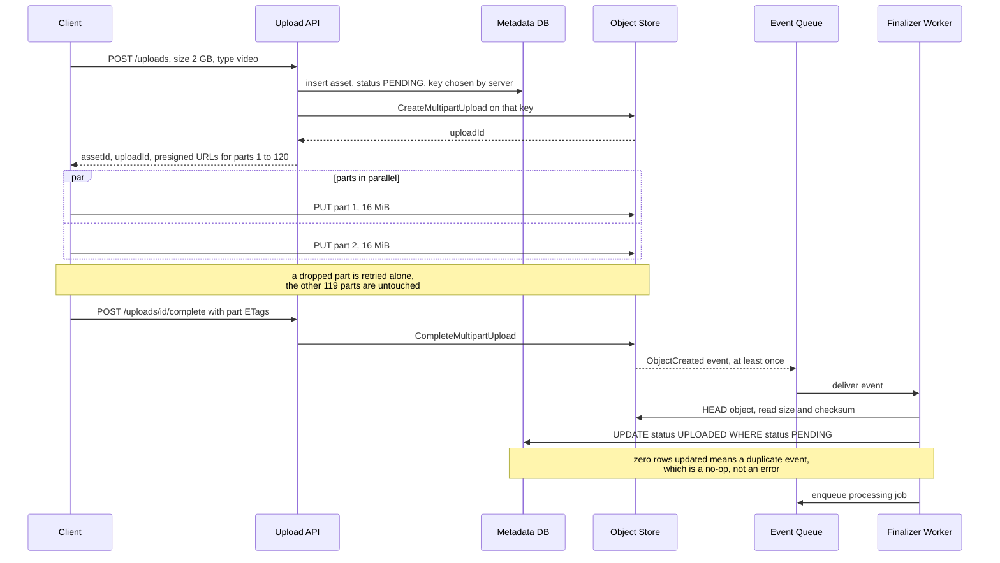
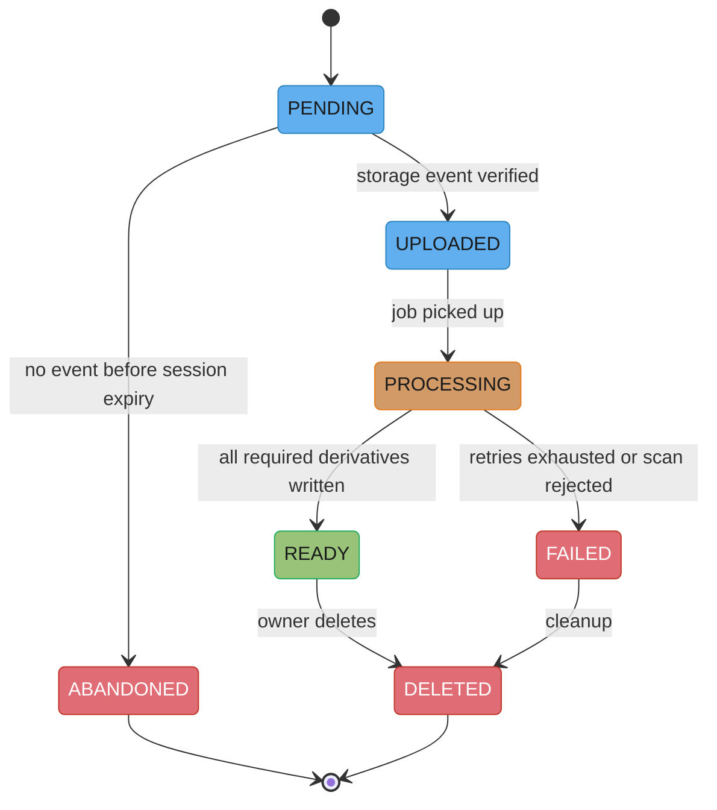
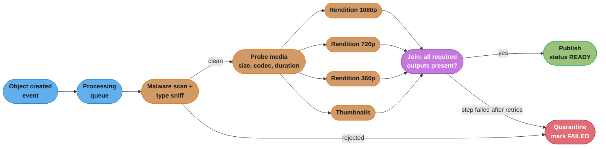
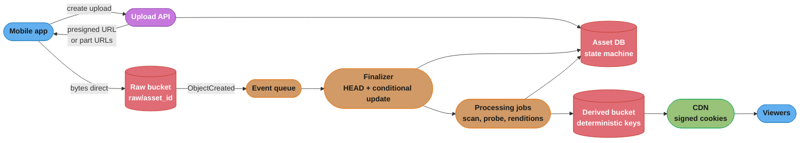

# Large Blobs and Media Pipelines
How to move gigabytes through a system whose application servers should only ever touch kilobytes.

> Product limits on this page were checked on 2026-11-25 against the AWS, Google Cloud, IETF and tus documentation. Every limit is a dated fact about one provider, not a law of nature: re-check before you quote one in a design review.

---

## 1. Concept Overview

A "large blob" is any payload that is too big, too slow, or too expensive to push through the
same request path as your JSON API: a 4 MB photo from a phone on a 3 Mbps uplink, a 2 GB video,
a 40 GB database export, a 300 MB machine-learning model artifact. The defining property is not
size alone. It is that **the bytes take longer to move than your request path is willing to
wait**, and that **the bytes cost far more bandwidth than the metadata that describes them**.

The pattern that every large-blob design converges on has one idea at its centre: **split the
control plane from the data plane.** Your application servers own the *metadata* (who uploaded
what, where it lives, what state it is in, who may read it). Object storage owns the *bytes*.
The application never streams the bytes itself. It hands the client a short-lived, narrowly
scoped credential (a presigned URL or an upload session), the client talks to object storage
directly, and object storage tells the application, through an event, that the bytes arrived.
Downloads mirror the same shape: the application authorizes, a CDN or the object store serves.

That split creates the real engineering problem of this module. The database row and the blob
live in two systems that do not share a transaction. Every interesting failure in this area is
some version of the two disagreeing: a row that points at a blob that never arrived, a blob
that no row points at, a "ready" asset whose thumbnails were never generated, a deleted account
whose videos are still in the bucket a year later. §6 works these one at a time.

**What this page owns and what it links to.** This is the pattern-and-decision page. Three
case studies in this section already build one large-blob system end to end, and this page
does not retell them:

- [Design Object Storage (S3)](../case_studies/design_object_storage_s3.md) owns the *inside*
  of the blob store: the metadata index, erasure coding, the multipart protocol server-side
  (§4.3), lifecycle tiering (§4.5) and garbage collection (§4.6).
- [Design Google Drive](../case_studies/design_google_drive.md) owns content-defined chunking,
  deduplication (§4.1) and resumable upload sessions with quota (§4.7) for a sync product.
- [Design YouTube Upload Pipeline](../case_studies/design_youtube_upload_pipeline.md) owns the
  resumable chunked upload at video scale (§4.1), idempotent chunk commit (§4.2), the
  transcoding DAG (§4.3) and the publish state machine (§4.6).

The API-level "how" (multipart form parsing, tus servers, virus scanning, content-type
sniffing, per-user quota enforcement) lives in the backend module
[File Upload and Media Handling](../../backend/file_upload_and_media_handling/file_upload_and_media_handling.md),
and a framework-level build is in the FastAPI case study
[Design a File Upload and Media API](../../fastapi/case_studies/design_file_upload_and_media_api.md).
The processing half of every media pipeline is a long-running job, so this page hands off to
[Long-Running Tasks and Workflows](../long_running_tasks_and_workflows/long_running_tasks_and_workflows.md)
for queues, retries and workflow engines.

---

## 2. Intuition

**The loading dock, not the reception desk.** A company that receives pallets of goods does
not carry them through the front lobby. The receptionist checks your paperwork, gives you a
dock pass that is valid for one bay and one afternoon, and points you round the back. You drive
the truck to the loading dock, the dock crew unloads it, and the dock clerk phones the office
to say "delivery 4471 is in." The office updates its inventory system from that phone call, not
from your promise at the front desk that you would deliver. If the truck never shows up, a
clerk eventually voids the dock pass and the reserved bay is freed.

Every part of that maps to this module. The receptionist is your API server (small, fast,
authenticating). The dock pass is a presigned URL (one object key, one method, an expiry). The
loading dock is object storage (built for bulk). The clerk's phone call is the upload-completion
event. The voided pass is the garbage collector for abandoned uploads. And the office's rule,
"believe the dock, not the driver," is the metadata-consistency rule of §6.3.

**Key insight:** the application server should touch the *metadata* of every blob and the
*bytes* of none of them. Once you hold that line, upload throughput stops being an application
scaling problem and becomes an object-storage and CDN problem, which are the two systems built
to absorb it.

---

## 3. Core Principles

**Separate the control plane from the data plane.** Requests that carry decisions (create an
upload, authorize a download, list my files) go through your API. Requests that carry bytes go
directly between the client and object storage or the CDN. The API's bandwidth is then
proportional to the *number* of files, not their *size*.

**Object storage is the source of truth for bytes, the database is the source of truth for
meaning.** Neither system knows the other exists. Keeping them consistent is your job, and it
is done with a state machine on the metadata row plus reconciliation, never with a
distributed transaction (object stores do not offer one).

**An upload is a state machine, not a request.** `PENDING -> UPLOADED -> PROCESSING -> READY`,
with `FAILED` and `ABANDONED` exits. Each transition is triggered by an observable fact (a
storage event, a worker result, a timeout), never by the client's claim that something
happened.

**Every byte path is either small or resumable.** A single request that carries 2 GB over a
mobile network will fail. Large transfers are split into independently retryable parts so a
dropped connection costs one part, not the whole file.

**Keys are server-generated and immutable.** The server chooses the object key (usually from
an asset ID or a content hash), and an object is never overwritten in place. New content gets
a new key. Immutability makes CDN caching trivially correct and makes "which version is this?"
a non-question.

**Garbage is the default outcome.** Abandoned sessions, half-finished multipart uploads,
derivatives of deleted assets and superseded renditions all accumulate silently and are billed
every month. Garbage collection is designed on day one, not after the first surprising bill.

**A presigned URL is a bearer token.** Anyone who holds it can use it until it expires. Scope
it to one key, one method and the shortest expiry that fits the transfer, and never let the
client choose the key.

**Process asynchronously, publish atomically.** Thumbnails, transcodes, scans and
fingerprinting run after the upload as jobs. The asset becomes visible to other users only when
every required derivative exists, in one state transition.

---

## 4. Types / Architectures / Strategies

### 4.1 Proxy Upload Through the Application Server

The client sends the file to your API, and the API streams it on to object storage. It is the
first thing every team builds because it needs no new client logic and authorization is just
the normal request authentication. It breaks on three axes at once. Bandwidth: every byte
crosses your fleet twice (client to app, app to storage). Concurrency: a 200 MB file on a 4 Mbps
uplink holds a connection and a worker for 400 seconds. Timeouts: load balancers, API gateways
and reverse proxies have request and idle timeouts that a slow upload will exceed. It is still
right for small files (under about 1 MB) where you must inspect or transform the bytes inline,
and for server-to-server transfers inside one region. §6.1 does the arithmetic.

### 4.2 Presigned PUT (Single Request)

The API creates a metadata row, generates a URL signed with its own credentials for exactly one
`PUT` to one key with an expiry, and returns it. The client uploads directly to the object
store. On Amazon S3 a single `PUT` carries at most 5 GB, and with Signature Version 4 an
SDK-generated presigned URL can be valid for at most 7 days (and never longer than the
credentials that signed it). This is the right default for files from a few hundred KB up to
roughly 100 MB on decent networks. Above that, a single failed request means re-sending
everything, which is why AWS's own guidance is to consider multipart once an object reaches
100 MB.

### 4.3 Presigned POST With a Policy (Browser Forms)

A variant built for HTML forms: the server signs a *policy document* instead of a single URL,
and the policy can carry conditions such as the exact key or key prefix, the allowed
`Content-Type`, and a `content-length-range` that rejects anything outside a byte range at the
storage edge. The upside over a presigned `PUT` is that the size limit is enforced by the object
store, not by trusting the client. Use it when a browser uploads directly and you need a hard
upper bound on size without a server in the byte path.

### 4.4 Multipart Upload With Per-Part Presigned URLs

The API calls `CreateMultipartUpload`, receives an upload ID, then presigns one `UploadPart` URL
per part. The client uploads parts in parallel, in any order, retries any part independently,
and finally the API calls `CompleteMultipartUpload` with the list of part numbers and their
ETags. S3's limits as of 2026-11-25: up to 10,000 parts, part numbers 1 to 10,000, each part
5 MiB to 5 GiB except the last (which has no minimum), and a maximum object size of 48.8 TiB.
Incomplete multipart uploads keep their parts, and those parts are stored and billed until the
upload is completed or aborted. §6.2 covers part sizing; §10 covers the orphaned-parts bill.
The server-side mechanics are in
[Design Object Storage §4.3](../case_studies/design_object_storage_s3.md).

### 4.5 Resumable Upload Sessions

Instead of the client tracking parts, the server holds an upload *session* with a single
offset. The client asks "how many bytes do you have?", then sends the rest from that offset.
Three variants matter:

- **tus 1.0.0** (published 2016-03-25), an open HTTP protocol: `HEAD` on the upload URL returns
  `Upload-Offset`, and `PATCH` appends bytes at that offset. Extensions add creation, expiration,
  checksums, termination and concatenation.
- **Google Cloud Storage resumable uploads**: the initial request returns a session URI that
  stays active for up to a week. GCS client libraries use chunk buffers that must be a multiple
  of 256 KiB.
- **IETF Resumable Uploads for HTTP** (`draft-ietf-httpbis-resumable-upload-16`, 2026-11-22), an
  HTTP working-group Internet-Draft derived from tus and intended for Proposed Standard. It is
  not yet an RFC; design against tus or a vendor session protocol today.

Sessions suit mobile clients and flaky networks best, because resuming needs one `HEAD`, not a
client-side record of which of 120 parts succeeded. The tradeoff is that bytes are appended
sequentially, so a single session does not parallelize the way multipart parts do.

### 4.6 Content-Defined Chunking and Deduplication

For sync products where the same file is edited and re-uploaded constantly, the client splits
the file into chunks at content-defined boundaries, hashes each chunk, asks the server which
hashes it already has, and uploads only the missing ones. An edit in the middle of a 500 MB file
re-uploads a few chunks instead of the whole file. The cost is a chunk index, reference
counting and a much harder garbage collector. This is a different product shape from "upload a
photo once", and it is covered end to end in
[Design Google Drive §4.1](../case_studies/design_google_drive.md).

### 4.7 Download Strategies

| Strategy | How it works | Right for |
|---|---|---|
| Proxy download | API streams the bytes from storage | Tiny files, or bytes that must be transformed per request |
| Presigned GET | API returns a short-lived URL to the object store | Private, rarely re-read files (an export, an invoice PDF) |
| CDN signed URL | API signs a CDN URL with an expiry and optional IP or path policy | Private files read many times from many places |
| CDN signed cookie | API sets a cookie that authorizes a path pattern | Many files per view, such as every HLS segment of one video |
| Public CDN on immutable key | Unguessable or genuinely public content-hash keys, long cache TTL | Public media after moderation |

CloudFront's own guidance is to use signed cookies when one view needs many restricted files
(its example is all the files of an HLS video) and signed URLs for individual files. A presigned
S3 URL is checked only when the request starts: a download that begins one second before expiry
completes, but a resume after expiry fails. Range requests (`Range: bytes=...`) give resumable
downloads and video seeking for free on every major object store and CDN. CDN mechanics live in
[CDN](../cdn/cdn.md).

### 4.8 Processing Pipelines

Once bytes land, something must happen to them: thumbnails, EXIF stripping, virus scanning,
transcoding, captions, fingerprinting, search indexing. Two shapes:

- **Single-step, event-triggered.** The storage event lands on a queue, one worker does one
  job (resize an image into three sizes), writes derivatives, marks the row `READY`. Good for
  images and documents.
- **A DAG of steps.** Video needs probe, then a fan-out of renditions in parallel, then
  packaging, then thumbnails and captions, then a publish step that waits for all of them. Each
  step retries independently and the whole thing can take minutes to hours. This is a workflow,
  and the choice between "queue plus status table" and a workflow engine is made on
  [Long-Running Tasks and Workflows](../long_running_tasks_and_workflows/long_running_tasks_and_workflows.md).
  The video-scale DAG is [Design YouTube Upload Pipeline §4.3](../case_studies/design_youtube_upload_pipeline.md).

---

## 5. Architecture Diagrams

### 5.1 Direct-to-Storage Multipart Upload, End to End



The client never sends a byte to the API. The API's only knowledge that the bytes exist comes
from the storage event and a `HEAD` against the object store, not from the client's
`/complete` call. That call only asks the API to finish the multipart upload.

### 5.2 The Asset Lifecycle



Every arrow is triggered by a fact the system observes. No arrow is triggered by the client
saying "done". `ABANDONED` and `DELETED` are the two states that own garbage: a sweeper and a
lifecycle rule must exist for each.

### 5.3 Proxy Versus Direct: Where the Bytes Go

```
PROXY UPLOAD (bytes through the app tier)
  client ==200 MB==> [ LB ] ==200 MB==> [ app server ] ==200 MB==> [ object store ]
                                        holds 1 worker for 400 s at 4 Mbps
  app tier carries: 2 x file size per upload (in + out)

DIRECT UPLOAD (bytes bypass the app tier)
  client --2 KB JSON--> [ app server ] --sign--> presigned URL --2 KB--> client
  client ==================200 MB========================> [ object store ]
  object store --event--> queue --> worker --HEAD + UPDATE--> [ metadata DB ]
  app tier carries: about 3 small JSON calls per upload, independent of file size

  delta at 10,000 concurrent 200 MB uploads:
    proxy : 40 Gbps in + 40 Gbps out through the app tier, 10,000 held workers
    direct: about 30,000 JSON calls spread over 400 s, 75 requests/s
```

*The direct path removes the file size from the application's cost model entirely. §6.1 derives
these numbers.*

### 5.4 Image and Video Processing Fan-Out



*The join is the only place that flips the asset to `READY`, so a viewer can never see an asset
with a missing rendition. Each box writes to a deterministic key, so a retried step overwrites
its own output instead of creating a second copy.*

---

## 6. How It Works — Detailed Mechanics

### 6.1 The Arithmetic That Kills Proxy Uploads

Assume a mobile-heavy app at a peak of 10,000 concurrent uploads, each a 200 MB video, each
client uplink averaging 4 Mbps (illustrative inputs).

```
time per upload        = 200 MB x 8 bits / 4 Mbps          = 400 s
ingress at peak        = 10,000 x 4 Mbps                   = 40 Gbps
proxy egress to store  = same bytes again                  = 40 Gbps
held workers           = 10,000 for 400 s each
app instances needed   = 10,000 / 200 worker threads each  = 50 instances
                         just to hold sockets, before any real work
```

The direct path replaces all of that with three JSON calls per upload (create, presign parts,
complete), each about 2 KB. Over the 400-second life of 10,000 uploads that is roughly 30,000
calls, or 75 requests per second, which one small instance handles. The bandwidth moves to the
object store, which is built for it: S3 documents at least 3,500 `PUT/COPY/POST/DELETE` and
11,000 `GET/HEAD` requests per second **per partitioned prefix**, and scales by partitioning more
prefixes as traffic grows. The capacity question becomes "are my keys spread across enough
prefixes" (§10), not "how many app servers do I need for bytes".

### 6.2 Part Size Is a Formula, Not a Guess

Two constraints bound the part size for S3 multipart: at most 10,000 parts, and parts of 5 MiB
to 5 GiB (except the last).

```
min_part = max(5 MiB, ceil(object_size / 10,000))

2 GB video     : ceil(2,000,000,000 / 10,000) = 200 KB  -> floor wins: 5 MiB  -> 382 parts
100 GB export  : ceil(100 x 10^9 / 10,000)    = 10 MB   -> choose 16 MiB      -> 5,961 parts
48.8 TiB max   : 48.8 TiB / 10,000            = 5.0 GiB -> exactly the part ceiling
```

Above the floor, the part size is a tradeoff between three costs:

| Bigger parts | Smaller parts |
|---|---|
| Fewer requests, fewer presigned URLs, less per-request overhead | More requests and more API calls to presign them |
| A failed part re-sends more bytes | A failed part re-sends fewer bytes |
| Fewer parts in flight at once on a narrow uplink | Better parallelism on a wide uplink |

A practical default for mobile is 8 to 16 MiB with 3 to 4 parts in flight, and for data-centre
transfers 64 to 128 MiB with 8 to 16 parts in flight. The YouTube case study uses the same
reasoning for chunk size in [§4.1](../case_studies/design_youtube_upload_pipeline.md).

### 6.3 Flagship Broken to Fixed: Who Decides the Upload Happened?

**BROKEN — the client's callback creates the row:**

```python
# Step 1: API hands out a URL. The client chooses the key.
def presign(user, filename):
    key = f"uploads/{filename}"                        # client-controlled key
    return s3.generate_presigned_url("put_object",
        Params={"Bucket": BUCKET, "Key": key}, ExpiresIn=7 * 24 * 3600)

# Step 2: after uploading, the client calls back and the API trusts it.
def upload_done(user, key, size, content_type):
    db.execute("INSERT INTO assets (owner, key, size, type, status) "
               "VALUES (%s, %s, %s, %s, 'READY')", (user, key, size, content_type))
    make_thumbnails(key)                               # synchronous, in the request
```

Five separate failures hide in twelve lines:

1. **Orphans.** The client uploads, then the app is killed before the callback. The blob exists,
   no row points at it, and nothing will ever delete it.
2. **Phantoms.** A malicious or buggy client calls `upload_done` without uploading. The row says
   `READY` and points at nothing.
3. **Overwrites.** The client picks the key, so `uploads/avatar.png` from user A overwrites
   user B's file with the same name.
4. **Lies about the bytes.** `size` and `content_type` come from the client. A 3 GB file declared
   as a 3 KB `image/png` sails past every quota and type check.
5. **A 7-day bearer token** for an upload that takes 30 seconds, and thumbnail work inside the
   request, so a slow resize times out the user's "done" call.

**FIX — the server chooses the key, and storage decides the upload happened:**

```sql
CREATE TABLE assets (
    asset_id      UUID PRIMARY KEY,
    owner_id      BIGINT NOT NULL,
    object_key    TEXT NOT NULL UNIQUE,        -- server-generated, never client input
    declared_size BIGINT NOT NULL,             -- what the client said, for a quota pre-check
    actual_size   BIGINT,                      -- what storage says, set by the finalizer
    checksum      TEXT,
    status        TEXT NOT NULL DEFAULT 'PENDING'
                  CHECK (status IN ('PENDING','UPLOADED','PROCESSING',
                                    'READY','FAILED','ABANDONED','DELETED')),
    upload_expires_at TIMESTAMPTZ NOT NULL,
    created_at    TIMESTAMPTZ NOT NULL DEFAULT now()
);
CREATE INDEX assets_pending_expiry ON assets (upload_expires_at) WHERE status = 'PENDING';
```

```python
def create_upload(user, declared_size, declared_type):
    check_quota(user, declared_size)                       # pre-check, not the final word
    asset_id = uuid4()
    key = f"raw/{asset_id}"                                # server-chosen, unguessable
    expires = now() + timedelta(minutes=15)
    db.execute("INSERT INTO assets (asset_id, owner_id, object_key, declared_size, "
               "upload_expires_at) VALUES (%s, %s, %s, %s, %s)",
               (asset_id, user.id, key, declared_size, expires))
    url = s3.generate_presigned_url("put_object",
        Params={"Bucket": RAW_BUCKET, "Key": key}, ExpiresIn=15 * 60)
    return {"assetId": asset_id, "uploadUrl": url}

def on_object_created(event):                              # consumer of the storage event
    key = event["key"]
    head = s3.head_object(Bucket=RAW_BUCKET, Key=key)      # storage's facts, not the client's
    rows = db.execute(
        "UPDATE assets SET status = 'UPLOADED', actual_size = %s, checksum = %s "
        "WHERE object_key = %s AND status = 'PENDING'",    # idempotent transition
        (head["ContentLength"], head.get("ChecksumCRC64NVME"), key))
    if rows == 0:
        return                                             # duplicate event or unknown key
    enqueue("process_asset", key=key)                      # async, outside any request
```

The `WHERE status = 'PENDING'` clause is what makes the at-least-once storage event safe: S3
documents that event notifications are delivered at least once, typically in seconds and
sometimes a minute or longer, so the finalizer will see duplicates and must treat a zero-row
update as success. It is the same conditional-write discipline as
[Coordination and Contention §6.2](../coordination_and_contention/coordination_and_contention.md).
The final quota and type checks run in the processing job against `actual_size` and the sniffed
type (§6.6), never against the declared values.

### 6.4 Metadata and Blob Consistency: the Four Disagreements

Because no transaction spans the database and the object store, design for each way they can
disagree, how you detect it, and who repairs it.

| Disagreement | How it happens | Detection | Repair |
|---|---|---|---|
| Row, no blob | Client never uploaded, or upload failed | `PENDING` rows past `upload_expires_at` | Sweeper marks `ABANDONED`, aborts any multipart upload |
| Blob, no row | Row deleted while bytes stay, or a bug wrote bytes without a row | Periodic diff of the bucket listing (S3 Inventory) against the asset table | Delete after a grace period, never immediately |
| Row says `READY`, derivative missing | A processing step wrote the status before its output, or an output was deleted | Join step verifies every required key with `HEAD` before publishing | Re-enqueue the missing step |
| Row deleted, blob still present | Deletion job crashed after the row update | Same inventory diff, filtered to deleted asset IDs | Retry the delete; it is idempotent |

The ordering rule that makes repair safe: **create the row before the bytes, delete the bytes
before the row**. On create, a row without a blob is visible and sweepable. On delete, mark the
row `DELETED` first (so readers stop seeing it), then delete blobs, then hard-delete the row
last, so a crash at any step leaves a row that still points at what must be cleaned up.

### 6.5 Garbage Collection Is Three Separate Collectors

1. **Incomplete multipart uploads.** Parts of an upload that is never completed or aborted stay
   in the bucket and are billed. S3 provides a lifecycle rule,
   `AbortIncompleteMultipartUpload` with `DaysAfterInitiation`, that aborts any multipart upload
   not completed within that many days and deletes its parts. AWS recommends it as a best
   practice, and it applies to existing uploads as well as new ones. Put it on every bucket
   that accepts multipart uploads; 1 to 7 days is a common setting.
2. **Abandoned sessions at the application level.** The sweeper on `assets_pending_expiry`
   marks rows `ABANDONED` and deletes any object that did arrive late.
3. **Deleted and superseded assets.** Soft-delete first (a 7 to 30 day restore window is
   common), then delete the original and every derivative key. If content is deduplicated
   across users, deletion becomes reference counting, which is the hard version covered in
   [Design Object Storage §4.6](../case_studies/design_object_storage_s3.md) and
   [Design Google Drive §4.1](../case_studies/design_google_drive.md).

Storage tiering is a fourth lifecycle concern, not a collector: move originals that are rarely
read to a cheaper storage class after N days, keep hot derivatives in the standard class. See
[Design Object Storage §4.5](../case_studies/design_object_storage_s3.md).

### 6.6 Verifying the Bytes You Were Given

The client controls everything it sends, including the bytes. The processing job, not the
upload API, establishes the truth:

- **Size** comes from `HEAD`, and the final quota charge uses it.
- **Integrity**: S3 computes and validates a checksum on upload when the client sends one.
  CRC-64/NVME is its default algorithm, and CRC32, CRC32C, SHA-1, SHA-256, MD5 and others are
  supported. Ask clients to send one so corruption in transit is rejected at the edge.
- **Type** is sniffed from the leading bytes (magic numbers), never taken from the file name or
  the declared `Content-Type`.
- **Safety**: malware scanning, image re-encoding (which strips EXIF location data and drops
  payloads hidden in metadata), and serving user content from a separate domain with
  `Content-Disposition: attachment` for anything not rendered as media.

The full set of API-level checks is the subject of
[File Upload and Media Handling](../../backend/file_upload_and_media_handling/file_upload_and_media_handling.md).

### 6.7 Making the Processing Pipeline Idempotent

Storage events are at-least-once, queue deliveries are at-least-once, and workers crash.
Every processing step therefore runs more than once for some assets. Three rules make that
harmless:

- **Deterministic output keys.** A rendition is written to
  `derived/{asset_id}/{rendition}/{params_hash}`. Running the step twice overwrites the same key
  with the same bytes. A random or timestamped output key makes every retry leak a copy.
- **Conditional status transitions.** `UPDATE ... SET status = 'READY' WHERE status =
  'PROCESSING'`, exactly as in §6.3.
- **Separate buckets or prefixes for input and output.** S3 warns that a notification which
  writes to the same bucket that triggered it can cause an execution loop. Write derivatives to
  a different bucket, or scope the trigger to the `raw/` prefix only.

### 6.8 Serving: Authorization Without Proxying

The download path repeats the upload principle in reverse. The API checks that the viewer may
see the asset, then returns a signed CDN URL (or sets a signed cookie for a whole HLS
directory). The CDN fetches from the object store on a miss and caches on immutable keys with a
long TTL. Revoking access means changing the *authorization* (shorter expiries, rotating signing
keys, removing a cookie), not purging bytes, because an immutable key never changes content.
Public assets after moderation can use unsigned CDN URLs with content-hash keys. CDN cache
behaviour, origin shield and invalidation are in [CDN](../cdn/cdn.md); the streaming and
packaging side of video delivery is in [Design Netflix](../case_studies/design_netflix.md).

---

## 7. Real-World Examples

**Amazon S3** exposes every primitive in this module as an API: presigned `PUT` and `POST`
(SigV4 URLs valid up to 7 days from the SDK, 1 minute to 12 hours from the console), multipart
upload (10,000 parts, 48.8 TiB maximum object), event notifications to SNS, SQS, Lambda and
EventBridge with at-least-once delivery, checksums with CRC-64/NVME as the default, and the
`AbortIncompleteMultipartUpload` lifecycle action. S3 has delivered strong read-after-write
consistency for all requests since 2020-12-01, which is why the finalizer in §6.3 can `HEAD` the
object immediately after the event and trust the answer. S3 notifications cannot target an SQS
FIFO queue directly; AWS routes that case through EventBridge.

**Google Cloud Storage** chose the session model rather than parts for its resumable uploads:
one session URI, active for up to a week, resumed from an offset, and only a completed upload
appears in the bucket. Its client libraries switch to resumable uploads automatically above a
size threshold (the Go library at 16 MiB, the C++ `UploadFile()` at 20 MiB).

**tus** is the open protocol for the same session model, and one of its authors co-authors the
IETF Resumable Uploads for HTTP draft (revision 16, dated 2026-11-22), which carries the model
toward an HTTP standard.

**Amazon CloudFront** offers both signed URLs and signed cookies for private content and
recommends cookies when one view needs many files, naming HLS video as the example.

The three large-blob case studies in this section are the worked systems:
[S3](../case_studies/design_object_storage_s3.md) (the blob store itself),
[Google Drive](../case_studies/design_google_drive.md) (chunked, deduplicated sync) and
[YouTube](../case_studies/design_youtube_upload_pipeline.md) (resumable video ingest and the
transcoding DAG).

---

## 8. Tradeoffs

### Upload Mechanisms

| Mechanism | Max single transfer | Resume granularity | Parallel | Size enforced by | Client complexity |
|---|---|---|---|---|---|
| Proxy through API | Bounded by API timeouts | None | No | Your API | Lowest |
| Presigned `PUT` | 5 GB (S3) | Whole file | No | Nobody, unless a post-check does | Low |
| Presigned `POST` + policy | 5 GB (S3) | Whole file | No | Object store (`content-length-range`) | Low |
| Multipart + presigned parts | 48.8 TiB (S3) | One part | Yes | Post-check on `HEAD` | Medium |
| Resumable session (tus, GCS) | Provider limit | Byte offset | No, within one session | Session server | Medium |
| Content-defined chunks + dedup | Unbounded | One chunk | Yes | Chunk service | High |

### Processing Timing

| Choice | Upside | Cost |
|---|---|---|
| Synchronous in the upload request | Result is immediate | Ties request latency to the slowest transform, fails on large inputs, couples upload availability to processing availability |
| Asynchronous job after the event | Upload returns fast, steps retry independently | The asset is not visible for seconds to hours; the client needs a status channel |
| Lazy, on first read (resize on demand behind the CDN) | No work for assets nobody views | First viewer pays the latency; needs a cache and protection against parameter abuse |

### Download Mechanisms

| Choice | Upside | Cost |
|---|---|---|
| Presigned object-store URL | Simple, no CDN needed | Every read hits the origin; no edge caching across users |
| CDN signed URL or cookie | Edge caching, origin offload, global latency | Key management for signing; revocation only by expiry or key rotation |
| Proxy through API | Per-request transformation and auditing | The bandwidth problem of §6.1, in reverse |

---

## 9. When to Use / When NOT to Use

**Use direct-to-storage uploads when:**

- Files are larger than about 1 MB, or clients are on mobile or otherwise slow networks.
- Upload volume is large enough that bandwidth, not request count, dominates your API costs.
- You need resumability, which proxy uploads cannot give you without rebuilding multipart.

**Use multipart or resumable sessions when:**

- Files can exceed about 100 MB, or any single failed request is costly to repeat.
- Clients are mobile (sessions resume with one `HEAD`) or the transfer is large enough to benefit
  from parallel parts (multipart).

**Use an asynchronous processing pipeline when:**

- Any transform takes longer than your synchronous request budget, or depends on input size.
- You need retries, scanning or moderation before the asset becomes visible.

**Do NOT use these patterns when:**

- Payloads are a few KB (an avatar crop, a JSON attachment). A presigned flow adds two round
  trips and a state machine for no gain; put the bytes in the request or a database column.
- You must transform the bytes inline before anyone stores them (for example, a rule that
  unscanned bytes may never touch shared storage). Then a proxy or an isolated quarantine bucket
  with its own ingest service is the design, at the bandwidth cost of §6.1.
- The "blob" is really structured data you will query. A 50 MB CSV that you then scan row by row
  belongs in a table or a lakehouse format, not behind a presigned URL.

---

## 10. Common Pitfalls

**Orphaned multipart parts billed for months.** *Broken:* the app creates a multipart upload
per video, mobile clients abandon some of them, and nobody aborts them. Parts of an incomplete
upload do not appear in a normal object listing, so the bucket "looks" right while storage cost
climbs. §14 works the numbers: 1.44 TB of invisible parts per day at a modest abandonment rate.
*Fix:* an `AbortIncompleteMultipartUpload` lifecycle rule on every ingest bucket (S3 applies it
to existing uploads too), plus the application sweeper that marks the row `ABANDONED` and calls
`AbortMultipartUpload` when the session expires.

**Client-chosen keys.** *Broken:* the presigned URL is generated for `uploads/{filename}`. Two
users upload `IMG_0001.jpg` and the second silently overwrites the first, or a crafted name lands
an object under a prefix that a downstream job trusts. *Fix:* the server generates
`raw/{asset_id}`; the original file name is metadata in the database, never part of the key.

**Trusting the declared content type.** *Broken:* an "image" upload is an HTML file declared as
`image/png`, stored with `Content-Type: text/html`, and served from the main application domain,
where it runs script with the user's session (stored XSS). *Fix:* sniff the type from the bytes,
re-encode images, store with a type you set, and serve user content from a separate cookie-less
domain with `Content-Disposition: attachment` for anything not rendered as media.

**A processing trigger that triggers itself.** *Broken:* a function subscribed to every
`ObjectCreated` event in a bucket writes thumbnails back into the same bucket, each thumbnail
creates an event, and the function runs on its own output until concurrency or the bill stops it.
AWS documents this loop explicitly. *Fix:* write derivatives to a separate bucket, or scope the
notification to the `raw/` prefix only.

**Hot prefixes returning 503 Slow Down.** *Broken:* keys are written as
`uploads/2026-11-25/{id}`, so every write on a given day lands on one prefix. When a prefix that
saw little traffic suddenly receives a high request rate, S3 can return 503 Slow Down until it
partitions that prefix. *Fix:* put high-cardinality characters early in the key (for example, a
short hash of the asset ID first) so load spreads across many prefixes from the start. The
metadata-index side of this failure is
[Design Object Storage §9 War Story 2](../case_studies/design_object_storage_s3.md).

**Publishing before processing finishes.** *Broken:* the asset flips to `READY` when the upload
lands, so the feed shows a video whose 360p rendition is still encoding and mobile viewers get a
404. *Fix:* only the join step in §5.4 may set `READY`, and it checks that every required output
key exists first.

**Duplicate events doing duplicate work.** *Broken:* the processor treats each storage event as a
new job, assigns a fresh output key, and a duplicate event produces a second set of renditions
plus a second "your video is ready" email. *Fix:* deterministic output keys, a conditional status
transition, and a notification that is sent only by the transition that actually changed a row.

---

## 11. Technologies & Tools

| Tool | Role | Notes |
|---|---|---|
| Amazon S3 | Object store | Presigned `PUT`/`POST`, multipart (10,000 parts, 48.8 TiB), event notifications, lifecycle, checksums |
| Google Cloud Storage | Object store | Resumable upload sessions (active up to a week), signed URLs |
| Azure Blob Storage | Object store | Block blobs assembled from staged blocks; SAS tokens for scoped access |
| Amazon CloudFront | CDN | Signed URLs for single files, signed cookies for many files per view |
| tus | Resumable upload protocol | Version 1.0.0; `HEAD` for offset, `PATCH` to append; client and server libraries in many languages |
| Amazon EventBridge | Event routing | Receives S3 events; the route to an SQS FIFO queue, which S3 notifications cannot target directly |
| AWS Elemental MediaConvert | Managed video transcoding | File-based transcoding to adaptive bitrate outputs |
| FFmpeg | Media toolkit | The open-source engine underneath most self-built transcode and thumbnail workers |
| libvips | Image processing | Streaming, low-memory image resizing for thumbnail workers |
| ClamAV | Malware scanning | Open-source scanner commonly run as a processing step |

---

## 12. Interview Questions with Answers

**Q: Why should large uploads bypass the application servers?**
**Short:** Proxying makes app bandwidth and held connections scale with file size; presigned direct uploads make the app handle only small metadata calls.

A proxied upload crosses your fleet twice (client to app, app to storage) and holds a worker for
the whole transfer: a 200 MB file on a 4 Mbps uplink takes 400 seconds. At 10,000 concurrent
uploads that is 40 Gbps in, 40 Gbps out, and 10,000 held workers. With presigned URLs the API
handles about three 2 KB JSON calls per upload regardless of size, and object storage, which is
built for bulk bandwidth, absorbs the bytes. Keep proxying for tiny files or bytes you must
transform inline.

**Q: The client finishes an upload and calls your API to say "done". Should the API mark the file ready?**
**Short:** No; the storage event plus a HEAD against the object store decides, because the client may lie, crash, or never call back.

Trusting the callback creates phantoms (a row with no bytes when the client lies or the upload
failed) and orphans (bytes with no row when the client crashes before calling). The robust
design creates a `PENDING` row before issuing the URL, then lets the object store's
`ObjectCreated` event drive a finalizer that reads size and checksum with `HEAD` and runs a
conditional `UPDATE ... WHERE status = 'PENDING'`. The client's call may still trigger
`CompleteMultipartUpload`, but it never sets the status.

**Q: Why must the server, not the client, choose the object key?**
**Short:** A client-chosen key lets uploads overwrite each other or land in trusted paths; a server key like raw/asset_id is unique and unguessable.

If the key comes from the file name, two users uploading `IMG_0001.jpg` collide and the second
overwrites the first. A crafted name can also aim an object at a prefix that downstream jobs
trust. A server-generated key derived from a UUID or content hash is unique, safe to cache
forever, and keeps the original file name where it belongs: in a metadata column.

**Q: How do you pick a part size for a multipart upload?**
**Short:** Use max(5 MiB, ceil(size / 10,000)) for S3, then trade larger parts for fewer requests against smaller parts for cheaper retries.

S3 allows at most 10,000 parts of 5 MiB to 5 GiB (the last part may be smaller), so the floor is
the larger of 5 MiB and size divided by 10,000. A 100 GB export needs parts of at least 10 MB;
16 MiB gives 5,961 parts. Above the floor, bigger parts mean fewer presign calls and requests,
while smaller parts mean a dropped connection re-sends less. Mobile clients typically use 8 to
16 MiB with 3 to 4 parts in flight.

**Q: What happens to the parts of a multipart upload that is never completed?**
**Short:** They stay in the bucket and are billed, invisible to normal listings, until the upload is completed or aborted.

Incomplete multipart uploads are a classic silent cost: the bucket's object listing looks clean,
but the parts are stored and charged. The fix is an `AbortIncompleteMultipartUpload` lifecycle
rule with `DaysAfterInitiation` (S3 applies it to existing and future uploads and deletes the
parts), plus an application sweeper that aborts uploads whose sessions expired.

**Q: How do you keep the metadata database and the object store consistent without a distributed transaction?**
**Short:** Use a state machine on the row, create the row before the bytes, delete the bytes before the row, and reconcile periodically.

Each disagreement gets a detector: `PENDING` rows past their expiry find rows without blobs; a
diff of a bucket inventory against the asset table finds blobs without rows; the publish step's
`HEAD` checks find missing derivatives. Ordering makes crashes recoverable: a row created first is
always visible to the sweeper, and a row deleted last always still points at what remains to
clean up.

**Q: Storage events are delivered at least once. What breaks if you ignore that?**
**Short:** Duplicates re-run processing, create extra derivative copies and send repeat notifications unless every step is idempotent.

S3 documents at-least-once delivery for event notifications, usually in seconds and sometimes a
minute or longer. Make the finalizer a conditional transition that treats zero updated rows as
success, write derivatives to deterministic keys so a rerun overwrites rather than adds, and send
user notifications only from the transition that actually changed state.

**Q: What does a presigned URL authorize, and how do you limit the damage if one leaks?**
**Short:** It is a bearer token for one method on one key until expiry; limit it with a short expiry, a server-chosen key and size conditions.

Anyone who holds the URL can use it, as many times as they like, until it expires; S3 allows up
to 7 days with SigV4 and never longer than the signing credentials. Scope it to one key and one
method, expire it in minutes for uploads that take minutes, use a presigned `POST` policy with
`content-length-range` when you need a hard size cap, and deny old signatures with the
`s3:signatureAge` condition if you need a bucket-wide ceiling.

**Q: When would you choose a resumable session protocol like tus over S3 multipart?**
**Short:** Choose a session when clients are flaky and should resume from one offset; choose multipart when parallel parts matter more.

A session keeps one server-side offset, so a mobile client resumes with a single `HEAD` and a
`PATCH` from that offset, with no record of which parts succeeded. Multipart gives parallel,
independently retried parts and higher throughput on wide links, at the cost of the client (or
your API) tracking part numbers and ETags. Google Cloud Storage chose the session model, with
sessions active for up to a week.

**Q: Why should a media asset become visible only after a join step?**
**Short:** Publishing on upload exposes assets whose renditions or scans are unfinished; a join that checks every required output publishes atomically.

Video produces several renditions, thumbnails and captions in parallel, each with its own retry
history. If the status flips when the upload lands, viewers request renditions that do not yet
exist. A single join step that verifies every required key and then runs one conditional update
to `READY` makes "visible" and "complete" the same event. The YouTube case study calls this the
publish state machine.

**Q: Why does a processing function sometimes run forever after an upload?**
**Short:** It writes its outputs into the bucket that triggers it, so every output fires another event and invokes it again.

A function subscribed to all `ObjectCreated` events that writes thumbnails back into the same
bucket triggers itself on each thumbnail. AWS documents this loop. Write derivatives to a
separate bucket or scope the trigger to the raw upload prefix.

**Q: Signed URLs or signed cookies for streaming a private HLS video from a CDN?**
**Short:** Signed cookies, because one playback fetches many segment files and a cookie authorizes the whole path pattern at once.

An HLS stream is a manifest plus many segments per rendition. Signing every segment URL means
rewriting manifests per viewer. A signed cookie scoped to the video's path covers all of them, and
CloudFront's own guidance names HLS as the case for cookies. Use signed URLs for single files
such as a download link.

**Q: Why do sequential date-based object keys cause 503 errors under load?**
**Short:** All writes land on one prefix, and the store throttles a prefix until it partitions it, so a burst on a new prefix gets 503 Slow Down.

S3 scales request rate per partitioned prefix (at least 3,500 writes and 11,000 reads per
second each) and partitions gradually as traffic grows. A key scheme like
`uploads/2026-11-25/...` concentrates a day's writes on one new prefix. Leading the key with
high-cardinality characters, such as a short hash of the asset ID, spreads load from the start.

**Q: What checks must run on the uploaded bytes, and where?**
**Short:** In the async processing job: size from HEAD, checksum, magic-byte type sniffing, malware scan and re-encoding, never trusting declared values.

The upload API only sees declared size and type, which the client controls. The job that runs
after the storage event reads the real size, verifies the checksum, sniffs the type from leading
bytes, scans for malware, re-encodes images to strip metadata, and charges quota on the actual
size. Failures move the asset to `FAILED` or quarantine before anyone else can read it.

**Q: How do you delete a user's media reliably?**
**Short:** Soft-delete the row first, then delete the original and every derivative key, and hard-delete the row last so a crash stays recoverable.

Marking the row `DELETED` hides it from readers immediately. Deleting blobs next, with idempotent
deletes on deterministic keys, means a crash leaves a row that still lists what must be removed.
A periodic inventory diff catches any blob that escaped. With cross-user deduplication, deletion
becomes reference counting, which is the hard case in the Drive and S3 case studies.

**Q: When is proxying uploads through the API still the right answer?**
**Short:** For tiny payloads, for bytes that must be transformed or scanned before any shared storage, and for intra-region server-to-server transfers.

A 20 KB avatar crop does not justify a presign round trip and a state machine. A rule that
unscanned bytes may never reach shared storage also forces bytes through a controlled ingest
service, ideally into an isolated quarantine bucket. In both cases accept the bandwidth cost
knowingly and keep request timeouts and body limits explicit.

**Q: How does a CDN change the cost of revoking access to a private file?**
**Short:** You revoke by expiring or re-signing authorization, not by purging bytes, because immutable keys never change content.

With signed URLs or cookies, a viewer's access lasts until the signature expires, so short
expiries are the revocation mechanism and key rotation is the emergency brake. Purging the CDN
does nothing for someone who still holds a valid signature. Keep expiries short for sensitive
content and long only for public, moderated assets.

---

## 13. Best Practices

**Keep bytes off the application tier.** The API issues credentials and owns metadata; object
storage and the CDN move bytes. Revisit any design where a file's size appears in your API's
capacity math.

**Generate keys on the server and never overwrite.** Use `raw/{asset_id}` for originals and
`derived/{asset_id}/{rendition}/{params_hash}` for outputs. Immutable keys make caching correct
and retries idempotent.

**Drive state from storage facts.** Create a `PENDING` row before issuing the URL; transition it
only from a storage event plus `HEAD`; make every transition a conditional update.

**Install garbage collectors on day one.** An `AbortIncompleteMultipartUpload` lifecycle rule on
every ingest bucket, a sweeper for expired `PENDING` rows, a soft-delete-then-hard-delete flow,
and a periodic inventory diff.

**Make large transfers resumable.** Multipart with per-part URLs for parallel desktop and
server transfers; a session protocol for mobile. Size parts with the formula in §6.2.

**Verify, do not trust.** Real size from `HEAD`, checksums on upload, magic-byte type sniffing,
malware scanning and image re-encoding, all before the asset is visible.

**Publish atomically.** One join step sets `READY` after checking every required output.

**Serve through a CDN with short-lived authorization.** Signed URLs for single files, signed
cookies for multi-file media, unsigned URLs only for public, moderated, content-hash keys.

**Spread keys across prefixes.** Lead keys with high-cardinality characters so a write burst does
not hit one new prefix.

**Cross-references:** Related HLD pages: [Design Instagram Photo Sharing](../case_studies/design_instagram_photo_sharing.md) (this pattern applied end to end to a photo product). The backend API contract and upload state machine for the same flow are in [Design a Media Upload API](../../backend/case_studies/design_media_upload_api/design_media_upload_api.md).

---

## 14. Case Study: Photo and Short-Video Uploads for a Social App

### Problem Statement

A social app accepts photos and clips up to 3 minutes from mobile clients. Design inputs
(illustrative): 4 million uploads per day, 80% photos averaging 3 MB and 20% videos averaging
60 MB, peak traffic 3x the daily average, and most uploads over cellular networks. Requirements:
uploads survive network drops, nothing appears in a feed until it is scanned and its renditions
exist, a deleted post's media is gone within 30 days, and storage cost does not grow with
abandoned uploads.

### Sizing

```
average size      = 0.8 x 3 MB + 0.2 x 60 MB           = 14.4 MB
daily ingress     = 4,000,000 x 14.4 MB                 = 57.6 TB/day
uploads per sec   = 4,000,000 / 86,400 = 46/s average, about 140/s at a 3x peak
API calls         = about 3 per upload -> about 420 small requests/s at peak
yearly raw growth = 57.6 TB x 365                       = about 21 PB before tiering
```

The API's load is 420 small requests per second at peak, a handful of instances. The bytes,
57.6 TB a day, go straight to object storage.

### Architecture



### Component Deep Dives

**1. Two upload paths by size.** Photos (under 10 MB) use one presigned `PUT` with a 15-minute
expiry. Videos use multipart with 8 MiB parts, which gives a 60 MB clip 8 parts and lets the app
retry a single part after a network drop. Part URLs are issued in batches so no URL outlives the
upload by hours.

**2. Finalizer as the only writer of `UPLOADED`.** It consumes `ObjectCreated` events, reads the
real size and checksum with `HEAD`, and runs the conditional update from §6.3. Duplicate events
update zero rows and are acknowledged.

**3. Processing as jobs, not requests.** Each upload enqueues a job: malware scan and type sniff,
then for photos three resized variants, for videos a probe followed by three renditions and
thumbnails in parallel, then a join that publishes. Retries, backoff and the dead-letter queue
follow [Long-Running Tasks and Workflows](../long_running_tasks_and_workflows/long_running_tasks_and_workflows.md).
Video jobs are a short DAG, small enough for a queue plus a status table; the YouTube-scale
version with priorities and per-title encoding is
[Design YouTube Upload Pipeline](../case_studies/design_youtube_upload_pipeline.md).

**4. Garbage collection.** An `AbortIncompleteMultipartUpload` rule of 2 days on the raw bucket;
a sweeper that marks `PENDING` rows `ABANDONED` 30 minutes after expiry; soft delete with a
14-day restore window, then deletion of `raw/{asset_id}` and every `derived/{asset_id}/*` key,
then the row; and a weekly inventory diff that reports any key with no live row.

**5. Serving.** Feed responses carry signed CDN URLs for photos and a signed cookie for each
video's HLS path. Originals move to an infrequent-access storage class after 30 days because the
app only ever serves derivatives.

### The Bug That Shipped First: Broken, Then Fixed

The first version sized everything correctly and still leaked. *Broken:* the video path created
a multipart upload per clip and relied on the app to call `/complete`. When users backgrounded the
app mid-upload, the mobile OS often suspended it and the call never came. There was no lifecycle
rule, so about 6% of video uploads (illustrative) left an average of 30 MB of parts behind:

```
abandoned video uploads/day = 4,000,000 x 20% x 6%  = 48,000
leaked bytes/day            = 48,000 x 30 MB        = 1.44 TB/day
after 90 days               = about 130 TB of parts that no listing showed
```

*Fix:* the 2-day abort rule, the application sweeper calling `AbortMultipartUpload`, and a
dashboard metric for incomplete multipart uploads per bucket. The leaked bytes stopped growing the
day the rule was installed, and the existing backlog was cleared because the rule applies to
uploads that already exist.

### Design Decisions and Tradeoffs

| Decision | Why | Cost accepted |
|---|---|---|
| Presigned `PUT` for photos, multipart for video | Photos are small enough that resuming is pointless; videos are not | Two client code paths |
| 8 MiB video parts | Cheap retries on cellular; 60 MB clips need only 8 parts | More requests than 64 MiB parts would need |
| Storage event, not client callback, sets `UPLOADED` | Removes orphans and phantoms | Seconds of extra latency before processing starts |
| Join step publishes | No viewer ever sees a half-processed asset | A failed rendition blocks the whole post until retried or skipped |
| Signed cookies for video | One authorization per playback instead of per segment | Cookie scoping must match the HLS path layout |

### Metrics and Results (Illustrative)

- Upload API at peak: about 420 requests per second on 4 small instances; file size never appears
  in its capacity plan.
- Median photo time-to-visible: about 4 seconds; median 60-second clip: about 50 seconds,
  dominated by rendition encoding.
- Incomplete multipart storage: flat after the lifecycle rule, versus 1.44 TB per day of growth
  before it.

### Lessons Learned

Every serious problem in this system lived in the gap between the database and the bucket, not
in moving bytes. The bandwidth problem disappeared the moment uploads went direct to storage.
What remained was bookkeeping: deciding which system's facts drive the state machine, making
every step idempotent against at-least-once events, and installing a collector for every way a
blob can outlive its purpose. Teams that treat those as day-one design work never meet the
130 TB surprise; teams that treat them as cleanup tasks always do.
