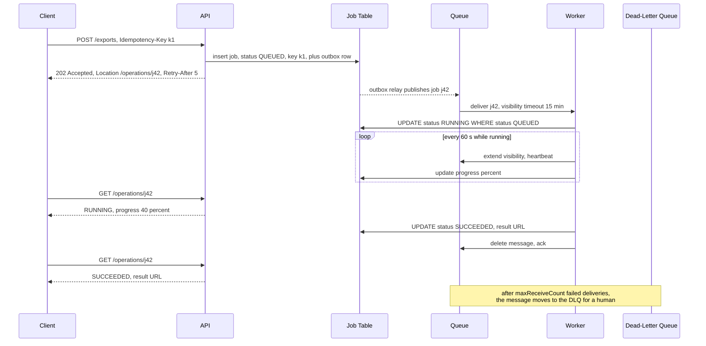
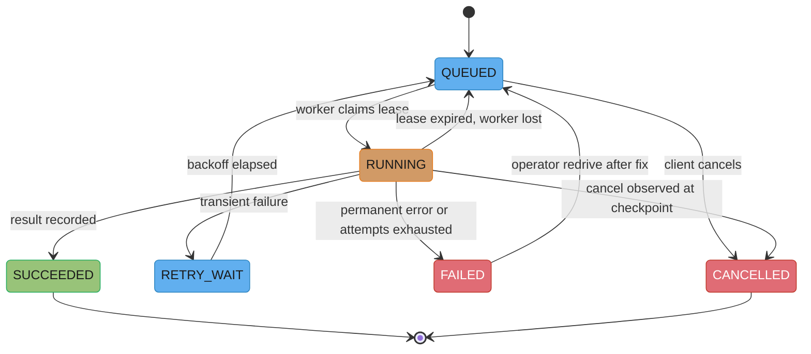
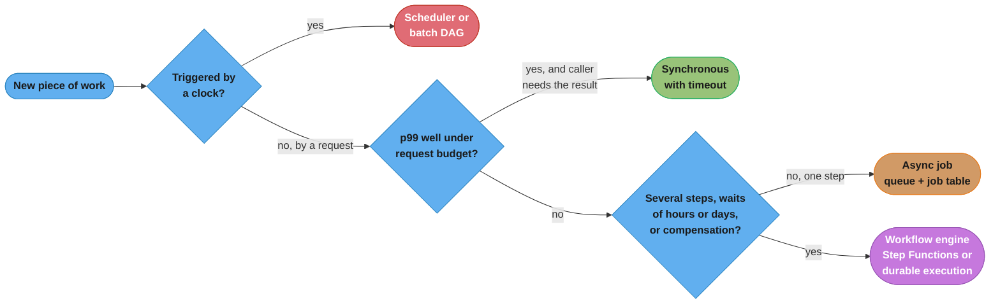
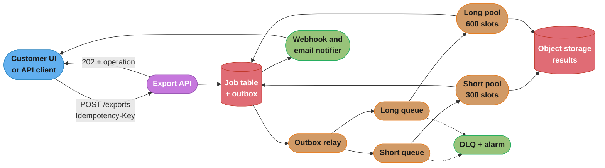

# Long-Running Tasks and Workflows
What to do when the work a request asks for takes longer than anyone is willing to hold a connection open for.

> Product limits on this page were checked on 2026-11-25 against the AWS, Google AIP and Temporal documentation. They are dated facts about one product each; re-check before quoting one in a design review.

---

## 1. Concept Overview

Most requests finish in milliseconds: read a row, write a row, return JSON. Some requests ask
for work that takes seconds, minutes or days: render a 400-page PDF, export 20 million rows,
transcode a video, run a fraud model over a batch, provision a tenant across nine services,
wait for a human to approve a refund. Holding the caller's connection open for that work fails
in three predictable ways. Infrastructure timeouts cut it off (an API gateway, a load balancer
idle timeout, a mobile network that drops). Capacity collapses, because every waiting request
pins a thread, a connection and memory. And the work itself is lost when the process that owns
the request is deployed, scaled in or crashes halfway.

The pattern that fixes this has one move at its core: **turn the request into a job.** The API
accepts the request, records it durably, and replies immediately with "accepted, here is your
job id" (HTTP `202 Accepted` plus a status resource). Separate workers pull jobs from a queue,
do the work, and record the result. The client learns the outcome by polling the status
resource, receiving a webhook, or listening on a push channel.

That single move opens a ladder of choices, and this page is about **where on the ladder to
stop**:

1. **Synchronous** with a timeout, when the work fits the request budget.
2. **Async job**: a queue, a worker pool, a job table, retries and a dead-letter queue.
3. **Multi-step process** built by hand: several jobs chained by events or a status column.
4. **Workflow engine**: a managed state machine (AWS Step Functions) or a durable-execution
   engine (Temporal, Lambda durable functions) that remembers the progress of a multi-step
   process across crashes, retries and waits of days.

Each rung buys durability and visibility and costs latency, infrastructure and engineering
discipline. The most common mistake is not picking the wrong rung; it is **skipping rungs in
either direction**: queueing work that should have been a 40 ms synchronous call, or hand-building
a nine-step saga out of queues and a cron job when a workflow engine was the right tool.

**What this page owns and what it links to.** This is the HLD decision page. Broker mechanics
(partitions, consumer groups, delivery guarantees, DLQ wiring) are in
[Message Queues](../message_queues/message_queues.md). Saga, outbox and compensation mechanics
are in [Distributed Transactions](../distributed_transactions/distributed_transactions.md).
The durable-execution pattern itself (deterministic replay, versioning a running workflow) is
owned by the backend module
[Durable Execution and Workflows](../../backend/durable_execution_and_workflows/durable_execution_and_workflows.md),
and the Temporal product is owned by
[Temporal Durable Execution](../../technologies/temporal_durable_execution/temporal_durable_execution.md).
Time-triggered jobs (cron at scale) are the
[Distributed Job Scheduler](../case_studies/design_distributed_job_scheduler.md) case study, and
a job queue built directly on Postgres is
[Design a Job Queue on Postgres](../../database/case_studies/design_job_queue_on_postgres/design_job_queue_on_postgres.md).
The upload-then-process shape of media systems is
[Large Blobs and Media Pipelines](../large_blobs_and_media_pipelines/large_blobs_and_media_pipelines.md).

---

## 2. Intuition

**The dry cleaner's ticket.** You do not stand at the dry cleaner's counter while they clean
your suit. You hand it over, they write it in the book, give you ticket 4471 and say "Thursday".
The book is the durable record; the ticket is your job id; "Thursday" is a `Retry-After`. You can
phone and ask "is 4471 ready?" (polling), or they can text you when it is (a webhook). If the
person who took your suit goes home sick, the suit is still in the book and someone else cleans
it. If the stain will not come out after three tries, the suit goes on the "problem items" rail
(the dead-letter queue) and a manager looks at it instead of the cleaners trying forever.

A wedding, by contrast, is a *workflow*: book the venue, then send invitations, wait three weeks
for replies, order catering for the number who said yes, and if the venue cancels, un-book the
caterer and the band. No single ticket captures that. Something has to remember which steps are
done, what is being waited for, and what to undo on failure. That something is the workflow
engine, or a status table and a cron job pretending to be one.

**Key insight:** the moment you reply before the work is done, the work's state must live
somewhere other than the request. Every decision on this page (what to persist, how to retry,
when to escalate to an engine) is a decision about *where that state lives and who is
responsible for advancing it*.

---

## 3. Core Principles

**The synchronous budget sets the boundary.** Every request path has a hard ceiling, set by the
tightest timeout on it. Amazon API Gateway REST APIs default to an integration timeout of 50 ms
to 29 seconds (raisable for Regional and private APIs). Load balancers, reverse proxies and
mobile clients impose their own. If p99 of the work can exceed that ceiling, it is a job.

**Accept durably before acknowledging.** A `202` is a promise. The job record (or the queue
message) must be committed before the response leaves, and the two must not be written as two
independent operations that can half-succeed. §6.2 is the broken version.

**A job id is an API contract.** It names a status resource that answers "queued, running,
succeeded with result X, failed with error Y", with progress where it is meaningful. Creating a
job is idempotent: the same `Idempotency-Key` returns the same job id, never a second job.

**Workers are at-least-once, so handlers must be idempotent.** Every mainstream queue redelivers
a message whose consumer did not acknowledge it in time. A worker can finish the work and crash
before acknowledging. The handler must make the second run harmless (§6.4).

**Leases must outlast the work, or be renewed.** A worker holds a job under a lease (a visibility
timeout, a lock with a TTL). If the lease expires while the worker is still running, a second
worker starts the same job. Size the lease above p99.9 of the work, or heartbeat to extend it.

**Retries are bounded, backed off and classified.** Transient failures (timeouts, 503s) retry
with exponential backoff and jitter. Permanent failures (validation errors, a 404 on an input)
fail immediately. After N attempts a job moves to a dead-letter queue, where a human or a
repair job decides.

**Watch the age of the oldest job, not the depth of the queue.** Depth says how much work is
waiting; age says whether you are keeping your promise to the oldest caller. A queue of 50,000
fast jobs can be healthy; a queue of 3 jobs aged 2 hours is an outage.

**Climb the ladder only when the work demands it.** One step with no waiting is a job. Several
steps with compensation, waits measured in hours or days, or the question "where exactly is
order 12345 right now?" asked during incidents, is a workflow.

---

## 4. Types / Architectures / Strategies

### 4.1 Synchronous With a Timeout

The baseline. If the work completes in well under the request budget at p99 (say, under 1 to 2
seconds against a 29-second gateway ceiling) and the caller needs the result to proceed, do it
inline with an explicit timeout and return the result. A job adds a write, a queue hop, a worker
pickup delay and a second round trip for the result; for 200 ms of work that is pure overhead.

### 4.2 In-Process Background Thread

The handler spawns a thread or task and returns. It looks asynchronous, but the work lives in
the memory of the process that took the request: a deploy, an autoscaler scale-in or an
out-of-memory kill loses it silently, with no record that it ever existed. Acceptable only for
best-effort work whose loss nobody would notice (warming a cache, a metrics flush). Framework
"background tasks" that run after the response (for example FastAPI's `BackgroundTasks`) are this
shape, which is why
[Background Jobs and Task Queues](../../fastapi/background_jobs_and_task_queues/background_jobs_and_task_queues.md)
draws the line between them and a real queue.

### 4.3 Async Job: Queue, Worker Pool and Job Table

The default for anything that matters. The API writes a job row and a queue message in one
durable step, returns `202`, and a pool of workers consumes messages, runs the work, writes the
result to the job row, and acknowledges. The queue gives buffering, load levelling and retry;
the job table gives the status resource, history and idempotency. Broker choice (SQS, RabbitMQ,
Kafka, Redis-based queues) is covered in [Message Queues](../message_queues/message_queues.md).

### 4.4 Database as the Queue

Skip the broker: the job table *is* the queue. Workers claim jobs with
`SELECT ... FOR UPDATE SKIP LOCKED`, which lets many workers take different rows without
blocking each other. One system to operate, transactional enqueue with your business write for
free, and status queries are plain SQL. The cost is that the database now carries queue load
(polling, row churn, vacuum pressure), so it fits up to moderate throughput. The full design and
its limits are in
[Design a Job Queue on Postgres](../../database/case_studies/design_job_queue_on_postgres/design_job_queue_on_postgres.md).

### 4.5 Result Delivery: Poll, Push or Callback

| Mechanism | How | Right for |
|---|---|---|
| Polling the status resource | Client `GET`s `/operations/{id}` at the `Retry-After` interval | Simple clients, scripts, any client behind a firewall |
| Webhook callback | Server `POST`s the result to a URL the client registered | Server-to-server integrations |
| Push channel (SSE, WebSocket) | Server pushes progress and completion to a connected client | Interactive UIs that show a progress bar |
| Email or notification | Out-of-band message with a link to the result | Human-scale jobs measured in minutes to hours |

Polling is the only mechanism every client can use, so always offer it, and add the others on
top. Webhook delivery has its own reliability problems (signing, retries, dead receivers), owned
by [Webhooks and Event Delivery](../../backend/webhooks_and_event_delivery/webhooks_and_event_delivery.md);
push channels are [Realtime Updates](../realtime_updates/realtime_updates.md).

### 4.6 Scheduled and Batch Jobs

Some long-running work is not triggered by a request at all: nightly reconciliation, hourly
aggregation, monthly invoicing. The trigger is a clock, and the hard problems are firing exactly
once per schedule across a fleet, the top-of-the-hour stampede, and daylight-saving time. That is
the [Distributed Job Scheduler](../case_studies/design_distributed_job_scheduler.md) case study.
Data-pipeline DAGs that run on a schedule (extract, transform, load) belong to a batch
orchestrator such as [Apache Airflow](../../technologies/apache_airflow/apache_airflow.md), not
to a request-driven job system.

### 4.7 Multi-Step Processes: Choreography Versus Orchestration

When one job is several steps (reserve inventory, charge, ship), two shapes compete:

- **Choreography.** Each step emits an event, and the next service reacts to it. No central
  coordinator, loose coupling, easy to add a listener. Hard to answer "where is order 12345?" and
  hard to change the step order, because the process exists only as the sum of its subscriptions.
- **Orchestration.** One coordinator calls each step and decides what happens next, including
  compensation on failure. The process is visible in one place. The coordinator must itself be
  durable, or its crash loses the process.

The step-by-step saga and compensation mechanics are in
[Distributed Transactions](../distributed_transactions/distributed_transactions.md). This page's
concern is what makes the coordinator durable.

### 4.8 Workflow Engines

A workflow engine is a durable orchestrator you do not write yourself. Three families matter in
interviews:

- **Managed state machines (AWS Step Functions).** You define states and transitions in Amazon
  States Language (JSON). Standard workflows run up to one year with exactly-once workflow
  execution (unless you add `Retry`), history of up to 25,000 events, and are billed per state
  transition. Express workflows run up to five minutes, are at-least-once when started
  asynchronously and at-most-once synchronously, and are billed by executions, duration and
  memory.
- **Code-first durable execution (Temporal, Lambda durable functions, Restate, DBOS).** You write
  ordinary code; the engine records each step's result and replays the function after a crash,
  skipping completed steps. Temporal limits one execution's event history to 51,200 events or
  50 MB (warning at 10,240 events or 10 MB). Lambda durable functions run up to one year, with
  waits that incur no compute charge, and allow up to 30,000 durable operations per execution.
  The determinism rule this imposes on your code is the subject of
  [Durable Execution and Workflows](../../backend/durable_execution_and_workflows/durable_execution_and_workflows.md).
- **Batch DAG orchestrators (Airflow).** Built for scheduled data pipelines, not for per-request
  business processes; listed here so it is not mistaken for one.

---

## 5. Architecture Diagrams

### 5.1 The Async Job Pattern, End to End



The client never waits on the worker. The job row, not the queue message, is the source of truth
for status; the message is only the trigger. The heartbeat loop is what keeps a 40-minute job
from being handed to a second worker.

### 5.2 Job Lifecycle



Two arrows are easy to forget and cause most incidents: `RUNNING --> QUEUED` on lease expiry
(which is where duplicate execution comes from) and `FAILED --> QUEUED` on redrive (which is why
the handler must be idempotent even for jobs that "already failed").

### 5.3 Choosing the Rung



*Most work stops at the second or third box. Reaching the workflow box should require a concrete
answer to "which steps, which waits, which compensation", not a feeling that the system is
getting complicated.*

### 5.4 Why the Lease Must Outlast the Work

```
VISIBILITY TIMEOUT 5 min, JOB TAKES 12 min (no heartbeat)

  t=0      worker A receives job ............ A runs ............ A done t=12
  t=5      timeout expires, job visible again
  t=5      worker B receives same job ....... B runs ............ B done t=17
  t=10     timeout expires again
  t=10     worker C receives same job ....... C runs ............ C done t=22
  result: 3 concurrent runs of one job, 3 emails, 3 charges unless the handler is idempotent

VISIBILITY TIMEOUT 5 min, HEARTBEAT EVERY 60 s

  t=0      worker A receives job, lease until t=5
  t=1..11  A extends visibility each minute, lease always about 5 min ahead
  t=12     A done, deletes message
  result: 1 run; if A dies at t=7, the lease lapses by t=12 and one other worker retries
```

*A lease shorter than the work turns normal operation, not failure, into duplicate execution.
On SQS the ceiling is 12 hours from first receipt even with extensions, so work longer than that
must be split or moved to a workflow engine.*

---

## 6. How It Works — Detailed Mechanics

### 6.1 The API Contract

A job-creating endpoint has four parts:

```
POST /v1/exports
Idempotency-Key: 6f1c2e...            # same key -> same job id, never a second job
{ "tenantId": "t-881", "format": "csv", "filter": {...} }

HTTP/1.1 202 Accepted
Location: /v1/operations/op_7Q3
Retry-After: 5
{ "name": "operations/op_7Q3", "done": false }

GET /v1/operations/op_7Q3
{ "name": "operations/op_7Q3",
  "done": false,
  "metadata": { "state": "RUNNING", "progressPercent": 40,
                "createTime": "2026-11-25T10:00:00Z" } }

GET /v1/operations/op_7Q3            # later
{ "name": "operations/op_7Q3",
  "done": true,
  "response": { "resultUrl": "https://...signed...", "rowCount": 18400000 } }
```

`202 Accepted` is defined in RFC 9110 (§15.3.3) as "accepted for processing, but the processing
has not been completed", and it is deliberately noncommittal about the eventual outcome, which is
exactly why a status resource must exist. The response shape above follows Google's AIP-151
long-running operations guidance: return an `Operation` with a `done` flag, a `metadata` message
for progress, and either a `response` or an `error`. Two details matter more than the shape:

- **Idempotent creation.** Store the `Idempotency-Key` with a unique constraint on the job row.
  A retried `POST` (the client timed out waiting for the `202`) returns the existing operation,
  not a duplicate export. The general idempotency-key mechanics are in
  [API Design](../api_design/api_design.md).
- **Results live elsewhere.** Large results go to object storage and the operation carries a
  short-lived signed URL, as in
  [Large Blobs and Media Pipelines §6.8](../large_blobs_and_media_pipelines/large_blobs_and_media_pipelines.md).

### 6.2 Flagship Broken to Fixed: Accepting a Job You Can Lose

**BROKEN — two independent writes, and an acknowledgement before the work:**

```python
def create_export(req):
    job_id = uuid4()
    db.execute("INSERT INTO jobs (id, status, params) VALUES (%s, 'QUEUED', %s)",
               (job_id, req.params))
    db.commit()
    queue.send({"job_id": job_id})           # crash here -> row QUEUED forever, no message
    return 202, {"id": job_id}

def worker_loop():
    while True:
        msg = queue.receive()
        queue.delete(msg)                    # ack first: a crash below loses the job
        run_export(msg["job_id"])            # not idempotent: a redelivery runs it twice
        db.execute("UPDATE jobs SET status = 'SUCCEEDED' WHERE id = %s", (msg["job_id"],))
```

Three failures:

1. **Dual write on enqueue.** If the process dies between `commit()` and `send()`, the row says
   `QUEUED` and no message will ever arrive. If you swap the order, a fast worker can receive the
   message before the row commits and find nothing.
2. **Acknowledge before work.** Deleting the message first turns at-least-once into
   at-most-once: a crash mid-export loses the job with the row stuck in `QUEUED`.
3. **No idempotency, no ownership.** A redelivered message (lease expiry, duplicate delivery)
   runs a second full export, and the status update has no guard against overwriting a
   different worker's result.

**FIX — enqueue in the same transaction, claim with a guard, acknowledge last:**

```sql
CREATE TABLE jobs (
    id              UUID PRIMARY KEY,
    tenant_id       TEXT NOT NULL,
    idempotency_key TEXT NOT NULL,
    status          TEXT NOT NULL CHECK (status IN
                    ('QUEUED','RUNNING','RETRY_WAIT','SUCCEEDED','FAILED','CANCELLED')),
    attempt         INT  NOT NULL DEFAULT 0,
    lease_owner     TEXT,
    lease_until     TIMESTAMPTZ,
    result          JSONB,
    created_at      TIMESTAMPTZ NOT NULL DEFAULT now(),
    UNIQUE (tenant_id, idempotency_key)
);

CREATE TABLE outbox (
    id         BIGSERIAL PRIMARY KEY,
    topic      TEXT NOT NULL,
    payload    JSONB NOT NULL,
    created_at TIMESTAMPTZ NOT NULL DEFAULT now()
);

-- create: one transaction, so the job and its trigger exist together or not at all
BEGIN;
INSERT INTO jobs (id, tenant_id, idempotency_key, status)
VALUES (:id, :tenant, :key, 'QUEUED')
ON CONFLICT (tenant_id, idempotency_key) DO NOTHING;
INSERT INTO outbox (topic, payload) SELECT 'exports', jsonb_build_object('job_id', :id)
WHERE EXISTS (SELECT 1 FROM jobs WHERE id = :id);
COMMIT;

-- claim: only one worker can move a job to RUNNING, and the attempt counter fences it
UPDATE jobs
SET status = 'RUNNING', attempt = attempt + 1,
    lease_owner = :worker, lease_until = now() + interval '15 minutes'
WHERE id = :id AND status IN ('QUEUED', 'RETRY_WAIT')
RETURNING attempt;

-- complete: only the current lease holder's attempt may record the result
UPDATE jobs SET status = 'SUCCEEDED', result = :result, lease_owner = NULL
WHERE id = :id AND status = 'RUNNING' AND lease_owner = :worker AND attempt = :attempt;
```

```python
def worker_loop():
    while True:
        msg = queue.receive(wait_seconds=20)              # long poll
        job_id = msg.body["job_id"]
        claimed = db.claim(job_id, worker=ME)             # the claim UPDATE above
        if claimed is None:
            queue.delete(msg)                             # already done or owned: drop dup
            continue
        with heartbeat(msg, db, job_id, every=60):        # extend visibility + lease_until
            result = run_export(job_id, attempt=claimed.attempt)  # writes to a fixed key
        db.complete(job_id, ME, claimed.attempt, result)  # guarded completion
        queue.delete(msg)                                 # ack only after the commit
```

An outbox relay publishes `outbox` rows to the queue and deletes them after the broker confirms
(the outbox pattern from [Distributed Transactions](../distributed_transactions/distributed_transactions.md)).
If you use the database as the queue (§4.4), the outbox disappears: workers claim rows with
`SKIP LOCKED` and the claim `UPDATE` above is the whole protocol.

### 6.3 Sizing the Worker Pool With Little's Law

Concurrency in service equals arrival rate times time in service. Size the pool for the
concurrency you need at a target utilization, not for average throughput:

```
arrival rate at peak        = 20 jobs/s
mean service time           = 45 s
jobs in service at peak     = 20 x 45            = 900
target utilization          = 75%
worker slots                = 900 / 0.75         = 1,200
slots per worker process    = 8 (I/O-bound jobs)
worker processes            = 1,200 / 8          = 150
```

Below 100% utilization the queue drains; near 100% the wait time grows sharply (the queueing
curve in [Queueing Theory for Capacity](../../backend/queueing_theory_for_capacity/queueing_theory_for_capacity.md)). Two
refinements matter more than the arithmetic:

- **Separate pools by job size.** One 40-minute export holds a slot that could have served 500
  ten-second jobs. A short pool and a long pool, each sized by Little's Law for its own mix,
  stop long jobs from starving short ones.
- **Autoscale on oldest-message age, not on queue depth.** Depth with a constant service time is
  fine; age crossing the promised latency is the signal that capacity is short.

### 6.4 Retries, Backoff, Poison Messages and the DLQ

A retry policy has four numbers and one classification:

```
delay(n)      = min(cap, base x 2^n) with full jitter: random(0, that value)
base = 2 s, cap = 300 s, max attempts = 8
worst-case delays before jitter: 2, 4, 8, 16, 32, 64, 128, 256 s -> 510 s, about 8.5 min
classification: timeout, 429, 503, connection reset  -> retry
                400, 404 on an input, schema violation -> fail now, no retry
```

Jitter matters because a dependency outage fails thousands of jobs at the same instant; without
jitter they all retry at the same instant too, and the recovering dependency falls over again
(the retry-storm failure in [Resilience Patterns](../resilience_patterns/resilience_patterns.md)).

A **poison message** is one that fails every time, for example a malformed input or a payload that
crashes the parser. Without a cap it is redelivered forever, burning a worker slot per attempt and
blocking ordered queues behind it. On SQS, a redrive policy's `maxReceiveCount` moves a message to
a dead-letter queue after that many receives. A DLQ is only useful with three things attached: an
alarm on its depth, enough context in the message and job row to diagnose the failure, and a
**redrive** path (move messages back after a fix), which is safe only because handlers are
idempotent. Broker-specific DLQ wiring is in [Message Queues](../message_queues/message_queues.md)
and [Messaging Patterns](../../backend/messaging_patterns/messaging_patterns.md).

### 6.5 Visibility Timeouts and Heartbeats

On Amazon SQS a received message stays in the queue but is hidden from other consumers for the
visibility timeout. The default is 30 seconds, it can be changed per queue or per message with
`ChangeMessageVisibility`, and the maximum is 12 hours from when the message is first received;
extending does not reset that 12-hour limit. If the consumer does not delete the message before
the timeout expires, it becomes visible again and another consumer can receive it. AWS's own
guidance for long work is a heartbeat that periodically extends the timeout, and for work beyond
12 hours, Step Functions or splitting the task.

The same shape exists everywhere under different names: a lease with a TTL on a job row, a
Temporal activity heartbeat timeout, a Kafka consumer's poll interval. The rule does not change:
**the holder renews while alive; expiry means "the holder stopped", never "the work was slow"**.
Pair every lease with a fencing check on completion (the `attempt = :attempt` guard in §6.2), so
a worker that wakes up after its lease was reassigned cannot overwrite the new owner's result.
That fencing idea is developed fully in
[Coordination and Contention](../coordination_and_contention/coordination_and_contention.md).

### 6.6 Cancellation, Deadlines and Progress

- **Cancellation is cooperative.** The API sets `cancel_requested = true` on the job row; the
  worker checks it at natural checkpoints (between pages of an export, between renditions) and
  stops cleanly. Killing a worker process mid-step is not cancellation; it is a crash that will be
  retried.
- **Every job has a deadline.** A job that has been running for 10x its p99 is stuck, not slow.
  A watchdog moves it to `FAILED` with a reason, which turns a silent stall into an alert.
- **Progress is optional but honest.** Report progress only where it is measurable (rows
  written of rows estimated). A progress bar stuck at 99% for an hour is worse than none.

### 6.7 Fairness Across Tenants

A single FIFO queue lets one tenant who submits 50,000 jobs push every other tenant's job behind
them. Options, from simplest:

| Technique | How | Cost |
|---|---|---|
| Per-tenant concurrency cap | A worker skips a job whose tenant already has N running | A counter per tenant, checked at claim time |
| Queue per priority class | Interactive and bulk jobs in separate queues and pools | Fixed split of capacity |
| Fair queues | Round-robin across tenants or message groups | Broker support or a scheduler layer |
| Per-tenant queues | One queue per large tenant | Queue sprawl and operational load |

Amazon SQS standard queues support fair queues keyed by `MessageGroupId`: when one group holds a
disproportionate share of in-flight messages, SQS treats it as a noisy neighbor and prioritizes
delivering other groups' messages, which keeps their dwell time low. Temporal 1.31 made task-queue priority
and fairness generally available, covered in
[Temporal Durable Execution §6.8a](../../technologies/temporal_durable_execution/temporal_durable_execution.md).

### 6.8 When to Escalate to a Workflow Engine

Escalate when at least two of these are true for the same process:

- **Three or more steps** whose order matters and which call different services.
- **Waits measured in hours or days** (a human approval, a settlement window, a 30-day grace
  period) that you are currently implementing with a cron sweep over a status column.
- **Compensation**: a failure at step 5 must undo steps 1 to 4.
- **Visibility under incident**: people regularly ask "where is this specific case right now and
  what already happened to it", and the answer needs logs from several services.
- **The hand-rolled version has a bug nobody can reproduce**, usually a race between the cron
  sweep and a late callback.

Then choose the family by programming model and operating model:

| Need | Good fit | Limit to know |
|---|---|---|
| AWS-native, mostly calls to AWS services, visual state machine | Step Functions Standard | 1-year maximum, 25,000 history events, 256 KiB per state input or output |
| High-volume, short, idempotent event processing | Step Functions Express | 5-minute maximum, at-least-once when asynchronous |
| Complex business logic in a general-purpose language, long-lived, multi-cloud or self-hosted | Temporal | 51,200 events or 50 MB of history per execution, so long-lived executions must Continue-As-New |
| Code-first durability without running a cluster, on AWS | Lambda durable functions | 30,000 durable operations and 100 MB of persisted state per execution |
| A small number of steps, modest volume, team already strong on Postgres | Database-backed library (DBOS) or a job table | You own the scaling of your database |

Determinism, versioning of in-flight executions and the replay model are a permanent cost of the
code-first engines; that cost is explained in
[Durable Execution and Workflows §6.5](../../backend/durable_execution_and_workflows/durable_execution_and_workflows.md)
and, for Temporal specifically, in
[Versioning and Safe Deploys](../../technologies/temporal_durable_execution/versioning_and_safe_deploys.md).

---

## 7. Real-World Examples

**Amazon API Gateway** caps REST API integration timeouts at 29 seconds by default, which is why
the canonical serverless pattern for long work is "API Gateway starts a Step Functions execution
or enqueues to SQS, returns immediately, and the client polls or is called back".

**AWS Lambda** functions can run for up to 1,800 seconds (30 minutes) per invocation, and Lambda
durable functions extend a single execution to up to one year by checkpointing steps and
suspending during waits without compute charges. Long work that does not fit one invocation is
the reason the durable variant exists.

**Amazon SQS** documents the visibility-timeout model (default 30 seconds, maximum 12 hours from
first receipt), at-least-once delivery even within the visibility timeout on standard queues,
message retention from 60 seconds to 14 days (4 days by default), messages up to 1 MiB, and
roughly 120,000 in-flight messages per standard queue before it returns `OverLimit`.

**AWS Step Functions** distinguishes Standard workflows (up to one year, exactly-once execution,
billed per state transition, history retained 90 days after completion) from Express workflows
(up to five minutes, at-least-once or at-most-once, billed by executions, duration and memory),
and documents that a Standard execution which reaches 25,000 history events fails.

**Google APIs** standardize long-running operations in AIP-151: a method that may take a long
time returns a `google.longrunning.Operation`, and every such API implements the shared
`Operations` service rather than inventing its own status endpoint.

**Temporal** limits each workflow execution's event history to 51,200 events or 50 MB and, by
default, 2,000 pending activities per execution, which is why entity-style workflows that live for
months must periodically Continue-As-New.

In this repository, the
[YouTube Upload Pipeline](../case_studies/design_youtube_upload_pipeline.md) is a long-running
media DAG, the [Distributed Job Scheduler](../case_studies/design_distributed_job_scheduler.md) is
time-triggered jobs at scale, and
[Durable Execution and Workflows §14](../../backend/durable_execution_and_workflows/durable_execution_and_workflows.md)
replaces a hand-rolled saga with a durable-execution engine.

---

## 8. Tradeoffs

### The Ladder

| Rung | Latency to result | Survives a crash | Visibility of progress | Operational cost | Engineering discipline |
|---|---|---|---|---|---|
| Synchronous | Lowest | No (caller retries) | None needed | None | Timeouts only |
| In-process background | Low | No, lost silently | None | None | None, which is the problem |
| Async job + table | Seconds of pickup delay | Yes | Status row | A queue and workers | Idempotent handlers, leases, DLQ |
| Hand-rolled multi-step | Per step | Mostly | Spread across tables and logs | Several queues, crons | Hand-written compensation and sweeps |
| Workflow engine | Per step plus engine overhead | Yes, with step-level resume | One history per execution | An engine (managed or self-hosted) | Determinism and versioning (code-first) or DSL limits (state machines) |

### Broker-Backed Queue Versus Database-as-Queue

| Dimension | Broker (SQS, RabbitMQ, Kafka) | Database table with `SKIP LOCKED` |
|---|---|---|
| Throughput ceiling | Very high | Moderate; bound by database write and vacuum capacity |
| Transactional enqueue with business data | Needs an outbox | Free: same transaction |
| Status queries | Need a separate job table | Plain SQL on the queue itself |
| Operational surface | A second system | One system |
| Fairness, priority, delay | Broker features vary | Expressible in the claim query |

### Result Delivery

| Choice | Upside | Cost |
|---|---|---|
| Polling | Works for every client, trivially reliable | Wasted requests; latency up to one poll interval |
| Webhook | No polling; server-to-server friendly | Receiver availability, signing, retries, SSRF exposure |
| Push (SSE, WebSocket) | Instant progress in a UI | Connection management and reconnection gaps |

---

## 9. When to Use / When NOT to Use

**Make it a job when:**

- p99 of the work can exceed the tightest timeout on the request path.
- The work's duration depends on input size (exports, imports, media, reports).
- The work must survive deploys, scale-in and crashes, and someone would notice if it vanished.
- Load is bursty and you would rather queue than over-provision for the peak.

**Do NOT make it a job when:**

- The work takes tens to hundreds of milliseconds and the caller needs the result to continue.
  Queueing it adds pickup latency, a second round trip and a state machine for nothing.
- The caller cannot do anything useful without the result and would just poll in a tight loop.
  You have rebuilt a synchronous call with worse latency.
- Strict ordering across all work matters and volume is low; a queue's parallelism buys nothing
  and its redelivery semantics complicate ordering.
- You are queueing to hide a slow query or an N+1. Fix the query.

**Use a workflow engine when** two or more of the escalation signals in §6.8 hold for the same
process. **Do NOT use one** for single-step jobs, for high-volume stateless fan-out (a queue is
cheaper per item), or for scheduled data pipelines (use a batch orchestrator).

---

## 10. Common Pitfalls

**The sync endpoint that retried itself into duplicates.** *Broken:* a report endpoint runs
synchronously and usually finishes in 20 seconds, but large tenants take 90. The gateway cuts the
request at 29 seconds, the client sees a 504 and retries, and the first request is still running
on the server. Large tenants get two, three, four identical reports and the database load doubles
exactly when it is already high. *Fix:* `202` plus a job id, with an `Idempotency-Key` so the
client's retry returns the same job instead of starting another.

**Visibility timeout shorter than the job.** *Broken:* the queue keeps the 30-second default,
jobs take 3 minutes, and every job is picked up about six times while the first run is still
going (the timeline in §5.4). *Fix:* set the timeout above p99.9 of job duration, heartbeat with
`ChangeMessageVisibility` for variable-length work, and fence completion with the attempt number.

**Acknowledging before the work.** *Broken:* the worker deletes the message on receipt "to avoid
duplicates", then the process is killed mid-job and the job is gone with its row stuck in
`QUEUED`. *Fix:* acknowledge after the result is committed and make the handler idempotent; the
duplicates you were afraid of are cheaper than the losses.

**Unbounded retries on a poison message.** *Broken:* a malformed payload crashes the parser on
every attempt, the message is redelivered forever, and in a FIFO queue every message behind it in
the same group waits. *Fix:* a redrive policy to a DLQ after a small `maxReceiveCount`, permanent
errors classified as non-retryable, and an alarm on DLQ depth.

**Retry storms after an outage.** *Broken:* a downstream API is down for 4 minutes, 30,000 jobs
fail, and all retry on a fixed 10-second interval, so the recovering API receives 30,000 requests
in one second and falls over again. *Fix:* exponential backoff with full jitter and a retry
budget, as in §6.4.

**One pool for long and short jobs.** *Broken:* a tenant submits 2,000 hour-long exports and the
shared pool of 1,200 slots fills with them; interactive 5-second jobs wait an hour. *Fix:*
separate pools by expected duration, plus a per-tenant concurrency cap at claim time.

**The hand-rolled workflow that nobody can reason about.** *Broken:* a nine-step tenant
provisioning process is implemented as nine queues, a `status` enum with 14 values, and a cron
that sweeps rows stuck in any state for more than 30 minutes. A late callback races the sweep, a
tenant ends up half-provisioned, and nobody can say which steps ran. *Fix:* move the process to a
workflow engine where the history answers "which steps ran" directly; the backend module's
[§14 case study](../../backend/durable_execution_and_workflows/durable_execution_and_workflows.md)
is exactly this migration.

**Workflows that grow without bound.** *Broken:* a long-lived workflow per customer appends events
for every login and hits the engine's history ceiling a year later (25,000 events on Step
Functions Standard, 51,200 on Temporal), and the execution fails mid-flight. *Fix:* design
Continue-As-New (or start a fresh execution with carried-over state) from the first version of any
workflow that is meant to live indefinitely.

---

## 11. Technologies & Tools

| Tool | Role | Notes |
|---|---|---|
| Amazon SQS | Managed queue | Visibility timeout 30 s default, 12 h maximum; messages up to 1 MiB; redrive to DLQ; fair queues on standard queues |
| RabbitMQ | Message broker | Acks, prefetch, dead-letter exchanges, quorum queues; see the backend deep dive |
| Apache Kafka | Log-based broker | Ordered partitions; a poor fit for per-job retry and DLQ unless you build those layers |
| PostgreSQL | Database as queue | `FOR UPDATE SKIP LOCKED` for concurrent claim; transactional enqueue |
| Celery | Python task queue | Workers, retries and scheduling over Redis or RabbitMQ brokers |
| Sidekiq | Ruby job processor | Redis-backed jobs with retries and a dead set |
| AWS Step Functions | Managed state machine | Standard (1 year, exactly-once) and Express (5 minutes) workflows |
| Temporal | Durable execution engine | Code-first workflows with replay; self-hosted or Temporal Cloud |
| AWS Lambda durable functions | Managed durable execution | Up to one year per execution, waits without compute charge |
| Apache Airflow | Batch DAG orchestrator | Scheduled data pipelines, not per-request business processes |
| Kubernetes Jobs | Batch execution | Run-to-completion pods with retry limits; a substrate, not a job system |

---

## 12. Interview Questions with Answers

**Q: A request sometimes takes 90 seconds. What is the first thing that goes wrong if you keep it synchronous?**
**Short:** A timeout on the path cuts it off, the client retries, and the original work keeps running, so you get duplicates under load.

API Gateway REST APIs default to a 29-second integration ceiling, and load balancers and mobile
networks impose their own. The server does not know the client gave up, so the first request
finishes while the retry starts a second copy. Convert it to a job: return `202 Accepted` with a
status resource, and make creation idempotent with an `Idempotency-Key` so the retry returns the
same job.

**Q: What must happen before an API returns 202 Accepted?**
**Short:** The job must be durably recorded, with its trigger, in one atomic step, or the 202 is a promise you can silently break.

If you commit a job row and then send a queue message as two operations, a crash between them
leaves a job that will never run; the reverse order lets a worker receive a message for a row that
does not exist yet. Use a transactional outbox (row and outbox entry in one transaction, a relay
publishes) or make the table itself the queue with `SKIP LOCKED`.

**Q: Why must job handlers be idempotent even with a "reliable" queue?**
**Short:** Delivery is at-least-once: a worker can finish and crash before acknowledging, or a lease can expire, so the same job will run twice.

SQS documents that standard queues may deliver a message more than once even within the
visibility timeout, and every broker redelivers unacknowledged messages. Write outputs to
deterministic keys, guard state transitions with conditional updates, and pass idempotency keys to
external side effects such as payment calls. The engine or broker cannot do this for you.

**Q: How do you size a visibility timeout for jobs whose duration varies from 10 seconds to 40 minutes?**
**Short:** Set a moderate timeout and heartbeat to extend it while working, so expiry means the worker died, not that the job was long.

A fixed timeout either redelivers long jobs while they run or delays retries of crashed short
jobs by 40 minutes. A heartbeat that calls `ChangeMessageVisibility` every minute keeps the lease
a few minutes ahead. On SQS the total cannot exceed 12 hours from first receipt, so longer work
must be split or moved to a workflow engine. Fence completion with an attempt number.

**Q: What is a poison message and how do you stop it from hurting the system?**
**Short:** A message that fails on every attempt; cap receives with a redrive policy to a dead-letter queue and alarm on the DLQ.

Without a cap it is redelivered forever, wasting a worker slot each time and, in an ordered queue,
blocking every message behind it. Classify permanent errors as non-retryable so they fail fast,
move repeat failures to a DLQ after a small `maxReceiveCount`, keep enough context to diagnose,
and offer a redrive path after the fix.

**Q: Why add jitter to exponential backoff?**
**Short:** Without jitter, thousands of jobs that failed together retry together, and the synchronized wave knocks the recovering dependency over again.

Exponential backoff spaces retries out per job; jitter spreads the same attempt number across
jobs. Full jitter draws the delay uniformly between zero and the exponential value. Combine it
with a cap (for example 300 seconds), a maximum attempt count, and a retry budget so a long outage
does not turn every queued job into load.

**Q: How do you size a worker pool?**
**Short:** Use Little's Law: concurrency equals arrival rate times service time, divided by a target utilization below 100 percent.

At 20 jobs per second with a 45-second mean, 900 jobs are in service at once; at 75% target
utilization you need 1,200 slots. Split pools by job duration so long jobs do not starve short
ones, and autoscale on the age of the oldest message rather than on queue depth.

**Q: Why is queue depth a poor alerting signal?**
**Short:** Depth ignores service time; the age of the oldest message tells you whether you are breaking the latency you promised.

50,000 one-second jobs drain quickly with enough workers, while 3 jobs stuck for two hours are an
outage. Alert on oldest-message age against the promised completion time, and on DLQ depth, which
counts work that will never finish without a human.

**Q: Polling, webhooks or push for delivering job results?**
**Short:** Always offer polling as the universal fallback, then add webhooks for servers and push channels for interactive UIs.

Polling works for every client behind any firewall and is trivially reliable; use `Retry-After`
to pace it. Webhooks remove polling for server-to-server integrations but need signing, retries
and receiver dedupe. SSE or WebSockets give live progress bars but must handle reconnects, so a
client that misses a push still falls back to the status resource.

**Q: When is a background thread in the web process acceptable for async work?**
**Short:** Only for best-effort work whose loss nobody would notice, because a deploy, scale-in or crash discards it with no record.

The work lives only in that process's memory, so there is no retry, no status and no evidence it
ever existed. Cache warming or a metrics flush can live with that; an email, a charge or an export
cannot. Anything that matters goes through a durable queue or job table.

**Q: Choreography or orchestration for a five-step order process?**
**Short:** Orchestration when you need one place to see progress and run compensation; choreography when steps are independent reactions.

Choreography keeps services decoupled, but the process exists only as the sum of subscriptions,
so "where is order 12345?" and "change the step order" are both hard. Orchestration centralizes
the decision logic and compensation; its coordinator must be durable, which is what a workflow
engine provides. Many systems orchestrate the core flow and choreograph side effects such as
analytics.

**Q: When should you move from a queue plus status table to a workflow engine?**
**Short:** When the same process has several ordered steps, waits of hours or days, compensation, or a recurring need to see exactly where one case is.

The hand-rolled version turns into a status enum, several queues and a cron sweep, and its bugs
are races between the sweep and late callbacks. A workflow engine records each step's result,
waits durably and makes compensation explicit. Do not move single-step jobs or high-volume
stateless fan-out; a queue is cheaper per item.

**Q: Step Functions Standard or Express?**
**Short:** Standard for long, auditable, non-idempotent processes; Express for short, high-volume, idempotent event processing.

Standard runs up to one year with exactly-once workflow execution, keeps history for 90 days, and
bills per state transition. Express runs up to five minutes, bills by executions, duration and
memory, and is at-least-once when started asynchronously (at-most-once synchronously), so its
steps must be idempotent. The type cannot be changed after the state machine is created.

**Q: What limits a long-lived workflow execution, and how do you design around them?**
**Short:** Event history ceilings end executions that grow forever, so periodically restart them with carried-over state (Continue-As-New).

Step Functions Standard fails an execution at 25,000 history events; Temporal at 51,200 events or
50 MB, warning at 10,240 or 10 MB; Lambda durable functions allow 30,000 durable operations per
execution. An entity-style workflow that records an event per user action will hit these. Design
the checkpoint-and-restart from the first version rather than after the first terminated
execution.

**Q: How do you keep one tenant's 50,000 jobs from delaying everyone else?**
**Short:** Cap per-tenant concurrency at claim time and use separate or fair queues, so capacity is shared rather than first-come-first-served.

A single FIFO queue serves the noisiest tenant first. A per-tenant running-job cap checked when a
worker claims a job is the cheapest control; separate pools for interactive and bulk work protect
latency-sensitive jobs; fair queues (SQS supports them on standard queues via `MessageGroupId`)
prioritize other tenants when one tenant's in-flight share is disproportionate.

**Q: How should cancellation of a running job work?**
**Short:** Cooperatively: set a cancel flag on the job row and have the worker check it at checkpoints, then stop cleanly and record CANCELLED.

Killing the worker process is not cancellation; the queue sees a crash and redelivers the job.
A flag checked between pages, files or steps lets the worker release resources, delete partial
outputs and write a final state. Workflow engines expose the same idea as a cancellation request
that the workflow code handles.

**Q: Does a workflow engine make side effects exactly-once?**
**Short:** No; it makes the workflow's progress durable, but each side-effecting step is still at-least-once, so the call itself must be idempotent.

A worker can complete a charge and crash before the engine records the result, and the engine
correctly retries the step. Only an idempotency key honoured by the payment provider, or a
deterministic output key, prevents a second effect. Step Functions Standard's "exactly-once"
refers to workflow execution, and it still runs a task again when you configure `Retry`.

---

## 13. Best Practices

**Decide the rung explicitly.** Write down the request budget, the work's p99, the step count, the
longest wait and whether compensation exists. The rung follows from those five numbers.

**Return 202 with a real status resource.** Include `Location` and `Retry-After`, follow an
operation shape such as AIP-151, and make creation idempotent on an `Idempotency-Key`.

**Record and trigger atomically.** Outbox or database-as-queue; never two independent writes.

**Acknowledge last, and make every handler idempotent.** Deterministic output keys, conditional
transitions, idempotency keys on external calls, and a fenced completion.

**Lease with heartbeats.** Timeout above p99.9, renewal while alive, and a hard ceiling per job
that a watchdog enforces.

**Retry with classification, backoff, jitter and a cap,** and route exhausted jobs to a DLQ with
an alarm and a tested redrive path.

**Separate pools by duration and cap per-tenant concurrency,** so long or noisy work never starves
short or quiet work.

**Alert on oldest-job age and DLQ depth,** not on queue depth.

**Escalate to a workflow engine on evidence,** and once there, design Continue-As-New and
versioning of in-flight executions before the first production run.

---

## 14. Case Study: Bulk Exports for a B2B Analytics Product

### Problem Statement

A B2B analytics product lets customers export filtered datasets to CSV or Parquet. Design inputs
(illustrative): 120,000 exports per day across 8,000 tenants; duration p50 20 seconds, p95 6
minutes, p99 40 minutes, depending on row count; peak arrival 5x the daily average during
business hours; results from 1 KB to 30 GB. A second, rarer process, a GDPR data-deletion request,
must fan out across nine internal services, wait up to 30 days for a legal-hold check, and prove
completion.

### Why the Original Design Failed

The first version exported synchronously behind an API gateway with a 29-second integration
timeout. Every export above that ceiling returned 504 to the client while still running on the
server. The web client retried twice on 5xx, so a 6-minute export ran three times in parallel,
tripling database load during exactly the busiest hours. Large tenants filed tickets about
"duplicate files", and the reporting replica's CPU sat at 95% every weekday afternoon.

### Sizing the Job System

```
average arrival        = 120,000 / 86,400            = 1.4 jobs/s
peak arrival           = 5 x 1.4                     = 7 jobs/s
mean service time      = 90 s (long tail included)
jobs in service, peak  = 7 x 90                      = 630
target utilization     = 70%
total slots            = 630 / 0.7                   = 900
split                  = short pool 300 slots (estimated under 1M rows)
                         long pool 600 slots (estimated 1M rows or more)
```

### Architecture



### Component Deep Dives

**1. The API contract.** `POST /exports` with an `Idempotency-Key` inserts a job row and an outbox
row in one transaction and returns `202` with `Location: /operations/{id}` and `Retry-After: 5`.
A unique constraint on `(tenant_id, idempotency_key)` turns the client's old retry habit into a
harmless lookup of the same operation.

**2. Routing by estimated size.** The API runs a cheap `COUNT` estimate from table statistics and
routes to the short or long queue. Misroutes are tolerated: a "short" job that runs long only
occupies a short slot for longer, and the estimate is logged so the threshold can be tuned.

**3. Workers with heartbeats and fencing.** Visibility timeout 10 minutes on the long queue, with a
heartbeat every 60 seconds; the claim and completion `UPDATE`s from §6.2 fence on the attempt
number. Exports are written in parts to `exports/{job_id}/attempt-{n}/` and a completed attempt
writes a manifest, so a retried attempt never mixes its parts with a dead attempt's parts. The
result is served through a 1-hour signed URL, the download pattern from
[Large Blobs and Media Pipelines §4.7](../large_blobs_and_media_pipelines/large_blobs_and_media_pipelines.md).

**4. Fairness.** A tenant may have at most 20 running exports; a worker that claims a job for a
tenant at its cap releases it back with a short delay. One customer's scripted backfill of 5,000
exports now takes longer for that customer and no longer for anyone else.

**5. Retries and DLQ.** Timeouts and replica-unavailable errors retry up to 6 times with full
jitter (base 5 seconds, cap 5 minutes); schema errors and permission failures fail immediately with
a readable message on the operation. After 6 receives a message moves to the DLQ, which pages
on-call when it holds more than 20 messages.

### The Second Process: GDPR Deletion as a Workflow

Deletion requests are rare (about 300 a day) but are exactly the shape §6.8 describes: nine
services to call in a defined order, a wait of up to 30 days for a legal-hold check, compensation
if a hold appears mid-process (restore what was soft-deleted), and an auditor who asks "show me
exactly what happened to request 8812". The team first modelled it as nine queues and a
`deletion_status` enum, then moved it to a durable workflow (Step Functions Standard here, because
every step called internal HTTP services through one gateway and the one-year limit exceeded the
30-day wait by a wide margin). The execution history became the audit evidence, and the cron sweep
that used to look for "stuck" deletions was deleted. Exports stayed on the queue: one step, high
volume, no waits.

### Design Decisions and Tradeoffs

| Decision | Why | Cost accepted |
|---|---|---|
| `202` + operation for every export, even fast ones | One contract for all clients; no timeout cliff | A 2-second export now needs a poll or a push |
| Two pools by estimated size | Short exports stop waiting behind 40-minute ones | Estimates are sometimes wrong; slots are not perfectly utilized |
| Per-attempt output prefix plus manifest | Retried attempts can never corrupt each other | Storage for partial attempts until the sweeper removes them |
| Queue for exports, workflow engine for deletions | Each process on the rung its shape needs | Two systems to operate |
| Per-tenant cap of 20 running exports | Protects every other tenant's latency | Bulk-heavy tenants wait longer |

### Metrics and Results (Illustrative)

- Duplicate exports: from roughly 9% of large exports to effectively zero after idempotent
  creation and fenced completion.
- Reporting replica CPU at the weekday peak: from about 95% to about 60%, because each export now
  runs once.
- p95 time-to-result for exports under 1M rows: about 25 seconds, unaffected by large tenants'
  backfills after the pool split and tenant cap.
- GDPR deletions: every request has one execution history that lists each service call, its
  result and the compensation (if any), which replaced a quarterly manual audit.

### Lessons Learned

The outage that started this work was not caused by slow exports; it was caused by pretending slow
work was fast. Once the work became a job, almost every remaining problem was a property of
at-least-once delivery: duplicates from short leases, losses from early acknowledgement,
corruption from retried attempts writing to the same place. Each had a small, local fix. The
judgment call was knowing that the deletion process was a different animal: a multi-step,
long-waiting, compensating process that a queue and a status column could only imitate. Picking
the rung per process, rather than one rung for the whole company, is the skill this pattern
tests.
