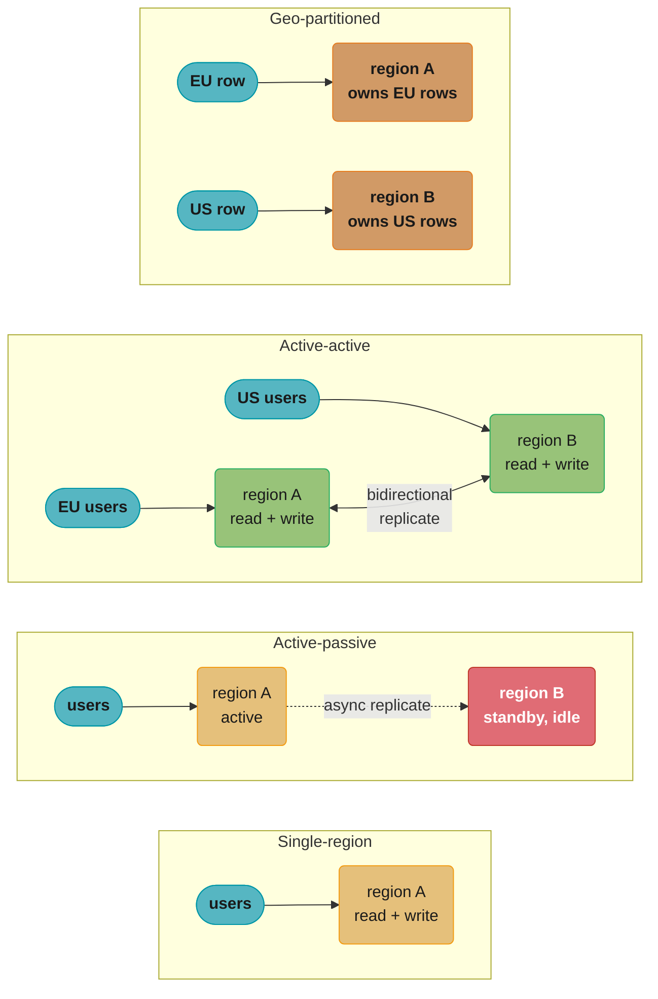
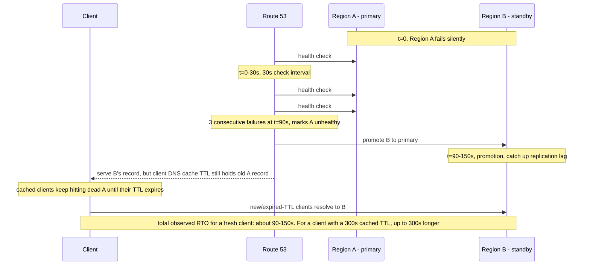
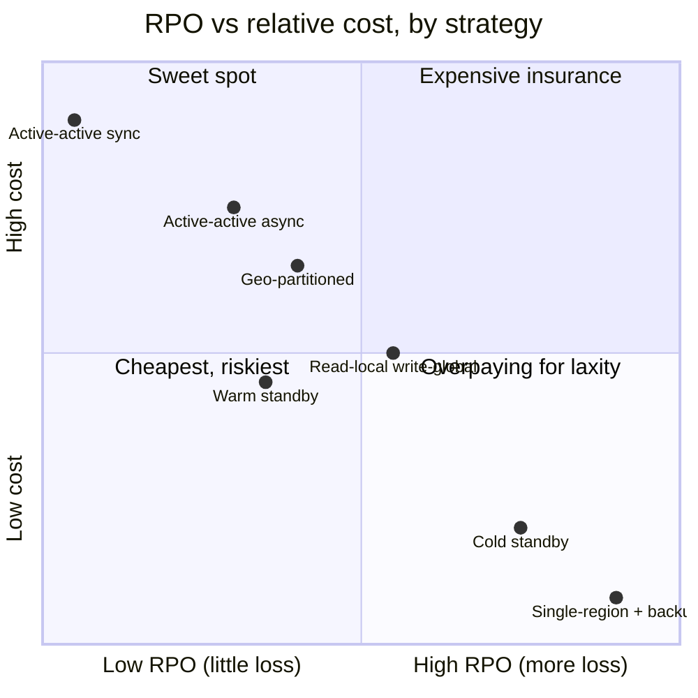
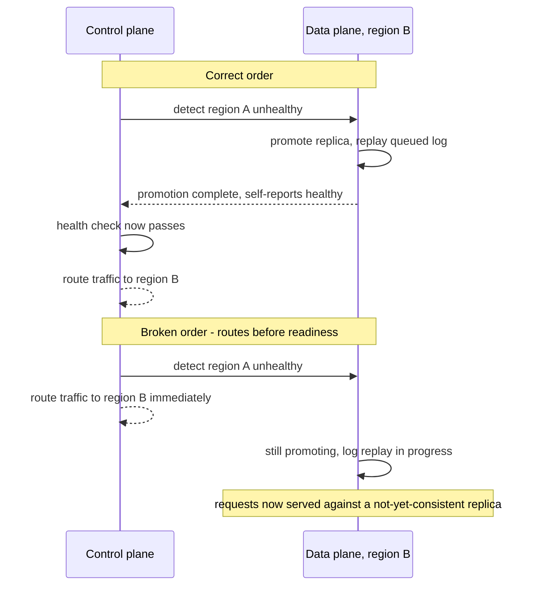
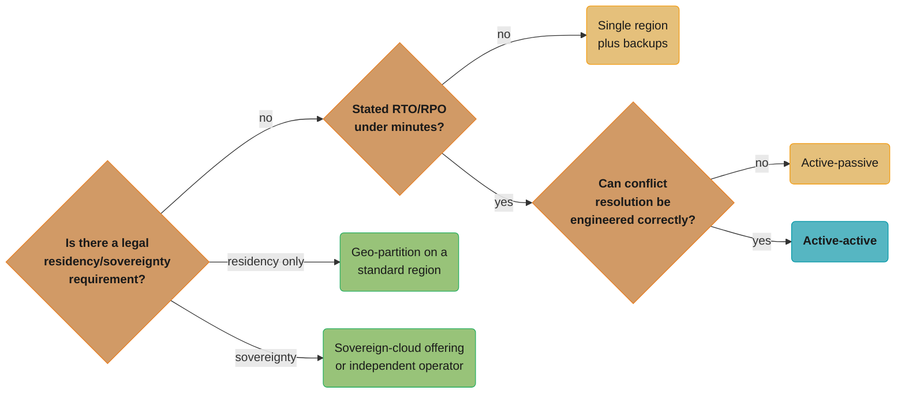

# Multi-Region Architecture and Data Residency

Where your bytes sit, who can be legally compelled to hand them over, and why "add a region" answers only the first question.

## 1. Concept Overview

A single-region deployment has one failure domain: the region. Every AWS, GCP, and Azure region has gone down at least once — most visibly the October 20, 2025 AWS US-EAST-1 disruption, a DNS-automation defect in DynamoDB's endpoint resolution that cascaded into a 15-hour outage touching EC2, Lambda, and dozens of downstream SaaS products (Snapchat, Reddit, Venmo, Slack among them), with insurance-loss estimates as high as $581M. If your entire stack lives in one region, that region's bad day is your bad day, full stop, and there is no engineering lever inside that region that fixes it — only a second, independent one does.

**"Just add a region" is simultaneously the correct answer to availability and the most misleading sentence in a design review**, because it gets asked to answer two different questions at once and only actually answers one of them:

- **Availability / disaster recovery** — "what happens to our uptime if a region disappears?" A second region genuinely fixes this, to the degree its RPO/RTO design allows (§3, §4).
- **Data residency and sovereignty** — "are we allowed to hold this EU citizen's data, and can a US court compel a US company to hand it over regardless of which region the bytes are stored in?" A second region **inside the EU** fixes the first half of that question (residency) and **does not touch the second half** (sovereignty) if the company operating that region is itself subject to a foreign legal order.

This module's thesis, stated once so it can be assumed everywhere else: **multi-region active/active is an availability and latency pattern; it is not a compliance strategy, and treating it as one is the single most common data-residency design error.** Region pinning controls *where the bytes physically sit* — that is residency, and it is the easy 80%. Sovereignty is the harder 20%: *who can be legally compelled to produce those bytes*, and that question is about corporate jurisdiction and government legal authority, not disk geography. Microsoft says this about its own EU Data Boundary product in plain language: as of 2026, "there is still no law that repeals the extraterritorial effect of the US CLOUD Act, which means that Microsoft cannot give an absolute guarantee that EU data will never be requested by US authorities" — from the vendor whose entire product is regional data pinning.

This module covers the architectures that solve the availability half (single-region through geo-partitioned and follow-the-workload), the mechanics that make cross-region writes hard (replication lag, conflict resolution, quorum placement, failover), and the residency/sovereignty distinction that decides whether any of those architectures actually satisfies a regulator. [CAP Theorem](../cap_theorem/cap_theorem.md) owns the consistency-availability tradeoff these architectures sit on top of; this module is about *where* the replicas live and *why*, not the replication protocol itself.

---

## 2. Intuition

> **One-line analogy**: A second region is a second warehouse in a different city — it protects you if one warehouse burns down. Data residency is a rule about which city the warehouse must be in. Data sovereignty is a rule about which *government* can order the warehouse's owner to open the door, and building a second warehouse across town doesn't change who owns the company that holds the keys.

**Mental model — the write path is the hard part, the read path is the easy part.** Reading from the nearest region is trivial: replicate data everywhere and let clients read the closest copy, stale by however long replication lag is. Writing is what breaks: if a customer in Frankfurt and a customer in São Paulo both update the same row within the same 100ms window, something has to decide which write wins, and that decision has to be made the same way in every region or the replicas diverge forever. Every architecture in §4 is really a different answer to "where does that decision get made, and how far does a write have to travel before it's durable."

**Why it matters.** Two numbers govern every conversation about multi-region: **RPO** (Recovery Point Objective — how much data can you afford to lose, measured in time) and **RTO** (Recovery Time Objective — how long can you afford to be down). An RPO of zero means synchronous cross-region replication, which means every write pays cross-region round-trip latency — 70-150ms transatlantic, permanently, on every write. An RPO of 60 seconds means asynchronous replication and a possible one-minute data loss on failover, but writes stay fast. There is no architecture that gives you RPO 0, RTO 0, and single-digit-millisecond writes at the same time; picking two of three is the entire design exercise, and a design review that skips stating the RPO/RTO number in seconds hasn't actually decided anything.

**Key insight — sovereignty is a legal-jurisdiction question, not a network-topology question.** A well-meaning architecture diagram with "EU data stays in eu-west-1" boxes and arrows answers "is the data physically in the EU" (residency) but says nothing about "is the company operating eu-west-1 itself subject to compulsion by a non-EU government" (sovereignty). Those are orthogonal axes — see the grid in §5.3 — and a design that conflates them ships a compliance claim the legal team cannot actually stand behind.

---

## 3. Core Principles

**1. Residency, sovereignty, and localisation are three different requirements, not synonyms.**
- **Data residency** — data must be stored within a specified geographic boundary (e.g., "customer data stays in the EU"). This is a location constraint, and region pinning solves it directly.
- **Data sovereignty** — data is subject to the laws of the jurisdiction it is collected in, *and* the operator of the infrastructure must not be legally compellable by a foreign government to produce it outside those laws. This is a corporate-jurisdiction and legal-authority constraint; region pinning alone does not solve it if the cloud provider is headquartered outside that jurisdiction.
- **Data localisation** — a stricter government mandate that certain categories of data (often government, health, or financial) must be processed *and* stored domestically, sometimes with additional restrictions on who may operate the infrastructure (e.g., a domestically-owned and domestically-staffed operator). This is the strictest of the three and is what genuine "sovereign cloud" offerings (§11) target.

A system can satisfy residency while failing sovereignty (EU-region AWS/Azure/GCP under GDPR before a Transfer Impact Assessment), and can only satisfy localisation with an offering purpose-built for it (AWS European Sovereign Cloud's independent EU-resident operating entity, or a national player like S3NS in France).

**2. GDPR does not ban international transfers — it gates them.** GDPR Chapter V restricts personal-data transfers outside the EEA unless one of four mechanisms applies, in order of preference: an adequacy decision (as of 2026, the European Commission has issued adequacy decisions for 16 non-EEA jurisdictions, including a Switzerland renewal from January 2024 and a UK decision renewed on 19 December 2025 and valid to 27 December 2031), Standard Contractual Clauses (SCCs) or Binding Corporate Rules as "appropriate safeguards," or a narrow Article 49 derogation. Following the 2020 *Schrems II* ruling, an SCC alone is not sufficient — the exporter must also run a **Transfer Impact Assessment (TIA)** judging whether the importing country's government-surveillance regime undermines the SCC's protections in practice, and add supplementary technical measures (e.g., encryption where the importer holds no plaintext key) if it does. *(Source: EDPB SME data-protection guide, Chapter V.)*

**3. The EU-US Data Privacy Framework is live law but is not stable ground to design against in 2026.** The DPF (the current EU-US adequacy mechanism, successor to the invalidated Privacy Shield) remains valid as of mid-2026, but its institutional footing has weakened: the Privacy and Civil Liberties Oversight Board — one of the safeguards the European Commission relied on to certify US "adequacy" — lost its quorum in January 2025 after three of five members were removed, and a June 29, 2026 US Supreme Court ruling (*Trump v. Slaughter*) cast doubt on the independence of the FTC, whose oversight the DPF's enforcement leans on. A challenge to the DPF (*Latombe*) was dismissed by the EU General Court in September 2025, but an appeal is pending before the CJEU, with a ruling expected late 2026 or early 2027. **Design implication:** do not architect a system whose only compliance story is "we rely on the DPF" without a fallback (SCCs + TIA) ready to take over, because this is not the first EU-US transfer framework to be struck down — Safe Harbor and Privacy Shield both were.

**4. The write path is what makes multi-region hard — reads are close to free.** Any read-heavy system can serve reads from the nearest replica cheaply; [CDN](../cdn/cdn.md) is the degenerate, maximally-cached case of exactly this. Writes are the hard part because a write has to be durable *somewhere agreed-upon* before it can be acknowledged, and "agreed-upon" is a distance problem the speed of light does not negotiate on: a synchronous round trip between Virginia and Frankfurt is physically bounded around 70-90ms one-way fiber propagation alone, before any processing.

**5. RPO and RTO are the two numbers that decide the architecture, not preferences to state afterward.** RPO decides sync vs. async replication (and therefore whether cross-region latency is paid on every write). RTO decides whether failover can be automatic (health-check-driven, seconds) or must involve a human decision (minutes to hours) — see [Resilience Patterns §4.7](../resilience_patterns/resilience_patterns.md) for the failover-trigger mechanics this module builds on. A design review that names an architecture ("we'll do active-active") without first stating an RPO and RTO number in seconds has picked a solution before stating the problem.

**6. Every strategy in §4 sits on the same CAP tradeoff, just at inter-region scale.** [CAP Theorem](../cap_theorem/cap_theorem.md) already establishes that a partition forces a choice between consistency and availability; a cross-region link going down *is* a partition, so every multi-region write path is a CP-or-AP decision made at a continental distance instead of a rack distance. Nothing new is being invented here — the same quorum, vector-clock, and CRDT machinery from that module and from [Database Sharding](../database_sharding/database_sharding.md) is being placed 4,000 miles apart instead of 4 racks apart, which is precisely what turns millisecond tradeoffs into 100-millisecond ones.

---

## 4. Types / Architectures / Strategies

Six strategies, ordered from cheapest/weakest to most expensive/strongest. Latency is approximate cross-region write latency under normal operation; RPO/RTO are typical achievable ranges, not universal constants.

| Strategy | RPO | RTO | Write latency | Relative cost | What it actually buys |
|---|---|---|---|---|---|
| Single-region + backups | Hours (last backup) | Hours-days (restore) | Local (~1-5ms) | 1x (baseline) | Nothing for regional outage; cheapest possible |
| Active-passive (warm standby) | Seconds-minutes (async replication lag) | Minutes (promote + reroute) | Local | ~1.5-2x | Survives regional outage; standby capacity often idle |
| Active-passive (cold standby) | Minutes-hours | Hours (provision + restore + reroute) | Local | ~1.1-1.3x | Cheapest DR with a real second region; slow to recover |
| Read-local / write-global | Near-zero for the single write region | Minutes-low hours for write availability | Local reads, cross-region writes (~70-150ms) | ~1.5x | Fast global reads; writes still single-point-of-failure |
| Active-active (multi-master) | Seconds (async) or zero (sync, at latency cost) | Seconds (health-check reroute) | Local (async) or cross-region (sync) | 2-3x | Best availability and latency; conflict resolution required |
| Geo-partitioned (home-region per row) | Depends on per-partition replication | Depends on per-partition failover | Local for in-region traffic | 2-2.5x | Solves residency directly; cross-partition queries get expensive |
| Follow-the-workload | Varies by data class | Varies | Local, wherever "local" currently is | 2-3x+ | Lowest latency for migrating users; highest operational complexity |

### 4.1 Single-Region with Cross-Region Backups

```
  write path:  client -> us-east-1 (only region) -> ack
               (no cross-region hop exists on the write path at all)
```

**RPO in practice: 15 minutes-24 hours**, set directly by backup/snapshot cadence — a nightly snapshot with hourly WAL/log shipping to the backup region bounds loss at roughly one hour; a bare nightly snapshot alone bounds it at up to 24 hours. **RTO in practice: 4-12+ hours** for a multi-hundred-GB dataset, dominated by cross-region transfer of the backup itself (the same egress cost called out in §10, Pitfall 6) plus cold compute reprovisioning — there is no promotion step to shortcut, because nothing in the second region is running yet. **Cost multiple: ~1.0-1.05x baseline** — backup storage and occasional cross-region snapshot copy typically add only a few percent to the primary region's bill, which is the entire appeal of this tier and the entire reason its RTO is the worst on the list.

### 4.2 Active-Passive (Warm Standby)

```
  write path:  client -> us-east-1 (primary) -> ack to client
                              |
                              +--(async ship, ~250ms batches)--> eu-west-1 (standby, read-only)
```

A fully provisioned, continuously-replicating standby in a second region, scaled to (or near) production capacity but receiving no live traffic. Promotion on failover is a data-plane operation (replica becomes primary) plus a control-plane operation (DNS/load-balancer cutover) — see §6.4 and §6.8 for why those two must be sequenced correctly. **RPO in practice: ~350ms-few seconds** at the batch/network/apply numbers worked in §6.6. **RTO in practice: ~120-150s for a fresh client, up to ~425s for a client holding a cached DNS answer** at a 300s TTL, per the phase-by-phase breakdown in §6.7 — unrehearsed and without automation, this routinely runs to tens of minutes instead (§10, Pitfall 1). **Cost multiple: ~2.0x baseline** when the standby is sized at full production capacity (§4.8's worked breakdown); cheaper only by trading away RTO safety margin.

### 4.3 Active-Passive (Cold Standby)

```
  write path:  identical to 4.1 (single write region);
               standby region holds DATA but has ZERO running compute
```

Same replication idea as 4.2, but the standby region holds data (via periodic backup/restore or lagged replication) without running provisioned compute. **RPO in practice: 5-30 minutes**, set by how frequently the lagged copy or restore point is refreshed — meaningfully tighter than pure backups (4.1) because the data transfer is incremental rather than a full nightly snapshot. **RTO in practice: 1-4 hours**, because "spin up compute, attach storage, warm caches, then promote" is now on the critical path of every failover, even though the data itself is already close to current. **Cost multiple: ~1.1-1.3x baseline** — storage-only in the standby region is cheap; the tradeoff is entirely in RTO, not RPO.

### 4.4 Read-Local / Write-Global

```
  write path:  client (any region) -> us-east-1 (sole write region) -> ack
  read path:   client (eu-west-1)  -> eu-west-1 local replica (async, may be stale)
               client (ap-southeast-1) -> ap-southeast-1 local replica (async, may be stale)
```

Reads are served from the nearest of many regions against a local (often async, eventually-consistent) replica; all writes are forwarded to a single designated region. **RPO for the write region's own durability is near-zero** (writes are durable the instant they're acknowledged there), but every read region trails behind it by its own replication lag — DynamoDB Global Tables' typical 1-2 second lag (§6.1) is the right order of magnitude to plan a staleness budget against. **RTO for write availability, if the write region fails, is effectively the same as 4.2 or 4.3** (minutes to hours) since some region still has to be promoted to accept writes; reads in the surviving regions may keep serving stale data throughout that window, which is itself a decision to make explicitly rather than an accident. This is the shape most systems reach for first because it is the cheapest way to fix *read* latency globally — but it leaves the single write region as a single point of failure for write availability, and it does not solve residency for any region other than the write region (a write forwarded from Frankfurt to us-east-1 physically leaves the EU on every write). **Cost multiple: ~1.5x baseline** — full compute in the write region, lighter read-replica footprint elsewhere.

### 4.5 Active-Active (Multi-Master)

```
  write path (async):  client (EU) -> eu-west-1 -> local ack
                                            |
                                    (bidirectional async replicate, ~250ms batches)
                                            v
                        client (US) -> us-east-1 <-------------------+

  write path (sync):   client (EU) -> eu-west-1 --RTT ~80-90ms--> us-east-1 ack
                                            <---------------------- (both must durably
                                                                       store before ack)
```

Every region accepts both reads and writes for at least some subset of data, with a replication/conflict-resolution layer (§6.2) reconciling concurrent writes to the same record made in different regions. **RPO: 0 under synchronous replication, or the same ~350ms-few-second figure as 4.2 under async** (§6.6). **RTO: seconds**, typically bounded by health-check detection alone (Route 53's ~90s default, per §6.7, or faster with a lower interval) since — unlike 4.2/4.3 — there is no promotion step at all: the surviving region was already accepting writes before the failure. Gives the best latency and availability profile on this list at the highest engineering cost: correctness now depends on getting conflict resolution right, and getting it wrong is silent (§6.2, §12 Q7) rather than loud. **Cost multiple: 2-3x baseline**, per §4.8's worked breakdown, since both regions run full production capacity simultaneously rather than one of them sitting idle.

### 4.8 Worked Example — What "2-3x Cost" Means in Practice

The relative-cost column in the table above hides a real decision: cost is driven far more by *how much of the second region is actually provisioned* than by which strategy is named.

```
  Baseline: single us-east-1 deployment costing $40,000/month in compute + storage.

  Active-passive, standby provisioned at FULL capacity (the safe default):
      second region compute+storage  ~ $38,000/month (near-identical footprint)
      cross-region replication data transfer (async, moderate write volume)
                                      ~  $2,000/month
      total                          ~ $80,000/month   -> ~2.0x baseline

  Active-passive, standby provisioned at 30% capacity ("save cost"):
      second region compute+storage  ~ $12,000/month
      total                          ~ $54,000/month   -> ~1.35x baseline
      BUT: this is §10 Pitfall 2 — the 30% figure is a real production
      incident waiting for its trigger, not a genuine cost optimization

  Geo-partitioned, EU + US each serving their own residents (not redundant
  copies of each other):
      EU region compute+storage      ~ $22,000/month (smaller EU user base)
      US region compute+storage      ~ $40,000/month (unchanged)
      total                          ~ $62,000/month  -> ~1.55x baseline
      (cheaper than full active-active because neither region is paying
       to duplicate the OTHER region's data, only to serve its own)
```

The lesson: "active-active costs 2-3x" and "geo-partitioned costs 2-2.5x" in the summary table are both real *ranges*, and where a specific design lands inside that range is a capacity-sizing decision, not a property of the strategy name alone — which is exactly why §13's advice is to size for the failover load in writing rather than trust the label.

### 4.6 Geo-Partitioned (Home-Region per Row)

```
  write path, EU customer row:
    client (Frankfurt) -> nearest gateway -> home_region lookup: "EU"
        -> routed to eu-west-1 cluster only -> ack
        (never touches us-east-1; no cross-region hop on the common path)

  write path, US customer row:
    client (Virginia) -> nearest gateway -> home_region lookup: "US"
        -> routed to us-east-1 cluster only -> ack

  cross-partition read (a report spanning every jurisdiction):
    aggregator -> fan out to EU cluster AND US cluster AND every other
                  partition -> merge results -> same N+1-shaped cost as
                  cross-shard queries in Database Sharding §4
```

Each row/record is pinned to a "home region" — typically derived from the customer's country or the entity's jurisdiction — and lives (and is served) from that region alone; this is [Database Sharding](../database_sharding/database_sharding.md)'s shard-key concept with the shard key specifically chosen to be a jurisdiction. This is the architecture that most directly answers a residency requirement, because "which region holds this row" becomes an explicit, auditable, per-row fact rather than an implicit consequence of replication topology.

**RPO and RTO are not single numbers here — they're per-partition, and that's the point.** A partition's RPO/RTO is whatever its own internal replication and failover story provides, independently of every other partition's. Two configurations are common: (a) each partition lives in exactly one region with only intra-region (multi-AZ) replication, so it inherits that region's own multi-AZ RPO (near-zero, synchronous within-region) and RTO (seconds to low minutes, no cross-region promotion) for everyday failures, but is fully unavailable if the *entire region* goes dark — regional-outage RTO becomes "however long that region takes to recover," which can be hours (§7, the October 2025 AWS outage); or (b) each partition gets its own smaller multi-region pair *within* its permitted jurisdiction — an EU partition replicated across eu-west-1 and eu-central-1 rather than to the US — which restores regional survivability without crossing the residency boundary at all. CockroachDB's **Super Regions** feature is built for exactly configuration (b): grouping several cloud regions inside one jurisdiction (e.g., Ireland, Frankfurt, and Paris grouped as a "Europe" super region) so that a table's replicas are guaranteed to never leave that group, even while surviving the loss of any one region inside it — residency and regional survivability satisfied by the same declaration, requiring at least three regions in the group to make the survival math work per §6.5.

It does not by itself solve sovereignty (§3, Principle 1) — the operator of the pinned region still matters, super-region or not. Cross-partition queries (a report spanning every jurisdiction) become genuinely expensive, the same cost [Database Sharding §4](../database_sharding/database_sharding.md) already documents for cross-shard queries generally, and the access-path problem in §12 Q6 (a query crossing the residency boundary even to *read* another partition) is unique to this strategy. **Cost multiple: ~2-2.5x baseline** for a two-jurisdiction split sized to each jurisdiction's own user base (§4.8's EU+US worked breakdown lands at ~1.55x for a modest EU footprint; a Super Regions configuration adds the cost of the extra in-jurisdiction regions in each group, typically pushing the multiple toward the higher end of the range).

### 4.7 Follow-the-Workload

```
  steady state:       client -> home region (wherever they were assigned)
  mid-migration:       client -> gateway checks migration-state table
                            -> in-flight?  dual-write old + new home region
                            -> not yet started? old home region only
                            -> complete?  new home region only
```

Data (or a user's "home" assignment) migrates to track where the workload actually is — a mobile user's session data moves toward whichever region they're currently closest to, or a tenant's data is relocated after a support ticket establishes their real jurisdiction. **RPO during a migration: effectively 0 for the migrated data**, because a correct migration dual-writes (or synchronously cuts over) rather than accepting any window where a write could land only in the region about to be abandoned. **RTO is really "migration duration,"** not a failure-recovery number — minutes for a single small tenant's row set, hours for a large one, dominated by how much data has to move and how conservative the cutover window is. Lowest steady-state latency achievable, and the only strategy in this list that can correct an initial placement mistake, at the cost of the migration machinery itself becoming a permanent, non-trivial subsystem (in-flight-request handling during migration, consistency during the cutover window, and idempotent re-migration on partial failure). **Cost multiple: 2-3x+ baseline** — full multi-region capacity like active-active, plus the migration-state store and dual-write path as a standing operational cost that never goes away, since new migrations keep happening.

---

## 5. Architecture Diagrams

### 5.1 Topology Spectrum



*Four topologies on one spectrum: single-region has no fallback at all; active-passive's standby (red) sits idle paying for capacity it may never serve; active-active's two regions (green) both serve live traffic and reconcile with each other; geo-partitioned (orange) never needs reconciliation because each row has exactly one owning region by design.*

### 5.2 Failover Timeline — DNS-Based Active-Passive



*Route 53's default health-check interval is 30 seconds with a 3-observation failure threshold, so detection alone costs about 90 seconds before any promotion begins — and every client still holding a cached DNS answer keeps hitting the dead region until its own TTL expires, which is why a low DNS TTL (30-60s) is part of the failover budget, not an afterthought (§6.4).*

### 5.3 Residency vs. Sovereignty — Two Independent Axes

```
                     WHO CAN BE LEGALLY COMPELLED TO PRODUCE THE DATA
                     EU-jurisdiction operator      Foreign (e.g. US) operator
                    +------------------------------+------------------------------+
  DATA PHYSICALLY   |                              |                              |
  LOCATED IN EU     |   RESIDENCY:  satisfied      |   RESIDENCY:  satisfied      |
  (region pinning)  |   SOVEREIGNTY: satisfied     |   SOVEREIGNTY: NOT satisfied |
                    |   e.g. S3NS (France),        |   e.g. standard AWS/Azure/   |
                    |   sovereign-cloud offerings  |   GCP EU region, pre-2026    |
                    +------------------------------+------------------------------+
  DATA PHYSICALLY   |                              |                              |
  LOCATED OUTSIDE   |   RESIDENCY:  NOT satisfied  |   RESIDENCY:  NOT satisfied  |
  EU                |   SOVEREIGNTY: n/a - moot,   |   SOVEREIGNTY: NOT satisfied |
                    |   residency already fails    |   the naive multi-region     |
                    |                              |   "just add a region" case   |
                    +------------------------------+------------------------------+

  Only the top-left cell satisfies BOTH requirements. Multi-region active/active
  into an EU AWS/Azure/GCP region alone moves you from bottom-right to top-right:
  residency fixed, sovereignty still open, because a US-headquartered operator
  remains subject to US legal process (CLOUD Act) regardless of where the disks are.
```

*The two axes are independent by construction: which axis a given architecture change moves you along is the single most useful question to ask before calling a design "compliant" — see §3 Principle 1 and Q1/Q2 in §12.*

### 5.4 Strategy Placement — Recovery Point vs. Relative Cost



*Cost climbs steeply only once RPO is pushed toward zero (bottom-right region — synchronous active-active) because that is the only region where every write pays cross-region round-trip latency; everything left of it is buying availability, not RPO, and gets there far more cheaply.*

---

## 6. How It Works — Detailed Mechanics

### 6.1 Replication Lag Budgeting

Async cross-region replication lag is a function of distance (propagation delay), link bandwidth relative to write volume, and the replication protocol's own overhead (batching, log-shipping cadence). Rough one-way fiber propagation floors: US-East to US-West ~30-40ms, US-East to EU-West ~35-45ms, US-East to AP-Southeast ~90-110ms — real observed replication lag is typically several times the pure propagation floor once serialization, batching windows, and queueing are included. DynamoDB Global Tables, for example, publish a `ReplicationLatency` metric per replica pair and typically replicate within one to two seconds under normal load, with the number rising for geographically farther pairs (e.g., Ireland-to-Sydney runs measurably higher than Ireland-to-London).

**RPO is a direct function of this lag under async replication**: if the primary region dies at an arbitrary instant, everything written in the last `lag` milliseconds and not yet shipped to the standby is lost on failover. Sizing the acceptable RPO means sizing the acceptable lag, which means either provisioning more replication bandwidth, accepting the lag, or switching to synchronous replication and paying the round-trip latency on every write instead.

### 6.2 Conflict Resolution — LWW vs. CRDT vs. Application Merge

Active-active (§4.5) requires a rule for when two regions write the same record concurrently:

- **Last-Write-Wins (LWW)** — attach a timestamp (or logical clock) to every write; the write with the higher timestamp wins, the other is silently discarded. Cheap and simple, and the default in many multi-region NoSQL stores, but it *silently drops data* — the losing write simply vanishes, and clock skew between regions can make "last" wrong relative to real-world ordering. See [CAP Theorem §6](../cap_theorem/cap_theorem.md) for the full LWW/vector-clock treatment; this module only restates the multi-region consequence.
- **CRDTs (Conflict-free Replicated Data Types)** — data structures (counters, sets, registers) with merge functions mathematically guaranteed to converge to the same result regardless of the order updates are applied in. No data is silently dropped, but the data model is constrained to what has a known CRDT (increment-only counters, add-wins sets) — not every business object maps cleanly onto one.
- **Application-level merge** — the write path detects the conflict and calls domain-specific logic to reconcile it (e.g., a shopping cart merges two concurrently-added item lists instead of picking one). Most correct for business semantics, most engineering effort, and it means every mutable entity that can be written from two regions needs its own merge function written and tested.

**Worked on one concrete row.** Shopping cart `cart_9921`, starting state `{items: [sku_A], qty: {sku_A: 1}}`, replicated to both `eu-west-1` and `us-east-1`. At `t=0` (pre-replication, both sides identical) a customer's two open tabs each fire a write within the same 200ms window — one from the EU region, one from the US region, each unaware of the other:

```
  EU write @ t=100ms (logical clock 100):  add sku_B, qty 1
      -> cart_9921 = {items: [sku_A, sku_B], qty: {sku_A:1, sku_B:1}}

  US write @ t=140ms (logical clock 140):  increment sku_A to qty 2
      -> cart_9921 = {items: [sku_A],       qty: {sku_A:2}}

  LWW (compares clock 100 vs 140, US wins):
      final state = {items: [sku_A], qty: {sku_A:2}}
      LOST: sku_B was added and then silently vanishes -- no error, no
      merge, the customer's EU tab just "loses" the item with no signal

  CRDT (add-wins set for items, PN-counter for qty):
      final state = {items: [sku_A, sku_B], qty: {sku_A:2, sku_B:1}}
      GAINED: both operations survive and compose, because "add sku_B"
      and "increment sku_A" are commutative under the CRDT's merge rule
      COST: qty had to be modeled as a counter CRDT from day one, and
      "remove item" needs its own CRDT (e.g. a tombstone set), not a
      plain delete -- the data model was constrained up front (§6.2)

  Application merge (domain rule: "union items, sum quantities on
  same-item concurrent adds, last-write on genuine field conflicts"):
      final state = {items: [sku_A, sku_B], qty: {sku_A:2, sku_B:1}}
      SAME correct result as the CRDT here, but reached by a hand-written
      merge function for THIS entity -- cart_9921 -- and every other
      mutable entity (invoices, inventory counts, user profiles) needs
      its own version of this function, reviewed and tested separately
```

The three approaches don't just differ in engineering cost — LWW is the only one of the three that *loses information silently*, which is exactly why §10 and §13 both call out documenting what a conflict-resolution choice drops as a non-optional step, not a footnote.

**A fourth option that sidesteps the conflict entirely: replicate the log, not the state.** [Event Sourcing / CQRS](../event_sourcing_cqrs/event_sourcing_cqrs.md) models every write as an immutable, appended event rather than an in-place mutation. Appends from two regions don't collide the way two competing updates to the same row do — both events are valid, ordered facts, and each region's read-model projection can fold them in as they arrive. This doesn't eliminate conflict resolution (two events that are semantically contradictory, like "cancel order" and "ship order" arriving out of causal order, still need a rule), but it narrows the problem from "reconcile arbitrary concurrent mutations" to "sequence and interpret a stream of facts," which is a meaningfully easier problem and is why event-sourced systems are a common answer to active-active correctness in domains — inventory, ledgers — where LWW's silent data loss (§10, Pitfall on conflict resolution) is unacceptable.

### 6.3 Split-Brain During a Partition

If the inter-region link fails but both regions' local health checks still pass, an active-active or a mis-configured active-passive setup can end up with **two regions each believing they are the (sole) primary**, both accepting writes that the other never sees — this is exactly the partition half of [CAP Theorem](../cap_theorem/cap_theorem.md), manifesting as diverging, unmergeable state instead of a clean unavailability.

**The exact moment each side commits divergent state, without a quorum guard:**

```
  t=0s     inter-region link fails; A and B can no longer reach each other
  t=0-5s   A's local health checks: all green (A has no idea B is unreachable
           except via the now-dead cross-region link)
  t=0-5s   B's local health checks: also all green, symmetrically unaware
  t=6s     A accepts write W1 (row X = "shipped"), commits LOCALLY, acks client
  t=9s     B accepts write W2 (row X = "cancelled"), commits LOCALLY, acks client
           -- BOTH writes are now durably committed and acknowledged, on
           opposite, mutually contradictory values, with no quorum check
           on either side to have prevented it
  t=30s    link heals; A and B exchange state; row X is now IRRECONCILABLE
           by timestamp alone if W1 and W2 happen to race within clock skew
```

The standard defenses: a majority-quorum requirement for accepting writes (a region isolated from the majority refuses writes rather than assuming primacy — a 2-of-3 setup would have refused W1 or W2 the instant either side found itself unable to reach a majority, see §6.5), and a fencing token / generation number that lets a returning region detect it was demoted while partitioned and refuse to re-merge stale writes as authoritative. [Consensus Algorithms](../consensus_algorithms/consensus_algorithms.md) covers the leader-election and term-number machinery that implements this correctly; a hand-rolled "ping the other region and hope" health check does not.

### 6.4 DNS vs. Anycast vs. Global Load Balancer Failover

- **DNS failover** (Route 53, Cloud DNS, Azure Traffic Manager) — clients resolve a hostname to the healthy region's IP; failover means updating the DNS answer. Cheapest and simplest, but bounded by two independent delays: the health-check detection time (§5.2 — 30s interval x 3 observations = ~90s for Route 53's default) and the **client-side DNS TTL**, since any resolver or client holding a cached answer keeps using it until that TTL expires regardless of how fast the authoritative record changed. Setting TTL to 30-60s during steady state trades a small amount of extra DNS query volume for a bounded worst-case client-side delay.
- **Anycast** — the same IP address is announced from multiple regions via BGP; the network layer itself routes each client to the topologically nearest healthy announcement, with no client-side DNS caching problem at all since the IP address never changes. Failover speed depends heavily on *how* the route disappears: a router or link that simply goes dark lets neighboring routers reconverge onto the next-nearest announcement almost immediately, while a deliberate prefix *withdrawal* has to propagate across the internet's BGP mesh — Cloudflare's own numbers put internal network convergence around 20 seconds, but full internet-wide convergence for a withdrawal in the 2-15 minute range due to BGP "path hunting" across independently-converging Tier-1 networks. Running anycast also requires owning the IP space and BGP relationships (Cloudflare and the major CDNs operate this way) — it is not available as a simple flag in most managed cloud offerings, which is why §6.7's DNS-based worked example, not anycast, is the default most teams actually operate.
- **Global (Layer-7) load balancer** — a provider-operated global front door (AWS Global Accelerator, GCP's global external LB) holds the anycast/BGP complexity for you and does health-check-driven routing at the load-balancer layer instead of DNS, avoiding client-side TTL caching entirely, at the cost of routing through the provider's edge network rather than direct anycast.

### 6.5 Quorum Placement Across Three Regions

A 3-region quorum-based cluster (e.g., a 3-region CockroachDB or Spanner-style deployment) tolerates the loss of **any one entire region** while remaining both readable and writable, because a majority (2 of 3) is still reachable:

```
  3 regions, replication factor 3, majority quorum = 2 of 3

  Region A (2 votes worth of data) --\
  Region B (2 votes worth of data) ---+--> majority = 2/3 reachable -> writes proceed
  Region C (2 votes worth of data) --/

  Region C goes dark (regional outage):
    remaining quorum = A + B = 2/3  -> still a majority -> cluster stays writable
    RPO = 0 for any write already acknowledged (it was durable on 2 of 3 before ack)
    RTO = time to detect C's loss + re-elect leadership for any range C was leading

  2 regions only (no witness/third region):
    losing either region drops the survivor to 1/2 -> NOT a majority -> writes halt
    this is why 2-region "HA" setups need a lightweight third-region witness/tiebreaker
```

**The latency arithmetic for one quorum write.** A quorum write only has to wait for a *majority*, not for every region — so its latency is governed by the FASTER of the two remote round trips, not the slower one:

```
  Leader region: us-east-1 (Virginia)
  Peer regions:  us-west-2 (Oregon),  eu-west-1 (Ireland)

  Approximate one-way fiber-propagation floors (physics, not a product SLA):
    us-east-1 <-> us-west-2:  ~30-40ms one-way  ->  ~60-80ms round trip
    us-east-1 <-> eu-west-1:  ~35-45ms one-way  ->  ~70-90ms round trip

  Write arrives at leader (us-east-1):
    leader durably writes locally                       -> ~1-5ms
    leader sends to BOTH peers in parallel, needs ANY ONE ack for quorum:
        us-west-2 ack lands                              ~60-80ms
        eu-west-1 ack lands                               ~70-90ms
    quorum (leader + 1 peer) reached at the FASTER of the two            -> ~60-80ms
    write acknowledged to client at                                     -> ~60-80ms

  Contrast: a SYNC-TO-ALL write (not quorum, every replica must ack)
    must wait for the SLOWER round trip                                 -> ~70-90ms
    -- the ~10-20ms gap between "wait for one" and "wait for all" is the
       quorum write's entire latency advantage over full synchronous
       replication, and it grows as more, farther-apart peer regions
       are added (quorum's cost stays "wait for the closest," full-sync's
       cost keeps climbing to "wait for the farthest")
```

This is the concrete mechanism behind §8's "quorum write" row: quorum buys RPO=0 durability at roughly the round trip to whichever peer region is *closer*, not the sum or the maximum of all peers — the same principle CAP Theorem's quorum treatment establishes at rack distance, just measured here in tens of milliseconds instead of tens of microseconds.

Google Cloud Spanner's multi-region configurations follow this shape explicitly: every multi-region instance spans at least three regions — a default leader region, a secondary read-write region, and a witness region — specifically so that losing the leader region still leaves a majority for Paxos-based consensus to keep operating, and Spanner publishes a 99.999% availability SLA (under five minutes of downtime per year) for multi-region configurations on that basis. CockroachDB's equivalent concept is named **Survival Goals**: a `REGION` survival goal (vs. the default `ZONE` goal) explicitly requires enough cross-region replica placement to survive a full region's loss, configured per database with a declarative SQL statement rather than left as an emergent property of wherever replicas happen to land.

### 6.6 RPO Budgeting — Symbol Table and Worked Example

```
  RPO(t) = max possible data loss if the primary dies at instant t
         = (time since the last replicated write reached durable
            storage in the recovery region)

Symbol            | What it is
------------------|---------------------------------------------------
write rate        | writes/sec the primary is accepting
batch interval    | how often the replication stream flushes/ships
network + apply   | one-way transit time + time for the standby to
                   | durably apply the batch it received
worst-case RPO     | batch interval + network + apply time
```

**Walk one example.** A primary accepting 500 writes/sec, replicating to a standby 4,000 miles away via a change-stream that batches every 250ms:

```
  batch interval                         =  250 ms
  cross-region network transit (EU<->US) =   80 ms
  standby apply time (small batch)       =   20 ms
  ----------------------------------------------------
  worst-case RPO                         =  350 ms

  In writes: 500 writes/sec x 0.350 s = 175 writes potentially
  unreplicated at the instant of failure -- this is the number that
  belongs in the design doc, not "RPO: seconds" as a vague label.

  Doubling the batch interval to 500ms (fewer, larger batches, lower
  replication overhead) moves worst-case RPO to ~600ms and ~300 writes
  at risk -- a concrete tradeoff between replication efficiency/cost
  and exposure, not a free efficiency win.
```

**Why this matters for the sync-vs-async decision (§8).** The same arithmetic run with 0ms batch interval (fully synchronous, every write waits for the remote ack) drives worst-case RPO to 0 by construction — because there is no unacknowledged window left to lose — at the cost of moving that 80ms of network transit from "background replication cost" to "every single client-visible write latency," which is precisely the 90ms figure discussed in §12 Q3.

### 6.7 RTO Breakdown — Worked Example (DNS-Based Active-Passive)

Continuing §5.2's timeline with the actual arithmetic behind the "~90-150s" figure:

```
Phase                          | Typical duration | Cumulative
--------------------------------|-------------------|------------
Health-check detection          | 3 x 30s interval  |     90 s
  (Route 53 default: 3 consecutive failed observations)
Standby promotion               |     10-30 s       |    120 s
  (replica promoted to primary; replays any final queued WAL)
DNS record update propagation   |      1-5 s         |    125 s
  (authoritative record change itself is near-instant)
Client-side cached-TTL drain    |   0 to TTL seconds |  125 s to (125+TTL) s
  (any client holding a cached answer keeps hitting the dead
   region until ITS OWN cached TTL expires)
--------------------------------|-------------------|------------
Fresh client RTO                                    |   ~120-150 s
Worst-case cached client RTO (TTL=300s)              |   ~425 s
```

**The lever that is actually in the architect's control:** detection and promotion time are mostly fixed by the provider's health-check mechanics and the database's own promotion speed, but **DNS TTL is a config value set months in advance of any incident** — the difference between a 30s TTL and a 300s TTL is the difference between a ~150s worst-case RTO and a ~450s one, for zero additional infrastructure cost. This is why §13 lists lowering the TTL as a standing best practice rather than an incident-response action: it has to already be low before the incident starts, because changing it *during* the incident doesn't help the clients who already cached the old answer under the old, longer TTL.

### 6.8 Data-Plane vs. Control-Plane Failover

Every failover has two halves that are easy to conflate but must be reasoned about separately:

- **Data-plane failover** — the actual serving path: the standby database becomes writable, replicas start accepting the traffic that used to hit the primary, the request path itself changes. This is the half that determines RPO (how much data survived) and directly determines whether requests succeed once they arrive.
- **Control-plane failover** — the orchestration layer that *decides* a failover should happen and *routes* traffic to the new data-plane target: health checks, the DNS/load-balancer update, the automation (or human) that pulls the trigger. This is the half that determines detection time and propagation time (§6.7's phase 1 and 3).

**Why the distinction matters.** A data-plane that is perfectly healthy and ready to serve is useless if the control plane never routes traffic to it (a health check pointed at the wrong endpoint, an IAM role the promotion automation lost access to). Conversely, a control plane that flips traffic instantly is dangerous if the data plane it's routing to hasn't actually finished promotion (in-flight replication not yet applied, connections not yet warmed) — this is precisely how a well-intentioned "fast failover" can serve requests against a not-yet-consistent standby, producing correctness bugs that look like nothing was wrong with the *infrastructure* at all.

**The ordering rule**: control-plane routing should never point at a data-plane target that has not confirmed its own readiness — promotion (data plane) completes and self-reports healthy *before* the control plane's health check for that target can pass, not after. [Resilience Patterns §4.7](../resilience_patterns/resilience_patterns.md) makes the same distinction for a single dependency's health-check-driven failover; here it is the same rule applied to an entire region.



*The correct sequence gates the traffic-routing step on the data plane's own readiness signal; the broken sequence treats "region A is unhealthy" as sufficient reason to route to region B, without ever asking whether region B is done promoting — the gap between those two events is exactly where §6.7's promotion-phase seconds turn into served-but-wrong responses.*

---

## 7. Real-World Examples

**Netflix** runs active-active across three AWS regions (us-east-1, us-west-2, eu-west-1) on the explicit design principle that any region must be able to serve all global traffic alone. During the December 2021 us-east-1 AWS outage, Netflix evacuated live traffic out of the failing region without a customer-visible outage. Its recurring "Chaos Kong" drills deliberately evacuate an entire region under live traffic to validate the failover path continuously rather than trusting it untested; one recorded drill moved 18TB of inter-region traffic at 9Gbps and recorded over a million database reads and writes during the failover window without data loss. The design target is explicit: survive the loss of *any two* of the three regions and still serve all traffic from the third.

**AWS's own October 2025 outage** is the case for why "single region, even a famously reliable one" is a business risk rather than a hypothetical: a DNS-automation defect in DynamoDB's endpoint resolution in us-east-1 alone produced a 15-hour disruption cascading into EC2, with over 17 million user-facing outage reports across companies that had no direct AWS dependency of their own visible to their customers (Snapchat, Reddit, Venmo, Slack, Atlassian, and others), and an estimated insurance-loss range up to $581M from a single region's bad day.

**AWS European Sovereign Cloud** launched its first region in Brandenburg, Germany in January 2026, structured specifically to answer the sovereignty half of §3 Principle 1 rather than only the residency half: it is operated as a physically and logically separate partition from other AWS regions, run exclusively by EU-resident staff, backed by an independent EU entity, with a committed €7.8B investment and third-party audit validation of its sovereignty criteria underway in 2026 — a materially different commitment than "your data is stored in an EU AWS region," which standard AWS regions already offered.

**Microsoft's EU Data Boundary**, completed on 26 February 2025 and expanded through 2026 to cover AI/Copilot processing, telemetry, and confidential computing, keeps customer data, system-generated logs, and support data inside the EU/EFTA region for Microsoft 365, Dynamics 365, Power Platform, and Azure — a strong residency commitment. Microsoft is simultaneously explicit, in its own 2026 public statements, that this does not extend to sovereignty: no law repeals the extraterritorial reach of the US CLOUD Act, so Microsoft "cannot give an absolute guarantee that EU data will never be requested by US authorities" — the exact residency/sovereignty gap this module's thesis is built on, stated by the vendor selling the residency product.

**Google Cloud** has taken a different tack, partnering with regionally-owned operators for the sovereignty layer rather than only building an internal boundary: S3NS in France (qualified to SecNumCloud 3.2, described as Europe's highest sovereignty regulatory bar), and Thales/T-Systems-operated offerings in Germany, alongside its own Data Boundary controls for standard regions.

**Kindred Group**, an online gambling operator spanning multiple national jurisdictions, adopted CockroachDB's geo-partitioning specifically to satisfy GDPR: assigning each user's data a home region policy lets the same logical database serve customers across Europe while pinning EU personal data to EU-region replicas — the row-level version of §4.6 rather than a whole-database split. A separate CockroachDB customer, an electronics-lock manufacturer serving European, Asian, and North American customers, chose geo-partitioned replicas over both Google Spanner and Amazon Aurora specifically because it needed low-latency local reads *and* GDPR-compliant regional pinning simultaneously — a case where "just add read replicas everywhere" (§4.4) was explicitly rejected because it didn't solve residency, only latency.

---

## 8. Tradeoffs

### By requirement satisfied

| Requirement | Single-region | Active-passive | Active-active | Geo-partitioned | Sovereign cloud offering |
|---|---|---|---|---|---|
| RPO | Hours (backup cadence, §4.1) | ~350ms-few sec async (§6.6); 0 if sync | 0 sync / ~350ms-few sec async (§4.5) | Per-partition — 0 intra-region, or region-scale if super-regioned (§4.6) | Depends on the region topology behind it, same as the strategy it wraps |
| RTO | 4-12+ hrs (§4.1) | ~120-425s incl. TTL drain (§6.7) | Seconds — detection only, no promotion (§4.5) | Region-scoped; whole-region loss can equal single-region's RTO unless super-regioned | Same as the underlying strategy, plus any sovereign-specific promotion constraints |
| Regulatory posture: residency | Satisfied only for its one region's users | Satisfied only for whichever region is currently active | Satisfied only if writes are pinned per-region, not free-floating | Satisfied by design — the architecture's entire purpose | Satisfied — sovereign SKUs are built around a residency boundary |
| Regulatory posture: sovereignty | Depends entirely on the operator's jurisdiction, unaffected by region choice | Same — unaffected by which region is active | Same — unaffected by which regions are live | Same — geo-partitioning alone does not change who operates the pinned region (§3, Principle 1) | This is the one column sovereign offerings are specifically built to change |
| Operational complexity | Lowest | Low-medium | High | Medium-high | Medium-high, plus vendor lock-in to the sovereign SKU |
| Cost multiplier vs. baseline | ~1.0-1.05x (§4.1) | ~2.0x at full-capacity standby (§4.8) | 2-3x (§4.8) | ~2-2.5x, higher with Super Regions (§4.6) | ~2-4x — sovereign SKUs price above standard regions for the same topology |

### Consistency vs. latency vs. cost, concretely

| Choice | Effect on writes | Effect on RPO | Cost |
|---|---|---|---|
| Synchronous cross-region replication | Every write pays full cross-region RTT (~70-150ms) | RPO = 0 | Highest — no capacity saved by idling a standby |
| Asynchronous cross-region replication | Local write latency (~1-5ms) | RPO = replication lag (often 1-2s, up to tens of seconds under load) | Lower — standby/secondary can run leaner |
| Quorum write (2-of-3 regions) | One cross-region RTT to the nearer of two remote regions, not both | RPO = 0 for acknowledged writes | Medium — pays for 3 full regions, not 2 |

**The regulatory-posture line item that doesn't show up in an infrastructure bill:** a Transfer Impact Assessment, ongoing SCC maintenance, and legal review of a sovereign-cloud contract are real, recurring costs that scale with headcount in the legal/compliance function, not with traffic — and they are the cost most often left off the "multi-region costs more" slide entirely.

### Which requirement forces which architecture

Not every regulatory or business trigger implies the same design; naming the actual trigger narrows the choice fast.

| Trigger | Forces | Does NOT force |
|---|---|---|
| "EU customer data must stay in the EU" (residency) | An EU region + geo-partitioning or per-tenant pinning (§4.6) | A sovereign-cloud SKU, a second write path, sub-second RPO |
| "No foreign government may compel access" (sovereignty) | A jurisdictionally-independent operator or documented compensating controls (§11) | Necessarily a second region at all — a single sovereign-boundary region can suffice if availability needs are modest |
| "Uptime SLA 99.95%+, RTO under 5 minutes" (availability) | A warm standby or active-active in a second region (§4.2/§4.5) | Any specific residency posture — the second region can be anywhere latency and cost favor |
| "Sub-100ms reads for users on three continents" (latency) | Read replicas or geo-partitioning near each user population | Cross-region synchronous writes — reads and writes can be solved independently |
| "Zero tolerance for lost transactions" (RPO = 0) | Synchronous replication or quorum writes (§6.5, §6.6) | Active-active specifically — a sync active-passive pair also achieves RPO 0 |

The recurring mistake this table is meant to prevent: reading "residency" and reaching for "active-active" (an availability pattern) or reading "high availability" and reaching for a sovereign-cloud SKU (a legal-jurisdiction pattern) — each solves a different trigger than the one named, at a cost premium the actual requirement never asked for.

---

## 9. When to Use / When NOT to Use

### A second region is genuinely unnecessary when
- Product-market fit is still being found and every hour spent on region 2 is an hour not spent finding it — this is real opportunity cost, not laziness.
- The business's own tolerance for downtime, honestly stated, exceeds what a single well-run region with good backups already delivers (many internal tools, low-traffic B2B products, and early-stage SaaS genuinely fit here).
- There is no data-residency or sovereignty requirement in play, and all users are geographically close to the one region already (a single-country product with a single-country user base).
- The team cannot yet operate *one* region reliably — see [Resilience Patterns §4.9](../resilience_patterns/resilience_patterns.md) on cell-based architecture: adding a second full region multiplies every existing operational gap by two before it multiplies availability by anything.

### Multi-region is required, not optional, when
- A named regulation mandates data residency or localisation for the data category involved (health records, government data, certain financial data under national law) and the primary user base is outside the current region.
- The business's actual RTO/RPO requirement (stated in seconds, not adjectives) cannot be met by single-region backup/restore — e.g., a payments system that cannot tolerate more than 30 seconds of write unavailability.
- Cross-continental read latency is itself the product's competitive constraint (a global real-time collaboration or gaming product where 150ms extra round-trip is a felt difference).

**A rough revenue-at-risk threshold worth stating out loud in the design review:** if the fully-loaded cost of a second region (§4.8's worked ~2x multiplier) exceeds the expected cost of the outages it prevents — `outage frequency x outage duration x revenue-per-hour-of-downtime` — the second region is a net cost, not a hedge, and the honest answer is to accept the risk explicitly rather than build the region anyway because "more resilient" sounds like it can't be wrong. This is the same math that makes §9's "genuinely unnecessary" list genuinely unnecessary, made explicit rather than left as intuition.

### A Decision Path, Not a Checklist

The three questions below have to be answered **in this order** — each one changes what the next question even means, and answering them out of order is how "multi-region for compliance" (§12 Q11) turns into the wrong architecture built for the right-sounding reason.



*The residency/sovereignty question is asked first because it constrains WHICH regions are even eligible before availability math is applied to them — deciding the availability architecture before the legal one routinely produces a design that has to be partly rebuilt once Legal weighs in (§14, Step 1).*

---

## 10. Common Pitfalls

**1. The standby that was never exercised.** A warm standby that has replicated correctly for two years but has never actually taken production traffic is a hypothesis, not a disaster-recovery plan — schema drift, IAM permissions that were only ever granted in the primary region, and stale connection strings hard-coded to the primary's endpoint all accumulate invisibly until the one day promotion is actually attempted, live, during an outage. Netflix's Chaos Kong (§7) exists specifically because "we believe failover works" and "we watched failover work last Tuesday" are different claims.

*Broken:* Standby region provisioned at launch, replication dashboard green for 18 months, DR runbook never executed outside a tabletop exercise. **Incident shape:** primary region goes down; automated promotion fires against the standby; the standby's IAM role — created 18 months earlier and never touched since — is missing the write permission a schema migration added to the primary's role eleven months ago. Promotion aborts mid-way, 40 minutes into what the runbook estimated as a 5-minute operation, with the database now in an ambiguous half-promoted state that a human has to untangle manually before failover can even be retried.
*Fix:* Scheduled, automated game-day failovers that shift real (or shadow) production traffic to the standby on a cadence (monthly or quarterly), with the promotion runbook itself being the thing under test, not just the replication link — a monthly drill would have caught the missing IAM permission on drill #1, at zero customer impact, instead of on the real incident eighteen months later. [DevOps: Disaster Recovery and Resilience](../../devops/disaster_recovery_and_resilience/disaster_recovery_and_resilience.md) owns the operational runbook, backup-testing cadence, and DR-drill tooling in full depth; this module only covers where the regions and the replication topology that runbook operates against come from.

**2. Asymmetric capacity — failing over into a region that cannot hold the load.** A standby provisioned at 20% of primary capacity "to save cost" looks fine on every dashboard until the day it becomes primary and immediately falls over under 100% of production traffic, converting a regional outage into a *second*, self-inflicted outage in the failover target.

*Broken:* Standby sized for steady-state cost efficiency, silently assumed to auto-scale fast enough during a failover. **Incident shape:** primary carries 10,000 req/s across 40 instances; standby is sized at 8 instances (20%) to save ~$14,000/month. Failover routes the full 10,000 req/s at the standby; auto-scaling needs ~6-8 minutes to add capacity under this provider's launch-time SLAs, but connection pools and CPU are saturated within the first 30 seconds — p99 latency goes from 80ms to 12+ seconds and the standby's own health checks start failing, so control-plane routing (§6.8) flaps between "standby is up" and "standby is down" for the entire scale-up window instead of settling into steady degraded service.
*Fix:* Size the standby (or the geo-partitioned peer regions) for the actual failover load, or explicitly and visibly accept a degraded-capacity mode during failover — but decide which one on purpose, in writing, not by omission. A standby at 100% capacity for this example costs the full ~$70,000/month rather than ~$14,000/month; the $56,000/month difference is the real, budgeted price of avoiding the second, self-inflicted outage above — not a number to discover during the incident.

**3. Cross-region chatty calls.** A service in region A making a dozen sequential synchronous calls to a dependency in region B pays cross-region RTT a dozen times sequentially instead of once — the same N+1 problem [Database Sharding](../database_sharding/database_sharding.md) documents for cross-shard queries, now at 70-150ms per hop instead of sub-millisecond. This most often creeps in when a "geo-partitioned" design's home-region boundary is drawn around data but not around the service calls that touch it.

**4. A "global" table that silently pins the whole system to one jurisdiction.** A shared reference table (feature flags, currency rates, a customer lookup) that everything reads gets placed in "whichever region is primary" for convenience, and every other region's request path now has a hidden dependency on that one region — quietly reintroducing both a single point of failure and, if that region is outside the customer's jurisdiction, a residency violation for any request that has to consult it.

**5. Encryption keys living in the wrong region.** Data pinned correctly to an EU region with an encryption key managed by a KMS instance (or an HSM) that lives in — or is administratively reachable from — a non-EU region undermines the residency claim: the data at rest may be inert ciphertext in the EU, but whoever controls the key controls the data, wherever the key-management plane actually sits.

**6. Backup egress cost surprises.** Cross-region backup replication and, more expensively, cross-region *restore* traffic (an entire dataset pulled across a continental link during a real disaster-recovery event) is billed as data egress by every major cloud provider, and that line item is frequently absent from the DR cost estimate until the first real drill or real incident produces the bill.

**7. A long DNS TTL discovered only during the incident.** As §6.7's arithmetic shows, TTL is the one RTO input that costs nothing to fix but has to be fixed *before* the outage — a team that lowers its TTL from 300s to 30s the day after a bad failover has correctly diagnosed the problem a failover too late. Set it low as steady-state policy, not as incident response.

*Broken:* DNS TTL left at the provider's default (often 300s or higher) because nobody revisited it after initial setup.
*Fix:* Explicit 30-60s TTL on any record that participates in failover routing, verified as part of the same game-day drill that exercises promotion (§10 Pitfall 1).

**8. Treating "we have a Data Processing Agreement" as equivalent to "we ran a Transfer Impact Assessment."** A DPA covers the general terms of processing; it is not the *Schrems II*-mandated, per-transfer assessment of whether the destination country's surveillance regime undermines the SCCs a transfer actually relies on (§3 Principle 2, §12 Q12). Vendor paperwork that satisfies procurement does not automatically satisfy this narrower, legally distinct requirement, and conflating the two is a recurring finding in EU customer security reviews.

---

## 11. Technologies & Tools

**AWS** — Route 53 (DNS-based health-check failover, configurable 10s/30s check interval and failure threshold), AWS Global Accelerator (anycast-backed global load balancing), DynamoDB Global Tables (managed active-active, typically sub-2-second cross-region replication lag, published `ReplicationLatency`/`PendingReplicationCount` metrics), Aurora Global Database (primary + up to five secondary regions, sub-second typical replication lag, promotable secondary), S3 Cross-Region Replication, AWS European Sovereign Cloud (launched January 2026, independent EU-resident operating entity — a genuinely different product from "an AWS region located in the EU").

**Google Cloud** — Cloud Spanner (multi-region configurations spanning ≥3 regions with a default leader region, secondary read-write region, and witness region; TrueTime-based external consistency; 99.999% published SLA for multi-region configs), Cloud DNS (health-check-driven failover routing policies), Global external Application Load Balancer (anycast-backed), Google Cloud sovereign controls (Data Boundary, and regional-partner offerings such as S3NS in France, qualified to SecNumCloud 3.2).

**Microsoft Azure** — Traffic Manager (DNS-based failover, priority/geographic/performance routing methods), Azure Front Door (anycast-backed global L7 load balancing), Cosmos DB (multi-region writes with configurable consistency levels, including a purpose-built conflict-resolution policy layer), Azure Cloud for Sovereignty and the EU Data Boundary (completed February 2024, expanded through 2026 to cover AI/Copilot processing and confidential computing).

**Distributed SQL with native geo-partitioning** — CockroachDB (`REGION` **Survival Goals**, declared per database via SQL, explicitly trading replica placement for the ability to survive a full region's loss; `REGIONAL BY ROW` tables for per-row home-region pinning), Google Cloud Spanner (regional/dual-region/multi-region instance configurations with configurable leader placement), YugabyteDB (row-level geo-partitioning built on PostgreSQL `LIST` partitioning plus tablespaces mapped to specific node geographies — changing which tablespace a partition is assigned to physically relocates that data if the residency requirement changes later).

**DNS and traffic management** — Route 53, Cloud DNS, Azure Traffic Manager (all three DNS-failover options above); Cloudflare and other anycast-native CDN/edge providers for BGP-level failover without client-side TTL exposure — see [CDN](../cdn/cdn.md) for the edge-caching half of this story.

**Sovereign-cloud-specific offerings** — AWS European Sovereign Cloud, Microsoft Cloud for Sovereignty (Sovereign Public Cloud and an increasingly available disconnected/air-gapped deployment model), Google Cloud's regional-partner sovereign offerings (S3NS/France, Thales & T-Systems/Germany, PSN/Italy). All three are 2025-2026-era products, materially newer than the underlying regions they sit alongside — verify current commitments against the vendor's own compliance documentation before citing a specific certification, since this is one of the fastest-moving product categories in cloud infrastructure.

**Provisioning and observability** — Infrastructure-as-code tooling (Terraform, Pulumi) is what keeps a second region's provisioning symmetric with the first rather than a hand-built, silently-drifting snapshot of it; a region module parameterized by region name, applied twice, is what §10 Pitfall 1's "schema drift between primary and standby" is actually preventing. Cross-region observability (region-labeled metrics/traces feeding a central or federated dashboard, per [Observability](../observability/observability.md)) is what makes §6.7's detection-time numbers real rather than theoretical — a health check is only as good as the signal it's built on.

---

## 12. Interview Questions with Answers

**Q: Does deploying active-active across an EU and a US region satisfy GDPR's data-residency requirement for EU customer data?**
**Short:** No — it satisfies availability, not residency; EU data written or replicated to the US region has left the EU.
Active-active by itself says nothing about *which* region a given customer's data lives in — it says every region can serve every write, which for EU personal data means that data routinely exists on US soil, precisely the transfer GDPR Chapter V restricts. Satisfying residency requires pinning EU customers' rows to EU regions specifically (§4.6, geo-partitioning), not merely having an EU region in the topology. Confusing "we have EU infrastructure" with "EU data never leaves the EU" is the single most common design-review error this module exists to correct.

**Q: If data physically stays inside an EU AWS region the entire time, is data sovereignty automatically satisfied?**
**Short:** No — sovereignty depends on who can legally compel the operator, not on where the disks sit.
A standard AWS, Azure, or GCP EU region satisfies residency (the bytes are in the EU) but the operating company is US-headquartered and therefore reachable by US legal process (the CLOUD Act) regardless of where its EU datacenter is — Microsoft states this explicitly about its own EU Data Boundary product. Genuine sovereignty requires either a jurisdictionally-independent operator (AWS European Sovereign Cloud's separate EU entity, France's S3NS) or supplementary legal/technical measures (customer-held encryption keys, contractual notification-and-challenge clauses) layered on top of residency, per §5.3's grid.

**Q: A synchronous multi-region write path adds 90ms of latency to every write. What's actually being bought with that 90ms?**
**Short:** RPO of zero — a durability guarantee that no acknowledged write is lost even if the primary region vanishes instantly.
Synchronous replication means the write isn't acknowledged to the client until a second (or a quorum of) region(s) has durably stored it, so the 90ms is the cross-region round trip the write must survive before the client is told it succeeded. The alternative — async replication — drops that latency to local speed but reintroduces an RPO equal to whatever the replication lag is at the moment of failure (§6.1); there is no way to get both without doing something clever like quorum writes across 3 regions where only 2 of 3 must ack (§6.5), which still pays one cross-region RTT, just not two.

**Q: A 2-region "HA" database setup: is losing one of the two regions always survivable?**
**Short:** No — 2-region quorum drops to 1-of-2 on a loss, which is not a majority, so writes typically halt.
Majority-quorum consensus needs `floor(n/2)+1` votes to proceed; with `n=2` that's 2, so losing either region leaves exactly 1 — not a majority — and the surviving region correctly refuses to accept writes on its own to avoid a split-brain (§6.3). This is why real quorum-based multi-region deployments use 3 regions (§6.5), sometimes with the third being a lightweight witness that holds no full replica but still casts a vote, specifically to keep a majority reachable after any single region's loss.

**Q: Why does a design that promises "zero data loss, zero downtime, sub-10ms writes, globally" deserve immediate skepticism?**
**Short:** Because RPO-zero, RTO-zero, and low-latency writes cannot all be true simultaneously across regions.
RPO-zero requires synchronous cross-region acknowledgment, which imposes cross-region RTT (tens to hundreds of ms) on every write — directly contradicting "sub-10ms, globally." A design claiming all three either hasn't actually tested a real regional failure, is silently accepting async replication's RPO risk while calling it zero, or is quietly serving all writes from one region and calling that "global." The correct response in an interview or a design review is to ask which one of the three is actually being relaxed, because one of them always is.

**Q: What single number should a design review demand before evaluating "which multi-region architecture" to use?**
**Short:** The RPO and RTO, stated in seconds — the architecture follows from those numbers, not the other way around.
Naming an architecture first ("let's do active-active") without first pinning down how much data loss and how much downtime the business can actually tolerate answers a question that hasn't been asked yet. A stated RPO of "under 5 seconds" and RTO of "under 2 minutes" rules out cold standby immediately and makes the sync-vs-async replication tradeoff in §6.1 concrete rather than philosophical.

**Q: A geo-partitioned system pins each customer's data to their home region. A support engineer in the US region needs to look up a UK customer's record for a ticket. What breaks?**
**Short:** The query becomes cross-partition and either crosses the residency boundary or requires a jurisdiction-aware access proxy.
If the US-region support tool queries the UK partition directly, that access itself may be the residency violation (EU personal data now being read from outside the EU, or by staff outside the EU, depending on the exact regulation) — the geo-partitioning solved *storage* residency but the access path needs its own jurisdiction-aware routing (e.g., a proxy that only allows EU-based staff or EU-region compute to query the UK partition, with the query executing in-region and only an authorized result crossing out). This is the cross-partition-query cost from [Database Sharding §4](../database_sharding/database_sharding.md) reappearing with a legal dimension added on top of the performance one.

**Q: Two customers in different regions update the same shared record (e.g., a shared shopping cart) within milliseconds of each other under active-active with Last-Write-Wins conflict resolution. What actually happens to the loser's write?**
**Short:** It is silently discarded — LWW keeps the higher-timestamp write and drops the other entirely, with no error.
There is no exception, no merge, and typically no notification to the client whose write "lost" — the record simply reflects only the winning write going forward, and if clocks between the two regions have any skew, "last" can even disagree with real-world wall-clock order. This is the concrete cost of choosing LWW over a CRDT or an application-level merge (§6.2), and it is worth stating explicitly in a design review rather than leaving it implicit, because "silently drops concurrent writes" reads very differently from "handles conflicts."

**Q: Route 53 health checks default to a 30-second interval with a 3-observation failure threshold. What RTO floor does that alone impose on a DNS-based failover, before any promotion work?**
**Short:** About 90 seconds of pure detection time, before the standby is even promoted.
Three consecutive failed 30-second checks means the earliest a failure is confirmed is 90 seconds after it began (worst case; best case slightly less depending on when in the interval the failure started), and only then does promotion (§5.2) begin — plus whatever the client's cached DNS TTL adds on top for clients that already resolved the dead region's address. A design that needs sub-30-second RTO cannot use default DNS-based failover at all and needs an anycast or global-load-balancer approach (§6.4) instead.

**Q: Why can't a single per-hop timeout budget just be set generously enough to cover any cross-region call, and be done with it?**
**Short:** Because a generous per-hop timeout composes across a call chain into a far larger end-to-end delay than any client will wait for.
This is the same deadline-propagation problem [Resilience Patterns §6.3](../resilience_patterns/resilience_patterns.md) covers for any call chain, just with cross-region RTT (70-150ms) as the per-hop floor instead of a same-region millisecond figure — four sequential cross-region hops at a "safe" 2-second timeout each can burn 8 seconds serving a client that gave up after 1. Multi-region call chains need the same remaining-deadline propagation, not a single generous constant copied to every hop.

**Q: When is a warm active-passive standby actually the better choice than active-active, given that active-active looks strictly better on the tradeoff table?**
**Short:** When conflict resolution correctness cannot be guaranteed for the data model, or engineering capacity can't sustain it.
Active-active's availability and latency wins are real, but they are paid for with the ongoing correctness burden of §6.2 — every mutable entity touchable from two regions needs a conflict-resolution story, tested, forever. A team that cannot staff that discipline, or a data model (financial ledgers, inventory counts) where a silently-dropped write is unacceptable and no clean CRDT exists, is better served by active-passive's single-writer simplicity even at the cost of a slower, non-zero RTO.

**Q: A team wants "multi-region for compliance." What's the first clarifying question that changes the entire architecture?**
**Short:** Ask whether the requirement is residency (location) or sovereignty (legal authority) — they demand different architectures.
If it's residency, a standard cloud region within the required geography plus geo-partitioning (§4.6) is sufficient and comparatively cheap. If it's sovereignty, the requirement cannot be satisfied by region choice alone and needs either a jurisdictionally-independent operator (§7, AWS European Sovereign Cloud / S3NS) or a documented legal-plus-technical compensating control stack — a materially more expensive and slower decision, and one Legal, not Engineering, should be the one confirming is actually required before it's built.

**Q: What does a Transfer Impact Assessment actually add on top of Standard Contractual Clauses, and why does it matter for an architecture decision?**
**Short:** It judges whether the destination country's surveillance regime undermines the SCC in practice, sometimes forcing supplementary technical controls.
Post-*Schrems II*, an SCC alone is not sufficient for a lawful GDPR international transfer — the exporter must additionally assess whether the importing jurisdiction's government-access regime could defeat the SCC's protections, and if the TIA concludes it can, add supplementary measures such as encryption where the importer never holds the plaintext key. Architecturally, "we signed SCCs" is not the finish line; a TIA finding of insufficient protection is what actually forces the encryption-key-location fix in §10, Pitfall 5.

**Q: Why is the EU-US Data Privacy Framework a risky single point of compliance failure to design a system around in 2026, even though it's currently valid law?**
**Short:** Its institutional safeguards have weakened and a pending CJEU appeal could invalidate it, as happened to its two predecessors.
The DPF's oversight leans on the FTC and the PCLOB, and 2025-2026 developments — the PCLOB losing quorum in January 2025 and a June 2026 US Supreme Court ruling questioning FTC independence — have visibly weakened that footing, with a CJEU appeal (following the *Latombe* case) pending and a ruling expected late 2026 or early 2027. Both of the DPF's predecessors, Safe Harbor and Privacy Shield, were struck down by the CJEU; a system whose only cross-border legal basis is "the DPF currently holds" has no fallback plan if it becomes the third, and SCCs-plus-TIA should be ready as a standing alternative, not a scramble.

**Q: The EU Data Act added cloud-switching rights in 2025-2026. Why does that matter for a multi-region or sovereign-cloud architecture decision made today?**
**Short:** It lowers the cost of a future vendor change, so a sovereign-cloud commitment made now is less permanent than it looks.
Since September 2025 the EU Data Act has required cloud providers to reduce technical switching barriers, with products released after September 2026 required to make customer data accessible by default for export, and provider switching charges banned entirely from January 2027. That doesn't eliminate migration cost or risk, but it changes the calculus of picking a sovereign-cloud vendor today: the commitment is a multi-year one, not a permanent architectural lock-in, and re-evaluation on that horizon is a legitimate part of the plan rather than a hypothetical.

**Q: A postmortem says "the standby was 20% capacity and fell over the moment it took production load." What's the actual root cause, and what single change fixes it?**
**Short:** Capacity was sized for steady-state cost, not for the failover load it exists to absorb — size (or explicitly accept degradation) for the real number.
This is §10 Pitfall 2: an idle standby optimized for cost efficiency looks correct on every normal-operation dashboard, because it's never asked to carry real load until the one moment it must. The fix isn't "make it bigger" reflexively — it's making the capacity decision explicit and written down (full production capacity, or a documented and accepted degraded-service mode during failover), rather than an unexamined byproduct of a cost-optimization pass.

**Q: What does a Chaos-Kong-style regional evacuation drill actually verify that a green replication-lag dashboard does not?**
**Short:** That the entire failover runbook — detection, promotion, traffic shift, and the standby's real capacity — works under live conditions, not just that data is copying.
A replication dashboard proves the data plane is healthy; it says nothing about whether the promotion automation still has the right IAM permissions, whether DNS/load-balancer cutover actually completes cleanly, or whether the "standby" capacity survives real production load (§10, Pitfalls 1 and 2) — all of which routinely drift out of sync with the primary over months of unexercised existence. Only an actual traffic-bearing drill, on a schedule, catches drift before a real outage does.

**Q: "We use CockroachDB with a REGION survival goal across 3 regions — are we now GDPR-compliant for EU residency?"**
**Short:** Only if EU customer rows are actually placed (via `REGIONAL BY ROW` or partitioning) so they never leave the EU region — the survival goal alone doesn't guarantee that.
A `REGION` survival goal governs how many *whole regions'* worth of failure the cluster tolerates while staying available — a correctness/availability property — and says nothing on its own about which specific rows are placed in which region. Residency requires the additional, deliberate step of pinning EU rows to the EU region specifically (§4.6, and the geo-partitioning features in §11), and even then only answers residency, not sovereignty (§3, Principle 1) — the cluster's *operator* still has to be jurisdictionally appropriate for the sovereignty half to hold.

---

## 13. Best Practices

**Test failover on a schedule, or you do not have a disaster-recovery plan — you have an untested hypothesis about one.** Everything else in this list is secondary to this: a standby that has never taken real traffic is unverified by definition, and the day it's needed is the worst possible day to discover it doesn't work (§10, Pitfall 1).

- **State RPO and RTO in seconds before naming an architecture.** "We need active-active" is a conclusion; "we can tolerate 10 seconds of data loss and 60 seconds of downtime" is the input that determines whether active-active is even necessary.
- **Never conflate residency with sovereignty in a compliance claim.** Say explicitly which one an architecture decision satisfies, and get Legal to confirm which one is actually the regulatory requirement before building for the wrong one (§12, Q11).
- **Pin the encryption key's jurisdiction, not just the data's.** A residency claim is only as strong as the location and reachability of whoever holds the key that makes the ciphertext readable (§10, Pitfall 5).
- **Prefer geo-partitioning over active-active when the requirement is residency, not availability.** It answers the actual question ("which region owns this row") directly instead of relying on replication topology to imply an answer.
- **Size standby/secondary capacity for the failover load, in writing, not by cost-optimization default.** An unstated assumption about standby capacity is a production incident waiting for its trigger (§10, Pitfall 2).
- **Set client-facing DNS TTLs low (30-60s) before an incident, not during one.** A high TTL set for "efficiency" directly extends the observed RTO for every client holding a cached answer (§5.2, §6.4).
- **Choose a conflict-resolution strategy deliberately, and document what it drops.** LWW's silent data loss is an acceptable tradeoff for some data and unacceptable for others (a shopping cart vs. a financial ledger) — the choice should be visible in a design doc, not an implicit default (§6.2).
- **Keep a standing SCC-plus-TIA fallback ready wherever the DPF is load-bearing.** Its two predecessors were both invalidated; treat "the DPF currently holds" as the current state, not a permanent guarantee (§12, Q14).
- **Route cross-partition/cross-region queries through a jurisdiction-aware access layer, not direct cross-region reads.** A geo-partitioned residency guarantee is only as strong as its weakest access path (§12, Q6).
- **Re-verify every named vendor sovereignty commitment before citing it — this space moves faster than most.** AWS European Sovereign Cloud, Azure's expanded EU Data Boundary, and Google's regional-partner offerings are all 2025-2026-era products still under active audit and expansion; check the vendor's current documentation rather than relying on a remembered feature set.
- **Separate control-plane failover from data-plane readiness explicitly.** Never let a health check for a failover target pass before that target has self-reported promotion complete (§6.8) — routing to a not-yet-consistent standby produces correctness bugs that outlast the outage that caused them.
- **Answer "residency, sovereignty, or availability" before naming an architecture, in that order.** §9's decision path and §8's trigger table both exist because the three questions are independent and answering them out of sequence is how the wrong, more expensive architecture gets built for the right underlying requirement.
- **Budget cross-region backup and restore egress into the DR cost estimate up front.** It is invisible until the first real drill or incident produces the bill, and by then it is a surprise rather than a line item (§10, Pitfall 6).
- **Treat a vendor's Data Processing Agreement and a Transfer Impact Assessment as two separate deliverables.** A DPA satisfies procurement; only a TIA satisfies the *Schrems II* requirement for a lawful international transfer (§10, Pitfall 8).

---

## 14. Case Study: Taking a US-Only SaaS to EU Customers Under a Residency Requirement

**Scenario.** "Ledgerly," a mid-size US SaaS company, runs its entire stack single-region in `us-east-1`: application servers, a PostgreSQL primary with local read replicas, and Redis caching, all serving US customers. Ledgerly has just signed its first large EU enterprise customers, whose procurement contracts require that EU personal data be stored within the EU and, per their own legal review, that Ledgerly demonstrate a lawful basis for any data that does cross the Atlantic (contracts, support tooling, analytics).

**Step 1 — separate the two questions immediately.** Per §3 Principle 1, Ledgerly's engineering and legal teams first split "where does the data live" from "who can be compelled to produce it." The EU contracts, read closely, require residency (data stored in the EU) and a defensible cross-border-transfer basis for anything that isn't — they do *not* require a sovereign, EU-owned-and-operated infrastructure provider. This single clarification rules out the most expensive path (a dedicated sovereign-cloud SKU) and points toward geo-partitioning on a standard EU cloud region plus SCCs/TIA for the residual cross-border flows.

**Step 2 — pick the architecture from a stated RPO/RTO, not the other way around.** Ledgerly's actual availability requirement (a B2B SaaS product, not a payments rail) is modest: RPO under 5 minutes, RTO under 30 minutes is acceptable to the business. That rules nothing in or out between active-passive and geo-partitioned on availability grounds alone — the deciding factor is the residency requirement itself, which active-passive (all writes still ultimately in one region) does not satisfy for EU rows. Ledgerly picks **geo-partitioned** (§4.6): a `eu-west-1` region added as a genuine peer to `us-east-1`, with each customer's row set pinned to a `home_region` column resolved at signup from the customer's contracted jurisdiction.

**Step 3 — partition the schema, not just the infrastructure.** The customers, invoices, usage-events, and audit-log tables all gain a `home_region` value; application queries are routed by a thin region-router service that reads `home_region` and directs the query to the correct regional database connection pool — mirroring [Database Sharding §4](../database_sharding/database_sharding.md)'s directory-based routing, with jurisdiction as the shard key instead of a hash. Tables that must remain genuinely global (the product's feature-flag configuration, the plan/pricing catalog) are explicitly reviewed and confirmed to contain no personal data, closing off §10 Pitfall 4 (the "global" table that silently pins everything to one jurisdiction) before it becomes a finding in the customer's own security review.

**The cutover, mechanically — moving customers who are already live in `us-east-1`.** Ledgerly's new EU customers are net-new signups and get `home_region=EU` from day one, no migration needed. But three existing customers, onboarded months earlier as ordinary US-region tenants, are now covered by the same contractual requirement and already have real data sitting in `us-east-1` — invoices, usage history, audit logs. Ledgerly runs each of those three tenants through four phases, one tenant at a time rather than all at once:

```
  Phase 1 - BACKFILL (hours, no customer impact)
    Bulk-copy the tenant's existing rows from us-east-1 to eu-west-1.
    Source stays authoritative and live; this is a one-way, read-only copy.

  Phase 2 - DUAL-WRITE (24-48 hours, no customer impact)
    New writes for this tenant go to BOTH regions (us-east-1 stays
    authoritative for reads). eu-west-1 catches up to real-time and
    a row-count + checksum diff is run every few hours until it reads
    zero discrepancies for two consecutive checks.

  Phase 3 - CUTOVER (a single ~10-15 minute maintenance window per tenant)
    Tenant's writes are briefly PAUSED (app returns 503 to writes only;
    reads continue served from us-east-1). Final diff confirms zero gap.
    home_region flips from US to EU for this tenant in the region-router.
    Writes resume, now routed to eu-west-1 only. us-east-1 stops
    receiving new writes for this tenant but is NOT yet deleted.

  Phase 4 - DECOMMISSION (30 days later, after a compliance sign-off)
    us-east-1's copy of the tenant's row set is deleted, subject to any
    active legal hold; backup snapshots taken before Phase 3 age out on
    the standard retention schedule rather than being force-purged, since
    a backup is inert ciphertext, not a live read/write path (§10 Pitfall 5
    still applies -- confirm the KEY protecting those aging backups is
    also EU-scoped, not just the row data).
```

The write-pause in Phase 3 is deliberate and small on purpose: a 10-15 minute write-only pause, scheduled and announced, is a known, bounded, customer-communicated event — the alternative (a live cutover with no pause) reintroduces exactly the split-brain risk from §6.3 for however long both regions could theoretically accept a write for the same tenant.

**What Ledgerly tells the customer during the migration.** Each affected customer's admin contact receives, ahead of Phase 3: the exact maintenance window (date, start time, 15-minute duration), that reads are unaffected and only new writes pause during that window, and a one-line technical summary — "your account's data is moving from our US infrastructure to our EU infrastructure to meet the residency terms in your contract; no data is deleted or at risk during the move, and the old US copy is retained under normal backup retention before being securely removed." After Phase 4 completes, the customer's compliance contact receives a short residency-confirmation notice (the [Database Sharding](../database_sharding/database_sharding.md)-style per-row `home_region` value they can independently audit if they choose) — the artifact that turns "we did the migration" into something the customer's own audit process can verify rather than take on faith.

**Step 4 — fix the key-management gap before it becomes an audit finding.** Ledgerly's KMS was, by default, a single-region `us-east-1` service. EU customer data was about to be residency-compliant in storage while the key that decrypts it remained administratively rooted in the US — §10 Pitfall 5, caught during the design review rather than during the customer's own audit. Fix: a region-scoped KMS key per `home_region`, with the EU key never leaving `eu-west-1`'s key-management boundary.

**Step 5 — put the cross-region exceptions on a documented legal basis.** Two flows still legitimately cross the Atlantic: Ledgerly's US-based support team occasionally needs read access to an EU customer's account for a support ticket, and aggregate (non-personal) usage analytics roll up centrally in `us-east-1` for the product team. Both are routed through SCCs, with the support-access flow specifically implemented as query-in-region, result-only-crosses-out (the fix from §12 Q6) rather than a direct cross-region database read, and a TIA is completed and kept on file per §3 Principle 2 rather than treating "we signed the SCC template" as sufficient on its own.

**Step 6 — make failover and the residency boundary both testable.** Ledgerly schedules quarterly game-day drills (§13, opening principle) that (a) fail over `us-east-1` to a `us-west-2` standby to validate the availability path, entirely separate from and never touching the EU partition, and (b) run an automated query-audit that fails the build if any code path is found issuing a direct (non-proxied) cross-region read against the EU partition — turning §10 Pitfall 3 and Pitfall 4 from a design-review hope into a continuously enforced check.

**Step 7 — put numbers on the result, not just a description of it.** Six weeks after cutover, Ledgerly's own metrics validate the design against the requirements stated in Step 1 and Step 2:

```
  EU customer read latency (Frankfurt user, EU partition):  ~18ms  (was ~95ms
      when served from us-east-1 pre-migration)
  Residency-boundary CI check: 0 direct cross-region reads shipped in 6 weeks
      of deploys (2 caught and blocked in code review before merge)
  Quarterly failover drill #1 (us-east-1 -> us-west-2): RTO observed 4m40s
      against a 30-minute budget -- comfortable margin, budget kept as-is
      rather than tightened, since tightening it further buys nothing the
      business asked for (§9's "genuinely unnecessary" test, applied honestly)
  TIA on file, reviewed and re-signed: 1 (support-access flow), renewal
      calendared for 12 months out rather than left to expire silently
```

**Step 8 — leave the door open for the requirement to sharpen later.** Ledgerly's contracts today ask for residency, not sovereignty, and the design correctly stops there — but the region-router and `home_region` schema from Step 3 mean that if a future EU customer's procurement team demands an EU-operated, sovereignty-grade offering, the migration is "point the EU partition at a sovereign-cloud region and re-key," not a rebuild of the entire data model. Building the jurisdiction-aware seam once, even when only the weaker requirement is live today, is what keeps §9's "don't overbuild" and "don't get boxed in" from being in tension with each other.

**Outcome.** Ledgerly's EU rollout satisfies its customers' actual contractual requirement (residency, plus a documented transfer basis for the narrow exceptions) without overbuilding into a sovereign-cloud commitment the contract never asked for and the budget didn't need — the architecture followed from the stated requirement and the stated RPO/RTO, in that order, rather than from "multi-region" as an unexamined default answer to a compliance question it was never built to answer alone.
