# Continuous Profiling — Deep Dive

---

## 1. Concept Overview

**Continuous profiling** is an always-on, low-overhead sampling profiler running in production, correlated to the same trace IDs and span IDs that metrics, logs, and traces already carry. It answers a question none of the other three signals can: not "which service is slow" (a trace), not "what happened" (a log), not "is the system healthy" (a metric), but **which line of code is spending the time or the memory**. [Observability §1](observability.md#1-concept-overview) already introduces this as the fourth signal, and §11/§12 (Q17, Q18) of that module cover the OpenTelemetry profiles signal's status and the eBPF-vs-SDK tradeoff at overview depth — this file does not repeat that framing. [`design_metrics_monitoring.md`](../case_studies/design_metrics_monitoring.md) explicitly scopes profiling out of that case study as "a related but architecturally distinct system with its own sampling and storage model" — this is that system.

This file also does not repeat [backend: Modern OTel Stack](../../backend/observability_and_monitoring/modern_otel_stack.md), which already covers the OTel profiles signal's alpha status, eBPF whole-machine profiling, and pprof interoperability in depth — link there for that ground. What neither the parent module nor that companion covers is **how a sampling profiler actually gets a stack trace without stopping the program**, why the obvious approach produces a systematically wrong answer, what a flame graph is actually encoding, and how profile data avoids the cardinality blowup that ruins naive metric labels ([Observability §6.5](observability.md#65-cardinality-explosion--concrete-numbers)). That is the gap this file closes: sampling mechanics, overhead budgets with cited figures, flame graphs and their differential form, storage shape, and the profile-to-trace correlation that makes "which code caused this slow request" answerable.

**Ad-hoc profiler attach vs. continuous profiling** is the distinction to keep straight throughout: attaching `async-profiler` or `jstack` to one production instance for sixty seconds during an incident gives you a snapshot of *that* instance, *that* moment — useful, but useless for "was this slow last Tuesday too" or "which of our 400 pods is the outlier." Continuous profiling runs the same sampling mechanism permanently, at a rate low enough to leave running in production forever, storing every window so any point in the past is queryable the same way a metrics dashboard lets you scrub back in time.

---

## 2. Intuition

> **One-line analogy**: A sampling profiler is a strobe light photographing a runner's stride hundreds of times a minute. No single photo tells you the full motion, but over enough photos, the fraction showing the left leg forward converges to the true fraction of the stride spent that way — you never watched continuously, and you still know exactly how the time was spent.

**Mental model**: Metrics say "checkout is at p99 480ms today." A trace says "480ms of that is one span, `computeShippingOptions`." Both stop there — the span is a black box the trace cannot see inside. A flame graph for that span's time window shows the box opened: `computeShippingOptions` (30%) called `deserializeAddressList` (22%) called `Jackson#readValue` (19%), and inside that, a regex-based validator running on every field (14%) turns out to be the actual hot path — three signals localize a service and a span; the profile localizes a function and a line.

**Why it matters**: Before continuous profiling existed as a signal, "which function is burning the CPU" was answered by reproducing the problem locally (if it even reproduces outside production traffic patterns) or attaching a profiler to a live instance and hoping the slow behavior recurs during the attached window. Both are reactive and both miss intermittent or fleet-wide-but-individually-small regressions — a function that got 8% slower across every request, every instance, all the time never trips a latency alert (aggregate p99 barely moves) but shows up immediately as "this function's share of total CPU went from 12% to 20%" in a differential flame graph (§6.5).

**Key insight — profiling answers a cost question, not just a latency question.** "Which function is 30% of our compute bill" is a query only a profile can answer directly; a trace tells you where time went for *one* request, but a profile aggregated across a fleet over a billing period tells you where *money* went. This is why continuous profiling gets adopted for FinOps reasons as often as for incident response (§10).

---

## 3. Core Principles

**1. Sampling trades exactness for an overhead budget you can actually afford in production.**
An instrumenting profiler that records every method entry/exit gets an exact call graph at 10-100x+ overhead — unusable always-on. A sampling profiler interrupts the running program at a fixed frequency (e.g., 100Hz — every 10ms) and records only the current call stack, converging statistically to an accurate picture of time spent per function as sample count grows, at overhead low enough to run permanently (§6.1).

**2. How the profiler captures a stack matters as much as how often — the naive approach is biased, not just slow.**
The obvious way to get a JVM thread's stack from another thread is to interrupt it and walk it directly, but the JVM's internal data structures are only guaranteed self-consistent at a **safepoint** — a program point the JIT has pre-arranged for safe pausing (GC, deoptimization). A profiler that can only capture stacks when a thread happens to be at a safepoint captures a systematically distorted sample, not a merely noisier one — some code paths visit safepoints often and get over-represented, others (a tight counted loop before certain JIT optimizations) may not hit one for a long stretch and are under-represented or invisible entirely (§6.2).

**3. CPU-time and wall-clock sampling answer different questions — conflating them misdiagnoses the wrong bottleneck.**
CPU-time sampling only records a stack when the thread is actually running on a core, and is the right lens for "what's burning compute." Wall-clock sampling records a stack regardless of whether the thread is running, blocked on I/O, or waiting on a lock, and is the right lens for "why did this request take so long" when the answer might be *waiting*, not computing (§6.3).

**4. Overhead is a stated, cited budget, not a guess — verify the vendor's own number before repeating it.**
Oracle documents JDK Flight Recorder's default profile at under 1% overhead in production; Grafana documents Pyroscope's continuous profiling at roughly 2-5% depending on configuration. Neither number is universal across profilers, languages, or sampling rates, and neither should be quoted as the other's figure (§6.1, §11).

**5. Profile data avoids the cardinality trap that breaks metrics, but only because of how it aggregates.**
A metric multiplies out every label combination into a stored time series ([Observability §6.5](observability.md#65-cardinality-explosion--concrete-numbers)); a profile instead merges many individual stack samples into one shared call tree per time window, so adding more samples grows the tree's node count sublinearly, not linearly per sample. The place cardinality risk re-enters is **tags attached to a profile** (per-tenant, per-endpoint profiling) — bound those the same way you'd bound a metric label (§6.6).

---

## 4. Types / Architectures / Strategies

### 4.1 Stack-Capture Mechanisms

| Mechanism | What it captures | Safepoint-biased? |
|-----------|-------------------|---------------------|
| Legacy JVMTI `GetStackTrace` polling (old `hprof`-style tools) | Java frames only, via the JVM's own safepoint-polling stack-walk API | Yes — the classic biased approach |
| `AsyncGetCallTrace` (HotSpot-internal, unsupported but widely relied upon) | Java frames, callable from a signal handler at any point, not just a safepoint | No |
| `perf_events` (Linux kernel) | Native frames — JIT-compiled code, C library calls, kernel time | N/A — captures whatever's executing, Java or native |
| `async-profiler`'s combined mode | Merges `AsyncGetCallTrace` (Java) with `perf_events` (native) into one mixed-mode stack | No |
| JFR `ExecutionSample` (pre-JDK 25) | Java frames via the JVM's safepoint-based stack walker | Yes — documented, known limitation |
| JFR `CPUTimeSample` (JDK 25+, JEP 518, "JFR Cooperative Sampling") | Java frames via asynchronous sample requests processed cooperatively at safepoints | Effectively no — designed specifically to close this gap without relying on the unsupported `AsyncGetCallTrace` API |

JEP 518 shipped in JDK 25 (delivered status, 2025) precisely to give the JVM an unbiased, first-class CPU-time sampling event built into the platform, so profilers no longer have to depend on `AsyncGetCallTrace` — an API HotSpot itself documents as unsupported and has periodically threatened to remove. `async-profiler` remains the tool most production JVM continuous-profiling setups actually run today, and its whole reason for existing was working around exactly this bias before the JVM shipped a native fix.

### 4.2 CPU-Time vs. Wall-Clock Sampling

Two sampling *targets*, orthogonal to the stack-capture mechanism above:

- **CPU-time sampling** — the profiler samples only while the thread is scheduled on a CPU core. A thread blocked on I/O, a lock, or a `Thread.sleep` contributes zero samples during that block, because it is not consuming CPU during it.
- **Wall-clock sampling** — the profiler samples on a fixed real-time interval regardless of thread state, capturing "off-CPU" time (blocked, waiting, sleeping) as part of the profile.

Both modes are commonly available in the same tool (`async-profiler` exposes both `cpu` and `wall` event types); the choice is about the question being asked, not tool capability (§6.3).

### 4.3 eBPF Whole-Machine Profiling (Overview Only — See Companion)

A kernel-level eBPF profiler samples every process on a host with zero code changes and zero redeploys, covering languages and legacy binaries that will never be instrumented. [Observability §12 Q18](observability.md#12-interview-questions-with-answers) already covers what this buys and what it structurally cannot see (business context), and [backend: Modern OTel Stack](../../backend/observability_and_monitoring/modern_otel_stack.md) covers the implementation landscape (the OTel eBPF profiler donated by Elastic, Grafana's `pyroscope.ebpf`, Polar Signals' Parca) in full. Nothing further on that ground belongs here.

### 4.4 pprof — the De Facto Wire Format

`pprof`, Google's protobuf-based profile format, is the format most profiling tools speak whether or not they say so — a tree of locations, functions, and mappings, plus a set of samples each carrying a stack (a path through that tree) and one or more numeric values (CPU nanoseconds, allocated bytes, sample count). OpenTelemetry's own Profiles signal was deliberately co-designed with the `pprof` maintainers so that data round-trips losslessly between OTLP Profiles and `pprof` with no information loss — a design choice made specifically to avoid orphaning the large existing ecosystem of `pprof`-consuming tooling (flame graph viewers, `go tool pprof`, per-language profilers that already emit it). As of today, OpenTelemetry's Profiles signal remains in **public alpha**, per the project's own current documentation, with explicit guidance that it "should not be used for critical production workloads" yet — treat a production continuous-profiling deployment as running on `pprof`-native tooling directly (Pyroscope, Parca, Datadog, Google Cloud Profiler) rather than waiting on the OTel signal to mature.

### 4.5 Flame Graphs and Differential Flame Graphs

A **flame graph**, invented by Brendan Gregg in 2011 while debugging a MySQL CPU regression at Joyent, merges many individual stack samples into one call tree and renders it as stacked, nested boxes: each box is one function, its **width** is the proportion of total samples in which that function appeared anywhere on the stack, and its **vertical position** is stack depth (the root frame at the bottom, the function actually running at the top of each stack in the sample). Width is the only dimension carrying information — the x-axis position of a box is not chronological order and reading it as a timeline is the most common misinterpretation (§6.4).

A **differential (diff) flame graph** renders the *change* between two profiles — typically before and after a deploy — coloring each function red if it consumed a larger share of samples in the "after" profile and blue if smaller, with color intensity proportional to the magnitude of the change. This is the mechanism that turns "which function regressed" from a manual side-by-side comparison into a single glance (§6.5).

### 4.6 Storage and Cardinality of Profile Data

Unlike a metric, which multiplies out every label combination into a separately stored time series, a profiling backend stores samples merged into a shared call-tree structure per time window (say, one aggregated tree per service per minute) — adding more samples deepens or widens existing tree nodes rather than creating new stored series, so raw sample volume scales far more gently than a metric with an unbounded label ever could. The cardinality risk re-enters through **profile tags** — if a system tags every profile with `user_id` or another unbounded dimension the way [Observability's cardinality war story](observability.md#10-common-pitfalls) shows a metric label doing, it recreates the identical multiplication problem, just one layer up from where metrics have it. Bound profile tags the same way: `endpoint`, `deployment`, `region` — not `user_id`, `request_id`.

### 4.7 Correlating a Profile to a Trace Span — the Killer Use Case

The mechanism that makes "which code caused this slow request" answerable: a profiler tags each sample with the `trace_id`/`span_id` active on the sampled thread at the moment of capture (an in-process SDK profiler reads this directly from thread-local context; an eBPF whole-machine profiler correlates by matching the sampled process/thread ID against an externally recorded active-span table, since the kernel has no notion of application-level trace context on its own — the same limitation [Observability §12 Q18](observability.md#12-interview-questions-with-answers) already names). Once that tag exists, a tracing UI can turn a slow span directly into "open this span's flame graph" — no manual correlation step, no reproducing the slowness separately, no guessing which of the last hour's profiles corresponds to this specific request (§6.6).

---

## 5. Architecture Diagrams

### 5.1 Flame Graph Anatomy — Width Is the Only Meaningful Dimension

```
  Merged stacks from 1,000 samples of one request's dominant span:

  ┌────────────────────────────────────────────────────────────┐
  │ handleCheckoutRequest                              100%     │  <- root, full width
  ├──────────────────────────┬────────────────────┬────────────┤
  │ computeShippingOptions   │ chargePayment       │ writeOrder │  <- 55% / 30% / 15%
  │         55%              │       30%           │    15%     │
  ├──────────────┬───────────┤                     │            │
  │ deserialize   │ rateApi   │                     │            │  <- children of the 55%
  │ AddressList   │ Call      │                     │            │     box, split further
  │    38%        │   17%     │                     │            │
  ├───────┬───────┤           │                     │            │
  │Jackson│ regex │           │                     │            │  <- 25% / 13% inside
  │readVal│Validat│           │                     │            │     the 38% box
  │  25%  │  13%  │           │                     │            │
  └───────┴───────┴───────────┴─────────────────────┴────────────┘

  x-axis = share of samples (WIDTH ONLY) -- NOT chronological order
  y-axis = call-stack depth, root at the BOTTOM, leaf frames at the TOP
```

*Every box's width is the fraction of the 1,000 samples in which that function was somewhere on the stack — `regex Validation` at 13% of total samples, nested three levels under the root, is competitive with `writeOrder`'s entire 15% despite living deep inside a different subtree. Reading left-to-right as "first this ran, then this" is the most common misread; the x-axis carries no time ordering at all.*

### 5.2 Sampling Pipeline — From Stack Capture to Stored Profile

```mermaid
flowchart LR
    classDef io      fill:#61afef,stroke:#2e86c1,color:#1a1a1a,font-weight:bold
    classDef frozen  fill:#c678dd,stroke:#9b59b6,color:#fff
    classDef train   fill:#98c379,stroke:#27ae60,color:#1a1a1a
    classDef mathOp  fill:#d19a66,stroke:#e67e22,color:#1a1a1a,font-weight:bold
    classDef lossN   fill:#e06c75,stroke:#c0392b,color:#fff,font-weight:bold
    classDef req     fill:#56b6c2,stroke:#0097a7,color:#1a1a1a
    classDef base    fill:#e5c07b,stroke:#f39c12,color:#1a1a1a

    T(["timer fires<br/>every 10ms, 100Hz"]) --> J{"Java frames or<br/>native frames?"}
    J -->|"Java"| AGCT("AsyncGetCallTrace<br/>or JFR CPUTimeSample")
    J -->|"native/JIT/kernel"| PERF("perf_events")
    AGCT --> MERGE("merge into one<br/>mixed-mode stack")
    PERF --> MERGE
    MERGE --> TAG("tag with active<br/>trace_id / span_id")
    TAG --> AGG("aggregate into<br/>call tree per window")
    AGG --> PPROF("serialize as pprof<br/>or OTLP Profiles")
    PPROF --> STORE(["profiling backend<br/>Pyroscope / Parca / vendor"])

    class T req
    class J mathOp
    class AGCT,PERF base
    class MERGE frozen
    class TAG mathOp
    class AGG base
    class PPROF frozen
    class STORE train
```



*Every 10ms the profiler captures whichever frames are live, Java frames through a safepoint-free API and native frames through the kernel, merges them into one stack, and tags it with whatever trace context the sampled thread was inside at that instant — the tag is what makes the eventual flame graph clickable from a trace UI (§4.7, §6.6).*

### 5.3 Differential Flame Graph — Isolating a Regression

```
  BEFORE deploy (baseline)          AFTER deploy (regression introduced)

  ┌─────────────────────────┐       ┌─────────────────────────┐
  │  handleCheckoutRequest   │       │  handleCheckoutRequest   │
  ├─────────────┬───────────┤       ├─────────────────┬───────┤
  │ compute...  │ charge... │       │  compute...      │charge.│
  │    38%      │    30%    │       │      61%         │  22%  │
  ├──────┬──────┤           │       ├──────────┬───────┤       │
  │Jackson│regex │           │       │ Jackson  │ regex │       │
  │ 25%   │ 13%  │           │       │   26%    │  35%  │       │
  └──────┴──────┴───────────┘       └──────────┴───────┴───────┘

  DIFF (after minus before, red = grew, blue = shrank):

  ┌─────────────────────────┐
  │  handleCheckoutRequest   │
  ├──────────┬───────────────┤
  │ compute..│ RED  charge...│  BLUE  (30% -> 22%, relatively smaller
  │ RED +23% │      -8%      │         only because compute grew)
  ├──────┬───┤               │
  │Jackson│regex              │
  │flat +1│ RED +22%          │  <- the regression: regex validation alone
  └──────┴───┴───────────────┘     accounts for nearly all the +23% growth
```

*Jackson deserialization is flat between the two profiles — it is not the regression. The regex validator inside it grew from 13% to 35% of samples, a +22-point jump that accounts for almost the entire +23-point growth in its parent — the diff isolates the one function that actually changed, out of dozens that share the same call path.*

---

## 6. How It Works — Detailed Mechanics

### 6.1 Sampling Overhead — Worked Budget

```
Model: overhead = (samples per second) x (cost per stack capture)
                   ---------------------------------------------
                                available CPU budget

  Sampling rate: 100Hz (every 10ms) per profiled thread group
  Cost per stack capture (mixed-mode, Java + native merge): ~5 microseconds
    (order-of-magnitude figure for a shallow-to-moderate stack depth;
    actual cost scales with stack depth and varies by JVM/tool)

  On an 8-core host running one profiled process:
    samples/sec (fleet-wide across cores actively sampled) = 100 Hz x 8 = 800/sec
    overhead time/sec = 800 x 5 microseconds = 4,000 microseconds = 4ms/sec

  overhead fraction = 4ms / 1,000ms (one full core-second) = 0.4%

  -> consistent with Oracle's own published figure for JFR's default
     profile: under 1% overhead in production, and with Grafana's
     published figure for Pyroscope continuous profiling: roughly
     2-5% depending on configuration (their number is higher because
     it typically includes more profile types active simultaneously
     -- CPU, allocation, goroutine, mutex/block -- not CPU alone).
```

**In plain terms.** "Overhead is sampling rate times the cost of one capture, divided by the CPU you have to spend it out of — cutting the rate in half cuts the overhead in half, with no change to what you can still see statistically at 1,000+ samples per window."

The arithmetic is why "just sample less" is the first lever to reach for if overhead ever becomes a real cost line item, rather than turning the profiler off entirely — halving the rate from 100Hz to 50Hz halves the overhead while still producing several hundred samples per second across an 8-core host, easily enough to resolve any function using more than a percent or two of total time.

| Symbol | What it is |
|--------|------------|
| sampling rate | Captures per second per profiled thread/core group (`100Hz` here) |
| cost per capture | Time to walk and record one stack (`~5us`, mixed-mode) |
| overhead time | `rate x cost` — CPU time spent profiling, not doing application work |
| overhead fraction | `overhead time / available CPU time` — the number vendors publish |
| published anchors | Oracle: JFR default `<1%`; Grafana: Pyroscope `~2-5%` |

**Walk one example.** Halving the rate, and what it costs in resolution:

```
  at 100Hz: 0.4% overhead (above), ~800 samples/sec fleet-wide
  at 50Hz:  0.2% overhead, ~400 samples/sec fleet-wide

  resolution cost: a function using 1% of total CPU time would appear
  in roughly 8 of 800 samples/sec at 100Hz, or roughly 4 of 400 at
  50Hz -- still enough samples per second to be statistically visible
  well above noise, so halving the rate here loses little practical
  resolution while halving the cost outright.
```

### 6.2 Safepoint Bias — Concrete Example

```
Scenario: a tight, JIT-compiled counted loop with no method calls and
no allocation inside it -- the compiler has no obligation to insert a
safepoint poll on every iteration, and under certain optimization
levels may not insert one for a long stretch of iterations.

  Safepoint-biased profiler (legacy JVMTI polling, or pre-JDK-25 JFR
  ExecutionSample):
    the profiler can only capture a stack when the JVM reaches a
    safepoint -- if this loop runs for, say, 50ms between safepoint
    polls, the profiler is BLIND to it for that entire 50ms window,
    regardless of how much real CPU time the loop actually consumed
    -> the loop's true cost is UNDER-represented in the resulting
       profile, potentially invisibly so if it never happens to be
       captured across an entire profiling session

  AsyncGetCallTrace-based profiler (async-profiler) or JEP 518's
  CPUTimeSample (JDK 25+):
    the sample request is captured asynchronously (a signal handler,
    or a cooperatively-processed async request) INDEPENDENT of
    whether the thread is at a safepoint -- the tight loop is sampled
    in proportion to its actual CPU time, the same as any other code
```

**What this actually says.** "A biased sampler doesn't just add noise — it structurally cannot see some code at all, so the profile it produces can rank a genuine hotspot below code that merely visits safepoints more often."

This is the specific defect that motivated `async-profiler`'s existence: rather than accept the JVM's own safepoint-gated stack walker, it combines `AsyncGetCallTrace` (unsupported, but capable of sampling at any point) with `perf_events` for native frames. JDK 25's JEP 518 ("JFR Cooperative Sampling") closes the same gap natively — it records sample *requests* asynchronously, then resolves them cooperatively at the next safepoint where the JVM's internal metadata is guaranteed consistent, giving JFR a first-class, unbiased CPU-time sampling event (`CPUTimeSample`) without relying on an unsupported internal API at all.

### 6.3 CPU-Time vs. Wall-Clock Sampling — Where They Disagree

```
Request: 250ms total. Breakdown:
  50ms  actual CPU work (JSON parsing, business logic)
  180ms blocked waiting on a database connection pool
  20ms  actual CPU work (response serialization)

CPU-TIME profile of this request:
  70ms total sampled time (50 + 20) -- the 180ms block is INVISIBLE,
  because the thread was not scheduled on a core during it
  -> profile shows: "this request spent its CPU time on parsing and
     serialization" -- true, but says NOTHING about why it took 250ms

WALL-CLOCK profile of the same request:
  250ms total sampled time -- includes the 180ms blocked-on-pool
  window as time attributed to whatever frame the thread was
  blocked inside (e.g. HikariCP's connection-acquire call)
  -> profile shows: "72% of this request's wall-clock time was spent
     waiting for a database connection" -- this is the actual answer
```

| Dimension | CPU-time sampling | Wall-clock sampling |
|-----------|---------------------|------------------------|
| Captures while blocked (I/O, lock, sleep) | No — zero samples during the block | Yes — attributed to the blocking call |
| Right question | "What's burning CPU / driving compute cost" | "Why did this request actually take this long" |
| Misleading if used for the other question | Understates latency causes that are pure waiting | Overstates compute cost — a thread parked on `epoll_wait` looks identical in cost terms to one doing real work |
| Typical availability | `async-profiler -e cpu`, JFR `CPUTimeSample` (JDK 25+) | `async-profiler -e wall` |

**In plain terms.** "CPU-time sampling answers a cost question; wall-clock sampling answers a latency question, and a profile built for one silently gives a wrong-shaped answer to the other."

The database-pool example is the single most common case this distinction actually catches in practice: a request dominated by *waiting*, not computing, shows up as a near-empty CPU-time profile (nothing was burning cycles) and a fully explained wall-clock profile (the wait itself is a first-class frame) — teams that only ever run CPU-time profiling can conclude "there's nothing to optimize here" about a request whose real problem was never CPU-bound in the first place.

### 6.4 Flame Graph Construction — the Merge Algorithm

```
Input: N individual stack samples, each a list of frames from root to leaf.

Algorithm:
  1. Start with an empty tree, root node = "total samples: N".
  2. For each sample's stack, walk it top-down (root frame first):
     at each level, find or create a child node for that frame,
     incrementing its sample count by 1.
  3. Repeat for all N samples -- frames shared by many samples
     accumulate a high count at that tree position; frames unique
     to one or few samples stay as thin leaves.
  4. Render: each node's rectangle WIDTH = its sample count / N,
     proportional to the parent's width (not the whole tree's width) --
     a node with 50% of its PARENT's samples renders as half its
     parent's width, regardless of what fraction of the total that is.

Reading rule: WIDTH = frequency in the sample set, i.e. proportion of
time. POSITION (left-to-right) carries NO temporal meaning -- it is
typically alphabetical or insertion order among siblings, an artifact
of the rendering, not the profiled program's execution order.
```

The rule worth internalizing before ever reading one: a wide box means "this ran a lot," full stop — it does not mean "this ran first," "this ran continuously," or "this ran once for a long time" versus "this ran a thousand times briefly." Those are indistinguishable from width alone; only a trace (not a profile) preserves chronological order.

### 6.5 Differential Flame Graph — the Diff Computation

```
Given two flame graphs over the same call structure (before/after a
deploy, or two time windows):

  for each function node present in BOTH profiles:
    delta = (after_samples / after_total) - (before_samples / before_total)
    color = RED if delta > 0 (grew), BLUE if delta < 0 (shrank)
    intensity ~ magnitude of delta

  for a node present ONLY in "after": entirely RED (new code path)
  for a node present ONLY in "before": entirely BLUE (removed code path)

Worked from Diagram 5.3's numbers:
  regex Validation:  13% (before) -> 35% (after) = +22 points -> RED,
                      high intensity
  Jackson#readValue: 25% (before) -> 26% (after) = +1 point  -> nearly
                      flat, low intensity either color
  chargePayment:     30% (before) -> 22% (after) = -8 points -> BLUE,
                      but this is a RELATIVE shift caused by compute's
                      growth, not evidence chargePayment itself changed
```

**Stated plainly.** "The diff isolates which function's *share* of total time changed, which is exactly the signal you need to separate a real regression from a function that only looks different because something else nearby grew."

The last line above is the trap worth naming: because every share is relative to the same total, a function that did not change AT ALL can still show a blue (shrinking) delta purely because a sibling grew and ate a larger share of the same pie. Read a diff flame graph's magnitude alongside the absolute sample counts, not the percentage alone, before concluding a blue node actually got faster.

### 6.6 Correlating a Profile Sample to a Trace Span

```
In-process SDK profiler (has direct access to application memory):
  1. Application's tracing SDK sets thread-local (or equivalent)
     context: {trace_id: "abc123", span_id: "def456"} for the
     duration of the current span.
  2. Profiler's sample handler fires (timer or signal), captures the
     stack, AND reads the same thread-local context at that instant.
  3. Sample is tagged: {stack: [...], trace_id: "abc123",
     span_id: "def456", timestamp: ...}.
  4. At query time: "show me the flame graph for span def456" is a
     filter over stored samples by span_id -- exact.

eBPF whole-machine profiler (kernel-level, no application memory access):
  1. Profiler samples PID/TID + stack at the kernel level, with NO
     notion of trace_id -- the kernel doesn't know what a span is.
  2. A separate correlation step matches sampled (PID, TID, timestamp)
     against an externally maintained record of "which span was
     active on this thread at this timestamp" (built from the
     application's own span start/end events, exported alongside).
  3. At query time: "show me the flame graph for span def456" is a
     JOIN between the stored samples and that span-activity record --
     approximate, bounded by timestamp granularity and how precisely
     thread-to-span activity was recorded.
```

This is the mechanism [Observability §12 Q18](observability.md#12-interview-questions-with-answers) refers to when it says eBPF profiling "sees mechanism, not meaning" — an in-process profiler gets the trace context for free because it shares the application's memory; an eBPF profiler has to reconstruct the same correlation externally, which is why business-context-aware profiling and zero-instrumentation whole-machine coverage remain a tradeoff rather than something one tool gives you both of.

---

## 7. Real-World Examples

- **Google-Wide Profiling (GWP)** — Google's own continuous, fleet-wide profiling infrastructure, described in Ren, Tune, Moseley, Shi, Rus, and Hundt's "Google-Wide Profiling: A Continuous Profiling Infrastructure for Data Centers" (IEEE Micro, 2010) — one of the earliest published accounts of running always-on sampling profiling across an entire production fleet rather than as an ad-hoc, per-incident tool, and the paper that established much of the "continuous" framing this signal is now built around.
- **Flame graphs, Brendan Gregg** — invented in 2011 while debugging a MySQL instance consuming roughly 40% more CPU than expected on the Joyent public cloud, when existing profilers produced walls of text too dense to read quickly; published formally in "The Flame Graph" (Communications of the ACM, June 2016) and now implemented by 300+ tools across languages, adopted widely including during Gregg's later tenure at Netflix.
- **Grafana Pyroscope, Parca (Polar Signals), Datadog Continuous Profiler, Google Cloud Profiler** — the production continuous-profiling backends named in [Observability §11](observability.md#11-technologies--tools); this file is the mechanics underneath what they all implement.
- **JDK 25 / JEP 518** — the JVM ecosystem's own recent response to safepoint bias: rather than continue relying on the community's `AsyncGetCallTrace`-based workaround, OpenJDK shipped a first-class, unbiased CPU-time sampling event (`CPUTimeSample`) directly into Flight Recorder, delivered in JDK 25 (2025) — evidence that the mechanics in §6.2 are not settled history but an active area the platform itself keeps investing in.

---

## 8. Tradeoffs

### CPU-Time vs. Wall-Clock Sampling

| Dimension | CPU-time | Wall-clock |
|-----------|----------|------------|
| Answers | "Where is compute cost going" | "Why did this take this long" |
| Blocked/waiting time | Invisible | Fully captured, attributed to the blocking call |
| Best for | Cost optimization, CPU-bound regressions | Latency debugging, lock/IO contention investigation |
| Risk if used alone | Misses latency caused by waiting, not computing | Can overstate "cost" of code that's actually just idle-parked |

### Safepoint-Biased vs. Async/Cooperative Stack Capture

| Dimension | Safepoint-biased (legacy JVMTI, pre-JDK-25 JFR) | Async (`AsyncGetCallTrace`) / Cooperative (JEP 518) |
|-----------|----------------------------------------------------|---------------------------------------------------------|
| Sample fairness | Systematically skewed toward safepoint-frequent code | Statistically representative of actual CPU time |
| Dependency | Only supported JVM APIs | `async-profiler`: an unsupported internal API (`AsyncGetCallTrace`); JEP 518: none — first-class JVM feature |
| Availability | Any JDK version, out of the box | `async-profiler`: any modern JDK via the external tool; native unbiased sampling: JDK 25+ only |
| Practical status (today) | Legacy behavior, known limitation, documented as such | `async-profiler` is the current production standard; JEP 518 is the emerging native replacement |

### Ad-Hoc Attach vs. Continuous Profiling

| Dimension | Ad-hoc attach (one instance, one incident) | Continuous profiling (always-on, whole fleet) |
|-----------|------------------------------------------------|----------------------------------------------------|
| Coverage | One instance, one window, only if the problem recurs while attached | Every instance, every window, retroactively queryable |
| Overhead | Can run at a higher sampling rate since it's temporary | Must stay within a sustained production budget (§6.1) |
| Best for | Deep, one-off investigation once a suspect is already known | Fleet-wide regression detection, cost attribution, "what changed since the last deploy" |
| Correlation to traces | Manual, after the fact | Automatic, via tagged samples (§6.6) |

---

## 9. When to Use / When NOT to Use

### Invest in Continuous Profiling When
- **A service's aggregate metrics look healthy but the compute/cost bill keeps climbing** — this is the case metrics and traces structurally cannot see: a fleet-wide, individually-small per-request regression that never crosses a latency alert threshold but shows up immediately in a differential flame graph's CPU-share delta (§10).
- **Incidents regularly stall at "the trace shows this span is slow" with no further path forward** — when the next investigative step has historically been "reproduce locally" or "attach a profiler and hope it recurs," continuous profiling replaces both with a stored, queryable answer.
- **The workload spends meaningful time both computing and waiting**, and the team needs to tell which is which — run both CPU-time and wall-clock sampling side by side (§6.3) rather than picking one.

### Skip or Minimize When
- **The service is I/O-bound with negligible CPU cost and no cost-optimization pressure** — a service that spends 95% of its time waiting on a downstream call, with no evidence CPU is ever the bottleneck, gets most of the same value from a well-instrumented trace alone.
- **The team has no path to act on a code-level finding** — profiling a third-party binary you cannot patch, or a vendor's managed service, produces a flame graph nobody can do anything about; the ROI is in the ability to change the code the profile points at.

### Caution / Anti-Patterns
- **Reading a flame graph's x-axis as a timeline** — position carries no chronological meaning (§6.4); this misreading routinely sends investigations toward the wrong function.
- **Drawing a CPU-cost conclusion from a wall-clock profile, or a latency conclusion from a CPU-time profile** — the two answer different questions and are not interchangeable (§6.3).
- **Tagging profiles with unbounded attributes** (`user_id`, `request_id`) the same way a metric label should never carry them — it recreates the cardinality blowup profile aggregation is otherwise structurally immune to (§4.6).

---

## 10. Common Pitfalls

**War Story — A Serialization Library Upgrade Tripled Fleet-Wide CPU Cost With Zero Visible Latency Impact**

A platform team upgraded a JSON serialization library across ~600 service instances as part of a routine dependency bump — the new major version added stricter runtime schema validation by default, implemented as a regex-based check run against every deserialized field. Per-request latency impact was small enough (an added ~4ms on requests already averaging 180ms) that it never crossed any p95/p99 alert threshold defined in the service's SLOs, and RED-method dashboards ([Observability §4.1](observability.md#41-red-method-for-services)) showed no visible change in the error rate or the latency distribution's shape. The change shipped cleanly and no incident was ever opened.

Three weeks later, a routine cost-review differential flame graph — comparing this week's aggregated CPU profile against the same week the prior month, fleet-wide — showed the new regex validator at 22% of total sampled CPU time across the fleet, a function that had not existed at all in the "before" profile (rendering entirely red, per §6.5's "present only in after" case). No metric or trace had ever flagged this: every individual request's latency increase was small enough to hide inside normal variance, and the RED dashboards that would have caught a latency regression were never built to catch a *CPU cost* regression that doesn't move the latency needle. Extrapolated across the full fleet's compute spend, the added validation was responsible for a low-double-digit percentage increase in the service's total infrastructure cost — invisible to every signal except the profile.

*Fix*: the validation was reconfigured to run against a compiled, cached schema validator instead of a fresh regex compiled per call (the actual defect — the library's default configuration recompiled its validation regex on every single invocation rather than once at startup), cutting the added overhead by roughly 90% while keeping the stricter validation the upgrade was meant to add. The team additionally added a standing "top CPU-cost movers, week over week" differential-flame-graph review to the regular deploy-review process — not gated on any alert firing, specifically because this class of regression, by design, never fires one.

**What it means.** "A change too small to move any latency percentile can still be large in aggregate, because latency alerts fire on the tail of a distribution and cost is a sum across the whole distribution — a profile is the only signal built to see the sum."

| Symbol | What it is |
|--------|------------|
| per-request added latency | The increase invisible to alerting — `~4ms` on `~180ms` requests |
| fleet size | Instances the change was deployed to — `~600` |
| CPU share, after | Fraction of total sampled CPU time attributable to the new validator — `22%` |
| detection path | What actually caught it — a scheduled differential-flame-graph review, not an alert |
| root cause | Not the validation itself, but re-compiling its regex on every call instead of once |

**Walk one example.** Why the per-request number looked harmless while the aggregate did not:

```
  per-request: 4ms added / 180ms baseline = 2.2% latency increase
    -> well inside normal p95/p99 variance, no alert threshold crossed

  fleet-wide, same regression summed rather than percentiled:
    600 instances x (whatever their steady request rate contributes)
    all carrying the SAME 22% CPU share for the same new function
    -> a real, fleet-wide compute cost increase, entirely legible in
       a profile's aggregated percentage and entirely illegible in
       any single request's latency number
```

The lesson generalizes past this one library: any regression whose per-request cost is small and uniform across a large fleet is close to invisible to percentile-based alerting by construction, no matter how well-tuned the alert thresholds are — percentiles are built to catch outliers, and a uniform small shift is not an outlier, it is a shift in the whole distribution's mean. A profile's aggregate CPU-share number is not looking for an outlier at all, which is exactly why it caught this.

---

## 11. Technologies & Tools

| Category | Tools | Notes |
|----------|-------|-------|
| JVM sampling profiler | **async-profiler** | Combines `AsyncGetCallTrace` (Java frames) with Linux `perf_events` (native frames) to avoid safepoint bias (§4.1, §6.2); supports `cpu`, `wall`, `alloc`, and `lock` sampling modes; the current production standard for JVM continuous profiling |
| JVM native profiling event | **JDK Flight Recorder (JFR)**, `CPUTimeSample` (JDK 25+, JEP 518) | Built into HotSpot, no external agent; Oracle documents the default profile at under 1% overhead; `CPUTimeSample` is the JVM's own unbiased CPU-time event, closing the safepoint-bias gap natively (§4.1, §6.2) |
| Continuous profiling backend | **Grafana Pyroscope, Parca (Polar Signals), Datadog Continuous Profiler, Google Cloud Profiler** | Store aggregated pprof-shaped profile data (§4.4, §4.6); Pyroscope's own docs cite roughly 2-5% overhead depending on which profile types are enabled |
| eBPF whole-machine profiling | **OTel eBPF profiler (donated by Elastic), Grafana `pyroscope.ebpf`, Parca** | Zero-instrumentation, kernel-level; full treatment in [backend: Modern OTel Stack](../../backend/observability_and_monitoring/modern_otel_stack.md), overview in [Observability §12 Q18](observability.md#12-interview-questions-with-answers) |
| Wire format | **pprof**, **OTLP Profiles** | `pprof` is the de facto standard (§4.4); OTLP Profiles is co-designed for lossless round-trip conversion with it, currently in public alpha per OpenTelemetry's own current documentation |
| Visualization | **Flame graphs, differential flame graphs** | Invented by Brendan Gregg (2011); the width-encodes-time, position-encodes-nothing reading rule (§6.4) applies across every implementation |

---

## 12. Interview Questions with Answers

**Q: What is safepoint bias, and why does it make a profile wrong rather than merely noisy?**
**Short:** Safepoint bias means a profiler can only sample at JVM safepoints, systematically over- or under-representing code by how often it hits one.

A: A profiler that can only capture a thread's stack when the JVM is at a safepoint — a pre-arranged, internally-consistent pause point — is blind to any code running between safepoints, no matter how much CPU time that code actually consumes. This is not random noise that averages out with more samples; it's a systematic distortion, because some code paths (loops with frequent safepoint polls) get sampled proportionally more often relative to their actual CPU time, while others (a tight counted loop the JIT didn't insert a poll into for a stretch) get sampled less or not at all. More samples make a biased profile more confidently wrong, not more accurate — the fix has to be a different capture mechanism, not more sampling. `AsyncGetCallTrace`-based tools (`async-profiler`) and JDK 25's JEP 518 `CPUTimeSample` event both solve this by capturing independent of safepoint timing.

**Q: Why do continuous profilers sample instead of instrumenting every method call?**
**Short:** Instrumenting every call gets an exact call graph at 10-100x+ overhead; sampling trades exactness for an overhead low enough to run always-on.

A: An instrumenting profiler inserts tracking code at every method entry and exit, producing an exact call graph and exact per-call timings — but at overhead commonly measured in multiples of the program's own runtime, which makes it unusable to leave running in production continuously. A sampling profiler instead interrupts the running program at a fixed frequency (commonly around 100Hz) and records only the current call stack at that instant, converging statistically to an accurate picture of where time is spent as sample count accumulates, at overhead low enough (§6.1, commonly under a few percent) to run permanently. The tradeoff is that a sampling profiler can miss a very short-lived function entirely if it's unlucky enough to fall between samples, while an instrumenting profiler never misses anything — continuous profiling accepts that risk deliberately, because "always-on and slightly probabilistic" answers far more real production questions than "exact but only runnable for sixty seconds during an incident."

**Q: What's the practical difference between CPU-time sampling and wall-clock sampling, and when would you pick one over the other?**
**Short:** CPU-time sampling only records while a thread runs on a core; wall-clock sampling records regardless, capturing blocked and waiting time too.

A: CPU-time sampling captures a stack only when the thread is actively scheduled on a CPU core, so a thread blocked on I/O, a lock, or a database connection pool contributes zero samples during that block — it's the right tool for "which function is driving compute cost." Wall-clock sampling captures on a fixed real-time interval regardless of thread state, attributing blocked/waiting time to whatever call the thread was parked inside — it's the right tool for "why did this request actually take this long," especially when the answer is waiting rather than computing. Using CPU-time sampling to investigate a latency problem dominated by lock or I/O contention will show an almost-empty, misleadingly reassuring profile, because the actual bottleneck was never consuming CPU in the first place.

**Q: How does a flame graph encode information, and what's the most common way people misread one?**
**Short:** Width encodes the proportion of samples in that function; the horizontal position carries no time ordering at all.

A: Each box's width is the fraction of total stack samples in which that function appeared, and vertical position is call-stack depth — the root at the bottom, the actively-running frame at the top of each individual sample. The most common misread is treating left-to-right position as chronological order, as if the graph were a timeline of execution — it isn't; sibling ordering is typically alphabetical or an artifact of construction order, carrying no temporal meaning whatsoever. A wide box means "this consumed a large share of sampled time," full stop; it does not distinguish between running once for a long stretch and running many times briefly, which only a trace (not a profile) can tell apart.

**Q: What does a differential flame graph show, and what's the trap in reading a "shrinking" (blue) node?**
**Short:** A diff colors functions red if their sample share grew and blue if it shrank between two profiles, but shares are always relative to the same total.

A: A differential flame graph computes, for each function present in both a "before" and "after" profile, the change in that function's share of total samples — coloring it red for growth and blue for shrinkage, with intensity proportional to the magnitude of the delta, and a function present in only one profile rendering entirely in that profile's color. The trap: because every function's share is relative to the *same* total, a function that did not change at all can still render blue purely because a sibling function grew and now consumes a larger relative slice of the same pie — a blue node is not proof that function got faster in absolute terms. Cross-check a diff's percentage deltas against absolute sample counts before concluding a shrinking node actually improved.

**Q: How is profile data correlated with a specific trace span, and why does that differ between an in-process profiler and an eBPF profiler?**
**Short:** An in-process profiler tags samples with trace context directly from shared memory; an eBPF profiler must reconstruct the same link externally by PID/TID and timestamp.

A: An in-process SDK profiler shares the application's memory, so it can read the same thread-local trace/span context the tracing SDK already set for the current span and stamp each stack sample with the exact `trace_id`/`span_id`, an exact tag. An eBPF whole-machine profiler operates entirely at the kernel level and has no notion of application-level trace context at all — correlating a sample to a span requires a separate step matching the sampled process/thread ID and timestamp against an externally maintained record of which span was active on that thread at that moment, which is approximate and bounded by how precisely that record was kept. This is the same distinction [Observability §12 Q18](observability.md#12-interview-questions-with-answers) makes about eBPF tracing generally — it sees mechanism (a hot stack) with no built-in notion of meaning (which business request it served), and getting the meaning back is an explicit, separate correlation step either way.

**Q: Why doesn't profile data suffer from the same cardinality explosion that breaks a metrics database?**
**Short:** A profile merges many stack samples into one shared call tree per window, while a metric multiplies out every label combination into a separately stored series.

A: A metric with an unbounded label multiplies its stored series count by that label's cardinality — adding `user_id` to a metric already tracked by `service`/`endpoint`/`status` turns thousands of series into billions ([Observability §6.5](observability.md#65-cardinality-explosion--concrete-numbers)). A profiling backend instead aggregates stack samples into a shared call tree per time window; adding more samples grows existing tree nodes' counts, or adds new nodes only for genuinely new code paths, rather than multiplying stored series by every dimension combined. The cardinality risk doesn't disappear entirely, though — it re-enters through *tags* attached to a profile (per-tenant profiling, per-request profiling), which would recreate the same multiplication problem one layer up if left unbounded; bound profile tags with the same discipline you'd apply to a metric label.

**Q: What overhead can you actually expect from running continuous profiling in production, and where do the commonly cited numbers come from?**
**Short:** Oracle documents JFR's default profile at under 1% overhead; Grafana documents Pyroscope's continuous profiling at roughly 2-5%.

A: Sampling overhead is roughly `(samples per second) x (cost per stack capture) / available CPU`, so it scales directly with sampling rate — halving the rate roughly halves the overhead, at the cost of somewhat less statistical resolution for very low-percentage functions. Two vendor-published, verifiable figures anchor the range: Oracle documents JDK Flight Recorder's default continuous recording profile at under 1% overhead in production based on internal testing and customer feedback, and Grafana documents Pyroscope's continuous profiling at roughly 2-5% depending on which profile types (CPU, allocation, goroutine, mutex/block) are enabled simultaneously — the higher end reflects running several profile types at once, not CPU sampling alone. Neither number transfers directly to a different tool, language runtime, or sampling configuration; verify the specific tool's own published figure rather than repeating either as a universal constant.

**Q: What is pprof, and why did OpenTelemetry design its profiles signal around it instead of inventing a new format?**
**Short:** pprof is the de facto profiling wire format; OTel co-designed its Profiles signal with pprof's maintainers for lossless round-trip conversion.

A: `pprof` is a protobuf-based format — a tree of locations, functions, and mappings, plus samples each carrying a stack and one or more numeric values (CPU time, bytes allocated) — that most existing profiling tools already speak, whether natively or via export. A brand-new competing format would have orphaned the large ecosystem already built around it: flame graph viewers, `go tool pprof`, and every per-language profiler already emitting pprof output. OpenTelemetry instead built its OTLP Profiles data model in direct collaboration with pprof's own maintainers, explicitly guaranteeing that data round-trips losslessly between the two formats — a team already invested in pprof tooling doesn't have to abandon it to also get OTel's cross-signal correlation (linking a profile to the trace and span it occurred during).

**Q: What is the current status of OpenTelemetry's profiles signal, and what does that mean for a production adoption decision today?**
**Short:** The signal remains in public alpha per OpenTelemetry's own current documentation, and is explicitly not recommended for critical production workloads yet.

A: As of the project's own current documentation, OTel's Profiles signal is in public alpha — it requires a recent OTel Collector version to support, and the project's explicit guidance states it "should not be used for critical production workloads" at this stage; SDK-level in-process profiling APIs and full backend support are both still being built out rather than fully shipped. The practical decision this drives: a production continuous-profiling deployment today should run on the mature, `pprof`-native tooling directly (async-profiler feeding Pyroscope, Parca, or a vendor backend) rather than waiting on or depending on the OTel Profiles signal to reach maturity, while still designing for eventual OTLP export once the signal graduates — the same "evaluate now, adopt at beta/GA" posture [Observability §11](observability.md#11-technologies--tools) already recommends for this signal generally.

**Q: A service's aggregate latency metrics look completely healthy, but continuous profiling flags a large CPU-cost regression. How is that possible, and what does it tell you about the limits of metrics-based alerting?**
**Short:** A per-request cost increase small enough to hide inside normal latency variance can still be large in aggregate across a whole fleet — percentile alerting cannot see it.

A: Percentile-based alerting (p95/p99) is built to catch outliers — requests meaningfully worse than the norm — not a small, uniform shift applied to every request across the fleet, which moves the whole distribution slightly without producing anything that looks like an outlier at any single percentile. A regression adding, say, 2% to every request's latency can be completely invisible to p95/p99 thresholds tuned with normal headroom, while still representing a real, summed cost increase once multiplied across every instance and every request over a billing period. A differential flame graph catches this because it's not looking for an outlier at all — it directly measures aggregate CPU share, which is a sum, not a percentile, and a uniform small shift shows up in a sum exactly as clearly as a large one-off spike would. This is the practical argument for running scheduled profile-diff reviews independent of any alert firing (§10) — this class of regression is invisible to alerting by construction, not by tuning failure.

**Q: How would you decide whether to run CPU-time sampling, wall-clock sampling, or both for a given service?**
**Short:** Run CPU-time sampling if the goal is cost, wall-clock if the goal is latency, and both if the service does meaningful amounts of each.

A: Start from the question being asked: if the goal is understanding or reducing compute cost, CPU-time sampling is the correct lens, since it only attributes time to code that's actually consuming a core. If the goal is explaining end-to-end request latency, wall-clock sampling is necessary, since it's the only mode that captures time spent blocked on I/O, locks, or downstream calls — time that's very often the actual majority of a request's latency in an I/O-heavy service. A service that is both compute-intensive in parts and I/O-bound in others (a typical web backend calling a database and doing some in-process transformation) benefits from running both simultaneously and comparing — a function that's expensive in the wall-clock profile but cheap in the CPU-time profile is a waiting problem, not a computing problem, and optimizing its code would be wasted effort; the fix belongs on the dependency or the connection pool, not the function itself.

**Q: What was JEP 518 ("JFR Cooperative Sampling"), and why does it matter for the future of JVM profiling?**
**Short:** JEP 518, delivered in JDK 25, gives JFR a native, unbiased CPU-time sampling event, removing the need to depend on the unsupported AsyncGetCallTrace API.

A: JEP 518 shipped in JDK 25 to give Flight Recorder a first-class, unbiased CPU-time sampling event (`CPUTimeSample`) built directly into the JVM, using a "cooperative" approach — sample requests are recorded asynchronously and then processed at the next safepoint, where the JVM's internal metadata is guaranteed consistent, rather than either walking the stack immediately at an arbitrary point (`AsyncGetCallTrace`'s approach) or waiting for whatever safepoint happens to occur next (the older, biased `ExecutionSample` approach). It matters because it removes profiling tooling's structural dependence on `AsyncGetCallTrace`, an API HotSpot documents as unsupported and has periodically threatened to remove — a native, unbiased sampling primitive built into the platform itself is a more durable foundation than every profiler independently relying on the same unofficial workaround. `async-profiler` remains the dominant tool in production today; JEP 518 is the platform closing the gap that made it necessary in the first place.

**Q: Why would a team run continuous profiling for cost optimization even when it has no active performance incident?**
**Short:** A profile aggregated across a fleet over a billing period directly answers "which function is what fraction of our compute spend," a question metrics and traces cannot answer at all.

A: Metrics and traces are built around request-scoped or service-scoped questions — is this service healthy, where did this one request's time go. Neither natively answers a fleet-wide, time-aggregated cost question like "which function accounts for 20% of our total compute bill this quarter." A continuous profile, aggregated across every instance over a billing period, answers that directly — its CPU-share percentages are already the right shape for a cost-attribution query, no separate cost-modeling layer required. This is why continuous profiling adoption is frequently driven by a FinOps or infrastructure-cost initiative as much as by incident response — the same signal, and often the same tooling, serves both use cases, and a scheduled differential-flame-graph review (§10) is the concrete practice that turns "we have a profiler" into "we actually catch cost regressions before they compound for a quarter."

**Q: How do you choose a sampling frequency for a continuous profiler, and what happens if you set it too low or too high?**
**Short:** Pick the lowest frequency that still yields enough samples per window to resolve the smallest function you care about, since overhead scales directly with rate.

A: Sampling frequency and overhead scale together linearly (§6.1) — doubling the rate roughly doubles the overhead, so the goal is the lowest frequency that still produces enough samples per analysis window to statistically resolve the smallest function share worth caring about. Too low a frequency (say, 1Hz on a service with thousands of short-lived functions) starves rare or fast functions of any samples at all, making them invisible or wildly noisy in the resulting flame graph even though the profiler is technically running. Too high a frequency needlessly burns overhead budget for resolution nobody asked for — going from 100Hz to 1000Hz buys almost no additional insight for a function already comfortably visible at 100Hz, while adding roughly 10x the profiling overhead for it. In practice, 100Hz (every 10ms) is a common default that balances both concerns for most services, with the option to temporarily raise it during an active investigation and lower it again once the investigation ends, similar to how a continuous profiler and an ad-hoc attach differ mainly in how long they run at whatever rate is chosen.

---

## 13. Best Practices

**1. Pick the sampling target (CPU-time or wall-clock) to match the question, and run both if the service genuinely spends meaningful time on each** — a profile built for the wrong question produces a confidently misleading answer, not an absent one (§6.3).

**2. Verify overhead against the specific tool's own published figure before quoting a number in a design review** — Oracle's `<1%` for JFR and Grafana's `~2-5%` for Pyroscope are not interchangeable, and neither transfers to a different profiler or language runtime (§6.1, §11).

**3. Read a flame graph's width, never its horizontal position** — position carries no chronological information in any implementation; treating it as a timeline is the single most common misread (§6.4).

**4. Run a scheduled differential-flame-graph review independent of any alert firing** — a uniform, small, fleet-wide regression is invisible to percentile-based alerting by construction, and only an aggregate CPU-share comparison catches it before it compounds (§10, §12).

**5. Tag profiles the same way you'd bound a metric label** — `endpoint`, `deployment`, `region` are safe; `user_id` and `request_id` recreate the cardinality blowup profile aggregation otherwise avoids (§4.6).

**6. Correlate profiles to traces via `trace_id`/`span_id` tagging wherever the profiler has access to do so** — this is the mechanism that turns "the trace shows a slow span" into "here's the exact function inside it," with no manual reproduction step (§4.7, §6.6).

**7. Treat OpenTelemetry's Profiles signal as an evaluation-stage standard, not a production dependency, until it reaches beta or GA** — run production continuous profiling on the mature `pprof`-native tooling today, and design for OTLP export as a future migration rather than a current requirement (§4.4, §12).
