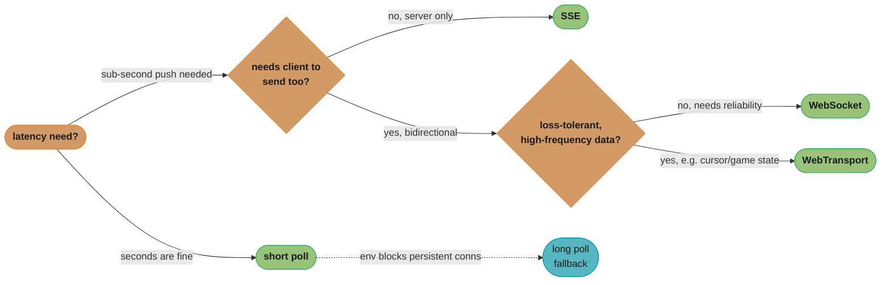
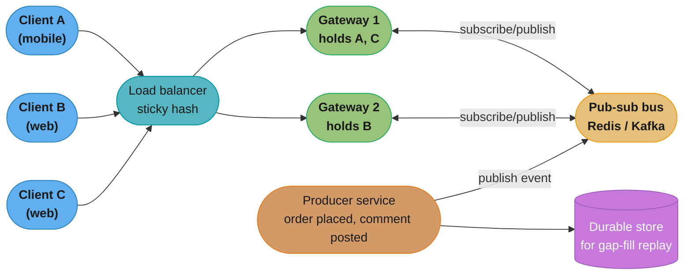
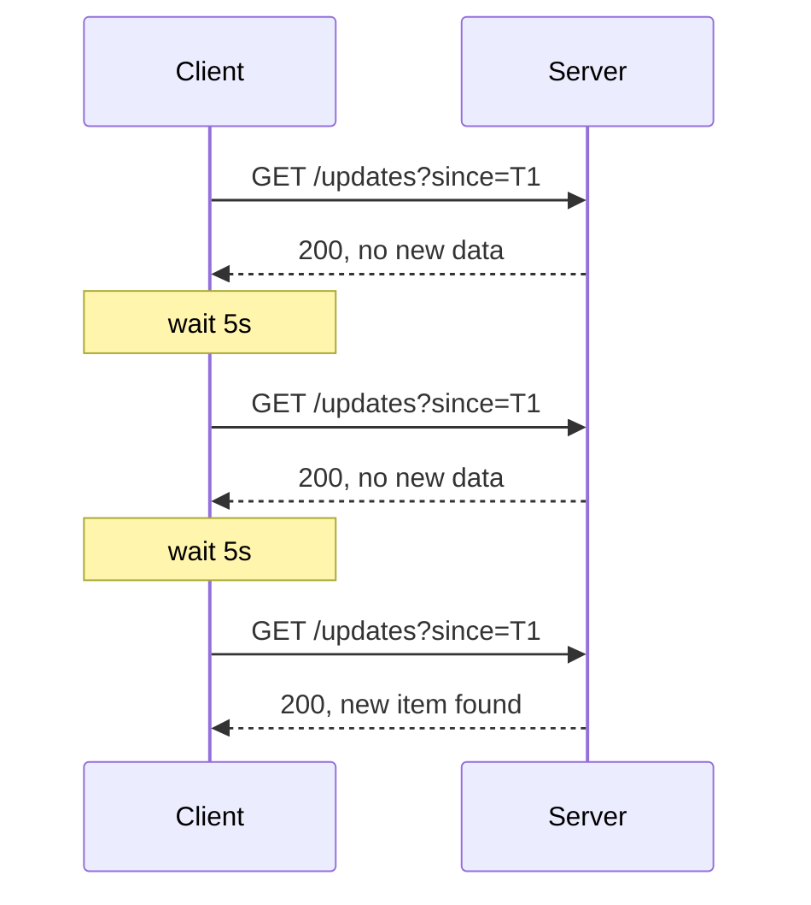
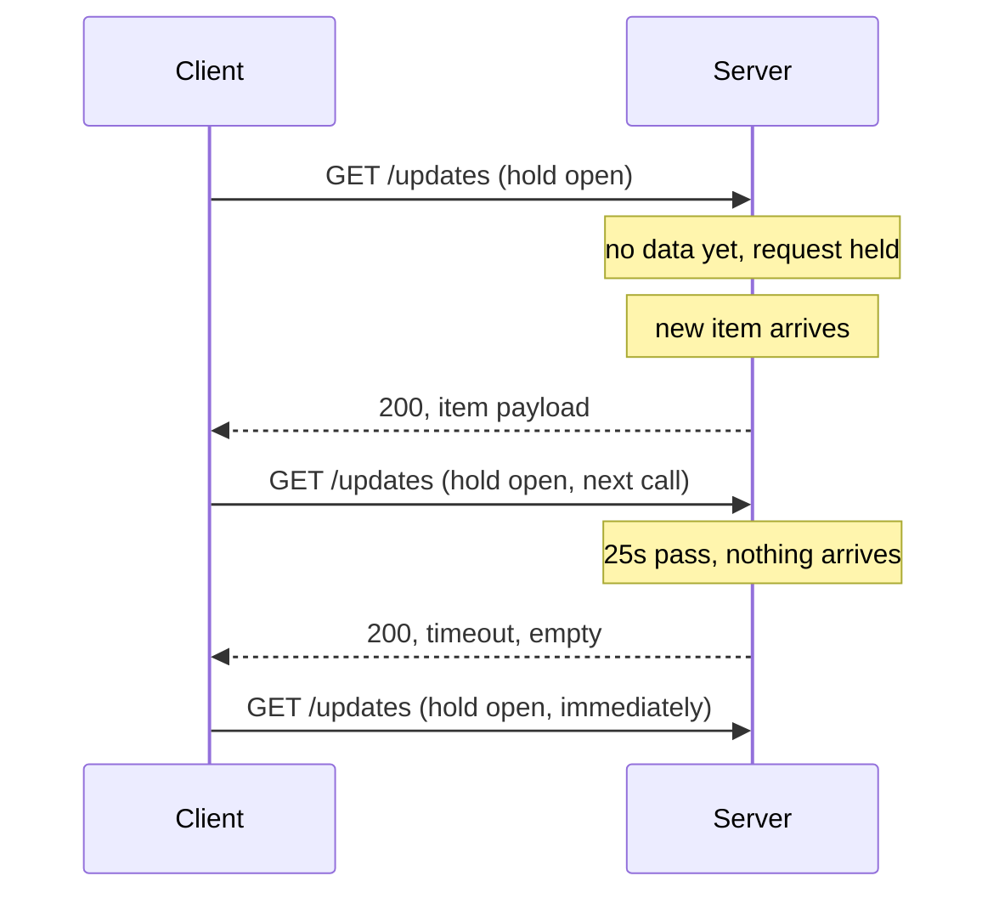
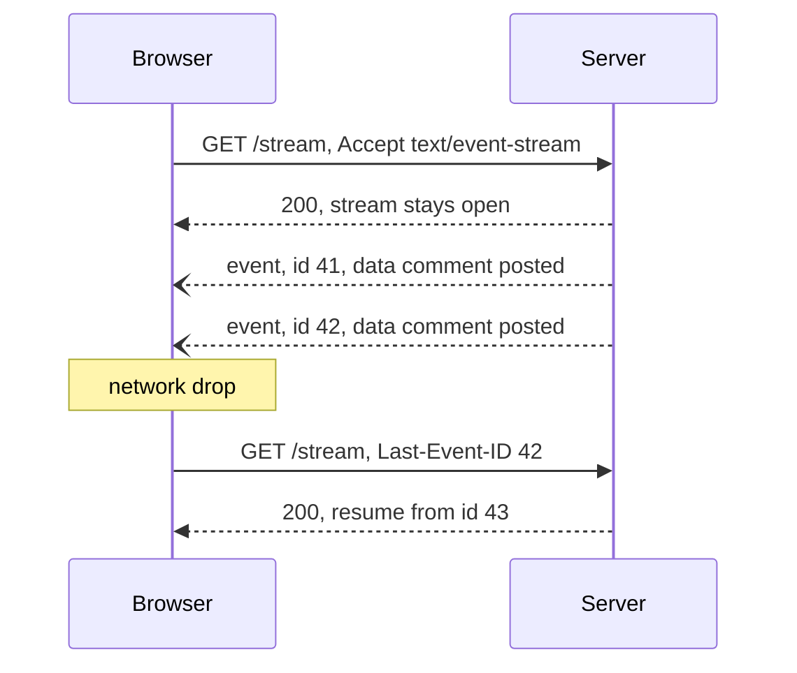
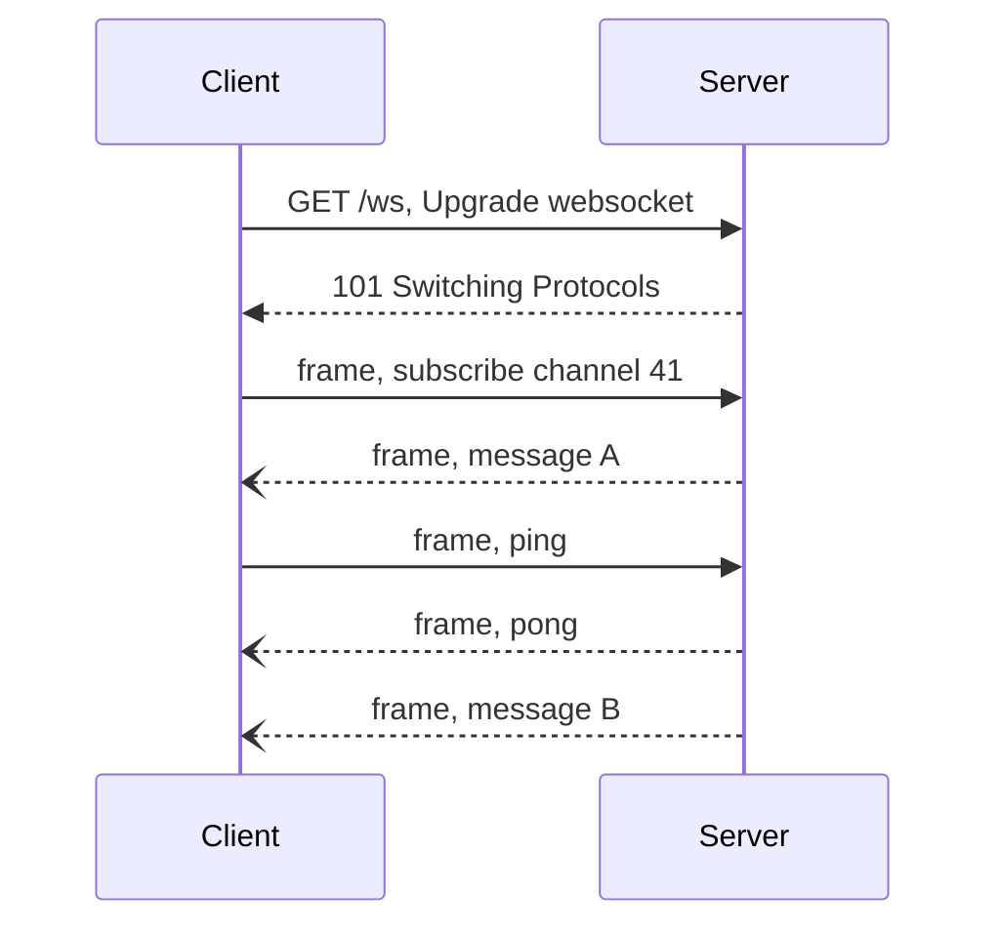
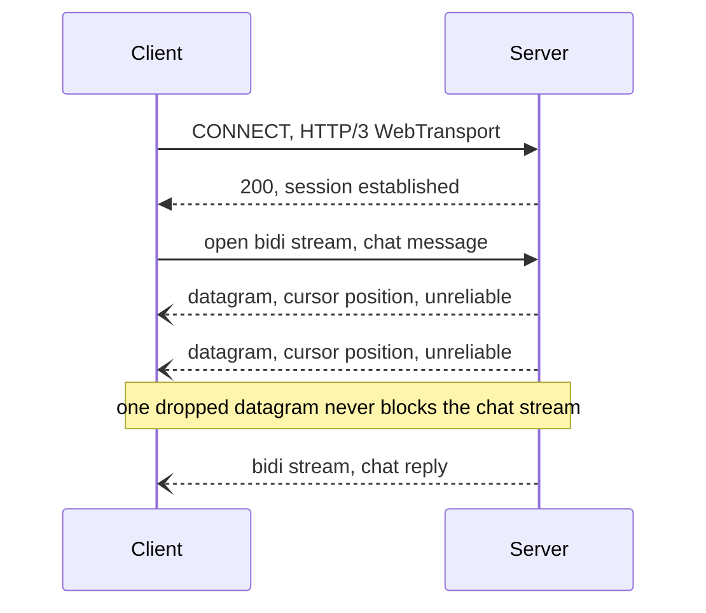

# Pushing Realtime Updates

Architectural decision-making for delivering server-initiated data to clients — who holds the connection, who pays for it, and how to route around the transport.

## 1. Concept Overview

**Realtime updates** is the architectural problem of getting new server-side state to a client without the client having to ask again and again: a chat message, a live comment count, a stock tick, a cursor moving on a shared canvas. Every solution to this problem is really answering one question — **who initiates the exchange, and who holds the connection open while waiting?** HTTP was built request-first: the client always initiates, the server always responds and then the exchange is over. Pushing data the other direction means either faking initiation from the client (poll repeatedly, or poll and wait), or keeping a channel open long enough for the server to write into it whenever it has something to say.

This module is the **decision layer**: which transport to reach for, how many concurrently open connections a fleet can actually afford, how to route a message from "something changed" to "the right open connection, on the right server, in the right process" at scale, and what breaks when a client's connection silently dies without either side noticing. It deliberately does **not** re-derive WebSocket frame formats, the HTTP Upgrade handshake, or the STOMP/SockJS wire protocol — that mechanical detail already lives in [Backend § WebSockets and SSE](../../backend/websockets_and_sse/websockets_and_sse.md), and duplicating it here would just be a second copy that drifts out of sync with the first. What that module treats as "here is how to write one connection correctly," this module treats as "here is how ten million of those connections stay correct, cheap, and recoverable at once."

The problem shows up everywhere realtime feels obviously necessary — chat, live sports scores, collaborative editing, trading dashboards, ride-hailing driver location — but the architectural reasoning is identical in every case: estimate the connection budget, pick a transport that matches the fan-out shape and the client population, decouple the process that *produces* an update from the process that *holds* the connection to a given client, and design the reconnect path before the happy path, because the reconnect path is the one that actually runs in production.

---

## 2. Intuition

> **One-line analogy**: Polling is checking your mailbox — you walk out, look, and walk back in, over and over, whether or not anything arrived. A push transport is a phone call — the line stays open, and the other side speaks the moment they have something to say, with no wasted trips.

**Mental model — who pays rent on the connection**: A phone call is expensive to *keep open* even in total silence — someone is holding a line, a battery, a cell tower slot — but it delivers the instant either side speaks. Checking the mailbox costs nothing while you're not looking, but has a floor on latency equal to how often you're willing to walk out there. A realtime architecture is a decision about which side of that tradeoff to sit on, made per feature: a stock ticker that must update within 50ms buys a phone line for every viewer; a "did my report finish generating" indicator that can tolerate a 30-second delay should never buy one.

**Why it matters**: The naive version of "make it realtime" is "add a WebSocket," and that decision, made without doing the connection-budget arithmetic in §6, is how a feature with 50,000 daily active users ends up needing 50,000 concurrently open sockets held by application servers that were sized for stateless HTTP request bursts, not for holding state for hours at a time. The cost of a push transport isn't the message — it's the *idle* connection sitting there the other 99.9% of the time nothing is happening on it.

**Key insight — the connection and the message are two different scaling problems**: How many clients you can keep connected (bounded by memory, file descriptors, and load-balancer idle timeouts) is a completely different constraint from how fast a message reaches all of them (bounded by fan-out routing and the pub-sub layer behind the connections). Conflating the two is the most common realtime-architecture mistake: a team solves "can we hold a million sockets" and assumes fan-out is solved too, then discovers that broadcasting one event to a million already-open sockets falls over for entirely separate reasons (§6, §10).

---

## 3. Core Principles

**1. Someone always pays for the wait — pick who.**
Every non-instant delivery mechanism makes a tradeoff between latency and idle cost, and there is no transport that avoids paying one of them. Short polling pays in wasted request volume; long polling and SSE and WebSocket pay in held-open connections; a push-notification fallback pays in platform dependency and best-effort delivery. Naming this tradeoff explicitly, per feature, is the first design decision — not "which library."

**2. The connection-holder and the message-producer are different services, on purpose.**
The process accepting a WebSocket upgrade from a client (the **gateway** / **edge** layer) should almost never be the same process that decides "user 4471 needs to see this new comment" (the **application/producer** layer). Coupling them means every application server needs to know which of N gateway machines holds a given user's socket — a routing problem that only gets worse as the fleet grows. A pub-sub bus in between (Redis Pub/Sub, Kafka, NATS) lets any producer publish "here's an update for user 4471" without knowing or caring which gateway instance is holding that user's connection; every gateway subscribes to the topics its currently-connected users care about and forwards locally. See [Message Queues](../message_queues/message_queues.md) for the broker mechanics this depends on.

**3. A connection that looks alive may not be.**
TCP doesn't tell either side when the other has vanished — a laptop closing its lid, a mobile network handoff, or a NAT/load-balancer idle-timeout can drop a connection with no FIN, no RST, nothing. The only way to know a connection is still good is to actively test it — an application-level heartbeat (ping/pong) on a period shorter than every idle timeout in the path (§6, §10). Skipping this means a fraction of your "connected" users are actually disconnected and don't know it yet.

**4. Reconnection is not resumption unless you design it to be.**
A client that reconnects after a drop gets a brand-new connection with no memory of what it already received. If the server doesn't track "where the client left off" (a cursor, a last-seen sequence number, a resume token) and replay the gap, every reconnect is a silent data loss event — the client resumes receiving *new* events with a hole where the disconnected window used to be, and nothing in the system surfaces that as an error (§6, §10).

**5. Idle connections are not free, and the bill comes due at the load balancer before it comes due at the application.**
Long before per-connection application memory becomes the bottleneck, the load balancer's own idle-connection timeout, its maximum concurrent-connection count, and its TCP/TLS termination cost start to matter (§6). A design that only budgets application-server RAM per connection and never checks the LB's defaults will hit a wall it didn't know existed.

**6. Ordering and delivery guarantees are a choice, not a given.**
"Realtime" does not imply "exactly-once, perfectly ordered." Most push transports are best-effort and at-most-once per connection lifetime; anything stronger — ordered delivery, gap-fill after reconnect, effectively-once semantics — has to be built deliberately on top, usually with a sequence number or timestamp cursor the client presents on reconnect (§6.5, §12 Q13-14).

**7. A slow client's backpressure must be bounded, never absorbed silently.**
One connection with a backed-up receive window (a poor mobile network, a paused tab) cannot be allowed to consume unbounded server memory queuing messages for it, nor to block the event loop or thread serving every other connection on the same process while the server waits on that one slow write. A bounded per-connection send queue, with an explicit policy for what happens when it fills (drop the oldest, or disconnect and let the client resume), keeps one bad connection from becoming everyone else's outage (§6.6).

---

## 4. Types / Architectures / Strategies

### 4.1 Client-initiated polling

**Short polling** — the client issues a normal HTTP request on a fixed interval (e.g. every 5s) and gets back "nothing new" most of the time. It is stateless, works through every proxy and firewall ever built, needs no special server infrastructure, and is trivial to reason about — and its latency floor is exactly the poll interval, while its request volume scales linearly with `clients × (1 / interval)` regardless of whether anything changed. **Connection lifecycle**: there is none to speak of — every poll is open, answered, and fully closed within one request/response pair, so there is no idle state, no heartbeat, and nothing for a load balancer's idle timeout to ever touch; the only "state" that persists between polls lives entirely on the client (its `since` cursor) and is re-sent on every call. It is the correct default until a feature specifically needs sub-poll-interval latency (§9).

**Long polling** — the client makes a request that the server *holds open* (not responding) until either new data exists or a timeout elapses (typically 20-30s), then the client immediately reopens another one. This trades request volume for held-open server resources: it looks like ordinary HTTP (proxy-friendly, works everywhere fetch/XHR does) but each open request now ties up a server-side thread, connection, or async handler for the duration of the hold — the server is effectively holding a bet that something will arrive before the timeout. **Connection lifecycle**: open → held (server waiting) → either a data response or a timeout response → client immediately re-opens; because the "idle" period *is* the entire held duration, the hold timeout must itself sit safely under any load-balancer idle timeout in the path (§6.3's ALB-driven reasoning applies here too, just measured against the hold duration rather than a heartbeat interval), or the LB kills the held request before the server ever gets to answer it. It was the pre-WebSocket way to fake push and is now mostly a fallback for environments that block persistent connections.

### 4.2 Server-push transports

**SSE (Server-Sent Events)** — one long-lived HTTP response the server keeps writing `event:`/`data:` frames into; the browser's native `EventSource` handles reconnection and resend of `Last-Event-ID` automatically. Unidirectional (server → client only), works over plain HTTP/1.1 or HTTP/2, and needs no special client library. **Connection lifecycle**: open (GET with `Accept: text/event-stream`) → stream stays open indefinitely, server writing frames as they occur, with no explicit heartbeat frame in the spec (a comment line, `: ping\n\n`, is the conventional keep-alive since it's ignored by `EventSource` but still resets any intermediary's idle timer) → on any drop, the browser reconnects automatically after the server-specified `retry:` interval (3000ms by default) and resends `Last-Event-ID` for resume. See [Backend § WebSockets and SSE](../../backend/websockets_and_sse/websockets_and_sse.md) for the wire format and the `Last-Event-ID` resume contract.

**WebSocket** — a single TCP connection upgraded once via HTTP's `101 Switching Protocols`, after which both sides can send framed messages at any time with no per-message HTTP overhead. It is the only one of these transports that is natively **bidirectional** — a chat client sending messages and receiving them on the same channel, a collaborative editor sending cursor moves and receiving peers' moves. **Connection lifecycle**: handshake (Upgrade request → 101 response) → open, application-managed heartbeat via Ping/Pong control frames (§6.3) → either a clean Close frame exchange or an unclean drop (network loss, LB idle-kill) that the client must detect via a missed pong and react to with reconnect-with-jitter (§6.4) plus gap-fill (§6.5), since — unlike SSE — none of this reconnection behavior is provided by the platform. Full handshake and frame mechanics: [Backend § WebSockets and SSE](../../backend/websockets_and_sse/websockets_and_sse.md).

**WebTransport** — an HTTP/3 (QUIC)-based API offering multiple independent bidirectional/unidirectional **streams** plus unreliable **datagrams** over one connection, avoiding TCP head-of-line blocking (one lost packet stalls only the stream it belongs to, not every message in flight, unlike WebSocket over TCP). **Connection lifecycle**: a QUIC session is established (roughly analogous to WebSocket's Upgrade, but over UDP), after which streams and datagrams can be opened and closed independently within it, and — because QUIC identifies a connection by a connection ID rather than the traditional IP/port 4-tuple — the whole session can migrate across a client's network change (WiFi to cellular) without a reconnect at all, which is a genuine lifecycle advantage over WebSocket's hard requirement to fully reconnect on any network change (§10 pitfall 6). As of 2026 it ships in every current Chromium browser (Chrome, Edge) and in Firefox (114+), and Safari closed the last major gap with support landing in Safari 26.4 on macOS and iOS — so it is now viable as a primary transport rather than a Chrome-only experiment, though WebSocket remains the safer default where the client population includes older browser versions or environments without HTTP/3 egress. Its datagram mode is the right fit for loss-tolerant high-frequency data (cursor positions, game state) where an old, dropped update is worse than useless — retransmitting it would just deliver stale data late.

### 4.3 The pub-sub routing layer (transport-independent)

Whichever client-facing transport is chosen, the **fan-out problem behind it is the same**: an event happens somewhere in the system, and it needs to reach every currently-connected client that cares — which may be zero, one, or a million sockets spread across hundreds of gateway machines. This is solved by a **pub-sub/broker layer** sitting between producers and the connection-holding gateway tier (Redis Pub/Sub for simple low-durability fan-out, Kafka for durable ordered fan-out with replay, or a purpose-built realtime bus like Centrifugo/Ably/Pusher — §11). The gateway subscribes only to the topics its locally-connected clients need and forwards matching messages down the open connection; it never needs to know how the event was produced. This decoupling is what lets the connection tier and the business-logic tier scale independently (§5, §6).

**How topics are keyed changes whether this design survives scale, independent of which broker technology runs it.** Three shapes exist, and they are not interchangeable:

- **Topic-per-entity** (e.g. one topic per document, per chat room, per live event) — a gateway subscribes to one topic per distinct entity its connected clients are viewing, so the topic count scales with the number of *distinct entities in use at once*, not with viewer count. This is the shape that works for §14's single-broadcast case study (one event = one topic) and for a chat app with a bounded number of active rooms.
- **Topic-per-user** (e.g. `user:4471`) — a gateway subscribes to one topic per connected *user*, so topic count scales directly with concurrent connections. At 1,000,000 concurrent users this means 1,000,000 live subscriptions spread across the gateway fleet — individually fine for a broker built for many small topics, but it collapses specifically when many of those users are also watching the *same* entity (§14's broadcast case): a naive topic-per-user design would require the producer to publish the same comment 1,000,000 times, once per viewer's personal topic, turning a single event into a million redundant publishes instead of one topic-per-entity publish that every subscribed gateway fans out locally.
- **A router keyed by subscription** (a shared registry, e.g. Redis, mapping `entity_id → [gateway_ids currently serving a viewer of it]`) — used instead of raw pub/sub topics when the subscriber set for a given entity needs to be looked up and targeted directly (the sharded in-process router of §6.7), which trades pub/sub's broadcast simplicity for point-to-point efficiency on entities with a small, well-known audience (a 1:1 DM, a small private room).

The practical rule: **key the topic to the thing being watched, not to the watcher**, unless the watcher count per entity is small enough that a lookup-and-target router is cheaper than a broadcast.

The choice of bus technology changes what the gateway tier can promise the client, independent of topic shape. **Redis Pub/Sub** is fire-and-forget — a message published while a given gateway is briefly disconnected from Redis (a network blip, a Redis failover) is simply gone, never delivered, and never recoverable, which makes it a fine fit for presence pings or cursor positions but a poor fit for anything that must survive a gap. **Kafka** (or another log-structured broker) keeps published events on disk for a configured retention window, so a reconnecting gateway — or a reconnecting client, via the gap-fill pattern in §6.5 — can replay from an offset instead of losing anything that happened during a disconnect. The tradeoff is operational weight: a Kafka cluster is a heavier piece of infrastructure to run correctly than a Redis instance, and its per-message latency, while still low, is higher than Redis Pub/Sub's near-zero hop. Choose the bus by asking the same delivery-guarantee question as any message queue design (see [Message Queues §4](../message_queues/message_queues.md)): can this specific class of update simply be dropped on disconnect, or must it be recoverable?

### 4.4 Choosing among transports — a decision order, not a menu

In practice the five options in §4.1-4.2 are evaluated in a fixed order rather than picked independently, because each one only gets considered once the one before it is ruled out: start with short polling and accept it unless the required latency is tighter than a sane poll interval allows; move to SSE once sub-second server-push latency is required and the channel is genuinely one-directional; move to WebSocket once the client also needs to send data on the same channel or the platform lacks a native `EventSource`-equivalent; and reach for WebTransport only when loss-tolerant high-frequency data or QUIC's per-stream loss isolation is specifically the point, not as a default upgrade from WebSocket. Long polling sits outside this ladder entirely — it exists only as a compatibility fallback for client environments that cannot hold a genuinely persistent connection at all.



*Long polling sits off the main ladder as a fallback path, reachable from any step whenever the client's environment cannot hold a genuinely persistent connection at all.*

---

## 5. Architecture Diagrams



*The load balancer's sticky hash decides which gateway a client lands on; the pub-sub bus is what lets the producer stay completely ignorant of that decision — it publishes once, and whichever gateway currently holds that user's socket picks it up.*

**Short poll** — no held connection at all; every arrow is a complete request/response.



**Long poll** — one request stays open until data exists or the timeout fires.



**SSE** — one response stream, server writes frames as events occur, browser resumes automatically.



**WebSocket** — one Upgrade handshake, then bidirectional frames with no per-message overhead.



**WebTransport** — one QUIC connection, independent streams so one loss stalls only itself.



The active/passive split behind Discord's fan-out numbers (§7) is easiest to see as a before/after
grid on one gateway's connections, not as a sequence of messages:

```
Fan-out cost per posted event -- 20 viewers held by one gateway instance

  BEFORE: every connection is "active"        AFTER: only viewers looking get
  every viewer gets the full payload          the full payload, rest get a counter

  [#][#][#][#][#][#][#][#][#][#]              [#][#][.][.][.][.][.][.][.][.]
  [#][#][#][#][#][#][#][#][#][#]              [.][.][.][.][.][.][.][.][.][.]

  20 full-payload sends per event              2 full-payload sends
                                                18 cheap counter-only sends

  [#] = full comment payload pushed down the connection
  [.] = passive: only a "N new" counter is pushed, not the payload itself
```

*Same 20 held connections, same one event -- moving 18 of them from active to passive cuts
full-payload fan-out work by 90%, which is the exact mechanism Discord's large guilds use to
stay serviceable at millions of connected members (§7) without every event reaching every
connection at full cost.*

---

## 6. How It Works — Detailed Mechanics

### 6.1 Connection-budget math

The first question for any push-transport design is arithmetic, not architecture: **how many concurrently open connections can one server actually hold, and where does the wall come from first?** Three independent limits stack up, and the first one hit is the effective ceiling — sizing only for the last one is the most common estimation mistake. Work the numbers in order:

**Step 1 — file descriptors, the cheap constraint to fix.** Each connection is one open file descriptor; a fresh Linux process typically starts with a soft `ulimit -n` of 1024, and a stock `nginx` install defaults `worker_connections` in roughly that same low-thousands range — both are deliberately conservative defaults meant to be raised explicitly (`worker_rlimit_nofile`, `ulimit -n 65536` or higher) before a box is asked to hold tens of thousands of long-lived sockets. A proxying gateway needs *two* descriptors per logical connection (client-facing socket plus the upstream socket to the application), so budget `2 × target_connections` against the raised limit, not `1 ×`. Raising this ceiling costs one config line; it is never the binding constraint once raised.

**Step 2 — OS socket buffers, the constraint that actually bites.** Every TCP socket carries kernel-side read/write buffers even while completely idle. Linux's default `tcp_rmem` (receive buffer) is 87,380 bytes and default `tcp_wmem` (send buffer) is 16,384 bytes per socket — call it roughly **100 KB of kernel memory per idle connection** at stock settings, before a single byte of application state is counted. A gateway built for many mostly-idle connections (chat, presence, comment fan-out) explicitly tunes `SO_RCVBUF`/`SO_SNDBUF` down — e.g. to 4 KB each — since it never needs the throughput those defaults were sized for; that alone cuts the kernel-buffer cost per connection from ~100 KB to ~8 KB, better than a 10x reduction.

**Step 3 — application state**, typically a few KB to low tens of KB per connection depending on framework: the WebSocket framing buffer, TLS session state, subscribed-topic set, and a user-session pointer. An event-loop server (Node, Go, Erlang/BEAM) holds this as a lightweight object; a thread-per-connection model instead pays a full OS thread stack per socket — 1-8 MB depending on platform — which dwarfs every other number in this section and is why thread-per-connection architectures are never used for this workload at scale.

**Putting it together — connections per server.** Take a representative 64 GB gateway box, tuned buffers (8 KB kernel + roughly 4 KB app state = ~12 KB/connection), and reserve 20% of RAM for the OS and the rest of the running process, leaving ~51 GB usable:

```
51 GB / 12 KB per connection  ≈  4.5 million connections   (memory-wall ceiling)
```

That memory-wall number is deliberately never the number actually deployed. CPU cost per idle connection is close to zero — a heartbeat every 20-30s per socket is negligible aggregate work — so CPU is not what stops a box from approaching the memory wall; what stops it in practice is safety margin against connection churn, GC pauses (on a managed runtime), and burst fan-out load (§6.7) that a box sitting at its absolute memory ceiling has no headroom to absorb. Production sizing therefore lands well under the theoretical ceiling: a typical JVM- or Node-based gateway (heavier per-connection objects and GC pauses than Erlang's ~300-byte process) is commonly budgeted at **50,000-150,000 connections per instance**, not millions — which is where this module's §14 case study number comes from. WhatsApp's ~2 million/server (§7) is the outcome of years of Erlang/BEAM-specific and FreeBSD-specific tuning most teams neither need nor should attempt to replicate; treat it as proof the memory wall is movable, not as a default target.

**Servers needed for 1,000,000 concurrent connections**, at the conservative production number rather than the theoretical ceiling:

```
1,000,000 connections / 100,000 per gateway  =  10 gateway instances
(sized to ~14-20 in practice for headroom -- see §14's capacity table)
```

### 6.2 Sticky routing vs. a shared bus — and each one's specific failure mode

Once a client is connected to a specific gateway instance, there are exactly two ways for the rest of the system to reach it, and each has a different, specific failure mode rather than a generic "less reliable":

**Sticky routing** — the load balancer hashes each client to the same backend gateway for the life of the connection (by source IP, a cookie, or a connection-id header, the same hashing mechanics covered generally in [Load Balancing](../load_balancing/load_balancing.md)). Simple, and it keeps all per-client state local to one process, with no cross-process coordination needed to deliver a message. **Its specific failure mode**: because a gateway instance is the single point of contact for every client hashed to it, losing that one process — a crash, an OOM kill from §6.1's memory wall, or an unremarkable rolling deploy — drops every connection it held **simultaneously**, and every one of those clients reconnects within the same few seconds. If the hash function then re-routes them across the *remaining* instances (as consistent hashing does after removing a node), those survivors absorb a step-function increase in connection count at the exact moment they're least prepared for it.

**Shared pub-sub bus** — every gateway instance is interchangeable; a producer publishes an event once to a topic (e.g. `user:4471` or `room:882`), and whichever gateway currently holds that user's socket (having subscribed to that topic on connect) delivers it. **Its specific failure mode is different, not absent**: the bus itself becomes a new single dependency — if Redis/Kafka is unreachable, every gateway loses its ability to receive anything to forward, even though every client connection is still technically alive, which turns a bus outage into a silent, cluster-wide "connected but receiving nothing" state rather than a visible disconnect. This is a strictly better failure mode than sticky routing's correlated reconnect storm (it degrades gracefully and clients don't even need to reconnect once the bus recovers), which is why production systems at scale default to it — but it is not failure-free, and the bus itself needs its own redundancy (§11) to avoid becoming the thing that takes the whole realtime layer down at once.

### 6.3 Presence and heartbeat

A WebSocket or long-lived connection that has gone silent could mean "user is idle" or "connection died without either side noticing" — TCP alone cannot tell these apart, since a dropped connection with no FIN/RST looks identical to a live-but-quiet one until something tries to use it. **Heartbeat** is the transport-level fix: either side periodically sends a ping and expects a pong within a bounded window (WebSocket's built-in Ping/Pong control frames, or an application-level `{"type":"ping"}` message for SSE, which has no native control frame); missing N consecutive pongs marks the connection dead and triggers cleanup.

**Choosing the interval is a subtraction problem, not a guess.** The heartbeat interval must be shorter than the *shortest* idle timeout anywhere in the path — not just the application's own assumption — because whichever timeout is shortest is the one that fires first and silently drops the connection (§10 pitfall 2). An AWS ALB's default idle timeout of 60 seconds is typically the tightest constraint in a standard cloud deployment (tighter than an NLB's 350s default, and almost always tighter than any application-level default a team would otherwise pick), so a heartbeat sent every 20-25 seconds — comfortably under half of 60s, leaving room for one missed beat before the LB's own clock runs out — is a defensible default specifically because it is derived from the ALB number, not chosen independently of it. Sitting close to the 60s ceiling (e.g. a 55s interval) leaves no margin for network jitter or a delayed pong and reintroduces the exact failure it was meant to prevent.

**Presence** is a distinct, higher-level feature built on top of heartbeat — "is user 4471 currently online" — typically tracked as a TTL'd key in a fast store (e.g. Redis, refreshed on every heartbeat, using the same TTL-expiry pattern covered generally in [Caching](../caching/caching.md)) rather than derived by scanning open sockets, because presence needs to be queryable by *other* users' connections, not just by the gateway holding the socket in question. Setting the presence TTL to roughly 2-3x the heartbeat interval (e.g. a 60s TTL against a 20s heartbeat) tolerates one or two missed beats without flapping a user's presence to "offline" and back on every minor network hiccup.

### 6.4 Reconnect with jitter

Every client-side reconnect strategy needs two properties that are easy to get half-right: **backoff** (each retry waits longer than the last, so a client doesn't hammer a struggling server) and **jitter** (the wait is randomized, not a fixed schedule), because backoff alone still leaves every client that disconnected at the same instant retrying in lockstep — full jitter (a random delay uniformly chosen between 0 and the current backoff ceiling) is what actually desynchronizes them. See §10 for the broken-then-fixed version of this and [Resilience Patterns](../resilience_patterns/resilience_patterns.md) for the same backoff/jitter reasoning applied to any retried call, not just reconnects.

### 6.5 Ordering and gap-fill on reconnect

A reconnected client has a hole in its event stream exactly the size of the outage, and closing that hole requires the server to answer "what happened between the last thing you saw and now" — which requires **both** a client-presented cursor (a monotonic sequence number or event id the client remembers and resends, exactly like SSE's `Last-Event-ID`) **and** a server-side buffer or durable log to replay from that cursor forward. A sequence number alone is not sufficient: without something to replay against (a short-retention Kafka topic, a capped Redis stream, or a database table of recent events), the server can only detect that a gap happened, not fill it — the honest fallback in that case is a full-state resync (re-fetch current state via a normal HTTP call) rather than pretending the gap was closed.

A minimal resume handshake looks like this — the client always presents its cursor first, and the server decides whether it can replay or must force a full resync:

```javascript
// client, on every (re)connect
socket.send(JSON.stringify({ type: "resume", lastSeq: lastSeenSeq }));

// server, on receiving a resume message
function handleResume(conn, lastSeq) {
  if (log.hasFrom(lastSeq)) {
    for (const evt of log.readFrom(lastSeq)) conn.send(evt); // gap-fill from the durable log
  } else {
    conn.send({ type: "resync_required" }); // gap too old, or never persisted at all
  }
}
```

**Sizing what the server must retain** is itself arithmetic, not a guess: retention window needed = `max_tolerable_reconnect_gap × peak_event_rate × avg_event_size`. A chat system that wants to gap-fill any reconnect up to 5 minutes long, at a peak of 50 events/sec per room and ~200 bytes/event, needs `300s × 50/s × 200 bytes ≈ 3 MB` of retained log per active room — cheap, and worth persisting exactly because the number is small. A system that decided to gap-fill an hour-long gap at the same rate needs `3600s × 50/s × 200 bytes ≈ 36 MB` per room, which is where the cost-benefit tips toward the §14 case study's choice instead: cap the tolerable gap deliberately (a shallow "last 50 items" resync) rather than retain indefinitely, because retention cost scales linearly with how much gap the design promises to close.

### 6.6 Backpressure — a slow client cannot be allowed to slow every other client

A gateway process serves many connections concurrently out of one event loop (or a small pool of them), and a single slow client — a mobile device on a poor connection whose TCP receive window has collapsed — can back up the gateway's write buffer for that one socket. Naively blocking the event loop on that one slow write stalls every other connection sharing the loop, which turns one bad client's network into an outage for everyone else on that process. The fix is a bounded **per-connection send queue**: writes destined for a slow socket queue up to a cap, and once the cap is exceeded the gateway makes an explicit choice — drop the oldest queued messages for that one connection (fine for a live feed where staleness beats a stall), or close that one connection outright and let it reconnect and gap-fill (fine where every message matters) — but never blocks the shared event loop waiting on it. This is the same principle as [Resilience Patterns'](../resilience_patterns/resilience_patterns.md) bulkheads (§3 there), applied to per-socket write buffers instead of thread pools.

### 6.7 Fan-out throughput math — what the bus actually has to carry

The bus's own ingest rate is never the number that determines its cost — the **outbound fan-out work** is, and the two diverge by orders of magnitude the moment one event has many subscribers. The general formula: if events arrive at `ingest_rate` events/sec and the average event has `S` subscribers, the aggregate outbound delivery work across the whole gateway tier is `ingest_rate × S` messages/sec — the bus itself only ever handles `ingest_rate` publish operations, but every gateway combined must perform `ingest_rate × S` sends. A comment stream at 2,000 comments/sec broadcast to 100,000 actively-watching viewers (§14's active/passive split) is 2,000 publishes/sec into the bus and **200,000,000 sends/sec** out of the gateway tier — the ingest side looks trivial and the delivery side is where the real capacity planning happens.

**What this costs on each bus technology:**

- **Redis/Valkey Pub/Sub** — `PUBLISH` itself is O(subscribers-on-that-channel), so the cost of one publish scales with how many gateways are subscribed to that topic, not with the total viewer count directly; a healthy single instance is commonly benchmarked in the low-hundred-thousands to low-millions of simple operations/sec for small payloads, but that number describes the bus's own throughput, not the gateway fleet's fan-out-to-client work downstream, which is the actual bottleneck at the scale above. Redis/Valkey's role here is cheap, low-latency notification to a bounded number of gateway subscribers (tens, not millions) — never one subscriber per end viewer.
- **Kafka** — a single well-configured broker is commonly benchmarked from a few hundred thousand to low millions of small messages/sec depending on message size, replication, and hardware (published benchmarks range from roughly 400K msgs/sec on commodity three-node clusters to several million on tuned single-node setups); Kafka's advantage here isn't raw publish throughput over Redis, it's the durable, replayable log that makes §6.5's gap-fill possible, at the cost of higher per-message latency than Redis Pub/Sub's near-zero hop.
- **A sharded in-process router** — instead of every gateway subscribing to a bus channel per event, the producer looks up (via a shared registry keyed by connection-id, kept in Redis or similar) exactly which gateway instance holds the target connection and sends directly to that one gateway's internal queue, skipping the broadcast entirely for events with a small, known subscriber set (a 1:1 DM, a 2-person call). This scales the best per-event but only works when the subscriber set is small and known in advance — it is the wrong tool for the 1M-subscriber broadcast case in §14, and the right one for point-to-point delivery.

The practical conclusion: **the bus is sized for its own publish rate; the gateway fleet is sized for the fan-out-multiplied delivery rate**, and confusing the two — assuming "Redis can do a million ops/sec, so we're fine" — ignores that the bus was never the bottleneck to begin with.

### 6.8 Cost comparison — polling vs. a push transport at increasing scale

§2's "add a WebSocket" warning is easiest to see as a table rather than a claim: holding the poll interval and connection-tier assumptions fixed (5s short-poll interval; §6.1's ~12 KB/tuned-connection push-transport footprint), the crossover in *what dominates the cost* happens well before a feature reaches internet scale.

| Daily active users | Short-poll request rate | Short-poll: comparable to | Push transport: concurrent connections held | Push transport: kernel+app memory (tuned) |
|---|---|---|---|---|
| 1,000 | 200 req/sec | A handful of API endpoints already on the box | up to 1,000 | ~12 MB |
| 50,000 | 10,000 req/sec | A dedicated, moderately busy service | up to 50,000 | ~600 MB |
| 1,000,000 | 200,000 req/sec | A large fleet sized for sustained peak load | up to 1,000,000 | ~12 GB, split across ~10-14 gateway instances (§6.1) |

At 1,000 DAU, short polling's 200 req/sec is trivial background noise on infrastructure already provisioned for other traffic — there is no case for a gateway tier, a pub-sub bus, or reconnect/gap-fill logic at that scale, regardless of how "realtime" the feature sounds in the product spec. By 1,000,000 DAU, short polling's 200,000 req/sec is now a dedicated capacity concern in its own right (§9), and the push transport's ~12 GB of held-connection memory is easily absorbed across a normal gateway fleet — the crossover point where a push transport actually starts paying for itself is not "any amount of realtime need," it's the DAU level at which polling's *sustained* request volume costs more infrastructure than a tuned connection-holding fleet does, which for most CRUD-shaped products lands somewhere in the tens of thousands of DAU, not the low thousands.

### 6.9 Multi-region fan-out — when one gateway fleet in one region stops being enough

Everything in §6.1-6.8 implicitly assumes one region: a bus with subscribers that are all a few milliseconds away. A globally-distributed audience breaks that assumption twice. First, **latency**: a viewer in Singapore subscribed to a bus instance in `us-east-1` pays a round-trip of well over 200ms before a single message even starts fanning out locally, which can dominate the "roughly one second" delivery budget a feature like §14's case study assumes. Second, **blast radius**: a single global bus is a single region-wide dependency (§6.2's bus-outage failure mode) for every viewer on earth at once, not just for one region's worth.

The standard fix is a **relay tier**: each region runs its own gateway fleet and its own local bus instance, and a thin cross-region relay layer forwards each publish from its origin region to every other region's local bus, so viewers always fan out from a nearby bus even though the event itself may have originated on the other side of the world. This adds one hop of cross-region latency to the *first* delivery into a remote region (still far cheaper than every viewer in that region paying the cross-region round trip individually) and turns a single global bus outage into a single-region-only outage, at the cost of running and keeping consistent N regional bus instances instead of one. This is precisely the fix §14 names for the order-of-magnitude growth scenario — not "add more gateways in the same region," but add a second fan-out layer that keeps each region's viewers served locally.

---

## 7. Real-World Examples

**WhatsApp** built its connection tier on Erlang/FreeBSD specifically because the BEAM's lightweight-process model let one physical server hold on the order of **2 million concurrent connections**, reported by engineer Rick Reed at Erlang Factory after a multi-year effort re-tuning FreeBSD kernel network parameters and the Erlang process footprint. That multi-year tuning effort, not any framework default, is exactly what §6.1's connection-budget math models step by step — the design lesson is that the memory wall is real but movable, and moving it costs sustained, deliberate kernel- and runtime-level tuning that most teams should budget as a real project, not assume comes free from picking a "fast" language.

**Discord** documented pushing a single guild (server) past **1 million concurrently online members** in its "Maxjourney" engineering post, achieved primarily by distinguishing "active" connections (receiving full fan-out) from "passive" ones (receiving updates only when the user is actively viewing), which cut roughly 90% of fan-out work in large guilds, combined with a "relay" tier that caps each relay process at about 15,000 connected sessions so no single process becomes the fan-out bottleneck. Discord's voice infrastructure separately reported serving **2.5 million concurrent voice users** over WebRTC. The design lesson, reused directly in this module's §14 case study: fan-out cost is a *choice* made per connection (active vs. passive), not a fixed multiplier of subscriber count, and capping per-process session counts (their relay ceiling) is what keeps one hot entity from concentrating all of its fan-out work onto a single point of failure.

**Slack** describes, in its own engineering writeup on real-time messaging, stateful in-memory **Gateway Servers** that hold each connected client's WebSocket and its channel subscriptions, paired with separately-scaled, consistent-hash-routed **Channel Servers** that hold recent channel history — the same connection-holder/message-producer split this module treats as a core principle (§3.2), at a scale the post describes as tens of millions of connected clients across the fleet. The design lesson is that splitting "who holds the connection" from "who holds the data" isn't just a resilience choice (§6.2) — it also lets each tier be scaled and consistent-hash-partitioned independently, on its own bottleneck (connection count for Gateway Servers, channel history volume for Channel Servers).

**Figma** built **LiveGraph**, a GraphQL-inspired realtime data layer that reads Postgres's own logical replication stream to detect changes and pushes matching subscription updates to clients over a WebSocket connection — one multiplayer server process per actively-edited document — rather than having application code manually publish "something changed" events. The design lesson: deriving realtime updates from the database's own change stream, instead of asking every application write path to remember to publish an event, closes off an entire class of "we forgot to notify" bugs by construction — a pattern worth considering whenever the realtime feed's source of truth is a database the team already owns and controls.

---

## 8. Tradeoffs

| Transport | p50 delivery latency once data exists | Server memory per connection | Proxy/CDN friendliness | Browser support | Bidirectional | Reconnect semantics | What breaks first at scale |
|---|---|---|---|---|---|---|---|
| Short poll | ~half the poll interval (e.g. ~2.5s at a 5s interval) | ~0, no held state between polls | Excellent — plain HTTP/1.1, every proxy and CDN handles it | Universal, since forever | No (client-initiated only) | N/A, stateless every call | Origin request-rate capacity (`clients / interval` req/sec), not memory |
| Long poll | tens of ms once data is ready to send | one held request's worth of thread/handler state, roughly comparable to a WebSocket's | Good — plain HTTP, but the hold duration must clear every LB idle timeout in the path | Universal | No (server can only respond) | New request per cycle; no native resume | Held-request slots (thread pool / async handler capacity), same shape as §6.1's connection budget |
| SSE | tens of ms, server writes as events occur | ~kernel buffers (§6.1) + a lightweight per-stream object, similar order to WebSocket | Good over HTTP/1.1; over HTTP/2, bounded by `SETTINGS_MAX_CONCURRENT_STREAMS` per origin connection (§11) | Universal in evergreen browsers (Chrome 6+, Firefox 6+, Safari 5+, Chromium Edge); **no native support in Internet Explorer**, needs a polyfill or long-poll fallback there | No (server → client only) | Automatic via `EventSource` + `Last-Event-ID` | HTTP/2 per-origin stream limit before connection-budget memory, if many streams share one origin |
| WebSocket | single-digit to tens of ms, full duplex | §6.1's tuned per-connection figure, ~10-15 KB typical | Fair — some corporate proxies/older LBs silently drop the Upgrade handshake (§10 pitfall 5) | Universal in browsers since the early 2010s | Yes | Manual; app must implement resume (§6.4, §6.5) | Connection-budget memory wall (§6.1) or fan-out throughput (§6.7), whichever the workload stresses harder |
| WebTransport | single-digit ms, full duplex, per-stream loss isolation | comparable to WebSocket plus QUIC session state | Fair — needs HTTP/3/UDP egress, blocked by some firewalls that pass TCP but not UDP | Chrome 97+, Edge 98+, Firefox 114+, Safari 26.4+ (macOS/iOS) as of 2026 — broad but newer than the other rows | Yes (streams + unreliable datagrams) | Manual; session migration across networks is a native QUIC property (§4.2) | Same connection-budget/fan-out limits as WebSocket, plus UDP-unfriendly network paths as an added failure mode |

The "proxy/CDN friendliness" and "browser support" columns are the two that tend to get skipped in a design review and then discovered in production: WebSocket and WebTransport both depend on something in the path (a corporate egress proxy, a restrictive firewall, an older load balancer) correctly forwarding an Upgrade handshake or UDP-based QUIC traffic, and neither failure mode produces a clean, debuggable error (§10 pitfall 5); SSE's browser-support gap is narrower but absolute — it has no native path on Internet Explorer at all, only a JavaScript polyfill or a long-poll fallback. Short polling, long polling, and SSE otherwise all ride on plain HTTP/1.1 semantics that essentially nothing in a standard network path is configured to block. Weigh those two columns as heavily as latency when the client population is a known enterprise or legacy-browser audience rather than the open consumer internet on evergreen browsers.

---

## 9. When to Use / When NOT to Use

**Polling (short or long) is correct when:** the data changes infrequently relative to a tolerable delay (a report-generation status, a batch job progress bar); the client population includes environments that cannot hold persistent connections at all (some enterprise proxies, certain embedded/IoT stacks); operational simplicity matters more than shaving seconds of latency, since polling needs no gateway tier, no pub-sub bus, and no heartbeat/reconnect logic to get right; or traffic is low enough that the request volume of short polling is genuinely cheaper than running and operating a connection-holding fleet.

**A push transport (SSE/WebSocket/WebTransport) is correct when:** updates are frequent and low-latency delivery is part of the product (chat, live collaboration, trading), the client population is predominantly modern browsers/apps that support persistent connections, and the team is willing to own a gateway tier, a pub-sub fan-out layer, presence/heartbeat, and reconnect/gap-fill logic — because a push transport that skips those pieces is not actually more reliable than polling, just faster when it happens to be working.

**Do NOT** default to WebSocket for unidirectional server-push use cases — SSE gets the same latency with a simpler operational model (plain HTTP, automatic browser reconnection, no custom heartbeat protocol to invent) whenever the client never needs to send anything back on the same channel. And do not reach for WebTransport as a default replacement for WebSocket purely because it is newer — its head-of-line-blocking-avoidance and unreliable-datagram advantages matter specifically for loss-tolerant high-frequency data; a chat application gains little from it over a well-implemented WebSocket.

**A quick decision checklist**, each question answered against the specific feature, not the product as a whole:

| Question | If "yes" | If "no" |
|---|---|---|
| Can users tolerate the update arriving one poll-interval late? | Short poll — stop here, nothing else in this module is needed | Continue |
| Does the client population include IE, or clients behind proxies that may drop Upgrade/UDP? | Long poll or SSE-with-fallback | Continue |
| Does the client ever need to send data back on the same channel? | WebSocket (or WebTransport if the next row also applies) | SSE |
| Is the data loss-tolerant and high-frequency (cursor/game-state class), and is the client population on modern engines? | WebTransport | WebSocket |
| Is the team prepared to own a gateway tier, a bus, heartbeat, and gap-fill (§6)? | Proceed with the push transport chosen above | Fall back to polling regardless of the answers above — an unowned push transport is a liability, not a feature |

The last row overrides every other answer: a push transport without the operational commitment behind it (§10) is worse than the polling it was meant to replace, because it fails silently instead of just being slow.

---

## 10. Common Pitfalls

**1. The naive reconnect loop stampedes the server it's trying to recover from.**

*Broken:* every disconnected client retries on a fixed interval with no randomization:
```javascript
function reconnect() {
  connect().catch(() => setTimeout(reconnect, 3000)); // every client, exact same 3s
}
```
When a gateway instance restarts (a deploy, a crash, an LB health-check flap), every client it was holding disconnects within the same second and then retries in lockstep every 3 seconds forever — a synchronized load spike that looks identical to the outage that caused it, arriving repeatedly, which is a large part of why the server struggles to actually recover.

*Fix:* exponential backoff with full jitter, plus a resume token so the reconnect also closes the message gap instead of just re-establishing the socket:
```javascript
async function reconnect(attempt = 0) {
  const ceiling = Math.min(30000, 1000 * 2 ** attempt);
  const delay = Math.random() * ceiling;              // full jitter desynchronizes clients
  await sleep(delay);
  try {
    const socket = await connect();
    socket.send(JSON.stringify({ type: "resume", lastSeq: lastSeenSeq })); // gap-fill cursor
  } catch {
    reconnect(attempt + 1);
  }
}
```

**2. A load balancer's idle timeout silently kills a connection nobody thought was idle.**

An AWS Application Load Balancer's default connection idle timeout is **60 seconds** (configurable 1-4000s); a Network Load Balancer's TCP idle timeout defaults to **350 seconds** (configurable 60-6000s as of the September 2024 update). A WebSocket connection with no application-level heartbeat, or a heartbeat interval longer than the load balancer's timeout, gets silently closed by the LB the moment it decides the connection is idle — no close frame reaches the application cleanly, no error is logged anywhere obvious, and the client simply stops receiving messages until something (an app-level ping failure, a user action) notices. The fix is mechanical: pick a heartbeat interval comfortably shorter than every idle timeout in the path, LB included, not just shorter than what the application layer imposes.

**3. Per-connection memory is budgeted from application state only, ignoring OS buffers.**

A team estimates "our per-connection object is 2 KB, so 500,000 connections is 1 GB, easy" — and forgets that stock Linux socket buffers alone are roughly 100 KB per idle connection (§6.1), which turns that same 500,000-connection fleet into ~50 GB of kernel buffer memory before the application's 1 GB is even added. The fix is to tune `SO_RCVBUF`/`SO_SNDBUF` down for workloads dominated by many small, infrequent messages (chat, presence) rather than accepting defaults sized for high-throughput bulk transfer, and to load-test actual per-connection RSS rather than trusting an application-only estimate.

**4. Missed messages during a reconnect window are invisible unless gap-fill is deliberately built.**

A client that reconnects and simply starts receiving new messages again looks, from the outside, exactly like a client that never missed anything — there's no error, no visible symptom, just a silent hole in what it has. This is the default behavior of any push transport that doesn't implement §6.5's cursor-and-replay pattern, and it is discovered in production as "why did the user say they never saw that notification" long after the outage that caused it. The fix is architectural, not a bug fix: gap-fill has to be designed in from the start, because it cannot be bolted on after the fact without a durable log to replay from.

**5. A CDN, WAF, or corporate proxy in front of the origin silently strips the Upgrade handshake.**

*Broken:* a WebSocket feature works perfectly in every environment the team tested, then fails with a plain HTTP 200 (not even an error) for a subset of production users sitting behind a corporate proxy or an intermediary that was never configured to forward `Connection: Upgrade` / `Upgrade: websocket` headers — some older forward proxies and a subset of CDN configurations pass through ordinary HTTP but drop or rewrite exactly the headers the handshake depends on, so the client's `new WebSocket(...)` call falls straight to `onerror` with no server-side log entry at all, because the request never reached the origin as an Upgrade request in the first place. Debugging this from server-side logs alone looks like nothing happened, because from the server's point of view, nothing did.

*Fix:* confirm the Upgrade path end-to-end through every intermediary in production (CDN, WAF, corporate egress proxy), not just from a developer laptop with a direct connection — most CDNs need WebSocket support explicitly enabled per route — and ship an SSE or long-poll fallback path for the client population that a proxy audit can't reach or fix, rather than assuming every client can complete an Upgrade handshake.

**6. Detecting a network handoff as a clean disconnect creates duplicate connections instead of one resumed one.**

A mobile client moving from WiFi to cellular gets a new IP address mid-session; naive reconnect logic that doesn't first confirm the old connection is actually dead (rather than just switching networks) can end up opening a second connection before the first one has timed out on the server, leaving the server briefly delivering the same events down two sockets to the same user — duplicate chat messages, duplicate notifications, until the stale connection's heartbeat finally lapses and the server closes it. Guard against this by having the client explicitly close its old socket before opening a new one whenever it detects a network change (most mobile platforms expose a reachability-changed event for exactly this), and by deduplicating on the client side using the message-id pattern from §12 Q13 as a backstop even when the server-side close is timely.

**7. Sizing the gap-fill retention window from an average message rate, not the peak, silently shrinks the window when it's needed most.**

*Broken:* the retention math in §6.5 (`window × peak_rate × avg_size`) gets computed with the system's *average* event rate rather than its peak — e.g. a chat room budgeted at "10 events/sec average" gets a retention buffer sized for 10/sec, and during a genuine burst (a viral moment, an incident-response channel suddenly active at 200 events/sec) the buffer fills and starts evicting old events far faster than planned, so a client that reconnects mid-burst finds its gap-fill window is now much shorter in wall-clock time than the 5-minute figure the design promised — exactly when the burst itself makes a dropped connection more likely (congestion, retries) and gap-fill matters most.

*Fix:* size the retention buffer from the system's peak sustained rate, not its average, the same way §6.1's connection budget is sized from peak concurrency rather than typical load — a buffer that looks wasteful most of the time is the one that's actually correctly sized for the moment it exists to handle.

---

## 11. Technologies & Tools

| Tool / technology | Role in this module's architecture | Key detail |
|---|---|---|
| AWS API Gateway (WebSocket APIs), Envoy, nginx, HAProxy | Gateway / edge layer — terminates the Upgrade handshake, proxies frames upstream | A proxying gateway needs 2 file descriptors per logical connection (§6.1) — client-facing plus upstream |
| MQTT (Mosquitto, EMQX, HiveMQ) | Lightweight pub/sub protocol for constrained or unreliable networks (IoT, mobile telemetry) | QoS 0/1/2 levels map directly to the delivery-guarantee choice in §3 Principle 6 |
| Centrifugo | Self-hostable realtime server purpose-built as the pub-sub/gateway layer of §4.3 | Speaks WebSocket/SSE/WebTransport to clients, Redis/Kafka/NATS internally |
| Ably, Pusher | Managed realtime platforms owning the entire gateway + bus + presence + reconnect-with-replay stack | Trades operational ownership for a per-message/per-connection bill |
| AWS ALB vs. NLB | L7 vs. L4 load balancing in front of the gateway tier | ALB: HTTP-aware routing, 60s default idle timeout. NLB: raw TCP, 350s default idle timeout, lower per-connection overhead (§10 pitfall 2) |
| SSE over HTTP/2 | Multiplexes many SSE streams over one TCP connection, no per-origin connection cap | Bounded by `SETTINGS_MAX_CONCURRENT_STREAMS` (RFC 7540 recommends >=100; nginx default 128) |
| Redis / Valkey Pub/Sub | Fire-and-forget fan-out bus, near-zero latency | `PUBLISH` is O(subscribers); no replay — a poor fit for anything that must survive a gap (§4.3, §6.7) |
| Kafka | Durable, replayable fan-out bus | Single-broker benchmarks span roughly 400K to several million small messages/sec depending on config; makes §6.5's gap-fill possible (§6.7) |
| Socket.IO | Client/server library layered on WebSocket, falls back to long polling | Convenience layer (reconnection, rooms, acks) — not a replacement for the connection-budget and fan-out decisions in this module |
| Firebase Realtime Database / Firestore listeners | Managed backend bundling connection tier + fan-out + client-side sync cache behind one SDK | No control over gateway sizing or bus technology, in exchange for near-zero infrastructure to operate |

---

## 12. Interview Questions with Answers

**Q: What's the single most common bug in hand-written WebSocket reconnect logic?**
**Short:** A fixed-interval reconnect loop with no jitter causes every disconnected client to retry in lockstep.

A: A naive reconnect loop retries on a fixed delay (e.g. exactly 3 seconds) with no randomization, so when a gateway instance restarts and drops thousands of connections at once, all of those clients retry at the same instant, and keep retrying in lockstep every 3 seconds thereafter — a self-inflicted, recurring load spike on the exact server trying to recover. The fix is exponential backoff with full jitter (a random delay uniformly chosen up to the current backoff ceiling), which desynchronizes the retries within a few cycles. Always pair the reconnect with a resume token so the client also closes its message gap, not just its socket (§10, §6.5).

**Q: Why do WebSocket connections sometimes drop with no error even though both the client and server code look correct?**
**Short:** A load balancer's own idle timeout silently closes a connection whose heartbeat interval is longer than that timeout.

A: An AWS ALB's default idle timeout is 60 seconds and an NLB's default TCP idle timeout is 350 seconds — if the application's heartbeat interval is longer than whichever of these sits in the path, the load balancer closes the connection on its own schedule, with no close frame reaching the application cleanly and nothing obvious logged on either side. The client simply stops receiving messages until something else notices. Pick a heartbeat interval comfortably shorter than every idle timeout between client and application, load balancer included, not just the application's own assumption.

**Q: Why can a plain round-robin load balancer break a WebSocket-based feature that otherwise works fine?**
**Short:** Round-robin routes each new request independently, so a stateful gateway never sees the same client's follow-up traffic.

A: WebSocket connections are stateful — once a client is upgraded onto gateway instance 3, all of that client's messages need to keep reaching gateway instance 3, because that's the process holding the socket and the in-memory subscription state for it. A load balancer configured for stateless round-robin has no concept of "the same client as before" and will happily route unrelated requests anywhere, which is fine for stateless HTTP but breaks any design that assumes a client's state lives on one particular gateway. The fix is either sticky routing (hash on client/session so the same client always lands on the same gateway) or removing the need for stickiness entirely via a shared pub-sub bus (§6.2) that lets any gateway serve any client.

**Q: Why does a reverse proxy sometimes break Server-Sent Events even when the application code streams correctly?**
**Short:** A proxy buffering or compressing the response holds it until a threshold is hit, defeating SSE's incremental delivery.

A: Many reverse proxies buffer upstream responses by default to optimize throughput, and some apply gzip to text responses — both behaviors are wrong for `text/event-stream`, because they hold the events in a buffer until it fills or the connection closes instead of flushing each one immediately, which makes a stream that is correct on the server look completely frozen to the client. The fix is proxy configuration, not application code: disable buffering for the SSE route specifically (e.g. `X-Accel-Buffering: no` and `proxy_buffering off;` on nginx) and disable compression for that content type. This is a pure infrastructure gotcha — the bug never shows up in local development because there's no proxy in the path.

**Q: What happens to messages sent while a client is disconnected, and why doesn't reconnecting alone fix it?**
**Short:** A fresh connection has no memory of what was missed, so gap-fill requires an explicit client cursor plus a server-side replay log.

A: A reconnected client simply starts receiving new messages again — from the outside, that looks identical to a client that never missed anything, but there is a silent hole in what it actually has covering the entire outage window. Closing that hole requires two things working together: the client presenting a cursor (a sequence number or event id it last saw, e.g. SSE's `Last-Event-ID`), and the server having something durable to replay from that cursor forward (a capped stream, a short-retention topic, or a recent-events table) — a sequence number with nothing to replay against can only detect that a gap happened, not fill it. Without this, the honest fallback is a full-state resync via a normal request rather than pretending the reconnect resumed cleanly.

**Q: Why does losing one server in a sticky-routed WebSocket fleet cause more damage than losing one stateless HTTP server?**
**Short:** Every connection that server was holding drops at once, and all of those clients reconnect simultaneously.

A: A stateless HTTP server losing capacity just means the load balancer routes the next request elsewhere — no client-visible event occurs. A sticky-routed WebSocket gateway holds live state (open sockets, subscriptions) for every client hashed to it, so when it dies or is redeployed, every one of those connections drops in the same instant, and all of those clients attempt to reconnect at once — a correlated failure the stateless case never produces. A shared pub-sub bus (§6.2) contains the blast radius to only the connections that instance happened to be holding, since any other gateway can pick up the same client with no coordination; reconnect logic still needs jitter (§10 Q1) regardless, because even a contained failure still produces a burst.

**Q: Why is per-connection memory usually underestimated when sizing a realtime fleet?**
**Short:** Kernel-level TCP socket buffers cost roughly 100 KB per idle connection before any application memory is counted.

A: Teams typically estimate memory from the application's own per-connection object (session pointer, subscribed topics — often just a few KB) and stop there, but every idle TCP socket also carries kernel-side read/write buffers: Linux's stock `tcp_rmem` default is 87,380 bytes and `tcp_wmem` default is 16,384 bytes per socket, roughly 100 KB of kernel memory per connection at default settings. At 500,000 idle connections that's on the order of 50 GB of kernel buffer memory alone, dwarfing a naive application-only estimate; tuning `SO_RCVBUF`/`SO_SNDBUF` down to, say, 4 KB each turns that same fleet's kernel-buffer cost into roughly 4 GB — a better-than-10x reduction from one config change, which is why §6.1's connection-budget math treats buffer tuning as step one, not an optional optimization. Gateway services built for many mostly-idle connections should tune those buffers down explicitly rather than accept defaults sized for high-throughput bulk transfer, and load-test actual process RSS rather than trusting the estimate.

**Q: Why is long polling not just "polling but less wasteful" from the server's point of view?**
**Short:** Long polling ties up a server-side thread or connection slot for the entire hold duration, unlike stateless short polling.

A: Short polling's cost is pure request volume — each request is stateless and completes instantly, so the server never holds a resource waiting. Long polling inverts that: each open request occupies a thread, an async handler, or a connection slot for up to the full hold timeout (typically 20-30s) whether or not anything ever arrives, which means the server's concurrent-connection budget, not its request-throughput budget, becomes the binding constraint — the same budgeting problem WebSocket and SSE have, just dressed up as ordinary HTTP. Treating long polling as "basically free because it's just HTTP" under-provisions exactly the resource it actually consumes.

**Q: How does a pub-sub bus let a gateway that isn't holding a client's connection still get that client's message to it?**
**Short:** It doesn't — the bus routes the message to whichever gateway is holding the connection, which the producer never needs to know.

A: A producer service (order placed, comment posted) has no idea which of a hundred gateway instances holds a given user's socket, and it shouldn't need to — it publishes an event to a topic keyed by user or room (e.g. `user:4471`) on the shared bus and moves on. Every gateway subscribes only to the topics its currently-connected clients care about; when a matching event arrives on the bus, the one gateway that actually holds that user's socket forwards it down the connection, and every other gateway simply never sees traffic for a client it doesn't hold. Note that the bus's own publish rate stays low even at huge scale — one publish per event, not one per viewer — while the real cost shows up downstream as fan-out-multiplied delivery work across the gateway fleet (§6.7's `ingest_rate × subscribers` math); this is what decouples the producer/business-logic tier's scaling from the connection tier's scaling (§3 Principle 2, §6.2).

**Q: What actually dominates the per-connection memory budget on a tuned WebSocket server at scale?**
**Short:** Whichever of OS socket buffers, application state, or per-connection thread stacks is left untuned dominates.

A: Three layers stack: kernel socket buffers (~100 KB per idle connection at Linux defaults, tunable down to single-digit KB via `SO_RCVBUF`/`SO_SNDBUF`), application-level per-connection state (a few KB to low tens of KB, framework-dependent), and — if the server uses a thread-per-connection model rather than an event loop — a full OS thread stack per connection, typically 1-8 MB depending on platform, which dwarfs both of the others by two to three orders of magnitude. Concretely: a tuned event-loop server can land around 10-15 KB/connection total (kernel + app state combined), which is what makes a 64 GB box's ~4.5 million theoretical connection ceiling (§6.1) arithmetically plausible — the same box on a thread-per-connection model hits its memory wall in the tens of thousands of connections instead, because thread stacks alone consume it first. WhatsApp's roughly 2-million-connections-per-server result came specifically from tuning the first and shrinking the second on an event-driven (Erlang/BEAM) model that avoids the third entirely. Which layer dominates tells you exactly where to spend tuning effort first.

**Q: How does presence differ from a simple ping/pong heartbeat?**
**Short:** Heartbeat detects whether one connection is still alive; presence answers whether a given user is online, queryable by anyone.

A: Heartbeat is a transport-level mechanism between exactly two parties — a socket and the server holding it — that periodically confirms the connection hasn't silently died (WebSocket's Ping/Pong control frames, or an app-level ping message for SSE, which has no native equivalent). Presence is a separate, higher-level feature built on top of heartbeat: "is user 4471 online right now," which needs to be answerable by *other* users' connections (a friends list, a chat roster), not just by the one gateway holding that user's socket. It's typically implemented as a TTL'd key in a fast shared store (e.g. Redis), refreshed on every successful heartbeat and set to roughly 2-3x the heartbeat interval (e.g. a 60s TTL against a 20s heartbeat, itself picked to sit safely under the ALB's 60s default idle timeout — §6.3) so one or two missed beats don't flap presence to "offline" and back — which also means presence naturally self-corrects a few seconds after a connection genuinely dies, without any gateway needing to explicitly announce the disconnect.

**Q: Why does HTTP/2's concurrent-stream limit matter specifically for SSE, when SSE doesn't feel like it's using "streams"?**
**Short:** Every open SSE connection over HTTP/2 is one multiplexed stream, bounded by SETTINGS_MAX_CONCURRENT_STREAMS.

A: SSE over HTTP/2 solves the old HTTP/1.1 problem of browsers capping connections-per-origin at six, since multiple SSE subscriptions to the same origin now multiplex as independent streams on one TCP connection — but each of those streams still counts against the server's advertised `SETTINGS_MAX_CONCURRENT_STREAMS` limit (RFC 7540 recommends no smaller than 100; nginx defaults to 128). A client or a browser tab opening many simultaneous SSE subscriptions to the same origin can exhaust that per-connection stream budget well before hitting any other limit, and new stream requests then queue or fail until an existing one closes. This is a server-configuration lever (raising the stream limit), not something the SSE application protocol itself controls.

**Q: How does WebTransport's delivery model differ from WebSocket's, and when does that difference actually matter?**
**Short:** WebTransport offers independent streams plus unreliable datagrams over QUIC, avoiding one lost packet stalling everything.

A: WebSocket runs over a single TCP connection, so TCP's in-order delivery guarantee means one lost packet head-of-line-blocks every message behind it, even ones logically unrelated to the lost data. WebTransport runs over HTTP/3's QUIC transport and exposes multiple independent streams (each with its own ordering) plus a genuinely unreliable **datagram** mode with no retransmission at all. This matters specifically for loss-tolerant, high-frequency data — cursor positions, game state ticks — where an old dropped update retransmitted late is actively worse than just skipping it; it matters far less for something like chat, where WebSocket's guarantees are exactly what's wanted anyway. As of 2026 it's supported across Chrome, Edge, Firefox, and Safari 26.4+, closing most of the earlier Chromium-only gap.

**Q: How do you get effectively-once delivery over a transport that's only at-least-once across reconnects?**
**Short:** Attach a unique id to every message and have the client deduplicate on receipt, since the transport itself won't.

A: A reconnect-and-replay flow (§6.5) can legitimately redeliver a message the client already processed once — if the gap-fill cursor is slightly conservative, or if the client's ack of a message never reached the server before the disconnect. Neither WebSocket nor SSE has a built-in exactly-once guarantee, so the deduplication has to happen at the application layer: every message carries a stable unique id, and the client (or a downstream consumer) tracks recently-seen ids and discards repeats. This is the same idempotency-key pattern used for retried writes elsewhere in the system (see [Resilience Patterns §3](../resilience_patterns/resilience_patterns.md)) applied to the receive side instead of the send side.

**Q: Why is a bare sequence number not enough to gap-fill a reconnecting client?**
**Short:** A sequence number only proves a gap exists; filling it requires a server-side log to replay from that point.

A: The client's last-seen sequence number tells the server exactly where the hole starts, but the server can only close that hole if it has something durable to replay from — a capped Redis stream, a short-retention Kafka topic, or a database table of recent events. If the events that occurred during the gap were only ever pushed live and never persisted anywhere, the sequence number lets the server *detect* that messages were missed but not recover them. In that case the correct behavior is an explicit full-state resync (the client re-fetches current state via a normal request) rather than silently resuming forward and leaving the gap unfilled and unreported.

**Q: When is polling still the architecturally correct choice, even though push transports exist?**
**Short:** When updates are infrequent relative to a tolerable delay, or the client environment can't hold persistent connections.

A: Polling is correct whenever the cost of running a connection-holding gateway tier, a pub-sub bus, heartbeat, and reconnect/gap-fill logic outweighs what's gained — a report-generation status that updates once every few minutes tolerates a poll interval just fine, and some enterprise network environments or embedded clients simply cannot hold a persistent connection reliably in the first place. The decision isn't "polling is legacy, always replace it" — it's a genuine cost-benefit call made per feature, and a low-traffic feature can be measurably cheaper to run as short polling than as a WebSocket subscription nobody needed the latency for.

**Q: How should a mobile app handle its realtime connection when backgrounded by the OS?**
**Short:** Close the socket deliberately and rely on platform push notifications, rather than fighting OS-imposed background limits.

A: Both iOS and Android aggressively suspend or kill network activity for backgrounded apps to save battery, so a WebSocket held open while backgrounded is unreliable at best and will be force-closed by the OS regardless of application intent. The correct pattern is to close the connection deliberately on backgrounding, rely on the platform's native push notification service (APNs, FCM) to wake the app or surface an alert for anything that happened while backgrounded, and reconnect the realtime channel fresh (with gap-fill, §6.5) when the app returns to the foreground. Treating "stay connected in the background no matter what" as a requirement fights the OS instead of designing around it.

**Q: Designing fan-out for a live event with a million concurrent viewers watching one comment stream — what's the shape of the architecture, and where does it break first?**
**Short:** Sharded gateways behind a pub-sub bus, with an active/passive split, because naive per-viewer fan-out multiplies by a million.

A: A single comment posted by one viewer has to reach roughly a million open connections, so the naive design — the producer iterating every subscriber and writing to each socket directly — collapses immediately; instead, the producer publishes once to a topic on a shared bus, and a fleet of gateway instances (each holding a bounded slice of the million connections, sized by the §6.1 connection budget, ~75,000-100,000/instance in practice, roughly 14-20 instances total) subscribes and locally fans out to only the sockets it holds. Even that shape still moves real volume — at a peak comment rate the aggregate outbound delivery work across the fleet is `comments/sec × active_viewers` (§6.7), which is why the design also demotes most viewers to a cheap "passive" counter-only stream rather than full payload. It breaks first at whichever single point still does O(subscribers) work per event — a single gateway process holding too large a share of the audience, or a bus topic with one partition serving all of it — which is exactly the problem Discord's "passive connection" split and per-relay session caps (§7) were built to solve: don't fan every event out to every viewer's full-fidelity connection, and cap how many connections any one process is responsible for.

---

## 13. Best Practices

- **Design the reconnect path before the happy path.** A push-transport feature spends the overwhelming majority of its production life either connected-and-idle or in the middle of reconnecting — not in the split second a message is delivered — so treat reconnect-with-jitter and gap-fill (§6.4, §6.5) as core requirements from day one, not a follow-up ticket.
- **Separate the connection-holding tier from the business-logic tier**, with a pub-sub bus between them (§3, §6.2), so either can scale, deploy, and fail independently.
- **Heartbeat on an interval shorter than every idle timeout in the path**, load balancer included — check the actual LB defaults (§10 Q2) rather than assuming the application's own timeout is the binding one.
- **Budget connections from all three layers** — file descriptors, OS socket buffers, application state (§6.1) — and load-test actual memory rather than estimating from application objects alone.
- **Default to the least stateful transport that meets the latency requirement**: short poll, then long poll, then SSE, then WebSocket, then WebTransport — each step up buys lower latency and/or bidirectionality at the cost of more infrastructure to own correctly.
- **Persist enough of the event stream to replay a gap.** A sequence number with nothing behind it to replay from can only detect a missed window, not fill it (§6.5, §10 Q4).
- **Bound every per-connection write path.** A single slow client must never be able to stall the event loop or thread serving every other connection on the same process (§6.6) — cap the queue, then drop or disconnect, never block.
- **Verify the Upgrade handshake through every intermediary in production**, not just from a developer machine with a direct connection — a CDN, WAF, or corporate proxy silently dropping `Connection: Upgrade` fails with no server-side signal at all (§10 pitfall 5).
- **Close the realtime connection deliberately on mobile backgrounding** and rely on platform push for anything that must reach a backgrounded user; fighting the OS's background network suspension is not a winnable design.

---

## 14. Case Study: Live-Comments Fan-Out at 1M Concurrent Viewers

**Scenario**: A live-streamed event (a product launch, a sports final) has a scrolling comment feed visible to every viewer, and any viewer's comment should appear on every other viewer's screen within roughly one second, sustained for the two-hour duration of the event, peaking at 1,000,000 concurrent viewers and an estimated 2,000 new comments per second at peak.

**Capacity math at peak**:

| Quantity | Value | Basis |
|---|---|---|
| Concurrent viewers | 1,000,000 | Stated peak |
| Connections per gateway instance | ~75,000 | §6.1 budget: raised FD limit, tuned socket buffers, event-loop server |
| Gateway instances needed | ~14 (rounded up, with headroom to ~20) | 1,000,000 / 75,000 |
| New comments per second | 2,000 | Stated peak |
| Full-payload sends per second, no split | 2,000 x 1,000,000 = 2 billion | Naive all-active fan-out (§5 before/after diagram) |
| Full-payload sends per second, 90% passive | ~200 million | Active/passive split (§7 Discord lever) applied at the stated ratio |
| Kernel socket-buffer memory, whole fleet | ~1,000,000 x 100 KB = ~100 GB | §6.1 default `tcp_rmem`/`tcp_wmem`, before any app-level tuning down |

The last two rows are why the active/passive split and the socket-buffer tuning in §6.1 are not optional
polish for this design — skipping either one changes the fleet's real workload by roughly an order of
magnitude, not a marginal amount.

**Connection tier.** Viewers connect over WebSocket (bidirectional isn't strictly required for a read-mostly feed, but the same connection doubles as the channel for "like" taps and viewer-count updates, so WebSocket is chosen over SSE here). Using the §6.1 budget — a raised file-descriptor limit, tuned-down socket buffers for this mostly-idle-between-comments workload, and an event-loop server avoiding thread-per-connection overhead — a single well-tuned gateway instance is planned to hold on the order of 50,000-100,000 connections, putting the fleet at roughly 10-20 gateway instances for 1,000,000 viewers, sized conservatively below the WhatsApp/Discord-scale numbers in §7 to leave real operating headroom rather than run at a measured ceiling.

**Fan-out.** Every comment write goes through a single producer path (comment service → durable store → publish to a Kafka topic partitioned by shard, not by individual viewer — one topic serving the whole event, since every viewer sees the same feed). Each gateway instance subscribes to that topic and locally broadcasts every message to all of its connected viewers — this is the one place the design deliberately does *not* shard by viewer, because unlike a chat app where each room only reaches its members, every viewer here is in the same "room," so the fan-out multiplier (one comment × a million viewers) is unavoidable and has to be absorbed by horizontal gateway count, not routed around.

**Active/passive split, borrowed from Discord's approach (§7).** Not every viewer needs every comment at full fidelity — a viewer who has the comment panel collapsed only needs a periodic "N new comments" counter, not the full stream. Marking those connections "passive" and only pushing full comment payloads to viewers actively scrolled into the feed cuts real fan-out work dramatically at the gateway layer, the same lever that let Discord's large guilds absorb a million-plus concurrent members without every event reaching every connection at full cost.

**Reconnect and gap-fill.** The comment feed tolerates *some* loss better than a chat app does — a viewer who misses three seconds of scrolling comments during a brief reconnect is a minor UX blemish, not a data-integrity incident — so the design deliberately uses a shallow gap-fill: on reconnect, the client requests "the last 50 comments" via a normal REST call rather than replaying an exact sequence-numbered gap from a durable log, trading perfect replay for a much simpler resume path, appropriate specifically because comment order within a small recent window doesn't materially matter to the viewer.

**Overload behavior.** At the peak comment rate, the gateway's write path to slow/congested individual client connections (a viewer on a poor mobile connection whose socket buffer is backed up) is bounded by a per-connection send queue with a cap — once a connection's queue exceeds the cap, older queued comments for that one connection are dropped rather than blocking the gateway's event loop waiting on one slow client, which would otherwise let one bad connection degrade delivery for every other viewer on the same gateway instance.

**Load balancer and idle-timeout sizing.** With WebSocket chosen as the transport, the fleet sits behind a Network Load Balancer rather than an Application Load Balancer specifically to inherit the longer 350-second default TCP idle timeout (§10 Q2) instead of the ALB's 60-second one — the application heartbeat is still set well below even that (a 20-second ping/pong interval), but the wider LB ceiling removes one more way an otherwise-healthy connection could be cut mid-event. Gateway instances are provisioned behind sticky-by-connection-id routing at the LB and register their currently-held connection count to a shared store every few seconds, which is what lets autoscaling add gateway capacity ahead of the event's known start time rather than reactively after connections are already being refused.

**Shard count, and why not fewer or more.** "Shard" here means gateway instance: the fleet lands at ~14 instances at the stated 75,000-connection-per-instance budget (capacity table above), provisioned to ~20 for headroom. Fewer, larger instances (e.g. 5 instances holding 200,000 connections each) would push each instance's connection count well past the conservative §6.1 production budget and closer to its untested ceiling, with no spare capacity to absorb a single instance's crash without a visible service-wide connection drop; more, smaller instances (e.g. 50 instances at 20,000 each) waste capacity relative to the per-instance fixed costs (each instance still needs its own subscription to the single event topic, its own heartbeat-processing loop, its own share of connection-management overhead) without buying anything, since the workload isn't CPU-bound at that connection count. ~75,000/instance is the point on that curve where per-instance risk (too few, too concentrated) and per-instance waste (too many, too fragmented) are both minimized for this specific budget.

**What breaks, in order, as load exceeds this design's planned capacity.** Overload here doesn't fail all at once — it degrades through the layers in a fixed order, cheapest defense first: (1) the per-connection send queue (§6.6) starts dropping the oldest queued comments for individual slow/congested connections first, invisible to every other viewer; (2) if comment rate itself spikes well past the planned 2,000/sec (a genuinely viral moment), the active/passive split's threshold tightens automatically — more viewers get demoted to passive (counter-only) rather than full-payload, trading feed completeness for continued delivery to everyone, rather than continuing to push full payloads to a shrinking fraction of connections that can no longer keep up; (3) if a gateway instance itself approaches its connection-memory wall (§6.1) rather than just a single slow connection, the autoscaler is expected to have already added capacity ahead of this point — reaching it live means the design has run out of its planned headroom, and the fallback is an emergency instance addition under load, which is strictly worse than pre-provisioned headroom because new instances take time to subscribe, warm up, and start accepting connections. **The moment this design stops working** is not any single one of those — it's if viewer count or comment rate grows roughly an order of magnitude past the stated peaks (10,000,000 viewers, or 20,000 comments/sec) without a redesign: at that point the single-topic-per-event fan-out in §6.7's math becomes tens of billions of full-payload sends/sec even with the active/passive split applied, which no reasonable gateway fleet size absorbs, and the fix is architectural (a second layer of fan-out, e.g. regional gateway clusters each doing local fan-out from a smaller number of cross-region relay subscribers) rather than "add more of the same gateway instances."

**What this design would not survive unchanged.** The single-topic-per-event fan-out described above works because every viewer is in the same logical room; it would not survive being reused unmodified for a feature where viewers are split across thousands of independent rooms (a chat app, not a single broadcast) — that shape needs the per-room topic partitioning a general chat system uses instead, where each gateway only subscribes to the rooms its connected users actually care about rather than to one firehose topic every gateway must consume in full.

---
