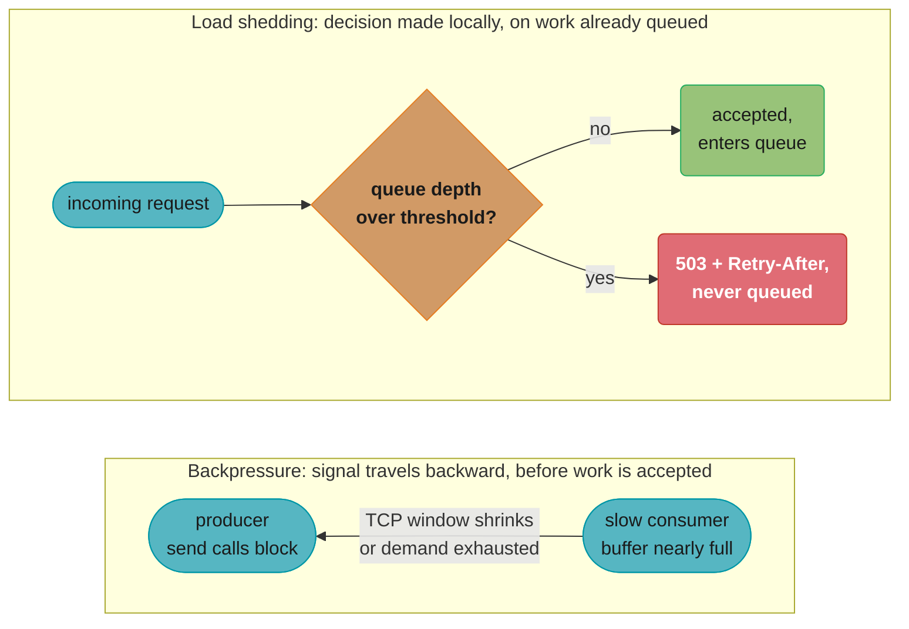
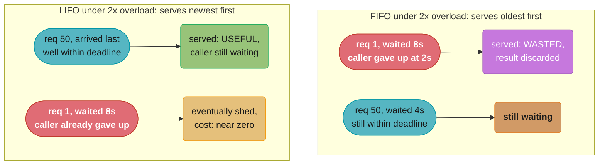
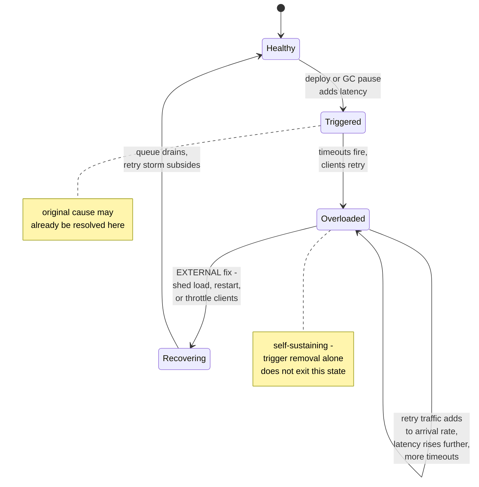

# Backpressure and Load Shedding — Deep Dive

---

## 1. Concept Overview

**Load shedding is which requests you drop; backpressure is telling the sender "I cannot take any more."** They are frequently used interchangeably in design discussions and interviews, and that conflation is itself a source of production incidents — a system that only sheds (drops work at the edge) but never signals backpressure upstream keeps accepting into a queue that is already lost, while a system that only signals backpressure but never sheds can deadlock a whole call chain when every hop just waits for the one behind it to slow down. They are complementary controls with different mechanisms, different failure modes, and different points in the stack where they apply.

[Resilience Patterns](resilience_patterns.md) already covers load shedding at the architectural level — §4.8 introduces priority-based shedding and edge admission control, §6.5 works a queue-depth threshold ladder, and §6.4 sizes a bulkhead's **concurrency** (in-flight slots) with Little's Law. This file does not repeat any of that. It deepens three things the parent leaves as an exercise: (1) backpressure as a *signal* distinct from shedding as a *decision*, including the backpressure mechanisms that already exist in TCP, HTTP/2, gRPC, and Reactive Streams whether or not you ever configure them; (2) sizing a **queue's depth budget** (not its concurrency) from a latency SLO with Little's Law, and the LIFO-vs-FIFO ordering choice once that budget is blown; and (3) the metastable-failure pattern — how retries interacting with a full queue keep an outage alive long after its trigger is gone, and why fixing the trigger does not end the incident.

See also [Message Queues §"Backpressure and Flow Control"](../message_queues/message_queues.md) for the asynchronous, broker-mediated case (Kafka retention, RabbitMQ `x-max-length`, SQS's unbounded growth) — that section is about a producer and consumer separated by a durable queue; this file is about backpressure and shedding on the **synchronous request path**, inside one service and across one RPC call.

---

## 2. Intuition

> **One-line analogy**: Load shedding is triage in a crowded emergency room — the staff already has patients in the waiting room and must decide, right now, who gets seen next and who gets turned away. Backpressure is the ER calling the dispatch center *before* the ambulance leaves, saying "we are full, divert to the next hospital." One manages the queue you already have; the other stops the queue from forming in the first place.

**Mental model — the signal only works if something is listening.** TCP has had a receive window for flow control since before the web existed; HTTP/2 and gRPC multiplex that idea per-stream; Reactive Streams put it in application code with `request(n)`. All three exist specifically so a slow consumer can make a fast producer wait *without either side needing to buffer unboundedly*. The reason backpressure still needs an entire deep-dive is that most systems defeat it by accident — an unbounded queue between the socket and the application thread pool absorbs the signal and turns "I am full, slow down" into "sure, keep sending, I'll just buffer it," right up until the buffer exhausts memory.

**Why it matters**: A queue does not create capacity — it only trades latency for the *appearance* of capacity, and only up to the point it fills. Once arrivals exceed service rate, no queue size fixes that; the only real choices are to slow the sender down (backpressure) or drop some of the arrivals (shedding). Every other lever — more threads, a bigger connection pool, a longer timeout — pushes the failure to a later point without changing whether `arrival rate > service rate` is true.

**Key insight — order of operations under sustained overload**: once you must shed *some* work, serve the newest requests first, not the oldest. A request that has already waited past its own deadline is worthless to finish — the caller has moved on — but the CPU cycle spent finishing it is not free; it comes out of the budget for a request that could still make its deadline. FIFO under sustained overload spends real capacity completing work nobody wants. LIFO spends it on work that still has a chance (§4.6, §6.6).

---

## 3. Core Principles

**1. Backpressure is a signal; load shedding is a decision — a system needs both, and they operate at different layers.**
Backpressure says "not right now" to the *specific sender on this connection*, propagating that slowdown backward through the call chain. Load shedding says "not this request" to a *specific unit of work*, deciding locally which items in an already-formed queue get served. A pure-backpressure system with no shedding can still fail if the entity generating load has no capacity to absorb the slowdown (a user staring at a spinner is backpressure with nowhere for the pressure to go). A pure-shedding system with no backpressure keeps accepting connections it will only reject later, wasting the accept-and-parse cost on work it always intended to drop.

**2. Little's Law budgets a queue's *depth*, not just a pool's *concurrency*.**
[Resilience Patterns §6.4](resilience_patterns.md#64-bulkhead-sizing-with-littles-law) uses `L = λW` to size how many concurrent slots a bulkhead needs. The same formula answers a different question here: given a latency SLO, how many requests are allowed to be *waiting in queue* before the added wait time alone blows the SLO? That number is the shedding threshold (§6.1).

**3. Shed on saturation signals, not on request rate.**
A fixed requests-per-second threshold is the worst shedding trigger available, because the same rate is safe on a fast day and catastrophic on a slow one — the moment a downstream dependency degrades 10x, the identical incoming rate now represents 10x the queueing load. Queue depth, CPU utilization, p99 latency, and in-flight request count all measure the thing that actually matters (is the system currently keeping up), and all four are used together in production shedding systems (§4.4, §6.1).

**4. Backpressure mechanisms already exist in your stack — the question is whether anything defeats them.**
TCP's receive window, HTTP/2's per-stream and per-connection flow-control windows, gRPC's flow control built on top of HTTP/2, and Reactive Streams' `request(n)` demand protocol are all backpressure that ships for free. An unbounded queue anywhere between the wire and the code that actually does the work — a `LinkedBlockingQueue` in front of a thread pool being the single most common instance — absorbs that signal and converts "slow down" into "keep going, I'll buffer it," which is exactly backwards (§6.4, §10 War Story).

**5. Under sustained overload, LIFO beats FIFO — and retries turn a transient trigger into a self-sustaining outage.**
Once the queue is genuinely oversubscribed, finishing the oldest request first spends capacity on work whose caller has almost certainly already given up. And a queue that stays full because failed callers retry into it keeps the system unhealthy long after whatever originally caused the spike has cleared — this is a **metastable failure** (§4.7, §6.7), and it is why "wait for the trigger to pass" is not always a valid remediation.

---

## 4. Types / Architectures / Strategies

### 4.1 TCP Flow Control — Backpressure Below the Application

Every TCP connection carries a **receive window**: the number of bytes the receiver is currently willing to accept, advertised in every ACK. When the receiving application's socket buffer fills faster than the application reads from it — because the application is busy, or CPU-starved, or blocked on something else — the receiver advertises a **shrinking window**, down to zero if the buffer is completely full. A zero window stalls the sender at the transport layer with no application code involved on either side. This is the oldest backpressure mechanism in the stack, and it is silent: an application whose read loop is slow gets automatic backpressure for free, with no library and no configuration.

### 4.2 HTTP/2 and gRPC Flow Control

HTTP/2 layers flow control on top of TCP's, at two granularities per RFC 7540: a **per-stream** window and a **per-connection** window, both defaulting to 65,535 bytes and adjusted via `WINDOW_UPDATE` frames as the receiver consumes data. This exists because HTTP/2 multiplexes many logical streams (requests) over one TCP connection — TCP's single window can't express "stream 7 is slow but stream 9 is fine," so HTTP/2 adds its own layer so one slow consumer of one response doesn't have to stall every other stream sharing the connection.

gRPC runs directly on HTTP/2 and inherits this flow control unmodified — a gRPC server that is slow to call `onNext()`/read the next message on a streaming RPC causes the client's stream-level window to fill and the client's send calls to block, again with zero application code written to make that happen. Production gRPC implementations (grpc-go, grpc-java, grpc-core) additionally auto-tune the window size upward from the 65,535-byte default using bandwidth-delay-product (BDP) estimation, so high-latency, high-throughput links aren't artificially capped at the RFC default.

### 4.3 Reactive Streams — `request(n)` as Explicit Demand Signaling

Where TCP and HTTP/2 backpressure happens invisibly at the transport layer, **Reactive Streams** (the spec behind Project Reactor, RxJava, and Java's own `java.util.concurrent.Flow`) puts the same idea directly into application code. A `Subscriber` calls `subscription.request(n)` to tell its `Publisher` "I am ready for `n` more elements" — the publisher is contractually forbidden from emitting more than the outstanding requested amount. Nothing is pushed onto a slow consumer; the consumer pulls at its own pace.

When a source genuinely cannot honor `request(n)` pull semantics (a hot sensor feed, a UI event stream), Reactive Streams implementations expose an explicit **overflow strategy** instead of silently buffering forever:

| Strategy | Behavior when demand is exhausted |
|----------|-----------------------------------|
| `BUFFER` | Queue unconsumed elements (bounded or unbounded — unbounded defeats the whole point, see §6.4) |
| `DROP` | Discard the newest elements that arrive while demand is zero |
| `LATEST` | Keep only the most recent element, discarding older unconsumed ones |
| `ERROR` | Terminate the stream with an overflow error rather than silently losing data |

`DROP` and `LATEST` are load shedding expressed as a stream operator — the same triage decision as §4.4, just applied per-element instead of per-request.

### 4.4 Priority Shedding and Request Classes

Production shedding systems classify inbound work into priority classes before deciding what to drop, rather than shedding uniformly at random:

- **Criticality class** — checkout and login versus a "recently viewed" widget; the widget sheds first.
- **User/tenant tier** — a paying tier's requests are shed last, or never, up to a fairness cap that prevents one tenant from starving shedding capacity for everyone else.
- **Retry vs. original attempt** — a request carrying a retry header is often shed *before* a first attempt at the same threshold, because a first attempt shed now becomes a retry later anyway, while shedding a retry that was already going to be retried again costs the system nothing extra.

### 4.5 Admission Control at the Edge

Rejecting excess load at the API Gateway or load balancer — before it reaches an application server at all — is cheaper than accepting a connection, parsing a request, and *then* deciding to shed it. A `503` with `Retry-After` returned by the edge costs a TCP handshake and a few bytes; the same rejection decided three hops deep has already paid for TLS termination, routing, and whatever the first two hops did before discovering there was no capacity. [Resilience Patterns §4.8](resilience_patterns.md#48-load-shedding) names this lever; the concrete queue-depth threshold that triggers it is derived in §6.1 below.

### 4.6 Brownout and Graceful Degradation as a Shedding Lever

A **brownout** deliberately serves a cheaper, degraded version of a response under load rather than the full version — smaller image variants, cached instead of live recommendations, a search result list without the "similar items" rail — trading response quality for capacity headroom before any request has to be rejected outright. This is the same spectrum [Resilience Patterns §4.6](resilience_patterns.md#46-graceful-degradation--fallback) already covers for dependency failure; the difference here is the trigger — brownout activates on the *serving system's own* saturation signal (queue depth, CPU) rather than on a downstream dependency being unavailable, and it is usually the cheapest capacity you can find, because it recovers throughput without shedding any requests at all.

### 4.7 Metastable Failure — Why the Outage Outlives Its Trigger

A **metastable failure** is a state a distributed system falls into where an internal positive feedback loop keeps the system unhealthy even after the original triggering condition is gone, and getting out requires an external intervention (shedding load, restarting instances, or throttling clients) rather than simply waiting. The canonical loop in a request-serving system: a latency spike (deploy, GC pause, a dependency blip) causes some requests to time out; timed-out clients retry; retries add to the arrival rate on top of the original traffic; the added load pushes latency up further, causing more timeouts, which causes more retries. Once the loop is running, removing the original trigger does not break the cycle — the system is now overloaded by its *own* retry traffic, which is self-sustaining at the new, higher arrival rate. This is the retry-amplification mechanic from [Resilience Patterns §12 Q6](resilience_patterns.md#12-interview-questions-with-answers) turned into a system-level state rather than a per-hop multiplier, and it is formalized as its own failure class in the HotOS 2021 paper "Metastable Failures in Distributed Systems" (Bronson, Aghayev, Charapko, Zhu) and its OSDI 2022 follow-up "Metastable Failures in the Wild" (Huang et al.).

---

## 5. Architecture Diagrams

### 5.1 Backpressure Signal Path vs. Load-Shedding Decision Point

Backpressure flows backward through the whole chain before work is even accepted; shedding is a local decision made at the point where a queue already exists:



*Backpressure prevents the queue from ever growing by slowing the sender at the transport or protocol layer; load shedding accepts that a queue exists and decides which arrivals join it. A system with only the right-hand path still lets its queue grow unbounded between shedding checks; a system with only the left-hand path has no answer when the entity generating load has nowhere to absorb the slowdown.*

### 5.2 LIFO vs. FIFO Under Sustained Overload

At 2x arrival rate against fixed service capacity, FIFO finishes work in the order it arrived — including requests whose callers gave up long ago — while LIFO finishes the newest arrivals first, salvaging the ones still inside their deadline:



*Under FIFO, capacity is spent finishing request 1 — whose caller almost certainly disconnected after its own client-side timeout — while request 50 keeps waiting behind it. Under LIFO, capacity goes to request 50, which still has a live caller, and request 1 is shed instead of served, costing almost nothing because no work was done on it.*

### 5.3 The Metastable Failure Loop

The trigger only needs to fire once; the loop keeps running on its own:



*The trigger transitions the system into `Overloaded`; from there, the `Overloaded -> Overloaded` self-loop is retry traffic feeding itself, and it runs regardless of whether the original deploy or GC pause is still happening. Exiting requires an external action — shed enough load to let the queue drain, or throttle/restart clients — not merely waiting for the trigger to pass.*

---

## 6. How It Works — Detailed Mechanics

### 6.1 Little's Law as a Queue-Depth Budget, Derived from an SLO

[Resilience Patterns §6.4](resilience_patterns.md#64-bulkhead-sizing-with-littles-law) uses `L = λW` to size a bulkhead's **concurrency** — how many requests may run at once. The same formula answers a different question: given a latency SLO, how many requests may **wait in queue** before queueing delay alone consumes the budget.

```
Little's Law:  L = lambda * W
  L      = average number of requests "in the system" — here, IN QUEUE specifically
  lambda = arrival rate (requests/sec)
  W      = average time spent in that part of the system — here, QUEUEING delay only

Checkout API SLO: p99 total latency under 250ms
  service time (actual work, no queueing): ~20ms average
  network + serialization overhead:        ~30ms (fixed, not shed-controllable)
  remaining budget allowed for QUEUEING WAIT: 250 - 20 - 30 = 200ms -> use 100ms
     of it as the shedding trigger, keeping 100ms of margin for variance

  arrival rate at peak: lambda = 1,000 req/s
  queueing wait budget: W = 0.1s

  L = 1,000 * 0.1 = 100

  -> once queue depth exceeds ~100 requests, the ADDED wait alone will
     exceed the 100ms budget for anything joining the back of the queue,
     even before that request has done a single millisecond of real work.
     Shed at depth 100, not at depth 100,000 "because the process hasn't
     crashed yet."
```

**Stated plainly.** "The SLO gives you a wait-time allowance; Little's Law converts that allowance into a queue-length number you can actually check on every request."

The distinction from §6.4's bulkhead sizing is the variable being solved for: bulkhead sizing fixes the desired `W` (dependency's known latency) and `lambda` (target throughput) to find `L` (concurrent slots to provision). This budget fixes the *allowed* `W` (what the SLO has left over after fixed costs) and the *observed* `lambda` to find `L` (the queue depth at which today's arrivals will blow that allowance) — one sizes a resource pool in advance, the other computes a live shedding threshold from current traffic.

| Symbol | What it is |
|--------|------------|
| SLO budget | Total latency allowance for the whole request — `250ms` here |
| fixed costs | Service time plus network/serialization — subtracted first, not shed-controllable |
| queueing wait budget (`W`) | What's left of the SLO for time spent waiting in queue — `100ms`, with margin reserved |
| `lambda` | Current observed arrival rate, not a provisioned target |
| `L` | The queue-depth shedding threshold — recomputed as `lambda` changes |

**Walk one example.** The same SLO under a slower dependency (service time rises from 20ms to 80ms, eating into the budget):

```
  fixed costs now: 80ms service + 30ms network = 110ms
  remaining SLO budget: 250 - 110 = 140ms -> reserve margin, use 70ms as W

  same arrival rate, lambda = 1,000 req/s
  L = 1,000 * 0.07 = 70

  -> the shedding threshold DROPS from 100 to 70 the moment the
     dependency degrades, because less of the SLO is left over for
     queueing. A static "shed at 500 in queue" threshold, chosen once
     and never revisited, is now nearly 7x too permissive.
```

The threshold is only correct at the fixed-cost numbers it was derived from; recompute it (or make it a live function of measured service time) rather than hand-picking one round number and trusting it across every dependency-latency regime.

### 6.2 HTTP/2 Flow-Control Window in Practice

```
Default per RFC 7540: SETTINGS_INITIAL_WINDOW_SIZE = 65,535 bytes,
applied independently at the per-stream and per-connection level.

Sequence for one stream, receiver slow to read:
  1. Sender transmits DATA frames; each frame's byte count is
     subtracted from the stream's remaining window.
  2. Window reaches 0 -> sender MUST stop sending on that stream,
     even though the TCP connection itself has room.
  3. Receiver's application finally reads the buffered data, then
     the peer emits a WINDOW_UPDATE frame restoring however many
     bytes were just freed.
  4. Sender resumes, bounded again by the (now larger) window.

Why per-stream AND per-connection: one slow stream (stream 7, a large
file download) reaching a zero window must not stall stream 9 (a small,
fast API call) multiplexed on the SAME TCP connection. The per-stream
window isolates that; the per-connection window still caps total
in-flight bytes across every stream combined.

Production tuning: grpc-go, grpc-java and grpc-core auto-tune the
window upward from the 65,535-byte default using a bandwidth-delay-
product (BDP) estimate, so a high-latency, high-throughput link isn't
artificially capped at a window sized for a LAN.
```

### 6.3 Reactive Streams `request(n)` — Demand Accounting

```java
// broken: unbounded push overwhelms a slow subscriber, no backpressure
Flux.interval(Duration.ofMillis(1))     // producer, ~1000 events/sec
    .subscribe(v -> slowDatabaseWrite(v));  // consumer, ~50 writes/sec possible
// Reactor buffers the difference internally with an UNBOUNDED default
// buffer on interval() -- memory grows without limit until OOM.

// fixed: explicit overflow strategy makes the tradeoff a decision, not an accident
Flux.interval(Duration.ofMillis(1))
    .onBackpressureBuffer(
        10_000,                                  // bounded: cap the buffer
        dropped -> log.warn("shed event {}", dropped),
        BufferOverflowStrategy.DROP_OLDEST)       // LIFO-flavored: keep the newest
    .subscribe(v -> slowDatabaseWrite(v));
```

The demand protocol underneath both versions is the same: `subscription.request(n)` tells the publisher exactly how many elements the subscriber is currently prepared to receive, and the publisher is contractually forbidden by the Reactive Streams spec from emitting more than the outstanding requested amount. `onBackpressureBuffer` with an explicit strategy is what turns "the publisher emits faster than demand allows" from a silent unbounded buffer into a bounded one with a declared, observable shedding policy — `DROP_OLDEST` here is the stream-operator equivalent of the LIFO ordering argued for in §4.7/§6.6, keeping the newest data and discarding the stalest.

### 6.4 Bounded Queue + `CallerRunsPolicy` — Broken, Then Fixed

```java
// BROKEN: unbounded queue defeats backpressure, turns a latency
// blip into an OOM instead of a controlled rejection
ExecutorService pool = new ThreadPoolExecutor(
    20, 20,                                   // 20 core/max threads
    60L, TimeUnit.SECONDS,
    new LinkedBlockingQueue<>());             // NO CAPACITY BOUND

// A downstream dependency degrades from 20ms to 4s per call. Threads
// stay busy 200x longer than normal, so submissions pile up in the
// UNBOUNDED queue instead of being rejected. At 500 submissions/sec,
// the queue grows by ~500 unconsumed Runnables PER SECOND, each
// holding request context (headers, buffers, callback closures) --
// commonly several KB apiece. Within minutes the queue alone accounts
// for gigabytes of retained heap, and the process OOMs -- taking down
// every OTHER request type sharing the same JVM, not just the ones
// hitting the slow dependency.

// FIXED: bounded queue + CallerRunsPolicy converts the same overload
// into backpressure on the SUBMITTING thread, not an OOM
ExecutorService pool = new ThreadPoolExecutor(
    20, 20,
    60L, TimeUnit.SECONDS,
    new ArrayBlockingQueue<>(100),            // hard bound: 100 queued max
    new ThreadPoolExecutor.CallerRunsPolicy());// backpressure, not silent drop

// Once 20 threads are busy AND the 100-slot queue is full, submit()
// no longer queues at all -- the CALLING thread runs the task itself,
// synchronously. This slows the caller down (real backpressure: the
// thread that would have submitted MORE work is now busy doing this
// one), which throttles the SOURCE of the load rather than absorbing
// it into unbounded memory. If the caller is itself a fixed-size
// request-handling pool, CallerRunsPolicy propagates the slowdown one
// more hop upstream automatically -- exactly the backward-propagating
// signal in Diagram 5.1.
```

`CallerRunsPolicy` is backpressure; it is not shedding — no work is dropped, the caller is simply made to feel the cost of submitting into a full queue. Pair it with an explicit shed (an `AbortPolicy` or a custom rejection that returns a fast `503`) when the caller itself must not be allowed to block — the two are not mutually exclusive, and production systems commonly run the queue-depth threshold from §6.1 to decide "shed" before capacity is so exhausted that `CallerRunsPolicy` would even trigger.

### 6.5 Adaptive Concurrency Limits — Gradient2, Worked

Static bulkhead sizes (§6.4 of the parent module) are a good starting point but go stale the moment the dependency's real latency drifts from the number used to size them. **Adaptive concurrency limiting** — the approach behind Netflix's open-source `concurrency-limits` library — instead adjusts the allowed in-flight count continuously from measured round-trip time, using an algorithm adapted from TCP congestion control:

```
Gradient2 (RTT-gradient-based limit adjustment):

  new_limit = old_limit * (min_RTT / avg_RTT) + sqrt(old_limit)

  min_RTT = the best RTT observed recently (a proxy for "uncongested")
  avg_RTT = the current smoothed average RTT

  Healthy state, latency stable:
    min_RTT = 20ms, avg_RTT = 22ms, old_limit = 50
    gradient = 20 / 22 = 0.909
    new_limit = 50 * 0.909 + sqrt(50) = 45.5 + 7.07 = ~52.5
    -> limit drifts slightly UP when RTT is close to its best-observed value

  Degrading state, latency rising:
    min_RTT = 20ms, avg_RTT = 80ms, old_limit = 50
    gradient = 20 / 80 = 0.25
    new_limit = 50 * 0.25 + sqrt(50) = 12.5 + 7.07 = ~19.6
    -> limit drops by more than half as soon as RTT climbs 4x,
       automatically shedding concurrency BEFORE a fixed bulkhead's
       static number would have let the pool fill up on slow calls
```

The `sqrt(old_limit)` term prevents the limit from ever fully collapsing to zero or getting permanently stuck near it — it guarantees a small amount of continued probing room so the limit can climb back up once RTT recovers, the same role TCP's slow-start plays after a congestion event. `concurrency-limits` also ships `VegasLimit` (a delay-based limiter recommended for server-side deployment) and `AIMDLimit` (a pure loss-based limiter, classic additive-increase/multiplicative-decrease, recommended client-side) — Gradient2 is the one worth knowing the arithmetic for because it is the one most often deployed as the default. **Maintenance state, stated honestly**: the library's most recent tagged release is v0.5.4 (December 2024) — it is still the reference open-source implementation of these algorithms and is used as a dependency in production systems, but release activity has slowed; treat it as a stable, largely-finished library rather than one under active weekly development, and expect to read its source rather than its changelog when integrating it.

### 6.6 LIFO vs. FIFO — Why Order Matters Once You're Already Shedding

```
Setup: service capacity = 100 req/s, arrival rate = 200 req/s (2x
overload), client-side deadline = 3s per request, queue unbounded
in this example (to isolate the ordering effect from the depth-based
shedding of §6.1 -- in production you'd apply both together).

FIFO, one second of overload (200 requests arrive, 100 get served):
  requests served this second: the OLDEST 100 in queue
  those had already waited up to (queue backlog / service rate) before
  even entering this second's service window -- once backlog exceeds
  a few seconds' worth of arrivals, the served requests are now OLDER
  than the 3s deadline, so their callers already gave up.
  useful throughput -> can fall toward ZERO as backlog grows, even
  though the server is working at full capacity the entire time.

LIFO, same setup:
  requests served this second: the NEWEST 100 that just arrived
  those have waited ~0s so far -- comfortably inside the 3s deadline
  useful throughput -> stays near 100 req/s, the server's actual
  capacity, regardless of how deep the backlog behind them grows
```

**In plain terms.** "Once the queue is deeper than what the deadline allows, FIFO spends capacity finishing work nobody is still waiting for, while LIFO spends the same capacity on work that still has a live caller."

This is counterintuitive because FIFO is the fairness-preserving, intuitively "correct" ordering under normal load — and it is, right up until backlog exceeds the client deadline. Past that point, "fair" and "useful" diverge: FIFO is fair to every request equally, including the ones whose outcome no longer matters to anyone.

| Symbol | What it is |
|--------|------------|
| deadline | Client-side timeout after which the caller has already given up |
| backlog | Queue depth divided by service rate — wait time a new arrival faces |
| useful throughput | Completed requests whose caller is still waiting for the result |
| overload factor | `arrival rate / service rate` — how far past capacity, same as §6.5 of the parent |

**Walk one example.** At 2x overload with a 3-second deadline, backlog crossing the deadline is the tipping point:

```
  service rate = 100 req/s
  backlog depth needed to exceed 3s deadline: 100 * 3 = 300 requests

  BEFORE backlog reaches 300: FIFO and LIFO perform identically --
    every queued request is still within its deadline either way.

  AFTER backlog exceeds 300: FIFO keeps serving requests older than
    3s (wasted), while LIFO keeps serving the newest arrivals (useful)
    -> the two orderings diverge exactly at the point where it matters,
       not gradually from the start.
```

The practical rule: LIFO (or a bounded-recency variant) is the right default specifically for a queue that is *already* being shed — it is not a general replacement for FIFO fairness under normal, within-capacity load, where FIFO's ordering has no downside at all.

### 6.7 Metastable Failure — Numeric Walkthrough

```
Baseline: arrival rate 1,000 req/s, service rate 1,200 req/s (healthy,
16% headroom), timeout 500ms, retry policy: 1 retry on timeout.

Trigger: a 90-second deploy-induced latency blip pushes service rate
down to 600 req/s (dependency pods restarting).

  during the blip:
    arrivals still 1,000 req/s, service only 600 req/s
    excess = 1,000 - 600 = 400 req/s can't be served -> time out
    each timeout retries once -> RETRY TRAFFIC ADDS 400 req/s
    new total arrival rate = 1,000 + 400 = 1,400 req/s

  the retries make the deficit WORSE, not better:
    against the degraded 600 req/s service rate, 1,400 req/s arriving
    means 800 req/s now failing -> 800 MORE retries next cycle

  trigger clears at t=90s: service rate recovers to its normal 1,200
  req/s. But arrival rate is now inflated by retry traffic that has
  nothing to do with the original deploy:
    if retry traffic has grown to, say, 900 req/s on top of the
    steady 1,000 req/s organic rate, total arrival = 1,900 req/s
    against a now-healthy 1,200 req/s service rate -> STILL 700 req/s
    over capacity, generating STILL MORE retries

  the system remains in the Overloaded state (Diagram 5.3) even
  though the trigger that caused it ended 90 seconds ago -- exiting
  requires an EXTERNAL action: shed enough of the retry traffic to
  get arrivals back under 1,200 req/s, or throttle/kill retrying
  clients, or add capacity. Simply waiting does not recover this,
  because nothing in the loop is currently trending back toward
  healthy on its own.
```

The retry budget from [Resilience Patterns §6.6](resilience_patterns.md#66-retry-budgets--bounding-retries-in-aggregate) is the direct countermeasure — capping retry traffic as a fraction of total traffic prevents the "retries add to arrival rate" step from ever compounding past a bounded multiplier, which is what keeps a transient trigger transient instead of self-sustaining.

---

## 7. Real-World Examples

- **Netflix `concurrency-limits`** — the open-source reference implementation of Vegas, Gradient2, and AIMD adaptive limiting (§6.5), built to replace static, hand-tuned bulkhead sizes across Netflix's service fleet with a self-adjusting number derived from measured RTT, the same congestion-control idea TCP has used for decades applied to RPC concurrency instead of packet windows.
- **Envoy's overload manager** — a resource-driven admission-control layer distinct from the per-instance outlier detection already covered in [Resilience Patterns §7](resilience_patterns.md#7-real-world-examples). It watches host-level resource monitors (`envoy.resource_monitors.fixed_heap`, `envoy.resource_monitors.global_downstream_max_connections`) and triggers overload actions — `stop_accepting_requests` once heap usage crosses a configured ceiling, `disable_http_keepalive` and `reduce_timeouts` at earlier thresholds, `shrink_heap` to release memory back to the OS — shedding at the proxy layer before the process itself runs out of memory.
- **gRPC and HTTP/2 in production RPC meshes** — every gRPC deployment on HTTP/2 inherits window-based flow control (§4.2, §6.2) whether or not anyone configures it, making it the most widely deployed backpressure mechanism in modern service-to-service traffic, almost entirely invisible to the application code running on top of it.
- **Google's SRE load-shedding guidance** — Google's publicly documented SRE practice for handling overload explicitly recommends shedding based on utilization and criticality classification (the same request-class idea as §4.4) rather than raw request-rate thresholds, for exactly the reason argued in §3 principle 3: a fixed rate threshold is safe or catastrophic depending on conditions the threshold itself cannot see.

---

## 8. Tradeoffs

### Backpressure vs. Load Shedding

| Dimension | Backpressure | Load Shedding |
|-----------|--------------|----------------|
| What it does | Signals the sender to slow down or stop | Decides which already-arrived work to drop |
| Where it acts | Transport/protocol layer, or an explicit demand API | Application layer, at or after admission |
| Failure mode if absent | Sender keeps pushing into an unbounded buffer -> OOM | Queue grows without limit even if the sender WOULD slow down given a signal |
| Failure mode if misapplied | Blocks a caller who has no fallback, propagating the slowdown upstream indefinitely | Drops work indiscriminately, including high-priority requests, if shedding is uniform rather than classed |
| Requires cooperation from | Both ends of the specific connection/stream | Only the local system — no upstream cooperation needed |

### LIFO vs. FIFO Queue Ordering

| Dimension | FIFO | LIFO (under sustained overload) |
|-----------|------|----------------------------------|
| Behavior within capacity | Fair, no downside | Identical to FIFO — no queue depth deep enough to matter |
| Behavior past the deadline-crossing backlog depth (§6.6) | Serves stale requests whose callers already gave up | Serves fresh requests still within their deadline |
| Perceived fairness | High — every request served in arrival order | Lower — old requests may starve entirely under sustained overload |
| Best for | Normal operation, and any queue that never sustains overload | A queue specifically feeding a service already past capacity |

### Static Bulkhead Sizing vs. Adaptive Concurrency Limits

| Dimension | Static bulkhead ([Resilience Patterns §6.4](resilience_patterns.md#64-bulkhead-sizing-with-littles-law)) | Adaptive concurrency limit (§6.5) |
|-----------|------------------------------------------------------------------------------------------------------------|-------------------------------------|
| Basis | `L = λW` computed once from expected latency and target throughput | Continuously recomputed from measured RTT via a congestion-control-style algorithm |
| Adapts to dependency drift | No — stays fixed until manually re-tuned | Yes — the limit tracks current RTT automatically |
| Operational simplicity | Simple: one number, easy to reason about and alert on | More moving parts: an algorithm and its tuning knobs (gradient smoothing, min-limit floor) |
| Failure mode if mis-set | Too small wastes capacity; too large lets a slow dependency exhaust the pool before the limit engages | A poorly tuned gradient can oscillate the limit under noisy RTT, similar to a flapping circuit breaker |

---

## 9. When to Use / When NOT to Use

### Invest in Explicit Backpressure (bounded queues, Reactive Streams demand, adaptive limits) When
- **The producer and consumer are decoupled by any buffer** — a thread pool's work queue, a Reactive Streams pipeline, an async message handoff — because an unbounded buffer there is the single most common way backpressure gets silently defeated (§6.4).
- **Dependency latency is variable and you cannot pre-provision for its worst case** — adaptive concurrency limits (§6.5) are worth the operational complexity specifically when a static bulkhead would need constant manual re-tuning to track real latency drift.

### Invest in Load Shedding When
- **The system can genuinely be overloaded by its own success** — a traffic spike, a viral event, a retry storm — where the answer to "should we serve this request" is sometimes legitimately no, regardless of how fast every dependency is.
- **Not every request is equally valuable** — shedding is far more effective (and far less damaging to the business) when priority classes (§4.4) already exist to decide what goes first.

### Skip or Minimize When
- **Traffic is well within provisioned capacity and bursts are small and short** — the queue-depth math in §6.1 only matters once backlog is deep enough to threaten the SLO; a queue that never grows past single digits doesn't need a shedding threshold tuned to the last millisecond.
- **A single-tenant, single-priority batch system with no user waiting synchronously** — FIFO's fairness has no downside here (§6.6), and LIFO's benefit (protecting requests whose caller is still waiting) doesn't apply when nothing is waiting on an individual item's completion.

### Caution / Anti-Patterns
- **Shedding on request rate alone** — a fixed req/s threshold is safe or catastrophic depending on current dependency latency, which the threshold cannot see (§3 principle 3).
- **An "unbounded buffer for safety"** — the single most common way a system defeats the backpressure that TCP, HTTP/2, or Reactive Streams already gave it for free (§6.4, §10).
- **Retrying without a budget into a system already shedding** — this is precisely the loop that produces a metastable failure (§4.7, §6.7); an uncapped retry policy turns a transient trigger into a self-sustaining outage.

---

## 10. Common Pitfalls

**War Story — An Unbounded Work Queue Turned a 90-Second Latency Blip Into a Full-Service OOM**

A `pricing-service` accepted incoming HTTP requests on a fixed 20-thread pool, handing each request off to `ExecutorService.submit()` backed by a `LinkedBlockingQueue` with no capacity bound — the default most examples online show, because it "just works" under normal load. A downstream currency-conversion dependency had a routine deploy that degraded its p99 from 20ms to roughly 4 seconds for about 90 seconds while new pods warmed up. `pricing-service`'s 20 threads, each now blocked for up to 4 seconds per call instead of 20ms, could drain only a small fraction of the incoming 500 req/s. Every request that couldn't get a thread queued instead — because the queue had no bound, `submit()` never rejected anything. Over the 90-second window, roughly 500 req/s × 90s ≈ 45,000 requests piled into the queue, each `Runnable` closure retaining a full request context (headers, deserialized body, callback references) at several kilobytes apiece — tens of thousands of them added up to several gigabytes of retained heap on top of the JVM's normal working set. The process OOM-killed roughly 70 seconds into the blip, twenty seconds *before* the triggering deploy had even finished — meaning the dependency had already begun recovering by the time `pricing-service` went down, and it took the deploy pipeline's own health checks down with it as collateral damage, since `pricing-service` served internal price lookups for the deploy tooling's own smoke tests.

*Fix*: replaced the unbounded `LinkedBlockingQueue` with a bounded `ArrayBlockingQueue(200)` and a `CallerRunsPolicy` rejection handler (§6.4), and added a queue-depth-based shedding check derived from Little's Law against the service's 300ms p99 SLO (§6.1: at the service's ~40 req/s sustainable rate and a 150ms queueing budget, the threshold worked out to roughly `40 * 0.15 = 6` — shed once more than 6 requests are already queued, well before the pool exhausts). The next time the same dependency degraded, `pricing-service`'s queue filled to its bound within the first second, `CallerRunsPolicy` began throttling submission (making the calling I/O threads feel the backpressure directly), and the shedding threshold rejected the excess with a fast `503` instead of queueing it — memory stayed flat, and the service continued serving the requests it had actual capacity for throughout the entire 90-second blip.

**What it means.** "An unbounded queue in front of a thread pool is not a buffer, it is a way for a latency problem to become a memory problem — and memory problems fail all requests, not just the slow-dependency ones."

The multiplier that made this an outage rather than a slowdown is the one every unbounded-queue configuration shares: queue growth is `(arrival rate - service rate) x duration`, and neither of those numbers has any relationship to available memory until the OOM killer finds out the hard way.

| Symbol | What it is |
|--------|------------|
| arrival rate | Requests hitting the service, unaffected by the downstream blip (`500 req/s`) |
| degraded service rate | What the 20-thread pool can actually drain during the blip, at 4s/call (`~5 req/s`) |
| queue growth rate | `arrival - service` — the deficit accumulating every second (`~495 req/s`) |
| bytes per queued item | Retained heap per `Runnable` closure (request context, several KB) |
| time to OOM | How long the deficit takes to exhaust available heap at that per-item cost |

**Walk one example.** The blip's numbers, queue growth versus the fix's shedding threshold:

```
  BROKEN, unbounded queue
    deficit = 500 - 5                  =    495 req/s accumulating
    at 70s into the blip:
      queued items = 495 * 70          = ~34,650 Runnables
      at ~5KB retained context each    = ~173 MB just for THIS queue,
      on top of every other allocation already competing for heap
    -> OOM before the 90s blip even finished

  FIXED, bounded queue (200) + shed threshold (6, from Little's Law)
    queue fills to 200 within under 1 second at a 495 req/s deficit
    CallerRunsPolicy engages immediately after that -> submitting
      threads slow down, which throttles ACCEPTANCE of new work
    shed threshold (6) triggers a 503 well before the queue's own
      200-item bound is even reached, for anything checked at the
      admission layer rather than the executor layer
    memory footprint: bounded at 200 * ~5KB = ~1MB, flat for the
      entire 90-second blip
```

The two fixes are doing different jobs and both mattered: the bounded queue capped the *worst case* if the shedding check were ever bypassed, and the Little's-Law-derived shedding threshold stopped work from reaching the queue at all once it could no longer be served inside the SLO — belt and suspenders, not either/or.

---

## 11. Technologies & Tools

| Category | Tools | Notes |
|----------|-------|-------|
| Adaptive concurrency limiting | **Netflix `concurrency-limits`** | Vegas, Gradient2, AIMD implementations (§6.5); stable reference library, release cadence has slowed (latest tag v0.5.4, December 2024) — read the source, not the changelog |
| Reactive backpressure | **Project Reactor, RxJava, `java.util.concurrent.Flow`** | Reactive Streams `request(n)` demand protocol (§4.3, §6.3); overflow strategies (`BUFFER`/`DROP`/`LATEST`/`ERROR`) make the shedding tradeoff explicit |
| Proxy-level admission control | **Envoy overload manager** | Resource monitors (`fixed_heap`, `global_downstream_max_connections`) and overload actions (`stop_accepting_requests`, `disable_http_keepalive`, `reduce_timeouts`, `shrink_heap`); distinct from Envoy's per-instance outlier detection (see [Resilience Patterns §7](resilience_patterns.md#7-real-world-examples)) |
| Protocol-level flow control | **HTTP/2 (`WINDOW_UPDATE`), gRPC** | Ships by default on every HTTP/2 connection; grpc-go/grpc-java/grpc-core auto-tune the window via BDP estimation |
| JVM thread-pool backpressure | **`java.util.concurrent.ThreadPoolExecutor`** | `ArrayBlockingQueue` + `CallerRunsPolicy`/`AbortPolicy` (§6.4) — the bounded-queue fix belongs in every service that hands work off to a pool |
| Retry budgets (the metastable-failure countermeasure) | **gRPC `retryThrottling`, AWS SDK `standard` retry mode** | Already covered in [Resilience Patterns §6.6](resilience_patterns.md#66-retry-budgets--bounding-retries-in-aggregate); the direct fix for §6.7's loop |

---

## 12. Interview Questions with Answers

**Q: What is the difference between backpressure and load shedding, and why are they so often confused?**
**Short:** Backpressure is a signal telling a sender to slow down; load shedding is a decision to drop specific requests already accepted.

A: Backpressure is a *signal* that flows backward from a slow consumer to its sender — "stop sending, I cannot keep up" — implemented at the transport layer (TCP windows), the protocol layer (HTTP/2 and gRPC flow control), or explicitly in application code (Reactive Streams `request(n)`). Load shedding is a *local decision* about which already-arrived requests get served versus dropped, made once a queue has formed. They're confused because both are responses to overload and both often get lumped under "backpressure" in casual conversation, but a system can have one without the other: a bounded queue with `CallerRunsPolicy` is backpressure with no shedding (nothing is dropped, the caller is just slowed down), while an edge gateway returning `503`s past a concurrency limit is shedding with no backpressure signal sent anywhere upstream. Well-designed systems use both — backpressure to avoid forming an unbounded queue in the first place, shedding to make a fast decision on whatever queue does form.

**Q: Why is a fixed requests-per-second threshold the worst signal to shed on?**
**Short:** A fixed rate threshold is safe or catastrophic depending on current dependency latency, which the threshold itself cannot observe.

A: Because the same arrival rate can be well within capacity or massively over capacity depending on conditions the rate threshold has no visibility into — specifically, current downstream latency. If a dependency degrades 10x, the service's *effective* capacity to handle the same incoming rate has also fallen roughly 10x, but a static "shed above 1,000 req/s" rule doesn't know that and keeps admitting requests it can no longer serve within its SLO. Queue depth, CPU utilization, p99 latency, and in-flight count all directly measure whether the system is currently keeping up, which is the thing that actually matters — a rate threshold is a proxy for that state that stops being accurate the moment conditions change.

**Q: Walk through how you'd derive a concrete queue-depth shedding threshold from a latency SLO.**
**Short:** Subtract fixed costs from the SLO to get a queueing-wait budget, then apply Little's Law with the current arrival rate to get a queue-depth number.

A: Start from the SLO's total latency budget (e.g., 250ms p99), subtract the fixed costs that queueing delay cannot affect — actual service time and network/serialization overhead — leaving whatever remains as the allowance for time spent waiting in queue, with some margin reserved for variance. Then apply Little's Law, `L = lambda * W`, using the current observed arrival rate for `lambda` and the queueing-wait allowance for `W`: the resulting `L` is the queue depth at which the added wait time alone would consume the SLO's remaining budget. Concretely, a 250ms SLO with 50ms of fixed cost leaves 200ms; reserving margin down to a 100ms queueing budget at 1,000 req/s arrival gives `L = 1,000 * 0.1 = 100` — shed once queue depth passes 100. Crucially, this threshold isn't a constant: recompute it whenever fixed costs change (a slower dependency eats into the SLO budget and lowers the threshold), which is the distinction from a hand-picked, never-revisited number.

**Q: What backpressure mechanisms already exist in a typical service-mesh gRPC deployment, without any application code written for them?**
**Short:** TCP's receive window and HTTP/2's per-stream and per-connection flow-control windows both apply automatically underneath gRPC.

A: Two layers ship by default. TCP's receive window shrinks as a receiving socket buffer fills, stalling the sender at the transport level with a zero window if the application isn't reading fast enough — this predates HTTP entirely and requires no configuration. On top of that, HTTP/2 (which gRPC runs on) adds its own flow control at both the per-stream and per-connection level, defaulting to a 65,535-byte window per RFC 7540 and adjusted via `WINDOW_UPDATE` frames as data is consumed — this exists specifically because HTTP/2 multiplexes many logical RPC streams over one TCP connection, so one slow stream needs to be throttled without stalling every other stream sharing that connection. Both operate with zero lines of application code; the failure mode to watch for is something *inside* the application (an unbounded queue between the gRPC handler and the actual work) absorbing that upstream signal and defeating it.

**Q: Explain the Reactive Streams `request(n)` protocol and how it differs from a push-based stream.**
**Short:** `request(n)` lets the subscriber pull only as much data as it's ready for, instead of the publisher pushing at its own pace.

A: In `request(n)`, the `Subscriber` tells its `Publisher` exactly how many elements it is currently prepared to receive by calling `subscription.request(n)`, and the Reactive Streams specification contractually forbids the publisher from emitting more than the outstanding requested amount. This is the opposite of a naive push-based stream, where the publisher emits at whatever rate it wants and the consumer either keeps up or an unbounded buffer absorbs the difference until memory runs out. When a source genuinely can't be throttled to match demand (a live sensor feed), the library exposes an explicit overflow strategy — `BUFFER` (bounded or unbounded), `DROP` (discard newest while demand is exhausted), `LATEST` (keep only the most recent unconsumed element), or `ERROR` (fail the stream) — turning what would otherwise be a silent unbounded buffer into a declared, observable tradeoff.

**Q: Why does an unbounded `LinkedBlockingQueue` in front of a thread pool defeat backpressure, and what's the fix?**
**Short:** An unbounded queue absorbs a slow-consumer signal into unlimited memory instead of propagating it back to the sender.

A: `ThreadPoolExecutor` with a `LinkedBlockingQueue` (no capacity argument) never rejects a submission — when all worker threads are busy, new tasks queue indefinitely rather than blocking the submitter or returning an error. If a downstream dependency slows down, threads stay busy far longer per task, throughput to drain the queue collapses, and the queue grows by the full arrival rate every second with nothing signaling the submitting code to slow down — this is backpressure being silently absorbed into unbounded heap instead of propagated. The fix is a bounded queue (`ArrayBlockingQueue` with an explicit capacity) paired with a rejection policy: `CallerRunsPolicy` converts a full queue into real backpressure (the submitting thread does the work itself, which slows down whoever is calling submit), while `AbortPolicy` or a custom handler converts it into explicit shedding (reject with a fast error). Both are strictly better than the unbounded default, which fails by OOM instead of by a controlled, observable decision.

**Q: What is an adaptive concurrency limit, and how does it improve on a statically sized bulkhead?**
**Short:** An adaptive limit recomputes allowed concurrency continuously from measured latency, instead of using a number fixed at setup time.

A: A statically sized bulkhead (per [Resilience Patterns §6.4](resilience_patterns.md#64-bulkhead-sizing-with-littles-law)) picks a concurrency number once, from Little's Law applied to expected latency and target throughput, and that number stays fixed until someone manually re-tunes it. An adaptive concurrency limit — Netflix's `concurrency-limits` library implements this with algorithms like Gradient2 — instead recomputes the allowed in-flight count continuously from measured round-trip time, adapting a technique from TCP congestion control: the limit rises slightly when current RTT is close to its best recently observed value, and drops sharply when RTT climbs relative to that baseline, before a fixed-size bulkhead would have let the pool fill entirely with slow calls. The tradeoff is complexity — a static number is one line to reason about and alert on, while an adaptive limit has its own tuning surface (smoothing windows, minimum-limit floors) and can itself misbehave (oscillating) if that tuning is off, similar to a mis-tuned circuit breaker.

**Q: Under sustained overload, why would you serve requests in LIFO order instead of FIFO?**
**Short:** Past the point where backlog exceeds the client's deadline, FIFO wastes capacity finishing requests whose callers already gave up.

A: Once queue backlog exceeds the client-side timeout — the point at which `queue depth / service rate` exceeds the deadline — every request FIFO serves next is one whose caller almost certainly disconnected already, because it waited longer than the caller was willing to. Finishing that request still costs real CPU and dependency calls; that capacity is being spent on a result nobody will receive. LIFO instead serves the newest arrivals first, which are still comfortably inside their deadline, so the same finite capacity produces results that are actually useful to a waiting caller. Below the deadline-crossing backlog depth the two orderings perform identically — LIFO is specifically a sustained-overload tactic, not a general replacement for FIFO's fairness under normal load, where FIFO has no downside at all.

**Q: What is a metastable failure, and why doesn't fixing the original trigger end the incident?**
**Short:** A metastable failure is a self-sustaining overload loop where retry traffic alone keeps the system unhealthy after the trigger clears.

A: A metastable failure is a state where an internal feedback loop keeps a system overloaded even after the condition that originally triggered it is gone — the canonical loop is a latency spike causing timeouts, timeouts causing retries, retries adding to arrival rate, and the added arrival rate causing more latency and more timeouts. Once that loop is running at a rate above the system's service capacity, it is self-sustaining: removing the original trigger (say, a deploy finishes and the dependency recovers to its normal latency) does not reduce the now-inflated arrival rate, because that inflation is coming from the system's own retry traffic, not from the original cause. Exiting requires an external intervention — shedding enough load to bring arrivals back under capacity, throttling or restarting retrying clients, or adding capacity — because nothing inside the loop is currently trending back toward healthy on its own; "wait for it to resolve" is not a valid remediation once the system is in this state.

**Q: How do retry budgets prevent a metastable failure from forming in the first place?**
**Short:** A retry budget caps total retry traffic as a fraction of overall traffic, preventing retries from ever compounding the arrival rate unboundedly.

A: [Resilience Patterns §6.6](resilience_patterns.md#66-retry-budgets--bounding-retries-in-aggregate) covers the mechanism — a client-wide token bucket that retries spend from and successes replenish, disabling retries entirely once the budget is exhausted rather than letting every client retry independently and unboundedly. Applied to the metastable-failure loop (§6.7), this caps the "retries add to arrival rate" step at a fixed multiplier of organic traffic instead of letting it compound indefinitely — once the budget is exhausted, failed requests return their first error immediately instead of adding another retry attempt on top of an already-overloaded system, which keeps the arrival-rate spike bounded and recoverable once the original trigger clears, rather than self-sustaining.

**Q: What does Envoy's overload manager do, and how is it different from Envoy's outlier detection?**
**Short:** The overload manager sheds load based on the proxy's own resource pressure; outlier detection ejects unhealthy upstream instances.

A: Outlier detection (covered in [Resilience Patterns §7](resilience_patterns.md#7-real-world-examples)) is circuit breaking applied per upstream instance, based on that instance's own error rate — it decides which *backend* to stop routing to. Envoy's overload manager is a separate mechanism that watches the *proxy's own* resource pressure — heap usage via `envoy.resource_monitors.fixed_heap`, active downstream connection count via `envoy.resource_monitors.global_downstream_max_connections` — and triggers overload actions when configured thresholds are crossed: `stop_accepting_requests` to shed new inbound work outright, `disable_http_keepalive` and `reduce_timeouts` as earlier, less drastic responses, and `shrink_heap` to actively release memory back to the OS. Outlier detection answers "is this backend healthy"; the overload manager answers "am I, the proxy, currently able to handle more load at all" — the two operate on different subjects and are commonly deployed together.

**Q: Why is admission control at the edge (API Gateway) cheaper than shedding deeper in the call chain?**
**Short:** Rejecting at the edge costs a handshake and a few bytes; rejecting after several hops wastes all the work those hops already did.

A: A request rejected at the API Gateway or load balancer, before it reaches any application server, costs roughly a TCP handshake, TLS negotiation, and enough parsing to read the request line — cheap, and it happens once. The same request rejected three hops deep — after the gateway routed it, an application server accepted and parsed it, and it queued waiting for a thread — has already consumed real work at every one of those stages before the decision to drop it is even made, and that work is now entirely wasted. Pushing the shedding decision as close to the edge as the necessary context (priority class, current system-wide saturation) allows minimizes the fraction of rejected traffic's cost that gets spent before the rejection happens.

**Q: How would you design load shedding for a service that has multiple request priority classes?**
**Short:** Classify requests into priority tiers before applying the queue-depth threshold, shedding the lowest tier first as saturation increases.

A: Classify incoming requests into priority tiers up front — critical path (checkout, login), standard, and best-effort (background/analytics), or by paying-tier versus free-tier user — and apply the queue-depth threshold from §6.1 per tier rather than uniformly. As saturation increases past successive thresholds, shed best-effort traffic first, then standard, reserving critical-path capacity until the system is genuinely unable to serve even that. A useful additional class is retry-vs-first-attempt (§4.4): shedding a request that's already carrying a retry marker before shedding a first attempt at the same priority costs less, since a shed first attempt still generates exactly one retry, while shedding an already-retried request avoids generating a second one. The key design point is that uniform, unclassified shedding treats a checkout request identically to a "recently viewed" widget refresh, which is rarely the right tradeoff for the business.

**Q: A service has bounded queues and correct shedding thresholds everywhere, but still OOMs under a retry storm. What's missing?**
**Short:** A per-hop shedding threshold doesn't cap total retry-amplified traffic across the whole call chain — that requires a retry budget.

A: Per-hop bounded queues and shedding thresholds each protect that individual hop from queueing past its own SLO, but they don't prevent the aggregate retry amplification described in [Resilience Patterns §12 Q6](resilience_patterns.md#12-interview-questions-with-answers) and §6.7 here — if each of several hops independently retries on failure, the effective load reaching the deepest dependency can still be `R^N` times the organic rate even though every individual hop is behaving "correctly" by its own local rules. What's missing is a retry budget (§6.6 of the parent module) that bounds retry traffic *in aggregate*, client-wide, rather than per-call — because a healthy-looking per-hop queue depth doesn't tell you that 80% of what's arriving in that queue is retry traffic from hops further upstream, all individually within their own local policy.

**Q: If TCP, HTTP/2, and Reactive Streams all provide backpressure automatically, why does load shedding still need to exist as a separate mechanism?**
**Short:** Backpressure only works when every hop in the chain honors it; shedding is what protects a system whose upstream sender either can't or won't slow down.

A: Backpressure requires cooperation — a sender that receives a "slow down" signal has to actually have somewhere to put the resulting delay, whether that's blocking, buffering with a bound, or propagating the slowdown further upstream itself. Some senders can't do any of those: a user staring at a browser has nowhere to "buffer" a slower page load beyond their own patience, and a fire-and-forget producer with no return channel has no way to even receive a backpressure signal in the first place. Load shedding doesn't require any cooperation from the sender — it's a purely local decision the receiving system makes about which of the requests that DID arrive get served, which is why it remains necessary even in a stack where every protocol-level backpressure mechanism is correctly wired up.

---

## 13. Best Practices

**1. Size a shedding threshold from Little's Law against the current SLO, not a round number chosen once** — recompute it as fixed costs (dependency latency, service time) drift, per §6.1; a static threshold silently goes stale the moment the numbers it was derived from change.

**2. Never let a queue between the wire and the actual work be unbounded** — an unbounded `LinkedBlockingQueue`-style buffer is the single most common way backpressure that already exists in TCP/HTTP2/Reactive Streams gets silently defeated (§6.4, §10).

**3. Pair backpressure with shedding, not one or the other** — `CallerRunsPolicy` alone slows a caller down but never sheds; a shedding threshold alone can still let an unbounded queue form behind it if nothing bounds admission first.

**4. Prefer LIFO (or a bounded-recency policy) for any queue that regularly runs past its deadline-crossing backlog depth** — FIFO is strictly better below that depth and strictly worse above it (§6.6); know which regime the queue actually operates in.

**5. Cap retry traffic with a retry budget before it can compound into a metastable failure** — a system with correct per-hop shedding can still self-sustain an outage through aggregate retry amplification (§6.7, §12 Q11); the budget is the fix that operates at the right scope.

**6. Classify requests by priority before shedding uniformly** — shedding a "recently viewed" widget and shedding a checkout request are not the same decision, and treating them the same wastes the business value shedding exists to protect (§4.4).

**7. Prefer adaptive concurrency limits over a hand-tuned static bulkhead for dependencies whose latency drifts** — the operational cost of tuning an algorithm once is usually lower than the recurring cost of manually re-tuning a static number every time the dependency's behavior changes (§6.5, §8).
