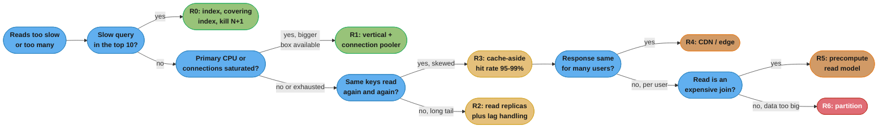
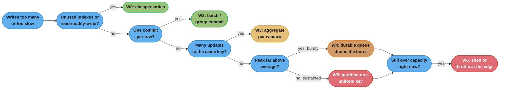

# Scaling Reads and Writes
The decision ladder: which rung to climb next when reads or writes outgrow the box, and what each rung costs you.

---

## 1. Concept Overview

Almost every "scale this system" interview question resolves into one of two questions:
**the reads are too many**, or **the writes are too many**. They look symmetrical and they are
not. Reads scale by *copying* data closer to the reader — an index, a replica, a cache, an
edge node, a precomputed view. Writes scale by *splitting* the work so no single machine has to
accept all of it — cheaper writes, batched writes, buffered writes, partitioned writes. Copying
is easy and splitting is hard, which is why a read-heavy system can usually grow 100x with
commodity techniques while a write-heavy system hits an architectural wall much sooner.

This page is the **decision ladder** for both. It does not re-teach the techniques; each rung
has an owner page that goes deep, and this page links to it:

| Rung / topic | Owner page (read this for depth) |
|---|---|
| Cache patterns, stampede, avalanche, eviction, hit-rate math | [Caching](../caching/caching.md) |
| Edge caching, `Cache-Control`, origin shield, invalidation | [CDN](../cdn/cdn.md) |
| Shard key selection, resharding, cross-shard queries, celebrity shards | [Database Sharding](../database_sharding/database_sharding.md) |
| Replication mechanics, failover, sync vs async | [Replication and High Availability](../../database/replication_and_high_availability/replication_and_high_availability.md) |
| Locks, leases, single-flight, queue-as-lock | [Coordination and Contention](../coordination_and_contention/coordination_and_contention.md) |
| Bounded queues, admission control, LIFO shedding, metastable failure | [Backpressure and Load Shedding](../resilience_patterns/backpressure_and_load_shedding.md) |
| Vertical vs horizontal, statelessness, Universal Scalability Law | [Scalability](../scalability/scalability.md) |
| QPS and storage arithmetic from DAU | [Capacity Estimation](../capacity_estimation/capacity_estimation.md) |

What this page owns is the **order**: which rung to try first, what multiplier each rung buys,
what consistency guarantee each rung spends, and how a single hot key defeats both ladders.
That ordering is what an interviewer is actually grading when they say "now make it handle 10x."

---

## 2. Intuition

> **One-line analogy:** A library with too many readers prints more copies of the popular books;
> a library with too many returns hires more clerks and gives each one a shelf range. Copies
> are cheap. Splitting the shelves is a reorganization.

**Mental model.** Draw every request as a cost paid at the one place that holds the
authoritative copy. Read scaling moves the *answer* further from that place — the replica, the
cache, the CDN edge, the precomputed view — so most reads never reach it. Write scaling cannot
move the authoritative copy; every write must eventually land there. So write scaling has only
four levers: make each write cheaper, make fewer writes (batch, aggregate), make writes wait
(queue), or create more authoritative places (partition).

**Why it matters.** The first instinct under load — "add a cache" or "shard it" — skips the
cheap rungs and buys the most expensive one first. A missing index fixed in an afternoon often
delivers more headroom than a three-month sharding project, and it costs no consistency.

**Key insight:** every rung above the bottom spends a consistency guarantee. Replicas spend
read-your-writes. Caches spend freshness. Queues spend synchronous acknowledgement. Partitions
spend cross-partition transactions and joins. Climb only as high as the load requires, and say
out loud which guarantee you just gave away.

---

## 3. Core Principles

**Measure the ratio and the shape before choosing a ladder.** A read:write ratio of 100:1 and a
ratio of 1:1 lead to different architectures. So does the *shape*: are reads spread over a
million keys or concentrated on a thousand? Are writes steady at 5,000/s or bursting to 80,000/s
for 90 seconds at a match kickoff? Peak, skew and burst decide the rung. Average decides nothing.

**Reads scale by copying; writes scale by splitting.** Adding a copy is additive capacity for
reads and pure overhead for writes, because every copy must apply every write. This is the single
fact that explains why replicas are a read rung and are useless as a write rung.

**Each rung is a multiplier with a price.** A rung that buys 2x is not worth a rung that costs a
consistency guarantee unless 2x is what is missing. Know roughly what each rung buys
(§6 works the numbers) so you can stop climbing at the right height.

**Climb from cheap to expensive, and from reversible to irreversible.** An index can be dropped
tomorrow. A cache can be turned off. A shard map cannot be un-sharded without a migration. Take
reversible rungs first and spend the irreversible ones only on load you have measured.

**A hot key breaks both ladders.** Replicas, caches and partitions all distribute load *across
keys*. When one key carries 8% of all traffic, no amount of distribution across keys helps; you
need a technique that splits *one key* (§4.3).

**The authoritative store is the last thing you scale, not the first.** Every rung above it
exists to keep load off it. If the primary database is your first scaling move, you have
skipped the cheapest rungs.

---

## 4. Types / Architectures / Strategies

### 4.1 The Read Ladder

Climb in this order. Each rung lists what it buys and what it costs.

| Rung | Technique | Typical multiplier | Consistency spent | Reversible? |
|---|---|---|---|---|
| R0 | Fix the query: index, covering index, remove N+1, cap result size | 2x to 50x | none | yes |
| R1 | Vertical scale and connection pooling | 2x to 4x | none | yes |
| R2 | Read replicas | about N x per replica set, minus replay overhead | read-your-writes, monotonic reads | yes |
| R3 | Application cache (cache-aside, read-through) | 1 / (1 - hit rate) on the DB | freshness (bounded by TTL or invalidation lag) | yes |
| R4 | CDN / edge cache for public or per-segment responses | removes edge-hit traffic from every tier behind it | freshness; per-user data excluded | yes |
| R5 | Precompute: denormalized read models, materialized views, fan-out on write | turns an N-join read into one key lookup | write cost goes up; read model lags | partly |
| R6 | Partition the read data (shard) | linear in shard count for key-scoped reads | cross-shard queries become scatter-gather | no |

**R0 — fix the query.** The cheapest multiplier in the industry. A query that scans 400,000
rows to return 20 costs the same CPU as thousands of well-indexed queries. See
[Database Design](../database_design/database_design.md) and
[Indexing Deep Dive](../../database/indexing_deep_dive/indexing_deep_dive.md).

**R1 — vertical scale and pooling.** A bigger primary and a connection pooler in front of it.
Unglamorous and fast. Pooling matters because app-tier autoscaling multiplies connections
(see [Scalability §10](../scalability/scalability.md), pitfall 7).

**R2 — read replicas.** Route reads to asynchronous replicas. Each replica must replay every
write, so replicas add read capacity and subtract nothing from write load, but they introduce
replica lag. On Amazon Aurora, AWS documents lag "usually much less than 100 milliseconds" that
grows during heavy write periods; on a self-managed PostgreSQL streaming replica, lag is
whatever the replay rate allows, and it can spike when a long query on the standby conflicts
with replay. §6.2 covers the read-your-writes fix.

**R3 — application cache.** Cache-aside in Redis, Valkey or Memcached. The database sees
`QPS x (1 - hit_rate)`, so a 95% hit rate is a 20x reduction and a 99% hit rate is a 100x
reduction — the last few points of hit rate are worth more than the first fifty. The full
pattern catalogue, stampede protection and invalidation strategies live in
[Caching](../caching/caching.md).

**R4 — CDN and edge.** For anything cacheable by URL — product pages for anonymous users,
images, search-result pages for popular queries — an edge hit never reaches your load balancer.
It is the only read rung that also cuts egress cost and user-perceived latency at the same
time. Per-user or authorization-dependent responses do not belong here. See
[CDN](../cdn/cdn.md).

**R5 — precompute.** Stop computing the answer at read time. A home timeline built by fan-out
on write, a product page assembled into one document by a stream job, a leaderboard maintained
as a sorted set. The read becomes a single key lookup; the cost moves to the write path, which
is the right trade when reads outnumber writes 100:1. See
[Event Sourcing and CQRS](../event_sourcing_cqrs/event_sourcing_cqrs.md) and
[Design Twitter](../case_studies/design_twitter.md) for fan-out on write and its celebrity
exception.

**R6 — partition reads.** Only when the *data* no longer fits one machine, or a single replica
set cannot hold the working set. For a pure read problem this is rarely the next rung; caches
and replicas usually get you further first.

### 4.2 The Write Ladder

| Rung | Technique | Typical multiplier | Consistency spent | Reversible? |
|---|---|---|---|---|
| W0 | Make each write cheaper: drop unused indexes, narrow rows, avoid read-modify-write | 1.5x to 3x | none | yes |
| W1 | Vertical scale: faster disks, more IOPS, larger WAL buffers | 2x to 4x | none | yes |
| W2 | Batch: group commit, multi-row inserts, client-side batching | 10x to 100x on per-commit overhead | per-write latency rises by the batch window | yes |
| W3 | Aggregate: coalesce many updates to one key into one write | divides writes by updates-per-key-per-window | intermediate values are never stored | yes |
| W4 | Queue: accept writes into a durable log, apply asynchronously | absorbs bursts; does not raise sustained capacity | the caller no longer waits for the final effect | yes |
| W5 | Partition: shard by a high-cardinality, evenly-accessed key | linear in partitions, if the key is uniform | cross-partition transactions and uniqueness | no |
| W6 | Shed or throttle: reject excess writes early and cheaply | protects the store; capacity unchanged | some writes are refused | yes |

**W0 — cheaper writes.** Every secondary index is another B-tree page write per insert. A table
with eight indexes pays roughly nine structure updates per row; dropping three that no query
uses removes a third of the write cost with no behavioural change. Replacing a `SELECT` followed
by an `UPDATE` with a single `UPDATE ... SET n = n + 1` halves round trips and removes a race.

**W1 — vertical.** Write throughput on a single primary is usually bound by fsync latency and
IOPS. Faster storage is a real multiplier and the least invasive one.

**W2 — batch.** One commit per row pays one fsync per row. One commit per 200 rows pays one
fsync per 200 rows. The cost is latency: each write waits for its batch. Kafka made this trade
the default in 4.0, when the producer's `linger.ms` default changed from 0 to 5 ms; the Kafka
docs state that "the efficiency gains from larger batches typically result in similar or lower
producer latency despite the increased linger."

**W3 — aggregate.** If 50,000 "like" events per second touch 2,000 distinct posts, buffering for
one second and writing `post_id -> +delta` turns 50,000 writes into 2,000. The store never sees
the intermediate counts. This is the single most powerful write rung for counters, metrics and
view counts, and the most often missed. See
[Design Ad Click Aggregation](../case_studies/design_ad_click_aggregation.md) and
[Stream Processing](../stream_processing/stream_processing.md).

**W4 — queue.** A durable log in front of the store converts a 3x burst into a backlog the
consumers drain at their own rate. It raises *peak* acceptance, never *sustained* capacity: if
the average arrival rate exceeds the drain rate, the backlog grows forever (§6.5). See
[Message Queues](../message_queues/message_queues.md).

**W5 — partition.** The only rung that raises sustained write capacity without limit, and the
only irreversible one. Its effectiveness depends entirely on partition-key quality (§6.4). The
mechanics — range vs hash vs directory, resharding, global vs local indexes — live in
[Database Sharding](../database_sharding/database_sharding.md).

**W6 — shed.** When every other rung is exhausted for this minute, refuse work at the edge before
it consumes a connection, a lock or a queue slot. See
[Backpressure and Load Shedding](../resilience_patterns/backpressure_and_load_shedding.md) and
[Rate Limiting](../rate_limiting/rate_limiting.md).

### 4.3 The Hot-Key Toolkit (Breaks Both Ladders)

A hot key is a single key that receives a disproportionate share of traffic: a celebrity's
profile, a flash-sale SKU, today's date as a partition key, a global counter. Partitioning,
replication and caching all spread load *between* keys, so none of them help *one* key.

| Hot key on | Technique | How it splits one key |
|---|---|---|
| Reads | In-process L1 cache with a short TTL (1 to 5 s) | Each app server answers from its own memory; the shared cache sees one fetch per server per TTL |
| Reads | Replicated key copies (`key#0` to `key#k`), reader picks one at random | k cache shards serve the same value |
| Reads | Request coalescing (single-flight) | N concurrent misses become 1 backend fetch |
| Writes | Sharded counter (`key#0` to `key#k`), writer picks one, reader sums | k partitions absorb the writes; reads pay k lookups |
| Writes | Buffered aggregation in the writer | Many increments become one `+delta` per window |
| Writes | Queue-as-lock: all writes for the key go through one ordered partition | Serializes contention instead of fighting it |

The coalescing and queue-as-lock mechanics are owned by
[Coordination and Contention §4.6 and §4.7](../coordination_and_contention/coordination_and_contention.md);
the cache-side hot-key answer is in [Caching §12](../caching/caching.md); the shard-side
celebrity problem is in [Database Sharding §6](../database_sharding/database_sharding.md).

---

## 5. Architecture Diagrams

### 5.1 The Read Ladder as a Decision Path



*Green rungs spend no consistency. Yellow and orange rungs spend freshness or read-your-writes.
Red is irreversible. A skewed key distribution sends you to the cache before the replicas,
because a cache multiplies capacity for exactly the keys that are hot.*

### 5.2 The Write Ladder as a Decision Path



*Queueing and partitioning solve different problems: a queue fixes a burst, a partition fixes
a sustained rate. Asking "is the peak far above the average?" is what separates them.*

### 5.3 Where Each Read Rung Takes Load Off the Primary

Worked from §6.1: 200,000 read QPS at peak, 60% anonymous and edge-cacheable.

```
  peak reads arriving at the edge                          200,000 QPS
  |
  +-- R4 CDN: 60% cacheable x 90% edge hit = 54% absorbed   -108,000
  |   reaching the app tier                                  92,000 QPS
  |
  +-- R3 cache: 96% hit rate                                 -88,320
  |   reaching the database                                   3,680 QPS
  |
  +-- R2 replicas: 3,680 / 3 replicas                         1,227 QPS per replica
  |
  +-- R0 index fix: 0.5 ms CPU per query, 16 cores at 70%    22,400 QPS per node capacity
      headroom per replica = 22,400 / 1,227                     18x
```

*The primary sees none of these reads. Without R3 and R4 the same three replicas would each take
66,667 QPS, three times their capacity even after the index fix. Each rung multiplies the
effect of the one below it.*

### 5.4 One Hot Key, Before and After Splitting

```
  BEFORE: one key, one shard                AFTER: key copied to 8 shards + L1 cache
  ----------------------------              --------------------------------------
  1,000,000 GET/s for "user:taylor"         500 app servers, L1 TTL = 1 s
            |                                each server: 2,000 GET/s, 1 miss/s
            v                                          |
  +--------------------+                     500 misses/s spread over 8 copies
  | cache shard 7      |  saturated                    |
  | ~1,000,000 ops/s   |                      +------+ +------+     +------+
  +--------------------+                      |#0  62| |#1  63| ... |#7  62|  ops/s
  other 31 shards idle                        +------+ +------+     +------+
```

*Adding cache shards would not have helped the left side: the hash of "user:taylor" always lands
on one shard. The fix acts on the key, not on the cluster: an in-process copy removes 99.95% of
the traffic, and copying the key eight ways spreads what remains.*

---

## 6. How It Works — Detailed Mechanics

### 6.1 Climbing the Read Ladder with Numbers

A product catalogue serves 2,000 read QPS today and must serve 200,000 at the peak of a holiday
sale. The assumptions are stated so an interviewer can change them:

```
  Assumptions (illustrative):
    primary: 16 cores, target 70% CPU
    current hot query: 5 ms CPU (full scan of a 400k-row category)
    after composite index: 0.5 ms CPU
    60% of traffic is anonymous product/category pages, edge-cacheable 60 s
    CDN edge hit ratio on that traffic: 90%
    app cache hit ratio on remaining traffic: 96%

  Capacity per database node = cores x (1000 ms / CPU ms per query) x utilization
    before R0: 16 x (1000 / 5.0) x 0.7 =  2,240 QPS    <- today's 2,000 QPS is at the limit
    after  R0: 16 x (1000 / 0.5) x 0.7 = 22,400 QPS    <- 10x from one index

  Load reaching the database at 200,000 QPS peak:
    no CDN, no cache        : 200,000 QPS             -> 9 nodes at 22,400 each (and replica lag)
    cache only (96%)        : 200,000 x 0.04          =  8,000 QPS -> 1 node
    CDN + cache             : 200,000 x 0.46 x 0.04   =  3,680 QPS -> 1 node, 6x headroom
```

Three replicas are still worth running at 3,680 QPS — not for capacity but so that losing the
cache does not send 92,000 QPS at one primary. That is the reading of R2 that interviewers
probe: replicas are also the **cache-failure fallback**. Size them for the cold-cache case you
can tolerate, then protect them from the full cold-cache load with request coalescing and a
warm-up step (see [Caching §6](../caching/caching.md), cache avalanche).

### 6.2 Replica Lag and Read-Your-Writes

Asynchronous replicas lag. A user who writes to the primary and immediately reads from a replica
can see their own write missing — the classic "I saved my profile and it reverted" bug.

**BROKEN — route every read to a replica:**

```python
def update_bio(user_id, bio):
    primary.execute("UPDATE users SET bio = %s WHERE id = %s", (bio, user_id))

def get_profile(user_id):
    # replica may be 40 ms behind; the bio just written is not there yet
    return replica_pool.any().query_one("SELECT * FROM users WHERE id = %s", (user_id,))
```

**FIX — carry a write position and read only from a replica that has caught up.** PostgreSQL
exposes the primary's current WAL position through `pg_current_wal_lsn()` and each standby's
replayed position through `pg_last_wal_replay_lsn()`:

```python
def update_bio(user_id, bio, session):
    with primary.transaction() as tx:
        tx.execute("UPDATE users SET bio = %s WHERE id = %s", (bio, user_id))
    # position after commit; store it with the user's session (cookie or token)
    session["min_lsn"] = primary.query_one("SELECT pg_current_wal_lsn()")[0]

def get_profile(user_id, session):
    min_lsn = session.get("min_lsn")
    for replica in replica_pool.shuffled():
        # replayed_lsn() is pg_last_wal_replay_lsn(), polled every 50 ms per replica
        if min_lsn is None or replica.replayed_lsn() >= min_lsn:
            return replica.query_one("SELECT * FROM users WHERE id = %s", (user_id,))
    return primary.query_one("SELECT * FROM users WHERE id = %s", (user_id,))  # none caught up
```

Only the writer pays: other users never carry a token, so their reads stay on replicas. The
alternatives, and when each is enough:

| Technique | Guarantee | Cost |
|---|---|---|
| Sticky primary window: route a user's reads to the primary for 2 s after their write | read-your-writes, if lag stays under 2 s | primary load rises with write rate; breaks silently when lag exceeds the window |
| LSN token (above) | read-your-writes regardless of lag | needs a replica-position poller and a token in the session |
| `synchronous_commit = remote_apply` with a synchronous standby | the standby has applied the commit before the client hears success | every commit waits for a round trip to the standby |
| Read from primary for the writer's own entity only | read-your-writes for that entity | simple; does not cover derived views |

The guarantee you are buying is per user, not global. Do not pay `remote_apply` latency on every
write to fix a bug that only the writer can observe.

### 6.3 Why the Last Points of Cache Hit Rate Are Worth the Most

The load behind a cache is `QPS x (1 - h)`. The reduction is nonlinear in `h`:

```
  hit rate h    load on DB per 100,000 QPS    multiplier vs no cache
  ---------     --------------------------    ----------------------
     50%                 50,000                        2x
     90%                 10,000                       10x
     95%                  5,000                       20x
     99%                  1,000                      100x
     99.9%                  100                    1,000x
```

Going from 95% to 99% cuts database load by 5x; going from 50% to 90% cuts it by the same 5x.
Hit-rate work — larger cache, better TTLs, caching negative results, warming hot keys — keeps
paying long after it looks "done." The flip side: a cache running at 99% means a cache outage
multiplies database load by 100x. The full hit-rate derivation and the avalanche failure are in
[Caching §3 and §6](../caching/caching.md).

### 6.4 Partition-Key Quality: Uniformity Beats Cardinality

A partitioned store's write capacity is not `partitions x per_partition_limit`. It is
`per_partition_limit / share_of_hottest_key`. DynamoDB states the per-partition ceiling plainly:
every partition delivers at most **3,000 read units and 1,000 write units per second** (one
write unit = one write per second of an item up to 1 KB). So:

```
  Workload: 50,000 writes/s, items under 1 KB  -> 50,000 WCU total
  Minimum partitions if perfectly uniform: 50,000 / 1,000 = 50

  Partition key = event_date (one value per day)
    hottest key share = 100% -> one partition asked for 50,000 WCU, limit 1,000 -> 98% throttled

  Partition key = customer_id, Zipf-skewed, top customer = 8% of writes
    hottest key share = 8%   -> 4,000 WCU on one key, limit 1,000 -> 75% of that customer throttled
    adding partitions changes nothing: one key lives in one partition

  Partition key = customer_id + "#" + (hash(event_id) % 8)
    hottest key share = 1%   -> 500 WCU per sub-key, under 1,000 -> no throttling
    cost: reading "all events for customer X" now issues 8 queries and merges them
```

Three properties decide key quality, in this order: **uniformity** of traffic across keys (the
8% customer above), **cardinality** high enough to spread (dates fail), and **query alignment**
— the key you shard on must be the key most reads filter on, or every read becomes a scatter
across all partitions. AWS's own write-sharding guidance uses the date example: append a random
suffix from 1 to 200 to a date key so writes spread over the larger key space, then read all 200
sub-keys to reassemble a day. That is the trade in one line: write sharding is paid for at read
time.

DynamoDB's adaptive capacity can isolate a single heavily-used item onto its own partition, but
AWS notes that this still caps that item at the partition maximum of 3,000 RCU and 1,000 WCU.
Adaptive capacity fixes a hot *partition*; it cannot fix a hot *key*.

### 6.5 Sizing a Write Queue for a Burst

A queue in front of the store turns a burst into a backlog. Its sizing is arithmetic:

```
  Store drain capacity (sustained)   D = 80,000 writes/s
  Normal arrival rate                A = 50,000 writes/s
  Burst arrival rate (kickoff)       B = 200,000 writes/s for T = 60 s

  Backlog at end of burst  = (B - D) x T          = 120,000 x 60  = 7,200,000 messages
  Drain time after burst   = backlog / (D - A)    = 7.2M / 30,000 = 240 s
  Worst-case staleness     = backlog / D          = 7.2M / 80,000 = 90 s behind real time
  Storage at 500 B/msg     = 7.2M x 500 B         = 3.6 GB (times the replication factor)
```

Two conclusions follow. First, the queue made the burst survivable; the store never saw more
than 80,000 writes/s. Second, if `A >= D`, the drain time is infinite — a queue cannot fix a
sustained shortfall, it only hides it until disk or retention runs out. That is when you climb
to W5 (partition to raise `D`) or W6 (shed to cap `A`).

The write is now acknowledged when it is durable *in the queue*, not when it is applied. The
user-visible consequence must be designed for: show "processing," return a job id, or apply the
write optimistically on the client. See [Message Queues](../message_queues/message_queues.md)
for delivery guarantees and
[Backpressure and Load Shedding §6.1](../resilience_patterns/backpressure_and_load_shedding.md)
for deriving a queue-depth limit from a latency SLO.

### 6.6 Aggregation: The Write Rung People Skip

```python
# BROKEN: one database write per like; 50,000 writes/s on 2,000 hot posts
def on_like(post_id):
    db.execute("UPDATE posts SET likes = likes + 1 WHERE id = %s", (post_id,))
```

Every one of those `UPDATE`s takes a row lock on a popular post. At a few thousand increments per
second on one row the lock queue, not the disk, becomes the bottleneck.

```python
# FIX: aggregate in the consumer, flush one delta per key per second
from collections import Counter

pending = Counter()

def on_like(post_id):              # consumer reads like-events from a log partitioned by post_id
    pending[post_id] += 1

def flush_every_second():
    batch = list(pending.items())
    pending.clear()
    db.executemany(
        "UPDATE posts SET likes = likes + %s WHERE id = %s",
        [(delta, post_id) for post_id, delta in batch])
    commit_log_offsets()           # only after the DB commit, so a crash replays, never loses
```

50,000 writes/s on 2,000 posts become at most 2,000 writes/s, batched into one transaction.
The log must be partitioned by `post_id` so two consumers never hold deltas for the same post,
and the offset commit must follow the database commit so a crash re-applies the last second
rather than dropping it. Re-applying means the counter can overcount by one window after a
crash; if that is unacceptable, store the last applied offset in the same transaction as the
delta.

### 6.7 When Replicas Stop Helping Reads

Each replica replays the full write stream. At low write rates that is noise. At a high write
rate it is the dominant cost: if replaying writes consumes 40% of a replica's capacity, each
replica contributes only 60% of a node to reads, and that fraction shrinks as writes grow. Add
the connections every replica multiplies and the coherence cost of the Universal Scalability
Law (see [Scalability §6](../scalability/scalability.md)), and a large replica set usually buys
less than a cache in front of a few replicas. Replicas are a strong read rung for
**write-light** data; for write-heavy data they get weaker every time writes grow.

---

## 7. Real-World Examples

**Facebook: memcache as the read tier.** The NSDI 2013 paper *Scaling Memcache at Facebook*
describes a memcached-based system that "handles billions of requests per second and holds
trillions of items." Its contributions are almost entirely read-ladder techniques: cache-aside
with leases against stampedes, regional pools, and invalidation coordinated with the database
rather than left to application code — the R3 rung pushed as far as it goes.

**Facebook: TAO and the read:write ratio.** The USENIX ATC 2013 TAO paper describes a graph data
store that "can process a billion reads and millions of writes each second." A ratio of roughly
three orders of magnitude is why TAO is a caching layer over sharded MySQL rather than a new
database engine: the design copies aggressively for reads and keeps one authoritative partition
per object for writes.

**Amazon DynamoDB: the per-partition ceiling made explicit.** AWS documents 3,000 read units and
1,000 write units per second per partition, a burst allowance of up to five minutes (300 seconds)
of unused capacity, adaptive capacity that can isolate one hot item onto its own partition, and
random or calculated key suffixes as the recommended write-sharding technique (§6.4). It is the
clearest public statement that partition count does not fix key skew.

**Amazon Aurora: replicas on shared storage.** Aurora replicas read the same cluster volume as
the writer, and AWS describes their lag as usually much less than 100 ms, rising during periods
of heavy writes. The architecture shortens R2's lag; it does not remove the need for §6.2 when a
user must read their own write.

**Apache Kafka 4.0: batching by default.** KIP-1030 changed the producer `linger.ms` default from
0 to 5 ms. The project's stated reason is the W2 argument exactly: larger batches cost a little
waiting and usually give similar or lower total latency, because fewer, larger requests reduce
per-request overhead.

---

## 8. Tradeoffs

### Read rungs

| Rung | Gains | Loses | Breaks when |
|---|---|---|---|
| R0 index | CPU per query, no new moving parts | write cost per extra index | the access pattern changes and the index no longer matches |
| R2 replicas | near-linear read capacity, failover target | read-your-writes, monotonic reads | write rate grows and replay eats replica capacity |
| R3 cache | 10x to 100x DB offload, lower latency | freshness, a new failure mode (cold cache) | the cache fails and the DB takes the uncached load |
| R4 CDN | offload of every tier, egress cost, global latency | freshness, per-user content | responses are personalized or need authorization |
| R5 precompute | O(1) reads for complex views | write amplification, a lagging read model | one entity fans out to millions (celebrity) |
| R6 partition | data larger than one node | joins, global secondary indexes, cross-shard queries | most reads are not scoped to one shard key |

### Write rungs

| Rung | Gains | Loses | Breaks when |
|---|---|---|---|
| W0 cheaper writes | 1.5x to 3x, no new components | read paths that used a dropped index | the dropped index served a rare but critical query |
| W2 batching | fsync and round trip amortized | latency of the batch window | the caller needs per-write durability immediately |
| W3 aggregation | huge reduction for counters | intermediate values; exact per-event history | every event must be stored individually (audit, billing) |
| W4 queue | burst absorption, decoupling | synchronous acknowledgement, read-after-write | average arrival exceeds drain capacity |
| W5 partition | unbounded sustained capacity | cross-partition transactions, uniqueness, joins | the key is skewed or not aligned with reads |
| W6 shed | the store survives | the refused requests | it becomes the steady state instead of the emergency valve |

### Hot-key techniques

| Technique | Read cost | Write cost | Staleness |
|---|---|---|---|
| L1 in-process cache | lowest | none | up to the L1 TTL, per server |
| k key copies | 1 lookup | k writes to update | between copy updates |
| Sharded counter | k lookups and a sum | 1 write | none |
| Buffered aggregation | unchanged | 1 write per window | up to one window |

---

## 9. When to Use / When NOT to Use

**Use the read ladder when:**
- Read:write ratio is above roughly 10:1 and the primary is CPU- or connection-bound on reads.
- A small fraction of keys serves most traffic (a cache's hit rate will be high).
- Responses are identical for many users (edge caching pays).
- Users tolerate staleness measured in seconds for most screens, and the few screens that do not
  can be routed with a read-your-writes token.

**Use the write ladder when:**
- The primary is bound on fsync, IOPS, row locks or WAL volume, not on read CPU.
- Writes arrive in bursts far above their average (queue) or concentrate on few keys (aggregate).
- Sustained write rate will outgrow the largest single node you can buy within your planning
  horizon (partition).

**Do NOT:**
- Shard to fix a read problem that a cache or a replica would fix. Sharding is irreversible and
  the read rungs are not.
- Add replicas to fix a write problem. Every replica replays every write.
- Put a queue in front of writes the user must see immediately, unless the client shows the
  pending state explicitly.
- Cache data whose staleness causes money or safety errors (balances, inventory decrements)
  without a write-path invalidation and a bounded TTL.
- Treat load shedding as capacity. It is a fuse, not a generator.

---

## 10. Common Pitfalls

### 1. Sharding before indexing

A team shards a 200 GB orders table across 16 MySQL hosts because p99 read latency is 900 ms.
After the migration, p99 is still 600 ms: the slow query was `WHERE status = 'pending' ORDER BY
created_at` with no composite index, and it now runs as a scatter across 16 shards instead of one
scan. A `(status, created_at)` index would have fixed it on the original single host. Always
climb R0 first; a sharded unindexed query is still an unindexed query, run once per shard.

### 2. Read-after-write served from a replica

A settings page saves to the primary and redirects to a page that reads from replicas. Under
normal load replica lag is 20 ms and nobody notices. During a nightly batch job the lag rises to
45 s, and support receives hundreds of "my changes were lost" tickets in one evening. §6.2 shows
the fix; the lesson is that replica lag is not a constant, and a design that is correct only
while lag stays small is not correct.

### 3. The cache that was the database

A cache at 99% hit rate hides that the database behind it can serve only 2% of peak traffic. A
cluster-wide cache restart sends 100% of traffic to the database, which falls over, which makes
every cache fill time out, which keeps the cache cold. Size the database tier for the cold-cache
load you can survive, warm the cache before routing traffic to it, and coalesce misses (see
[Caching §6](../caching/caching.md), cache avalanche).

### 4. Date as the partition key

**BROKEN:**

```sql
-- every write today lands in the partition for today's date
CREATE TABLE events (
    event_date  date,
    event_id    uuid,
    payload     text,
    PRIMARY KEY (event_date, event_id)
);
```

All writes for a day hit one partition while every other partition is idle; on DynamoDB this
caps the table at 1,000 writes per second regardless of provisioned capacity.

**FIX:**

```sql
-- spread a day over 32 buckets; reads for a day fan out to 32 partitions
CREATE TABLE events (
    event_date  date,
    bucket      smallint,          -- hash(event_id) % 32, computed by the writer
    event_id    uuid,
    payload     text,
    PRIMARY KEY ((event_date, bucket), event_id)
);
```

The composite partition key syntax is Cassandra CQL; DynamoDB expresses the same idea by
concatenating the bucket into the partition-key string. Choose the bucket count from the
arithmetic in §6.4: peak writes per day-key divided by the per-partition write limit, with 2x
headroom.

### 5. A queue that hides a sustained shortfall

A write queue absorbs a launch-day spike and everyone celebrates. Three weeks later the backlog
is 40 hours deep because average arrivals grew past the consumer's drain rate and nothing alerts
on consumer lag. Alert on **lag in seconds**, not on queue depth in messages, and treat a lag that
grows for more than one daily cycle as a capacity incident.

### 6. Write amplification from denormalized read models

Fan-out on write precomputes every follower's timeline. It works until one account with 30
million followers posts and a single write becomes 30 million writes. The read rung R5 must have
an exception path for high-fan-out entities — fan-out on read for them, merged at query time.
See [Design Twitter](../case_studies/design_twitter.md) and
[Database Sharding §6](../database_sharding/database_sharding.md), the celebrity problem.

### 7. Adding cache nodes to fix one hot key

A cluster of 32 cache shards shows one shard at 100% CPU. Operations adds 16 more shards.
Nothing changes: the hot key hashes to one shard in any cluster size. The fix is to split the
key (L1 cache, k copies), not to grow the cluster.

---

## 11. Technologies & Tools

| Tool | Rung | Notes |
|---|---|---|
| PgBouncer | R1 | Connection pooler for PostgreSQL; multiplexes many client connections onto few server connections |
| ProxySQL | R1, R2 | MySQL proxy with connection pooling and read/write query routing to replicas |
| Amazon Aurora | R2 | Replicas on the shared cluster volume; lag usually well under 100 ms per AWS |
| Redis | R3, W3 | Cache-aside, sorted sets for leaderboards, `INCRBY` for counters |
| Valkey | R3 | Open-source Redis fork used as a drop-in cache tier |
| Memcached | R3 | Simple multi-threaded key-value cache; the base of Facebook's memcache tier |
| Cloudflare | R4 | CDN and edge cache |
| Amazon CloudFront | R4 | CDN integrated with AWS origins |
| Apache Kafka | W2, W4 | Durable partitioned log; producer batching with `linger.ms` (5 ms default since 4.0) |
| Apache Flink | R5, W3 | Stream processor for building read models and windowed aggregation |
| Amazon DynamoDB | W5 | Partitioned key-value store; 3,000 RCU and 1,000 WCU per partition |
| Vitess | W5 | Sharding layer for MySQL |
| Citus | W5 | Distributed PostgreSQL extension |
| Envoy | W6 | Proxy with local rate limiting and an overload manager for shedding |

---

## 12. Interview Questions with Answers

**Q: In what order do you apply read-scaling techniques, and why that order?**
**Short:** Index first, then vertical scale, then cache or replicas, then CDN, then precompute, and shard last, cheapest and reversible first.

Fix the query first, then scale the box and pool connections, then add a cache or read replicas
depending on key skew, then push cacheable responses to a CDN, then precompute expensive views,
and partition last. The order goes from cheap and reversible to expensive and irreversible, and
from rungs that spend no consistency to rungs that spend freshness or read-your-writes. A missing
index is routinely a 10x win in an afternoon, while sharding is a quarter of work that cannot be
undone. In an interview, name the rung you are on and the guarantee it spends before moving to
the next one.

**Q: Why do read replicas not help at all with write load?**
**Short:** Every replica must replay every write, so replicas add read capacity but never remove write work from anyone.

Each replica applies the full write stream, so adding a replica adds read capacity and adds write
work rather than removing it. The primary still accepts every write, and each replica spends part
of its capacity replaying those writes; as the write rate grows, that replay share grows and each
replica contributes less to reads. Writes scale only by making them cheaper, fewer, buffered or
partitioned. If someone proposes replicas for a write bottleneck, the design has confused copying
with splitting.

**Q: A user saves their profile and the next page shows the old value. What happened and how do you fix it?**
**Short:** The read went to an asynchronous replica that had not replayed the write yet, so route that user's reads by write position.

The write went to the primary and the following read went to an asynchronous replica that had
not yet replayed it. The robust fix is a read-your-writes token: after the commit, record the
primary's WAL position (`pg_current_wal_lsn()` on PostgreSQL) in the user's session, and serve
that user's reads only from a replica whose `pg_last_wal_replay_lsn()` has reached it, falling
back to the primary otherwise. A cheaper variant routes the writer to the primary for a fixed
window after a write, which fails silently when lag exceeds the window. Only the writer needs the
guarantee, so do not make every commit synchronous to fix it.

**Q: When should a cache come before read replicas on the ladder?**
**Short:** When reads are skewed toward a small set of hot keys, because a cache multiplies capacity exactly where the load is concentrated.

Choose the cache first when a small fraction of keys serves most reads, because the hit rate will
be high and the database load falls by `1 / (1 - hit_rate)`. Replicas come first when reads are
spread over a long tail of keys that would rarely hit, when data may be no staler than
replication lag, or when queries are ad hoc rather than keyed. Most consumer products are skewed,
so the cache wins; analytics-style read loads are long-tail, so replicas win. Measure the key
distribution before choosing.

**Q: One cache key receives a million reads per second. How do you serve it?**
**Short:** Split the key: an in-process L1 copy on every app server, plus several replicated copies of the key across cache shards.

Split the key, because adding shards cannot move one key off its shard. Put a short-TTL
in-process cache (1 to 5 seconds) on each app server so the shared cache sees one fetch per
server per TTL; with 500 servers that is about 500 fetches per second instead of a million. Store
k copies of the value under suffixed keys (`key#0` to `key#7`) and have readers pick one at
random, so the remaining fetches spread over k shards. Add request coalescing so concurrent misses
on one server become one fetch, and accept that each server may serve a value up to one TTL old.

**Q: One counter receives 50,000 increments per second. How do you scale the writes?**
**Short:** Aggregate increments in the writer and flush one delta per window, or shard the counter into k sub-keys that readers sum.

Stop writing every increment to one row. Buffer increments in a consumer keyed by the counter and
flush one `+delta` per second, which turns 50,000 writes into one; or split the counter into k
sub-counters that writers pick at random and readers sum. Aggregation is cheaper when readers can
tolerate a one-window delay; sharded counters suit reads that must be exact and fresh, at the
cost of k reads per lookup. Either way the store stops seeing a lock queue on one row, which is
what was actually saturating.

**Q: Why does sharding not fix a hot key?**
**Short:** A key always hashes to one shard, so more shards spread different keys but leave the single hot key exactly where it was.

A partitioning function maps each key to exactly one partition, so adding partitions spreads
*different* keys more thinly and leaves the hot key on one machine. If one key carries 8% of a
50,000-writes-per-second workload, that partition sees 4,000 writes per second at any cluster
size. DynamoDB states this directly: even adaptive capacity that isolates one item caps it at the
partition maximum of 1,000 write units per second. Fix hot keys by splitting the key itself —
suffixes, aggregation, or an in-process copy for reads.

**Q: What makes a good partition key for write scaling?**
**Short:** Uniform traffic per key first, enough distinct values second, and alignment with the dominant read filter third.

A good key spreads traffic evenly, has enough distinct values, and matches the field most queries
filter on. Uniformity matters most: write capacity is `per_partition_limit / hottest_key_share`,
so one key at 8% of traffic caps the table no matter how many partitions exist. Cardinality
matters second: a date or a status column has too few values to spread. Query alignment matters
third: if reads filter on a different field, every read becomes a scatter to all partitions.
Check all three against production traffic before committing, because changing the key later is
a full migration.

**Q: What is the difference between batching writes and putting a queue in front of them?**
**Short:** Batching lowers the cost per write and raises sustained capacity, while a queue only stores a burst and drains it later.

Batching reduces per-write overhead — fsyncs, round trips, lock acquisitions — so the same store
sustains a higher write rate. A queue does not make any write cheaper; it stores writes durably
and lets consumers apply them at the store's own pace, so it absorbs bursts above capacity. A
queue in front of an unbatched consumer still fails at the same sustained rate. The two combine
well: the queue absorbs the spike and the consumer batches what it drains.

**Q: How large must a write queue be to survive a burst, and when does a queue stop helping?**
**Short:** Backlog equals burst excess over drain rate times burst length, and a queue stops helping once average arrivals reach drain capacity.

The backlog at the end of a burst is `(burst_rate - drain_rate) x burst_duration`, and it drains
in `backlog / (drain_rate - average_rate)`. With 200,000 writes per second for 60 seconds against
an 80,000 drain and a 50,000 average, the backlog is 7.2 million messages and it clears in 240
seconds. The queue stops helping the moment the average arrival rate reaches the drain rate:
drain time becomes infinite and the backlog grows until disk or retention runs out. Alert on
consumer lag in seconds, and treat sustained lag growth as a signal to partition or shed.

**Q: When do you shed writes instead of queueing them?**
**Short:** Shed when the work loses its value if delayed or when the backlog would outlast its usefulness, and queue when late is still useful.

Queue writes that remain valuable when applied late, such as analytics events or notifications.
Shed writes that are worthless after a deadline, such as a bid on an auction that has closed, and
shed when the projected backlog would take longer to drain than the data stays useful. Shedding
should happen at the edge, before the request consumes a connection or a lock, and should drop
low-priority classes first. A queue that absorbs everything during sustained overload converts an
outage into a slower outage plus a backlog.

**Q: How do you monitor replica lag so it does not become a correctness bug?**
**Short:** Alert on lag in seconds per replica, pull replicas over a threshold out of the read pool, and route consistency-sensitive reads by position.

Measure lag in seconds per replica, not only bytes, and remove a replica from the read pool when it
exceeds a stale-read budget such as 2 seconds. Watch for long queries and vacuum conflicts that
stall replay on a standby, because those produce sudden lag spikes rather than gradual drift.
For reads where staleness is a bug, use a position token rather than trusting lag to be small.
Define the budget as a product decision: "a feed may be 5 seconds stale, an account balance may
not be stale at all."

**Q: Where does a CDN sit on the read ladder and what can it not cache?**
**Short:** It sits above the application cache and absorbs URL-identical responses at the edge, but not per-user or authorization-dependent content.

A CDN serves responses identical for many users — public pages, images, popular search results —
from the edge, so hits never reach the load balancer, the app tier or the cache. It is the only
rung that cuts egress cost and global latency in the same move. It cannot hold responses that
vary per user or depend on authorization unless the variation is encoded in the cache key, and
it serves content up to its TTL stale. Split pages into a cacheable shell and a small per-user
API call to get most of the benefit.

**Q: Fan-out on write is a read optimization. Where does it break?**
**Short:** It breaks on entities with huge fan-out, where one write becomes millions, so those entities switch to fan-out on read.

Fan-out on write precomputes each reader's view at write time, which turns reads into single key
lookups but multiplies each write by the number of readers. It breaks on high-fan-out entities:
one post by an account with 30 million followers becomes 30 million timeline writes. The standard
fix is a hybrid — fan out on write for ordinary accounts and fan out on read for accounts above a
follower threshold, merging their posts at query time. Set the threshold where the write
amplification costs more than the extra read-time merge.

**Q: What does random-suffix write sharding cost on the read side?**
**Short:** Every read for the original key must query all suffixes and merge them, so reads cost one lookup per suffix.

A suffix spreads one logical key over k physical keys, so writes no longer collide, but any read
of the logical key must issue k queries and merge the results. AWS's own example appends a suffix
from 1 to 200 to a date key, which means reading one day costs 200 queries. Choose k from the
write arithmetic — peak writes per logical key divided by the per-partition limit, with headroom —
not as large as possible. Where reads target a known item, use a calculated suffix such as a hash
of the item id so the reader can compute which sub-key to query.

**Q: Why does adding more read replicas eventually stop increasing read capacity?**
**Short:** Each replica spends capacity replaying writes and adds connections and coordination, so returns diminish as writes and replica count grow.

Each replica replays every write, so its contribution to reads is one node minus its replay
share, and that share grows with the write rate. Replicas also multiply connections and
monitoring, and the Universal Scalability Law's coherence term grows with the number of copies
that must stay in agreement. A cache in front of a few replicas usually buys more than a large
replica fleet. If replica count keeps climbing, check whether the real problem is write volume or
a missing cache.

**Q: How does Kafka's producer batching default illustrate the write-batching tradeoff?**
**Short:** Kafka 4.0 raised the default linger.ms from 0 to 5 ms because slightly delayed, larger batches usually do not raise total latency.

Since Apache Kafka 4.0 (KIP-1030) the producer waits up to 5 ms by default for more records before
sending a batch, where it previously sent immediately. Each record may wait up to 5 ms, but fewer
and larger requests reduce per-request overhead, and the Kafka docs say this typically gives
similar or lower producer latency overall. The same reasoning applies to database group commit
and multi-row inserts: a small fixed wait buys a large reduction in per-write cost. Tune the
window against your latency SLO rather than treating zero delay as the safe default.

**Q: Why do secondary indexes matter for write scaling?**
**Short:** Each index is another structure updated on every insert, so unused indexes multiply write cost without helping any read.

Every secondary index is another B-tree, or LSM entry, written for every insert and for every
update that touches an indexed column. A table with eight indexes pays roughly nine structure
updates per row; removing the three no query uses cuts write cost by about a third at no
behavioural cost. Denormalized copies and global secondary indexes in partitioned stores have the
same effect at larger scale. Audit index usage before adding write capacity, because the cheapest
write is the one you stop doing.

**Q: An interviewer says "now handle 10x the writes." How do you structure your answer?**
**Short:** Quantify peak, burst and key skew first, then climb cheaper writes, batching, aggregation, queueing, and partitioning in that order.

Start by stating the numbers: peak sustained write rate, burst size and duration, and how
concentrated the writes are on keys. Then climb: remove write cost, batch commits, aggregate
updates to hot keys, queue to absorb bursts, and partition on a uniform key only for the sustained
rate that remains, naming at each step what you gave up. Close with the overload story: what you
shed or throttle when even the partitioned store is full. That shows you know which rung solves
which problem, which is the actual question.

**Q: What does DynamoDB adaptive capacity do for a hot item, and what does it not do?**
**Short:** It can move a hot item onto its own partition, but that item stays capped at 3,000 read and 1,000 write units per second.

Adaptive capacity rebalances partitions so a consistently hot item can end up alone on a
partition, which stops it from throttling its neighbours. AWS states that the item is still limited
to the partition maximum of 3,000 read units and 1,000 write units per second. Burst capacity keeps
up to five minutes of unused capacity for short spikes but does not raise the sustained ceiling.
If one key needs more than the partition limit, the application must split it with suffixes or
aggregate before writing.

---

## 13. Best Practices

1. **State the numbers first.** Peak QPS, read:write ratio, burst size and duration, and the share
   of traffic on the hottest key. The rung follows from these; without them it is a guess.
2. **Climb reversible rungs before irreversible ones.** Index, pool, cache and CDN can all be
   undone. A shard map cannot.
3. **Name the guarantee each rung spends.** "This read may now be 2 seconds stale" and "this write
   is acknowledged before it is applied" are design decisions, not footnotes.
4. **Design the cold-cache path.** Size the database tier for the cache failure you will survive,
   coalesce misses, and warm the cache before routing to it.
5. **Route read-your-writes per user.** Use a write-position token for the writer instead of
   making every read or commit synchronous.
6. **Aggregate counters before sharding them.** A one-second buffer often removes most counter
   writes with no new infrastructure.
7. **Alert on queue lag in seconds and on growth across a day.** Depth in messages tells you
   nothing about whether the backlog will ever drain.
8. **Check key skew in production data, not in a uniform synthetic load test.** Skewed access is
   the norm; a uniform test hides the partition that will throttle. See
   [Workload Characterization and Load Modelling](../../backend/workload_characterization_and_load_modelling/workload_characterization_and_load_modelling.md).
9. **Keep shedding as the last rung and make it priority-aware.** Shed low-value requests first, at
   the edge, before they hold any resource.

### Cross-Perspective: LLD Connections

- The read-your-writes router in §6.2 is a Strategy: replica selection varies by whether the
  session carries a position token.
- The aggregating consumer in §6.6 is Producer-Consumer with a flush policy; see
  [ProducerConsumer](../../lld/concurrency_patterns/ProducerConsumer.md).
- An in-process L1 cache with single-flight is a Proxy in front of the shared cache client.

**Cross-references:** Related HLD pages: [Search Systems](../search_systems/search_systems.md) (the copy-vs-split rule applied to a search cluster: replicas add query capacity, not indexing capacity).

---

## 14. Case Study: Taking a Marketplace Listing Service from 5k to 500k Reads per Second

### Problem Statement

A second-hand marketplace serves listing pages and records "watch" clicks and view counts on
listings. Today: one PostgreSQL primary, 5,000 read QPS, 500 write QPS, p99 page latency 180 ms.
A national TV campaign is scheduled; the plan must handle 500,000 read QPS and 50,000 write
events per second at peak (40,000 views and 10,000 watch clicks), with watch clicks bursting to
100,000 per second for about two minutes after each advert. All numbers below are design
assumptions for the exercise.

Requirements:
- Listing page p99 under 200 ms at peak.
- A seller who edits a listing sees the edit on the next page load.
- View counts may lag by up to 10 seconds; watch clicks must never be lost.
- The plan must survive a full cache restart during peak without an outage.

### Read Path: Five Rungs

**R0.** The listing page runs 11 queries. Two of them scan `listing_images` by `listing_id` with no
index. Adding the index and folding the 11 queries into 3 drops database CPU per page from 9 ms to
1.2 ms. Capacity of the existing 32-core primary at 70% utilization goes from
`32 x 1000 / 9 x 0.7 = 2,489` to `32 x 1000 / 1.2 x 0.7 = 18,667` pages per second.

**R4.** 70% of listing views are anonymous. The page is split into a public shell (title, photos,
price, description) cached at the CDN for 30 s, and a small per-user API call (watch state,
seller tools). Assumed edge hit ratio on the shell: 92%. Origin load:
`500,000 x (1 - 0.70 x 0.92) = 178,000` requests per second reach the app tier.

**R3.** The app tier reads listings through cache-aside on a Valkey cluster with a 300 s TTL and
invalidation on edit. Measured hit rate on staging replay: 97%. Database load:
`178,000 x 0.03 = 5,340` QPS.

**R2.** Three replicas serve that load at about 1,780 QPS each — 10x headroom against 18,667. The
replicas exist mainly for the cold-cache case: 178,000 QPS on a cold cache would need ten nodes,
so the plan is a warm-up job plus request coalescing, and a brownout mode that serves the CDN
shell with "watch count unavailable" if the database is overloaded.

**R5 was considered and rejected.** A precomputed listing document would save the three remaining
queries, but at 1.2 ms CPU per page the database is not the bottleneck after R3; a lagging read
model was not worth its consistency cost.

### Read-Your-Writes for Sellers

**BROKEN — seller edits, then the cache is refilled from a lagging replica:**

```python
def edit_listing(listing_id, fields):
    primary.update("listings", listing_id, fields)
    cache.delete(f"listing:{listing_id}")            # invalidated...

def view_listing(listing_id):
    hit = cache.get(f"listing:{listing_id}")
    if hit:
        return hit
    row = replica.get("listings", listing_id)         # ...but refilled from a lagging replica
    cache.set(f"listing:{listing_id}", row, ttl=300)  # stale row now cached for 5 minutes
    return row
```

The delete races the replica: the next miss refills the cache from a replica that has not replayed
the edit, and the stale row is then pinned for the full TTL for every viewer.

**FIX — refill only from a source that has the write, and let the seller bypass the cache:**

```python
def edit_listing(listing_id, fields, session):
    primary.update("listings", listing_id, fields)
    lsn = primary.scalar("SELECT pg_current_wal_lsn()")
    session["min_lsn"] = lsn
    cache.delete(f"listing:{listing_id}")
    cache.set(f"listing_guard:{listing_id}", lsn, ttl=60)    # refill guard for every reader

def view_listing(listing_id, session):
    guard = cache.get(f"listing_guard:{listing_id}")
    need = max([p for p in (guard, session.get("min_lsn")) if p], default=None)
    if need is None:
        hit = cache.get(f"listing:{listing_id}")
        if hit:
            return hit
    # replica whose pg_last_wal_replay_lsn() >= need, else the primary
    row = read_at_least(listing_id, need)
    cache.set(f"listing:{listing_id}", row, ttl=300)         # safe: row is at least as new as the edit
    return row
```

The guard key makes every refill within 60 s of an edit come from a caught-up source, so the
cache cannot pin a pre-edit row; the seller's own session token covers their next reads even after
the guard expires.

### Write Path: Four Rungs

**W3 for view counts.** Views are emitted to a Kafka topic partitioned by `listing_id`. A consumer
buffers per-listing deltas for 5 s and writes one batched `UPDATE` per flush. At 40,000 views per
second over an assumed 25,000 distinct listings per 5 s window, database writes fall from 40,000 to
5,000 per second.

**W4 for watch clicks.** Watch clicks must not be lost, so they are written to Kafka with
`acks=all` and acknowledged to the client once durable in the log. The consumer applies them
idempotently (`INSERT ... ON CONFLICT DO NOTHING` on `(user_id, listing_id)`). Burst arithmetic,
with 10,000 watch clicks per second sustained, 100,000 per second at burst for 120 s, and a
30,000 per second drain:

```
  backlog after burst = (100,000 - 30,000) x 120      = 8,400,000
  drain time          = 8,400,000 / (30,000 - 10,000) = 420 s
  worst staleness     = 8,400,000 / 30,000            = 280 s
```

280 s exceeds the product's tolerance for the watch list, so the client shows the watch state
optimistically from its own click and the server reconciles; the delay is invisible to the
clicker and acceptable to everyone else.

**W5 was not needed for this campaign.** After aggregation and queueing the primary applies about
35,000 row writes per second at peak (5,000 view-count updates plus 30,000 watch inserts), batched
into about 350 commits per second, within the 45,000 batched row writes per second measured on the
existing hardware. The team documented the trigger for partitioning instead — sustained row
writes above 36,000 per second for a week — and the key: `seller_id`, after checking that the
largest seller holds 0.4% of listings.

**W6.** The API gateway sheds the view-count endpoint first (it is fire-and-forget), then
anonymous search, and never the watch or checkout endpoints.

### Results (illustrative)

| Metric | Before | Campaign peak |
|---|---|---|
| Read requests at the edge | 5,000/s | 500,000/s |
| Read requests reaching the database | 5,000/s | 5,340/s |
| Listing p99 | 180 ms | 140 ms |
| Database row writes | 500/s | about 35,000/s in about 350 commits/s |
| Watch clicks lost | n/a | 0 |
| Infrastructure changes | — | 1 index, CDN shell, cache, 3 replicas, 2 Kafka topics |

### Lessons

1. The two biggest read multipliers were an index (7.5x on database CPU) and the CDN shell (2.8x
   on origin traffic). Neither spent any write-path consistency.
2. The cache-plus-replica combination created a stale-pinning bug that neither component has
   alone; read-your-writes must be designed across both layers.
3. Aggregation removed 87.5% of the view-count writes, and queueing turned a 100,000 per second
   burst into a 30,000 per second steady drain, which deferred sharding entirely.
4. Writing down the partitioning trigger and key in advance turned the most expensive rung into a
   planned project instead of an emergency.
