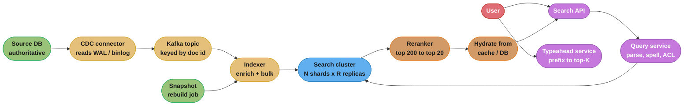
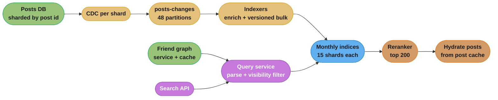

# Search Systems
The system around the search engine: how documents get in, how fresh they are, how a query fans out, and where ranking plugs in.

---

## 1. Concept Overview

A search system answers "which of my N documents best match this text, for this user, right
now?" The engine at its centre — Elasticsearch, OpenSearch, Solr, Vespa, or a custom index — is
only one box. Around it sit the decisions that interviewers actually probe: how changes in the
source database reach the index, how many seconds of staleness the product can afford, how the
index is split across machines and what that does to tail latency, how typeahead differs from
full-text search, how permissions are enforced, and where a ranking model plugs in.

This page is the **system-level** view. The engine internals and the ranking science are owned
elsewhere and linked, not repeated:

| Topic | Owner page (read this for depth) |
|---|---|
| Inverted index, BM25, analyzers, filter vs query context, ILM, deep pagination, alias-based reindex API | [Search Engines](../../database/search_engines/search_engines.md) |
| Lucene segments, refresh/flush/merge, translog, routing formula, checkpoints, shard sizing, OpenSearch fork | [Elasticsearch Internals](../../database/elasticsearch_internals/elasticsearch_internals.md) |
| Retrieval metrics, learning-to-rank, LambdaMART, NDCG, dense and hybrid retrieval | [Information Retrieval and Search](../../ml/information_retrieval_and_search/information_retrieval_and_search.md) |
| Typeahead: trie with precomputed top-K, build-then-swap, trending layer | [Design Search Autocomplete](../case_studies/design_search_autocomplete.md) |
| Vector indexes, HNSW, filtered ANN | [Vector Databases](../../database/vector_databases/vector_databases.md) |
| The ranking model as an ML system | [Design Search Ranking](../../ml/case_studies/design_search_ranking.md) |
| Postgres plus Elasticsearch catalogue, worked end to end | [Design E-commerce Catalog](../../database/case_studies/design_ecommerce_catalog/design_ecommerce_catalog.md) |
| Change data capture as a product | [Debezium](../../technologies/debezium_change_data_capture/debezium_change_data_capture.md) |
| Geo search | [Geospatial Indexing](../geospatial_indexing/geospatial_indexing.md) |

What this page owns: the **indexing pipeline choice**, the **freshness budget**, **index
partitioning and fan-out**, the **typeahead vs full-text split**, the **ranking stages and their
hooks**, **permission filtering**, **cluster topology**, and **reindexing as an operation**. If a
paragraph names a Lucene file or an Elasticsearch setting's internals, it belongs in the
database section; if it names which box talks to which and with what latency, it belongs here.

---

## 2. Intuition

> **One-line analogy:** A search index is a library's card catalogue. It is built from the books,
> it is rebuilt when the cataloguing rules change, and nobody ever reads the catalogue instead of
> the book. If the catalogue burns, you re-catalogue; you do not lose the library.

**Mental model.** Treat the search index as a **materialized view** whose only job is to turn
"text plus filters" into a ranked list of document ids, fast. Everything else — the
authoritative content, the permissions, the counts that must be exact — lives in the source
system. The view is updated asynchronously, so it is always somewhat stale; it is queried by
scatter-gather, so it is as slow as its slowest shard; and its ranking is layered, so the first
stage only needs to be cheap and roughly right.

**Why it matters.** The common failure in search design is to treat the index as a database:
writing to it directly from the application, trusting its counts, filtering permissions after
retrieval, or having no way to rebuild it. Each of those produces a bug that is invisible in a
demo and expensive in production.

**Key insight:** search is two pipelines that meet at the index. The **write pipeline** decides
freshness and correctness. The **read pipeline** decides latency and relevance. Design them
separately, give each its own budget, and let the index be the contract between them.

---

## 3. Core Principles

**The index is derived, never authoritative.** Every document in the index must be
reproducible from a source of truth. That is what makes a mapping change, an analyzer change or
a lost cluster an operation rather than data loss.

**Freshness is a budget, allocated across stages.** "Searchable within 10 seconds" is the sum of
capture lag, transport lag, indexer batching, bulk latency and refresh interval. Each stage gets
a share; shrinking the total means shrinking the largest share, and every stage trades freshness
for throughput.

**A document-partitioned index makes every query a scatter-gather.** Each shard holds a slice of
the documents and its own local inverted index, so a query must ask every shard and merge. The
query's latency is the maximum of the shards it touches, not their average.

**Retrieval and ranking are different stages with different budgets.** Retrieval must be cheap
enough to run over millions of candidates; reranking can be expensive because it runs over a few
hundred. Putting an expensive model in the retrieval stage, or a cheap heuristic as the final
ranker, are both design errors.

**Typeahead is not full-text search.** Typeahead completes a *prefix* from popular *queries*
within a per-keystroke budget; full-text search ranks *documents* for a *finished* query. They
use different data, different structures and usually different services.

**Permissions are filters, never ranking signals.** A document the viewer may not see must be
excluded before scoring and counting, not hidden after. Anything else leaks counts, creates
pagination holes, or returns empty pages.

---

## 4. Types / Architectures / Strategies

### 4.1 Getting Changes into the Index

| Pattern | How it works | Consistency | Use when |
|---|---|---|---|
| Dual write | Application writes the DB, then writes the index | Breaks on partial failure; ordering not guaranteed | Never for anything that matters |
| Transactional outbox | Application writes the DB row and an outbox row in one transaction; a relay publishes the outbox | At-least-once, ordered per entity | You own the write path and want explicit events |
| Change data capture (CDC) | A connector reads the DB's replication log and publishes row changes | At-least-once, ordered per key, captures every writer | Many writers, legacy code, or you want zero app changes |
| Batch rebuild | A job reads a snapshot and builds a new index, then swaps an alias | Exactly the snapshot, stale between runs | Corpus changes slowly, or as the backfill half of any of the above |
| Event log as source | The index is one consumer of an event-sourced log | At-least-once, replayable from offset 0 | The system is already event-sourced |

Every production design is a **streaming pattern plus a batch rebuild**: the stream keeps the
index fresh, the rebuild makes it correct after a mapping change, a bug, or a lost cluster. The
outbox and CDC mechanics are owned by
[Distributed Transactions](../distributed_transactions/distributed_transactions.md) and
[Polyglot Persistence Patterns](../../database/polyglot_persistence_patterns/polyglot_persistence_patterns.md).

### 4.2 Partitioning the Index

| Scheme | Each shard holds | A query touches | A document write touches | Who uses it |
|---|---|---|---|---|
| Document-partitioned (local index) | All terms for a subset of documents | Every shard (scatter-gather) | One shard | Elasticsearch, OpenSearch, Solr, most engines |
| Term-partitioned (global index) | All postings for a subset of terms | Only shards holding the query's terms | One shard per distinct term in the document | Rare as a whole design; appears for specific global indexes |
| Routed document partitioning | Documents for a routing key (tenant, user) | One shard when the query carries the key | One shard | Multi-tenant search, per-user mailboxes |
| Time-partitioned indices | Documents from one time window | Only windows the query's time filter overlaps | The current window | Logs, posts, events |

Document partitioning wins by default because writes stay local and a shard can fail without
losing any term entirely. Its cost is fan-out (§6.4). The two levers against fan-out are
**routing** (a query that carries a tenant id hits one shard) and **time partitioning** (a query
for the last 7 days skips older indices). See
[Database Sharding §6](../database_sharding/database_sharding.md) for the local vs global
secondary-index tradeoff this mirrors.

### 4.3 Cluster Topology

- **Single cluster, primaries plus replicas.** Replicas add query capacity and availability;
  they do not add indexing capacity, because each replica indexes too (the same copy-vs-split
  rule as [Scaling Reads and Writes](../scaling_reads_and_writes/scaling_reads_and_writes.md)).
- **Index per time window behind an alias.** New writes go to the current window; old windows
  become read-only, are force-merged, and move to cheaper tiers. The data-tier mechanics are in
  [Elasticsearch Internals §4.8](../../database/elasticsearch_internals/elasticsearch_internals.md).
- **Shared index with routing vs index per tenant.** A shared index with a routing key scales to
  millions of tenants; an index per tenant gives isolation and per-tenant mappings but each index
  and shard carries fixed heap and cluster-state overhead.
- **Separate clusters per workload.** Log analytics and user-facing product search have opposite
  priorities (ingest throughput vs query latency) and should not share heap or thread pools.
- **Typeahead served outside the main cluster.** A precomputed prefix structure in memory or in
  a key-value store, so per-keystroke traffic never touches the full-text cluster.

### 4.4 Query Types

| Query type | Data structure | Typical budget | Notes |
|---|---|---|---|
| Full-text keyword | Inverted index plus BM25 | 100 to 300 ms p99 | The default; analyzers decide recall |
| Structured filter and facets | Inverted index for filters, doc values for aggregations | same | Facet counts are approximate across shards for some aggregations |
| Typeahead / prefix | Trie or precomputed prefix to top-K map | under 100 ms p99 end to end | Built from query logs, not documents |
| Geo | Geohash, S2, H3 or BKD tree | same as full-text | See [Geospatial Indexing](../geospatial_indexing/geospatial_indexing.md) |
| Semantic / vector | ANN index (HNSW, IVF) over embeddings | same | Recall vs latency knob; filtered ANN is the hard part |
| Hybrid | Lexical and vector retrieval fused | same plus fusion | Reciprocal rank fusion is the common default (§6.6) |

### 4.5 Ranking Stages and Their Hooks

| Stage | Runs over | Cost per item | Hook |
|---|---|---|---|
| Retrieval | Millions of matching docs per shard | microseconds | Query structure, analyzers, BM25 or ANN |
| First-pass scoring | Top hundreds to thousands per shard | microseconds | Index-time signals (popularity, quality) combined at query time with a function score |
| Rescoring | Top N per shard | tens of microseconds | Engine-side rescore with richer features or a model plugin |
| Reranking | Top 100 to 500 globally | sub-millisecond to milliseconds | External model service (gradient-boosted trees, cross-encoder) |
| Business rules | Final page | negligible | Deduplication, diversity, pinned results, freshness boosts |

Each stage narrows the candidate set so the next stage can afford a more expensive model. The
models themselves are owned by [Information Retrieval and Search](../../ml/information_retrieval_and_search/information_retrieval_and_search.md);
the system decision is how many candidates each stage passes on and how much latency it gets.

---

## 5. Architecture Diagrams

### 5.1 End-to-End: Two Pipelines Meeting at the Index



*Green is authoritative, yellow is the write pipeline, blue is the index, purple is the read
pipeline, orange is ranking and hydration. Typeahead never touches the full-text cluster, and
results are hydrated from the source of truth so a stale index entry cannot show stale content.*

### 5.2 The Freshness Budget, Stage by Stage

```
  "searchable within 10 s at p99" for a post, illustrative budget

  stage                      p50        p99      bar (p99, 1 char = 250 ms)
  -------------------------  ------     ------   ----------------------------------------
  CDC capture from WAL        150 ms     800 ms   ###
  Kafka produce + consume      20 ms     300 ms   #
  indexer batch window        500 ms   1,000 ms   ####
  enrichment lookups           40 ms     400 ms   ##
  bulk request to cluster     150 ms   1,500 ms   ######
  refresh interval (1 s)      500 ms   1,000 ms   ####
  consumer lag during spikes    0 ms   4,000 ms   ################
  -------------------------  ------     ------
  total                     ~1.4 s     ~9.0 s     under the 10 s budget
```

*The refresh interval everyone talks about is one of seven stages and rarely the largest at p99.
Consumer lag during an ingest spike dominates the tail, so the freshness SLO is really an
indexer-capacity SLO. Lowering refresh below 1 s buys almost nothing here and costs indexing
throughput.*

### 5.3 Document-Partitioned vs Term-Partitioned Fan-Out

```
  query: "red running shoes"

  DOCUMENT-PARTITIONED (local index per shard)      TERM-PARTITIONED (global index)
  -------------------------------------------      --------------------------------
            coordinator                                     coordinator
     /    /    |    |    \    \                             /     |     \
   s1   s2   s3   s4   s5   s6                         [red]  [running] [shoes]
   every shard scores its own docs                     3 shards, each returns a
   returns local top-K, coordinator merges             full posting list, coordinator
                                                       intersects lists of millions
   query touches: all 6 shards                         query touches: 3 shards
   write of one doc touches: 1 shard                   write of one doc touches: 1 shard
                                                       per distinct term (often 50+)
```

*Document partitioning pays at query time, term partitioning pays at write time and ships huge
posting lists over the network for common terms. Engines choose document partitioning and then
fight its fan-out with routing and time-based pruning.*

### 5.4 The Ranking Funnel


*Each arrow is a budget decision. Sending 4,500 candidates to the reranker instead of 200 would
multiply its cost by 22x for a recall gain the per-shard top 100 has mostly already captured.*

---

## 6. How It Works — Detailed Mechanics

### 6.1 Choosing the Indexing Pipeline

**BROKEN — dual write from the application:**

```python
def update_post(post_id, text):
    db.execute("UPDATE posts SET text = %s, version = version + 1 WHERE id = %s", (text, post_id))
    search.index("posts", id=post_id, body={"text": text})   # crashes here -> index never updated
```

Three failure modes: the process dies between the two writes (index permanently stale); the
index write fails and is retried after a newer update (old text wins); a second code path or a
SQL migration updates the table without calling `search.index` (silently missing). None of them
raise an alert.

**FIX — CDC from the database log, keyed by document id, plus a rebuild path:**

```python
# consumer of a CDC topic partitioned by post_id; at-least-once delivery
def on_change(event):
    if event.op == "delete":
        index_soft_delete(event.key, version=event.source_version)
        return
    doc = build_document(event.after)              # enrich: author name, tags, counts
    search.index(
        "posts",
        id=event.key,
        body=doc,
        version=event.source_version,              # monotonic per row, e.g. a version column
        version_type="external")                   # older versions are rejected, see 6.2
```

The log captures every writer, including migrations and other services; partitioning by
`post_id` keeps each document's changes in order on one consumer; and the rebuild job reuses
`build_document` over a snapshot, so streaming and backfill cannot disagree on document shape.

### 6.2 Out-of-Order Updates and the Delete Trap

At-least-once delivery means retries and redeliveries; a rebalance can briefly run two consumers
over one partition. Ordering by partition key is necessary but not sufficient. The index must
also reject an older version of a document it has already seen newer. Elasticsearch supports
this directly: with `version_type=external`, an index request succeeds only if the supplied
version is **greater** than the stored one, otherwise it fails with a 409 conflict. The docs note
the side effect that matters here: there is no need to maintain strict ordering of async indexing
operations from a source database, as long as the version numbers come from that database.

Deletes need one more step. Elasticsearch keeps a deleted document's version available only for
`index.gc_deletes`, which defaults to **60 s**. A stale update that arrives more than 60 s after
a delete finds no version to compare against and **recreates the deleted document**:

```
  t=0      UPDATE post 42 -> v7 (delayed in a retry queue)
  t=1s     DELETE post 42 -> v8  ... index deletes doc, remembers v8 for 60 s
  t=95s    retry delivers v7 ... no tombstone left, v7 is indexed, post 42 is back
```

The robust fix is a **soft delete**: index the delete as a versioned update
(`{"deleted": true}` at v8), filter `deleted: false` in every query, and purge soft-deleted
documents in the periodic rebuild. The version check then always has something to compare to.

### 6.3 Reindexing as an Operation

A new analyzer, a changed field type, or a shard-count change all require building a new index.
The API-level mechanics (aliases, `_reindex`) are in
[Search Engines §6](../../database/search_engines/search_engines.md); the system-level procedure
is the part that goes wrong:

```
  1. Create posts_v2 with the new mapping; refresh disabled, replicas 0 for the backfill.
  2. Record the CDC topic offset O (or the snapshot LSN) at snapshot start.
  3. Backfill posts_v2 from the snapshot with the same build_document().
  4. Start a second consumer group writing to posts_v2 from offset O
     (external versions make overlap between backfill and stream harmless).
  5. Wait until consumer lag on v2 is under the freshness budget.
  6. Restore refresh and replicas; verify: doc counts per day, 500 sampled queries
     compared top-10 between v1 and v2, error rate on a shadow-read slice.
  7. Swap the read alias posts -> posts_v2 atomically.
  8. Keep posts_v1 and its consumer running for N days as the rollback target.
```

The offset recorded in step 2 is what makes this correct: everything that changed during the
backfill is replayed into v2 by the stream, and external versions resolve any overlap. Without it,
writes during the backfill window are silently missing from the new index.

### 6.4 Shard Count, Fan-Out and the Tail

Elastic's sizing guidance is to aim for shards of **10 GB to 50 GB** and keep each shard below
**200 million documents**, and it notes that each shard runs a search on a single CPU thread, so a
query over many shards consumes many search threads at once. A worked sizing:

```
  Corpus: 3 years of posts, 600M posts/month (assumption), ~1 KB index footprint per post
    per month: 600M x 1 KB = 600 GB -> 15 shards of 40 GB, 40M docs each
    36 monthly indices x 15 shards = 540 primary shards, 1,080 with one replica

  Default query window = last 90 days -> 3 indices x 15 = 45 shards per query
  "All time" query                      -> 540 shards per query
```

The fan-out is what sets the tail. If each shard answers within its own p99 independently, the
probability a query sees no slow shard is `0.99^n`:

```
  shards touched (n)    P(no shard slower than its p99)    query is slow on
  ------------------    -------------------------------    ----------------
          1                        99.0%                     1 in 100
         15                        86.0%                     1 in 7
         45                        63.6%                     1 in 3
        540                         0.4%                     almost every query
```

So the levers are, in order: **query fewer shards** (time pruning, routing by tenant), **make
shards fewer and larger** within the 50 GB guidance, **choose the fastest replica** per shard
(adaptive replica selection), and **set a timeout with partial results** for broad queries, so one
slow shard degrades completeness instead of latency. The general math of tail amplification and
hedged requests is owned by
[Tail Latency and Fan-Out](../../backend/tail_latency_and_fan_out/tail_latency_and_fan_out.md).

### 6.5 Typeahead vs Full-Text: Two Different Products

| | Typeahead | Full-text search |
|---|---|---|
| Input | A prefix, re-sent on each keystroke | A finished query |
| Output | 5 to 10 query completions | A ranked page of documents |
| Data source | Aggregated query logs (what people search) | The documents (what exists) |
| Structure | Trie or prefix map with precomputed top-K per prefix | Inverted index, scored per query |
| Freshness | Rebuilt hourly or daily, plus a trending overlay | Seconds |
| Latency budget | Under 100 ms p99 end to end, per keystroke | 200 to 500 ms p99 |
| Request volume | Several requests per search | One per search |
| Serving | In memory, fully replicated, often at the edge | The search cluster |

Because one search generates several typeahead requests, typeahead carries a multiple of the
full-text QPS and must never share the full-text cluster's threads. The design — trie sizing,
precomputed top-K, build-then-swap, trending layer, personalization — is worked end to end in
[Design Search Autocomplete](../case_studies/design_search_autocomplete.md). The one decision
this page adds: if completions must be *documents* (product names, people) rather than past
queries, serve them from a small dedicated prefix index of entity names, still separate from the
main corpus.

### 6.6 Ranking Hooks and Hybrid Fusion

There are four places to put a ranking signal, ordered by cost:

1. **Index time.** Store precomputed numbers on the document — popularity, quality score,
   author reputation — refreshed by a batch job. Free at query time; stale by the job interval.
2. **Query-time function score.** Combine BM25 with stored numbers and decays (recency, distance)
   inside the engine. Cheap, runs on every candidate per shard.
3. **Rescore window.** Re-score only each shard's top N with a more expensive query or an engine
   model plugin.
4. **External reranker.** Send the global top 100 to 500 with their features to a model service.
   Most flexible; adds a network hop and its own latency budget.

Log the features and the results shown at stage 4 with the click outcome. That log is the
training set for learning-to-rank; without it, ranking cannot improve beyond hand-tuned weights.
See [Information Retrieval and Search](../../ml/information_retrieval_and_search/information_retrieval_and_search.md).

**Hybrid lexical and vector retrieval.** BM25 scores and vector similarities live on different
scales, so adding them is meaningless. Reciprocal rank fusion (RRF) combines **ranks** instead:
`score(d) = sum over retrievers of 1 / (k + rank(d))`. Elasticsearch's RRF retriever defaults
`rank_constant` (k) to **60**. Worked:

```
  doc   lexical rank   vector rank   RRF score (k = 60)
  ---   ------------   -----------   ---------------------------------
   A          1              5       1/61 + 1/65 = 0.01639 + 0.01538 = 0.03178
   B          3              -       1/63         = 0.01587
   C          2              2       1/62 + 1/62  = 0.01613 + 0.01613 = 0.03226
  fused order: C, A, B
```

C wins without being first in either list, because both retrievers agree it is good. That is the
property that makes RRF a safe default before you have training data for a learned blend.

### 6.7 Permission Filtering

Social and enterprise search must exclude documents the viewer cannot see. Three approaches:

| Approach | How | Failure mode |
|---|---|---|
| Post-filter after retrieval | Fetch top 20, drop invisible ones | Empty or short pages, pagination holes, facet counts that include hidden documents |
| ACL fields at index time | Store `visibility`, `owner_id`, `group_ids` on each document; filter in the query | ACL changes require reindexing affected documents |
| Viewer-scoped filter at query time | Build a filter from the viewer's friend or group list | Large lists make large filters; needs caching of the viewer's list |

The production answer combines the last two: store visibility class and owner on the document,
and at query time filter `visibility = public OR owner_id IN (viewer's friends)`, in filter
context so it is cached and does not affect scoring. Documents whose visibility depends on a
fast-changing rule are re-checked at hydration time against the source of truth, as a safety net
that drops at most a few results rather than as the main filter. GitHub's code search does the
same final check: after aggregating shard results it filters "to double-check permissions"
before returning the top 100.

---

## 7. Real-World Examples

**GitHub code search (Blackbird, 2023).** GitHub's engineering post of 2023-02-06 explains why it
left Elasticsearch for a custom engine: at the time of the beta it searched almost 45 million
repositories, 115 TB of code and 15.5 billion documents. The design is a textbook version of this
page. Ingest is event-driven through Kafka; crawled documents are published to a topic where
**each shard consumes a single Kafka partition**, and the message order in Kafka is how the
system gains query consistency. Documents are **sharded by Git blob object ID**, which spreads
documents evenly and deduplicates identical files, so there are no hot servers for popular
repositories. Deduplication and delta indexing brought 115 TB of content down to about 28 TB of
unique content and a 25 TB index. The ingest pipeline publishes around 120,000 documents per
second, which re-indexes the whole corpus in about 18 hours. On the query side, per-shard p99 is
on the order of 100 ms, and with one query occupying one core for that time, a 64-core host has
an upper bound of about 640 queries per second; results are aggregated, re-sorted, filtered to
double-check permissions, and only then highlighted.

**Facebook Unicorn (VLDB 2013).** Meta describes Unicorn as "an online, in-memory social
graph-aware indexing system designed to search trillions of edges between tens of billions of
users and entities on thousands of commodity servers," answering "billions of queries per day at
latencies in the hundreds of milliseconds," built on standard information-retrieval concepts with
features to promote results with good social proximity. It is the reference point for people
and post search where the viewer's social graph is a filter and a ranking signal.

**Elasticsearch defaults that shape system design.** `index.refresh_interval` defaults to 1 s
(5 s on Elastic Cloud Serverless), and shards that have seen no search for `index.search.idle.after`
(30 s) skip background refreshes until searched. `index.max_result_window` defaults to 10,000,
which caps `from + size` paging. An index may have at most 1,024 primary shards by default. The
sizing guidance is 10 GB to 50 GB per shard and under 200 million documents per shard. The
reasons behind each default are in
[Elasticsearch Internals](../../database/elasticsearch_internals/elasticsearch_internals.md).

---

## 8. Tradeoffs

### Indexing pipeline

| | Dual write | Outbox | CDC | Batch rebuild |
|---|---|---|---|---|
| Captures all writers | no | only instrumented code | yes | yes (at snapshot) |
| Freshness | immediate if it works | seconds | seconds | hours |
| Failure behaviour | silent divergence | retries from outbox | retries from log offset | rerun the job |
| Operational cost | none | relay process | connector plus replication slot | compute per run |
| Needs external versions | yes | yes | yes | no |

### Partitioning

| | Document-partitioned | Term-partitioned | Routed | Time-partitioned |
|---|---|---|---|---|
| Query fan-out | all shards | terms' shards | one shard | overlapping windows |
| Write locality | one shard | many shards | one shard | current window |
| Skew risk | low | very high for common terms | high for big tenants | current window is hot |
| Best for | general corpora | rarely the whole system | multi-tenant | logs, posts, events |

### Freshness vs throughput

| Lever | Fresher | Cost |
|---|---|---|
| Lower refresh interval | up to 1 s gained | more small segments, more merging, lower indexing throughput |
| Smaller indexer batches | up to the batch window | more bulk requests per second |
| More indexer consumers | less lag at peak | more partitions needed; cluster indexing load rises |
| Synchronous index on write | near zero | couples product writes to search availability |

### Shared index vs index per tenant

| | Shared index with routing | Index per tenant |
|---|---|---|
| Tenants supported | millions | thousands at most per cluster |
| Isolation | noisy tenants affect neighbours on a shard | per-index settings and limits |
| Mapping flexibility | one mapping for all | per tenant |
| Overhead | low | per-index and per-shard heap and cluster-state cost |

---

## 9. When to Use / When NOT to Use

**Use a dedicated search system when:**
- Users type free text and expect relevance ranking, typo tolerance, synonyms or stemming.
- Queries combine text with many optional filters and facets over millions of documents.
- Relevance needs signals (popularity, recency, personalization) that a relational `ORDER BY`
  cannot express efficiently.

**Do NOT use one when:**
- Queries are exact lookups by key or by a few indexed columns; a database index is cheaper and
  strongly consistent.
- The corpus is small (tens of thousands of rows) and PostgreSQL full-text search meets the
  relevance bar; one fewer system to keep in sync.
- Results must be transactionally consistent with a just-committed write and you cannot design
  the UI around seconds of staleness.
- You plan to make the index the source of truth. Use a database and index from it.

---

## 10. Common Pitfalls

### 1. Dual writes that diverge silently

An e-commerce team writes product updates to PostgreSQL and then to Elasticsearch from the same
request handler. A deploy that times out the second call during a cluster restart leaves 30,000
products with old prices in search for two weeks, found only when a customer complains about a
price mismatch at checkout. §6.1 shows the CDC fix; add a nightly count-and-checksum comparison
between source and index so divergence becomes an alert instead of a support ticket.

### 2. Deleted documents that come back

**BROKEN:**

```python
def on_change(event):
    if event.op == "delete":
        search.delete("posts", id=event.key)       # tombstone version kept only 60 s
    else:
        search.index("posts", id=event.key, body=build_document(event.after),
                      version=event.source_version, version_type="external")
```

A retry of an older update that arrives more than `index.gc_deletes` (60 s by default) after the
delete finds no version to compare against and re-creates the deleted post. Users see posts they
deleted, which in a social product is a trust and privacy incident.

**FIX:**

```python
def on_change(event):
    body = {"deleted": True} if event.op == "delete" else build_document(event.after)
    search.index("posts", id=event.key, body=body,
                 version=event.source_version, version_type="external")
    # every query filters deleted: false; the periodic rebuild drops soft-deleted docs
```

### 3. Permissions filtered after retrieval

A team retrieves the top 20 posts by relevance and drops the ones the viewer cannot see. For a
viewer with few friends, most pages come back with 2 or 3 results, page 2 repeats documents, and
the "1,240 results" count includes posts the viewer may not see — which itself leaks information.
Move visibility into the query's filter context (§6.7).

### 4. Typeahead pointed at the full-text cluster

Every keystroke runs a prefix query against the main cluster. At 6 typeahead requests per search
the cluster's query load rises 7x, and p99 for real searches doubles during the evening peak.
Serve typeahead from a precomputed in-memory prefix structure (§6.5).

### 5. Unbounded fan-out on "all time" queries

A default search spans 540 shards because nobody set a time window. 99.6% of queries wait on at
least one slow shard (§6.4). Default to a recent window, make "all time" an explicit option with
a timeout and partial results, and route by tenant where a tenant id exists.

### 6. Reindexing without a stream offset

A team rebuilds an index from a snapshot over 6 hours and swaps the alias. Every change made
during those 6 hours is missing from the new index, because the stream was never replayed from
the snapshot's position. Record the offset or LSN at snapshot start and replay from it (§6.3).

### 7. Using search results as the displayed content

Results render title and body straight from the index. An edited post shows its old text for the
length of the freshness budget, and a post whose author was banned stays visible until the
reindex. Hydrate displayed content from the source of truth (or its cache) using the ids the
index returned.

---

## 11. Technologies & Tools

| Tool | Role | Notes |
|---|---|---|
| Elasticsearch | Search engine | Lucene-based; refresh 1 s default; RRF retriever with `rank_constant` 60 |
| OpenSearch | Search engine | Apache 2.0 fork of Elasticsearch 7.10.2; see the fork comparison in the database section |
| Apache Solr | Search engine | Lucene-based, SolrCloud for distribution |
| Apache Lucene | Search library | The inverted-index library under Elasticsearch, OpenSearch and Solr |
| Vespa | Search and ranking engine | Built-in multi-phase ranking and tensor features |
| Debezium | Change data capture | Streams row changes from database logs into Kafka |
| Apache Kafka | Change transport | Partition by document id to keep per-document order |
| Apache Flink | Enrichment and aggregation | Joins change streams with reference data before indexing |
| PostgreSQL | Source of truth, small-corpus full-text | `tsvector` full-text search for corpora too small to justify a cluster |
| Redis | Typeahead and hydration cache | Prefix maps or sorted sets for completions; cached documents for hydration |
| Algolia | Hosted search | Managed search service with typo tolerance and instant search |
| Typesense | Search engine | Open-source in-memory search engine aimed at instant search |

---

## 12. Interview Questions with Answers

**Q: Why should a search index never be the source of truth?**
**Short:** The index is an asynchronously updated derived view, so it must be rebuildable from an authoritative store after any mapping change or loss.

The index is a derived, eventually consistent view optimized for matching and ranking, so it must
be reproducible from an authoritative store. Mapping changes, analyzer changes and shard-count
changes all require building a new index from source data, and a lost or corrupted cluster is
only recoverable if the source still exists. Search engines also lack the transactional and
constraint guarantees a primary store needs. Keep the data in a database, index from it through
CDC or an outbox, and hydrate displayed content from the database using ids the index returns.

**Q: Why is dual-writing to the database and the search index a bad idea?**
**Short:** The two writes are not atomic, so crashes, retries and forgotten code paths leave the index silently stale or wrong with no alert.

The database write and the index write are separate operations with no shared transaction. A
crash between them leaves the index stale forever; a failed and retried index write can land after
a newer update and overwrite it with older content; and any writer that bypasses the code path —
a migration, a batch job, another service — never updates the index at all. None of these raise
an error. Use change data capture from the database log or a transactional outbox, which capture
every committed change in order, and keep a periodic rebuild as the correctness backstop.

**Q: How do you keep the index correct when change events arrive out of order?**
**Short:** Partition the change stream by document id and index with an external version from the source, so the index rejects older versions.

Partition the change topic by document id so each document's changes are consumed in order, and
send a monotonic version from the source with every index request. Elasticsearch's
`version_type=external` accepts a write only when its version is greater than the stored one and
returns a 409 otherwise, so a redelivered older event cannot overwrite a newer document. The
version must come from the source database, such as a row version column, not from the consumer's
clock. With both in place, at-least-once delivery and overlapping consumers become harmless.

**Q: A user deleted a post and it reappeared in search results a few minutes later. What happened?**
**Short:** A delayed older update arrived after the delete tombstone expired, so the index had no version to reject it and recreated the post.

Elasticsearch keeps a deleted document's version only for `index.gc_deletes`, 60 seconds by
default. A retried or delayed update with an older version that arrives after that window finds
nothing to compare against and is indexed, recreating the deleted document. The fix is to index
deletes as versioned soft deletes (`deleted: true`) so the version check always has a newer
version to compare to, filter `deleted: false` in every query, and purge soft-deleted documents
during the periodic rebuild. Never rely on a short-lived tombstone to order a delete against a
late retry.

**Q: How do you decide how fresh the search index needs to be, and where does the staleness come from?**
**Short:** Set a freshness SLO from the product need, then budget it across capture, transport, batching, bulk indexing, refresh and peak consumer lag.

Start from the product: a news or social feed may need posts searchable within 10 seconds, a
catalogue within a minute, an archive within an hour. Then allocate that budget across stages —
CDC capture, transport, indexer batching, enrichment, bulk indexing, the refresh interval, and
consumer lag during spikes. At p99 the largest share is usually consumer lag during an ingest
burst, not the 1-second refresh. To get fresher, add indexer capacity and partitions first;
lowering refresh buys little and costs indexing throughput.

**Q: Why does a query's latency get worse as the number of shards grows?**
**Short:** A document-partitioned query waits for its slowest shard, and the chance that at least one shard is slow grows with shard count.

In a document-partitioned index every query scatters to every shard it covers and waits for all
of them, so its latency is the maximum of the shard latencies. If each shard independently exceeds
its p99 1% of the time, a query over 45 shards sees at least one slow shard about 36% of the time,
and a query over 540 shards almost always does. Reduce the shards each query touches with time
windows and routing, keep shards large within the 10 to 50 GB guidance, prefer the fastest replica,
and set timeouts with partial results for broad queries.

**Q: Document-partitioned or term-partitioned index — which do you choose and why?**
**Short:** Document-partitioned by default, because writes stay on one shard and load spreads evenly, accepting scatter-gather on every query.

Document partitioning keeps each document's postings on one shard, so writes are local and shard
load is even, at the cost of querying every shard. Term partitioning lets a query touch only the
shards holding its terms, but a single document write updates one shard per distinct term, common
terms create huge hot shards, and multi-term queries ship long posting lists across the network to
intersect them. That is why engines default to document partitioning and attack its fan-out with
routing and time-based pruning rather than switching schemes.

**Q: How do typeahead and full-text search differ as system components?**
**Short:** Typeahead completes prefixes from aggregated query logs out of a precomputed in-memory structure, while full-text ranks documents in an inverted index.

Typeahead takes a prefix on every keystroke and returns a handful of completions within a 100 ms
end-to-end budget, built from what people searched and precomputed per prefix in memory. Full-text
search takes a finished query and ranks documents from an inverted index within a few hundred
milliseconds, updated within seconds of document changes. Because each search produces several
typeahead requests, typeahead runs at a multiple of search QPS and belongs on its own fully
replicated service, never on the full-text cluster.

**Q: Where can ranking logic plug into a search system?**
**Short:** At index time as stored signals, at query time as function scores, in an engine rescore window, and in an external reranker over the top results.

Stored signals such as popularity are free at query time but only as fresh as the job that
computes them. Query-time function scores combine BM25 with those signals and decays like recency
on every candidate. A rescore window applies a more expensive scorer to each shard's top N. An
external reranker service applies a learned model to the global top few hundred with full feature
access. Each stage narrows candidates so the next can afford more, and logging features with
clicks at the final stage is what makes learning-to-rank possible.

**Q: How do you combine lexical and vector retrieval results?**
**Short:** Fuse by rank, not score, typically with reciprocal rank fusion, because BM25 scores and vector similarities are on incompatible scales.

BM25 scores are unbounded and corpus-dependent while vector similarities live in a fixed range,
so adding or averaging them is meaningless. Reciprocal rank fusion scores each document as the sum
of `1 / (k + rank)` across retrievers, with k defaulting to 60 in Elasticsearch, which rewards
documents that both retrievers rank well. It needs no training data, so it is the safe first
choice. Once click data exists, replace it with a learned blend or a reranker that sees both scores
as features.

**Q: How do you enforce permissions in search without breaking pagination or leaking information?**
**Short:** Filter visibility inside the query using ACL fields and the viewer's groups, never by dropping results after retrieval.

Store visibility class, owner and group ids on each document and add a filter such as
`visibility = public OR owner_id IN viewer_friends` to the query, in filter context so it is cached
and does not affect scores. Post-filtering after retrieval returns short or empty pages, causes
duplicates across pages, and produces result counts that include hidden documents, which is a
leak. Keep a final check at hydration time against the source of truth for fast-changing rules,
as a safety net rather than the main mechanism.

**Q: How do you change an index mapping on a live system without losing writes?**
**Short:** Build a new index from a snapshot, replay the change stream from the snapshot's offset, verify, then swap an alias atomically and keep the old index for rollback.

Create the new index, record the change-stream offset or source LSN at the moment the snapshot
starts, backfill from the snapshot, and run a second consumer that applies changes from that offset
into the new index. External versions make the overlap between backfill and stream safe. When lag
on the new index is within the freshness budget and sampled query results and per-day counts match,
switch the read alias atomically, and keep the old index and its consumer running for rollback.
Skipping the recorded offset silently drops every change made during the backfill.

**Q: Why should search results be hydrated from the source of truth rather than rendered from the index?**
**Short:** The index lags and may hold outdated or disallowed content, so render with fresh data fetched by the ids search returned.

The index is seconds to minutes behind, so rendering titles, prices or bodies from it shows edits
late and keeps content visible after it was removed or its author banned. Use the index to find and
order ids, then fetch the displayed fields from the database or its cache by id, which also gives a
last permission check. The cost is one batched multi-get per page, usually a few milliseconds from
a cache. Store only what you need to match, filter and rank in the index.

**Q: When is a separate search cluster unnecessary?**
**Short:** When queries are exact or few-column lookups, the corpus is small, or the database's built-in full-text search meets the relevance needs.

If users search by exact identifiers or by a few structured columns, a database index is cheaper
and strongly consistent. If the corpus is in the tens of thousands of rows and simple relevance is
enough, PostgreSQL full-text search avoids a second system and its synchronization pipeline. A
dedicated engine earns its cost when you need relevance ranking, typo tolerance, facets over
millions of documents, or ranking signals beyond `ORDER BY`. Each extra system adds a freshness
budget and a correctness check to operate.

**Q: How do you size the number of shards for a large time-ordered corpus?**
**Short:** Use time-based indices, size each so shards land between 10 and 50 GB and under 200 million documents, and keep queries to recent windows.

Split the corpus into time-based indices, such as monthly, and choose each index's shard count so
shards fall within Elastic's 10 to 50 GB and under-200-million-document guidance. For 600 million
posts a month at about 1 KB each, that is 600 GB and 15 shards of 40 GB. Default queries to a recent
window so they touch 45 shards rather than 540. Old indices become read-only, can be force-merged,
and move to cheaper tiers, which time-based indexing makes a whole-index operation instead of a
document-by-document delete.

**Q: How did GitHub's code search use Kafka to keep shards consistent?**
**Short:** Each index shard consumes exactly one Kafka partition, so message order in the partition defines a consistent per-shard index state.

GitHub's Blackbird publishes crawled documents to a Kafka topic partitioned between shards, and
each indexer shard consumes a single partition at its own pace. Because the order of messages in
the partition is the order the shard applies them, GitHub states that this ordering is how it
gains query consistency. Sharding by Git blob object ID spreads documents evenly and deduplicates
identical files, so popular repositories do not create hot shards. The pattern — partition the log
the same way as the index and give each shard one partition — generalizes to any engine.

**Q: What are the common failure modes of refreshing a search index too often?**
**Short:** Very frequent refreshes create many small segments that must be merged, which lowers indexing throughput without improving freshness much.

Each refresh opens a new searchable segment, so a very short interval creates many small segments
that the engine must later merge, consuming disk I/O and CPU that would otherwise go to indexing.
Since refresh is only one of several stages in the freshness budget, shortening it from 1 second
to 100 milliseconds rarely changes end-to-end staleness at p99, which is dominated by consumer lag
during spikes. Leave the default unless measurement shows refresh is the largest stage, and disable
refresh entirely during bulk backfills. The mechanics are in the database section's internals page.

**Q: How would you design search over posts for a social network, at a high level?**
**Short:** CDC into Kafka, time-partitioned indices with visibility fields, filtered BM25 retrieval, a reranker over the global top results, and hydration from the post store.

Stream post changes through CDC into a topic keyed by post id, index them with external versions
into monthly indices carrying author, visibility and soft-delete fields, and default queries to the
last 90 days. Retrieve with BM25 plus a recency decay under a visibility filter built from the
viewer's friend list, merge per-shard top results, rerank the global top 200 with a model using
social affinity and engagement, and hydrate the final page from the post store. Serve typeahead
separately, and state a freshness SLO such as 10 seconds with its stage budget.

---

## 13. Best Practices

1. **Make the index rebuildable on day one.** One `build_document` function used by both the
   streaming consumer and the snapshot rebuild, so the two can never disagree.
2. **Use CDC or an outbox, never dual writes.** Partition the change stream by document id and
   index with external versions from the source.
3. **Soft-delete in the index.** Deletes are versioned updates; purge in the rebuild.
4. **Write down the freshness budget per stage** and alert on consumer lag in seconds, because
   lag during spikes is the real p99 driver.
5. **Bound fan-out.** Time-partition, route by tenant, keep shards within the 10 to 50 GB
   guidance, and give broad queries a timeout with partial results.
6. **Keep typeahead off the full-text cluster.**
7. **Filter permissions in the query, re-check at hydration.**
8. **Separate retrieval, ranking and business rules,** each with a candidate count and a latency
   budget, and log features with clicks at the final ranking stage.
9. **Hydrate displayed content from the source of truth** by id.
10. **Reindex by procedure:** snapshot with a recorded offset, stream replay, verification,
    atomic alias swap, retained rollback index.

### Cross-Perspective: LLD Connections

- The change consumer in §6.1 applies the Command pattern: each change event is an immutable
  command replayable from the log.
- The ranking funnel in §5.4 is a Chain of Responsibility in which each stage narrows the
  candidate set for the next.
- Hybrid retrieval with pluggable retrievers and a fusion step is a Strategy plus a Composite.

**Cross-references:** the backend plumbing between a service and its index (sync pipeline, reindex
runbook, API contract) is in
[Search Integration Patterns](../../backend/search_integration_patterns/search_integration_patterns.md).

---

## 14. Case Study: Post Search for a 50M-DAU Social Network

### Problem Statement

A social network wants users to search posts by keyword. All scale figures are design assumptions.

| Input | Value |
|---|---|
| Daily active users | 50M |
| New posts | 20M/day (230/s average, about 700/s peak) |
| Edits and deletes | 2M/day |
| Searches | 100M/day (about 1,160 QPS average, 3,500 QPS peak at 3x) |
| Typeahead requests | 6 per search, about 21,000 QPS peak |
| Retention searchable | 3 years |
| Visibility | public, or friends-only (average 300 friends) |

Requirements: results only from posts the viewer may see; a new post searchable within 10 s at
p99; search p99 under 400 ms; deleted posts never reappear.

### Architecture



### Sizing

```
  Corpus: 20M posts/day x 1,095 days       = 21.9B posts
  Index footprint ~1 KB per post (measured on a 10M sample, assumption)
    per month: 600M posts -> 600 GB        -> 15 shards x 40 GB, 40M docs each
    36 monthly indices                      -> 540 primaries, 1,080 shards with one replica
  Default window 90 days                    -> 45 shards per query
  Query load on shards: 3,500 QPS x 45      = 157,500 shard-searches/s at peak
    at ~5 ms CPU per shard-search (assumption) -> 788 cores busy at peak
    at 60% target utilization                  -> about 1,300 search cores across hot-tier nodes
```

The arithmetic says the cost driver is fan-out, not corpus size: a 30-day default window would cut
shard-searches by 3x. Product accepted 90 days as default with a "search older posts" link that
issues a separate, timeout-bounded query over the warm tier.

### The Visibility Filter

**BROKEN — retrieve, then hide:**

```python
def search(viewer, q):
    hits = cluster.search(index="posts-recent", query=bm25(q), size=20)
    friends = graph.friends(viewer)
    return [h for h in hits if h.visibility == "public" or h.author_id in friends]
```

For a typical viewer, most of the top 20 by relevance are friends-only posts by strangers, so the
page shows 4 results, page 2 shows 3 different ones, and the result count includes posts the
viewer may not see.

**FIX — filter in the query, re-check at hydration:**

```python
def search(viewer, q):
    friends = friend_cache.get_or_load(viewer)          # about 300 ids, cached 5 minutes
    query = {
        "bool": {
            "must": [bm25(q)],
            "filter": [
                {"term": {"deleted": False}},
                {"bool": {"should": [
                    {"term": {"visibility": "public"}},
                    {"bool": {"filter": [
                        {"term": {"visibility": "friends"}},
                        {"terms": {"author_id": friends}}]}}],
                    "minimum_should_match": 1}}],
        }
    }
    candidates = cluster.search(index="posts-90d", query=with_recency_decay(query), size=200)
    ranked = reranker.rank(viewer, candidates)[:20]
    return hydrate_and_recheck(viewer, ranked)           # drops posts whose visibility just changed
```

The filter runs before scoring, so every returned page is full and counts reflect only visible
posts. The hydration re-check catches the rare post whose visibility changed within the freshness
window; it removed 0.02% of results in the shadow test.

### Freshness and Correctness

- Change events carry the post row's `version` column; indexers use `version_type=external`.
- Deletes and visibility changes are indexed as versioned updates, never hard deletes, so a late
  retry cannot resurrect a post after the 60 s `gc_deletes` window.
- 48 topic partitions, 24 indexer instances; measured p99 searchable delay 6.8 s, of which 4.1 s
  is consumer lag during the evening peak. Lag over 8 s pages on-call.
- A weekly rebuild of the oldest month compares per-day counts with the source and repairs drift.

### Latency Budget (p99)

| Stage | Budget |
|---|---|
| Parse, spell-correct, friend list from cache | 25 ms |
| Search over 45 shards, adaptive replica selection, 250 ms timeout | 200 ms |
| Rerank 200 candidates | 40 ms |
| Hydrate 20 posts from post cache | 30 ms |
| Network and serialization | 50 ms |
| Total | 345 ms |

### Results (illustrative)

| Metric | Value |
|---|---|
| Search p99 | 340 ms |
| Searchable delay p99 | 6.8 s |
| Resurrected deleted posts | 0 after the soft-delete change (11 per day before) |
| Short pages (under 20 results with more available) | 0.1% (38% with post-filtering) |
| Typeahead p99, separate service | 45 ms |

### Lessons

1. Fan-out, set by the default time window, drove cost more than corpus size.
2. Visibility belongs in the query's filter context; post-filtering failed on every metric.
3. The 60-second delete tombstone was the one correctness bug no load test found; soft deletes
   removed it structurally.
4. The freshness SLO was an indexer-capacity problem, not a refresh-interval problem.
