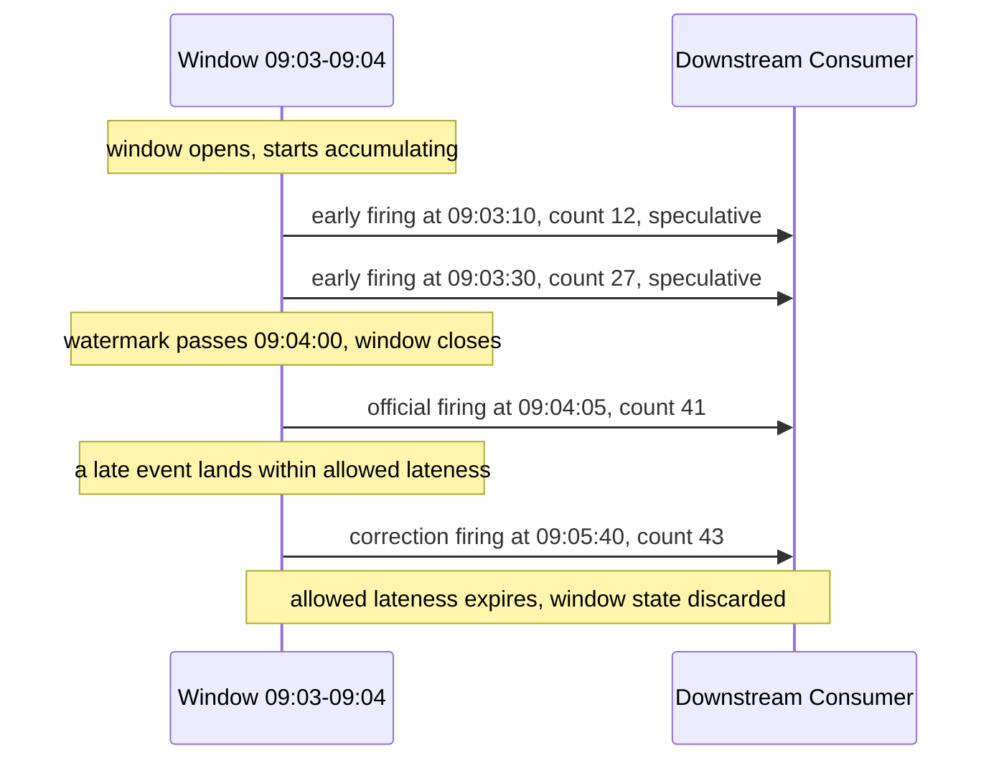
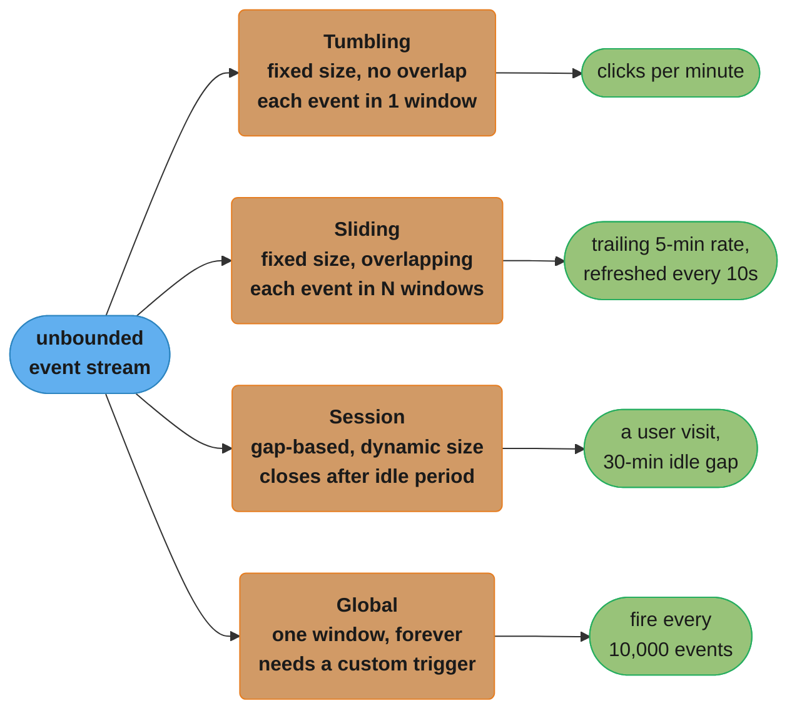
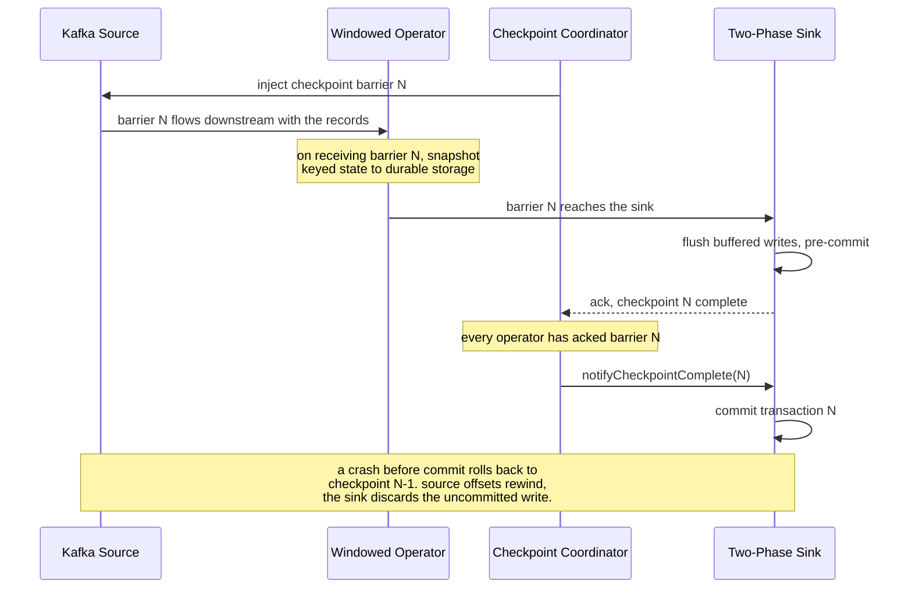
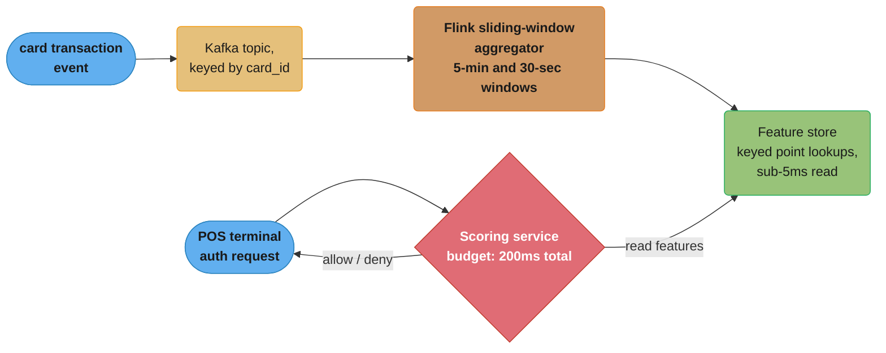

# Stream Processing

Windows, watermarks, and exactly-once state over data that never stops arriving.

## 1. Concept Overview

A **batch job** operates on a bounded input: the file, the table, the partition is finite, it has an end, and "done" is a well-defined state. A **stream-processing job** operates on an **unbounded** input — an event source that, by definition, never finishes. There is no "last event" to wait for, so every question a batch job answers trivially ("what's the total?", "is this the final count?") becomes a design decision in streaming: *when* do you stop waiting for more events and emit an answer, knowing that answer might still be wrong?

That single word — **unbounded** — is the only thing that actually distinguishes stream processing from batch processing. It is not about latency (a batch job can run every second; a stream job can buffer for an hour) and it is not about the technology (Spark runs both batch and streaming jobs on the same engine). A batch job over "yesterday's clicks" and a stream job over "clicks, forever" can run the identical aggregation logic — the only difference is whether the input has an edge. Every mechanism this module covers — windows, watermarks, triggers, checkpointing — exists because "unbounded" removes the one assumption batch processing gets for free: that you can wait until the input is exhausted before producing a correct answer.

This module owns the **stream-processing primitives**: how to carve an unbounded stream into finite, answerable pieces (windowing), how to know when a piece is "done enough" to answer (watermarks), what to do when the world is wrong about that (late data), how to make computation over a stream survive a crash without corrupting or duplicating results (exactly-once state and sinks), and the architectural choice of running one processing path or two (Lambda vs. Kappa). [Message Queues](../message_queues/message_queues.md) and the [Kafka deep dive](../../backend/kafka_deep_dive/kafka_deep_dive.md) own the transport underneath a stream — partitioning, delivery guarantees, consumer groups, replayable logs. This module owns what a **stream processor** does with the events once they're flowing: the windowing, timing, and state-consistency logic that turns a raw event feed into a correct, continuously updating answer.

[Design: Ad Click Event Aggregation](../case_studies/design_ad_click_aggregation.md) is the applied version of everything here — a full system built around exactly these primitives, with concrete SLAs, a Lambda architecture, and two production war stories about watermark tuning. Read this module for the primitive and *why* it behaves the way it does; read that case study for how the primitive gets assembled into a system with a billing SLA riding on it.

---

## 2. Intuition

> **One-line analogy**: A batch job is a lake — the water has stopped moving, so you can measure its exact volume any time you like and get the same answer twice. A stream job is a river — you can only ever sample the flow rate as it passes a point, and the instant you report a number, more water has already gone by. Every stream-processing decision is really a decision about *where and how often to sample the river*, because "waiting for the river to stop" is not an option.

**Mental model — a river you sample vs. a lake you measure**: measuring a lake's volume is embarrassingly simple: the water isn't going anywhere, so you can take your time, measure every cubic meter, and the answer is final the moment you finish. Sampling a river's flow rate is a fundamentally different kind of measurement — you pick an interval ("how much water passed in the last minute"), you pick a moment to report it, and you accept that a leaf floating downstream slower than the current might arrive at your sampling point *after* you already reported the number for the minute it actually fell in. Stream processing's whole toolkit is built to manage that acceptance: windows are the "last minute" you're measuring, watermarks are the rule for deciding you've waited long enough, and late-data handling is what you do about the late leaf.

**Why it matters**: A team that reaches for a batch job's mental model on unbounded data — "run the aggregation once we have all the data" — either never ships (there is no "all the data") or silently ships something that looks like a batch answer but is quietly redefining "all" as "everything we happened to see before some timeout." Making that timeout an explicit, tuned, and monitored parameter (the watermark) rather than an accidental default is the entire discipline this module teaches.

**Key insight — completeness is a probability you choose, not a fact you discover**: In a bounded batch, "we've seen everything" is objectively true once the job finishes reading its input. In an unbounded stream, "we've seen everything for window `[t, t+1min)`" is never objectively true — a mobile client could still deliver an event from that window five minutes from now after coming back online. The watermark is a bet: "we are willing to say this window is done once we haven't seen an event older than `X` in `Y` time," and the entire art of stream processing is choosing `X` and `Y` deliberately, with an explicit plan for the bet being wrong (§4.2, §9).

---

## 3. Core Principles

**1. There are three clocks, and only one of them is about the data.**
- **Event time** — when the event actually happened, stamped by the producer (a mobile app, a sensor, an ad server). This is the *only* clock that makes a result semantically correct — "clicks between 9:00 and 9:01" must mean clicks that *happened* between 9:00 and 9:01, or the number is answering a different question than the one asked.
- **Processing time** — when the stream processor's operator handles the event, i.e., the wall clock of the machine doing the work. Trivial to use (no coordination, no waiting), but the result depends on network delays, retries, and consumer lag, which means the *same job replayed later produces a different answer* — a non-starter for anything that must be reproducible.
- **Ingestion time** — when the event entered the messaging system (e.g., the Kafka broker's append timestamp). A middle ground: more stable than processing time, doesn't require the producer to be a trusted clock — but still not the time the thing actually happened, so it inherits event time's problem (network delay, offline buffering) without event time's semantic correctness.

Event time is the default choice whenever the *answer itself* has meaning (billing, SLA reporting, anything a person will later ask "how many X happened during period Y"). Processing time survives only where the metric is explicitly about system behavior right now (raw ingestion throughput, operational dashboards where "roughly the last minute" is good enough).

**2. Completeness is unknowable — a watermark is a heuristic, not a guarantee.**
Because the stream never ends, there is no event that can prove "no more events for time `T` are coming." A watermark is the stream processor's best estimate of that fact, derived from what it has observed so far (typically `max event-time seen minus some allowed lateness`). It **will** be wrong sometimes — a genuinely late event will still arrive after the watermark has passed. The system's job is not to make the watermark never wrong; it's to make being wrong a handled, visible case (a side-output stream, a correction mechanism) rather than a silent gap in the data (§4.2, §10).

**3. State is the hard part. Throughput is comparatively easy.**
A stateless transform — `map`, `filter`, a per-event enrichment lookup — scales the same way any embarrassingly parallel workload does: add more workers, get more throughput, no coordination required. The moment an operator needs **state that spans events** — a running count per window, a join buffer waiting for its other side, a deduplication set — three new problems appear simultaneously that a batch job never has to solve concurrently: the state must be **partitioned** across workers (so it can scale), it must **survive a crash** without losing or duplicating updates (so the answer stays correct), and it must be **bounded** despite an unbounded input (so a long-running job doesn't grow memory or disk forever). §4.4 and §6 are almost entirely about managing this — throughput tuning is a small fraction of what makes streaming systems hard in practice.

**4. A late-arriving fact does not un-happen — it demands a correction, not a discard.**
A design that drops late data outright is implicitly claiming the late event didn't happen, which is false — it happened, it just arrived after the system stopped waiting. The honest options are: widen the window before closing it (accept more latency for more completeness), or close on schedule and **issue a correction** when the late fact turns up (accept a two-stage answer: fast-and-approximate now, corrected-and-final later). Silently dropping is the one option that is never honest, and it is exactly what happens when a team doesn't make the lateness policy an explicit choice (§10).

---

## 4. Types / Architectures / Strategies

### 4.1 Windowing Strategies

A window is how an unbounded stream gets carved into finite pieces small enough to answer a question about. Four shapes cover essentially every real workload:

- **Tumbling** — fixed-size, non-overlapping, contiguous (`[9:00,9:01)`, `[9:01,9:02)`, ...). Every event belongs to exactly one window. Cheapest to compute and store; the default choice for "metric per fixed period" (clicks per minute, requests per 5 seconds).
- **Sliding** — fixed-size, but windows overlap and re-fire on a shorter slide interval than their length (a 5-minute window, re-evaluated every 10 seconds). Every event contributes to multiple windows in flight simultaneously. Used for smoothed rate metrics ("trailing 5-minute error rate") where a tumbling window's step-function jumps at each boundary are undesirable.
- **Session** — dynamically sized, defined by a **gap in activity** rather than a fixed clock (close the window once no event has arrived for the key in the last 30 minutes). The window's size is data-dependent, so two users can have wildly different session lengths from the same job. The natural fit for "group this user's activity into a visit/session."
- **Global** — one window for the entire stream, forever. Meaningless without a custom **trigger** (see below) telling the engine when to emit, since a global window by itself never "closes." Used for count-based batching (emit every 10,000 events) or fully custom firing logic that doesn't map to any clock at all.

**Session windows, worked: the gap parameter decides everything, and windows must be able to merge.** Unlike the other three shapes, whose boundaries are known the instant the job starts, a session window's boundary is only known in retrospect — once a gap of at least the configured size has actually elapsed with no new event for that key. This creates a requirement the other three shapes don't share: two events for the same key that initially look like they belong to separate sessions can turn out to belong to the *same* one once an intermediate event lands, so the engine must be able to **merge** two provisional sessions into one:

```
  gap parameter = 30 minutes, key = user_42

  event at 09:00  ->  opens session A: [09:00, 09:00 + gap)
  event at 09:10  ->  within A's gap  ->  A extends to [09:00, 09:40)
  event at 10:05  ->  more than 30 min since 09:10  ->  A's gap has
                       elapsed  ->  session A CLOSES as [09:00, 09:40),
                       a NEW provisional session B opens: [10:05, 10:35)

  a LATE event at 09:35 then arrives (within allowed lateness, §4.2):
      09:35 falls inside A's original gap window, AND it is exactly
      30 minutes before B's start (10:05 - 09:35 = 30 min)  ->  the
      two sessions' gap windows touch  ->  the engine MERGES A and B
      into one session [09:00, 10:35), retiring both provisional
      results and re-emitting a single combined one
```

This merge requirement is why session-window state per key is not just "a running aggregate" the way a tumbling window's is — it must track the full set of that key's currently open, not-yet-merged provisional sessions, merging them as new or late events arrive. That extra bookkeeping is also why session windows are the shape most exposed to the unbounded-growth pitfall in §10: every provisional session is live state until its own gap elapses, and a key that never stops generating events inside the gap never closes any of them.

### 4.2 Watermarks and Allowed Lateness

A **watermark** is a moving marker on the event-time axis representing the engine's claim: *"I do not expect to see an event with an event-time earlier than this, from here on."* The common formula: `watermark = max(event-time seen so far) − allowed lateness`. A window `[t, t+size)` is considered **closed** once the watermark passes `t+size`. `allowed lateness` is the deliberate slack built into that claim — the longer it is, the more out-of-order arrival and delivery delay the window tolerates before closing, at the direct cost of the window taking that much longer to produce any answer at all.

What happens to an event that arrives **after** its window has already closed depends entirely on a policy decision, not a law of physics:
- **Drop it** — simplest, and silently wrong unless the business genuinely doesn't care (§10).
- **Route it to a side output** — a separate "late events" stream that a downstream consumer can use to issue a correction to an already-emitted result, or simply to monitor how much lateness the pipeline is actually experiencing.
- **Reopen and re-fire the window** — some engines (Flink, Beam) let a window continue accumulating past its watermark-triggered close, up to a second, longer **allowed-lateness bound**, re-emitting an updated result each time a late event lands within that bound; only after that second bound passes is the state actually discarded.

### 4.3 Triggers

A **trigger** decides *when* a window emits a result — the watermark passing the window's end is the default trigger, but it is not the only one, and conflating "when the window closes" with "when it fires" is a common source of confusion:

- **Watermark trigger (default)** — fire once when the watermark passes the window end. Simple, but means a one-hour tumbling window produces zero output for up to an hour.
- **Early/speculative triggers** — fire periodically *before* the watermark passes (e.g., every 10 seconds) with a partial, non-final result, then fire once more at the watermark for the "official" result. This is how a dashboard shows a live-updating hourly count instead of a blank panel for 59 minutes.
- **Late triggers** — fire again if a late event arrives within the allowed-lateness window after the first, official firing (§4.2), each time emitting a correction.

Apache Beam's model (adopted conceptually by Flink) treats "windowing + watermark + trigger + accumulation mode" as four independently tunable knobs precisely because coupling them (one window shape, one firing rule) is not expressive enough for "show me a live estimate now, and a corrected number later" — which is exactly the requirement behind the case study's tiered pulse/corrected/reconciled reporting (§14 of [the ad-click case study](../case_studies/design_ad_click_aggregation.md)).



*One window fires four times across its lifetime — two early, speculative firings a dashboard can show while the window is still open, one official firing once the watermark passes, and one late correction — and every firing after the first re-emits a full, replacement result, not a delta, which is exactly why every downstream consumer must upsert by window key rather than sum deltas (§10).*

**Trigger and accumulation mode are two separate knobs, and conflating them is a common design mistake.** The trigger decides *when* a window fires (above); the accumulation mode decides *what* each firing contains relative to the one before it:

| Accumulation mode | What each firing emits | Downstream consumer must... |
|---|---|---|
| **Discarding** | Only the delta since the last firing for this window (e.g., "3 more clicks since the last firing") | Sum every firing's value to reconstruct the running total |
| **Accumulating** | The full, replacement result as of this firing (e.g., "41 clicks total, as of now") | Overwrite/upsert with each firing's value — never sum |
| **Accumulating & retracting** | The full new result, plus an explicit retraction of the value it replaces | Either apply the retraction then the new value, or simply treat it as accumulating (the retraction is a correctness aid, not a requirement) |

Discarding mode pairs naturally with a strictly append-only, sum-based downstream sink. Accumulating mode is what the diagram above assumes, and it is what every early/late-firing pipeline in this module effectively requires: it is the only mode where "the latest firing IS the current answer" holds without the consumer reconstructing history from every prior delta, which is exactly the upsert-by-window-key discipline §10's Kappa-replay pitfall and §12 already demand of any replay-tolerant consumer. Mixing the two — a consumer built to sum deltas fed accumulating-mode firings, or vice versa — produces a silently wrong number with no exception thrown, since both shapes parse identically as "a value for this window."

### 4.4 Lambda vs. Kappa Architecture

- **Lambda** — two independent pipelines over the same raw source: a stream path (fast, watermark-bounded, approximate) and a batch path (slow, unbounded wait, exact), reconciled at the serving layer. The batch path exists specifically because it needs **zero** streaming-layer approximation (no watermark cutoff, no bounded dedup cache) to be trusted as ground truth.
- **Kappa** — a single streaming pipeline. "Batch reprocessing" is achieved by **replaying** the raw log from an earlier offset through the same job, relying on the source being a durable, replayable, partitioned log (this is precisely what [Message Queues](../message_queues/message_queues.md) and Kafka's log-retention model provide). No second codebase to maintain — but replaying at the same watermark and windowing configuration as before is required to get the same answer, so a Kappa "correction" is really "re-run the stream job with better data or a bug fix," not "run a categorically different, simpler exact computation."

The decision is almost always about **audit requirements**, not throughput: Lambda earns its extra codepath specifically when a downstream consumer (billing, regulatory reporting) needs a result reproducible from raw data with **zero** trust placed in streaming-layer approximations. See §5 for the tradeoff table and [the ad-click case study §4.4](../case_studies/design_ad_click_aggregation.md) for a worked example of exactly this decision.

### 4.5 Stream-Table Duality

A stream and a table are two views of the same underlying fact, and the ability to convert between them is what makes stateful stream processing tractable:

- A **stream** is a sequence of facts — "this happened, then this happened." Replaying a stream from the beginning and applying each fact in order (an insert, an update-by-key, a delete) *produces* a table — the current state after all facts so far.
- A **table** is the latest value per key — a snapshot. Watching a table for changes (every insert/update/delete as it happens) and emitting each one as a fact *produces* a stream — this is exactly what a database's **changelog** (Debezium-style CDC, or a Kafka compacted topic) is.

Kafka Streams makes this literal in its API: a `KStream` is the stream view (every record is a new, independent fact); a `KTable` is the table view (a record with the same key **replaces** the previous value, backed by a **compacted** topic that keeps only the latest value per key). A windowed aggregation is a stream-to-table operation (turn a sequence of click events into "current count for this window"); a table changelog is a table-to-stream operation. Understanding this duality is what makes "join a stream against a slowly-changing dimension table" a natural, well-defined operation rather than a special case. [Event Sourcing & CQRS](../event_sourcing_cqrs/event_sourcing_cqrs.md) is this same duality at a system-design level: an event-sourced service's append-only log **is** the stream side, and every read-model projection built from it **is** a table side — a stream processor is one natural way to build and keep such a projection continuously up to date.

### 4.6 Stateful vs. Stateless Operators

- **Stateless** — `map`, `filter`, `flatMap`, per-event enrichment via an external lookup with no memory of prior events. Scales linearly with parallelism; a crash just means "reprocess this one event," with no state to reconcile.
- **Stateful** — windowed aggregation, streaming joins (buffering one side while waiting for the other), deduplication (remembering which IDs have been seen), pattern detection (remembering a partial match across events). These require state that is **partitioned by key**, **checkpointed** so it survives failure (§6.2), and **bounded** (a dedup set or session-window map that never expires anything grows without limit — §10).

The stateless/stateful line is the single most useful lens for estimating how hard a new streaming job will be to build and run: a stateless pipeline is "how many machines," a stateful one is "how many machines, plus a state-consistency and state-sizing plan."

---

## 5. Architecture Diagrams

### 5.1 Event Time vs. Processing Time — Out-of-Order Arrival and the Watermark

```
EVENT TIME vs PROCESSING TIME  --  events arrive out of order

  event_time (when it happened):   09:00   09:02   09:01   09:04   09:03   09:05
  arrival order (processing time):   e1      e2      e3      e4      e5      e6
                                      |       |       |       |       |       |
  processing time (wall clock) ----- 1 ------ 2 ------ 3 ------ 4 ------ 5 ------ 6 ---->
                                      |       |       |       |       |       |
                                    on time  early  LATE:   early   LATE:   on time
                                                     e3's                   e5's
                                                     09:01                  09:03
                                                     arrives                arrives
                                                     after e2's             after e4's
                                                     09:02                  09:04

  watermark(t) = max(event_time seen so far) - allowed_lateness

  allowed_lateness = 2 minutes

  after e6 arrives (event_time 09:05, the latest seen so far):
    max event_time seen   = 09:05
    watermark              = 09:05 - 00:02  = 09:03

    window [09:00, 09:01)  ->  09:03 >= 09:01  ->  CLOSED long ago
    window [09:03, 09:04)  ->  09:03 <  09:04  ->  still OPEN, e5 still counts
    window [09:04, 09:05)  ->  09:03 <  09:05  ->  still OPEN, waiting

  e3 (event_time 09:01) arrives at processing step 3, watermark at that point
  was only 09:00 - 00:02 (window [09:00,09:01) not yet closed) -- ON TIME.
  A HYPOTHETICAL e_late (event_time 09:00) arriving at step 6, when the
  watermark has already reached 09:03, WOULD be late: its window closed
  two full minutes of watermark-time ago.
```

*The watermark is not "now minus a delay" measured against wall-clock time — it only advances when a new maximum event-time is observed, which is why a stalled event source stalls the watermark too (§10). Six events arrive in an order that does not match their event-time; the watermark computed from the latest event-time seen, minus the allowed lateness, is what actually decides which windows are still open and which are closed for good.*

### 5.2 Four Window Types Over the Same Stream



*The same event stream feeds four different window shapes with different tradeoffs: tumbling is cheapest and the default for fixed-period metrics, sliding trades extra compute for a smoother trend line, session windows follow the data's own activity pattern rather than a fixed clock, and a global window is only meaningful once paired with a custom trigger (§4.3).*

---

## 6. How It Works — Detailed Mechanics

### 6.1 A Tumbling Event-Time Window with Allowed Lateness

The standard shape of a windowed aggregation on Flink's DataStream API — watermarks generated with a fixed bound on out-of-orderness, a tumbling window keyed by ad ID, allowed lateness routing stragglers to a side output instead of dropping them:

```java
WatermarkStrategy<ClickEvent> watermarkStrategy =
    WatermarkStrategy
        .<ClickEvent>forBoundedOutOfOrderness(Duration.ofSeconds(30))
        .withTimestampAssigner((event, recordTimestamp) -> event.eventTimeMillis())
        .withIdleness(Duration.ofMinutes(1)); // §10: stops one idle partition from
                                               // freezing the watermark for everyone

OutputTag<ClickEvent> lateEventsTag = new OutputTag<>("late-clicks") {};

SingleOutputStreamOperator<WindowResult> perMinuteCounts = clickStream
    .assignTimestampsAndWatermarks(watermarkStrategy)
    .keyBy(ClickEvent::adId)
    .window(TumblingEventTimeWindows.of(Duration.ofMinutes(1)))
    .allowedLateness(Duration.ofMinutes(2))     // window stays reopenable 2 more minutes
    .sideOutputLateData(lateEventsTag)          // truly-late events go here, not dropped
    .aggregate(new ClickCountAggregator());

DataStream<ClickEvent> lateEvents = perMinuteCounts.getSideOutput(lateEventsTag);
```

Three independent knobs are doing three independent jobs here: `forBoundedOutOfOrderness` sets how far behind the watermark trails the max observed event-time (the base lateness tolerance before a window closes), `allowedLateness` extends how much *longer* a closed window stays reopenable for a late-but-not-too-late correction, and `sideOutputLateData` is what stands between "truly late" data and the silent drop that is Flink's alternative default behavior.

**In plain terms.** `watermark = max(event-time seen so far) - out-of-orderness bound` says: "assume nothing arrives more than this many seconds late, and never let the watermark move backward even if a newer max event-time hasn't been seen in a while."

| Symbol | What it is |
|--------|------------|
| `max event-time seen` | The latest event-time this operator has observed across every key, ever — monotonically non-decreasing |
| out-of-orderness bound | `forBoundedOutOfOrderness`'s argument — how far behind the max the watermark trails, `30s` above |
| watermark | `max event-time seen - out-of-orderness bound` — the line a window's end must cross to close |
| window end | `windowStart + windowSize` — closes once `watermark >= window end` |
| allowed lateness | Extra time a *closed* window stays reopenable for a late correction, on top of the watermark's own bound |

**Walk one example.** A one-minute window `[09:03, 09:04)`, 30s out-of-orderness, 2-minute allowed lateness:

```
  window end                             = 09:04:00

  max event-time seen reaches 09:04:35
      watermark = 09:04:35 - 00:00:30    = 09:04:05
      09:04:05 >= 09:04:00  ->  window CLOSES, first result emitted

  a late event with event-time 09:03:50 then arrives
      is it within allowed lateness?
      window end + allowed lateness      = 09:04:00 + 00:02:00 = 09:06:00
      current watermark (09:04:05) < 09:06:00  ->  YES, still within bound
      -> window REOPENS, re-aggregates, re-emits a corrected result

  a second late event with event-time 09:03:10 arrives once the
  watermark has advanced past 09:06:00
      -> too late even for allowedLateness  ->  routed to the
         sideOutputLateData stream, never silently dropped (§10)
```

The two bounds are doing different jobs and are easy to conflate: the out-of-orderness bound decides how long a window stays open *before ever emitting anything*; allowed lateness decides how long a *closed* window stays willing to accept one more correction. A pipeline that only tunes the first and leaves the second at zero gets exactly one, non-negotiable answer per window with no mechanism to revise it — which is fine for a dashboard, and not fine for a number someone bills against.

**Multi-partition watermark generation: the operator's watermark is the minimum across every input, never the maximum.** The walkthrough above tracked one partition in isolation; a real windowed operator usually consumes several upstream partitions or parallel subtasks at once, and the operator's own watermark (Flink exposes it as the `currentInputWatermark` metric) is computed as the **minimum** of every input's individual watermark. This is the only choice that keeps the guarantee honest — declaring a window closed is a claim that *nothing* has more to contribute to it, and one partition still behind is enough to make that claim false no matter how far ahead the others have advanced:

```
  4 input partitions feeding one windowed operator, per-partition watermarks:

  partition 0:  09:04:10
  partition 1:  09:04:05
  partition 2:  09:03:40   <- slowest
  partition 3:  09:04:20

  operator watermark = min(09:04:10, 09:04:05, 09:03:40, 09:04:20) = 09:03:40

  a window ending at 09:04:00 is NOT closed yet, even though 3 of 4
  partitions have already advanced 20-40 seconds past it -- partition 2
  alone is what is still holding it open
```

If partition 2 goes idle instead of merely slow — an inactive tenant on a low-volume Kafka partition, producing nothing at all — its individual watermark simply stops advancing, because §4.2's formula has no new max event-time to derive a value from. The `min()` above then freezes at partition 2's last reported value indefinitely, stalling every window on the operator regardless of how much data the other three partitions keep producing. `withIdleness(...)` (§6.1's code) is the direct fix: once a source hasn't emitted a record within the configured threshold, the engine excludes it from the `min()` entirely, so `currentInputWatermark` tracks the three active partitions instead of freezing on the fourth.

### 6.2 Checkpointing — How Fault Tolerance and Exactly-Once State Are Achieved

Flink's checkpointing is a distributed, consistent snapshot of every operator's state, taken **without stopping the stream**, using a barrier-based algorithm derived from the Chandy-Lamport snapshot protocol:



*A checkpoint barrier flows through the job graph like a special record embedded in the stream; each operator snapshots its own state the moment the barrier passes, and only once every operator (source through sink) has acknowledged does the coordinator tell the sink it's safe to commit — which is what lets a mid-stream crash roll everything back to one single, globally consistent point instead of a mismatched patchwork of partially-updated state.*

**Aligned vs. unaligned checkpoints.** The "aligned" version above makes each operator wait for the barrier to arrive on *every* input channel before snapshotting, which guarantees a clean cut but stalls under backpressure — a slow channel delays the barrier, which delays the snapshot, which delays recovery. **Unaligned checkpoints** snapshot immediately on the first barrier seen, and additionally snapshot any in-flight records still buffered ahead of the barrier on the other channels — trading a slightly larger snapshot for a checkpoint that completes in bounded time even when the pipeline is backpressured. The tradeoff is genuinely mechanical: aligned checkpoints are smaller and simpler; unaligned checkpoints are the fix specifically for "checkpoints keep timing out because the pipeline is backpressured," which is otherwise a hard deadlock — the very congestion you need to snapshot through is what prevents the snapshot from completing.

**Alignment, walked through with real timing.** Consider a join operator with three input channels, all carrying the barrier for checkpoint 42:

```
  channel A: barrier 42 arrives at t=100ms
  channel B: barrier 42 arrives at t=100ms
  channel C: barrier 42 arrives at t=850ms   <- channel C is backpressured

  ALIGNED behavior:
    t=100ms   barrier seen on A and B -> the operator BUFFERS every
              record that continues to arrive on A and B (does not
              process them) while waiting on C
    t=100-850ms   A and B's buffers grow for 750ms while C catches up
    t=850ms   barrier finally arrives on C -> operator snapshots
              state, THEN processes the 750ms of buffered A/B records
    checkpoint 42 duration: ~750ms, dominated entirely by channel C

  UNALIGNED behavior:
    t=100ms   barrier seen on A, the first channel -> operator
              snapshots state immediately, including as part of the
              snapshot every A/B record still in flight ahead of
              where C's barrier has yet to arrive
    checkpoint 42 duration: bounded by A's arrival time (~100ms),
              independent of how backpressured C is
    cost: the snapshot payload is larger -- it carries the in-flight
          A/B records that alignment would instead have processed
          for free during the 750ms wait
```

The number that matters operationally is checkpoint **duration**, not payload size: aligned duration is set by the single slowest channel — precisely the channel most likely to be backpressured under the exact conditions a checkpoint most needs to survive — while unaligned duration is decoupled from that slowest channel almost entirely, at the cost of a larger but still bounded snapshot.

### 6.3 The Two-Phase-Commit Sink — and Why "Exactly-Once" Really Means "Effectively-Once End to End"

A checkpoint alone only makes the stream processor's **internal** state consistent. Making an **external** sink (a database, a second Kafka topic, a file) exactly-once requires coordinating the sink's write with the checkpoint itself, via a two-phase commit built around Flink's Sink V2 API:

```java
public class ExactlyOnceFileSink
        implements TwoPhaseCommittingSink<ClickAggregate, PendingFileCommittable> {

    @Override
    public PrecommittingSinkWriter<ClickAggregate, PendingFileCommittable> createWriter(
            WriterInitContext context) {
        // buffers writes to a not-yet-visible, in-progress file per checkpoint
        return new BufferedFileWriter(context);
    }

    @Override
    public Committer<PendingFileCommittable> createCommitter(CommitterInitContext context) {
        // called only after notifyCheckpointComplete -- renames the buffered
        // file into its final, visible path (the "commit")
        return new AtomicRenameCommitter(context);
    }
}
```

The **pre-commit** happens when the checkpoint barrier reaches the sink (§6.2): all buffered writes for this checkpoint are flushed to durable, but still *invisible*, storage — an open Kafka transaction, a temp file not yet renamed into place. The **commit** happens only after `notifyCheckpointComplete` — i.e., only after every operator upstream has confirmed its own state was durably snapshotted for this same checkpoint. If the job crashes between pre-commit and commit, the pending write is either committed on recovery (if the checkpoint it belongs to did complete) or discarded (if it didn't) — never partially applied.

**The handshake, step by step, with the exact failure window at each step:**

```
  1. checkpoint barrier reaches the sink
  2. sink WRITER flushes buffered records to durable-but-invisible
     storage (an open Kafka transaction, an unrenamed temp file)
     -- this IS the pre-commit
  3. sink acks checkpoint N to the coordinator
  4. coordinator waits for EVERY operator's ack for checkpoint N
  5. once every operator has acked: coordinator calls
     notifyCheckpointComplete(N) on the sink
  6. sink COMMITTER makes the pre-committed write visible
     (rename the file, commit the Kafka transaction)
     -- this IS the commit

  crash between step 1 and step 2 (mid pre-commit)
      -> on restart, job recovers from checkpoint N-1
      -> the partial pre-commit is simply abandoned
      -> NO loss, NO duplicate (checkpoint N never happened)

  crash between step 2 and step 5 (pre-committed, not yet told to commit)
      -> on restart, job recovers from checkpoint N-1
      -> the pre-committed-but-uncommitted write is discarded
         (Kafka aborts the open transaction; an unrenamed temp
         file is simply never made visible and is cleaned up)
      -> NO loss, NO duplicate -- checkpoint N is retried from
         scratch on the next attempt

  crash between step 5 and step 6 (told to commit, hasn't finished)
      -> on restart, the sink's committer re-attempts step 6 against
         the SAME pre-committed artifact -- committing an already-
         committed Kafka transaction, or renaming an already-renamed
         file, is itself effectively idempotent
      -> NO loss, NO duplicate
```

Every one of those three windows resolves to *no loss, no duplicate* — which is the entire point of the protocol. What none of them cover is a crash **after** step 6, inside whatever the sink's *own downstream consumer* does with the now-visible data. The two-phase commit has done its job perfectly at that point; if that downstream consumer isn't itself idempotent, the duplicate simply happens one hop later, outside the protocol's reach entirely. That is the concrete, mechanical reason "effectively-once end to end" is the accurate term rather than "exactly-once": the protocol makes the sink's own commit atomic and crash-safe, and stops exactly at the sink's own boundary.

This is genuinely powerful, and it is also why "exactly-once" is the wrong phrase for what any of this delivers end to end: the guarantee covers **internal Flink state** and **any sink implementing this transactional protocol** — a write to a plain, non-transactional REST endpoint, a fire-and-forget email send, or a side effect outside the checkpoint's reach gets no such protection, no matter how correctly the rest of the pipeline is configured. Kafka-to-Kafka pipelines get the full guarantee because Kafka's own transactional producer (see the [Kafka deep dive §12](../../backend/kafka_deep_dive/kafka_deep_dive.md)) participates in exactly this pre-commit/commit protocol. The honest term the industry has converged on is **effectively-once**: no duplicates and no loss for the parts of the pipeline actually wired into the transaction, and an explicit idempotency plan (an idempotency key, an upsert keyed by a stable ID) for every side effect that isn't.

### 6.4 State Backends

Where checkpointed keyed state actually lives while the job is running is a separate, configurable choice from *whether* it gets checkpointed:

- **Heap-based (`HashMapStateBackend`)** — state lives as regular Java objects on the JVM heap; checkpoints serialize the whole thing to a durable filesystem (S3, HDFS). Fast reads/writes (no serialization on the hot path), but state size is capped by available heap, and full checkpoints get expensive as state grows — every checkpoint re-serializes everything.
- **`EmbeddedRocksDBStateBackend`** — state lives in an embedded RocksDB instance on local disk per task, serialized on every access. State size is bounded by local disk, not heap, so it comfortably handles state far larger than memory (multi-terabyte jobs are routine). Supports **incremental checkpoints** — only the RocksDB SST files that changed since the last checkpoint are uploaded, turning checkpoint cost from `O(total state size)` into roughly `O(state delta since last checkpoint)`, which is what makes frequent checkpointing of large-state jobs affordable at all.

The practical rule: start with the heap backend for small, latency-sensitive state; move to RocksDB the moment state size approaches available memory, or the moment checkpoint duration starts dominating the checkpoint interval — RocksDB's serialization overhead per access is a real, measurable cost, but it is a cost traded for state size and incremental-checkpoint affordability, not free.

**Why incremental checkpoints change the cost curve.** A full checkpoint re-serializes and re-uploads the *entire* state on every checkpoint, so its cost scales with total state size regardless of how little actually changed since the last one:

```
  Total keyed state size                 = 400 GB  (RocksDB, across all tasks)
  Fraction of state touched per minute   = ~2%       (typical for a windowed job
                                                        with a rolling few-minute horizon)

  Full checkpoint, every checkpoint:
      upload cost per checkpoint          = 400 GB
      at a 1-minute checkpoint interval   = 400 GB uploaded every minute -- infeasible

  Incremental checkpoint (only changed SST files):
      upload cost per checkpoint          = 400 GB x 2%      = 8 GB
      at the same 1-minute interval       = 8 GB uploaded every minute -- sustainable

  Cost reduction from incrementality      = 400 / 8 = 50x
```

This is the arithmetic that makes frequent checkpointing of large-state jobs affordable at all: a full-checkpoint policy forces a choice between large state and frequent checkpoints (pick one), while incremental checkpointing decouples the two almost entirely, since the recurring cost tracks the *change rate* of the state, not its total size. (Flink's own `lastCheckpointFullSize` metric reports the logical total — the 400GB figure above — separately from `lastCheckpointSize`, which reports only the incremental bytes actually transferred; watching `lastCheckpointFullSize` trend upward with no plateau over weeks, independent of a corresponding rise in real traffic, is the standard early signal of the unbounded-state pitfall in §10.)

**Sizing RocksDB's own memory budget, not just its disk footprint.** RocksDB is disk-resident, but it still needs real memory per task slot for its block cache (recently-read blocks, avoiding a disk seek on a hot key) and write buffers (memtables absorbing writes before they flush to disk as SST files) — under-provisioning this is a common, easy-to-miss source of state-access latency that has nothing to do with checkpoint tuning and everything to do with how much of RocksDB's own working set actually fits in memory:

```
  Per-task-slot RocksDB memory budget, one reasonable starting point:

  managed memory per slot (Flink-controlled, off-heap)   =  2 GB
      block cache (hot-key reads avoid a disk seek)       =  1.0 GB  (50%)
      write buffers / memtables (absorb incoming writes)  =  0.6 GB  (30%)
      index + bloom-filter blocks                         =  0.4 GB  (20%)

  4 task slots per TaskManager: 4 x 2 GB = 8 GB of RocksDB memory,
  ON TOP OF whatever heap the TaskManager needs for everything else
  (network buffers, JVM overhead, user-code objects) -- a
  TaskManager sized only for a heap-based workload will silently
  starve RocksDB's block cache the moment a RocksDB-backed job
  lands on it, showing up as elevated per-access state latency
  with no checkpoint-side metric pointing at the cause.
```

The rule of thumb worth carrying into a capacity-planning conversation: RocksDB's *disk* footprint scales with total state size (the 400GB figure above), but its *memory* footprint should be sized against **working-set size and access pattern**, not total state size — a job with 400GB of mostly-cold historical state and a 2GB hot working set needs only a modest cache tuned to that 2GB, while the same 400GB accessed near-uniformly at random needs a much larger cache to avoid constant disk seeks on the cold majority. RocksDB exposes `state.backend.rocksdb.metrics.block-cache-usage` and `state.backend.rocksdb.metrics.estimate-live-data-size` (both off by default, enabled explicitly) for exactly this — size the cache against what those report the access pattern actually is, not against the total-state number a dashboard shows by default.

### 6.5 Keyed State and Rescaling via Key Groups

Keyed state (state partitioned by `keyBy`) is not distributed key-by-key — it is distributed via an intermediate layer of **key groups**. Every possible key hashes into one of `maxParallelism` key groups (a value fixed when the job is first deployed), and each parallel task instance owns a contiguous *range* of key groups, not an arbitrary scattered set of individual keys. Rescaling the job (changing its parallelism, e.g., 4 -> 8 task instances) redistributes whole key groups across the new instance count — never individual keys — which is what makes rescaling a bounded, predictable state-redistribution operation instead of an arbitrary reshuffle.

The consequence worth internalizing: `maxParallelism` should be set explicitly and generously up front, because it can only be *lowered* by restarting the job from a savepoint with a full state migration — it is not a value you casually bump later the way you'd bump ordinary parallelism.

**The arithmetic, worked.** With `maxParallelism = 128` (a common floor) and every key hashed into one of those 128 key groups, ownership is assigned to task instances by simple integer division of the key-group range:

```
  maxParallelism = 128 key groups total, fixed at first deployment

  parallelism = 4 task instances:
      subtask 0 owns key groups   0 -  31   (128 / 4 = 32 groups each)
      subtask 1 owns key groups  32 -  63
      subtask 2 owns key groups  64 -  95
      subtask 3 owns key groups  96 - 127

  rescale to parallelism = 8 task instances:
      subtask 0 owns key groups   0 -  15   (128 / 8 = 16 groups each)
      subtask 1 owns key groups  16 -  31
      subtask 2 owns key groups  32 -  47
      subtask 3 owns key groups  48 -  63
      subtask 4 owns key groups  64 -  79
      subtask 5 owns key groups  80 -  95
      subtask 6 owns key groups  96 - 111
      subtask 7 owns key groups 112 - 127

  what actually moves: exactly half of every original subtask's
  key-group range transfers to one new subtask (old subtask 0's
  groups 16-31 become new subtask 1's groups 16-31 verbatim) --
  a clean split of existing ranges, never a from-scratch scatter
  of individual keys

  the ceiling: maxParallelism = 128 means parallelism can scale up
  to 128 task instances (each owning >= 1 key group) with zero
  state migration; parallelism = 129 has no group left to assign
  it and is rejected outright
```

That ceiling is the concrete reason `maxParallelism` needs deliberate headroom at launch: a job that starts at parallelism 4 and later needs to scale to, say, 200 task instances during a traffic-driven incident discovers the ceiling is fixed — and fixing it means a savepoint restart with a full state migration, which is a far worse time to learn the limit than at initial capacity planning.

### 6.6 Backpressure

Backpressure is the mechanism (not a bug) by which a slow downstream operator causes upstream operators to **automatically slow down** rather than buffering an unbounded, ever-growing backlog. Flink implements this with **credit-based flow control**: each receiving operator advertises how many buffers it currently has free ("credits"); a sending operator only transmits as many records as it has credits for, and stalls once it runs out — so backpressure at the sink naturally propagates backward through the entire job graph, one hop at a time, all the way to the source, which is what actually slows down consumption from Kafka.

Backpressure is a **symptom**, and treating it as the problem to fix (rather than the alarm) is a common mistake: chronic backpressure means *some* operator downstream is the true bottleneck (an expensive UDF, an underscaled sink, a slow external lookup) — the fix is finding and scaling that operator, not suppressing the backpressure signal, which exists specifically to protect the job from an unbounded, uncheckpointable buffer growing without limit.

---

## 7. Real-World Examples

- **Netflix — Keystone**: Netflix's real-time data pipeline processes **2+ trillion events per day** (roughly 3 PB/day inbound, 7 PB/day outbound after fan-out and enrichment) across **20,000+ concurrently running Apache Flink jobs**, spanning use cases from graph materialization to observability analytics to ad-event processing (Netflix Technology Blog).
- **Uber — exactly-once ad-event processing**: Uber's ad-billing pipeline runs Flink over Kafka with **read-committed** consumer isolation and a **2-minute checkpoint interval** feeding **one-minute tumbling windows**, landing results into Apache Pinot with an upsert keyed on a per-record UUID as the final idempotency backstop — the same "checkpoint plus idempotent sink" pattern from §6.3, applied to hundreds of millions of ad events per week (Uber Engineering Blog, "Real-Time Exactly-Once Ad Event Processing with Apache Flink, Kafka, and Pinot").
- **Pinterest**: Pinterest's multitenant Flink platform sustains **20+ million messages/second across 12 production clusters**, serving use cases from real-time experiment analytics to ML feature pipelines on a single, shared streaming engine (Pinterest Engineering Blog, "Tuning Flink Clusters for Stability and Efficiency").
- **Alibaba**: Alibaba Cloud's Realtime Compute for Apache Flink processed a peak of **4 billion records per second** (~7 TB/second) during the Double 11 shopping festival, computing live GMV and real-time recommendation signals at a scale that was, at its debut, the largest concurrent streaming computation publicly documented (Alibaba Cloud Blog, "Four Billion Records per Second").

---

## 8. Tradeoffs

| Engine | State backend | Exactly-once mechanism | Latency floor | Rescaling story | SQL support | Operational cost | What breaks first under load |
|---|---|---|---|---|---|---|---|
| **Apache Flink** | Heap or embedded RocksDB, incremental checkpoints (§6.4) | Barrier-based checkpointing + Sink V2 two-phase commit (§6.2-6.3) | Single-digit ms to low seconds, bound by checkpoint interval | Key-group redistribution via savepoint restart (§6.5) — no live rescale without one | Flink SQL / Table API, full windowed SQL over streams | Highest — dedicated cluster (JobManager/TaskManagers), savepoint discipline, checkpoint/alignment tuning | Checkpoint alignment stalling under sustained backpressure (fixed by unaligned checkpoints, §6.2) |
| **Kafka Streams** | Embedded RocksDB per instance, changelog-topic recovery | `processing.guarantee=exactly_once_v2` (Kafka transactions — [Kafka deep dive](../../backend/kafka_deep_dive/kafka_deep_dive.md)) | Single-digit ms to low seconds | Live rebalance across app instances via the Kafka consumer-group protocol; no savepoint step | ksqlDB, a separate product layered on top | Lower — a library in your app's own deployment, no separate cluster to run | A single hot partition/key, since parallelism is capped at partition count |
| **Spark Structured Streaming** | Micro-batch state store, RocksDB provider since Spark 3.2 | Write-ahead log + idempotent sinks in micro-batch mode; the experimental continuous mode has none and is stateless-only | Seconds (micro-batch, the supported path); continuous mode sub-ms but unsupported for production | Repartition on a new job submission; no live rescale of a running query | Native Spark SQL / DataFrame API — the deepest SQL story of the four | Moderate — reuses a Spark cluster teams often already run for batch | Micro-batch scheduling overhead once the trigger interval drops toward sub-second |
| **Cloud-managed** (AWS Managed Service for Apache Flink, GCP Dataflow, Confluent Cloud) | Provider-managed, typically RocksDB-backed underneath | Full, provider-guaranteed, mechanism abstracted away from the user | Single-digit ms to low seconds | Provider-managed autoscaling, abstracted away | Inherits the underlying engine's SQL (Flink SQL, Beam SQL) | Lowest engineering overhead, highest per-unit cost; no cluster to operate, less tuning control | Provider-side quota or scaling limits, not a mechanism you tune directly |

The choice rarely comes down to raw throughput — all four rows in this table sustain production traffic at real scale (§7). It comes down to **where the operational burden should sit**. Kafka Streams pushes it into the application's own deployment (no separate cluster, but every instance is now a stateful service your app team owns); Flink centralizes it into a dedicated cluster with its own operational discipline (savepoints, checkpoint tuning) in exchange for the deepest exactly-once and state-management story of the four; Spark Structured Streaming is the right default when the team already runs a Spark cluster for batch and wants one engine for both, accepting seconds-scale micro-batch latency as the cost; and a cloud-managed offering trades the highest per-unit cost for removing cluster operations from the team's plate entirely — the right call when the org has no appetite for owning a 24/7 stateful streaming cluster at all (§9).

---

## 9. When to Use / When NOT to Use

### Use Stream Processing When
- **A result must reflect events as they happen**, not as of the last scheduled batch run — fraud scoring, live dashboards, alerting, anything with a latency SLA measured in seconds.
- **The input genuinely has no natural end** — a click stream, a sensor feed, application logs — and periodically re-running a batch job "as if" it had an end is itself an approximation of streaming, just a cruder one (bigger latency, no incremental state reuse).
- **Incremental computation matters for cost** — recomputing a running aggregate from scratch every batch cycle over a growing dataset gets more expensive every cycle; a stateful stream job amortizes that cost into a small update per event.

### When a Batch Job Is the Right Answer
- **The SLA tolerates hours, not seconds.** A nightly reconciliation report, a monthly billing run — if "by 6am tomorrow" is genuinely fine, a batch job is simpler to write, test, reason about, and debug than the equivalent streaming pipeline, with none of watermarks, triggers, or state-backend tuning to get right.
- **Correctness matters more than freshness, and the data is naturally bounded.** A daily reconciliation of "yesterday's transactions" over a data lake partition has a real, discoverable "done" — batch's core assumption (§1) actually holds, so none of streaming's approximation machinery buys anything.
- **The team doesn't yet have the operational muscle for a 24/7 stateful service.** A stream processor is a long-running, stateful service that must be operated continuously — savepoints, checkpoint tuning, backpressure monitoring, rescaling. A batch job that fails just gets re-run.

### Caution / Anti-Patterns
- **Choosing streaming purely for "real-time" prestige** on a workload with a genuinely bounded input and an hours-scale SLA — this buys watermark tuning, state-backend operations, and a permanently running service for a latency improvement nobody asked for.
- **Building an ad-hoc, unmonitored "streaming-ish" batch job** (a cron job that queries "the last 5 minutes" on a fixed schedule) instead of either a real batch job or a real stream processor — it inherits streaming's correctness hazards (double-counting on overlap, gaps on drift) without any of a real engine's watermark or exactly-once machinery to manage them.

---

## 10. Common Pitfalls

- **Session windows with no idle-gap timeout — unbounded state growth.**
  *Broken:* a session-window job groups a user's activity by a gap, but the gap is set enormous ("close the session after 24 hours of inactivity") to be "safe," and a meaningful fraction of users never generate a 24-hour gap during the retention period the job is monitored for. Every such user's session state — every event they've ever sent, plus every provisional merge candidate (§4.1) — sits in memory or RocksDB indefinitely.
  *Symptom:* the job never crashes outright; it slowly gets slower and heavier over weeks, with no single deploy or traffic spike to point at.
  *Metric:* Flink's `lastCheckpointFullSize` (the logical total state size, reported separately from the incremental `lastCheckpointSize` — §6.4) trending upward in a straight line with no plateau, while the platform's own request/event volume stays flat over the same period — that divergence (state growing, traffic not) is the fingerprint distinguishing dead accumulated state from legitimately growing usage.
  *Fix:* set the idle-gap timeout to the smallest value the actual use case tolerates (30 minutes is a common, defensible default for a user "visit"), and separately configure state TTL as a hard backstop so state for a key is cleaned up even if the session-close logic itself has a bug — never rely on the session gap as the *only* mechanism bounding state size.

- **One idle partition freezes the watermark for the entire job.**
  *Broken:* a Kafka source has 12 partitions; 11 carry steady traffic, 1 is a low-volume tenant that goes quiet for an hour. A naive watermark implementation computes the job's overall watermark as the **minimum** across all partitions' individual watermarks (correct in principle — the job can't claim completeness for a window until *every* partition has caught up to it, §6.1) — but the idle partition's watermark never advances, because it has produced no new events to derive a new max event-time from. Every window in the entire job stalls, not just the ones the idle partition would have contributed to.
  *Symptom:* dashboards for every ad ID or tenant stop updating simultaneously, even though 11 of 12 partitions are still visibly producing events — the outage looks platform-wide even though only one partition is actually the cause.
  *Metric:* Flink's `currentInputWatermark` on the windowed operator flatlines (stops advancing entirely) while `records-consumed-rate` stays nonzero on 11 of 12 source subtasks and near-zero on the twelfth — watermark lag growing without bound *while* most partitions show healthy consumer lag near zero is the specific signature that isolates it to one idle partition rather than a general slowdown.
  *Fix:* mark idle sources explicitly (`WatermarkStrategy.withIdleness(...)` in Flink, shown in §6.1) so the engine excludes a source that hasn't produced a record within the configured idle threshold from the watermark computation entirely, letting the other 11 partitions' progress advance the job's watermark on their own.

- **Reprocessing a Kappa pipeline double-counts everything downstream.**
  Replaying the raw log from an earlier offset through the same streaming job (§4.4) recomputes every window it touches from scratch — which is exactly right for the job's *own* state, but wrong for anything downstream that isn't equally aware the replay is happening. A downstream consumer that simply appends every emitted result to a running total, rather than upserting by window key, ends up with the original run's numbers *plus* the replay's numbers.
  *Symptom:* a downstream total for the replayed date range jumps to roughly double (or, for a partial replay, to `1 + replayed_fraction` times) its prior value, and the jump lands exactly when the replay job finishes, not on any real traffic event.
  *Metric:* diff the metric's value for the replayed window immediately before and immediately after the replay completes — an almost-exact 2x step is the fingerprint of an append-not-upsert bug; a real traffic spike essentially never aligns that precisely with a batch job's completion timestamp.
  *Fix:* structural, not a config flag — every downstream consumer of a replayable stream must treat incoming results as upserts keyed by `(window, key)`, never as append-only deltas to be summed (§4.3's accumulation-mode matrix).

- **Processing-time windows during a backfill replay produce meaningless results.**
  A job configured with processing-time windows (§3, principle 1) computes windows based on the wall clock of the machine doing the work — during normal operation that tracks event time closely enough to look "fine." Replaying historical data through the same job to backfill or reprocess runs through months of events in minutes, so a one-minute processing-time window during the replay might capture ten thousand events spanning three days of event-time.
  *Symptom:* a backfill intended to reproduce "January's daily numbers" emits a small handful of windows total instead of the roughly 44,640 one-minute buckets (31 days x 1,440 minutes) that real calendar time would produce, and none of the emitted windows' boundaries correspond to any minute a person would recognize.
  *Metric:* count of windows actually emitted for the backfilled range versus the count calendar arithmetic predicts for that range — a large shortfall is the direct, countable signature of processing-time windows compressing under replay speed.
  *Fix:* event-time windowing is immune to this entirely, because the window boundary is derived from the data's own timestamps, not from when the job happened to process it — the concrete, mechanical reason event time is the default for anything that must survive a replay or backfill.

- **Out-of-order data silently dropped by an unconfigured default.**
  A job that never explicitly sets allowed lateness or a side output for late data (§4.2, §6.1) is, by most engines' defaults, simply discarding any event that arrives after its window's watermark has passed — with no error, no warning, and no metric that makes the loss visible by default.
  *Symptom:* a specific event a customer or auditor can independently confirm happened (a support ticket referencing an exact transaction or click) is simply absent from the aggregate for its correct window, with nothing in the logs pointing at why.
  *Metric:* Flink's `numLateRecordsDropped` counter, exposed per windowed operator, is exactly this — it is zero-cost to check and, unlike the other pitfalls here, requires no derived signal or trend-watching: a nonzero, growing value on this counter *is* the defect made visible.
  *Fix:* the one from §6.1: always wire a `sideOutputLateData`-equivalent tag, even when the plan is "do nothing with it yet" — turning a silent, undetectable loss into a monitored, visible one is most of the fix, independent of what correction mechanism (if any) eventually consumes that side output.

---

## 11. Technologies & Tools

- **Apache Flink** — the reference engine for this module's mechanics (checkpointing, watermarks, Sink V2, RocksDB state backend); current stable line is Flink 2.x (2.3.0, June 2026), which raised the JVM baseline to Java 17 and reworked disaggregated state management.
- **Kafka Streams** — a Java library (not a cluster) embedded in the application, giving stream-table duality (`KStream`/`KTable`) and exactly-once via `processing.guarantee=exactly_once_v2`; owned in depth by the [Kafka deep dive](../../backend/kafka_deep_dive/kafka_deep_dive.md).
- **Spark Structured Streaming** — micro-batch streaming on the same engine and DataFrame API as Spark's batch jobs, with a RocksDB-backed state store (since Spark 3.2) for large stateful aggregations; its low-latency "continuous processing" mode remains experimental and stateless-only.
- **Apache Beam** — a portable programming model (windowing + watermark + trigger + accumulation, §4.3) that compiles down to a chosen runner (Flink, Spark, Google Cloud Dataflow); useful when the pipeline logic needs to be engine-agnostic.
- **Materialize / RisingWave** — streaming databases that expose incremental view maintenance over SQL: define a materialized view with ordinary `SELECT`/`JOIN`/`GROUP BY`, and the engine keeps it continuously up to date as new events arrive, without hand-writing windowing or watermark logic.
- **Cloud-managed** — AWS Managed Service for Apache Flink, Google Cloud Dataflow (a managed Beam runner), and Confluent Cloud's managed Flink and ksqlDB offerings remove cluster operations entirely at a per-unit cost premium (§8).

---

## 12. Interview Questions with Answers

**Q: Is "exactly-once" in a stream-processing framework really exactly-once, end to end?**
**Short:** No — the guarantee covers checkpointed internal state and transactional sinks, not arbitrary external side effects.

No. The checkpointing and two-phase-commit machinery (§6.2-6.3) gives exactly-once *internal state* and exactly-once delivery to any sink that participates in the same commit protocol — a Kafka topic written by a transactional producer, a database write wrapped in the sink's pre-commit/commit hooks. Any side effect outside that protocol (a plain REST call, an email send, a non-transactional write) gets no such guarantee no matter how well the rest of the pipeline is configured — it can still be executed twice after a crash-and-recover cycle. The industry-accurate term is **effectively-once**: no loss, no duplication for what's actually wired into the transaction, with an explicit idempotency plan (an idempotency key, an upsert on a stable ID) required for everything that isn't.

**Q: What actually happens to an event that arrives after its window's watermark has already passed?**
**Short:** By default it is silently dropped unless allowed lateness and a side output are explicitly configured.

By an unconfigured engine's default, it is **silently dropped** — no error, no metric, unless the job specifically wires a side output for late data (§6.1, §10). With `allowedLateness` set, a closed window stays reopenable for that additional bound, re-firing an updated result if the late event lands within it; with `sideOutputLateData` set, anything still later than that gets routed to a separate stream rather than discarded outright. Neither is the engine's default behavior — both must be explicitly configured, which is precisely why unconfigured lateness handling is a recurring, hard-to-detect production defect (§10).

**Q: Why does event time matter more than processing time for a result's correctness?**
**Short:** Event time makes a replayed job reproducible; processing time's answer depends on when the job happened to run.

Because event time is the only clock that makes "clicks between 9:00 and 9:01" actually mean clicks that happened in that real-world interval — processing time answers "clicks my job happened to handle while its own clock read 9:00 to 9:01," which shifts with network delay, consumer lag, and retries. The sharpest illustration is replay: run the exact same job twice over the exact same event-time-stamped data, once live and once replayed a month later at ten times the speed, and event-time windowing produces identical output both times, while processing-time windowing produces two different, both-wrong answers (§10's backfill pitfall). Processing time survives only for metrics that are explicitly *about* the system's own real-time behavior (raw ingestion rate right now), where "roughly the last minute of wall clock" is the actual question being asked.

**Q: A session-window job's memory usage grows without bound over weeks of uptime and nobody changed the traffic pattern — what's the likely cause?**
**Short:** An idle-gap timeout set too generously (or unset) leaves inactive users' session state accumulating forever.

The idle-gap timeout that closes a session is very likely too long (or missing a state-TTL backstop) relative to how many keys never naturally trigger it (§10's broken/fix pair). Every user whose session never sees the configured gap of inactivity keeps every event they've ever sent buffered in state — the job isn't leaking in the traditional sense, it's correctly doing exactly what it was configured to do (wait for a gap that, for some users, never comes). Fix it two ways at once: shrink the idle-gap timeout to the smallest value the product use case actually needs, and add an independent, hard state-TTL so a key's state expires on a fixed clock regardless of whether the session-close logic itself is ever triggered — never let one mechanism be the only thing bounding state size.

**Q: Is a stream job's fast, watermark-bounded number wrong if it disagrees with the batch-reconciled final number for the same window?**
**Short:** No — under Lambda they are answering different questions on purpose: fast-and-approximate versus slow-and-exact.

No — under a Lambda design (§4.4) this disagreement is expected, not a bug: the stream path answers "what do we know as of the watermark," the batch path answers "what is true given every event, including everything that arrived after the watermark passed." Presenting the stream number as final, rather than clearly labeled as provisional, is the actual defect — not the numeric gap between the two paths. What *would* be a genuine bug is the two numbers converging to different totals once the batch path finishes, beyond the expected effect of late data — that indicates a real correctness issue in one of the two pipelines (a dedup-cache eviction, a windowing off-by-one), not the ordinary and expected stream-vs-batch drift.

**Q: What's the actual difference between Lambda and Kappa architecture, and when does the extra Lambda codepath earn its cost?**
**Short:** Lambda adds an independent, zero-approximation batch path; it earns its cost when a result must be audit-grade exact.

Lambda runs two independent pipelines (a fast, approximate stream path and a slow, exact batch path) reconciled at serving time; Kappa runs one streaming pipeline and achieves "batch reprocessing" by replaying the raw log through that same job (§4.4). The deciding question is whether a downstream consumer needs the result reproducible from raw data with **zero** trust placed in any streaming-layer approximation — a watermark cutoff, a bounded dedup cache, a windowing edge case. Billing and regulatory reporting typically answer yes and earn Lambda's second codepath; a live dashboard or a monitoring metric typically answers no and stays on the cheaper, single-pipeline Kappa path. The [ad-click case study §4.4](../case_studies/design_ad_click_aggregation.md) works this exact decision end to end for a real billing pipeline.

**Q: Walk through how Flink's checkpointing achieves fault tolerance without stopping the stream.**
**Short:** A checkpoint barrier flows through the job graph like a record, and each operator snapshots when it passes.

The checkpoint coordinator injects a **barrier** — a special marker, not a data record — into the stream at the source; the barrier flows through the job graph exactly like a normal record would, and each operator, on receiving it, snapshots its own state to durable storage at that instant, then forwards the barrier downstream (§6.2's diagram). Because the barrier travels with the stream rather than stopping it, upstream operators keep processing new records past the barrier while downstream operators are still catching up to it — the snapshot is a distributed, consistent cut of the whole job graph's state at "the moment the barrier passed," achieved without a global pause. Once every operator, source through sink, has acknowledged its own snapshot for barrier N, the checkpoint is complete, and the job can recover from exactly that point after any single failure.

**Q: What problem do unaligned checkpoints solve that aligned checkpoints don't?**
**Short:** Unaligned checkpoints complete even under backpressure by snapshotting in-flight buffered records too.

Aligned checkpoints require an operator with multiple input channels to wait until the barrier has arrived on *every* channel before snapshotting — which is exactly what stalls under backpressure, since a slow channel delays the barrier's arrival, which delays the snapshot, which can delay recovery from ever completing while the pipeline is congested. Unaligned checkpoints snapshot the moment the barrier arrives on the *first* channel, and additionally capture whatever records are still buffered ahead of the barrier on the slower channels as part of the snapshot itself — trading a somewhat larger checkpoint payload for one that completes in bounded time regardless of how backpressured the pipeline currently is. Use unaligned checkpoints specifically when checkpoints are timing out or taking minutes under sustained backpressure; aligned checkpoints remain simpler and smaller when the pipeline isn't backpressured in the first place.

**Q: What is the stream-table duality, and why does it matter for a streaming join?**
**Short:** A stream replayed in order produces a table, and a table's change log replayed in order produces a stream.

A stream (an ordered sequence of facts) and a table (the latest value per key) are two views of the same data: replaying a stream's inserts/updates/deletes in order *is* how you materialize a table, and watching a table's changes as they happen — a database changelog, a compacted Kafka topic — *is* a stream. Kafka Streams makes this literal with `KStream` (every record an independent fact) and `KTable` (a record replaces the prior value for its key, backed by log compaction). This matters for joins because it turns "join a stream against a slowly changing reference table" into a well-defined operation — the table side is just a stream of its own changes, kept as current keyed state, joined against each incoming stream record — rather than a special case bolted onto the streaming model.

**Q: Why does rescaling a Flink job redistribute key groups instead of individual keys?**
**Short:** Keyed state is pre-partitioned into a fixed number of key groups, and rescaling reassigns whole groups, not keys.

Because keyed state was never partitioned key-by-key in the first place — every possible key hashes into one of a fixed number of **key groups** (set by `maxParallelism` when the job is first deployed), and each parallel task owns a contiguous range of those groups. Rescaling from, say, 4 to 8 task instances just reassigns which instances own which ranges of key groups — a bounded, predictable redistribution — rather than recomputing an arbitrary scatter of individual keys across new instances. The direct consequence: `maxParallelism` should be set deliberately and generously at first deployment, because lowering it later requires a full restart from a savepoint with state migration, unlike ordinary parallelism, which can be changed freely within the `maxParallelism` ceiling.

**Q: A job's backpressure metric is consistently high — is backpressure itself the bug to fix?**
**Short:** No — backpressure is the alarm, not the fault; the fix is finding and scaling the actual bottleneck operator it's protecting.

No — backpressure is the *mechanism*, via credit-based flow control (§6.6), that automatically slows every upstream operator down to match whatever the true bottleneck downstream can sustain, specifically to avoid an unbounded, uncheckpointable buffer. Chronic backpressure is a symptom pointing at a real bottleneck somewhere in the job graph — an expensive UDF, an underscaled external lookup, a sink that can't keep up — and the fix is identifying and scaling *that* operator, using the per-operator backpressure ratio in the job's monitoring UI to locate it. Treating the backpressure signal itself as the problem (for instance, by inflating buffer sizes to mask it) just delays the same congestion into a larger, harder-to-recover buffer, and can make checkpoint alignment (§6.2) take dramatically longer in the process.

**Q: When would you choose the RocksDB state backend over the heap-based one, and what does that choice cost?**
**Short:** Choose RocksDB once state exceeds available memory; it costs per-access serialization for that headroom.

Choose RocksDB the moment keyed state approaches available heap size, or once checkpoint duration starts dominating the checkpoint interval — RocksDB stores state on local disk with incremental checkpoints (only changed SST files re-uploaded each time), which is what makes multi-terabyte state and frequent checkpointing of large jobs practical at all (§6.4). The cost is real and worth stating precisely: every state access serializes/deserializes through RocksDB rather than touching a plain Java object on the heap, which is measurably slower per operation than the heap backend. The heap backend remains the right default for small, latency-sensitive state where checkpoint cost isn't yet a problem — RocksDB is a deliberate tradeoff of per-access latency for state-size and checkpoint-affordability headroom, not a strictly better default.

**Q: How does an idle Kafka partition stall watermark advancement for an entire job, and how do you fix it?**
**Short:** The job watermark is the minimum across all partitions, so one silent partition freezes it for everyone.

Because the job's overall watermark is computed as the **minimum** across every source partition's individual watermark — correct in principle, since the job can't claim a window is complete until every partition has caught up to it — but a partition that has produced no new events has no new max event-time to derive a watermark from, so its individual watermark simply never advances, and neither does the job's overall one (§10's broken/fix pair). The fix is `WatermarkStrategy.withIdleness(...)` (§6.1): once a source hasn't emitted a record within a configured threshold, the engine excludes it from the watermark computation entirely, letting the remaining active partitions' progress advance the job's watermark on their own until the idle one resumes.

**Q: Replaying a Kappa pipeline to fix a bug in historical results causes every downstream metric to double — what went wrong, and what's the actual fix?**
**Short:** The replay's re-emitted results were appended rather than upserted by the downstream consumer's own logic.

The replay itself (§4.4) is working correctly — it recomputes every window it touches from scratch, which is exactly the point of Kappa's replay-based correction model. The bug is downstream: a consumer that treats every emitted window result as an append-only delta to sum, rather than as an **upsert keyed by `(window, key)`**, ends up adding the replay's numbers on top of the original run's numbers instead of replacing them (§10). The fix is structural rather than a config flag — every consumer of a replayable stream's output must be written as an idempotent upsert by window key from the start, because there is no way to distinguish "this is a replay" from "this is new data" at the consumer without that discipline already in place.

**Q: A job backfilling a year of historical data through processing-time windows produces results that don't correspond to any real calendar period — why?**
**Short:** Processing-time windows track wall-clock speed, so a fast replay compresses a year of events into a few real minutes.

Because processing-time windows are keyed to the wall clock of the machine actually running the job (§3), and a backfill replays a year of historical events at whatever throughput the job can sustain — often orders of magnitude faster than real time. A one-minute processing-time window during that replay might close after capturing every event from several real-world days, because those events all streamed past the operator within one minute of the *replay's* wall clock, bearing no relationship to any calendar minute a person asked about (§10). Event-time windowing is immune to this entirely, because the window boundary is derived from the data's own timestamps, not from when the job happened to process it — which is the concrete, mechanical reason event time is the default for anything that must survive a replay or backfill.

**Q: How do you actually decide the watermark delay / allowed-lateness value for a real pipeline, rather than picking a round number?**
**Short:** Measure the pipeline's real out-of-order arrival distribution and set the delay against an observed percentile, not a guess.

Measure the actual distribution of `arrival_time - event_time` across real production traffic — most engines expose this as a lag metric, or it can be derived by comparing event timestamps to broker append timestamps — rather than picking a round number like "2 minutes" with no data behind it. Set the base watermark delay to comfortably cover a high percentile of that observed distribution (commonly p99), accepting that data beyond that percentile will be late and route it to a side output or a wider `allowedLateness` bound (§4.2, §6.1) rather than pretending the tail doesn't exist. The tradeoff is unavoidable and worth stating to a stakeholder directly: every second added to the watermark delay is a second of latency added to *every* window's first result, in exchange for a smaller fraction of events arriving late — there is no delay value that eliminates lateness, only one that trades it against freshness at a chosen point on that curve.

**Q: You have a tumbling window job re-run every 10 seconds against overlapping ranges — isn't that the same thing as a sliding window?**
**Short:** No — a re-run tumbling job recomputes each range from scratch, while a sliding window incrementally updates one running aggregate.

No — they produce similar-looking output but do fundamentally different work underneath. A tumbling window re-run on a schedule against overlapping ranges recomputes each range's aggregate **from scratch** every time it runs, re-reading and re-aggregating every event that falls in the range on every single invocation. A true sliding window (§4.1) maintains one incrementally updated running aggregate and only adds/removes the events entering or leaving the window's edge at each slide step, which is why a stream engine's sliding-window operator scales to sub-second slide intervals over large windows while a "just re-run the batch query" approach gets prohibitively expensive as the slide interval shrinks or the window widens. The practical tell: if the range being recomputed and the previous range share the vast majority of their data, a real sliding-window operator is doing meaningfully less work than a naively re-scheduled batch query — that efficiency gap is the entire reason sliding windows exist as a first-class primitive rather than "just run the query more often."

**Q: The pipeline already uses Kafka's transactional, exactly-once producer — why does the stream processor still need its own consumer-side idempotency?**
**Short:** Kafka's transaction covers writes within Kafka; anything the stream job writes to a non-Kafka sink is outside that guarantee.

Because a Kafka transaction's exactly-once guarantee (see the [Kafka deep dive §12](../../backend/kafka_deep_dive/kafka_deep_dive.md)) covers writes *within Kafka* — a producer's records plus the associated consumer-offset commit — and nothing outside it. The moment the stream job's output goes anywhere else (a Postgres table, a Pinot upsert, a REST call, exactly like Uber's ad-event pipeline in §7), that write sits outside the Kafka transaction's boundary entirely, and a task restart between "processed the event" and "acknowledged the write" can re-execute that external write a second time regardless of how correctly the upstream Kafka transaction was configured. The fix is the same one §6.3 gives for any non-transactional sink: an idempotent write keyed on something stable and reconstructible after a restart — an event's own ID, or its `(topic, partition, offset)` — so a re-executed write lands on the same row instead of a duplicate one. This is precisely why "effectively-once end to end" (§6.3, §12) is the accurate framing: every hop needs its own idempotency story, and Kafka's transactional producer only supplies one of them.

---

## 13. Best Practices

- **Default to event time unless the metric is explicitly about the system's own real-time behavior.** Processing time is the exception that needs justifying, not the default (§3).
- **Always wire a destination for late data, even if it's "do nothing yet."** A side output that's unused today is a monitored, visible gap; no side output at all is a silent, undetectable one (§10).
- **Set `maxParallelism` deliberately and generously at first deployment.** It can only be lowered later via a full state-migrating restart from a savepoint, unlike ordinary parallelism (§6.5).
- **Pair every "close on gap" mechanism (session windows, custom idle logic) with an independent, hard state-TTL backstop.** Never let a single, data-dependent trigger be the only thing bounding state size (§10).
- **Treat a chronic backpressure metric as a pointer to the true bottleneck, not the fault to silence.** Use per-operator backpressure ratios to find which operator to scale (§6.6).
- **Design every downstream consumer of a replayable (Kappa) stream as an idempotent upsert by `(window, key)`, from day one.** Retrofitting this after the first replay is how a bug fix turns into a double-counting incident (§10).
- **Choose Lambda's extra batch codepath only when a consumer genuinely needs zero streaming-layer approximation** — an audit trail, a billing number — not as a default "more correct" posture for every pipeline (§4.4).
- **Base the watermark delay on measured out-of-order arrival data, not a guessed round number**, and revisit it when the mobile/offline client population that drives lateness changes (§12).

---

## 14. Case Study: A Real-Time Fraud-Scoring Pipeline with a 200ms Budget

**Scenario**: A payments platform must score every card transaction for fraud risk and return an allow/deny decision to the point-of-sale terminal within a **200ms end-to-end budget**, using features that depend on the customer's very recent transaction history — "how many transactions has this card made in the last 5 minutes," "has the velocity of transactions from this device spiked in the last 30 seconds." The features themselves are windowed stream aggregations; the scoring call is a synchronous request that cannot wait for a watermark tuned for completeness over speed.

**Why this is a stream-processing problem, not a database-query problem**: computing "transactions in the last 5 minutes for this card" as an on-demand database query at request time means a table scan (or, at best, an index range scan) against a table that is itself being written to at the platform's full transaction rate — under load, that query's own latency becomes the dominant term in the 200ms budget, and it competes for the same database capacity as the write path it's trying to protect. Maintaining the rolling window as continuously-updated **stream-processing state**, and having the scoring call simply **read** the current value of that state (a point lookup, not a scan), moves the expensive part of the computation off the request's critical path entirely.



*The expensive part — maintaining "transactions in the last 5 minutes" as a continuously updated aggregate — happens entirely off the request path, in the streaming job's sliding windows (§4.1); the synchronous scoring call only ever performs a fast, keyed point read against already-computed state, which is what makes a 200ms budget achievable at all.*

**Design decisions specific to the 200ms budget**:

1. **Processing-time-biased freshness over event-time watermark purity.** A strict event-time watermark, tuned for completeness (§4.2), would trade freshness for correctness in exactly the wrong direction here — a fraud feature that's 100% complete but 90 seconds stale is worse than one that's 99% complete and 2 seconds stale, because the fraud pattern this system exists to catch (a burst of transactions in a short window) is itself a freshness-sensitive signal. The design uses a short watermark delay (a few seconds) tuned against the p99 of the payment network's own event-delivery lag, accepting that a small fraction of transactions will be scored against slightly incomplete windows — and compensates with a **second, offline** batch job (Lambda, §4.4) that re-scores flagged transactions against the complete, reconciled history within minutes, catching anything the real-time path missed.
2. **Sliding, not tumbling, windows for the velocity features.** A tumbling 5-minute window would reset to zero at every boundary, meaning a burst of fraud right after a window resets is invisible until the next window has accumulated enough data — exactly the failure mode a fraud system can't tolerate. A sliding window, re-evaluated every few seconds (§4.1), keeps a genuinely rolling 5-minute view with no such blind spot.
3. **Feature-store read is the only synchronous step in the request path.** Everything computing the window (§6.1's aggregator) runs continuously and asynchronously to any single scoring request; the scoring call's only interaction with the stream-processing layer is a keyed point lookup against already-materialized state, budgeted at single-digit milliseconds — the same "expensive work off the hot path, cheap read on it" pattern that makes caching effective elsewhere in system design.
4. **RocksDB state backend with a short checkpoint interval.** Per-card state across the full active-card population is far larger than fits comfortably on-heap, so RocksDB (§6.4) is the only realistic choice; a short checkpoint interval (tens of seconds, not minutes) bounds how much windowed state would need to be rebuilt from Kafka replay after a task failure, keeping post-failure feature staleness itself inside an acceptable bound.

**The 200ms budget, spent.** The synchronous scoring call's own budget breaks down roughly as follows — the streaming layer's window maintenance is deliberately absent from this list, because it happens entirely off the request path:

```
  POS terminal -> auth request received                =   0 ms  (budget start)
  network + gateway overhead                            =  20 ms
  feature-store point lookups (velocity, 5-min count,
    device/card cross-reference -- 3 keyed reads)        =  15 ms  (5ms each, in parallel)
  model inference (gradient-boosted tree ensemble)       =  25 ms
  decision + response serialization                      =   5 ms
  network back to POS terminal                          =  20 ms
  ------------------------------------------------------------
  total synchronous latency                              =  85 ms
  margin against the 200 ms budget                       = 115 ms
```

That margin is deliberate, not slack to be optimized away: it absorbs p99 tail latency on the feature-store reads and model inference under load, and it is the concrete number that makes "the window maintenance runs asynchronously, off this path" more than a slogan — if the feature reads had instead been on-demand aggregation queries against a live-write table (this section's opening argument), that 15ms line item would routinely spike well past the entire 200ms budget under the same load that makes fraud detection matter most.

**What gets sacrificed when the budget is actually blown.** A 200ms budget on a synchronous authorization path cannot simply be exceeded — the POS terminal and card network have their own timeout above it, so "run a little over" is not an available failure mode; the system must pick, in advance, what it gives up when a request can't finish in time:
- **Fail open (allow the transaction) if the feature-store read itself times out.** The design accepts a small, bounded increase in real-time fraud exposure during a feature-store degradation in exchange for never blocking a legitimate customer's purchase — the asymmetry is deliberate: a missed fraud signal is recoverable after the fact (the offline Lambda batch path re-scores every transaction, §14's decision 1), a declined legitimate purchase usually is not recoverable at all, since the customer has often already walked away.
- **Fall back to a cheaper, rule-based check (rather than the full model) if inference itself is what's running late**, trading model accuracy for a latency floor that's an order of magnitude lower and far more predictable than a gradient-boosted ensemble under load — a hand-tuned velocity threshold alone still catches the crudest fraud patterns even with zero model inference in the loop.
- **What the design refuses to sacrifice**: it never widens the 200ms budget itself under load, because the budget isn't this system's number to negotiate — it's inherited from the card network's own timeout, and blowing past it fails the transaction anyway, just later and with a worse customer experience than failing open immediately would have.

**What this case study demonstrates that §6's mechanics don't show in isolation**: a synchronous, latency-critical request path and an unbounded, asynchronously updated stream-processing layer are not in tension — they're a deliberate split, where every mechanism in this module (sliding windows, a tuned watermark, checkpointed RocksDB state) exists specifically to make the *asynchronous* side cheap and current enough that the *synchronous* side never has to do anything more expensive than a point read.
