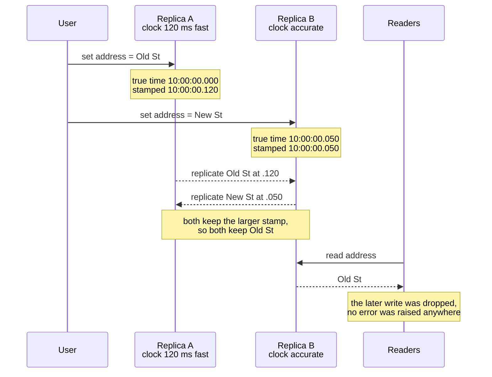
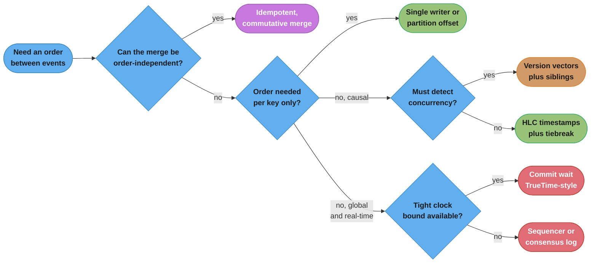
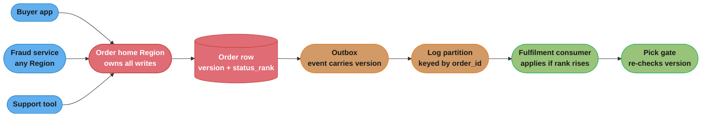

# Time, Clocks and Ordering
Why "what time is it" and "what happened first" are two different questions, and what a system design does about each.

> Facts, defaults and incident figures on this page were checked against primary sources on 2026-11-25.
> Capacity figures in the examples and the case study are illustrative design inputs, not measurements.

---

## 1. Concept Overview

Every machine in a distributed system has its own clock, and no two of those clocks agree.
A quartz oscillator drifts with temperature and age, a time daemon corrects the drift by
slewing or stepping the clock, a virtual machine can be paused and resumed somewhere else,
and once in a while the world inserts a leap second. So a timestamp is never a fact about
the world. It is a **claim made by one clock you do not control**, accurate only within an
error bound that you either measure, assume, or ignore.

System designs ask the clock two different questions and routinely confuse them:

1. **"What time is it?"** — physical time. Needed for TTLs, lease expiry, "show me orders
   from yesterday", billing periods, SLAs, and audit trails that a human reads.
2. **"What happened before what?"** — ordering. Needed for "which write wins", "apply the
   cancel after the create", "replay these events in the right order", and "is this read
   allowed to miss that write".

The second question does not need physical time at all. A message that carries "I saw
event 41" proves causality without any clock. The most common distributed-systems bug in
this area is answering question 2 with the tool built for question 1: comparing wall-clock
timestamps from two machines and treating the larger one as "later".

This module is the **HLD application layer** for time and ordering: which clock or
ordering mechanism to put where, what each costs, and how real systems (Spanner,
CockroachDB, Cassandra, DynamoDB global tables, Kafka, Snowflake IDs) choose. Boundaries:

- The **theory spine** — the formal happens-before relation, proofs that vector clocks
  characterize causality, system models and impossibility results — is owned by
  [Distributed Systems Theory](../../cs_fundamentals/distributed_systems_theory/distributed_systems_theory.md).
  This page uses those results and does not re-prove them.
- **Total-order broadcast through a replicated log** (Raft, Paxos) is owned by
  [Consensus Algorithms](../consensus_algorithms/consensus_algorithms.md). Here a consensus
  log appears only as one of several ways to buy an order.
- **Event time, processing time and watermarks** inside a stream job are owned by
  [Stream Processing](../stream_processing/stream_processing.md). §6.8 and §10 cover only
  where a pipeline's notion of time comes from and how it goes wrong.
- **Detecting that a node is dead** is a timing problem too, but it is owned by
  [Failure Detection and Membership](../failure_detection_and_membership/failure_detection_and_membership.md).
- **Language time APIs** (time zones, `Instant` vs `LocalDateTime`, DST gaps) are owned by
  [Java Time and Date-Time](../../java/java_time_datetime/java_time_datetime.md).

---

## 2. Intuition

**One-line analogy:** a postmark versus a reply chain. Two letters stamped 10:02 and 10:03
by two different post offices tell you almost nothing about which was written first — each
office's clock could be wrong by minutes. A letter that begins "Re: your note of Tuesday"
tells you for certain that Tuesday's note came first, with no clock involved at all.

**Mental model:** think of every event in the system as a dot, and draw an arrow from A to
B only if information from A could have reached B (same process, or a message carried it).
The arrows form a **partial order**: some pairs of dots have a path between them, and some
do not. Pairs with no path are genuinely **concurrent** — neither could have influenced the
other. Physical timestamps try to squash this graph onto a single line, and in doing so
they invent an order for concurrent events and, when clocks are skewed, can even reverse
the order of events that do have an arrow between them.

**Why it matters:** "which write wins" decides whether a user's last edit survives, whether
a cancelled order ships, and whether a balance is right. Systems that decide it with
skewed wall clocks lose data silently — there is no error, only a missing update that
someone notices days later.

**Key insight:** order is cheap when one participant assigns it (a single writer, a
sequencer, a partition leader) and expensive when many participants must agree on it. So
the design question is almost never "how do I synchronize clocks better". It is **"what
is the narrowest scope in which I need an order, and who can assign it there"**.

---

## 3. Core Principles

**Every machine has two clocks, and they answer different questions.** The **wall clock**
(time of day, `CLOCK_REALTIME`, `System.currentTimeMillis()`, a Go `time.Time` printed as
a date) is set by a time daemon and can jump forward or backward. The **monotonic clock**
(`CLOCK_MONOTONIC`, `System.nanoTime()`, the monotonic reading Go has carried inside
`time.Time` since Go 1.9) never goes backward but has no meaning across machines or
reboots. Use the wall clock for "when, for a human", the monotonic clock for "how long, on
this machine", and neither for "which came first across machines".

**Clock skew is bounded only by an assumption you must state.** NTP over ordinary networks
keeps clocks within tens to hundreds of milliseconds; Cockroach Labs puts typical NTP
offsets at 100 to 250 ms. GPS- and atomic-disciplined services shrink the bound: Google
cites a TrueTime bound of 7 ms for Spanner, and AWS has offered microsecond-range accuracy
on supported EC2 instances since November 2023. Any design that compares timestamps across
machines is correct only while the real skew stays under the bound it assumes.

**Happens-before is a partial order, and concurrency is a real outcome.** If neither event
could have seen the other, they are concurrent. A design either preserves that fact (vector
clocks, siblings, CRDT merge) or explicitly destroys it with a deterministic tiebreak
(last-writer-wins). Destroying it is fine when you choose it; it is a bug when a skewed
clock chooses it for you.

**Ordering guarantees have a scope, and cost grows with the scope.** Per key, per session,
per partition, causal across the system, and total across the system are different
products. A Kafka partition gives a total order for free inside the partition and none
across partitions. A global total order needs a single sequencer or a consensus round, and
it caps throughput or adds latency.

**Assign order at the point of truth.** A sequence number given by the single writer of a
key, a log offset given by the partition leader, or a commit timestamp given by the
database is authoritative. A client-side `created_at` is an opinion.

**When you cannot order, make the merge order-independent.** An update that is idempotent
(applying it twice equals once) and commutative (A then B equals B then A) does not need an
order at all. "Set status to CANCELLED if its rank is higher" and "max(seen_offset)" merge
safely in any order; "subtract 1" does not.

---

## 4. Types / Architectures / Strategies

### 4.1 Physical Clocks and Time Services

The wall clock on each host, disciplined by a time protocol:

| Source | How it works | Published bound |
|---|---|---|
| NTP over a LAN or the internet | Client polls servers, estimates offset from round-trip times, slews or steps the clock | Tens to hundreds of ms; Cockroach Labs cites 100 to 250 ms |
| PTP (IEEE 1588) with hardware timestamping | NICs timestamp packets in hardware, removing OS scheduling jitter from the estimate | Depends on NIC and switch support; far tighter than NTP on a tuned LAN |
| Amazon Time Sync Service | GPS-disciplined reference clocks reached through the Nitro system, by NTP or a PTP hardware clock | Microsecond range on supported instances (announced 2023-11-16) |
| Google TrueTime (internal) | GPS and atomic references per datacenter, an API that returns an interval | Upper bound cited at 7 ms |

Physical time is the only option when the answer must mean something to a human or match
an external calendar (billing day, regulatory timestamp, a lease that expires "at 10:00").

### 4.2 Monotonic Clocks

A per-process counter that only moves forward, used for durations, timeouts, rate-limit
windows and latency measurement. It cannot order events across machines and resets on
reboot. Go's `time.Now()` has carried a monotonic reading since Go 1.9, so `time.Since(start)`
is safe; Java code must choose `System.nanoTime()` explicitly for durations.

### 4.3 Lamport Clocks

Leslie Lamport's 1978 paper (*Communications of the ACM* 21(7), July 1978) defined a
counter per process: increment before each event, attach it to every message, and on
receive set the counter to `max(local, received) + 1`. If A happened before B, then
`L(A) < L(B)`. The reverse does not hold: `L(A) < L(B)` does **not** mean A happened before
B. Pairing the counter with a node id gives a total order that is consistent with
causality, which is enough for mutual exclusion, total-order tiebreaks and replicated
state machines. HashiCorp Serf stamps every membership and user-event message with a
Lamport time so that a "leave" received before its "join" can be ordered correctly.

### 4.4 Vector Clocks and Version Vectors

One counter per participant. Comparing two vectors tells you exactly one of three things:
A before B, B before A, or **concurrent**. That third answer is what Lamport clocks cannot
give, and it is what lets a store keep both conflicting writes ("siblings") instead of
silently dropping one. The 2007 Dynamo paper (SOSP) used vector clocks for this, and the
application merged the siblings, the canonical example being a shopping-cart union. The
cost is size: one entry per writer, so vectors grow with the number of replicas or clients
that ever wrote the key, and systems prune or bound them. Cassandra deliberately does not
do this — its documentation contrasts Dynamo's vector clocks with Cassandra's simpler
last-write-wins model (§4.7).

### 4.5 Hybrid Logical Clocks (HLC)

Kulkarni, Demirbas and co-authors ("Logical Physical Clocks", OPODIS 2014) combined a
physical component `l` that tracks the largest wall-clock time seen with a small logical
counter `c` that breaks ties. HLC timestamps:

- stay close to wall time, so they are readable and usable for "as of 10:00" queries;
- respect causality like a Lamport clock, so a message's receiver always stamps later;
- fit in a fixed-size value, unlike a vector clock.

CockroachDB timestamps every transaction with HLC time; its documentation describes HLC as
"composed of a physical component (always close to local wall time) and a logical
component". HLC does not remove the need for bounded skew — §6.5 shows what CockroachDB
still does with its configured maximum offset.

### 4.6 Bounded-Uncertainty Clocks (TrueTime-style)

Instead of returning a single instant, the clock returns an interval
`[earliest, latest]` that is guaranteed to contain true time. Spanner (OSDI 2012) uses
this to give **external consistency**: if transaction T1 commits before T2 starts, T2's
timestamp is larger, across every server in the world. The mechanism is **commit wait**:
pick a commit timestamp `s >= latest`, then do not report the commit until `earliest > s`.
The price is waiting out the uncertainty on every read-write transaction (§6.4).

### 4.7 Last-Writer-Wins (LWW)

Tag each write with a timestamp and keep the largest. It is simple, needs no coordination,
and is the default in Cassandra (timestamps come from the client or the coordinator, per
column) and in DynamoDB global tables in multi-Region eventual consistency mode ("the
modification with the latest internal timestamp on a per-item basis"). LWW is correct only
if "largest timestamp" means "the write the business wanted to survive". Under clock skew,
an older write from a fast clock beats a newer write from a slow clock, and the loser
disappears with no error (§5.1).

### 4.8 Sequencers and Log Offsets

Let one participant assign the order and everyone else accept it:

- **Single writer per key or partition** — the owner increments a version.
- **Partitioned log** — a Kafka partition leader assigns offsets; order is total within
  the partition and undefined across partitions. See [Message Queues](../message_queues/message_queues.md).
- **Consensus log index** — a Raft log index or an etcd revision is a cluster-wide order,
  bought with a quorum round. See [Consensus Algorithms](../consensus_algorithms/consensus_algorithms.md).
- **K-sorted IDs** — Twitter's Snowflake packs 41 bits of milliseconds (69 years from a
  custom epoch), 10 bits of machine id and 12 bits of sequence into 64 bits. IDs from
  different machines are only **roughly** time-ordered: Snowflake promised k-sorting
  within 1 second and aimed for tens of milliseconds. See
  [Design a Distributed Unique ID Generator](../case_studies/design_distributed_unique_id.md).

### 4.9 The Ordering Guarantee Ladder

| Guarantee | What it promises | Typical mechanism | Cost |
|---|---|---|---|
| None | Events may be applied in any order | Fire-and-forget, multiple consumers | Free; merge must be order-independent |
| Per-key FIFO | Updates to one key apply in send order | Partition by key, one consumer per partition | Hot keys serialize through one consumer |
| Session / read-your-writes | A client sees its own writes in order | Sticky routing, causality token, version floor | Client must carry state |
| Causal | If A could have influenced B, everyone sees A before B | Vector clocks, HLC plus dependency tracking | Metadata per write; delayed visibility |
| Total per partition | One order inside each partition | Partition leader offset | Throughput per partition is capped |
| Total global (linearizable) | One order for everything, consistent with real time | Single sequencer, consensus, or commit wait | Cross-node round trip or clock-uncertainty wait per write |

Pick the lowest rung that satisfies the requirement, then name the rung in the design doc.
"We need ordering" without a rung is the requirement that later turns into a global lock.

---

## 5. Architecture Diagrams

### 5.1 How Last-Writer-Wins Loses a Write Under Clock Skew



The user's second write happened 50 ms after the first in real time, but the first write
carries the larger timestamp because Replica A's clock runs 120 ms fast. Every replica
converges — on the wrong value. Convergence is not correctness.

### 5.2 Lamport Clocks vs Vector Clocks on the Same Run

```
Three processes; time flows left to right. m1, m2, m3 are messages.

P1:  a(1) ---------- b(2) -------------------- e(4)
                      |                         ^
                      | m1                      | m2
                      v                         |
P2:  c(1) ---------- d(3) ----------------------+
                      |
                      | m3
                      v
P3:  f(1) -- g(2) -- h(4)

Lamport:   a=1 b=2 c=1 d=3 e=4 f=1 g=2 h=4
Vector:    a=[1,0,0] b=[2,0,0] c=[0,1,0] d=[2,2,0] e=[3,2,0]
           f=[0,0,1] g=[0,0,2] h=[2,2,3]

Pair       Lamport says        Vector clock says
g vs d     g(2) < d(3)         [0,0,2] vs [2,2,0]  -> CONCURRENT
c vs b     c(1) < b(2)         [0,1,0] vs [2,0,0]  -> CONCURRENT
b vs h     b(2) < h(4)         [2,0,0] <= [2,2,3]  -> b HAPPENED BEFORE h
```

*Lamport numbers place `g` before `d` and `c` before `b`, but neither pair is causally
related: the vector clocks show both pairs as concurrent. Only `b` before `h` is a real
happens-before edge (through m1 and m3). A Lamport clock can produce an order; only a
vector clock can tell you the order was invented.*

### 5.3 Commit Wait on a Bounded-Uncertainty Clock

```
TT.now() at commit returns [earliest, latest], width 2e (e = uncertainty bound)

true time --->  |<------ 2e ------>|<------ 2e ------>|
                earliest           s = latest         earliest' > s
                ^ commit starts    ^ timestamp chosen  ^ commit acknowledged

Wait = time until TT.now().earliest passes s, about 2e in the steady state.
e = 7 ms    -> wait about 14 ms per read-write transaction
e = 1 ms    -> wait about 2 ms
e = 250 ms  -> wait about 500 ms   (why commit wait needs GPS and atomic clocks, not NTP)
```

*Commit wait converts clock uncertainty directly into write latency. That is why it is
worth building only with tight hardware-disciplined clocks: with typical NTP bounds the
same rule would add half a second to every write.*

### 5.4 Choosing an Ordering Mechanism



*Every branch further to the right costs more coordination. Most real requirements stop at
the second or third box.*

---

## 6. How It Works — Detailed Mechanics

### 6.1 Lamport Clock

```python
class LamportClock:
    def __init__(self, node_id: str):
        self.t = 0
        self.node_id = node_id

    def local_event(self) -> tuple[int, str]:
        self.t += 1
        return (self.t, self.node_id)          # (counter, node) is a total order

    def send(self) -> int:
        self.t += 1
        return self.t                           # attach to the outgoing message

    def receive(self, msg_t: int) -> tuple[int, str]:
        self.t = max(self.t, msg_t) + 1
        return (self.t, self.node_id)
```

Comparing `(counter, node_id)` tuples lexicographically gives every replica the same total
order. That order respects every happens-before edge and breaks concurrent ties by node
id — which is arbitrary but deterministic, so every replica makes the same arbitrary
choice.

### 6.2 Version Vectors and Sibling Detection

```python
def compare(a: dict[str, int], b: dict[str, int]) -> str:
    keys = a.keys() | b.keys()
    a_le_b = all(a.get(k, 0) <= b.get(k, 0) for k in keys)
    b_le_a = all(b.get(k, 0) <= a.get(k, 0) for k in keys)
    if a_le_b and b_le_a:
        return "equal"
    if a_le_b:
        return "before"        # a happened before b: b supersedes a
    if b_le_a:
        return "after"
    return "concurrent"        # keep both as siblings, ask the application to merge

def merge_vectors(a: dict[str, int], b: dict[str, int]) -> dict[str, int]:
    return {k: max(a.get(k, 0), b.get(k, 0)) for k in a.keys() | b.keys()}
```

On a write, the coordinator increments its own entry. On a read that returns siblings, the
client merges the values (cart union, field-level merge, or "ask the user"), writes back
with the merged vector, and the siblings collapse. The design question is **who merges**:
a store that returns siblings pushes conflict resolution into every client.

### 6.3 Hybrid Logical Clock

The algorithm from the HLC paper, with `wall()` as the local physical clock:

```python
class HLC:
    def __init__(self, wall):          # wall() returns physical time in ms
        self.wall = wall
        self.l = 0                     # largest physical time seen
        self.c = 0                     # logical counter for ties

    def now(self) -> tuple[int, int]:  # local event or send
        prev = self.l
        self.l = max(prev, self.wall())
        self.c = self.c + 1 if self.l == prev else 0
        return (self.l, self.c)

    def update(self, ml: int, mc: int) -> tuple[int, int]:   # on receive
        prev = self.l
        self.l = max(prev, ml, self.wall())
        if self.l == prev == ml:
            self.c = max(self.c, mc) + 1
        elif self.l == prev:
            self.c += 1
        elif self.l == ml:
            self.c = mc + 1
        else:
            self.c = 0
        return (self.l, self.c)
```

Two properties matter for design. First, `l` never runs behind the local wall clock and
stays within the real clock skew of it, so HLC timestamps can be used for "read as of
10:00:00". Second, a receiver's timestamp is always larger than the sender's, so causality
is preserved even when the receiver's clock is slow. A production implementation also
**rejects** a received `ml` that is further ahead of its own wall clock than the
configured maximum offset, so that one node with a wildly wrong clock cannot drag the
whole cluster's time into the future.

### 6.4 Commit Wait Arithmetic

```
commit(T):
    s = TT.now().latest          # no earlier than any correct clock's view of now
    apply writes at timestamp s (replicated through Paxos)
    while TT.now().earliest <= s:
        sleep                    # wait out the uncertainty
    acknowledge commit to client
```

After the wait, every correct clock in the system reads a time larger than `s`, so any
transaction that starts after the acknowledgement picks a larger timestamp. Commit wait
overlaps with the replication round, so the wall-clock cost is roughly
`max(replication latency, about 2e)` rather than the sum. A design that copies the idea
onto NTP-synchronized hosts must budget the wait at about twice its assumed skew per write.

### 6.5 CockroachDB: Uncertainty Intervals Instead of Commit Wait

CockroachDB runs on commodity clocks, so it does not wait after writes. Cockroach Labs'
own summary: "While Spanner always waits after writes, CockroachDB sometimes retries reads."

1. A transaction takes a provisional timestamp `ts` from the gateway's HLC.
2. It treats `(ts, ts + max_offset]` as an **uncertainty window**. The maximum offset
   defaults to 500 ms (the `--max-offset` flag).
3. If a read finds a committed value with a timestamp inside that window, the value might
   have been written before the transaction started in real time, so the transaction
   moves its timestamp above that value and retries the read.
4. A node that detects its clock is out of sync with at least half of the other nodes by
   80% of the maximum offset shuts itself down rather than risk inconsistency.

Serializability holds regardless of skew; single-key linearizability between causally
dependent transactions depends on skew staying inside the configured bound. For causal
chains that cross clients, CockroachDB describes a **causality token** — the maximum
timestamp a transaction observed — passed to the next actor as a minimum timestamp.

### 6.6 The Flagship Broken to Fixed Pair: Ordering With Wall Clocks

**BROKEN — "latest update wins" by each host's wall clock:**

```sql
-- Each service instance stamps updated_at from its own clock.
UPDATE orders
SET status = :new_status, updated_at = :host_now
WHERE order_id = :id AND updated_at < :host_now;
```

Two problems. A host whose clock is 300 ms fast makes its update "win" against any update
issued in the following 300 ms. A host whose clock is slow cannot overwrite a value written
by a fast host until its own clock catches up, so updates are dropped silently and the
statement reports zero rows as if nothing was wrong.

**FIX — the row owns the order with a version, and the business rule owns the merge:**

```sql
-- Version assigned by the row itself; no host clock in the comparison.
UPDATE orders
SET status = :new_status, version = version + 1, updated_at = now()
WHERE order_id = :id AND version = :expected_version;
-- 0 rows => someone else wrote first: re-read, re-apply the business rule, retry.

-- Status transitions that must not regress are encoded as a rank, so
-- an out-of-order event is absorbed instead of applied.
UPDATE orders
SET status = :new_status, status_rank = :new_rank, version = version + 1
WHERE order_id = :id AND status_rank < :new_rank;
```

The `updated_at = now()` value is still written, for humans and for reporting, but it no
longer decides anything. The comparison that decides uses a value one authority assigns.

### 6.7 Order-Independent Merges

When events can arrive in any order and you cannot route them through one writer, design
the state so the merge function is **commutative, associative and idempotent**:

| Data shape | Merge | Safe in any order? |
|---|---|---|
| Max of a counter or offset | `max(a, b)` | Yes |
| Set of tags, cart items added | union | Yes, for adds only |
| Per-node counter (G-counter) | per-node `max`, then sum | Yes |
| Field with an explicit version | keep higher `(version, node_id)` | Yes, if the version comes from one authority |
| Balance updated by deltas | `a + delta` | No — duplicate or replayed deltas double-count |
| Status updated by "set to X" | last arrival | No — a late CREATED overwrites CANCELLED |

These are the shapes behind CRDTs; the local-first sync material in
[Embedded and Edge Databases](../../database/embedded_and_edge_databases/embedded_and_edge_databases.md)
and the convergence discussion in
[Consistency Models and Consensus](../../database/consistency_models_and_consensus/consistency_models_and_consensus.md)
go deeper. For a balance, the standard fix is to store immutable entries keyed by an
idempotency key and derive the balance, rather than to apply deltas in arrival order.

### 6.8 Where Time Comes From in an Event Pipeline

A pipeline has at least four candidate timestamps per event, and each answers a different
question:

| Timestamp | Set by | Trust | Use it for |
|---|---|---|---|
| Device time | Phone or browser clock | Low; can be hours off or set by the user | Event time, but only when bounded by ingest time |
| Ingest time | Edge collector on receipt | Medium; skew of the collector fleet | Bounding device time, late-data detection |
| Log append time | Broker on append (Kafka `LogAppendTime`) | High within a partition | Replay order, retention |
| Processing time | Stream job when it handles the event | Accurate but meaningless for business windows | Operational lag metrics |

Business windows ("clicks per minute") should use **event time**, which is usually device
time clamped to a plausible range around ingest time. Watermarks and allowed lateness then
decide when a window is complete — see [Stream Processing §4.2](../stream_processing/stream_processing.md).
How those windows feed batch and serving layers is the subject of
[Data Platform Architecture](../data_platform_architecture/data_platform_architecture.md).

---

## 7. Real-World Examples

**Google Spanner.** TrueTime exposes clock uncertainty as an interval, and Spanner turns it
into external consistency with commit wait. Google's documentation states the guarantee:
a timestamp T generated after T' finished being generated is always greater, across all
servers. Cockroach Labs cites the published bound as 7 ms.

**CockroachDB.** HLC timestamps, a 500 ms default maximum clock offset, read restarts
inside the uncertainty window, and self-termination of a node whose clock drifts past 80%
of the bound against at least half the cluster. Its operational FAQ also warns about
vMotion: a VM suspended and migrated can briefly run on a stale clock, and the
`--clock-device` flag lets a node read a PTP hardware clock instead.

**Apache Cassandra.** Every mutation carries a timestamp from the client or the
coordinator, and each column resolves concurrent writes with last-write-wins. The
documentation states plainly that "Cassandra's correctness does depend on these clocks"
and tells operators to run NTP.

**Amazon DynamoDB global tables.** In the default multi-Region eventual consistency mode,
concurrent updates to the same item in different Regions resolve by "the latest internal
timestamp on a per-item basis". A multi-Region strong consistency mode exists for items
that cannot tolerate that.

**Twitter Snowflake.** 64-bit IDs ordered roughly by time. The README states that if the
clock moves backward, Snowflake "will refuse to generate ids until a time that is after
the last time we generated an id".

**Cloudflare RRDNS, 2017-01-01.** A leap second made Go's `time.Now()` appear to go back
one second; Go then offered no monotonic time source. A resolver round-trip time computed
as `time.Now().Sub(start)` went negative, the smoothed value went negative, and
`rand.Int63n` panicked on the negative argument. At peak about 0.2% of DNS queries to
Cloudflare were affected. Go 1.9 later added transparent monotonic time.

**Leap smearing.** Since 2008 Google has smeared leap seconds instead of stepping clocks.
It recommends a 24-hour linear smear from noon to noon UTC, a frequency change of about
11.6 ppm, and states that AWS uses the same smear. Smeared time is up to about half a
second away from stepped UTC around the leap, so mixing smeared and unsmeared sources in
one cluster creates that much skew.

**Leap seconds are ending.** Resolution 4 of the 27th CGPM (2022) decided that the maximum
value of UT1 minus UTC will be increased in, or before, 2035, and noted that a first
negative leap second "has never been foreseen or tested". Code must still survive any leap
second that happens before then.

---

## 8. Tradeoffs

### Ordering Mechanisms Compared

| Mechanism | Detects concurrency | Close to wall time | Metadata size | Coordination per write | Typical use |
|---|---|---|---|---|---|
| Wall-clock timestamp | No | Yes | 8 bytes | None | Display, TTL, LWW where loss is acceptable |
| Lamport clock | No | No | 8 bytes + node id | None | Total-order tiebreaks, Serf events |
| Vector clock | Yes | No | One entry per writer | None | Siblings, causal stores, offline sync |
| HLC | No (orders, does not detect) | Yes, within skew | Fixed, about 8 to 12 bytes | None | Distributed SQL timestamps, snapshot reads |
| TrueTime + commit wait | n/a (real-time order) | Yes | Interval | Wait about 2e per write | Externally consistent global transactions |
| Sequencer / log offset | n/a (assigns order) | No | 8 bytes | Route through the leader | Per-partition order, replicated logs |

### Conflict Resolution Policies

| Policy | Data loss risk | Client complexity | Good fit |
|---|---|---|---|
| LWW by wall clock | High under skew, silent | None | Caches, presence, "last seen" |
| LWW by HLC + node id | Concurrent writes still lose one side | None | Fields where any single winner is acceptable |
| Version check (CAS) | None; loser gets an error and retries | Retry loop | Most OLTP rows |
| Siblings + application merge | None | Every reader may have to merge | Carts, collaborative documents |
| CRDT merge | None for supported shapes | Data type limits | Counters, sets, text editing |

### Clock Quality vs What It Buys

| Clock bound | What becomes possible | What it costs |
|---|---|---|
| Unknown (no daemon, no monitoring) | Nothing safe across machines | Nothing — except correctness |
| About 100 ms (NTP) | HLC with read restarts, coarse lease expiry | A time daemon and offset monitoring |
| Microseconds (hardware-disciplined cloud service) | Short leases, small commit waits, one-way latency measurement | Supported instance types or PTP-capable NICs |
| Single-digit ms with a guaranteed bound (TrueTime) | External consistency without a central sequencer | GPS and atomic references per datacenter |

---

## 9. When to Use / When NOT to Use

**Use wall-clock time when** the value is for humans or calendars: display, audit fields,
billing periods, retention cut-offs, "orders placed yesterday". Store it in UTC as an
instant.

**Use monotonic time when** you measure a duration on one machine: timeouts, latency,
rate-limit windows, retry backoff, lease renewal deadlines.

**Use a single writer or a log offset when** you need order per key or per entity and can
route all updates for that key through one place. This covers most real requirements.

**Use version checks (CAS) when** concurrent writers update the same row and a lost update
is unacceptable. The loser is told, instead of silently overwritten.

**Use vector clocks or siblings when** writers must keep working while disconnected
(multi-master across Regions, offline mobile) and you need to know that a conflict
happened in order to merge it.

**Use HLC when** you need timestamps that are both causally consistent and close to real
time, for example MVCC snapshot reads in a distributed database.

**Use commit wait when** the product promise is external consistency across a globally
distributed database and you own clock infrastructure with a small, guaranteed bound.

**Do NOT** use wall-clock timestamps to decide which of two writes from different machines
wins when losing the newer write matters.

**Do NOT** build a global total order "just in case". It funnels throughput through one
sequencer or one consensus group and buys nothing for operations that only touch one key.

**Do NOT** assume order across Kafka partitions, across messages in an unordered queue,
or across two different topics. Order exists only inside the scope that a single authority
assigns it.

---

## 10. Common Pitfalls

**Measuring durations with the wall clock.** *Broken:* `elapsed = System.currentTimeMillis()
- start` in a timeout or latency metric; an NTP step or a leap second makes it negative or
huge. Cloudflare's 2017 leap-second incident was exactly this shape, ending in a panic on a
negative value. *Fix:* `System.nanoTime()` in Java, the monotonic reading in Go
(`time.Since`), `time.monotonic()` in Python, and a guard that clamps durations to zero
before they feed arithmetic that fails on negatives.

**Silent lost updates under LWW.** *Broken:* multi-Region active-active writes to the same
item with last-writer-wins, on the assumption that users rarely edit the same thing twice
within the skew window. Profile edits from a phone and a laptop seconds apart are normal,
and the lost write is invisible. *Fix:* route each entity's writes to one home Region, or
use conditional writes on a version, or model the item so concurrent updates touch
different attributes. See [Multi-Region and Data Residency](../multi_region_and_data_residency/multi_region_and_data_residency.md).

**Client timestamps used as event time without bounds.** A phone with a wrong date sends
events stamped years in the future or in 1970; the stream job puts them in windows that
never close or closed long ago, and a watermark based on the maximum event time seen jumps
forward and drops every real event as late. *Fix:* clamp device time to a window around
ingest time (for example, accept it only within 24 hours behind and 5 minutes ahead of
receipt, else use ingest time), and record which source the event time came from.

**Assuming cross-partition order.** An order-created event goes to partition 3 and its
order-cancelled event, keyed by a different field, goes to partition 7. A consumer
processes the cancel first, finds no order, drops it, then creates the order. *Fix:* key
every event for one entity by that entity's id so they share a partition, and make
handlers tolerate out-of-order arrival with status ranks (§6.6).

**Lease expiry computed from another machine's clock.** A lock service grants a lease
"until 10:00:10" and the client checks expiry against its own wall clock, which is 2 s
slow. The client keeps acting for 2 s after the lease went to someone else. *Fix:* express
leases as durations measured on each side's monotonic clock, subtract a safety margin for
drift on the client side, and fence the protected write — see
[Coordination and Contention §4.3](../coordination_and_contention/coordination_and_contention.md).

**Two IDs in the same millisecond.** *Broken:* an ID built from `now_ms` alone
(`order-1732540800123`); two requests in the same millisecond on one host, or on two
hosts, collide. *Fix:* add a per-host sequence and a host id (the Snowflake layout), or a
random component, and never rely on the timestamp part alone for uniqueness.

**A clock step backward breaks a k-sorted ID generator.** When NTP steps a clock back
40 ms, a naive Snowflake clone reuses timestamps it already issued and, if the sequence
also restarts, issues duplicate IDs. *Fix:* remember the last timestamp used, refuse or
wait when the clock is behind it (Snowflake's documented behaviour), prefer slewing over
stepping for small corrections, and alert on backward steps.

**Mixing smeared and unsmeared time sources.** Half a fleet uses a smearing NTP pool and
half uses servers that step at the leap second. For hours around the event the two halves
disagree by up to about 0.5 s, and anything comparing their timestamps misbehaves.
*Fix:* one time-source policy per fleet; CockroachDB's documentation requires all nodes to
sync to the same source or to sources that smear the same way.

**Treating a paused VM as impossible.** Live migration or a long GC pause freezes the
process; on resume its idea of "now" is stale until the clock catches up. A node that
issues timestamps during that window can hand out values in the past. *Fix:* read a
hardware clock device where available, alert on forward jumps, and keep every protected
action behind a fencing check rather than a clock comparison.

---

## 11. Technologies & Tools

| Tool | Role | Notes |
|---|---|---|
| chrony | NTP client and server | Common default time daemon on Linux distributions |
| linuxptp | PTP (IEEE 1588) implementation for Linux | Hardware-timestamped synchronization on a LAN |
| Amazon Time Sync Service | Cloud time source | NTP and PTP hardware clock access; microsecond-range accuracy on supported EC2 instances since 2023-11-16 |
| Google Public NTP | Public time source | Serves time with the 24-hour noon-to-noon leap smear |
| Google Cloud Spanner | Globally distributed SQL | TrueTime and commit wait for external consistency |
| CockroachDB | Distributed SQL | HLC timestamps, 500 ms default maximum offset, read restarts inside the uncertainty window |
| Apache Cassandra | Wide-column store | Per-column last-write-wins with client or coordinator timestamps |
| Amazon DynamoDB | Key-value and document store | Global tables: last-writer-wins in MREC mode, or MRSC mode for strong consistency |
| Apache Kafka | Partitioned log | Total order per partition by offset; `CreateTime` or `LogAppendTime` record timestamps |
| etcd | Consensus key-value store | A cluster-wide revision number orders every change |
| HashiCorp Serf | Gossip membership | Stamps membership and user events with Lamport time |

---

## 12. Interview Questions with Answers

**Q: Why can't you use wall-clock timestamps from two different servers to decide which write happened first?**
**Short:** Each server's clock is skewed by an unknown amount, so a later write can carry a smaller timestamp than an earlier one.

Wall clocks drift and are corrected independently, so two machines disagree by an amount
that is only bounded by assumption — tens to hundreds of milliseconds on NTP. A write made
50 ms after another can carry a timestamp 70 ms earlier if its host's clock is 120 ms
behind. Comparing the stamps then reverses real order, and under last-writer-wins the
newer write is silently discarded. Use an order assigned by one authority (a version, a
log offset) or a logical clock instead.

**Q: What is the difference between a wall clock and a monotonic clock, and when do you use each?**
**Short:** A wall clock tells the time of day and can jump; a monotonic clock only moves forward and is for durations on one machine.

The wall clock is set by NTP or PTP and can step forward or backward, including at a leap
second; it answers "when" for humans and calendars. The monotonic clock never goes
backward but has no meaning across machines or reboots; it answers "how long". Timeouts,
latency metrics, rate-limit windows and lease renewals belong on the monotonic clock
(`System.nanoTime()`, `time.Since` in Go). Cloudflare's 2017 leap-second incident came from
computing a duration with the wall clock.

**Q: What does a Lamport clock guarantee, and what does it not?**
**Short:** If A happened before B then L(A) is less than L(B), but a smaller Lamport value does not prove A happened before B.

Each process increments a counter per event and takes `max(local, received) + 1` on
receive, so causality always maps to increasing numbers. The converse fails: two
concurrent events still get different numbers, and nothing in the numbers says they were
concurrent. Adding a node id gives a total order consistent with causality, which is
enough for tiebreaks and replicated state machines but not for detecting conflicts.

**Q: When do you need vector clocks instead of Lamport clocks?**
**Short:** When you must detect that two updates were concurrent, so you can keep and merge both instead of silently picking one.

A vector clock has one counter per writer, and comparing two vectors returns before, after
or concurrent. That third answer lets a multi-master store keep both versions as siblings
and hand them to the application to merge, as the Dynamo paper did for shopping carts. The
cost is metadata that grows with the number of writers and extra client work on every read
that returns siblings. If a deterministic winner is acceptable, a Lamport or HLC timestamp
plus node id is cheaper.

**Q: How does last-writer-wins lose data, and how would you avoid it?**
**Short:** Under clock skew an older write with a larger timestamp beats a newer write, and the newer one vanishes with no error.

Every replica converges on the highest timestamp, so the system looks consistent while the
user's latest change is gone. Avoid it by giving each entity a single home writer, by
using conditional writes on a version so the loser gets an error and retries, by
splitting the item so concurrent updates touch different fields, or by using a CRDT or
sibling merge where both updates must survive. Keep LWW for data where losing one
concurrent update is acceptable, such as presence or last-seen.

**Q: What is a hybrid logical clock and why do distributed databases use it?**
**Short:** An HLC pairs the largest physical time seen with a logical counter, so timestamps stay near wall time and still respect causality.

The physical part tracks the maximum of the local wall clock and any timestamp received,
and the logical part breaks ties, so a message receiver always stamps later than the
sender even if its own clock is slow. Because values stay close to real time, they work
for MVCC snapshot reads like "as of 10:00:00", and they have a fixed size, unlike vector
clocks. CockroachDB uses HLC for transaction timestamps. HLC still needs bounded skew to
give real-time guarantees, which is why CockroachDB enforces a maximum clock offset.

**Q: How does Spanner use TrueTime to get external consistency?**
**Short:** It picks a commit timestamp at the top of the clock's uncertainty interval, then waits until every clock has passed it before acknowledging.

TrueTime returns an interval guaranteed to contain true time. Spanner chooses
`s >= TT.now().latest`, replicates the writes, and does not acknowledge until
`TT.now().earliest > s`. After that wait, any transaction that starts later gets a larger
timestamp on any server, so timestamp order matches real-time order. The wait is about
twice the uncertainty bound and overlaps with replication, which is why it is only
practical with tight GPS and atomic-clock bounds, not NTP.

**Q: CockroachDB runs without atomic clocks. How does it still give consistent reads?**
**Short:** It defines an uncertainty window above each transaction's timestamp and restarts reads that see values inside that window.

A transaction's provisional HLC timestamp `ts` comes with a window up to `ts + max_offset`
(500 ms by default). A committed value stamped inside the window might have been written
before the transaction started in real time, so the transaction raises its timestamp
above it and retries. Spanner waits after writes; CockroachDB sometimes retries reads. A
node whose clock drifts past 80% of the maximum offset against at least half the cluster
shuts itself down to protect consistency.

**Q: Kafka guarantees ordering. What exactly is ordered?**
**Short:** Records are totally ordered by offset within one partition, and there is no order across partitions or topics.

The partition leader assigns offsets on append, so consumers of one partition see records
in one order. Two partitions are independent logs, so a consumer reading both can see a
later event before an earlier one. To keep all events for one entity in order, key them by
the entity id so they hash to the same partition, and keep one consumer per partition. If
the key changes between event types, the ordering guarantee silently disappears.

**Q: How do you design a handler that stays correct when events arrive out of order?**
**Short:** Make the update idempotent and monotonic, for example by applying a status only if its rank is higher than the stored one.

Store a rank or version with the entity and apply an event only if it moves the entity
forward: `WHERE status_rank < :new_rank`. A late CREATED after CANCELLED is then absorbed
instead of resurrecting the order. Deduplicate by event id so redelivery is harmless. For
counters and sets, use merges that are commutative and idempotent (max, union, per-node
counters). For balances, store immutable entries keyed by idempotency key and derive the
total rather than applying deltas in arrival order.

**Q: What happens to a Snowflake-style ID generator when the clock goes backward?**
**Short:** It would reissue old timestamps and can duplicate IDs, so it must refuse or wait until the clock passes the last timestamp used.

The 41-bit time field assumes time only moves forward. If NTP steps the clock back and the
generator keeps going, it reuses millisecond values it has already used, and with a reset
sequence it emits duplicates. Snowflake's documented behaviour is to refuse to generate
IDs until the clock is past the last timestamp it issued. Also prefer slewing for small
corrections and alert on backward steps.

**Q: A leap second is coming. What breaks and what do you do?**
**Short:** Code that assumes time never repeats or goes backward breaks, so smear the second and measure durations monotonically.

At a stepped leap second, a wall-clock second repeats, so durations computed from wall
time can be negative and timestamps can collide or go backward. The common mitigation is a
smear: Google recommends spreading the second over 24 hours, noon to noon UTC, at about
11.6 ppm, and AWS uses the same smear. Every host in a cluster must use the same policy,
or smeared and unsmeared hosts disagree by up to half a second. Durations must use
monotonic clocks regardless.

**Q: How should a streaming pipeline choose the event time for mobile events?**
**Short:** Use device time only when it falls within a plausible window around server receipt time, otherwise fall back to ingest time.

Device clocks can be wrong by hours or years, and one event stamped far in the future can
push a watermark forward and make every real event late. Clamp device time to a range
around ingest time, record which source you used, and let windows and watermarks work on
the clamped value. Keep processing time only for lag metrics. The watermark mechanics
themselves are covered in the stream processing module.

**Q: Why is a global total order expensive, and how do you avoid needing one?**
**Short:** Every write must pass through one sequencer or one consensus round, which caps throughput and adds latency for all writes.

A single sequencer is a throughput ceiling and a failover problem; consensus adds a quorum
round trip; commit wait adds clock uncertainty to each write. Most requirements need order
only per entity, per account or per partition. Scope the order to that unit, route each
unit's writes to one authority, and make cross-unit effects order-independent. Name the
rung of the ordering ladder in the design rather than writing "events must be ordered".

**Q: What is causal consistency and how is it different from linearizability?**
**Short:** Causal consistency only orders events that could influence each other; linearizability orders all operations consistently with real time.

Under causal consistency, if a user posts and then replies, everyone sees the post before
the reply, but two unrelated posts can appear in different orders to different readers.
It can be provided without a global coordinator by tracking dependencies with vector
clocks or HLC timestamps. Linearizability makes the whole system behave like one copy with
real-time order, which needs consensus or commit wait. Many products need causal order for
user-visible threads and linearizability only for a few objects such as balances or locks.

**Q: Why do lease-based locks depend on clocks, and how do you make them safe?**
**Short:** Lease expiry assumes both sides measure time at similar rates, so a paused or skewed holder can act after expiry unless writes are fenced.

The lock service and the holder each decide when the lease ends, and a GC pause, a VM
migration or a wrong clock can make the holder believe it still owns a lease that was
reassigned. Measure lease durations with monotonic clocks, renew well before expiry, keep
a client-side safety margin for drift, and make the protected resource reject writes that
carry an old fencing token. The fencing mechanics live in the coordination and contention
module.

**Q: How do Cassandra and DynamoDB global tables resolve concurrent writes to the same item?**
**Short:** Both use last-writer-wins on timestamps: Cassandra per column, DynamoDB global tables per item in the default mode.

Cassandra stamps each mutation with a client or coordinator timestamp and resolves each
column independently, so updates to different columns of one row merge without conflict,
and its correctness depends on NTP. DynamoDB global tables in multi-Region eventual
consistency mode keep the modification with the latest internal timestamp per item, and
offer a multi-Region strong consistency mode for items that cannot accept that. In both,
design so that concurrent writes either touch different attributes or go through a
conditional write.

**Q: How would you order operations in a collaborative editor where users edit offline?**
**Short:** Give each operation a causal identity plus a site id tiebreak, and merge with a CRDT so the order of arrival does not matter.

Offline edits are concurrent by definition, so a single timestamp order would silently
drop or misplace text. Text CRDTs and operational transformation give each character or
operation an identity that encodes its causal position and a deterministic tiebreak by
site id, so every replica converges to the same document regardless of arrival order. The
design cost is metadata per character and garbage collection of tombstones. See the
[Google Docs case study](../case_studies/design_google_docs.md) for the system around it.

---

## 13. Best Practices

**Write down the clock bound you depend on.** Every design that compares timestamps across
machines should state the maximum skew it assumes and what happens if the bound is
exceeded. Monitor clock offset on every host and alert well before the bound.

**Use one authority per ordering scope.** A row version, a partition offset or a consensus
index is an order; a client's `created_at` is not. Route each entity's writes through the
authority for its scope.

**Store instants in UTC, measure durations monotonically.** Keep time zones at the edges
for display, never in comparisons. Never compute elapsed time from two wall-clock reads.

**Make handlers order-tolerant by default.** Deduplicate by event id, apply status changes
only if they move forward, and prefer merges that are commutative and idempotent. Treat
"events arrive in order" as an optimization, never as a correctness assumption.

**Keep LWW for data that can lose a concurrent update.** Presence, last-seen, cache
entries and telemetry are fine. Money, inventory, permissions and user-authored content
need version checks, a single writer, or a merge that keeps both sides.

**Use one time-source policy per fleet.** Either every host smears leap seconds the same
way or none does. Prefer a cloud provider's hardware-disciplined service where available,
and prefer slewing over stepping for small offsets.

**Pick the lowest rung on the ordering ladder that meets the requirement.** Per-key order
covers most needs; causal order covers user-visible threads; global real-time order is a
deliberate, budgeted choice for a few objects.

**Record which timestamp you used.** In event pipelines, store device, ingest and append
times separately with a flag for the one used as event time, so late-data and skew bugs
can be diagnosed after the fact.

---

## 14. Case Study: The Cancelled Orders That Shipped Anyway

### Problem Statement

A marketplace runs order services in three Regions, active-active. Orders are created in
the buyer's nearest Region; cancellations can come from the buyer app, a fraud service in
another Region, or customer support. Order events flow into a fulfilment pipeline through
a partitioned log. Illustrative scale: 40,000 orders per minute at peak, about 3%
cancelled, and about 1 in 2,000 cancellations arriving within 2 seconds of creation (fraud
auto-cancels).

The incident: a few hundred orders a week were cancelled, refunded, **and shipped**. Every
replica agreed the order was CANCELLED; the warehouse had already picked it.

### Root Cause

Three timing assumptions failed together:

1. The order row used **last-writer-wins on `updated_at` from each service's clock**. The
   fraud service host in another Region ran about 400 ms behind. Its CANCELLED write,
   made after creation, carried an earlier timestamp than a late PAYMENT_CAPTURED status
   update and lost.
2. Order events were keyed by `payment_id` for some event types and by `order_id` for
   others, so CREATED and CANCELLED landed on **different partitions**. The fulfilment
   consumer sometimes saw CANCELLED first, found no order, and dropped the event.
3. The fulfilment service decided "is this order still live" by comparing the event's
   `updated_at` with its cached copy — another cross-machine clock comparison.

### Architecture After the Fix



### Component Deep Dives

**1. One home Region per order.** The order id encodes its home Region. Cancellations from
other Regions are forwarded to the home Region (one cross-Region round trip, about 70 to
150 ms illustrative), where all writes for that order are serialized. No cross-Region
conflict can occur for order state, so LWW is no longer needed.

**2. Version and rank instead of timestamps.**

```sql
-- BROKEN: the host clock decides
UPDATE orders SET status = 'CANCELLED', updated_at = :host_now
WHERE order_id = :id AND updated_at < :host_now;

-- FIX: the row decides, and terminal states cannot be overwritten
UPDATE orders
SET status = 'CANCELLED', status_rank = 90, version = version + 1, updated_at = now()
WHERE order_id = :id AND status_rank < 90;
```

Ranks: CREATED 10, PAYMENT_CAPTURED 20, PICKING 50, CANCELLED 90, SHIPPED 95. A cancel
that arrives after PICKING still wins (90 is greater than 50) and triggers a pick-stop; a
cancel after SHIPPED is rejected and starts a return flow instead of silently doing
nothing.

**3. One partition key for every event of an order.** All event types are keyed by
`order_id`, so the log gives per-order order for free. Each event carries the row
`version` it was produced from, written through an outbox in the same transaction as the
row change (see [Distributed Transactions](../distributed_transactions/distributed_transactions.md)).

**4. Order-tolerant consumer.** The fulfilment consumer stores `(order_id, version,
status_rank)` and applies an event only if its version is higher. A CANCELLED that
arrives before CREATED is stored as a tombstone with its rank, so the later CREATED is
absorbed rather than starting a pick.

**5. A final check at the point of truth.** Before a picker starts, the pick gate re-reads
the order's version from the home Region. This is the same lesson as fencing: the last
check happens at the resource that would otherwise be corrupted.

### Design Decisions and Tradeoffs

| Decision | Why | Cost accepted |
|---|---|---|
| Home-Region writes instead of multi-master LWW | Removes cross-Region conflicts for order state | Cross-Region cancels pay one extra round trip |
| Status rank instead of timestamps | Order of arrival stops mattering for status | Every new status needs a rank, reviewed as a schema change |
| Partition by `order_id` for all events | Per-order order from the log | None in practice; one order is never a hot key |
| Pick gate re-check | Closes the race between cancel and pick start | One extra in-Region read per pick |
| Keep `updated_at` | Humans, audit and reporting need wall time | None; it simply no longer decides anything |

### Metrics and Results (Illustrative)

- Cancelled-but-shipped orders: from a few hundred a week to zero over the following
  quarter.
- Cancel latency p99: up by about 120 ms for the minority of cancels issued outside the
  home Region; unchanged for the rest.
- Clock-offset alerts were kept, but they now page for audit-timestamp quality only, not
  for data correctness.

### Lessons Learned

None of the three fixes made clocks better. They removed clocks from every decision that
mattered: one authority assigns order per entity, the log preserves it per key, and the
consumer accepts events in any order because the merge is monotonic. Time stayed in the
system where it belongs — on receipts, dashboards and audit trails.
