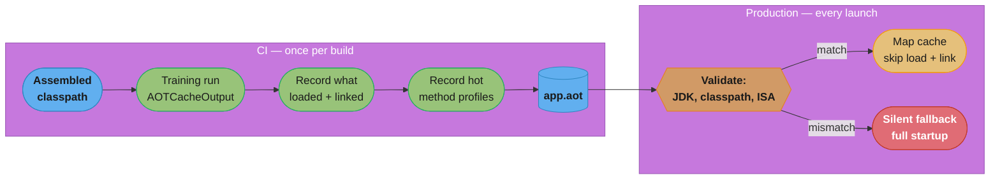

# AOT Startup & Class Data Sharing

## 1. Concept Overview

Every time a JVM starts, it does the same work it did the last time it started. It reads `.class` files off disk, parses them into internal metadata structures, verifies the bytecode's `StackMapTable` frames, resolves and links symbolic references, runs static initializers, and then begins interpreting — climbing slowly through the JIT tiers until the hot methods are finally compiled. None of that work depends on the input to this particular run. It is, in the strictest sense, homework the JVM already did and then threw away.

**Class Data Sharing (CDS) and the newer AOT cache are the mechanism for keeping it.** A *training run* exercises the application, the JVM records what it loaded and linked (and, on modern releases, which methods got hot), and that record is written to a file. Every subsequent launch maps that file in and skips straight past the work it represents. The application's semantics are untouched: it is the same bytecode, the same classloaders, the same JIT, the same reflection. Only the redundant preparation is gone.

This matters because the JVM has, until recently, offered exactly one credible answer to "our service takes eight seconds to start" — **GraalVM native image**, which achieves a ~15 ms start by abandoning the open world entirely. That is a real answer, and it is an expensive one: a closed-world build, reachability metadata for every reflective call, no runtime JIT, no agents, a different GC, and a build that takes minutes. A great many services that need startup to go from 8 s to 3 s do not need, and cannot afford, that trade.

**This module is the cheap answer.** The ladder below runs from a flag you already have on (default CDS, since JDK 12) to an AOT cache that also carries method profiles (JEP 515, JDK 25) — and every rung of it preserves full dynamic behaviour, full JIT throughput, and full debuggability. [GraalVM Native Image](../graalvm_native_image/graalvm_native_image.md) is the last rung and the only one that gives any of that up. Read this module before that one: the section previously presented native image as the only answer to slow startup, and for most services it is the wrong first move.

---

## 2. Intuition

> **One-line analogy**: The JVM is a student who re-derives every proof from the axioms at the start of each exam. AOT hands it last term's marked-up notebook — the same exam, the same answers, but the derivations are already on the page.

**Mental model**: think of startup as three separate expenses, paid in sequence, every single launch:

1. **Load** — find the class, read the bytes, parse them into the JVM's internal metadata form.
2. **Verify and link** — check the bytecode is well-formed and type-safe, then resolve symbolic references into real pointers.
3. **Interpret, then compile** — run the code in the interpreter while the JIT profiles it, and only after enough invocations replace it with compiled code.

CDS attacks expense 1 by storing the *parsed* metadata in a memory-mappable format, so the JVM maps it instead of parsing it. The AOT cache (JEP 483) attacks expenses 1 and 2 together by also storing the *linked* state. AOT method profiling (JEP 515) attacks expense 3 by shipping the training run's profiles so the JIT can start compiling hot methods immediately instead of re-discovering which ones are hot. Native image attacks all three by doing them at build time and deleting the machinery that would let them happen again.

**Why it matters**: startup cost is paid per *process*, not per *request*. A monolith that restarts twice a week does not care. A service that scales to zero, a Kubernetes Job, a CLI tool run a thousand times a day on a developer's laptop, or a serverless function billed on cold start cares enormously — and in those shapes the same eight seconds is paid over and over for work whose answer never changes.

**Key insight**: **the cache is a speed artifact, never a semantics artifact.** The JVM must produce exactly the same behaviour with the cache, without the cache, and with a cache it decides is stale. That is a deliberate design guarantee, and it has a sharp consequence: when the cache is unusable, the JVM **silently falls back** to doing the work. Your startup quietly regresses to baseline and nothing fails. Almost every production problem in this module is a variation on that one sentence.

---

## 3. Core Principles

- **A training run must be representative.** The cache contains what the training run actually touched. A training run against an empty database never loads the JDBC driver's result-set machinery, so that cost stays on every production launch.
- **The cache is bound to its JDK version and its classpath.** Change either and it is invalid. This is not a bug; the cached metadata contains resolved pointers into structures that a different JDK lays out differently.
- **Correctness must never depend on the cache.** The JVM is free to ignore it, and under the default modes it does so without failing. Code that only works when the cache loads is code with a latent production bug.
- **Fallback is silent by design, which makes verification your job.** `-Xshare:auto` "silently ignores the error and loads classes normally"; `-XX:AOTMode=auto` warns and continues. Neither takes your deploy red.
- **The cache is a build artifact, not a runtime artifact.** Produce it once, in CI, in the same stage that assembles the classpath, and ship it in the image. Generating it per-pod at startup pays the training cost on every launch to save the linking cost on the same launch — a net loss.
- **Caching classes is not caching code.** Even the AOT cache does not ship compiled native code; it ships loaded/linked classes and (JDK 25+) method profiles. The JIT still compiles, it just starts from a warm profile instead of a cold one.
- **Every rung preserves the open world.** Reflection, dynamic proxies, agents, classloaders, and `Class.forName` all keep working exactly as before. This is the entire reason to prefer this ladder over native image when it suffices.

---

## 4. Types / Architectures / Strategies

### 4.1 The ladder — cheapest first

| Rung | Mechanism | Release | Flags |
|------|-----------|---------|-------|
| 1 | **Default CDS archive** | JEP 341, **JDK 12** (default-on) | `-Xshare:auto` (default), `-Xshare:on`, `-Xshare:off`, `-Xshare:dump` |
| 2 | **AppCDS, static** | JEP 310, JDK 10 era | `-XX:SharedClassListFile=<file>` then `-XX:SharedArchiveFile=<file>` |
| 3 | **Dynamic CDS archives** | JEP 350, **JDK 13** | `-XX:ArchiveClassesAtExit=app.jsa`, then `-XX:SharedArchiveFile=app.jsa` |
| 4 | **Auto-created archives** | **JDK 19** (JDK-8261455; no JEP number) | `-XX:+AutoCreateSharedArchive -XX:SharedArchiveFile=app.jsa` |
| 5 | **AOT class loading & linking** | **JEP 483, JDK 24** (Project Leyden) | `-XX:AOTMode=record\|create\|auto\|on\|off`, `-XX:AOTConfiguration=`, `-XX:AOTCache=` |
| 6 | **AOT command-line ergonomics** | **JEP 514, JDK 25** | `-XX:AOTCacheOutput=`, `JDK_AOT_VM_OPTIONS`, `%p` PID substitution |
| 7 | **AOT method profiling** | **JEP 515, JDK 25** | *(no new flag — folded into the cache)* |
| 8 | **AOT object caching with any GC** | **JEP 516, JDK 26** | *(no new flag — removes a GC restriction)* |
| 9 | **GraalVM native image** | — | see [GraalVM Native Image](../graalvm_native_image/graalvm_native_image.md) |

Rung 1 is already on in every JDK 12+ installation: the JDK ships a prebuilt `classes.jsa` at `$JAVA_HOME/lib/server/classes.jsa`, generated at JDK-build time from a default class list, and `-Xshare:auto` maps it without being asked. Everything you do beyond that is about getting *your* classes, not just the JDK's, into an archive.

### 4.2 What each rung actually caches

| Rung | Parsed class metadata | Linked/resolved state | Heap objects | Method profiles | Compiled native code |
|------|:---:|:---:|:---:|:---:|:---:|
| Default CDS / AppCDS | ✓ (JDK classes only, or your class list) | partial | limited, GC-specific | ✗ | ✗ |
| Dynamic archive | ✓ | partial | limited | ✗ | ✗ |
| AOT cache (JEP 483) | ✓ | ✓ | ✓ | ✗ | ✗ |
| + JEP 515 (JDK 25) | ✓ | ✓ | ✓ | **✓** | ✗ |
| + JEP 516 (JDK 26) | ✓ | ✓ | ✓ **under any GC, ZGC included** | ✓ | ✗ |
| Native image | n/a — done at build time | n/a | n/a | via PGO | **✓** |

The single most useful row to internalise is the last column. **No rung short of native image caches compiled code.** Caching native code alongside the AOT cache exists only as an unnumbered OpenJDK draft (`8335368`, status Submitted, no JEP number, no target release) — it is a direction, not a feature, and should not be planned around.

The JEP 516 row is the one that changes an operational decision. Before JDK 26, heap-object caching worked by mapping archive bytes straight into the GC-managed heap in a GC-specific binary layout, which **did not work with ZGC**. JEP 516 replaces that with a GC-neutral primordial heap whose objects are allocated and linked individually through the Access API, so object caching now works under any collector. A team on ZGC for pause reasons no longer has to choose between their collector and their startup cache.

### 4.3 Which rung to pick

| Situation | Rung |
|-----------|------|
| Any JDK 12+ service | Rung 1 is already active; verify it, do not configure it |
| Pre-JDK-24 runtime, want app classes cached | Rung 3 (dynamic archive) — one training run, no class-list file |
| Pre-JDK-24, want it to be self-maintaining | Rung 4 (`+AutoCreateSharedArchive`) — regenerates itself when stale |
| **JDK 25+, the current default recommendation** | **Rung 6** — `-XX:AOTCacheOutput=` to train, `-XX:AOTCache=` to run |
| ZGC and want heap objects cached too | JDK 26 (rung 8) |
| Startup must be ~15 ms and a closed world is acceptable | Rung 9 |

---

## 5. Architecture Diagrams

### The pipeline: training run → cache → production run



The two arrows out of the validation diamond are the whole operational story. One of them is the feature; the other is a performance regression that reports nothing.

### Where the startup clock goes, and what each rung removes

```
Cold JVM start of a Spring-shaped service, ~8000 classes loaded. Illustrative shape,
not a measurement -- the point is which bar each rung deletes, not the absolute widths.

               |----------------- time to first served request ------------------|
  plain JVM    [ load ][ verify+link ][ <clinit> ][--- interpret, JIT warms up ---]
                  ^^^^   ^^^^^^^^^^^^
                  |      |
  default CDS    [~][ verify+link ][ <clinit> ][--- interpret, JIT warms up ---]
                  ^ JDK classes mapped, not parsed. Your classes untouched.

  AppCDS         [~][~~~~~~~~~~~][ <clinit> ][--- interpret, JIT warms up ---]
                     ^ your classes' metadata mapped too

  AOT cache      [~][~][ <clinit> ][--- interpret, JIT warms up ---]
  (JEP 483)            ^ loaded AND linked

  + profiles     [~][~][ <clinit> ][-- JIT compiles hot methods immediately --]
  (JEP 515)                          ^ no re-profiling from cold

  native image   [ isolate init ][ flat throughput from instruction one ]
                  ^ ~15ms, but closed world: no JIT, no agents, metadata required

  Legend:  [ ] work performed at this launch   [~] work replaced by a mapped cache
```

Each rung removes a bar and leaves the ones to its right untouched. Notice that `<clinit>` — running your static initializers — survives every rung except native image, because those initializers are *your code* and may legitimately do different things on different days. That is why a service dominated by expensive static initialization sees a smaller win from the AOT cache than one dominated by class loading, and it is the first thing to check when a cache underdelivers.

---

## 6. How It Works — Detailed Mechanics

### The current recommended workflow (JDK 25+)

JEP 483 shipped a two-step flow in JDK 24; JEP 514 collapsed it in JDK 25. Teach the JDK 25 form:

```bash
# 1. Training run. Exercise the app, then let it exit. The cache is written on shutdown.
java -XX:AOTCacheOutput=app.aot -cp app.jar com.example.App

# 2. Production. Same classpath, same JDK.
java -XX:AOTCache=app.aot -cp app.jar com.example.App
```

With `-XX:AOTCacheOutput` present the JVM ergonomically selects record-then-create in a single run, and the intermediate configuration lives in a temporary file you never see. `JDK_AOT_VM_OPTIONS` supplies extra options that should apply only while the cache is being created, and `%p` expands to the PID inside `AOTCache`, `AOTCacheOutput`, and `AOTConfiguration` values — useful when several JVMs train concurrently and would otherwise clobber one file.

The JDK 24 two-step flow is still valid and is what you will meet on a JDK 24 runtime:

```bash
java -XX:AOTMode=record -XX:AOTConfiguration=app.aotconf -cp app.jar com.example.App
java -XX:AOTMode=create -XX:AOTConfiguration=app.aotconf -XX:AOTCache=app.aot -cp app.jar
java -XX:AOTCache=app.aot -cp app.jar com.example.App
```

`-XX:AOTMode` takes `record`, `create`, `auto`, `on`, and `off`. `auto` is the one you deploy with: it uses the cache named by `-XX:AOTCache` when it is valid and **warns and continues** when it is not.

### The older CDS rungs, for pre-JDK-24 runtimes

```bash
# Rung 3 — dynamic archive. One training run, no class-list file to maintain.
java -XX:ArchiveClassesAtExit=app.jsa -cp app.jar com.example.App
java -XX:SharedArchiveFile=app.jsa   -cp app.jar com.example.App

# Rung 4 — self-maintaining. Creates the archive if missing, stale, or incompatible;
# uses it if valid. One command line for both cases.
java -XX:+AutoCreateSharedArchive -XX:SharedArchiveFile=app.jsa -cp app.jar com.example.App

# Rung 2 — static AppCDS, when you need explicit control of the class list.
java -XX:DumpLoadedClassList=app.lst -cp app.jar com.example.App
java -Xshare:dump -XX:SharedClassListFile=app.lst -XX:SharedArchiveFile=app.jsa -cp app.jar
java -XX:SharedArchiveFile=app.jsa -cp app.jar com.example.App
```

### Lambdas, `invokedynamic`, and why they need special handling

A lambda is not a class in the jar. `invokedynamic` calls `LambdaMetafactory` at the first execution of a lambda expression, which **spins a hidden class at run time** and installs it in the call site. There is nothing on disk to archive, and the classes that do get generated have names containing a per-JVM counter (`Foo$$Lambda/0x00007f...`), so they cannot simply be recorded by name.

CDS and the AOT cache handle this by archiving the *generated* classes along with enough of the call-site state to re-link them, which is why the `-Xlog:cds+lambda` tag exists as a separate channel from `-Xlog:cds`. It matters in practice because a codebase heavy in streams, method references, and functional interfaces can spend a surprising fraction of its startup in `LambdaMetafactory`:

```bash
# How many lambda classes are being spun, and whether they came from the archive:
java -Xlog:cds+lambda=debug -XX:AOTCache=app.aot -cp app.jar com.example.App 2>&1 \
  | grep -c 'Archived lambda proxy class'

# Any hidden class NOT archived shows up here as a runtime definition:
java -Xlog:class+load -XX:AOTCache=app.aot -cp app.jar com.example.App 2>&1 \
  | grep '\$\$Lambda' | grep -v 'shared objects file' | wc -l
```

The practical consequence: a lambda that only executes on a code path the training run never reached is not archived, so it is spun at run time exactly as before. This is another face of the representative-training-run rule, and it is the reason a stream-heavy service can see a larger-than-expected win from getting the training harness right.

### Agents, custom classloaders, and what stays open

The claim that the AOT cache "preserves the open world" is worth making concrete, because it is the reason to choose this ladder over native image and it is often assumed to be a hedge:

| Capability | Under the AOT cache | Under native image |
|------------|:---:|:---:|
| `Class.forName(aVariable)` | ✓ works unchanged | requires reachability metadata |
| Dynamic proxies (`java.lang.reflect.Proxy`) | ✓ | requires declared interfaces |
| A custom `ClassLoader` defining classes at run time | ✓ | ✗ closed world |
| `-javaagent:` / `Instrumentation.retransformClasses` | ✓ | ✗ |
| Attaching a debugger (JDWP) | ✓ | limited |
| JFR, heap dumps, `jcmd` | ✓ | limited/different |
| Bytecode generated at run time (ASM, Byte Buddy) | ✓ | ✗ |

Classes loaded by a **custom classloader** are the one asterisk: they are not archived by default, because the archive's identity check is tied to the classpath and a custom loader's provenance cannot be verified the same way. A framework that loads plugins through its own loader will find those plugin classes still loading from disk. That is not a failure — the rest of the cache still applies — but it caps the achievable win for plugin-architecture applications, and it is worth measuring with `-Xlog:class+load` before promising a number.

An agent is a subtler case. Agents that **retransform** classes at load time are perfectly compatible, but they invalidate the point of caching the affected classes, since the cached form is superseded by the transformed one. A service running a bytecode-weaving APM agent will therefore see a smaller win than the same service without one — which is worth knowing before you conclude that the cache "didn't work here".

### Broken → fix: the cache that stopped working and told nobody

**Broken.** A team wired the AOT cache into CI. The Dockerfile did this:

```dockerfile
# BROKEN: the cache is baked in an earlier layer than the dependencies it was trained against.
COPY app.aot /opt/app/app.aot
COPY target/dependency/ /opt/app/lib/
COPY target/app.jar /opt/app/app.jar
ENTRYPOINT ["java", "-XX:AOTCache=/opt/app/app.aot", "-cp", "/opt/app/app.jar:/opt/app/lib/*", "com.example.App"]
```

The cache was generated in a nightly job. Ten weeks later a routine dependency bump changed `jackson-databind` from 2.17.2 to 2.18.1. The classpath no longer matched what the cache was recorded against, so the cache was rejected. Startup went from 2.6 s back to 6.1 s. Nothing failed. No alert fired — the liveness probe's threshold was 30 s, so 6.1 s was still comfortably healthy. The regression was found four months later, by someone reading a startup-duration graph for an unrelated reason.

**Diagnosis.** The evidence was always available and nobody had asked for it:

```bash
$ java -Xlog:aot -XX:AOTCache=/opt/app/app.aot -cp ... com.example.App 2>&1 | head -5
[0.004s][warning][aot] Archived non-system classpath is not the same as the
                       runtime classpath; disabling AOT cache
[0.004s][info   ][aot] Unable to use AOT cache. Continuing without it.
```

**Fixed.** Generate the cache in the same CI stage that assembles the classpath, so the two cannot drift, and assert it actually loads:

```dockerfile
# FIXED: cache is produced from this exact classpath, in this build, in this stage.
COPY target/dependency/ /opt/app/lib/
COPY target/app.jar /opt/app/app.jar
RUN java -XX:AOTCacheOutput=/opt/app/app.aot \
         -cp "/opt/app/app.jar:/opt/app/lib/*" com.example.TrainingHarness
# Fail the BUILD if the cache does not load, rather than discovering it in six months.
RUN java -Xlog:aot -XX:AOTCache=/opt/app/app.aot \
         -cp "/opt/app/app.jar:/opt/app/lib/*" com.example.App --version 2>&1 \
    | grep -q 'Loaded .* classes from AOT cache' || (echo "AOT cache rejected" && exit 1)
ENTRYPOINT ["java", "-XX:AOTCache=/opt/app/app.aot", "-cp", "/opt/app/app.jar:/opt/app/lib/*", "com.example.App"]
```

The general lesson: **because the fallback is silent, the only way to know a cache is working is to assert it.** Treat "the cache loaded" as a build-time invariant, exactly as you would treat a passing test.

### What invalidates a cache

| Change | Invalidates? | Why |
|--------|:---:|-----|
| JDK version (even a patch release) | ✓ | Cached metadata contains resolved pointers into version-specific layouts |
| A jar added, removed, or version-bumped | ✓ | The classpath fingerprint no longer matches |
| Classpath **order** changed | ✓ | Resolution can pick a different class for the same name |
| Module path changed | ✓ | Same reason |
| Application code recompiled | ✓ | The classes themselves differ |
| **CPU/ISA mismatch between training and runtime host** | ✓ | Cached state can encode ISA assumptions — e.g. trained on an AVX-512 build agent, run on a node without it |
| GC choice (heap-object caching, pre-JDK-26) | ✓ | Object layout was GC-specific until JEP 516 |
| Heap size, thread count, JVM tuning flags | ✗ | These do not affect what was loaded and linked |
| Application config, environment variables | ✗ | Same |

### Observing what actually happened

```bash
-Xlog:aot                        # AOT cache decisions (JDK 24+)
-Xlog:aot,class+path=info        # plus the classpath comparison that rejected it
-Xlog:cds                        # classic CDS
-Xlog:cds+lambda=debug           # lambda/invokedynamic archiving specifically
-Xlog:class+load                 # per-class origin: "source: shared objects file" means it came from the cache
-Xshare:on                       # TESTING ONLY: turn silent fallback into a hard failure
```

`-Xshare:on` is the sharpest tool here and the most misused. It converts "quietly do the work anyway" into "refuse to start", which is exactly what you want in a CI assertion and exactly what you do not want in production, where a stale cache would then take the whole service down rather than merely making it slower.

---

## 7. Real-World Examples

- **Spring Boot ships first-class support.** Per Spring's own documentation, Spring "supports the AOT cache for **Java 25 and above**" — the cache shipped in Spring Boot 4.0, and 4.1.1 is only the docs-site version selector, not a stated minimum; CDS is supported in earlier Spring Boot versions and remains the path on Java below 25. The training run is made to terminate after context refresh rather than serving traffic:

  ```bash
  java -Djarmode=tools -jar my-app.jar extract --destination application
  cd application
  java -XX:AOTCacheOutput=app.aot -Dspring.context.exit=onRefresh -jar my-app.jar
  java -XX:AOTCache=app.aot -jar my-app.jar
  ```

  The CDS variant substitutes `-XX:ArchiveClassesAtExit=application.jsa` and then `-XX:SharedArchiveFile=application.jsa`. `-Dspring.context.exit=onRefresh` is the load-bearing piece: without it the training run starts serving and never exits, so no cache is written.

- **Published startup measurements cluster around a 40–50% reduction for Spring-shaped applications.** JEP-483-era reporting cited a Spring Boot app going from roughly 2 s to roughly 1 s; independent third-party measurements of Spring Boot 3.3+ services report figures in the same band, and Spring PetClinic around 40%. **The exact number is entirely application-dependent** — it scales with how much of your startup is class loading and linking rather than static initialization, network calls, or database migrations. Measure your own before promising anyone a number.

- **Cloud function and scale-to-zero cold starts** are where the arithmetic is most favourable, because the cost is paid on the request's critical path and is directly billed.

- **CLI tools** run hundreds of times a day on developer laptops pay startup on every invocation and never reach steady state at all — the single best fit for the cheap rungs of the ladder.

- **CI-produced caches shipped in the image** are the emerging standard shape: the cache is a build output living beside the jar, versioned with it, regenerated whenever the jar is.

---

## 8. Tradeoffs

| | Plain JVM | Default CDS | AppCDS / dynamic | AOT cache (JEP 483/514/515) | Native image |
|---|---|---|---|---|---|
| Startup improvement | baseline | small (JDK classes only) | moderate | **large (typically 40–50% on Spring-shaped apps)** | ~15 ms, order-of-magnitude |
| Peak throughput | full JIT | full JIT | full JIT | **full JIT, reached sooner** | lower — no runtime JIT |
| Build/setup time | none | none | one training run | one training run | minutes per build |
| Reflection, proxies, `Class.forName` | ✓ | ✓ | ✓ | **✓** | requires reachability metadata |
| Java agents, instrumentation | ✓ | ✓ | ✓ | **✓** | ✗ |
| Arbitrary classloaders | ✓ | ✓ | ✓ | **✓** | closed world |
| Debuggability (JDWP, JFR, heap dumps) | ✓ | ✓ | ✓ | **✓** | limited/different |
| Choice of GC | any | any | any (heap objects GC-specific pre-26) | any (**ZGC included from JDK 26, JEP 516**) | Substrate VM's own |
| Operational complexity | none | none | a training step in CI | a training step in CI + a load assertion | a build pipeline, metadata, native tests |
| Failure mode when it breaks | n/a | silent fallback | silent fallback | **silent fallback** | build failure or runtime `ClassNotFoundException` |

The column that decides most real arguments is the reflection/agents/classloaders block. **The AOT cache costs you nothing in dynamic capability.** It is the same JVM running the same bytecode with the same open world; the only difference is that some preparation is pre-computed. Native image is a different runtime with a different contract, and the startup number is the payment you receive for accepting it — not a free upgrade.

---

## 9. When to Use / When NOT to Use

**Use the AOT cache when:**
- The process starts often relative to how long it lives — scale-to-zero, Kubernetes Jobs and CronJobs, serverless, CLI tools, short-lived batch workers.
- Cold start is on a request's critical path or is directly billed.
- Startup is dominated by class loading and linking. Check this first: if `-Xlog:class+load` shows 12,000 classes loaded, the ladder will help a great deal; if startup is three database migrations and a schema validation, it will not.
- You are already on JDK 24+ (25+ for the one-command ergonomics), and CI can run the training step.

**Use native image instead when:**
- ~15 ms startup and a small resident footprint are hard requirements, not preferences.
- The closed world is genuinely acceptable — you can enumerate the reflection, you do not need agents, and you accept lower peak throughput.

**Do NOT bother when:**
- The process is long-lived and restarts rarely. An eight-second start twice a week costs nothing worth a CI stage.
- Startup is dominated by I/O — waiting on a database, a config server, or a service-discovery round trip. No amount of class caching touches that. Profile before you build.
- You cannot produce the cache in the same CI stage that assembles the classpath. A cache maintained by hand, out of band from the build, will drift and silently stop working — see §10.

**Never:**
- Never make correctness depend on the cache loading.
- Never ship `-Xshare:on` to production. It converts a slow start into a failed start.
- Never generate the cache at pod startup. The training run costs more than the linking it saves, on the very launch you are trying to speed up.

---

## 10. Common Pitfalls

### War Story 1: The cache that drifted and reported nothing

Covered in full in §6. Ten weeks after a `jackson-databind` bump, a service's startup had regressed from 2.6 s to 6.1 s and stayed there for four months. The cache was produced in a nightly job and the jar was built per-commit, so the two were always going to diverge; the only question was when. **The silent fallback is the defining hazard of this entire module — if you take one operational habit from it, take the build-time assertion.**

### War Story 2: The training run against an empty database

A payments service trained its cache in CI against a container with a freshly-migrated, empty schema. The training run started the Spring context, answered a health check, and exited. In production, the first real request loaded the Hibernate result-set mapping machinery, the connection pool's validation path, and roughly 400 classes the training run had never touched — because with zero rows, no result set was ever mapped. Time-to-first-request improved by only 11% against an expected ~45%. Fix: the training harness was changed to execute one representative read and one representative write against seeded data. The improvement went to 43%. **The cache contains what the training run touched, and a health check touches almost nothing.**

### War Story 3: The build agent with a different CPU

A team's CI ran on newer instances than their production node pool. The cache was produced on a host with AVX-512 available and deployed onto nodes without it. The cache was rejected on every production launch and accepted on every staging launch — staging happened to run on the newer pool. The result was a startup improvement that was real in staging, absent in production, and reproducible nowhere in between. Fix: produce the cache on an image matching the production instance family, and assert loading in a smoke test that runs on the production node pool.

### War Story 4: The cache regenerated on every pod start

An `initContainer` was added to "keep the cache fresh", running the training step before the application container. It worked, in the sense that the cache was never stale. It also added a full training run — about 7 s — to every single pod start, to save about 3 s of linking on the same start. Net effect: startup got 4 s *worse* and the team had built machinery to make it so. **The cache is a build artifact. Produce it once, in the build, and ship it.**

### War Story 5: A feature that only worked with the cache

A service had a static initializer whose ordering happened to differ between the cached and uncached paths, and a lazily-initialized singleton that was only correct under the ordering the cache produced. It ran fine for months. The first time the cache was rejected — a routine JDK patch upgrade — the service started successfully and then produced wrong results, because it had silently taken the uncached path for the first time. Fix: the initialization was made order-independent. **The JVM guarantees identical behaviour with and without the cache; if your application does not, the cache has become a correctness dependency and the next invalidation is an incident.**

### War Story 6: Measuring the wrong thing

A team reported "no improvement" from the AOT cache. Their benchmark measured `time java -version`-style process startup — which the JDK's default CDS archive already optimises — rather than time-to-first-served-request, which is where their 8,000 application classes were loaded. The cache was working perfectly and their measurement could not see it. **Measure time to first successful request, from process launch, not JVM boot in isolation.**

---

## 11. Technologies & Tools

| Tool / flag | Purpose |
|-------------|---------|
| `-XX:AOTCacheOutput=<file>` | JDK 25+: train and write the cache in one run (JEP 514) |
| `-XX:AOTCache=<file>` | Use the cache in production |
| `-XX:AOTMode=record\|create\|auto\|on\|off` | Explicit mode control (JEP 483); `auto` is the production choice |
| `-XX:AOTConfiguration=<file>` | The intermediate recording, for the JDK 24 two-step flow |
| `JDK_AOT_VM_OPTIONS` | Options applied only while the cache is created |
| `-XX:ArchiveClassesAtExit=<file>` | Dynamic CDS archive (JEP 350, JDK 13) — the pre-24 path |
| `-XX:+AutoCreateSharedArchive` | Self-maintaining archive (JDK 19); regenerates when stale |
| `-XX:SharedArchiveFile=<file>` | Point at a custom CDS archive |
| `-XX:SharedClassListFile=<file>` / `-XX:DumpLoadedClassList=<file>` | Static AppCDS class-list workflow |
| `-Xshare:auto\|on\|off\|dump` | CDS mode. `on` is a CI assertion, never a production setting |
| `-Xlog:aot` , `-Xlog:aot,class+path=info` | Why the AOT cache was accepted or rejected |
| `-Xlog:cds` , `-Xlog:cds+lambda=debug` | The same for classic CDS |
| `-Xlog:class+load` | Per-class origin — `source: shared objects file` means it came from the cache |
| `jcmd <pid> VM.flags -all` | Confirm which cache flags a running JVM actually has |
| Spring Boot `-Djarmode=tools ... extract` | Explode a fat jar so its classes are cacheable |
| `-Dspring.context.exit=onRefresh` | Make a Spring training run terminate after context refresh |

---

## 12. Interview Questions with Answers

**Q: What happens when a JVM is given an AOT cache that no longer matches its classpath?**
**Short:** It silently falls back to normal class loading — startup regresses to baseline and nothing fails or alerts.

Under the default modes it silently ignores the cache and loads classes normally. `-Xshare:auto` "silently ignores the error"; `-XX:AOTMode=auto` emits a warning and continues. This is deliberate: the JVM guarantees identical behaviour with and without the cache, so an unusable cache must never be fatal. The operational consequence is severe, though, because a broken cache produces no failure, no alert, and no exception — only a startup that quietly returns to its pre-cache duration, which usually still passes every health check. The only defences are `-Xlog:aot` to see the rejection and a build-time assertion that fails the build if the cache does not load.

**Q: Why does an AOT cache built in a nightly job stop working, and what is the fix?**
**Short:** Any classpath change invalidates it, so a cache built on a different schedule than the jar will inevitably drift out of sync.

The cache records a fingerprint of the exact classpath it was trained against. Adding, removing, reordering, or version-bumping any jar invalidates it, as does recompiling the application or upgrading the JDK. A cache produced nightly against a jar produced per-commit is guaranteed to diverge the first time a dependency moves — and because rejection is silent, nobody notices. The fix is structural rather than procedural: generate the cache in the **same CI stage that assembles the classpath**, so they cannot drift, and add a build step that runs the app with `-Xlog:aot` and fails if the cache was not loaded.

**Q: Does the AOT cache store compiled native code?**
**Short:** No — it stores loaded and linked classes and, since JDK 25, method profiles, but the JIT still compiles at runtime.

It does not. JEP 483 caches the results of class loading and linking; JEP 515 (JDK 25) adds the training run's method-execution profiles so the JIT can begin compiling hot methods immediately rather than re-profiling from cold. The JIT still runs and still produces the native code, which is precisely why peak throughput is unaffected — you keep adaptive recompilation and all the profile-driven optimisation a long-running JVM depends on. Caching native code alongside the cache exists only as an unnumbered OpenJDK draft with no JEP number and no target release, so it should not be planned around. GraalVM native image is the only option today that ships compiled code, and it pays for that by giving up the runtime JIT entirely.

**Q: Your service's startup did not improve after enabling the AOT cache. What do you check?**
**Short:** Whether the cache actually loaded, whether the training run was representative, and whether startup is even class-loading-bound.

Three things, in order. First, confirm the cache is being used at all — `-Xlog:aot` will say if it was rejected, and `-Xlog:class+load` shows `source: shared objects file` for classes that came from it. Second, check whether the training run was representative: a training run that only answered a health check never touched the JDBC, ORM, or serialization paths that dominate the first real request, so those costs remain. Third, check whether startup is class-loading-bound at all — if the eight seconds are three database migrations and a config-server round trip, no class cache will touch them. Measure time to first **served request**, not JVM boot in isolation, or you will be measuring a phase the default CDS archive already optimised.

**Q: Why should you never deploy with `-Xshare:on`?**
**Short:** It turns a stale cache from a silent slowdown into a hard startup failure, taking the service down instead of merely slowing it.

`-Xshare:on` requires the archive: if it is missing, stale, or incompatible, the JVM refuses to start. In production that converts the cache from a performance optimisation into a hard dependency, so a routine JDK patch upgrade or a dependency bump takes the whole service down rather than making it three seconds slower. It is genuinely valuable in CI, where turning silent fallback into a loud failure is exactly what you want from an assertion. The production setting is `-Xshare:auto` (the default) or `-XX:AOTMode=auto`, paired with a build-time check that the cache loads.

**Q: What is the difference between the training run and the production run, and what makes a training run "representative"?**
**Short:** The cache contains only what the training run actually loaded, so it must exercise the same code paths a real first request does.

The training run executes the application while the JVM records which classes were loaded and linked and which methods got hot; the production run maps that record instead of recomputing it. "Representative" means the training run touches the paths a real request touches. The classic failure is training against an empty database: with no rows, no result set is ever mapped, so several hundred ORM and driver classes are never loaded and their cost stays on every production launch. A training harness should execute at least one representative read and one representative write against seeded data. For a Spring application, `-Dspring.context.exit=onRefresh` makes the run terminate after context refresh so a cache is actually written.

**Q: A cache works in staging and is rejected in production, with identical jars and an identical JDK. What is left?**
**Short:** The hardware — a CPU/ISA mismatch between the host that produced the cache and the host that runs it invalidates it.

The host. Cached state can encode instruction-set assumptions, so a cache produced on a build agent with AVX-512 available and deployed onto nodes without it is rejected — while staging, running on the same newer instance family as the build agents, accepts it happily. The symptom is maddening precisely because it is invisible in every environment that could reproduce it. Produce the cache on an image matching the production instance family, and run the load assertion as a smoke test on the production node pool rather than on the build agent.

**Q: Is the AOT cache an alternative to GraalVM native image, or a step toward it?**
**Short:** An alternative with a completely different contract — it keeps the open world, native image trades it away for a 15 ms start.

An alternative, and usually the one to try first. The AOT cache preserves everything: reflection, dynamic proxies, arbitrary classloaders, Java agents, JFR, JDWP debugging, your choice of GC, and full JIT peak throughput. It costs one training step in CI. Native image gives a startup roughly two orders of magnitude better, but requires a closed world with reachability metadata for every reflective call, forbids agents, replaces the runtime with Substrate VM, and typically lowers peak throughput. The right question is not "which is faster" but "does this service need 15 ms, or does it need 8 s to become 3 s" — and for the large majority of services it is the latter, at a fraction of the cost.

**Q: Which JDK release made a CDS archive available by default, and what does it actually contain?**
**Short:** JEP 341 in JDK 12 — a prebuilt archive of JDK platform classes shipped inside the JDK image itself.

JEP 341 in JDK 12 made default CDS archives standard. The JDK ships a prebuilt `classes.jsa` at `$JAVA_HOME/lib/server/classes.jsa`, generated at JDK-build time from a default class list, and `-Xshare:auto` — already the default — maps it without any configuration. Crucially it contains **JDK platform classes only**, not yours, which is why a service loading 8,000 application classes sees very little benefit from it alone. Everything above rung 1 of the ladder is about getting your own classes into an archive too, whether via AppCDS, a dynamic archive, or the AOT cache.

**Q: What changed in JDK 26 with JEP 516, and who does it affect?**
**Short:** AOT heap-object caching now works under any GC including ZGC, instead of being restricted to collectors accepting a specific archive layout.

Before JEP 516, heap-object caching worked by mapping archive bytes directly into the GC-managed heap in a GC-specific binary layout, which meant it did not work with ZGC. JEP 516 replaces that with a GC-neutral "primordial heap" in which cached objects are allocated and linked one at a time through the Access API, exactly like ordinary objects — decoupling the archive format from any particular collector. The teams it affects are those who chose ZGC for pause-time reasons and previously had to give up part of the startup cache to keep it. From JDK 26 that trade no longer exists.

**Q: Should the AOT cache be generated at pod startup to keep it fresh?**
**Short:** No — the training run costs more than the linking it saves, on the very launch you were trying to speed up.

No, and doing so makes startup worse. Adding an `initContainer` that trains the cache before the application container runs means every pod start pays a full training run (often several seconds) to save a smaller linking cost on that same start — a net regression, achieved through extra machinery. The cache is a **build** artifact: produce it once, in the CI stage that assembles the classpath, ship it in the image next to the jar, and regenerate it whenever the jar is rebuilt. Freshness is then guaranteed by construction rather than by a runtime step.

**Q: What does JEP 515 add on top of JEP 483, and what does it cost?**
**Short:** Method-execution profiles from the training run, so the JIT compiles hot methods immediately instead of re-profiling from cold — for under 10% more cache size.

JEP 515 (JDK 25) extends the AOT cache to carry the training run's method-execution profiles alongside the loaded and linked classes. Without it, the JIT starts every process cold: it interprets, profiles, and only then compiles, so the application climbs through the tiers on every launch. With profiles cached, the compiler knows on instruction one which methods are hot and can begin compiling them straight away, which shortens the warm-up ramp rather than just the load phase. The JEP's own figure is that profile data adds **less than 10% to the AOT cache size**, which makes it close to free — and it is why the JDK 25 cache helps time-to-*steady-state* and not merely time-to-first-request.

**Q: Lambdas are generated at run time, so how can they be cached at all?**
**Short:** CDS archives the hidden classes `LambdaMetafactory` spins plus enough call-site state to re-link them, tracked under its own log tag.

A lambda has no class in the jar: `invokedynamic` calls `LambdaMetafactory` on first execution, which spins a hidden class at run time with a name containing a per-JVM counter. CDS and the AOT cache archive those *generated* classes along with enough call-site state to re-link them, which is why `-Xlog:cds+lambda` exists as a channel separate from `-Xlog:cds`. The gotcha is the familiar one in a new costume: a lambda on a code path the training run never executed was never spun, so it is not archived and is generated at run time exactly as before. For a stream-heavy or method-reference-heavy codebase this can be a large share of startup, which is why getting the training harness right often pays off more there than the class count alone would suggest.

**Q: Which classes does the AOT cache NOT help with?**
**Short:** Classes loaded by a custom classloader, and classes a bytecode-weaving agent retransforms at load time.

Two categories. Classes loaded through a **custom `ClassLoader`** are not archived by default, because the archive's identity check is anchored to the classpath and a custom loader's provenance cannot be verified the same way — so a plugin architecture will find its plugin classes still loading from disk while the rest of the cache still applies. And classes a **bytecode-weaving agent** retransforms at load time gain little, because the cached form is superseded by the transformed one; a service running a weaving APM agent therefore sees a smaller win than the same service without one. Neither is a failure, and neither breaks anything — but both cap the achievable improvement, and both are worth measuring with `-Xlog:class+load` before you promise anyone a percentage.

**Q: How do you prove a cache is actually being used, rather than assuming it?**
**Short:** Run with `-Xlog:aot` and `-Xlog:class+load` and look for classes whose source is the shared objects file.

Ask the JVM directly. `-Xlog:aot` prints why the cache was accepted or rejected, and `-Xlog:aot,class+path=info` adds the classpath comparison that produced the verdict. `-Xlog:class+load` shows each class's origin, where `source: shared objects file` means it came from the cache rather than from disk. For classic CDS the equivalent tags are `-Xlog:cds` and `-Xlog:cds+lambda=debug`. Because rejection is silent by design, this check belongs in the build as a gate rather than in a runbook as a suggestion: run the app once with the cache, grep the log for a successful load, and fail the build otherwise.

**Q: Does using an AOT cache change how your application behaves?**
**Short:** No — it is a speed artifact, and the JVM guarantees identical semantics with the cache, without it, and with a stale one.

It must not, and the JVM guarantees it does not: the same bytecode runs under the same classloaders with the same reflection and the same JIT, and only the preparation is pre-computed. That guarantee is exactly what makes silent fallback safe. The hazard lives on your side of the line: an application with order-dependent static initialization can accidentally behave differently on the cached and uncached paths, and since the cached path is the one it runs every day, the first invalidation — a JDK patch upgrade, say — becomes the first time the other path has ever executed in production. If your application only works with the cache, the cache has become a correctness dependency and the next invalidation is an incident.

**Q: What is `-XX:+AutoCreateSharedArchive` for, and when would you still use it over the AOT cache?**
**Short:** It makes a CDS archive self-maintaining from one command line, which is the right pre-JDK-24 option and useful for developer tooling.

Introduced in JDK 19 (JDK-8261455 — it has no JEP number), it collapses creation and use into a single command line: given `-XX:+AutoCreateSharedArchive -XX:SharedArchiveFile=app.jsa`, the JVM creates the archive if it is missing, stale, or incompatible, and uses it if valid. That self-healing property is what makes it attractive where no CI stage exists to produce an artifact — a developer CLI tool, or a service on a JDK below 24 where the AOT cache is unavailable. On JDK 25+ with a real build pipeline the AOT cache is strictly better, because it also caches linked state and method profiles and is produced deterministically at build time rather than opportunistically at run time.

**Q: Your startup is eight seconds and you have profiled it. What tells you the AOT cache will not help?**
**Short:** If the time is in I/O, migrations, or expensive static initializers rather than class loading, no class cache touches it.

Look at where the eight seconds actually go. If `-Xlog:class+load` shows twelve thousand classes loaded, class loading and linking dominate and the ladder will help substantially. If instead the time is three database migrations, a config-server round trip, a service-discovery registration, or a handful of very expensive static initializers, the cache will barely register — `<clinit>` runs on every launch regardless of rung, because static initializers are your code and may legitimately do different things each time. This is the single most common reason a team reports "we tried it and it did nothing", and it is answerable in ten minutes with a class-load log before you build any CI machinery at all.

---

## 13. Best Practices

1. **Produce the cache in the CI stage that assembles the classpath.** Not nightly, not on a schedule, not by hand — in the same stage, from the same inputs, so drift is impossible by construction.
2. **Assert the cache loads, and fail the build if it does not.** Run the app once with `-Xlog:aot` and grep for a successful load. Silent fallback means this is the only thing standing between you and a four-month invisible regression.
3. **Make the training run representative.** At minimum one real read and one real write against seeded data. A health check is not a training run.
4. **Train on a host matching production's instance family.** An ISA mismatch rejects the cache in production while staging accepts it.
5. **Ship the cache in the image, in the same layer as the jar it was trained against.** Never in an earlier layer than its dependencies.
6. **Deploy with `-XX:AOTMode=auto` (or the plain `-XX:AOTCache=`), never `-Xshare:on`.** Reserve `-Xshare:on` for CI assertions.
7. **Regenerate on every dependency change.** Which is automatic if you followed rule 1.
8. **Measure time to first served request**, from process launch — not `java -version` startup, which the default archive already optimises.
9. **Check that startup is class-loading-bound before building any of this.** One `-Xlog:class+load` run answers it.
10. **Never let correctness depend on the cache.** If a feature only works when it loads, fix the application, not the cache.
11. **Cross-link the decision, don't skip a rung.** Evaluate the AOT cache before [GraalVM Native Image](../graalvm_native_image/graalvm_native_image.md); native image is the right answer far less often than its reputation suggests.

A CI recipe encoding rules 1, 2, and 5:

```bash
set -euo pipefail
CP="/opt/app/app.jar:/opt/app/lib/*"

# 1. Train, from the classpath this stage just assembled.
java -XX:AOTCacheOutput=/opt/app/app.aot -cp "$CP" com.example.TrainingHarness

# 2. Assert. A rejected cache fails the BUILD, not a graph six months from now.
java -Xlog:aot -XX:AOTCache=/opt/app/app.aot -cp "$CP" com.example.App --selftest 2>&1 \
  | tee /tmp/aot.log
grep -q 'shared objects file\|Loaded .* from AOT cache' /tmp/aot.log \
  || { echo "FATAL: AOT cache was rejected"; grep -i 'aot' /tmp/aot.log; exit 1; }
```

---

## 14. Case Study

### Cutting a Scale-to-Zero Service's Cold Start from 8.4 s to 3.1 s

**Scenario.** `catalog-sync` is a JDK 25, Spring-shaped internal service running as a Kubernetes Job triggered by an upstream event — roughly 400 invocations a day, each processing a batch and exiting. Because it never stays warm, every invocation pays a full cold start. At 8.4 s of startup against 6 s of actual work, **58% of the compute bill was the JVM getting ready to work.** A previous team had scoped a GraalVM native image migration at six weeks and shelved it: the service uses a reflection-heavy internal serialization library, and enumerating the reachability metadata was the bulk of that estimate.

**Step 1 — confirm the cost is where we think it is.** Before building anything:

```
$ java -Xlog:class+load:file=/tmp/cl.log -jar catalog-sync.jar --selftest
$ wc -l /tmp/cl.log
11847 /tmp/cl.log
```

11,847 classes loaded. This is a class-loading-bound startup, which is what the ladder addresses. Had this shown 900 classes and a six-second wait on a config server, the correct answer would have been "do nothing here" and the project would have stopped at this step.

**Step 2 — a baseline that measures the right thing.** Time-to-first-batch-processed, not JVM boot, averaged over 20 cold runs:

```
plain JVM, default CDS only (JDK 25):   8.41 s  (sigma 0.22)
```

**Step 3 — first attempt, and the mistake worth recording.** The training harness was the existing `--selftest` flag, which starts the Spring context, verifies bean wiring, and exits.

```
AOT cache, --selftest training:         7.02 s   (-17%)
```

Disappointing against the 40–50% the published measurements suggested. `-Xlog:class+load` on a *production* run showed roughly 3,100 classes still loading from disk — the entire JDBC, Hibernate mapping, and serialization stack, because `--selftest` never read or wrote a row.

**Step 4 — a representative training run.** A dedicated harness was written: start the context, process one seeded batch end-to-end against a Testcontainers PostgreSQL instance, exit.

```
AOT cache, representative training:     3.94 s   (-53%)
```

Classes loading from disk on a production run fell from ~3,100 to ~240.

**Step 5 — the ISA trap, caught in staging.** The first deploy showed 8.3 s in production against 3.9 s in CI. `-Xlog:aot` on a production pod:

```
[0.006s][warning][aot] Unable to use AOT cache: incompatible CPU features
```

CI ran on a newer instance family than the production node pool. The build image was pinned to match production, and the assertion from §13 was added as a smoke test running **on the production node pool**, not on the build agent — which is the only place that particular failure is visible.

**Step 6 — final numbers, 20 cold runs each, production node pool.**

| | Startup | Total invocation | Classes from disk | Build time added |
|---|---|---|---|---|
| Baseline (default CDS) | 8.41 s | 14.4 s | 11,847 | — |
| AppCDS (dynamic archive) | 5.62 s | 11.6 s | ~5,900 | +40 s |
| **AOT cache, representative training** | **3.14 s** | **9.2 s** | **~240** | **+95 s** |
| *(GraalVM native image, estimate)* | *~0.02 s* | *~6.1 s* | *n/a* | *+6 weeks of engineering* |

**Outcome.** Cold start fell 63%, total invocation time 36%, and the compute bill for this job fell by roughly a third. The work took two days: one to write a representative training harness, one to wire the CI stage and the assertion. The native-image migration remains shelved, and the arithmetic now clearly justifies leaving it there — it would buy a further 3.1 s per invocation for six weeks of work plus a permanent reachability-metadata maintenance burden on a reflection-heavy codebase.

**What the case study is really about.** Two of the three interesting numbers came from mistakes rather than from the feature: the 17% first attempt (unrepresentative training) and the 8.3 s regression (ISA mismatch). Both were **silent** — neither produced an error, and the second was invisible in every environment that could reproduce it. The feature itself was four lines of CI. The engineering was entirely in noticing that it was not working.

---

## Related / See Also

- [GraalVM Native Image](../graalvm_native_image/graalvm_native_image.md) — the closed-world rung at the top of the ladder; read this module first
- [JVM Internals](../jvm_internals/jvm_internals.md) — class loading, verification, linking, and the JIT tiers this module short-circuits
- [The JVM in Containers](../performance_and_tuning/jvm_in_containers.md) — why startup CPU demand and a tight CFS quota interact badly, and why an AOT cache is worth more under a limit than without one
- [Performance & Tuning](../performance_and_tuning/performance_and_tuning.md) — tiered compilation and JIT warm-up, which JEP 515's profiles shorten
- [JPMS](../java_platform_module_system/java_platform_module_system.md) — `jlink` custom runtime images, an orthogonal way to cut image size and pull time
- [Bytecode & Class File](../bytecode_and_classfile/bytecode_and_classfile.md) — what verification and linking actually do to the bytes being cached
- [Java 22-26 Features](../java22_to_26_features/java22_to_26_features.md) — where JEP 483/514/515/516 sit in the wider release timeline
