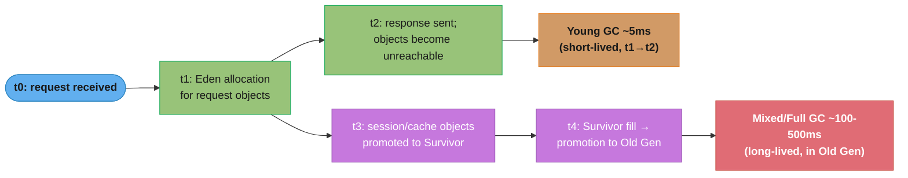

# JVM Tuning and GC for Services

## 1. Concept Overview

JVM GC tuning is the practice of configuring the HotSpot garbage collector so that memory
reclamation pauses stay within service SLO bounds and heap footprint fits within container
or machine memory. For most services the default G1GC settings are adequate; tuning begins
when GC pauses exceed 200ms or throughput drops below target.

---

## 2. Intuition

Think of the heap as a workspace shared by all requests. Allocation is fast (pointer-bump
on Eden), but eventually the workspace fills and work stops for cleanup (GC pause). The
tuning goal is: **keep the workspace large enough that cleanup is rare, and keep objects
short-lived enough that cleanup is fast.** GC problems almost always trace to either an
over-full heap or objects that live far longer than intended.

---

## 3. Core Principles

- **Generational hypothesis:** most objects die young (within a few hundred milliseconds).
  GC algorithms exploit this by collecting young generations (Eden + Survivor) cheaply and
  frequently, promoting survivors to Old Gen rarely.
- **Stop-the-world pauses:** most GC work requires all application threads to stop ("STW").
  Concurrent collectors (G1, ZGC, Shenandoah) minimize STW by doing most work concurrently,
  but cannot eliminate it.
- **Heap sizing tradeoff:** larger heaps hold more live objects and reduce GC frequency,
  but make Full GC pauses proportionally longer. Container memory limits are hard — exceeding
  them causes OOM-kill, not graceful degradation.
- **Allocation rate matters more than heap size:** a service allocating 1 GB/s will GC far
  more frequently than one allocating 100 MB/s, regardless of heap size.

---

## 4. GC Algorithms

### G1GC (Garbage First, Java 9+ default)

- Heap divided into equal-size regions (ergonomically 1–32 MB each; settable up to 512 MB),
  dynamically assigned to Eden,
  Survivor, or Old Gen.
- Collects the regions with the most garbage first (hence "Garbage First").
- Target pause: `-XX:MaxGCPauseMillis=200` (default) — G1 attempts to stay under this.
- Mixed collections periodically reclaim both Young and Old Gen concurrently.
- Best for: heaps 4–32 GB with pause targets of 100–200ms.

### ZGC (generational; `-XX:+UseZGC`)

- Concurrent compaction — GC runs while application threads execute.
- STW pauses < 1ms regardless of heap size (tested to TB heaps).
- Generational by default: young objects are collected separately, so the barrier and
  marking cost falls on a much smaller live set than the whole heap.
- Throughput cost vs G1 is workload-dependent — barrier overhead is real, but the
  generational collector recovers most of it on allocation-heavy services.
- Best for: services requiring sub-1ms pause SLOs, large heaps.

### Shenandoah (Red Hat, non-Oracle JDKs)

- Similar concurrent approach to ZGC; production-ready in OpenJDK 15+, absent from Oracle JDK builds.
- Sub-10ms pauses; slightly different throughput profile than ZGC.
- Best for: latency-sensitive services on non-Oracle JDKs.

### SerialGC / ParallelGC

- SerialGC: single-thread stop-the-world. For CLIs and small heaps. Ergonomics selects it
  automatically on a machine (or container) with fewer than 2 CPUs or under ~1792 MB of
  memory — a common surprise in small Kubernetes pods where you expected G1. This is a
  Java 25 baseline behavior; **JEP 523 (Java 27) makes G1 the default in ALL environments**,
  removing the server-class-machine heuristic entirely.
- ParallelGC: multi-thread stop-the-world. Highest throughput; unsuitable for latency SLOs.
- Use in services: never (unless batch job with no latency requirement).

### Selection matrix

| Heap size | Pause target | Throughput sensitivity | Container size | Choose |
|---|---|---|---|---|
| < 1.5 GB or < 2 CPUs | n/a (batch/CLI) | n/a | Tiny pod, no SLO | SerialGC (or verify it wasn't picked by accident — see gotcha below) |
| 1.5–4 GB | 100–200 ms acceptable | High (throughput-first) | Small-to-medium pod | ParallelGC only if truly latency-insensitive; otherwise G1GC |
| 4–32 GB | 100–200 ms | Balanced | Standard service pod/VM | **G1GC (default)** — the right choice for most services with no measured problem |
| 8 GB+ | < 10 ms | Balanced, non-Oracle JDK | Latency-sensitive | Shenandoah |
| Any, especially 32 GB+ | < 1 ms | Workload-dependent, often net-positive (fewer timeouts) | Latency-critical, large heap, headroom available | ZGC (generational) |

**Container gotcha (Java 25 baseline):** the SerialGC heuristic above reads the *effective*
CPU/memory ergonomics — a pod correctly sized at "fewer than 2 CPUs, under ~1792 MB" for a
batch sidecar will silently get SerialGC even though nobody asked for it, and a request-only
pod misread as small (see `ActiveProcessorCount` in §6) can trigger the same heuristic
unintentionally on a service that needed G1. Verify with `-Xlog:gc` at startup — the first
log line names the collector — rather than assuming the default matches what you configured.
On Java 27 (JEP 523) this entire class of surprise disappears: G1 is the default everywhere,
container or not.

---

## 5. Architecture Diagrams

### G1GC heap layout

```
Heap (e.g., -Xmx8g):
  +--------+--------+--------+--------+--------+--------+...
  |  Eden  |  Eden  |  Surv  | OldGen | OldGen | Humong |...
  +--------+--------+--------+--------+--------+--------+...
  <- Young Gen (minor GC, frequent) ->  <- Old Gen (major/mixed GC) ->

  Region size = heap / 2048 (e.g., 8 GB / 2048 = 4 MB per region)
  Humongous regions: objects > 50% of region size are allocated directly in Old Gen
```

### GC pause sources in a request-processing service



Tuning goal: prevent t3→t4 by ensuring object lifetime < 2 survivor copies.

---

## 6. Detailed Mechanics

### Heap sizing

```bash
# Production starting point for a 16 GB container:
-Xms4g -Xmx12g  # leave 4 GB for OS, metaspace, direct buffers, native threads

# Container-aware sizing (Java 11+):
-XX:MaxRAMPercentage=75.0  # use 75% of container memory for heap
# Avoid -XX:+UseLargePages in containers without huge page support; can cause allocation failures
```

### Container and cgroup heap sizing — why a heap that "looks fine" still gets OOMKilled

`-XX:+UseContainerSupport` has been on by default since JDK 10 (backported to 8u191): the
JVM reads the cgroup memory limit and CPU quota instead of the host's, so a percentage-based
heap flag scales with the *container*, not the node's 64 GB. `-XX:MaxRAMPercentage` defaults
to 25.0 and `-XX:InitialRAMPercentage` to 1.5625 — both are silently ignored the moment an
explicit `-Xmx` / `-Xms` is also passed, so pick one style per service, not both:

```bash
-XX:MaxRAMPercentage=75.0       # override the 25.0 default explicitly
-XX:InitialRAMPercentage=50.0   # override the negligible 1.5625 default for predictable startup
```

**The crucial mechanic: the container limit covers the whole process RSS, not just the
heap.** Metaspace, JIT code cache, thread stacks (each platform thread's ~1 MB is native and
lives outside `-Xmx`), GC bookkeeping structures, and direct/mapped buffers all count against
the same cgroup limit — so `-Xmx` (or `MaxRAMPercentage`) equal to the container limit is a
guaranteed OOMKill the moment any of those grow. Worked arithmetic for a realistic 4 GiB
(4096 MiB) pod running `-XX:MaxRAMPercentage=75.0` with no explicit `-Xmx`:

```
Heap ceiling:              4096 MiB x 0.75                        =  3072 MiB
Remaining budget for everything else                              =  1024 MiB

  Metaspace        (-XX:MaxMetaspaceSize=256m)                    ~   200 MiB
  Code cache        (default ReservedCodeCacheSize=240m,          ~   240 MiB
                      tiered compilation, on by default)
  Thread stacks     (200 platform threads x ~1 MiB, native,       ~   200 MiB
                      outside -Xmx)
  Direct/mapped buffers (Netty/NIO pools)                         ~   256 MiB
  GC bookkeeping     (card tables, remembered sets)                ~   100 MiB
                                                                    ---------
  Total non-heap RSS accounted for                                ~   996 MiB   <- already at the ceiling

  before counting glibc malloc-arena overhead, JNI libraries, or a burst in any one bucket.
```

At 75% the budget is already tight for a thread-heavy service — the common "75% of container
memory" rule of thumb is a starting point to verify with real numbers, not a default to trust
blind. A service running many platform threads or large direct buffers needs a lower
`MaxRAMPercentage`, or an explicit cap on the buckets that are growing (`-Xss256k`,
`-XX:MaxDirectMemorySize=256m`), to keep real headroom.

**Finding where the non-heap RSS actually went** — Native Memory Tracking, low enough
overhead (roughly 5–10%) to run in production:

```bash
# Enable at JVM startup:
-XX:NativeMemoryTracking=summary

# Then, live, at any point:
jcmd <pid> VM.native_memory summary
# Breaks RSS down by the same buckets as the arithmetic above — Java Heap, Class (Metaspace),
# Thread, Code, GC, Compiler, Internal, Symbol — measured, not estimated.
```

**Diagnostic distinction that trips people up.** A container OOMKill (exit code 137, `SIGKILL`
sent by the kernel's OOM killer, no Java stack trace, no heap dump, `OOMKilled: true` in
`kubectl describe pod`) is a completely different event from a Java `OutOfMemoryError` (the
JVM's own allocator refusing a request, with a full stack trace and optionally a heap dump via
`-XX:+HeapDumpOnOutOfMemoryError`). Diagnosing an OOMKill as if it were a Java OOME sends the
investigation into the wrong 75% of the container's memory — the fix for an OOMKill with a
heap that looks healthy is almost always hiding in the non-heap 25%, found with NMT above, not
in heap sizing.

**`ActiveProcessorCount` and the CPU quota-vs-set trap.** The JVM sizes its default GC thread
count, `ForkJoinPool.commonPool()` parallelism, and every library that defaults to
`Runtime.availableProcessors()` from `ActiveProcessorCount`, read *once* at startup — it is
never re-read if the container's allocation changes later. `UseContainerSupport` derives it
correctly from a Kubernetes CPU **limit** (a cgroup quota: `cpu.cfs_quota_us` /
`cpu.cfs_period_us` on cgroup v1, `cpu.max` on cgroup v2). A **request-only** pod with no
limit has no quota to read, so the JVM falls back to the node's full core count — a pod
requesting 2 cores on a 64-core node then sizes G1 with dozens of GC threads and a
common-pool parallelism to match cores it can never actually run concurrently. That shows up
as CPU throttling (`container_cpu_cfs_throttled_seconds_total` climbing), not as an OOM, and
it is easy to misdiagnose as "GC is slow" when the real cause is thread count sized off the
wrong number. Fix: always set a CPU **limit** in the pod spec, or override explicitly with
`-XX:ActiveProcessorCount=2` when the deployment intentionally runs request-only.

### G1GC tuning

```bash
# Default is usually fine; tune only when profiling shows a problem:
-XX:+UseG1GC  # default since Java 9
-XX:MaxGCPauseMillis=100  # tighter than default 200ms; G1 will reduce region count
-XX:G1HeapRegionSize=8m   # override auto-selection; 8 MB for heaps > 16 GB
-XX:G1NewSizePercent=20   # minimum young gen (default 5% — may be too small)
-XX:G1MaxNewSizePercent=40  # cap young gen (default 60%)
-XX:InitiatingHeapOccupancyPercent=45  # start concurrent marking when heap is 45% full
                                       # (initial value 45%; G1UseAdaptiveIHOP is on by
                                        # default, so G1 tunes the real trigger from
                                        # observed marking duration and allocation rate.
                                        # Set G1UseAdaptiveIHOP=false to pin this value.
                                        # JDK 27+ name: -XX:G1IHOP.)
```

### ZGC tuning

```bash
-XX:+UseZGC        # generational ZGC; no extra flag needed
-Xms8g -Xmx32g     # ZGC needs larger heap headroom than G1 (uncommitted pages are fine)
-XX:SoftMaxHeapSize=28g  # ZGC elastic reserve; will uncommit pages below this
# No -XX:MaxGCPauseMillis needed — ZGC is designed to be < 1ms regardless
```

### GC logging (mandatory in production)

```bash
-Xlog:gc*:file=/var/log/app/gc.log:time,uptime,level,tags:filecount=10,filesize=20m
# Parses with: gceasy.io, GCViewer, or:
# grep "Pause" gc.log | awk '{print $NF}' | sort -n | tail -20
```

### Memory tuning for microservices

```bash
# Direct buffers (NIO, Netty): not counted in -Xmx
-XX:MaxDirectMemorySize=512m  # guard against unbounded direct buffer growth

# Metaspace: class metadata (replaces PermGen since Java 8)
-XX:MetaspaceSize=256m          # initial size; avoids early metaspace GC
-XX:MaxMetaspaceSize=512m       # hard cap; safeguard against class loader leak

# Stack size (per thread):
-Xss256k  # HotSpot default ThreadStackSize is 1 MB on 64-bit Linux/x86 (2 MB on macOS/AArch64)
           # and is wasteful for high-concurrency services; 256k is enough for most business
           # logic. Verify the default on your platform: java -XX:+PrintFlagsFinal -version |
           # grep ThreadStackSize (the value printed is in KB).
```

### AOT caching and Class Data Sharing — the cheap ladder before GraalVM

GraalVM native-image is the most expensive answer to "startup is slow" — a separate build
pipeline, a closed-world reachability model, and a different runtime to operate. There is a
cheap ladder to climb first, entirely inside the standard HotSpot JVM, each rung a bigger
win than the last for less setup cost. All of it addresses **startup and warmup time**, not
peak throughput — a long-running service's steady-state throughput is unaffected either way.

```bash
# Rung 1 — default CDS: on by default since JDK 12, needs no flags. Archives java.base's
# own classes (java.lang.String, java.util.HashMap, ...) so the JVM does not re-parse and
# re-verify them on every startup. Free, and already happening.

# Rung 2 — AppCDS: extend the archive to YOUR application's classes.
java -Xshare:off -XX:DumpLoadedClassList=app.classlist -cp app.jar com.example.App   # 1. record
java -Xshare:dump -XX:SharedClassListFile=app.classlist \
     -XX:SharedArchiveFile=app.jsa -cp app.jar                                       # 2. build
java -XX:SharedArchiveFile=app.jsa -cp app.jar com.example.App                       # 3. run

# Rung 3 — dynamic archives (JEP 350, Java 13+): skips the manual classlist step.
java -XX:ArchiveClassesAtExit=app-dynamic.jsa -cp app.jar com.example.App            # 1. record on exit
java -XX:SharedArchiveFile=app-dynamic.jsa -cp app.jar com.example.App               # 2. run

# Rung 4 — the AOT cache (JEP 483, Java 24): supersedes CDS conceptually — pre-loads AND
# pre-links classes, not just pre-parses them.
java -XX:AOTMode=record -XX:AOTConfiguration=app.aotconf -cp app.jar com.example.App # 1. training run
java -XX:AOTMode=create -XX:AOTConfiguration=app.aotconf -XX:AOTCache=app.aot \
     -cp app.jar                                                                     # 2. create cache
java -XX:AOTCache=app.aot -cp app.jar com.example.App                                # 3. run

# Rung 5 — AOT command-line ergonomics (JEP 514, Java 25): rungs 1+2 above collapse into
# a single invocation; the launcher internally splits it into a training sub-run and a
# cache-creation sub-run.
java -XX:AOTCacheOutput=app.aot -cp app.jar com.example.App                          # record + create
java -XX:AOTCache=app.aot -cp app.jar com.example.App                                # run (same as rung 4 step 3)
# Needs roughly 2x the configured heap during the one-shot invocation (training run's
# heap plus the cache-creation pass) — budget for that in CI, not just the runtime pod.

# Rung 6 — AOT method profiling (JEP 515, Java 25): folds into the same cache automatically;
# no separate flag. The cache now also carries the JIT profiles the training run collected,
# so C2 compilation can start from real profile data instead of re-warming from cold.
```

**Two failure modes, both silent:**

1. **A training run that does not represent production.** The AOT cache only helps the code
   paths the training run actually exercised — record a health-check-only startup and the
   cache speeds up nothing that matters. Train against a realistic request mix, not a smoke
   test.
2. **A cache silently ignored at runtime.** The classpath (JARs, in the same order) and JDK
   build must match what created the cache exactly; a mismatch does not fail the deploy, it
   just quietly falls back to the cold path with zero indication in ordinary logs. Detect it
   with:

```bash
java -XX:AOTCache=app.aot -Xlog:cds,aot -cp app.jar com.example.App
# or, once the cache is in use, verify effectiveness with:
java -XX:AOTCache=app.aot -Xlog:class+load:file=aot-load.log -cp app.jar com.example.App
# a classpath mismatch specifically shows as "shared class paths mismatch" — isolate it with
# -Xlog:class+path=info
```

Never let a deploy silently run cold because a build changed the classpath's JAR order — the
service still starts and still serves traffic, just at cold-start latency, which is exactly
the kind of regression nobody notices until the next incident review asks why p99 startup
time crept back up.

### Compact object headers — the alignment trap

**JEP 519 (Java 25)** made compact object headers a product feature
(`-XX:+UseCompactObjectHeaders`): the object header shrinks from 96 bits to 64 bits — 12
bytes to 8 — by packing the compressed class pointer into the mark word. **JEP 534 (Java
27)** makes it the default, disableable with `-XX:-UseCompactObjectHeaders`. Every heap
sizing number in this file assumes the header size in effect, so it is worth being exact
about what the 4-byte shrink actually buys — it is not a flat per-object win.

HotSpot aligns every object to an 8-byte boundary (`ObjectAlignmentInBytes=8` by default),
and that rounding either amplifies the saving or erases it entirely depending on the
payload size:

```
Object with two int fields (8 bytes of payload):
  Old header (12) + payload (8) = 20  -> rounds up to 24 bytes
  New header (8)  + payload (8) = 16  -> already a multiple of 8 -> 16 bytes
  Saved: 8 bytes (double the nominal 4-byte header shrink — the rounding
         boundary was crossed)

Object with three int fields (12 bytes of payload):
  Old header (12) + payload (12) = 24 -> already a multiple of 8 -> 24 bytes
  New header (8)  + payload (12) = 20 -> rounds up to 24 bytes
  Saved: 0 bytes (the 4-byte shrink is entirely absorbed by alignment padding)
```

Work the arithmetic for the object shapes that actually dominate a given heap (a JFR
allocation profile or `jmap -histo` gives the live class mix) rather than assuming a
uniform percentage reduction — a heap full of two-field records sees the full win, a heap
full of three-field ones sees none.

### A real tuning session — from GC log to fix to measured delta

**Symptom:** an order-processing service's p99 latency SLO (150 ms) is breached during
nightly batch reconciliation, though average latency looks fine.

**Step 1 — read the log** (`-Xlog:gc*:file=gc.log:time,uptime,level,tags` was already
running, per the mandatory logging rule above):

```
[2026-08-12T02:14:07.911+0000][uptime=1847.221s] GC(412) Pause Young (Normal)
    (G1 Evacuation Pause) 6144M->3021M(8192M) 187.442ms
[2026-08-12T02:14:19.556+0000][uptime=1858.866s] GC(413) Pause Young (Normal)
    (G1 Evacuation Pause) 6187M->3055M(8192M) 201.883ms
[2026-08-12T02:14:31.204+0000][uptime=1870.514s] GC(414) Pause Young (Concurrent Start)
    (G1 Evacuation Pause) (G1 Humongous Allocation) 6203M->3401M(8192M) 214.117ms
```

**Step 2 — diagnose.** Pauses are Young GC, not Full GC (rules out an undersized Old Gen),
but they are running 187–214 ms against the 200 ms `MaxGCPauseMillis` target and, worse,
against the service's own 150 ms SLO — G1 is meeting its own goal and still breaching the
SLO, so the goal itself is the wrong number. The third entry names the trigger:
`G1 Humongous Allocation` — the reconciliation job builds a batch response object larger
than 50% of the region size, which forces a Young GC as a side effect of the humongous
allocation path. `jstat -gcutil <pid> 1000` during the batch window confirms Eden filling
and being reclaimed roughly every 11–12 seconds, matching the log cadence.

**Step 3 — change the flag(s):**

```bash
-XX:MaxGCPauseMillis=100      # tighten the target the SLO actually needs
-XX:G1HeapRegionSize=16m      # was auto-selected at 4m for an 8g heap; the batch response
                               # objects (~2.3 MB) were crossing the 50%-of-region humongous
                               # threshold at 4m (2m) but not at 16m (8m)
```

**Step 4 — measure the delta** (same nightly batch window, one week later):

```
Young GC pause, p99:       214 ms  ->  61 ms
Humongous allocations/hr:  340     ->  4     (only genuinely oversized responses remain)
SLO breaches during batch: 22/night -> 0/night
```

The fix was never "the heap is too small" — the heap had 5 GB of slack throughout. It was
a region-size mismatch turning ordinary large allocations into humongous ones, each dragging
in a Young GC pause at exactly the moment the SLO could least afford it.

---

## 7. Real-World Examples

**LinkedIn:** Tuned `-XX:InitiatingHeapOccupancyPercent` (`-XX:G1IHOP` on JDK 27+) from 45 to 30 to eliminate Full
GC spikes during peak traffic when the Old Gen grew faster than concurrent marking could
reclaim it. Result: Full GCs eliminated; Mixed GC pauses stayed under 50ms.

**Netflix:** Made Generational ZGC the default collector on JDK 21 for their streaming
services, and reported it in "Bending pause times to your will with Generational ZGC"
(Netflix TechBlog, March 2024). More than half of their critical streaming video services
run on it. Their headline finding: GC pauses had been a significant source of tail latency
in gRPC and DGS Framework services — timeouts during a pause triggered cancellations,
retries and hedged requests — and moving to sub-millisecond pauses removed that whole
class of error. Contrary to the usual "ZGC costs throughput" expectation, they measured a
net improvement of roughly 10% on their capacity metric, because the avoided retries were
costing more than the barrier overhead.

**Discord:** A useful counter-example for when GC tuning is not the answer. Discord's Read
States service showed 10–40 ms latency spikes every two minutes, traced to the language
runtime's garbage collector, and they rewrote the service in Rust rather than tune the
collector — a decision that only makes sense when the pause budget is measured in
microseconds and the service is small enough to rewrite. On the JVM the equivalent move is
to a concurrent collector, not to a different language.

---

## 8. Tradeoffs

| GC | Pause (P99) | Throughput | Heap sizing | Use when |
|---|---|---|---|---|
| G1GC (default) | 50–200ms | High | Moderate | General services, 4–32 GB heap |
| ZGC (generational) | < 1ms | Workload-dependent; barrier cost often repaid by fewer timeouts | Needs extra headroom (~150%) | Latency-critical, large heap |
| Shenandoah | < 10ms | Similar to ZGC | Similar | Non-Oracle JDK, latency-sensitive |
| ParallelGC | 100ms–1s | Highest | Compact | Batch jobs, no latency SLO |

---

## 9. When to Use / When NOT to Use

**Use GC tuning when:**
- GC logs show pauses > your P99 SLO (e.g., `Pause Young (G1 Evacuation Pause) 250ms`)
- Concurrent marking is not completing before allocation fills the heap (Full GC spikes)
- Heap is undersized for the live object set (> 75% occupancy after GC)
- Container memory limit causes OOM-kill

**Do NOT tune without profiling:**
- Don't change `-XX:MaxGCPauseMillis` without measuring actual pause times via GC logs
- Don't increase `-Xmx` to "just give it more memory" without identifying object retention
- Don't disable GC logging — it is the only retroactive evidence of GC behavior

---

## 10. Common Pitfalls

**Pitfall 1: Object retention via static collections**
A static `Map<String, List<Object>>` accumulates entries across requests and never releases
them. The Map is always reachable (static = GC root), so all values are in Old Gen
indefinitely. Fix: use `WeakHashMap`, bounded caches (Caffeine), or explicit lifecycle
management.

**Pitfall 2: Humongous object allocation**
Objects larger than 50% of the G1 region size bypass Eden and go directly to Old Gen,
triggering expensive humongous region reclamation. Fix: increase `-XX:G1HeapRegionSize`
to make large objects non-humongous, or reduce object sizes (e.g., don't deserialize full
5 MB JSON responses into heap if only 3 fields are needed).

**Pitfall 3: Container memory limit = heap size**
Setting `-Xmx` equal to container memory limit ignores OS, JVM overhead (code cache,
metaspace, direct buffers, native threads). Result: OOM-kill. Rule: `-Xmx` ≤ 75% of
container memory for normal services; 85% for memory-dominated services with known
metaspace/direct buffer limits.

**Pitfall 4: Survivor too small → premature promotion**
If the Survivor space is full, live objects are promoted to Old Gen earlier than their
actual longevity warrants — inflating Old Gen. Fix: increase Young Gen size
(`-XX:G1NewSizePercent`) or increase `-Xmx` to provide more region budget.

**Pitfall 5: GC logs rotated away before investigation**
`-Xlog:gc*:file=gc.log` with no rotation options writes one file that is truncated on every
JVM restart, and `filecount=0` disables rotation entirely so the active file is overwritten.
During a weekend incident, GC logs from Friday's spike are gone Monday morning. Fix: always
set `filecount=10,filesize=20m` explicitly for at least 2 weeks of GC history per instance.

**Pitfall 6: Treating an OOMKill as a Java `OutOfMemoryError`**
The pod died with exit code 137 and `OOMKilled: true`, so the on-call engineer opens a
heap-dump tool looking for a leak — but an OOMKill is a kernel `SIGKILL`, not a JVM event; it
carries no stack trace and no heap dump, and the JVM never saw a healthy-looking heap coming
close to its own limit. The actual growth was almost always in the non-heap 25% (Metaspace,
code cache, direct buffers, thread stacks) — see the RSS arithmetic and Native Memory
Tracking in §6. Fix: before touching `-Xmx`, run `jcmd <pid> VM.native_memory summary`
against a surviving replica to find which non-heap bucket is actually growing.

**Pitfall 7: An AOT cache silently falling back to cold start**
The deploy pipeline builds the AOT cache in one CI job and ships the JAR from another; a
dependency-version bump reorders the classpath between the two, and the runtime cache no
longer matches. Nothing fails — the service starts, serves traffic, and just runs at
cold-start latency, which shows up as "startup got slower again" weeks later with no
obvious cause. Fix: run with `-Xlog:cds,aot` in a canary and grep for "shared class paths
mismatch"; pin the classpath (JARs, exact order) between the training build and the runtime
image rather than reconstructing it independently in each pipeline stage.

**Pitfall 8: Sizing GC threads off the node instead of the pod**
A service requests 2 CPUs but the pod spec sets no CPU *limit* — only a request. With
nothing to derive a quota from, `ActiveProcessorCount` falls back to the node's full core
count, and G1 starts dozens of GC threads and a `ForkJoinPool.commonPool()` sized to match.
None of that capacity is real: the pod gets CPU-throttled under the very GC work meant to
keep pauses short, and the symptom (long pauses under load) looks identical to an
undersized heap. Fix: always set a CPU limit, or pin `-XX:ActiveProcessorCount` explicitly
when a request-only deployment is intentional — see §6 for the full mechanism.

---

## 11. Technologies & Tools

| Tool | Purpose |
|---|---|
| GCeasy.io | Upload GC log; get visual GC pause analysis, promotion rate, throughput |
| GCViewer | Open-source desktop tool for GC log analysis |
| `jstat -gcutil <pid>` | Live per-generation occupancy and GC timing |
| `jmap -histo <pid>` | Histogram of live objects by class — find retention culprits |
| Eclipse MAT (Memory Analyzer Tool) | Heap dump analysis; finds memory leaks, dominator tree |
| JVM Flight Recorder (JFR) | Low-overhead profiling built into HotSpot; captures GC + allocation |
| Async-profiler | Flame graphs for CPU + allocation; identifies hot allocation paths |
| Prometheus JVM metrics (via Micrometer) | `jvm.gc.pause` histogram, `jvm.memory.used` by pool |

---

## 12. Interview Questions with Answers

**Q: What is the default GC in Java 9+ and what is its pause target?**

G1GC is the default since Java 9. Its default target is `-XX:MaxGCPauseMillis=200` —
G1 attempts to keep individual pauses under 200ms by adaptively sizing the young generation.
It does not guarantee the target; it is a goal that influences how many regions G1 collects
per pause cycle.

**Q: What is the difference between a minor GC and a major (Full) GC?**

Minor GC (Young GC) collects only the Young Generation (Eden + Survivor spaces) and is
fast (typically 5–50ms) because it uses copy collection and the live set is small. Major
GC (Full GC) collects the entire heap including Old Gen and is proportionally slower. G1
uses "Mixed GC" — collecting Young Gen plus selected Old Gen regions — as a middle ground
that avoids full-heap pauses.

**Q: How do you diagnose a GC pause problem in production?**

Enable GC logging: `-Xlog:gc*:file=gc.log:time,uptime,level,tags`. After a latency spike,
grep for "Pause" entries — `Pause Young (G1 Evacuation Pause)` shows Young GC pauses;
`Pause Full` shows Full GC. For each pause, record duration and heap occupancy before/after.
If Full GCs appear, the Old Gen is filling before concurrent marking completes — lower
`-XX:InitiatingHeapOccupancyPercent` (`-XX:G1IHOP` on JDK 27+) or increase `-Xmx`. If Young GC pauses are long,
Young Gen is too large (collecting too many regions per pause) — reduce
`-XX:G1MaxNewSizePercent`.

**Q: What does `-XX:InitiatingHeapOccupancyPercent=45` control?**

It sets the heap occupancy threshold at which G1 starts a concurrent marking cycle. When
live objects occupy ≥ 45% of the heap, G1 begins concurrently marking objects to identify
Old Gen regions eligible for collection. Setting it too high (e.g., 75%) means marking
starts late, and if allocation fills the heap before marking completes, G1 falls back to
a Full GC. Setting it too low (e.g., 20%) wastes CPU on marking cycles that are rarely
productive. Tune toward lower values if Full GCs occur; higher if marking overhead is
visible on CPU profiles. JDK 27 renamed the flag to `-XX:G1IHOP` (JDK-8227106); the old
name still works there with a deprecation warning.

**Q: How does ZGC achieve sub-1ms pause times?**

ZGC is a concurrent, generational collector that performs compaction while application
threads run. It uses load barriers — small JIT-inserted code snippets on every object
reference read — to transparently fix references that point into relocated objects. The
only STW phases are root scanning and reference processing, which are sub-millisecond even
on TB heaps because the work does not scale with heap size. The tradeoff is barrier
overhead on every reference load; whether that shows up as a net throughput loss depends
on the workload, and on allocation-heavy services the generational young collection
usually pays it back.

**Q: What is a "humongous allocation" and why is it a GC problem?**

In G1GC, a humongous allocation is an object larger than 50% of the region size. Since a
humongous object cannot fit in a single Eden region, it is allocated directly in one or
more contiguous Old Gen regions. This bypasses Young GC, inflating Old Gen immediately.
Humongous regions cannot be compacted during Young GC, only reclaimed during Mixed or Full
GC. A service that frequently allocates large buffers (> 2–4 MB) will see its Old Gen grow
faster than concurrent marking can reclaim it. Fix: increase region size
(`-XX:G1HeapRegionSize=8m` or `16m`) so objects are below the 50% threshold.

**Q: What is Metaspace and how can it leak?**

Metaspace stores class metadata — bytecode, method data, constant pools — outside the Java
heap (direct memory since Java 8, replacing PermGen). It grows dynamically by default
(`-XX:MaxMetaspaceSize` defaults to unlimited). A class loader leak occurs when a framework
or plugin system creates new class loaders that are not garbage collected (e.g., held by a
static reference or a ThreadLocal). Each leaked class loader retains all the class metadata
it loaded. Fix: set `-XX:MaxMetaspaceSize=512m` as a hard ceiling to surface the leak with
an OOM rather than consuming all available native memory; then use a heap dump with MAT to
find the class loader retention tree.

**Q: How do you tune the JVM heap for a microservice in a 4 GB container?**

Use `-XX:MaxRAMPercentage=75.0` to let the JVM use 75% of container memory (3 GB heap).
Reserve the remaining 25% for OS page cache, JVM code cache (~256 MB), Metaspace
(~256 MB), direct buffers (NIO/Netty), and native thread stacks (~256 KB × thread count).
Enable G1GC (default) with GC logging, deploy, and observe. If pauses exceed SLO, switch
to ZGC (`-XX:+UseZGC`). Never set `-Xmx` equal to container limit — OOM-kill is the result.

**Q: What is the relationship between object allocation rate and GC pause frequency?**

Higher allocation rate fills Eden faster, triggering Young GC more frequently. Young GC
pause duration is proportional to the amount of live data in Young Gen (objects that
survived long enough to be copied), not the total Eden size. So a high allocation rate
with mostly short-lived objects causes frequent but short pauses. A high allocation rate
with long-lived objects fills Old Gen quickly and eventually triggers expensive Mixed/Full
GC. The key metric is "promoted bytes per second" (visible in `jstat -gcutil`); if it is
high, objects are living too long and the application needs profiling, not heap size
increases.

**Q: How do ThreadLocal variables cause heap memory leaks?**

`ThreadLocal` values survive as long as the thread is alive. In a thread pool (e.g.,
Tomcat's request handler threads), threads are long-lived and reused across requests.
A ThreadLocal set during request handling that is not `remove()`d remains attached to the
thread after the request completes. Over time, these orphaned values accumulate in each
thread's ThreadLocalMap, referencing request-scope objects that cannot be GC'd. In Spring,
this is the mechanism behind `TenantContext` leaks — if the filter that clears
`ThreadLocal.remove()` is not invoked (e.g., an exception bypasses the finally block),
the tenant ID leaks into the next request on the same thread. Fix: always `remove()` in a
`finally` block or use a try-with-resources wrapper.

**Q: What is JVM Flight Recorder and when should you use it?**

JFR (Java Flight Recorder) is a low-overhead profiling framework built into HotSpot
(open-sourced in Java 11). It records GC pause details, object allocation by call site,
lock contention, thread stalls, and I/O latency at ~1–2% overhead — suitable for
continuous production profiling. Enable it with:
`-XX:StartFlightRecording=duration=60s,filename=profile.jfr,settings=profile`
or via `jcmd <pid> JFR.start duration=60s filename=out.jfr`. Analyze with
JDK Mission Control (JMC). Use it whenever profiling data is needed in production without
a visible performance impact from the profiler itself.

**Q: How do you detect an object retention (heap leak) in production?**

1. Monitor `jvm.memory.used{area=heap}` via Micrometer/Prometheus — a sawtooth pattern
   (heap grows, GC collects, repeat at higher baseline) indicates growing live set.
2. Take two heap dumps 10 minutes apart: `jcmd <pid> GC.heap_dump filename=heap1.hprof`
   and `heap2.hprof`.
3. Load both into Eclipse MAT and use "Compare Snapshots" to identify object types that
   grew in count or retained size.
4. Follow the dominator tree to find the GC root (static field, ThreadLocal, listener
   registry) that is keeping the growing objects alive.
5. Fix by removing the reference or using a weak reference / evicting cache.

**Q: What is the difference between `-Xms` and `-Xmx`, and should they be equal?**

`-Xms` is the initial heap size (committed to the OS at JVM startup); `-Xmx` is the
maximum. If `-Xms` < `-Xmx`, the JVM starts with a small heap and grows it on demand,
which causes OS memory allocation during application startup — visible as startup slowness
and early GC churn in Eden. Setting `-Xms = -Xmx` (e.g., both 8g) commits the full heap
at startup, eliminating heap-grow overhead and making memory usage predictable for
container scheduling. This is the recommended production setting for services where
startup latency matters and memory is dedicated. In development or batch jobs with short
runtimes, `-Xms < -Xmx` reduces peak memory usage.

**Q: When does G1GC fall back to a Full GC and how do you prevent it?**

G1 falls back to a serial Full GC when: (1) concurrent marking cannot complete before the
Old Gen fills (allocation races marking); (2) evacuation fails — a Young GC cannot find
free regions to copy live objects into. Both indicate the heap is too small or Old Gen
objects are not being collected fast enough. Prevention: (1) lower
`-XX:InitiatingHeapOccupancyPercent` (`-XX:G1IHOP` on JDK 27+) to start marking earlier; (2) increase `-Xmx` to
provide more region budget; (3) identify and fix object retention causing Old Gen bloat;
(4) increase `-XX:ConcGCThreads` (ergonomic default `(ParallelGCThreads + 2) / 4`) to speed up concurrent
marking. Monitor `jvm.gc.pause{action=end_of_major_GC}` counter in Prometheus — any
occurrence is a severity-2 incident signal.

**Q: How do virtual threads (Project Loom) change JVM memory characteristics?**

Virtual threads are user-mode threads scheduled by the JVM, not the OS. Their stack is
stored on the Java heap (as a `Continuation` object), and unmounted threads' stacks can
be GC'd. A platform thread uses ~1 MB of native stack memory (off-heap), but a blocked
virtual thread's stack occupies ~2–8 KB of heap. With 100,000 virtual threads, this is
200 MB–800 MB of heap for stacks vs 100 GB of native memory for platform threads.
The GC implication: unmounting/remounting virtual threads generates short-lived heap
allocation for stack frames, increasing allocation rate. Monitor Eden promotion rate after
migrating to virtual threads; if it rises significantly, Young Gen may need to grow
(`-XX:G1NewSizePercent`).

**Q: A service's heap metrics look healthy, but Kubernetes reports the pod as OOMKilled. Where do you look?**

Not at the heap — an OOMKill is a kernel `SIGKILL` (exit code 137), a completely different
event from a Java `OutOfMemoryError`; it carries no stack trace or heap dump, and a healthy
heap graph is consistent with it because the growth was never in the heap. The container
memory limit covers the JVM's entire process RSS: Metaspace, JIT code cache
(`ReservedCodeCacheSize`, 240 MB by default with tiered compilation), thread stacks (~1 MB
each, native, outside `-Xmx`), GC bookkeeping, and direct/mapped buffers all draw from the
same cgroup limit as the heap. Enable `-XX:NativeMemoryTracking=summary` and run
`jcmd <pid> VM.native_memory summary` to find which non-heap bucket is actually consuming
the missing memory, rather than tuning `-Xmx` in response to a heap that was never the
problem.

**Q: You set `-XX:MaxRAMPercentage=75.0` on a 4 GiB pod and it still gets OOMKilled under load. Why, and what's the fix?**

`MaxRAMPercentage` only bounds the heap; at 75% of 4096 MiB that reserves 1024 MiB for
everything else, and a thread-heavy or buffer-heavy service can exceed that easily — 200
platform threads alone cost ~200 MiB of native stack, and a 240 MB code cache plus a few
hundred MB of Netty direct buffers can consume the rest before the heap is even under
pressure. The fix is not raising the container limit blindly; it is doing the RSS
arithmetic explicitly (heap + Metaspace + code cache + thread stacks + direct buffers + GC
overhead) against the container limit, then lowering `MaxRAMPercentage` or capping the
buckets that are actually growing (`-Xss256k`, `-XX:MaxDirectMemorySize=256m`) so the sum
has real headroom instead of a number picked by convention.

**Q: A JVM in Kubernetes requests 2 CPUs with no limit set. What goes wrong with GC thread sizing?**

`ActiveProcessorCount` is derived from the cgroup CPU *quota*, which only exists when a
*limit* is set — a request-only pod has no quota, so the JVM falls back to reading the
node's full core count, which can be far larger than the 2 cores the pod is actually
scheduled for. G1 then sizes its GC thread count and `ForkJoinPool.commonPool()`
parallelism off that inflated number, and none of that concurrency is real: the pod gets
CPU-throttled trying to run threads it cannot actually schedule, which shows up as long GC
pauses that look like an undersized heap but are actually a CPU-throttling problem. Fix:
always set a CPU limit in the pod spec, or override with `-XX:ActiveProcessorCount=N`
explicitly when request-only scheduling is intentional.

**Q: What is the cheapest way to reduce JVM startup time before reaching for GraalVM native-image?**

Climb the AOT/CDS ladder inside the standard JVM first: default CDS (on since JDK 12, free)
archives the core `java.base` classes; AppCDS extends that to the application's own classes
via `-XX:SharedArchiveFile`; dynamic archives (`-XX:ArchiveClassesAtExit`, JEP 350) remove
the manual classlist step; the AOT cache (`-XX:AOTCache` / `-XX:AOTCacheOutput`, JEP 483 and
JEP 514) pre-loads and pre-links classes rather than just pre-parsing them; and AOT method
profiling (JEP 515) folds JIT profile data into the same cache so compilation starts warm.
Each rung costs a training run and a build-pipeline step, not a rewrite or a different
runtime — GraalVM native-image is worth its much higher setup and operational cost only
once this ladder stops being enough.

**Q: An AOT cache is deployed, but a service's startup time didn't improve. How do you diagnose it?**

Run with `-Xlog:cds,aot` (or, for `AOTMode=auto`, the same flags) and check whether the
cache was actually used — the most common cause is a "shared class paths mismatch,"
diagnosable with `-Xlog:class+path=info`, which happens whenever the classpath (JAR set or
order) at runtime differs from the classpath used to build the cache. This failure is
silent by design: the JVM falls back to the cold path rather than refusing to start, so the
service keeps serving traffic at pre-cache latency with no error anywhere. The fix is
pinning the exact classpath between the training build and the runtime image, not
re-tuning cache flags.

**Q: Compact object headers shrink the header from 12 bytes to 8. Does every object save 4 bytes?**

No — object alignment (8-byte boundaries by default) means the saving depends on the
payload size, not just the header. An object with two `int` fields goes from 20 bytes
(rounded to 24) to 16 bytes exactly — an 8-byte saving, more than the nominal 4, because the
smaller header crosses an alignment boundary the old one didn't. An object with three `int`
fields goes from 24 bytes (already aligned) to 20 bytes (rounded back up to 24) — a 0-byte
saving, entirely absorbed by padding. `-XX:+UseCompactObjectHeaders` (JEP 519, Java 25;
default since JEP 534, Java 27) is a real win in aggregate across a heap with a realistic
object-size mix, but never claim a flat per-object percentage without checking the actual
shapes via a heap histogram.

---

## 13. Best Practices

- Always enable GC logging with rotation in production; no other retroactive evidence exists
- Start with G1GC defaults; tune only when GC logs show a measurable problem
- Use `-XX:MaxRAMPercentage=75.0` in containers instead of hard `-Xmx` values
- Set `-Xms = -Xmx` for predictable startup and memory committed to container scheduling
- Add `jvm.gc.pause` Prometheus alert: page if P99 pause > SLO threshold
- Profile allocation hot paths with Async-profiler before increasing heap; often one call
  site generates 80% of allocation

---

## 14. Case Study

Applied in: [Connection Pool](../design_connection_pool.md) — HikariCP connection objects
and statement caches have bounded lifetimes; GC tuning ensures pool operations do not
induce GC pauses. [LRU Cache](../design_lru_cache_java.md) — a 10M-entry cache requires
careful heap sizing (`-Xmx9g`) to avoid promoting cache entries to Old Gen while also
leaving headroom for G1 concurrent marking.
