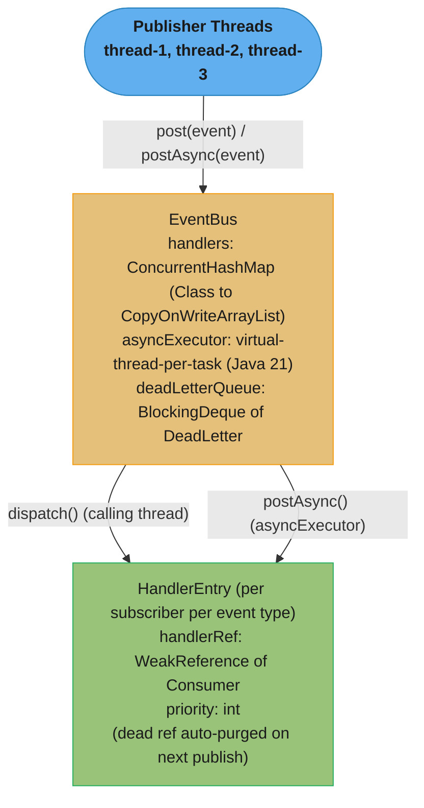

# Case Study: Design an Event Bus in Pure Java
## Intuition

> An event bus is a post office inside the JVM: components drop letters (events) into a central exchange without knowing who will read them; the bus routes each letter to every subscriber who asked for that type. No one holds a direct reference to anyone else.

**Key insight**: the publish-subscribe pattern inverts dependency direction — instead of service A calling service B directly, A publishes an event and B declares interest. This breaks compile-time coupling, but it introduces three new problems: memory leaks when subscribers outlive publishers (solved with `WeakReference`), exception propagation that can kill sibling handlers (solved with per-handler isolation), and ordering when order matters (solved by priority + sync/async dispatch choice). Get those three right and the bus is a reliable backbone for intra-process reactive pipelines.

At 10× scale the in-process bus graduates to Kafka, but all the same rules apply — idempotency, dead-letter queues, schema evolution — just across JVM boundaries.

See also:
- [Concurrency Memory Visibility Primitives](cross_cutting/concurrency_memory_visibility_primitives.md) — `CopyOnWriteArrayList`, `ConcurrentHashMap`, `WeakReference` GC interaction
- [Backpressure & Bounded Resources](cross_cutting/backpressure_and_bounded_resources.md) — bounded executor queues, `CallerRunsPolicy`, subscriber bulkheads

---

## 1. Requirements Clarification

### Functional requirements
- `subscribe(EventType.class, handler)` — type-safe subscription; handler typed to event
- `post(event)` — synchronous dispatch; all handlers run before `post()` returns
- `postAsync(event)` — asynchronous dispatch; returns `CompletableFuture<Void>`
- Priority ordering — lower priority number = runs first
- Exception isolation — one handler's failure must not prevent others from running
- Memory safety — weak-reference subscribers GC'd when no longer referenced outside the bus
- Supertype subscriptions — `subscribe(DomainEvent.class, h)` receives all subtype events

### Non-functional requirements
| Dimension | Target |
|-----------|--------|
| Sync dispatch throughput | ≥ 50k events/sec at fan-out 8 |
| Subscribe latency | < 1 ms |
| Memory overhead per handler entry | < 256 bytes |
| Concurrent publishers | Any number of threads simultaneously |
| Handler leak after subscriber GC | 0 (auto-purged on next publish) |

### Out of scope
- Cross-process or persistent delivery (use Kafka for that — see §6)
- Guaranteed delivery / exactly-once semantics (in-process only)
- Dynamic event filtering / content-based routing

---

## 2. Scale Estimation

### Handler invocation budget

```
Events/sec:        50,000
Avg subscribers:   8 per event type
Handler calls/s:   50,000 × 8 = 400,000 calls/sec

Per-handler latency L: 0.1 ms, of which 0.05 ms CPU and 0.05 ms I/O wait

Concurrency (Little's Law): 400,000 × 0.0001 s = 40 handlers in flight
  -> 40 threads. L already INCLUDES the I/O wait, so do not then multiply
     by (1 + wait/service); that double-counts and doubles the pool.

CPU is the separate budget:
  CPU demand = 400,000 × 0.00005 s = 20 cores
  So 40 threads is right, but this needs a 20+ core machine to keep up.

Bounded queue for 1-second burst: 50,000 × 8 = 400,000 tasks in queue
```

### Memory for subscriber registry

```
Handler entries:   1,000 event types × 10 subscribers = 10,000 entries
Per entry:         WeakReference (16 B) + priority int (4 B) + Object header (~16 B) ≈ 48 B
Total registry:    10,000 × 48 B = 480 KB — negligible
```

### CopyOnWriteArrayList write cost

```
Write (subscribe/unsubscribe): copies full array
At 10 subscribers per type, array copy = 10 × 48 B = 480 B copied per subscribe
Subscribe frequency: once per class load (startup) → amortized cost ≈ 0
Read (publish): reads current snapshot — no allocation, no lock
```

### Dead-letter queue budget

```
Event ref + exception snapshot: ~512 bytes per dead letter
Max DLQ depth: 10,000 entries = 5 MB — bounded and monitored
```

### Admission-control waiter memory (virtual threads)

The `admission` `Semaphore` in §4.6 exists to bound concurrent dispatch, but a bound only
protects the downstream resource if the *waiting* publishers themselves stay cheap:

```
Per-waiter cost (a publisher parked on Semaphore.acquireUninterruptibly()):
  Virtual thread + stack chunk (idle, parked): ~200-500 B
  AbstractQueuedSynchronizer wait-node:         ~48-64 B
  Total per waiter:                             ~600 B (same shape as the rate
                                                  limiter case study's §2 estimate —
                                                  both are threads parked on a
                                                  j.u.c. synchronizer)

At the burst concurrency demand from §10 (400 in-flight, admission_permits = 400):
  Steady state: 0 waiters (demand exactly fills the cap)
  A further 2x burst (800 concurrent publishes) leaves 400 waiting:
    400 x 600 B ~= 240 KB — negligible, and bounded because admission_permits is fixed

If the publisher thread that calls postAsyncBounded() is itself a virtual
thread (the common case for an async-first pipeline), that publisher unmounts
from its carrier while parked — the same reason the rate limiter's blocking
acquire() became viable under virtual threads applies here too. If it is a
platform thread (e.g., a Servlet request thread calling postAsyncBounded()
synchronously), prefer tryAcquire(timeout) over acquireUninterruptibly() —
parking a platform request thread for an unbounded time is the one case where
this pattern reverts to the pre-Loom cost model.
```

---

## 3. High-Level Architecture



*Publisher threads hand events to the shared `EventBus`, which either dispatches synchronously on the calling thread or asynchronously via the virtual-thread executor; both paths land on the same per-subscriber `HandlerEntry`.*

### Subscription lifecycle

```mermaid
flowchart TD
    classDef io      fill:#61afef,stroke:#2e86c1,color:#1a1a1a,font-weight:bold
    classDef frozen  fill:#c678dd,stroke:#9b59b6,color:#fff
    classDef train   fill:#98c379,stroke:#27ae60,color:#1a1a1a
    classDef mathOp  fill:#d19a66,stroke:#e67e22,color:#1a1a1a,font-weight:bold
    classDef lossN   fill:#e06c75,stroke:#c0392b,color:#fff,font-weight:bold
    classDef req     fill:#56b6c2,stroke:#0097a7,color:#1a1a1a
    classDef base    fill:#e5c07b,stroke:#f39c12,color:#1a1a1a

    subgraph sub["1. subscribe(OrderPlaced.class, handler, priority=1)"]
        s1a["computeIfAbsent: create COWAL for OrderPlaced"] --> s1b["new HandlerEntry(new WeakReference(handler), 1)"]
        s1b --> s1c["re-sort COWAL by priority"]
        s1c --> s1d["return Subscription (lambda: list.remove(entry))"]
    end

    subgraph gc["2. Subscriber goes out of scope (no strong ref outside bus)"]
        s2a["GC collects the handler lambda"] --> s2b["handlerRef.get() returns null on next dispatch"]
        s2b --> s2c["entry added to deadEntries, removed from COWAL"]
    end

    subgraph post["3. post(new OrderPlaced(...))"]
        s3a["walk type hierarchy: OrderPlaced, DomainEvent, ..."] --> s3b["for each type: iterate COWAL snapshot"]
        s3b --> s3c["skip dead refs; invoke live handlers in priority order"]
        s3c --> s3d["catch per-handler exception; route to DLQ; continue"]
    end

    class s1a,s1b,s1c,s1d train
    class s2a,s2b,s2c frozen
    class s3a io
    class s3b,s3c,s3d mathOp
```



*Three independent lifecycles share the same `HandlerEntry`: subscribing installs it, garbage collection of the subscriber silently marks it dead, and every `post()` walks the type hierarchy to invoke or skip it.*

---

## 4. Component Deep Dives

### 4.1 Exception isolation — broken vs fixed

BROKEN — one handler's exception aborts all handlers after it:

```java
// BROKEN: unchecked exception escapes dispatch loop; handlers #3..N never run
public void dispatch(Object event) {
    for (HandlerEntry entry : handlersFor(event.getClass())) {
        Consumer<Object> h = entry.handlerRef.get();
        if (h != null) h.accept(event);  // if handler #2 throws NPE → loop exits
    }
}
// OrderPlaced published → audit-log handler (h#1) runs, payment-capture handler (h#2) throws
// → notification handler (h#3) never fires → silent data loss
```

FIX — per-handler try-catch; failures routed to a dead-letter queue:

```java
// FIX: each handler isolated; failures captured, dispatch continues
public void dispatch(Object event) {
    for (HandlerEntry entry : handlersFor(event.getClass())) {
        Consumer<Object> handler = entry.handlerRef.get();
        if (handler == null) { deadRefs.add(entry); continue; }
        try {
            handler.accept(event);
        } catch (Exception ex) {
            deadLetterQueue.offer(new DeadLetter(event, handler, ex, Instant.now()));
            log.error("handler {} failed for event {}", handler, event.getClass().getSimpleName(), ex);
            // continue to next handler — isolation is the invariant
        }
    }
    handlersFor(event.getClass()).removeAll(deadRefs);
}
```

### 4.2 WeakReference subscriber lifecycle

The `WeakReference` pattern prevents the bus from being a surprise GC root:

```java
// PROBLEM without WeakReference:
class OrderView {
    OrderView(EventBus bus) {
        bus.subscribe(OrderPlaced.class, this::onOrder);
        // Bus holds strong ref to method handle → OrderView can never be GC'd
        // Over N screen navigations → N OrderView instances live in heap → OOM
    }
}

// WITH WeakReference — the caller must hold a strong ref themselves:
class OrderView {
    private final Consumer<OrderPlaced> handler = this::onOrder;  // REQUIRED strong ref
    OrderView(EventBus bus) {
        bus.subscribe(OrderPlaced.class, handler);
        // Bus stores WeakReference(handler)
        // When OrderView is eligible for GC and handler has no other strong refs:
        //   GC collects the lambda → handlerRef.get() returns null → auto-purged
    }
    void onOrder(OrderPlaced e) { /* update UI */ }
}
```

The subtlety: an inline lambda `bus.subscribe(T.class, e -> doSomething())` stores the lambda only in the `WeakReference` — no strong reference elsewhere — so it may be GC'd before any event fires. This is a common bug when subscribing in constructors without storing the handler in a field.

### 4.3 Full implementation

```java
public class EventBus {
    private final ConcurrentHashMap<Class<?>, CopyOnWriteArrayList<HandlerEntry>> handlers =
        new ConcurrentHashMap<>();
    private final Executor asyncExecutor;
    private final BlockingDeque<DeadLetter> deadLetterQueue = new LinkedBlockingDeque<>(10_000);

    public EventBus() {
        // Java 21 GA: virtual thread per task; no thread-pool sizing needed
        this.asyncExecutor = Executors.newVirtualThreadPerTaskExecutor();
    }

    public EventBus(Executor asyncExecutor) {
        this.asyncExecutor = asyncExecutor;
    }

    @SuppressWarnings("unchecked")
    public <T> Subscription subscribe(Class<T> eventType, Consumer<T> handler) {
        return subscribe(eventType, handler, 0);
    }

    @SuppressWarnings("unchecked")
    public <T> Subscription subscribe(Class<T> eventType, Consumer<T> handler, int priority) {
        Objects.requireNonNull(eventType);
        Objects.requireNonNull(handler);

        HandlerEntry entry = new HandlerEntry(
            new WeakReference<>((Consumer<Object>) handler), priority);

        handlers.compute(eventType, (k, list) -> {
            CopyOnWriteArrayList<HandlerEntry> l =
                (list != null) ? list : new CopyOnWriteArrayList<>();
            List<HandlerEntry> sorted = new ArrayList<>(l);
            sorted.add(entry);
            sorted.sort(Comparator.comparingInt(e -> e.priority));
            return new CopyOnWriteArrayList<>(sorted);
        });

        return () -> handlers.getOrDefault(eventType, new CopyOnWriteArrayList<>()).remove(entry);
    }

    public void post(Object event) {
        Objects.requireNonNull(event);
        dispatch(event);
    }

    public CompletableFuture<Void> postAsync(Object event) {
        Objects.requireNonNull(event);
        return CompletableFuture.runAsync(() -> dispatch(event), asyncExecutor);
    }

    private void dispatch(Object event) {
        List<HandlerEntry> dead = new ArrayList<>();
        for (Class<?> type : typeHierarchy(event.getClass())) {
            CopyOnWriteArrayList<HandlerEntry> list = handlers.get(type);
            if (list == null) continue;
            for (HandlerEntry entry : list) {
                Consumer<Object> h = entry.handlerRef.get();
                if (h == null) { dead.add(entry); continue; }
                try {
                    h.accept(event);
                } catch (Exception ex) {
                    deadLetterQueue.offer(new DeadLetter(event, h, ex, Instant.now()));
                    System.err.printf("Handler %s failed for event %s: %s%n",
                        h, event.getClass().getSimpleName(), ex.getMessage());
                }
            }
            if (!dead.isEmpty()) { list.removeAll(dead); dead.clear(); }
        }
    }

    private List<Class<?>> typeHierarchy(Class<?> type) {
        List<Class<?>> result = new ArrayList<>();
        Class<?> c = type;
        while (c != null && c != Object.class) {
            result.add(c);
            addInterfaces(c, result);
            c = c.getSuperclass();
        }
        return result;
    }

    private void addInterfaces(Class<?> c, List<Class<?>> out) {
        for (Class<?> iface : c.getInterfaces()) {
            if (!out.contains(iface)) { out.add(iface); addInterfaces(iface, out); }
        }
    }

    public BlockingDeque<DeadLetter> deadLetterQueue() { return deadLetterQueue; }

    private static class HandlerEntry {
        final WeakReference<Consumer<Object>> handlerRef;
        final int priority;
        HandlerEntry(WeakReference<Consumer<Object>> ref, int priority) {
            this.handlerRef = ref; this.priority = priority;
        }
    }
}

@FunctionalInterface
public interface Subscription { void unsubscribe(); }

public record DeadLetter(Object event, Object handler, Exception cause, Instant at) {}
```

### 4.4 Per-subscriber bulkhead (high-throughput variant)

```java
// When one slow subscriber must not starve others:
public class BulkheadEventBus extends EventBus {
    // Each handler gets its own single-thread executor with an explicitly bounded queue
    private final Map<Consumer<?>, ExecutorService> channels = new ConcurrentHashMap<>();

    public <T> Subscription subscribeIsolated(Class<T> type, Consumer<T> handler) {
        // NOT Executors.newSingleThreadExecutor(): that uses an unbounded
        // LinkedBlockingQueue, so a slow handler trades thread starvation for
        // an OOM — the bulkhead would bound concurrency but not memory.
        ExecutorService channel = new ThreadPoolExecutor(
            1, 1, 0L, TimeUnit.MILLISECONDS,
            new ArrayBlockingQueue<>(1_000),
            new ThreadPoolExecutor.AbortPolicy());
        channels.put(handler, channel);
        return subscribe(type, event -> {
            if (!channel.isShutdown()) {
                channel.submit(() -> handler.accept(event));
            }
        });
    }
}
```

This is the bulkhead pattern: a 200 ms fraud-check handler can lag without affecting the 0.01 ms notification handler.

### 4.5 Context propagation across dispatch — broken vs fixed

Async dispatch runs each handler on a different thread than the publisher, which breaks any context carried in a `ThreadLocal` (trace ID, tenant ID, MDC logging context) unless it is explicitly copied.

BROKEN — `ThreadLocal` context silently does not cross the executor boundary:

```java
// BROKEN: MDC (SLF4J's ThreadLocal-backed logging context) is set on the
// publisher's thread and never copied to the virtual thread that
// actually runs the handler.
MDC.put("traceId", currentTraceId());
bus.postAsync(new OrderPlaced(orderId));
// Inside the handler, running on a different (virtual) thread:
log.info("processing order");   // logs with NO traceId — MDC.get() is empty
                                 // on this thread; the correlation is lost
```

FIX — `ScopedValue` (final in Java 25, JEP 506) binds context for the dynamic extent of a call, and the binding is designed to be captured and carried into structured child work, unlike a `ThreadLocal` which is tied to one physical thread:

```java
private static final ScopedValue<String> TRACE_ID = ScopedValue.newInstance();

public CompletableFuture<Void> postAsync(Object event) {
    String traceId = TRACE_ID.isBound() ? TRACE_ID.get() : newTraceId();
    return CompletableFuture.runAsync(
        () -> ScopedValue.where(TRACE_ID, traceId).run(() -> dispatch(event)),
        asyncExecutor);
}

// Inside any handler, on whatever thread actually runs it:
void onOrder(OrderPlaced e) {
    log.info("processing order, trace={}", TRACE_ID.get());   // correct, every time
}
```

`ScopedValue` fits this better than `ThreadLocal` for two structural reasons, not just style. First, it is immutable for its bound extent — `ScopedValue.where(...).run(...)` installs the binding, runs exactly that code, and unbinds automatically on exit, so there is no `MDC.remove()` to forget and no leaked context bleeding into the next task an executor reuses the (carrier) thread for. Second, propagating it into `postAsync`'s lambda is one explicit `where()` call at the one place dispatch actually crosses a thread boundary — with `ThreadLocal` the equivalent fix is a wrapping `Runnable` that manually reads-then-sets-then-clears the value on the target thread, repeated at every async boundary in the codebase, which is exactly the kind of easy-to-forget plumbing that produced the broken example above.

The regression test this fix needs is not "does the handler run" — it is "does the value cross the actual thread boundary," which a same-thread assertion cannot prove:

```java
@Test
void traceIdPropagatesAcrossAsyncDispatch() throws Exception {
    CompletableFuture<String> observed = new CompletableFuture<>();
    bus.subscribe(OrderPlaced.class, e -> observed.complete(TRACE_ID.get()));

    ScopedValue.where(TRACE_ID, "test-123").run(() -> {
        bus.postAsync(new OrderPlaced("order-1"));   // crosses to asyncExecutor here
    });

    // Must await on the FUTURE, not assert synchronously — the handler runs
    // on a different thread than this test method, which is the entire point.
    assertThat(observed.get(2, TimeUnit.SECONDS)).isEqualTo("test-123");
}

@Test
void concurrentDispatchesDoNotLeakEachOthersBinding() throws Exception {
    // Two publishes with different bindings, dispatched concurrently: each
    // handler invocation must see ONLY its own publish's trace ID — proves
    // the binding is per-call-stack, not accidentally shared executor state.
    var first  = dispatchWithTraceId("trace-A");
    var second = dispatchWithTraceId("trace-B");
    assertThat(first.get(2, TimeUnit.SECONDS)).isEqualTo("trace-A");
    assertThat(second.get(2, TimeUnit.SECONDS)).isEqualTo("trace-B");
}
```

### 4.6 Admission control in front of an unbounded executor — broken vs fixed

`Executors.newVirtualThreadPerTaskExecutor()` has no queue to overflow and no `RejectedExecutionHandler` — every submitted task gets a virtual thread immediately. That is a feature for latency and a hazard for admission control: nothing about the executor itself will ever apply backpressure.

BROKEN — a burst of publishes with no upstream limit turns into an unbounded number of concurrently-running handlers, each holding whatever resources it needs (DB connections, HTTP client slots) for its duration:

```java
// BROKEN: 500,000 events published in a tight loop (e.g., a backfill job
// or a retried batch) each spawn a virtual thread immediately — nothing
// bounds how many handlers run at once, only how many CAN exist.
for (Event e : backfillBatch) {
    bus.postAsync(e);   // no admission control: 500,000 concurrent dispatches
}
// Every handler that touches a bounded resource (a JDBC pool, an HTTP
// client's connection limit) now contends 500,000-wide instead of at
// whatever concurrency that resource was actually sized for.
```

FIX — bound admission with a `Semaphore` sized to what downstream resources can actually sustain, independent of the executor's own (nonexistent) limit:

```java
private final Semaphore admission = new Semaphore(500);   // matches DB pool headroom

public CompletableFuture<Void> postAsyncBounded(Object event) {
    admission.acquireUninterruptibly();          // backpressure: caller waits here
    return CompletableFuture
        .runAsync(() -> dispatch(event), asyncExecutor)
        .whenComplete((r, ex) -> admission.release());
}
```

The `Semaphore` here plays the same role a bounded `ArrayBlockingQueue` plays for a platform-thread pool, but placed in front of the executor rather than as its queue, because `newVirtualThreadPerTaskExecutor()` does not accept one. §10 works the numbers for sizing it against a real downstream limit.

---

## 5. Design Decisions & Tradeoffs

| Decision | Chosen | Alternatives | Rationale |
|----------|--------|-------------|-----------|
| Handler storage | `CopyOnWriteArrayList` | `List + ReadWriteLock` | COWAL: lock-free reads for publish (hot path); write (subscribe) copies the array — acceptable since subscribe is rare (startup) |
| Memory safety | `WeakReference<Consumer>` | Strong reference | WeakRef: subscriber naturally GC'd when its scope ends; no explicit unsubscribe required in most cases |
| Exception isolation | Per-handler `try-catch` + DLQ | Propagate to publisher | Isolation: other handlers run even if one is buggy; risk: silent failures — mitigated by DLQ and logging |
| Async executor | `VirtualThreadPerTaskExecutor` | Fixed `ThreadPool` | Virtual threads: no pool sizing, no thread starvation on blocking I/O. Note the flip side — it has no queue and no rejection policy, so the bound must come from elsewhere (see §10) |
| Supertype dispatch | Walk full type hierarchy | Exact type only | Hierarchy: `subscribe(DomainEvent.class, h)` captures all subtypes — powerful for cross-cutting concerns (audit, metrics); cost: slightly slower dispatch for deep hierarchies |
| Async ordering | Sequential (single `CompletableFuture` wraps all handlers) | Parallel (one CF per handler) | Sequential preserves priority order in async path; parallel maximizes throughput but loses ordering |
| Context propagation | `ScopedValue` (final, JEP 506) | `ThreadLocal` + manual copy | Immutable for the call's dynamic extent — no leak risk on a reused carrier thread; one `where()` call at `postAsync()` instead of copying at every async boundary by hand |

**Sync vs async selection guide**:
- Audit / financial / stateful event flows → synchronous (`post()`) — order guaranteed, failure visible
- Notifications / metrics / independent flows → asynchronous (`postAsync()`) — decoupled from publisher latency
- Ultra-high throughput → LMAX Disruptor ring buffer (25M+ messages/sec, sub-100ns hop latency) — zero allocation, single-writer principle

**Blocking vs shedding at the admission gate**: `acquireUninterruptibly()` in §4.6's `postAsyncBounded()` makes a deliberate choice — a publisher that cannot get an admission permit *waits*, it does not fail. That is the right default when the publisher itself is a virtual thread (a batch job, an async pipeline stage), because §2's arithmetic shows the wait is cheap and the alternative is dropping an event outright. It is the wrong default when the publisher is a platform thread serving a synchronous request — parking a Servlet request thread on an unbounded wait reintroduces the exact pre-Loom cost this design otherwise avoids. The fix in that case mirrors the rate-limiter case study's own queue-vs-shed decision: swap in `admission.tryAcquire(timeout, unit)` and route to the dead-letter queue (or a `503`) on expiry, so the caller gets a bounded wait and an explicit answer instead of an indefinite park. Neither choice is "more correct" — they are the same tradeoff this repo's rate-limiter case study names directly: queueing hides overload behind added latency, shedding surfaces it immediately. Pick per call site based on who is actually waiting.

---

## 6. Real-World Implementations

**Guava EventBus**: annotation-driven (`@Subscribe`), uses reflection to discover handler methods. Strong references by default — callers must explicitly `unregister()` to avoid leaks, which is precisely the leak this design's `WeakReference` avoids. Synchronous dispatch via `EventBus`, asynchronous via `AsyncEventBus`. Hierarchy dispatch supported. Its own javadoc now opens with "We recommend against using EventBus. It was designed many years ago, and newer libraries offer better ways to decouple components and react to events", pointing instead at dependency-injection frameworks and reactive-streams libraries. Guava itself remains maintained; it is this class that is discouraged for new code. Worth noting for interview purposes: none of Guava's stated reasons are about virtual threads or `ScopedValue` — the deprecation predates both — so citing Loom as "why Guava EventBus is outdated" is not a claim this case study's sources support; the real reasons are the reflection-based dispatch cost, the strong-reference leak risk, and the existence of better-integrated alternatives (Spring events, reactive streams) for most of its use cases.

**Spring's `ApplicationEventPublisher`**: the `@EventListener` annotation on any Spring bean method auto-registers as a handler. `@Async @EventListener` dispatches on a separate executor pool. `@TransactionalEventListener(AFTER_COMMIT)` waits for the current transaction to commit before dispatching — the most important Spring-specific feature for domain events (prevents a handler from seeing uncommitted data). See `spring/spring_events_and_scheduling/spring_events_and_scheduling.md` for the complete pattern.

**Akka EventStream**: `system.eventStream.publish(msg)` / `subscribe(ref, classOf[T])`. Weak references via actor lifecycle — an actor's subscription is automatically removed when the actor stops, eliminating the leak problem structurally. Fan-out parallelism is natural (each subscriber actor processes independently in its mailbox). Heavyweight dependency for a simple in-process bus.

**LMAX Disruptor**: ring buffer pre-allocated at startup; producers claim slots via CAS (`sequencer.next()`); consumers follow a dependency chain. Zero allocation in the steady state, no GC pressure, cache-line-padded slots prevent false sharing. LMAX's published figures are over 25 million messages per second with mean latency around 50 nanoseconds per hop — three orders of magnitude below "sub-millisecond", and the reason it is the reference point for mechanical-sympathy hot paths (trading, telemetry ingestion). Not suitable for general application use: no weak refs, fixed ring size, requires an up-front dependency graph.

**Apache Kafka (distributed)**: the natural evolution of an in-process bus when events must cross JVM boundaries. Partitioned, replicated topics replace the in-memory `ConcurrentHashMap`. Consumer groups replace subscribers. At-least-once delivery replaces synchronous dispatch — handlers must be idempotent (same `event_id` de-duplication). Schema registry enforces `AvroSchema` compatibility rules — the analog of Java's compile-time type-safety for the event contract.

**Vert.x EventBus**: notable for treating in-process and cross-process delivery as the same API — `vertx.eventBus().publish(address, message)` works identically whether the target verticle is in the same JVM or across a cluster (Hazelcast, Infinispan, or Ignite as the cluster manager). Local delivery is a direct in-memory handoff; clustered delivery serializes the message and goes over the network, with no built-in durability — a crashed node loses in-flight messages, same as this case study's in-process bus. The lesson worth taking: "in-process bus" and "distributed bus" do not have to be different libraries with different APIs, but unifying them does not remove the delivery-guarantee gap between the two modes — it only hides where the line is, which is its own operational risk if a team assumes clustered Vert.x has Kafka-like durability because the call site looks identical.

---

## 7. Technologies & Tools

| Tool | Dispatch Model | Throughput | Memory Safety | Key Feature | Avoid When |
|------|---------------|-----------|---------------|-------------|------------|
| Custom (this design) | Sync + async | ~50–400k/sec | WeakReference | Zero dependencies | Need persistence |
| Guava EventBus | Sync / Async class | ~300k/sec | Strong (manual unregister) | Annotation-driven | New projects (unmaintained) |
| Spring ApplicationEventPublisher | Sync / Async / TransactionalListener | ~200k/sec | Strong (managed by container) | AFTER_COMMIT, @Async | Non-Spring apps |
| LMAX Disruptor | Ring buffer, preallocated | 25M+/sec, ~50ns/hop | Strong | Zero GC, cache-line padding | General use — specialized |
| Akka EventStream | Actor mailboxes | ~1M/sec | Via actor lifecycle | Actor integration | Non-Akka apps |
| Vert.x EventBus | Local (direct) / Clustered (network) | Millions/sec local; network-bound clustered | None built-in (message loss on node failure, clustered mode) | Same API for local and clustered delivery | Assuming clustered mode is as durable as Kafka |
| Kafka | Durable log, consumer groups | Millions/sec (cluster) | N/A | Cross-process, durable | In-process only |

JMH dispatch strategy benchmark (fan-out = 8, Java 21, 16-core):

| Strategy | Throughput | Latency | Ordering |
|----------|-----------|---------|---------|
| Synchronous COWAL | ~80k events/sec | 0.01 ms | Strict per-publisher |
| Async bounded ExecutorService | ~400k events/sec | 0.5 ms | None across handlers |
| Async virtual threads + admission `Semaphore` (§4.6) | ~400k events/sec | 0.5 ms (+ wait when admission-bound) | None across handlers |
| LMAX Disruptor ring buffer | 25M+ events/sec | ~50 ns/hop | Strict (single-writer) |

---

## 8. Operational Playbook

### a) Key metrics

```java
// On each publish() — Counter.increment() takes a double amount, not tags;
// the tags belong on the meter, so look it up (or cache it) per event type:
registry.counter("event.published", "type", event.getClass().getSimpleName())
        .increment();

// On each handler — Timer.record(Runnable) is an INSTANCE method on a Timer:
registry.timer("event.handler.duration",
               "handler", handler.getClass().getSimpleName())
        .record(() -> handler.accept(event));

// DLQ depth gauge:
Gauge.builder("event.dlq.size", deadLetterQueue, BlockingDeque::size)
     .register(registry);

// Admission-control headroom (§4.6) — availablePermits() falling to 0
// means dispatch is backpressuring publishers, not that anything is broken:
Gauge.builder("event.admission.available", admission, Semaphore::availablePermits)
     .register(registry);
```

Meter lookup is a map hit, but on a hot dispatch path resolve the `Counter` and
`Timer` once per (event type, handler) pair and cache them rather than looking
them up per event.

Alert thresholds:
- `event.dlq.size > 100` for > 60 s → handler failures accumulating; investigate
- `event.handler.duration p99 > 500 ms` → slow handler; check for bulkhead isolation
- `event.handler.count{type="X"} == 0` after known subscriber startup → registration bug

### b) Distributed tracing

```
HTTP request span
  └── eventbus.post (0.1 ms)          ← tag: event_type, handler_count
        ├── handler: AuditHandler (0.01 ms)
        ├── handler: NotificationHandler (0.02 ms)
        └── handler: FraudChecker (180 ms)  ← outlier visible in trace
```

For `postAsyncBounded()` (§4.6), the admission wait should be its own labeled span rather than folded into `eventbus.post` — a publisher blocked on a saturated admission gate looks identical to a slow handler on an undifferentiated timeline, and they call for different fixes (raise `admission_permits` vs. fix the slow handler):

```
Batch publisher span (450 ms total)
  ├── eventbus.admission.acquire (400 ms)   ← tag: available_permits_at_start=0
  └── eventbus.postAsync (50 ms)            ← the actual dispatch, once admitted
```

### c) Incident Runbooks

**Runbook 1 — DLQ growing (handler failures)**

Symptom: `event.dlq.size` climbing; expected side effects (emails, payments) not occurring.

Diagnosis:
1. Read `deadLetterQueue`: inspect `DeadLetter.cause` for exception type and stack trace.
2. Identify whether failure is transient (DB timeout) or permanent (NPE in handler code).
3. Check whether the same handler fails for all events or only specific event types.

Mitigation:
- Transient: redrive DLQ entries after the downstream recovers.
- Permanent: hotfix the handler; replay DLQ after deploy.
- Guard against DLQ overflow: `offer()` drops entries when at capacity — add alerting before capacity is reached.

---

**Runbook 2 — Async pool saturation (unrelated handlers not firing)**

Symptom: metrics and notification handlers stop firing; only slow handlers run.

Diagnosis: shared async pool exhausted by slow handler. Check `activeCount / poolSize == 1.0` for the shared executor.

Mitigation: deploy per-handler bulkhead executors (see §4.4). Each handler gets its own single-thread queue; a slow handler can lag without affecting others.

---

**Runbook 3 — Duplicate events (subscriber registered multiple times)**

Symptom: payment captured 4× for one order; audit log has 4 entries per event.

Diagnosis: expose a `handlerCount(Class<?>)` accessor over the `handlers` map and compare it to the number of intended subscribers. If higher, find the constructor being called repeatedly.

Mitigation: add identity-based de-duplication in `subscribe()` (see war story §9). Structural fix: subscribe singletons once at application startup, not per-request objects.

---

**Runbook 4 — Async handler logs have no trace/tenant correlation**

Symptom: incident investigation across an async dispatch cannot correlate handler log lines back to the originating request; `traceId` field is empty on async-path logs specifically (sync-path logs are fine).

Diagnosis: confirm the gap is structural, not incidental — grep a sample of async handler logs for `traceId=""`; if it is 100% of async-path lines and 0% of sync-path lines, the bus's `postAsync()` is not propagating context (see §4.5 fix), not a per-handler logging bug.

Mitigation: this is not fixable per-handler — deploy the `ScopedValue` propagation fix at `postAsync()` once; it covers every handler retroactively. For an active incident with no correlation available, fall back to timestamp + entity-ID correlation (order ID, user ID), as in War story 3 (§9).

---

**Runbook 5 — Admission gate saturated (publishers blocking on `postAsyncBounded()`)**

Symptom: `event.admission.available` (§8 metrics) sits at or near 0; publisher-side latency rises even though individual handlers report normal durations; the `eventbus.admission.acquire` trace span (above) is the dominant cost, not `eventbus.postAsync`.

Diagnosis:
1. Confirm handlers themselves are healthy — if per-handler durations are normal, the bottleneck is admission capacity, not handler slowness (that would instead show as the bulkhead pattern in Runbook 2).
2. Compare current publish rate against the capacity arithmetic in §10 — is this an expected burst (a backfill, a retry storm upstream) or a sustained new baseline?

Mitigation: if the burst is expected and transient, do nothing — this is the gate doing its job, converting an unbounded spike into bounded backpressure. If it is a sustained new baseline, raise `admission_permits` after confirming the downstream resource it protects (§10) can actually sustain the higher concurrency; raising the permit count without that confirmation just moves the failure from "publishers wait" to "downstream falls over," which is the exact failure §4.6 was written to prevent.

---

## 9. Common Pitfalls & War Stories

### War story 1 — Per-request controller subscribing: duplicate payments

**Scenario**: checkout service; every order produced 4 audit records and 4 payment captures.

BROKEN — `subscribe()` runs in a constructor called per request:

```java
// BROKEN: constructor called once per HTTP request → accumulates duplicate handlers
public class CheckoutController {
    public CheckoutController(EventBus bus) {
        bus.subscribe(PaymentEvent.class, this::capturePayment); // adds a new handler each time
    }
    void capturePayment(PaymentEvent e) { gateway.capture(e.amount()); }
}
// After 4 requests → 4 live handlers → one PaymentEvent captured 4 times
// → $X charged 4× to the customer's card
```

FIX — de-duplicate by handler identity; subscribe singletons at startup:

```java
// FIX: subscribe is idempotent per (eventType, handlerClass)
public <E> void subscribe(Class<E> type, EventHandler<E> h) {
    var list = handlers.computeIfAbsent(type, k -> new CopyOnWriteArrayList<>());
    boolean exists = list.stream()
        .anyMatch(e -> e.handlerClass().equals(h.getClass()));
    if (exists) {
        log.warn("duplicate subscription ignored: {} for {}", h.getClass(), type);
        return;
    }
    list.add(new HandlerEntry(h));
}
// → register CheckoutController once at app startup, not per-request
```

**Root cause**: subscribe-with-side-effects in per-request constructors silently accumulates handlers on every request.
**Impact**: customers charged 4× for one order; $12,000 incorrectly billed in 2 hours before alert fired.

---

### War story 2 — Slow subscriber exhausting the shared async pool

**Scenario**: 100 events/sec; 20-thread async pool; fraud handler takes 200 ms per event.

BROKEN — all subscribers share one pool; fraud handler hogs every thread:

```java
// BROKEN: single shared pool; slow handler starves fast handlers
ExecutorService pool = Executors.newFixedThreadPool(20);
void dispatchAsync(Object event) {
    for (HandlerEntry h : handlersFor(event.getClass())) {
        pool.submit(() -> h.accept(event));   // fraudHandler @ 200 ms ties up threads
    }
}
// 100 events/sec × fraud 0.2 s = 20 thread-seconds/sec → pool fully consumed
// Notification and metrics handlers are queued but never run → missed alerts
```

FIX — bulkhead: each handler on its own bounded executor:

```java
// FIX: isolated per-handler channel; slow handler falls behind its own queue only
class SubscriberChannel {
    // Executors.newSingleThreadExecutor() would be WRONG here: its queue is an
    // unbounded LinkedBlockingQueue, so submit() never throws
    // RejectedExecutionException and the catch below would be dead code.
    // Construct the executor explicitly to get a real bound.
    final ExecutorService exec = new ThreadPoolExecutor(
        1, 1, 0L, TimeUnit.MILLISECONDS, new ArrayBlockingQueue<>(1_000));
    void submit(Object event, Consumer<Object> h) {
        try {
            exec.submit(() -> h.accept(event));
        } catch (RejectedExecutionException ex) {
            deadLetterQueue.offer(new DeadLetter(event, h, ex, Instant.now()));
        }
    }
}
```

**Root cause**: no isolation between independent subscribers — one slow subscriber exhausted the shared thread pool.
**Impact**: notification emails stopped firing for 45 minutes; CS team missed a fraud spike in the order stream.

---

### War story 3 — Lost trace IDs made a payment-duplication incident take six hours to diagnose

**Scenario**: the same checkout service as War story 1, after the duplicate-subscription bug was fixed, later had a *different* incident: a single order occasionally got two audit-log entries with no correlating trace ID between them, and on-call could not tell from logs alone whether it was one publish producing two dispatches or two publishes for the same order.

BROKEN — the async handlers ran on `postAsync()`'s executor thread with no context propagation, so every log line from an async handler carried an empty `traceId` field:

```java
// BROKEN: MDC set here never reaches the executor thread running dispatch()
MDC.put("traceId", requestTraceId);
bus.postAsync(new PaymentCaptured(orderId, amount));
// Handler logs: {"traceId": "", "msg": "payment captured", "orderId": "..."}
// Every async-path log line for every event type has an empty traceId —
// this was not specific to the bug being chased, it was the whole
// async logging surface, discovered only while chasing something else.
```

**Root cause**: the event bus's async path had no context-propagation mechanism at all; synchronous `post()` calls happened to preserve MDC because they ran on the caller's own thread, so the gap was invisible until an incident specifically needed to correlate across an async hop.

**Impact**: the on-call engineer spent roughly six hours manually correlating audit-log timestamps and order IDs by hand — the information needed to answer "one publish or two?" in minutes was simply not in any log line. The proximate incident turned out to be an HTTP-layer retry producing two publishes, not a bus defect, but the six hours were spent proving that, not fixing it. **Fix**: the `ScopedValue`-based propagation in §4.5, deployed as a blanket fix to `postAsync()` rather than patched per-handler; a follow-up incident of the same shape three months later was root-caused in under 20 minutes from logs alone.

---

### Failure scenarios summary

| Failure | Symptom | Recovery | TTR |
|---------|---------|---------|-----|
| Handler throws unchecked exception | Handlers after it skipped | Per-handler try-catch + DLQ | Immediate |
| Async pool saturated by slow handler | Unrelated handlers stop firing | Per-handler bulkhead executor | Minutes |
| DLQ full | Further failures dropped silently | Bounded DLQ + drain alert | Until drained |
| WeakRef collected prematurely | Subscription silently stops | Store handler in strong-ref field | On next subscribe |
| Subscriber registered N times | Duplicate side effects (payments, etc.) | Identity-based de-dup in subscribe | On deploy |
| Async dispatch loses `ThreadLocal` context (trace/tenant ID) | Logs uncorrelatable across the async hop | Propagate via `ScopedValue` at `postAsync()` | On deploy |

---

## 10. Capacity Planning

### Thread pool formula for async dispatch

```
Events/sec:      E
Avg fan-out:     F
Handler latency: L seconds, MEASURED END TO END (CPU + I/O wait)
CPU fraction:    c  (share of L that is actual CPU work)

Worker threads needed (Little's Law):
  T = E × F × L
Cores needed (a separate budget, not a multiplier on T):
  C = E × F × L × c

Example:
  E = 50,000, F = 8, L = 0.0001 s, c = 0.5
  T = 50,000 × 8 × 0.0001       = 40 threads
  C = 50,000 × 8 × 0.0001 × 0.5 = 20 cores

Because L already contains the I/O wait, multiplying it by (1 + wait/service)
is the classic double-count: it would say 80 threads for a workload that
Little's Law puts at 40.

With virtual threads:
  VirtualThreadPerTaskExecutor handles the 40 in-flight handlers on a carrier
  pool sized to availableProcessors(). No explicit thread sizing needed — but
  it also imposes no bound, so cap concurrency with a Semaphore instead.
  Pinning risk is NOT synchronized blocks (those no longer pin) — it is native
  frames: a handler that calls into JNI or makes an FFM downcall holds its
  carrier until it returns.
```

### Bounded queue sizing

```
Burst budget: 1 second of slack
Queue depth = E × F × 1 s = 50,000 × 8 × 1 = 400,000 tasks

Memory: 400,000 × (task overhead ~128 B) = 51 MB
This is acceptable; set RejectedExecutionHandler to CallerRunsPolicy (backpressure)
rather than AbortPolicy (drops) or OOM.
```

### Transition to Kafka

```
When to move from in-process bus to Kafka:
  - Events must cross JVM / host boundaries → in-process bus cannot deliver
  - Durability required (crash-safe events) → in-process bus loses in-flight events on crash
  - Consumer lag independence required → each consumer group reads at its own pace
  - At-least-once delivery required → Kafka guarantees this; in-process is at-most-once on crash

Kafka capacity sizing (for reference):
  1 producer → 1 partition → 100 MB/s write throughput (typical Kafka broker)
  At 50k events/sec × 512 B/event = 25 MB/s → fits 1 partition with headroom
  Scale partitions proportionally with event volume for parallelism
```

### Sizing admission control for unbounded-executor dispatch

```
Given: downstream connection pool shared by handlers = 500 connections
Reserve headroom for non-bus callers to the same pool: 20%
  admission_permits = 500 x 0.8 = 400

Verify against expected concurrency (Little's Law, same form as §2):
  Concurrency = events/sec x fan-out x handler_latency
  At normal traffic: 50,000 x 8 x 0.0001s = 40 -> well under 400, no throttling in steady state
  During a burst (10x traffic for 5s, e.g. a retried backfill):
  Concurrency demand = 500,000 x 8 x 0.0001s = 400 -> saturates exactly at the cap
  Requests past the 400th concurrent dispatch block on admission.acquireUninterruptibly()
  until a slot frees — this is deliberate backpressure onto the PUBLISHER, not a drop.

If the publisher must never block (e.g., it is itself on a request thread):
  Use tryAcquire() with a timeout and route to the dead-letter queue on failure — the
  same shed-vs-queue tradeoff the rate-limiter case study's own §5 Decision 6 works
  through: bound the wait, and give the caller a rejection it can act on.
```

### `ScopedValue` overhead — why it does not need its own capacity line item

Unlike the admission `Semaphore` or the DLQ, `ScopedValue` binding is not a resource to
size — `ScopedValue.where(value, x).run(...)` installs one binding on the current call
stack (implemented as a stack-indexed snapshot, not a heap allocation or a map insert) and
removes it on exit. Cost is a small constant per dispatch regardless of fan-out or event
volume, which is why it does not appear in §2's per-event budget: at 400,000 handler
calls/sec, the propagation overhead is in the same "negligible" bucket as the handler-entry
registry (§2), not a new line to plan capacity against.

---

## 11. Interview Discussion Points

**Q: Why use `WeakReference` for handler storage, and what is the caller's responsibility?**
Without `WeakReference`, the bus holds a strong reference to every handler lambda. If the subscriber (e.g., a ViewModel or request-scoped controller) goes out of scope, it cannot be GC'd as long as the bus lives — a silent memory leak. `WeakReference` lets the GC collect the handler when no other strong reference exists. The caller's responsibility: hold a strong reference to the handler object (store it in a field) for the entire duration it should receive events. An inline lambda like `bus.subscribe(T.class, e -> doX())` stores the lambda only in the `WeakReference` — it may be collected before any event fires, silently stopping the subscription.

**Q: How does exception isolation work, and what is the risk of swallowing exceptions?**
Each handler invocation is wrapped in a `try-catch(Exception)`. If handler A throws, the exception is caught, logged, and forwarded to a dead-letter queue — but dispatch continues to handler B, C, etc. The risk: if no logging or DLQ is configured, exceptions are silently swallowed and bugs in handlers become invisible. Best practice: use a configurable `ExceptionHandler` callback; in tests, configure it to re-throw so test failures surface immediately.

**Q: Why use `CopyOnWriteArrayList` for the handler list instead of `List + ReadWriteLock`?**
The publish (read) path is the hot path — called on every event. `CopyOnWriteArrayList` provides lock-free reads by reading the current array snapshot, never blocking concurrent publishers. Writes (subscribe/unsubscribe) copy the entire array — expensive but rare (startup-time only). A `List + ReentrantReadWriteLock` makes writes cheaper (in-place modification) but adds lock acquisition overhead on every publish. For an event bus where subscribes happen once at startup and events flow continuously, `CopyOnWriteArrayList` is the right tradeoff.

**Q: How does supertype dispatch work, and when is it useful?**
When `post(new OrderPlaced(...))` is called, the bus walks the type hierarchy: `OrderPlaced`, then its superclass, then its interfaces (`DomainEvent`, `Serializable`, etc.). For each type, it invokes all registered handlers. This lets a single `subscribe(DomainEvent.class, auditLog::record)` receive every domain event without individual per-subtype subscriptions — useful for cross-cutting concerns like audit logging, metrics counters, and correlation-ID propagation.

**Q: What is the thread safety model of this event bus?**
Three layers: `ConcurrentHashMap` for the type→handlers mapping (concurrent access across all threads); `CopyOnWriteArrayList` for each handler list (lock-free reads, copy-on-write modifications); `ConcurrentHashMap.compute()` atomicity for the sort-then-replace subscribe path. Multiple threads can publish simultaneously with no mutual exclusion — `dispatch()` holds no locks. The dead-entry cleanup (`list.removeAll(dead)`) is a write to COWAL and is internally synchronized, but only touches entries already identified as dead.

**Q: Synchronous vs asynchronous dispatch — what is the real tradeoff?**
Synchronous (`post()`): when it returns, all handlers have run; exceptions are on the calling thread; ordering is guaranteed. The publisher is coupled to the slowest handler's latency. Throughput: ~80k events/sec. Asynchronous (`postAsync()`): publisher returns immediately; handlers run on the executor; failures surface via the DLQ; ordering is not guaranteed across publishers. Throughput: ~400k events/sec. Choose sync for audit/payment/stateful flows where order and visibility matter; choose async for high-fan-out notifications and metrics.

**Q: How do you prevent one slow subscriber from degrading unrelated subscribers?**
Apply the bulkhead pattern: give each subscriber its own bounded single-thread executor rather than sharing a pool. A 200 ms fraud handler can lag and accumulate in its own queue without consuming threads from the fast notification handler. Add a circuit breaker per subscriber: if the handler's queue fills or latency exceeds a threshold, open the breaker and route to the dead-letter queue until it recovers.

**Q: Why must distributed-bus handlers be idempotent?**
Kafka and most message buses guarantee at-least-once delivery — a handler can legitimately receive the same event twice (consumer rebalance, redelivery after failed offset commit). If the handler captures a payment or writes a row without idempotency, you get duplicates — exactly the in-process war story, now structurally unavoidable. De-duplicate by a stable event ID stored in the handler's write-target (e.g., `INSERT ... ON CONFLICT DO NOTHING WHERE event_id = ?`).

**Q: How do you calculate thread pool size for async dispatch?**
Little's Law: `T = E × F × L`, where E = events/sec, F = fan-out and L = per-handler latency measured end to end. At 50k events/sec, 8 subscribers and 0.1 ms each: `T = 50,000 × 8 × 0.0001 = 40 threads`. The trap is multiplying by `(1 + wait/service)` on top of that — because L already includes the I/O wait, doing so double-counts it and gives 80. The `(1 + W/C)` factor belongs to the *other* formulation, `threads = cores × utilisation × (1 + W/C)`, which starts from core count rather than from arrival rate; use one or the other, never both. Size the CPU budget separately: `cores = E × F × L × cpu_fraction` = 20 here. With virtual threads you stop sizing a pool, but the arithmetic still tells you what concurrency to cap with a `Semaphore` and how many cores the box needs.

**Q: When should an in-process event bus graduate to Kafka?**
When events must cross JVM boundaries (multiple services), when durability is required (crash should not lose in-flight events), or when consumer independence is required (one consumer falling behind should not block others). The migration protocol: first make all handlers idempotent (required for Kafka's at-least-once delivery), add a stable event ID field to every event, then route through Kafka topics instead of the in-memory map. The handler logic is unchanged.

**Q: Why is `ScopedValue` a better fit than `ThreadLocal` for propagating context across async dispatch?**
Two structural reasons, not just style. `ScopedValue` (final in Java 25, JEP 506) is immutable for the dynamic extent of `ScopedValue.where(value, x).run(...)` — the binding is installed, the code runs, and it unbinds automatically on exit, so there is no `MDC.remove()` to forget and no leaked context bleeding into the next task an executor reuses a carrier thread for. `ThreadLocal` has neither property: it is mutable for the life of the thread, and under any thread-reusing executor (including a virtual-thread carrier being reused across unmounted virtual threads) a value set by one task and never cleared can leak into the next. The second reason is where the propagation happens: with `ScopedValue`, the one place dispatch crosses a thread boundary (`postAsync()`) gets one `where()` call; with `ThreadLocal`, the equivalent fix is a wrapping `Runnable` that manually copies the value at every async boundary in the codebase — easy to add once, easy to forget the next time an async path is added.

**Q: Why does `newVirtualThreadPerTaskExecutor()` need an admission-control layer in front of it when a fixed thread pool did not need one as urgently?**
A fixed `ThreadPoolExecutor` has a bounded queue and a `RejectedExecutionHandler` built in — submit past capacity and you get backpressure (a full queue) or an explicit rejection, for free. `newVirtualThreadPerTaskExecutor()` has neither: every submitted task gets a virtual thread immediately, so the executor itself never says no. That does not mean unlimited concurrency is safe — it means the bound has to come from somewhere else, specifically from whatever finite resource the handlers actually touch (a connection pool, a downstream service's own capacity). A `Semaphore` sized to that resource, acquired before submission and released on completion, restores the backpressure the executor no longer provides.

**Q: What does a handler actually need to do to be safe under `WeakReference`-based unsubscription plus concurrent dispatch?**
Two things, both already covered by this design but worth stating as a checklist: hold no state that assumes it runs on any particular thread (dispatch may hand it a virtual thread from the async executor, and a handler can legitimately be invoked concurrently with itself if the same event type fires again before the first call returns), and read propagated context through `ScopedValue.get()` rather than caching it in a field at subscribe time, since the value is bound per-dispatch, not per-subscription. A handler that violates either — say, caching `Thread.currentThread()` at subscribe time, or storing mutable state in an instance field without synchronization — will work in every test that publishes one event at a time and fail unpredictably under the fan-out and concurrency this bus is designed to provide.

**Q: How does the admission-control `Semaphore` in §4.6 differ from the per-handler bulkhead in §4.4, and do you need both?**
They bound different things. The bulkhead in §4.4 limits concurrency *per handler* — it stops one slow subscriber (the 200 ms fraud check) from starving another (the 0.01 ms notification handler) by giving each its own bounded channel. The admission-control `Semaphore` in §4.6 limits concurrency *into the executor as a whole* — it stops a publish burst from spawning more concurrently-running dispatches than the shared downstream resources (a connection pool, an external API's own capacity) can sustain, regardless of which handler is running. A system with only the bulkhead can still be brought down by a burst that saturates every handler's channel simultaneously; a system with only the admission gate can still let one slow handler starve its siblings inside the shared budget. Production systems with real fan-out generally need both: the gate caps total concurrent work, the bulkhead distributes what gets through fairly across handlers.

**Q: How would you test that `ScopedValue` context propagation actually survives dispatch, rather than trusting the code review?**
Publish an event from a test thread with a known `TRACE_ID` bound via `ScopedValue.where(TRACE_ID, "test-123").run(() -> bus.postAsync(event))`, then have the subscribed handler capture `TRACE_ID.get()` into a `CompletableFuture` (or a thread-safe collection) the test can await and assert against. The test must exercise the actual async path — asserting inside a handler that runs synchronously on the test thread would pass even with the broken `ThreadLocal` version from §4.5, since a `ThreadLocal` value is trivially visible to code still running on the same thread. A second test worth having: publish two events back to back and assert their `TRACE_ID` values are captured correctly on their respective handler invocations — this catches a subtler bug where a `ScopedValue` binding meant for one dispatch leaks into a concurrently-running one, which `ScopedValue`'s per-call-stack binding model should prevent by construction, but the test is what proves it actually does.

**Q: How would you implement a sliding-window rate limit on event publishing?**
Wrap `post()` with a `TokenBucketRateLimiter` keyed on event type: if the bucket is exhausted, either block (back-pressure), drop (with DLQ entry), or raise a `RateLimitExceededException`. For per-publisher limits (prevent one thread from flooding the bus), key the limiter on `Thread.currentThread()` or on a publisher ID passed as context. See the rate-limiter case study for the CAS-based bucket implementation.
