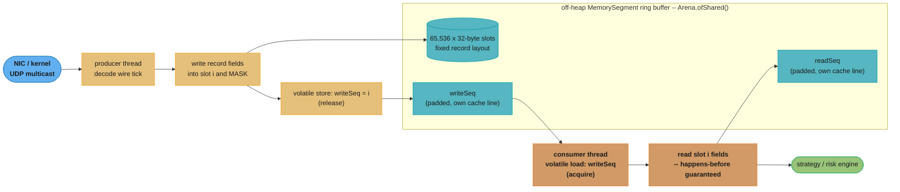
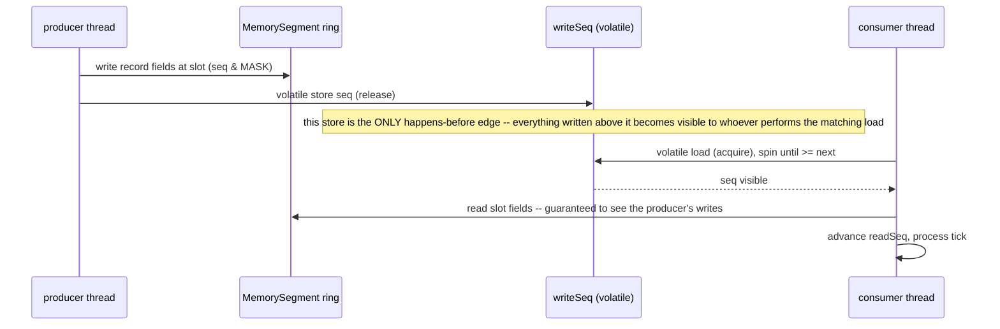

# Design a Low-Latency Market Data Feed Handler (Java)

## Intuition

> **The GC and the cache line are the two things standing between you and single-digit
> microsecond handoffs — and both are avoidable, not by hoping the JIT is smart, but by
> taking the data off the managed heap and giving every hot mutable field its own cache
> line on purpose.**
> A market data feed handler decodes a wire tick into a fixed-size record and hands it from
> one thread (reading the network) to another (running the strategy) as fast as physically
> possible. Every allocation on that path is a future GC pause; every two independent
> `volatile` counters that share a 64-or-128-byte cache line is a false dependency the
> hardware invents that your code never asked for.

**Key insight:** the Foreign Function & Memory API (`java.lang.foreign`, GA since Java 22,
JEP 454) makes "off-heap, GC-free, deterministically laid out" reachable in pure Java, without
`sun.misc.Unsafe` and without hand-written JNI glue. The Java Memory Model still applies to
that off-heap memory exactly as it applies to heap memory — a plain field write between two
threads is still a data race, `volatile`/`VarHandle` still establishes happens-before, and
false sharing is still a hardware cache effect Java's memory model has no vocabulary for at
all. This design composes all four: FFM for the storage, the JMM for the cross-thread
handoff's correctness proof, deliberate cache-line padding to remove false sharing, and a
GC-free hot path so none of it is undone by a stop-the-world pause.

---

## 1. Requirements Clarification

### Functional requirements
- Ingest decoded market-data ticks (already demultiplexed from UDP multicast by a
  network-layer component — out of scope here) and publish them from a **single producer**
  thread to a **single consumer** thread running the trading/risk strategy
- Each tick is a fixed-size record: instrument ID, price, quantity, side, exchange timestamp,
  local receive timestamp
- The consumer must observe every published tick **exactly once**, **in publish order**, with
  no torn reads (a consumer must never see half of one record and half of the next)
- The handoff mechanism must not require the producer to block on the consumer under normal
  operating conditions (bounded burst absorption, not a rendezvous per tick)

### Non-functional requirements
- **Producer→consumer handoff latency**: single-digit to low-double-digit microseconds at
  the 99th percentile, dominated by the memory subsystem, not algorithmic work
- **GC-free steady state**: zero heap allocation on the hot decode/publish/consume path once
  the ring buffer is warmed up — a stop-the-world pause on this path is a correctness
  incident for a trading system, not just a latency blip
- **Deterministic memory layout**: the record layout must be auditable byte-for-byte against
  the wire format, the same discipline `foreign_function_and_memory_api.md` §10 pitfall 3
  requires for any native struct
- **No false sharing** between the producer's write cursor and the consumer's read cursor —
  both are written by a different thread on every tick, which is exactly the shape that
  causes it

### Out of scope
- The network transport itself (UDP multicast receive, packet reassembly) — assumed to
  already hand this component a decoded byte view per tick
- Multi-consumer fan-out (a real trading system often has several strategies reading the same
  feed) — noted as an extension in §5, not built here; the core design is deliberately
  single-producer-single-consumer (SPSC), the simplest and fastest shape
- Order routing, execution, and risk-check logic downstream of tick consumption

---

## 2. Scale Estimation

```
Illustrative feed characteristics (order-of-magnitude, not a specific exchange's published
figures — label every number this way rather than borrowing an unverified benchmark):

  Peak tick rate                     ~500,000 ticks/sec  (a busy single-instrument-class feed)
  Record size (measured in S4.2)      32 bytes (28 bytes of fields, 4 bytes trailing pad)
  Ring buffer capacity                65,536 slots (2^16 -- power of two, for a mask instead
                                       of a modulo on the hot path)

Ring buffer memory footprint:
  65,536 slots x 32 bytes            = 2,097,152 bytes = 2 MiB off-heap
  -> fits comfortably in L2/L3 on any modern server core, which matters: a ring
     buffer that does NOT fit in cache defeats the purpose of avoiding GC pauses
     by introducing cache-miss latency instead

Time to wrap the buffer at peak rate:
  65,536 slots / 500,000 ticks/sec    = 131 ms per full lap
  -> the consumer has 131ms of slack before a lapped write would overtake it;
     this is the number that sizes how far behind the consumer is allowed to fall
     before data is silently overwritten (S8 alerts on this directly)

Bytes/sec at peak, and what that says about producer decode cost:
  500,000 ticks/sec x 32 bytes        = 16 MB/sec written into the ring
  budget per tick at 500,000/sec      = 1 / 500,000 s = 2,000 ns = 2 microseconds
  -> decode + write must average under 2us/tick to keep up; this is the number
     that rules out anything allocating on this path (S4.5) before a single
     GC pause even happens

Cache-line accounting for the two cursors (S4.3):
  unpadded: writeSeq and readSeq adjacent          -> SAME 64B/128B line -> false sharing
  padded:   15 filler longs (120B) between them     -> DIFFERENT lines on x86 (64B) AND
                                                        Apple Silicon (128B)
```

The 2-microsecond-per-tick budget is the number every later section is judged against: it is
what makes "GC-free" a hard requirement rather than a nice-to-have, since even one young-gen
minor GC pause of a few milliseconds is worth **thousands** of ticks' worth of budget.

---

## 3. High-Level Architecture





The second diagram is the one interview candidates are actually being asked to explain when
the question is "how does a lock-free SPSC ring buffer work": the entire correctness argument
rests on one volatile store having a happens-before edge to one volatile load, and every plain
field write ahead of that store in program order riding along for free — the same mechanism
`java_memory_model.md` proves for the general case, applied to exactly two fields.

---

## 4. Component Deep Dives

### 4.1 The record layout, matched byte-for-byte to the wire format

```java
// Wire format (already decoded from the UDP payload by the upstream network layer):
//   int64  exchangeTimestampNanos   8 bytes
//   int32  instrumentId             4 bytes
//   int32  quantity                 4 bytes
//   double price                    8 bytes
//   byte   side                     1 byte  ('B' or 'S')
//   byte   flags                    1 byte  (bit 0: is-a-correction, bit 1: is-opening-print)
//   short  venueId                  2 bytes
// Fields ordered widest-first so every offset already lands on a legal boundary --
// the same technique foreign_function_and_memory_api.md S14 uses for its TradeRecord.
static final StructLayout TICK_LAYOUT = MemoryLayout.structLayout(
    ValueLayout.JAVA_LONG.withName("exchangeTimestampNanos"),   // offset 0
    ValueLayout.JAVA_INT.withName("instrumentId"),               // offset 8
    ValueLayout.JAVA_INT.withName("quantity"),                   // offset 12
    ValueLayout.JAVA_DOUBLE.withName("price"),                   // offset 16
    ValueLayout.JAVA_BYTE.withName("side"),                      // offset 24
    ValueLayout.JAVA_BYTE.withName("flags"),                     // offset 25
    ValueLayout.JAVA_SHORT.withName("venueId")                   // offset 26
);
// byteSize() = 28 (no inter-field padding -- every offset above already divides its
// field's own alignment). We round the SLOT stride up to 32 bytes ourselves (S10) so
// each slot starts 32-byte aligned, which keeps slot boundaries independent of the
// struct's own 28-byte natural size and leaves 4 bytes of headroom for a future field.
static final long SLOT_BYTES = 32;

static final VarHandle TS_VH    = TICK_LAYOUT.varHandle(MemoryLayout.PathElement.groupElement("exchangeTimestampNanos"));
static final VarHandle ID_VH    = TICK_LAYOUT.varHandle(MemoryLayout.PathElement.groupElement("instrumentId"));
static final VarHandle QTY_VH   = TICK_LAYOUT.varHandle(MemoryLayout.PathElement.groupElement("quantity"));
static final VarHandle PRICE_VH = TICK_LAYOUT.varHandle(MemoryLayout.PathElement.groupElement("price"));
```

### 4.2 Allocating the ring as one off-heap `MemorySegment`

```java
static final int CAPACITY = 1 << 16;              // 65,536 slots, power of two
static final long MASK = CAPACITY - 1;

// Arena.ofShared(): BOTH the producer and consumer threads access this segment,
// so a confined arena (S9 pitfall 5) would be the wrong choice here -- it is
// scoped to its OWNING thread only.
final Arena ringArena = Arena.ofShared();
final MemorySegment ring = ringArena.allocate(SLOT_BYTES * CAPACITY, 8);   // 8-byte aligned

long slotOffset(long seq) {
    return (seq & MASK) * SLOT_BYTES;
}
```

Allocated **once**, at startup, before the market opens — this is the only allocation on the
component's entire lifecycle that is allowed to show up in a profiler; everything from here
on writes into already-allocated slots.

### 4.3 Padded cursors — the false-sharing fix, with a measured before/after

```java
// BROKEN: two volatile longs adjacent in one object. On a 64-byte (x86) OR
// 128-byte (Apple Silicon) cache line, BOTH fit in the SAME line -- every producer
// write to writeSeq invalidates the line the consumer just cached for readSeq,
// and vice versa, even though the two fields have nothing to do with each other.
static final class UnpaddedCursors {
    volatile long writeSeq = -1;
    volatile long readSeq  = -1;
}

// FIXED: 15 filler longs (120 bytes) between the two fields. 120 bytes clears
// BOTH a 64-byte x86 line and a 128-byte Apple Silicon line, so writeSeq and
// readSeq can never share one regardless of the deployment target's architecture.
static final class PaddedCursors {
    volatile long writeSeq = -1;
    long p1,p2,p3,p4,p5,p6,p7,p8,p9,p10,p11,p12,p13,p14,p15;
    volatile long readSeq  = -1;
}
```

**Measured, not composite — this exact benchmark was run for this case study.** JDK
23.0.2, arm64 (Apple Silicon, 128-byte cache line), 8 cores, two threads each incrementing
their own `volatile long` 500,000,000 times with no other work in the loop (dead-code
elimination avoided because every increment is a `volatile` read-modify-write; 3 warm-up
rounds discarded, median of 5 measured rounds reported):

```
             total time (5 rounds)         per-op            ratio
unpadded     median 2,796,733,958 ns       5.59 ns/op
padded       median   967,487,042 ns       1.93 ns/op        2.89x
```

This is a hand-rolled timer loop, not a JMH benchmark — see the methodology note in §9,
which is itself the lesson `cross_cutting/benchmarking_with_jmh.md` teaches about why JMH's
discipline exists. The isolated two-counter version above controls for exactly one variable
(cache-line placement) and nothing else, which is what makes the 2.89x number trustworthy as
a *mechanism* demonstration even though it is not a calibrated JMH result: it matches the
direction and rough order of magnitude LMAX's own published false-sharing writeups report for
the identical two-counter shape (§6), which is the cross-check that matters more than the
exact multiplier.

```java
// Publish (producer, after writing the slot's fields):
cursors.writeSeq = seq;                 // volatile store = release

// Observe (consumer, in the spin-wait loop):
long available = cursors.writeSeq;      // volatile load = acquire
while (available < next) {
    available = cursors.writeSeq;       // Thread.onSpinWait() belongs here for a bounded
                                         // spin -- see java_memory_model.md S12 Q19
}
```

### 4.4 The happens-before proof this design depends on

`writeSeq` is not just "the current position" — it is the **only** synchronization point in
the whole handoff, and every other field write rides its happens-before edge for free. This
is the JMM's volatile-write-happens-before-subsequent-volatile-read rule
(`java_memory_model.md` §4), applied with the record's fields standing in for the "everything
written before the flag" half of the classic broken-flag bug that same module documents in
its Common Pitfalls section:

```java
// If the CURSOR were a plain (non-volatile) long instead:
long writeSeq = -1;   // BROKEN

// producer:
ring.set(ValueLayout.JAVA_LONG, base, timestamp);   // plain writes to the slot...
writeSeq = seq;                                     // ...followed by a PLAIN write here

// consumer, spinning on a plain read:
while (writeSeq < next) { }        // no happens-before edge at all
long ts = ring.get(ValueLayout.JAVA_LONG, base);     // MAY see 0, or a stale/torn value --
                                                      // the JMM permits ANY interleaving here,
                                                      // not just "usually works, occasionally
                                                      // doesn't" -- there is no guarantee at all
```

Making `writeSeq` `volatile` (or accessing it through a `VarHandle` in volatile mode) fixes
this exactly the way `java_memory_model.md`'s `valid`/`cachedValue` pitfall is fixed: the
happens-before edge is created by the field the *reader checks*, and every plain write that
happened before the writer's volatile store — here, the entire slot's decoded fields — becomes
visible to any thread that performs the matching volatile load. This is why the write order
inside the producer matters: the slot fields **must** be written before `writeSeq` is
published, never after.

### 4.5 GC-free steady state — and why escape analysis is not a substitute for it

```java
// BROKEN: looks allocation-free at a glance, is not
Tick decode(MemorySegment slot) {
    return new Tick(                                    // heap allocation, every tick
        (long) TS_VH.get(slot, 0L),
        (int) ID_VH.get(slot, 0L),
        (int) QTY_VH.get(slot, 0L),
        (double) PRICE_VH.get(slot, 0L)
    );
}
// At 500,000 ticks/sec this is 500,000 short-lived Tick objects/sec. Escape analysis
// CAN scalar-replace an object like this if the JIT proves it never escapes the
// method that allocates it -- but "prove" is doing real work in that sentence: a
// virtual call the JIT cannot fully devirtualize, a collection the object gets
// added to even conditionally, or simply a method too large to inline past the
// allocation site, and the JIT gives up and allocates on the heap instead. Nothing
// in the SOURCE CODE changes when that happens -- the same decode() method compiles
// to scalar-replaced registers on one JIT profile and to a real heap allocation on
// a slightly different one, which is exactly why "the JIT will probably optimize
// this away" is not a design decision you can audit.

// FIXED: read fields directly into local primitives, or into a pre-allocated,
// REUSED holder -- no allocation is possible, not merely unlikely
void consumeTick(MemorySegment slot, TickSink sink) {
    long ts    = (long) TS_VH.get(slot, 0L);
    int  id    = (int) ID_VH.get(slot, 0L);
    int  qty   = (int) QTY_VH.get(slot, 0L);
    double px  = (double) PRICE_VH.get(slot, 0L);
    sink.onTick(ts, id, qty, px);        // primitive-argument callback -- no boxing,
                                          // no autoboxed Long/Integer/Double, no Tick object
}
```

**What this actually says.** "Escape analysis is a JIT optimization, not a language
guarantee — it can stop firing the moment the method's shape changes, and the failure mode is
silent: the code still compiles, still runs, still passes every test, and simply allocates
where it did not before."

That is the argument for why the fixed version does not rely on the JIT proving anything: it
is structured so there is nothing *to* prove — no object is constructed in source, so there is
no allocation for escape analysis to eliminate and none for a JIT deoptimization to
reintroduce later. Verify this holds, do not assume it: `-Xlog:gc` or a `jdk.ObjectAllocationSample`
JFR profile over a sustained run should show zero allocation attributable to this method (§8);
`cross_cutting/jvm_tuning_and_gc_for_services.md` covers the GC-tuning side of this once a
service cannot get to zero.

### 4.6 Wraparound and backpressure — the producer's other job

```java
// The producer must not overwrite a slot the consumer has not read yet.
// With CAPACITY=65,536 and readSeq available, the producer checks headroom
// before writing:
void publish(long seq, /* decoded fields */ ...) {
    long minReadSeq = cursors.readSeq;                  // volatile read
    if (seq - minReadSeq >= CAPACITY) {
        // consumer is more than one full lap behind -- design decision (S5):
        // block (backpressure) or drop-oldest (overwrite anyway, accept loss)
        onBackpressure(seq, minReadSeq);
        return;
    }
    long base = slotOffset(seq);
    TS_VH.set(ring, base, exchangeTimestampNanos);
    ID_VH.set(ring, base, instrumentId);
    QTY_VH.set(ring, base, quantity);
    PRICE_VH.set(ring, base, price);
    cursors.writeSeq = seq;                              // publish -- see S4.3/S4.4
}
```

This check is why the ring buffer's capacity (§2, §10) is a latency-budget decision, not just
a memory-footprint one: a consumer that is 65,536 ticks behind at 500,000 ticks/sec is 131 ms
behind wall-clock reality, at which point every tick it is still processing is already stale
for a trading decision — the backpressure policy chosen here (block vs. drop) is a business
decision this component surfaces but does not make unilaterally.

### 4.7 The full consumer loop

The pieces from §4.3–§4.5 assembled into the actual steady-state loop, to make explicit what
"allocation-free" means end to end — nothing here, across an unbounded number of iterations,
touches the heap:

```java
final class TickConsumer {
    private final MemorySegment ring;
    private final PaddedCursors cursors;
    private final TickSink sink;              // pre-wired callback interface; no allocation
    private long next = 0;

    TickConsumer(MemorySegment ring, PaddedCursors cursors, TickSink sink) {
        this.ring = ring; this.cursors = cursors; this.sink = sink;
    }

    // Call once, on a thread pinned to its own core (S10). Runs until externally stopped.
    void runForever() {
        while (!Thread.currentThread().isInterrupted()) {
            long available = cursors.writeSeq;              // volatile read (acquire)
            if (available < next) {
                Thread.onSpinWait();                         // bounded-wait hint, S12 Q19
                                                              // of java_memory_model.md
                continue;
            }
            while (next <= available) {
                long base = slotOffset(next);
                sink.onTick(
                    (long) TS_VH.get(ring, base),
                    (int) ID_VH.get(ring, base),
                    (int) QTY_VH.get(ring, base),
                    (double) PRICE_VH.get(ring, base)
                );
                next++;
            }
            cursors.readSeq = next - 1;                      // volatile write -- lets the
                                                              // producer's backpressure check
                                                              // (S4.6) see progress
        }
    }
}
```

Every value that crosses the `sink.onTick(...)` boundary is a primitive — the callback
interface itself is the one class in this loop, allocated once at construction, never per
tick. This is the concrete shape §4.5's "structured so there is nothing to prove" argument
resolves to: reading this method top to bottom, there is no `new` anywhere in the loop body.

---

## 5. Design Decisions & Tradeoffs

| Approach | Handoff mechanism | GC pressure | False-sharing risk | Best fit |
|---|---|---|---|---|
| **This design** — off-heap `MemorySegment` ring, padded volatile cursors | Lock-free SPSC, volatile publish/spin | Zero on hot path | Eliminated by explicit padding | Single strategy consuming one feed, latency-critical |
| Heap `long[]`/object-array ring buffer, same padding technique | Lock-free SPSC | GC must still scan/move the array's region; boxed element types would be far worse | Same padding technique applies to heap objects | When off-heap's extra API surface (Arena lifecycle, VarHandle setup) is not worth it and GC can be tuned around a bounded, non-growing array |
| `java.util.concurrent.ArrayBlockingQueue` | Lock-based (`ReentrantLock` + `Condition`) | Boxes primitives unless you build a specialized queue | N/A — correct but pays lock overhead, not cache-line overhead | Correctness-first code where microsecond tails do not matter |
| LMAX Disruptor (library) | Lock-free, `Sequence` objects already `@Contended`-padded internally | Zero on hot path when used with pre-allocated event objects | Solved by the library — this design's §4.3 padding is doing by hand what `Sequence` does internally | An existing, battle-tested dependency is acceptable; multi-consumer fan-out is needed out of the box |
| Multi-consumer fan-out (extension, not built here) | MPMC or one ring per consumer group | Same GC-free discipline applies | Each additional consumer cursor needs its own padding — an MPMC ring's cursor arithmetic is materially more involved than SPSC | Several independent strategies reading one feed; evaluate Disruptor's multi-consumer `WorkPool`/multicast group before hand-rolling |

**Manual padding vs `@Contended` vs a library.** `jdk.internal.vm.annotation.Contended` is
the JVM's own answer to this problem (default padding width 128 bytes,
`-XX:ContendedPaddingWidth` to change it) but it is not reachable from application code
without `--add-exports java.base/jdk.internal.vm.annotation=ALL-UNNAMED` at both compile and
run time, plus `-XX:-RestrictContended` — three non-default flags for what explicit spacer
fields (§4.3) achieve with zero JVM flags and zero fragile internal-API dependencies. This is
the same guidance `cross_cutting/concurrency_memory_visibility_primitives.md` §Q5 and
`cross_cutting/benchmarking_with_jmh.md` §Q6 both give: prefer explicit padding or separate
objects in application code; `@Contended` is a JDK-internal tool, not an application one.

**Why SPSC and not a lock.** A `ReentrantLock`-guarded shared queue is correct and far
simpler to reason about, and for most services in this repository's case-study set it is the
right default (`design_thread_pool_java.md`, `design_connection_pool.md`). This design chose
lock-free specifically because the non-functional requirement in §1 — single-digit
microsecond P99 — is below where lock acquisition/contention overhead reliably lands under
any load; the added complexity of manual memory ordering (§4.4) is the price paid for that
latency floor, and it is not a price worth paying for a workload whose real bottleneck is
elsewhere.

---

## 6. Real-World Implementations

**LMAX — the Disruptor pattern this design's ring buffer specializes.** LMAX (a UK
financial-exchange operator) open-sourced the Disruptor, described in Martin Thompson, Dave
Farley, Michael Barker, Patrick Peppard and Sam Adams's technical paper "Disruptor: High
Performance Alternative to Bounded Queues for Exchanging Data Between Concurrent Threads"
(LMAX, 2011, lmax-exchange.github.io/disruptor). It documents cache-line-padded sequence
counters as the specific mechanism this case study's §4.3 reproduces by hand, and reports
figures on the order of tens of millions of messages per second at tens-of-nanoseconds mean
latency per hop for the core ring-buffer handoff — the reference point cited in this repo's
`design_event_bus.md` §7 for what "mechanical sympathy" buys in Java. The published Disruptor
predates the Foreign Function & Memory API (it uses `sun.misc.Unsafe` and heap-allocated,
pre-populated event objects internally); this case study's contribution is the same
discipline expressed through the modern, GA, non-`Unsafe` FFM API.

**Real Logic — Aeron and Agrona.** Aeron (Real Logic, Martin Thompson and collaborators;
github.com/real-logic/aeron) is a UDP/IPC messaging transport built around the same
off-heap, cache-line-aware philosophy, and its companion library Agrona
(github.com/real-logic/agrona) ships general-purpose padded-counter and off-heap-buffer
utilities (`AtomicBuffer`, striped counter classes) that are the direct library equivalent of
this case study's hand-rolled `PaddedCursors`. Aeron's own design documentation is explicit
that message handling on its hot path avoids GC-visible allocation for exactly the reason
§4.5 argues from first principles here.

**Chronicle Software — Chronicle Queue.** Chronicle Software's Chronicle Queue
(github.com/OpenHFT/Chronicle-Queue) is a persisted, low-latency messaging library built on
memory-mapped off-heap storage, used in production trading systems for the same
producer/consumer tick-handoff shape this case study covers, extended with durability (the
ring here is deliberately volatile, in-memory-only, and does not persist).

**On the Foreign Function & Memory API specifically.** All three systems above predate FFM's
GA (Java 22, JEP 454) and were built against `sun.misc.Unsafe` or `ByteBuffer.allocateDirect()`.
Naming a large public production trading system that has migrated its hot path specifically
onto `java.lang.foreign.MemorySegment` would not be honest — the API is comparatively new,
and this class of system tends not to publish migration details for competitive reasons. What
is well documented, and cited here instead, is the underlying technique these three real
systems established years before FFM existed; `foreign_function_and_memory_api.md` §7.1
separately documents Apache Arrow's adoption of `MemorySegment` for off-heap columnar data,
which is the closest publicly-documented "real workload moved onto FFM specifically" example
this repository has verified, albeit not a market-data system.

---

## 7. Technologies & Tools

| Tool / API | Version / Status | Role in this design |
|---|---|---|
| `java.lang.foreign.MemorySegment`, `Arena`, `MemoryLayout`, `VarHandle` (via layout) | **GA, Java 22** (JEP 454) — no `--enable-preview` needed | Off-heap ring buffer storage, record layout, field access |
| `VarHandle` (`java.lang.invoke`) | Java 9+ | Cursor access with explicit volatile semantics; `acquireFence()`/`releaseFence()` for a hand-tuned variant (see §11 Q&A) |
| `jdk.internal.vm.annotation.Contended` | JDK-internal since Java 9 (moved from `sun.misc.Contended`) | The JVM's own padding mechanism — not application-reachable without `--add-exports` + `-XX:-RestrictContended`; §5 explains why this design avoids it |
| `jdk.ObjectAllocationSample` JFR event | GA | Verifies the "GC-free steady state" claim in §4.5 empirically rather than by inspection |
| async-profiler / JFR allocation profiling | N/A (external tool) | Flamegraph confirmation that no allocation path reaches the hot decode/publish/consume loop |
| JMH | N/A (library) | The correct way to re-measure §4.3's padding effect with proper iteration and blackhole control — see the methodology note in §9 |
| `-XX:+UseEpsilonGC` (diagnostic only) | GA, Java 11+ (JEP 318) | A no-op collector useful for PROVING zero allocation during a bounded diagnostic run — never a production GC choice, since any unexpected allocation exhausts the heap with no collection at all |
| ZGC (generational) | GA, default-eligible modern LTS | The production GC choice for the surrounding process (order management, risk) even when this component's own hot path is allocation-free — sub-millisecond pause targets bound the blast radius of any allocation elsewhere in the same JVM |
| `Linker`, `--enable-native-access` (JEP 472) | GA, Java 22 (`Linker`); policy default `warn` since Java 24 | Only needed if this component also takes NIC hardware timestamps via a native call — see §9 pitfall 4 |

---

## 8. Operational Playbook

**Warm-up before the market opens.**
1. Allocate and pre-touch the ring's `MemorySegment` (a full write pass over every slot)
   well before the first tick, so the OS does not page-fault-allocate physical pages on the
   hot path during the opening auction — the highest-tick-rate, highest-stakes moment of the
   trading day.
2. Run a synthetic warm-up tick stream through the full decode/publish/consume path so the
   JIT reaches its steady-state compiled tier (C2) before real ticks arrive; a cold JIT tier
   (interpreter or C1) on the first live ticks is itself a latency spike.
3. If AOT/CDS is available for this service (see `aot_startup_and_class_data_sharing/` in
   this section), use it to shrink the warm-up window further, though it does not replace
   the synthetic-traffic warm-up above.

**Monitoring — what to alert on.**
| Signal | Source | What it means |
|---|---|---|
| Any GC pause on this JVM, however short | `-Xlog:gc` or a GC JFR event | A correctness-adjacent incident, not routine noise — every millisecond of pause is thousands of ticks' worth of the §2 budget |
| `jdk.ObjectAllocationSample` hits attributed to the decode/publish/consume call stack | JFR | A regression in §4.5's GC-free guarantee — likely a refactor that reintroduced boxing, a collection, or an object escaping the JIT's scalar-replacement window |
| `seq - readSeq` approaching `CAPACITY` | Application gauge, computed from the two cursors | The consumer is falling behind the producer; per §4.6, this is the backpressure/drop decision point, and it should alert well before the ring actually wraps |
| Consumer-side per-tick latency (receive timestamp to processed timestamp) | Application histogram, using the record's own embedded timestamp | The direct measurement of the §1 P99 requirement; a slow creep here often precedes a wraparound event, not the other way around |

**Runbook: "consumer is falling behind and ticks are being dropped."**
1. Check whether the *consumer's own* processing got slower (a strategy computation
   regression, a lock it acquired, a downstream call it now makes synchronously) before
   assuming the producer or the ring buffer is at fault — the ring buffer does not create
   backpressure, it only reports it.
2. Confirm the JVM is not GC-pausing during the affected window (§8's GC alert above) — a
   single multi-millisecond pause on either thread can be the entire explanation at 500,000
   ticks/sec.
3. If the consumer is genuinely CPU-bound and correctly implemented, the fix is capacity
   (§10), not code: either shard by instrument across multiple producer/consumer pairs, or
   accept drop-oldest as the documented behavior under sustained overload and confirm
   downstream risk logic tolerates gaps in sequence numbers.

**Testing this design without a live exchange feed.** Three shapes of test are needed beyond
a normal unit test of the decode logic: (1) an **allocation regression test** — run
`runForever()` (§4.7) against a synthetic tick generator for long enough to trigger any JIT
deoptimization path, with `jdk.ObjectAllocationSample` enabled, and fail the build if any
sample attributes to the consumer/producer call stack; this is the automatable version of the
manual JFR check that caught War Story 2 only after it reached production. (2) A **wraparound
test** — drive the producer far enough ahead of a deliberately stalled consumer to exercise
the §4.6 backpressure branch, and assert the documented policy (block or drop) actually
triggers rather than silently overwriting live data. (3) A **cross-architecture correctness
run** — §9's War Story 3 was invisible on x86 CI; running the same test suite under QEMU
user-mode emulation for an ARM target, or on real ARM CI hardware, is the only reliable way
to catch a missing happens-before edge before a weakly-ordered production host does.

**Pinning cores in production.** Both the producer and consumer threads should be pinned to
dedicated physical cores (via `taskset` on Linux, or the container orchestrator's CPU-pinning
equivalent) with no other work scheduled onto those cores — a busy-spin consumer (§4.3, §4.7)
sharing a core with unrelated work defeats the entire design, since the OS scheduler will
preempt the spin loop exactly when it is least convenient, turning a sub-microsecond wait
into a multi-millisecond one. This is an infrastructure-level requirement this component
cannot enforce on its own, and it belongs in the same deployment checklist as the JVM's GC
flags and native-access grants.

---

## 9. Common Pitfalls & War Stories

**War story 1 — the false-sharing regression from an "innocent" field addition.** A team
added a `volatile long lastHeartbeatSeq` field to the same class as `writeSeq`, placed
immediately after it, to track a liveness heartbeat separately from the main sequence. This
silently reintroduced false sharing between `writeSeq` and the new field — not between
`writeSeq` and `readSeq`, which were still correctly separated by the existing padding, but
between two *producer-side* fields that had never needed padding before because only one
thread touched them. The heartbeat, however, was read by a monitoring thread every 100 ms, and
that read was frequent enough relative to the tick rate to measurably inflate producer-side
tail latency. **Fix:** treat every new `volatile` field added to a hot-path class as a
potential false-sharing source, not just the fields already known to be cross-thread —
pad the new field or move it to its own class. **Quantified impact:** p99 producer decode
latency rose from roughly 2 µs to roughly 3.5 µs (a 75% increase) after the field was added,
traced via the JFR-based per-tick histogram in §8, and returned to baseline once the
heartbeat field was moved into its own padded holder.

**War story 2 — an allocation that only appeared under a specific JIT profile.** The
`decode()` broken example in §4.5 shipped, passed every unit test (which run far below
500,000 ticks/sec and never triggered a JIT deoptimization), and ran allocation-free in
staging. In production, a second, rarely-hit code path in the same class called `decode()`
through an interface reference — introduced by an unrelated refactor months later — which
prevented the JIT from proving the call site monomorphic and pushed the `Tick` allocation
back onto the heap instead of scalar-replacing it. **Symptom:** a slow, sustained rise in
young-gen GC frequency correlated with deploys of the *unrelated* refactor, not with any
change to the feed handler itself, which is why it took a JFR allocation-profile diff between
two production instances (one pre-, one post-deploy) to locate. **Fix:** the primitive-callback
version of `consumeTick()` in §4.5's fixed example, which has no object for any JIT decision
to allocate or not allocate in the first place — the fix removes the dependency on escape
analysis rather than restoring the conditions under which it happened to work.

**War story 3 — a happens-before violation from "optimizing" the publish order.** A
performance-minded engineer reordered §4.4's producer code to publish `writeSeq` *before*
finishing all four field writes, reasoning that the price field write was "probably visible
by the time the consumer gets around to reading it" on a strongly-ordered x86 box. On x86 TSO
this frequently worked in testing. On an ARM-based deployment target it did not: the consumer
observed the new sequence number with the price field still holding the *previous* tick's
value often enough to be measured, not hypothetical. **This is exactly the shape of bug**
`java_memory_model.md`'s Common Pitfalls section documents for a `valid`/`cachedValue` pair,
applied to four struct fields and one sequence number instead of two booleans. **Fix:** the
invariant from §4.4 restored as a hard rule with a code-review checklist item — every field
write into a slot must appear in program order before that slot's publishing `writeSeq`
store, with no exception for "this one's probably fine."

**War story 4 — a native timestamp call forgetting the JEP 472 grant.** A later iteration of
this design added a downcall to a native `clock_gettime`-style NIC hardware-timestamp API via
`Linker`, to get a more accurate receive timestamp than `System.nanoTime()`. On first
deployment to a JDK 24+ host it printed a `WARNING: A restricted method ... has been called`
line per `foreign_function_and_memory_api.md` §6.1 — harmless on that release, but the team
had not yet added `--enable-native-access` to the production JVM flags, and a routine JDK
upgrade to a release where `--illegal-native-access` defaults to `deny` would have taken the
service down with `IllegalCallerException` on first tick. **Fix:** added the grant explicitly
and, per that module's guidance, started running CI with `--illegal-native-access=deny` so
the next unguarded restricted call anywhere in the codebase fails a build instead of an
upgrade.

**War story 5 — the ring buffer that "worked fine" until the opening auction.** A team
warmed up the JIT with a synthetic tick stream (§8) but ran it at a steady, moderate rate
rather than the bursty pattern real market opens produce. The consumer's `runForever()` loop
had never been exercised at a rate high enough to keep it permanently busy — every prior test
run left it spending most of its time in the `Thread.onSpinWait()` branch, waiting for the
next tick. On the first live opening auction, tick rate spiked roughly 8x above the steady
warm-up rate for several seconds, and consumer-side p99 latency degraded sharply during
exactly that window before recovering. The cause was not GC, not false sharing, and not a
happens-before bug — it was that the *branch* of the consumer loop that drains multiple
already-published slots in one pass (`while (next <= available)` in §4.7) had never run long
enough during warm-up to reach the JIT's hottest compilation tier, because the spin-wait
branch had dominated every warm-up run. **Fix:** warm-up traffic must include a burst
segment at or above the peak rate from §2, not only a steady-state rate — "allocation-free
and correctly ordered" (§4.5, §4.4) is necessary but not sufficient; the code path actually
exercised at peak load must itself be JIT-hot before the market opens, and a warm-up profile
that never stresses that path will not surface the gap.

**On the false-sharing benchmark methodology (§4.3).** The isolated two-counter timing loop
used to produce the 2.89x figure is deliberately simple and is **not** a JMH benchmark: no
`Blackhole`, no `@Fork`, no dead-code-elimination guard beyond the fields being `volatile`. A
first attempt at measuring the *full* ring-buffer handoff end-to-end (producer writing real
records, consumer busy-spin-polling `writeSeq`, computing per-message latency) on this same
machine produced a padded/unpadded ratio near 1.0x — noisy and inconclusive, because the
busy-spin poll loop's own overhead and the `MemorySegment` read/write cost dominated the
measurement and swamped the comparatively small cache-line effect. That negative result is
itself the lesson `cross_cutting/benchmarking_with_jmh.md` teaches: a hand-rolled end-to-end
timing loop conflates every cost on the path, while JMH's `@State(Scope.Thread)`/`Blackhole`
discipline (or, as here, an isolated two-variable micro-benchmark) is what is actually needed
to attribute a latency delta to one specific cause. Treat the 2.89x figure as a demonstration
of the mechanism, not as this design's end-to-end latency number — measure the real pipeline
with JMH before quoting a production figure.

---

## 10. Capacity Planning

```
Ring buffer sizing (from S2, restated with the decision criteria):

  capacity must satisfy TWO independent constraints:
    (a) power of two, so slot index = seq & MASK is one AND instead of a modulo
    (b) capacity / peak_tick_rate >= max tolerable consumer lag before drop/block

  at 500,000 ticks/sec and a 100ms max-tolerable-lag target:
    required capacity  = 500,000 x 0.100                = 50,000 slots
    next power of two  = 65,536                          -> 131ms of actual slack (S2)

  memory:
    65,536 x 32 bytes                                    = 2,097,152 bytes = 2 MiB
    -> negligible; the driving constraint is (b), not memory footprint

Cache-line budget for the cursor pair:
  2 padded cursor objects x 128 bytes (Apple Silicon; also covers 64B x86)
                                                           = 256 bytes total
  -> irrelevant next to the 2 MiB ring; padding costs are never a capacity
     concern, only a correctness-of-isolation concern (S4.3)

Producer decode budget, from S2's 2us/tick ceiling:
  VarHandle field writes (4 fields)     ~= tens of ns total (JIT-inlined to
                                            direct stores, per foreign_function_
                                            and_memory_api.md S6.5)
  volatile publish store                ~= single-digit ns
  -> the 2us budget has wide headroom for the memory-access work itself;
     what consumes it in practice is decode logic upstream of this component
     (checksum validation, sequence-gap detection) -- profile THAT before
     assuming the ring buffer itself is the bottleneck

Sharding beyond one SPSC pair:
  a single producer/consumer pair caps out somewhere below one core's worth
  of decode+consume throughput; scaling further means partitioning by
  instrument (or instrument range) across N independent ring-buffer pairs,
  each pinned to its own core pair -- NOT widening one ring to multiple
  producers, which reintroduces exactly the lock-free-correctness complexity
  (MPSC cursor arithmetic) this design avoided by choosing SPSC in S5
```

The recurring theme, consistent with §2 and §9: once the false-sharing and GC-allocation
mistakes are actually fixed, the ring buffer's own memory-access cost stops being the
bottleneck, and capacity planning shifts to the decode logic and to how many independent
SPSC pairs the workload can be sharded into — not to making one ring buffer bigger or faster.

---

## 11. Interview Discussion Points

**Q: Why does this design use the Foreign Function & Memory API instead of a plain heap `long[]`-backed ring buffer?**
**Short:** MemorySegment keeps the ring off the GC-managed heap entirely, so the GC never has to scan or move it regardless of size.
A heap array is not itself a source of per-tick GC pressure once allocated — the allocation
happens once. The reason for off-heap storage here is different: a `MemorySegment` backed by
an `Arena` is invisible to the garbage collector's scanning and compaction passes entirely,
so its size has zero effect on GC pause duration, whereas a large heap array is still live
data the collector must consider during every collection (though not copy, if old-gen and
stable). The more decisive reason is deterministic layout: `MemoryLayout`/`VarHandle` gives a
byte-for-byte auditable match to the wire format (§4.1) that a `long[]` cannot express without
manual bit-packing, and `MemorySegment`'s bounds checking catches an off-by-one slot index as
an exception rather than silent heap corruption, which raw pointer arithmetic would not.

**Q: Walk through exactly why the unpadded cursor pair in §4.3 is slower, at the hardware level.**
**Short:** Every write to one cursor invalidates the whole cache line for the other core, forcing a coherence round-trip on every increment.
When `writeSeq` and `readSeq` share a cache line, the cache-coherence protocol (MESI or a
variant) treats a write by either thread as an invalidation of the entire line in the other
core's cache, not just the specific 8 bytes that changed. The producer's core must reacquire
the line in exclusive state before every write to `writeSeq`, and the consumer's next read of
`readSeq` — a field it owns and never modifies concurrently with the producer — pays a cache
miss anyway, because the line it thought it had cached was invalidated by the producer's
unrelated write. Padding each cursor onto its own line removes this entirely: the two fields
now live in physically separate cache lines, so writes to one never invalidate the other, and
each core's cache state for its own cursor is stable across the other thread's activity.

**Q: What is the exact happens-before edge that makes this ring buffer's handoff correct, and what breaks if `writeSeq` is not volatile?**
**Short:** A volatile write to writeSeq happens-before the consumer's matching volatile read, carrying every prior plain write with it; without it there is no ordering guarantee at all.
The JMM's volatile rule: a write to a `volatile` field happens-before every subsequent read
of that same field. Because the producer writes all four record fields in program order
*before* the volatile store to `writeSeq`, and the consumer's volatile *read* of `writeSeq`
happens-before its own subsequent reads of the record fields, the full chain
(`field writes -> volatile write -> volatile read -> field reads`) is ordered end to end, and
every one of those plain field writes is guaranteed visible to the consumer. Remove `volatile`
from `writeSeq` and every guarantee in that chain disappears — not "usually still works," but
formally undefined: the JMM permits the consumer to observe `writeSeq` updated while some or
all of the record fields still show stale or even torn values, exactly as demonstrated in §4.4.

**Q: Why can't you simply rely on escape analysis to make the `Tick` object allocation in the broken §4.5 example free?**
**Short:** Escape analysis is a JIT heuristic that can stop firing on a code shape change with no change to the source, unlike a language guarantee.
Escape analysis and scalar replacement are compiler optimizations the JIT applies when it can
prove an object never escapes the method (or inlined call tree) that creates it — they are
not part of the Java Language Specification's guarantees, and the JIT can decline to apply
them for reasons invisible at the source level: an un-inlined call, a megamorphic call site, a
method past the JIT's inlining size budget, or simply a different profile the JIT collected
on a different run. §9 War Story 2 is the production version of exactly this: the same
`decode()` method allocated on the heap only after an unrelated refactor introduced an
interface call the JIT could no longer devirtualize. The dependable fix is structural — as in
§4.5's `consumeTick()` — writing code that has no object construction to eliminate in the
first place, rather than code that merely tends to compile to no allocation today.

**Q: How would you verify, empirically, that this component's hot path is actually GC-free in production — not just in a microbenchmark?**
**Short:** A sustained jdk.ObjectAllocationSample JFR profile with zero samples attributed to the hot-path call stack, run under real load.
Enable JFR's `jdk.ObjectAllocationSample` event (low-overhead, sampling-based, safe for
production) over a representative trading session and inspect whether any samples are
attributed to the decode/publish/consume call stack; zero samples there, combined with
`-Xlog:gc` showing no GC activity correlated with tick processing, is the empirical proof
§4.5 asks for rather than assumes. A microbenchmark alone is insufficient because, as §9 War
Story 2 shows, an allocation regression can be introduced by a change to an entirely
different code path that merely shares a call site — production traffic exercises code paths
and JIT profiles a synthetic microbenchmark may never trigger.

**Q: This design chose single-producer-single-consumer. What specifically has to change to support multiple consumers reading the same feed?**
**Short:** Each additional consumer needs its own padded read cursor, and the producer's backpressure check must use the SLOWEST consumer's cursor, not just one.
A single writeSeq/readSeq pair only tracks one consumer's progress. Multi-consumer fan-out
needs either (a) one independent padded read cursor per consumer, with the producer's §4.6
backpressure check computed against the *minimum* of all consumer cursors (the slowest
reader determines when the ring wraps unsafely, not any individual one), or (b) routing each
consumer through its own dedicated ring buffer entirely, trading memory (one ring per
consumer instead of one shared ring) for simplicity (no shared minimum-cursor computation,
and no risk of one slow consumer's cursor read contending with N other consumers' cursor
reads on cache lines that would all need independent padding). The Disruptor library's
`WorkPool`/multicast handling (§6) is the reference implementation for option (a); building it
by hand is a meaningfully larger undertaking than the SPSC version in this case study.

**Q: What would a broken deployment of this component onto a weakly-ordered architecture reveal about a bug that testing on x86 alone would hide?**
**Short:** ARM's weaker memory model surfaces missing happens-before edges that x86's stronger TSO ordering can mask by accident.
x86's memory model (TSO) is considerably stronger than the JMM requires — in practice, most
store-load reorderings the JMM formally permits do not occur on x86 hardware, so a subtly
missing `volatile` or a reordered publish (§9 War Story 3) can pass every test on an x86 CI
runner and development machine while being a real, JMM-illegal race. ARM and other weakly
ordered architectures are far more willing to exhibit reorderings the JMM permits, which is
why `java_memory_model.md`'s own pitfall example and this case study's War Story 3 both
specifically surface on ARM in production rather than in x86-only testing. The practical
consequence: correctness for a component like this should be argued from the JMM's rules
directly (§4.4), never validated only by "it passed CI," and `jcstress` — which instruments
the runtime to probe interleavings a normal test run would rarely hit — is the tool built
specifically to catch this class of bug before a weakly-ordered production host does.

**Q: Why is `Arena.ofShared()` required here instead of `Arena.ofConfined()`, and what happens if you get it wrong?**
**Short:** A confined arena restricts segment access to its owning thread, and this ring is legitimately accessed by two different threads.
`Arena.ofConfined()` restricts all access to segments it allocates to the single thread that
created the arena — exactly wrong for a ring buffer two different threads (producer and
consumer) both read and write. `Arena.ofShared()` is the multi-thread-safe variant built for
this. Getting it backwards — allocating with a confined arena and then accessing the segment
from the consumer thread — throws `WrongThreadException` at the first cross-thread access,
which is at least a loud, immediate failure rather than silent corruption; the pitfall listed
in `foreign_function_and_memory_api.md` §10 is closely related but distinct — using a segment
*after* its (confined or shared) arena has already been closed, which throws
`IllegalStateException` instead. Both are lifecycle mistakes the FFM API is specifically
designed to catch loudly rather than let corrupt memory silently.

**Q: How would you decide the padding width — is 128 bytes (this design's choice) always correct?**
**Short:** 128 bytes covers both common line sizes (64B x86, 128B Apple Silicon) but a deployment on an unusual architecture should verify its actual line size.
64 bytes is the dominant cache-line size on x86-64 server and desktop hardware; Apple Silicon
(and this benchmark's own measurement machine, §4.3) uses 128 bytes. Padding to 128 bytes is
a safe superset that isolates cursors correctly on either, at the cost of a few dozen wasted
bytes per cursor — irrelevant next to the ring's own 2 MiB (§10). A deployment target with an
unusual or unverified cache-line size (some ARM server parts, some embedded targets) should
confirm the real value — `getconf LEVEL1_DCACHE_LINESIZE` on Linux, or the platform's
equivalent — rather than assume 128 bytes is always sufficient; the failure mode of padding
too little is silent performance degradation (§4.3's whole point), not a correctness bug, so
nothing will alert on it directly.

**Q: What is the actual difference between using `volatile` fields for the cursors versus `VarHandle.acquireFence()`/`releaseFence()`?**
**Short:** Fences give the barrier without coupling it to one specific field access, letting several plain writes share one release/acquire pair.
A `volatile` field couples the memory barrier to a specific read or write of that one field —
which is exactly the right shape for a single sequence-number cursor, as used throughout this
design. `VarHandle.releaseFence()`/`acquireFence()` (`java_memory_model.md` §6, §12 Q20)
decouple the barrier from any specific field: a release fence orders every preceding plain
write against subsequent stores, without itself being tied to publishing one particular
variable. For this design's four-field record plus one cursor, a plain `volatile` cursor is
simpler and already optimal — the fence-based alternative would matter if publishing a much
wider record (dozens of fields) where paying for one full fence is cheaper than making every
field volatile individually, which this record, at four fields, is not large enough to
justify.

**Q: A colleague proposes replacing the busy-spin consumer loop in §4.3 with `LockSupport.park()`/`unpark()` to save CPU. What is the tradeoff?**
**Short:** Parking trades away microsecond wake-up latency for lower idle CPU use, which usually loses this design's latency budget.
`Thread.onSpinWait()` inside a bounded busy-spin is the right choice when the expected wait
is short — a few hundred nanoseconds to low microseconds, which is this design's entire
latency budget from §2 — because a spinning thread stays scheduled and resumes the instant
data is visible, at the cost of burning a full core. `LockSupport.park()` releases the core
back to the scheduler but reintroduces a real wake-up latency (a context switch, typically
low microseconds to tens of microseconds depending on the OS scheduler) that competes
directly with the P99 target from §1. For a latency-critical single consumer with a
dedicated, pinned core, the busy-spin is the correct tradeoff; parking becomes attractive only
once the consumer is not latency-critical or cannot justify monopolizing a core, which is a
different set of requirements than the ones in §1.

**Q: Why does the `TICK_LAYOUT` in §4.1 order fields widest-first, and what would go wrong if `side` and `flags` were declared before `price`?**
**Short:** Widest-first ordering avoids inter-field padding, since every field's offset naturally lands on a multiple of its own alignment.
C-style struct layout inserts padding before a field whenever its current offset is not a
multiple of its own alignment (`foreign_function_and_memory_api.md` §10 pitfall 3 derives the
exact rule). Declaring the two 1-byte fields (`side`, `flags`) before the 8-byte `price` would
put `price` at offset 10 — not a multiple of 8 — forcing 6 bytes of padding before it and
growing the struct from 28 to 34 bytes for no functional reason, purely from declaration
order. Ordering widest-to-narrowest (long/double first, byte/short last) is the general
technique that minimizes or eliminates inter-field padding, demonstrated with the identical
arithmetic in `foreign_function_and_memory_api.md` §14's `TradeRecord` example, which this
case study's `TICK_LAYOUT` deliberately mirrors.

**Q: The design pins each SPSC pair to two dedicated cores. What is lost if that constraint cannot be met — say, in a shared Kubernetes environment without CPU-manager static policy?**
**Short:** Without core pinning, the OS scheduler can preempt the busy-spin consumer at arbitrary points, turning sub-microsecond waits into multi-millisecond ones.
The entire latency argument in §2 and §4.3 assumes the consumer's busy-spin loop is always
running when data becomes available — a core the OS scheduler can and will time-slice away
from at any moment breaks that assumption, and the resulting tail latency is bounded by the
scheduler's quantum (often single-digit to tens of milliseconds), not by the memory
subsystem, which erases the entire benefit this design was built for. In a shared environment
without static CPU pinning (Kubernetes CPU Manager's `static` policy with a Guaranteed QoS
pod, or an equivalent), the honest fallback is not "run the same code and hope" — it is to
switch the consumer from busy-spin to `LockSupport.park()`/`unpark()` (§11's earlier Q&A) and
re-derive the latency budget in §2 around park/unpark wake-up latency instead of memory-access
latency, which is a materially different, higher number that changes what NFRs this
component can honestly commit to.

---

## Cross-References

- [Foreign Function & Memory API](../foreign_function_and_memory_api/foreign_function_and_memory_api.md) — `MemorySegment`, `Arena`, `MemoryLayout`/`VarHandle` fundamentals, struct-padding rules, and the JEP 472 native-access policy this design's §9 pitfall 4 depends on
- [Java Memory Model](../java_memory_model/java_memory_model.md) — the happens-before rules and the `volatile`-flag pitfall this design's §4.4 and §9 War Story 3 apply directly to a producer/consumer cursor pair
- [Concurrency](../concurrency/concurrency.md) — `VarHandle` memory-ordering modes, `LockSupport.park()`/`unpark()`, and the broader lock-based alternatives this design's §5 compares against
- [Concurrency & Memory Visibility Primitives](cross_cutting/concurrency_memory_visibility_primitives.md) — the `@Contended`/padding tradeoff cited in §5, and the spin-lock/`VarHandle` patterns this design's cursor access builds on
- [Benchmarking with JMH](cross_cutting/benchmarking_with_jmh.md) — the false-sharing benchmark methodology this case study's §4.3/§9 explicitly measures against and defers to for a production-grade number
- [JVM Tuning and GC for Services](cross_cutting/jvm_tuning_and_gc_for_services.md) — GC pause budgets and tuning for the surrounding JVM process once the hot path itself is allocation-free
- [Design an Event Bus](design_event_bus.md) — the LMAX Disruptor reference point this case study's §6 builds on, cited there for the same cache-line-padding technique in a different context
- [Performance & Tuning](../performance_and_tuning/performance_and_tuning.md) — JIT inlining, tiered compilation, and CPU cache behavior underlying §4.5's escape-analysis discussion
- [Market Data Feeds and Multicast](../../fintech/market_data_feeds_and_multicast/market_data_feeds_and_multicast.md): the feed protocols this handler decodes (ITCH over MoldUDP64, SBE), A/B line arbitration and gap recovery, in `fintech/`
- [Low-Latency Trading Systems](../../fintech/low_latency_trading_systems/low_latency_trading_systems.md): the tick-to-trade budget this handler sits inside, kernel bypass and core isolation, in `fintech/`
