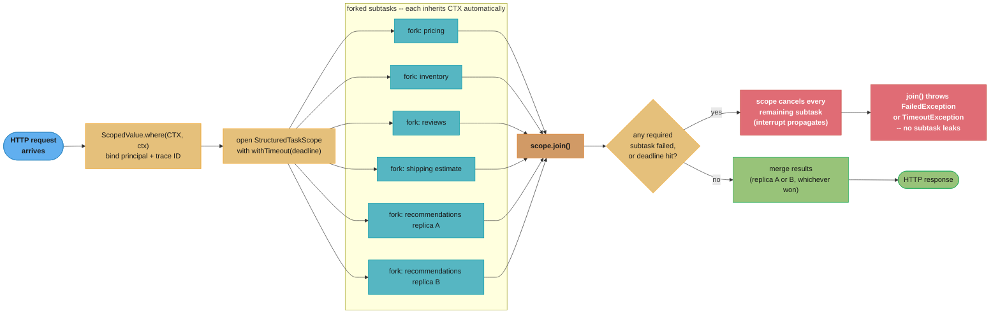
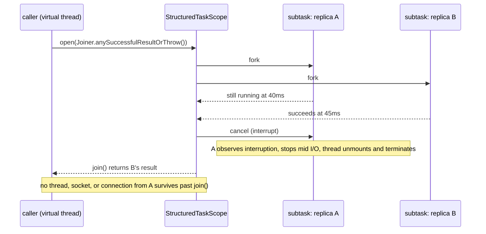

# Design a Fan-Out Aggregator with Structured Concurrency (Java)

## Intuition

> **A structured scope is a supervised team, not a pile of independent contractors.**
> `ExecutorService.submit()` hands a task to a thread and gives you a `Future` — the task's
> lifetime is no longer tied to anything. If the caller times out or throws before calling
> `future.cancel()`, the task keeps running: it holds its thread, its socket, its DB
> connection, until it finishes on its own schedule. `StructuredTaskScope` inverts the
> ownership: every subtask is forked *inside* a lexical scope, and the scope's `try` block
> cannot exit — successfully, by exception, or by timeout — until every subtask is either
> done or cancelled. The parent can no longer outlive its children.

**Key insight:** the property senior engineers actually want from a fan-out call is not
"faster" — `CompletableFuture.allOf()` already parallelises fine — it is "cannot leak."
`StructuredTaskScope` (still a preview API as of Java 26 — see the version table in
§7) gets there by making the failure-handling and cancellation code impossible to skip: the
`try`-with-resources block *is* the leak guard, and `ScopedValue` (final since Java 25,
JEP 506) removes the other classic leak source — a `ThreadLocal` that outlives the request it
was set for on a thread a pool hands to someone else.

---

## 1. Requirements Clarification

### Functional requirements
- Aggregate results from **N independent downstream calls** behind one request — a product
  page backend calling pricing, inventory, reviews, shipping-estimate and recommendation
  services in parallel and merging the results
- Support two fan-out policies without two different call-site shapes: **all-must-succeed**
  (a dashboard where a missing field is a broken page) and **hedged read / race** (query two
  replicas of the same downstream, take whichever answers first, cancel the loser)
- Enforce a **hard deadline** on the aggregate call; on expiry, cancel every in-flight
  subtask and either fail the request or return whatever succeeded, depending on policy
- Propagate **request-scoped context** — authenticated principal, trace ID, tenant ID — to
  every subtask (and any subtask *those* subtasks fork) with no per-call-site plumbing
- Guarantee **zero subtask survives the request handler returning** — no orphaned threads,
  no orphaned HTTP connections, under every exit path (success, downstream failure, timeout,
  client disconnect)

### Non-functional requirements
- **Aggregate latency** ≈ `max(subtask latencies)` + fixed scope overhead, not
  `sum(subtask latencies)` — the entire reason to fan out instead of calling sequentially
- **Fan-out width**: 3–12 downstream calls per request is the target range; the design must
  not degrade non-linearly as width grows
- **Leak rate**: zero leaked virtual threads or downstream connections under sustained
  timeout-heavy load — measured, not assumed (see §8's chaos-test runbook)
- **Cancellation latency**: a cancelled subtask must observe interruption and stop within a
  bounded window of the deadline firing, not "eventually"

### Out of scope
- Cross-JVM saga/compensation orchestration for multi-step writes — see
  [`event_sourcing_and_cqrs`](../../backend/event_sourcing_and_cqrs/event_sourcing_and_cqrs.md)
  in the backend section; this design is a **read-side, single-request** fan-out
- Per-downstream circuit breaking — a real aggregator composes with one; see
  [Circuit Breaker](design_circuit_breaker_java.md) for the state machine that decides
  whether a downstream is even worth forking a subtask against
- Distributed tracing plumbing itself — `ScopedValue` here carries a trace ID as a `String`;
  wiring that into an actual OpenTelemetry span is a library concern layered on top

---

## 2. Scale Estimation

```
Target: a product-page backend, fan-out width 6, deadline 300 ms

Requests/sec (peak)        = 4,000 req/s
Fan-out width               = 6 subtasks/request
Avg subtask latency          = 60 ms  (I/O-bound: HTTP/gRPC to a downstream)

In-flight subtasks at steady state (Little's Law, L = lambda x W):
  L = 4,000 req/s x 6 subtasks/req x 0.060 s = 1,440 in-flight subtasks

As virtual threads (this design):
  1,440 x ~4 KB heap stack                    ~= 5.6 MiB
  carrier pool stays at the default (= CPU cores, e.g. 16) — never grows for this

As platform threads (naive ExecutorService-per-subtask, for comparison):
  1,440 x ~1 MB OS stack                      ~= 1.4 GiB   <- the number that forces
                                                               a bounded pool, which then
                                                               forces queueing, which is
                                                               the whole reason this design
                                                               exists

Requests in flight at the parent-scope level:
  4,000 req/s x (worst-case deadline 0.300 s) = 1,200 concurrent scopes
  1,200 scopes x ~200 bytes bookkeeping        ~= 240 KB  -- negligible

Downstream connection pools -- the REAL ceiling (see Capacity Planning, S10):
  each downstream needs its own sized HTTP client / connection pool;
  virtual threads remove the THREAD ceiling, not the DOWNSTREAM ceiling.
  A pool of 50 connections to the reviews service still admits only 50
  concurrent calls no matter how many virtual threads are waiting on it.
```

The numbers earn their place because they answer the interview question directly: "why not
just use a bigger platform thread pool?" — because 1,440 in-flight subtasks at peak cost 1.4
GiB of pinned OS stack memory as platform threads and 5.6 MiB as virtual threads, a **256x**
gap that only widens as fan-out width or request rate grows. The number that does NOT shrink
with virtual threads is the downstream connection pool — that is covered in §10.

---

## 3. High-Level Architecture





The hedged-read sequence is the one interviewers probe hardest: the losing subtask is not
merely ignored, it is actively cancelled, and `join()` does not return until that
cancellation has been observed by the scope — the guarantee the whole pattern exists to give.

---

## 4. Component Deep Dives

### 4.1 Request-scoped context via `ScopedValue`, not `ThreadLocal`

```java
public record RequestContext(String principal, String traceId, String tenantId) {}

// One instance per JVM; the VALUE bound to it changes per request, per scope.
static final ScopedValue<RequestContext> CTX = ScopedValue.newInstance();

// Bound once, at the top of request handling:
ScopedValue.where(CTX, new RequestContext(principal, traceId, tenantId))
           .run(() -> handleAggregateRequest(req));
// Every scope.fork() called anywhere inside handleAggregateRequest — including
// forks made by a subtask that itself opens a nested scope (S4.6) — sees CTX.get()
// return this exact RequestContext. No parameter threading, no manual copy.
```

`ScopedValue` matters here for a reason specific to fan-out, not just "it is the modern
replacement for `ThreadLocal`": a `StructuredTaskScope` fork runs its `Callable` on a fresh
virtual thread the JVM creates for that fork. A `ThreadLocal` set on the parent's thread is
simply not visible there — it was never inherited unless you reach for
`InheritableThreadLocal`, and that copies the value **once, at fork time**, so a later
`ThreadLocal.set()` on the parent after forking is invisible to already-running children.
`ScopedValue` binding is visible to every fork made while the binding is active, because the
binding lives on the call stack, not on a per-thread map.

### 4.2 All-must-succeed fan-out — the dashboard case

```java
record ProductPage(Price price, Stock stock, List<Review> reviews,
                    ShippingEstimate shipping, List<Recommendation> recs) {}

ProductPage buildProductPage(String sku) throws InterruptedException, TimeoutException {
    RequestContext ctx = CTX.get();   // read once; every fork below can also read it directly

    try (var scope = StructuredTaskScope.open(
            StructuredTaskScope.Joiner.<Object>allSuccessfulOrThrow(),
            cf -> cf.withTimeout(Duration.ofMillis(300)))) {

        var priceTask    = scope.fork(() -> pricingClient.get(sku));
        var stockTask    = scope.fork(() -> inventoryClient.get(sku));
        var reviewsTask  = scope.fork(() -> reviewsClient.list(sku));
        var shipTask     = scope.fork(() -> shippingClient.estimate(sku, ctx.tenantId()));
        var recsTask     = scope.fork(() -> recommendationClient.forSku(sku));

        scope.join();   // throws FailedException (first failure) or TimeoutException at 300ms;
                        // in either case every other subtask is already cancelled by the time
                        // join() returns control to this line

        return new ProductPage(priceTask.get(), stockTask.get(), reviewsTask.get(),
                                shipTask.get(), recsTask.get());
    }
    // scope closed: every forked virtual thread is guaranteed terminated here,
    // whichever of the three exits above was taken
}
```

`allSuccessfulOrThrow()` is the joiner for the "one missing field breaks the page" case: the
first subtask to fail cancels every sibling immediately, so a downstream that would have hung
for its own 10-second timeout does not hold the request open for 10 seconds just because a
different, faster downstream already failed at 40 ms.

### 4.3 Hedged read via `Joiner.anySuccessfulResultOrThrow()`

```java
// Two read replicas of the SAME service; take whichever answers first.
Recommendation fetchRecommendationsHedged(String sku) throws InterruptedException {
    try (var scope = StructuredTaskScope.open(
            StructuredTaskScope.Joiner.<Recommendation>anySuccessfulResultOrThrow())) {

        scope.fork(() -> recommendationReplicaA.forSku(sku));
        scope.fork(() -> recommendationReplicaB.forSku(sku));

        return scope.join();   // returns the winner's result; the loser is cancelled and its
                               // virtual thread, socket, and connection-pool lease are all
                               // released before join() returns
    }
}
```

> **Spelling depends on your JDK.** `anySuccessfulResultOrThrow()` is the **Java 25 LTS**
> name (JEP 505). JDK 26's JEP 525 renamed it to `anySuccessfulOrThrow()` and made
> `allSuccessfulOrThrow()` return a `List` directly rather than a stream. Because the whole
> API is preview, a rename per feature release is the contract, not a bug — see §7 for how to
> insulate call sites from it.

This is the textbook "hedged request" from the Google/Dean-and-Barroso literature (see §6),
implemented with a guarantee the classic pattern's hand-rolled version usually lacks: the
loser is not merely abandoned, it is interrupted and its resources are reclaimed
deterministically before the caller proceeds.

### 4.4 Deadline enforcement with partial-result tolerance

Not every fan-out should fail outright on timeout. A "best-effort" dashboard would rather
render 4 of 6 widgets than show an error page:

```java
List<Widget> buildBestEffortDashboard(String userId, Duration budget) throws InterruptedException {
    List<Widget> rendered = new ArrayList<>();

    try (var scope = StructuredTaskScope.open(
            StructuredTaskScope.Joiner.<Widget>allUntil(_ -> false),   // never cancel early
            cf -> cf.withTimeout(budget))) {

        WIDGET_SOURCES.forEach(source -> scope.fork(() -> source.fetch(userId)));

        for (var subtask : scope.join()) {                              // returns AT the deadline
            if (subtask.state() == StructuredTaskScope.Subtask.State.SUCCESS) {
                rendered.add(subtask.get());
            }
            // FAILED or UNAVAILABLE subtasks are simply omitted — the widget is skipped,
            // not the whole page
        }
    }
    return rendered;
}
```

`allUntil(Predicate)`'s predicate decides whether to cancel the *remaining* siblings after
each subtask completes; returning `false` unconditionally means "never cancel early, always
run to the full budget," and the `Joiner`'s `onTimeout()` (the default does nothing for this
joiner) lets `join()` return the partial list instead of throwing.

### 4.5 Broken → Fixed: the leaked task after a caller timeout

This is the failure `StructuredTaskScope` was built to make structurally impossible — worth
seeing fail first.

```java
// BROKEN: manual ExecutorService fan-out with a caller-side timeout
ExecutorService pool = Executors.newVirtualThreadPerTaskExecutor();

ProductPage buildProductPageBroken(String sku) throws Exception {
    Future<Price> priceFuture   = pool.submit(() -> pricingClient.get(sku));
    Future<Stock> stockFuture   = pool.submit(() -> inventoryClient.get(sku));
    Future<List<Review>> revFuture = pool.submit(() -> reviewsClient.list(sku));

    // The caller times out on the SLOWEST future it is willing to wait for...
    Price price = priceFuture.get(300, TimeUnit.MILLISECONDS);
    Stock stock = stockFuture.get(300, TimeUnit.MILLISECONDS);
    List<Review> reviews = revFuture.get(300, TimeUnit.MILLISECONDS);
    // ...but if priceFuture.get() throws TimeoutException on the FIRST line, this method
    // propagates the exception immediately. stockFuture and revFuture are never cancelled —
    // nobody ever calls stockFuture.cancel(true). Both subtasks keep running on the shared
    // executor, holding their downstream HTTP connections, until THEIR OWN client timeout
    // fires independently, seconds later. Under sustained partial-timeout load this is a
    // slow, silent leak: the executor's queue and the downstream connection pools both creep
    // toward exhaustion, and nothing in this method's exception path caused it.
    return new ProductPage(price, stock, reviews, null, null);
}

// FIXED: StructuredTaskScope — the scope itself is the leak guard
ProductPage buildProductPageFixed(String sku) throws InterruptedException, TimeoutException {
    try (var scope = StructuredTaskScope.open(
            StructuredTaskScope.Joiner.<Object>allSuccessfulOrThrow(),
            cf -> cf.withTimeout(Duration.ofMillis(300)))) {

        var priceTask = scope.fork(() -> pricingClient.get(sku));
        var stockTask = scope.fork(() -> inventoryClient.get(sku));
        var revTask   = scope.fork(() -> reviewsClient.list(sku));

        scope.join();   // if this throws TimeoutException, EVERY subtask above has already
                        // been cancelled — the JVM does not return control past this line
                        // until cancellation has been requested for all of them
        return new ProductPage(priceTask.get(), stockTask.get(), revTask.get(), null, null);
    }   // and this line does not execute until they have all actually stopped
}
```

The mechanical difference is small — three `pool.submit()` calls become three `scope.fork()`
calls — but the guarantee is structural rather than a discipline the author has to remember:
there is no code path through the fixed version, including every exception and every timeout,
in which a subtask survives the `try` block. The broken version's leak is not a bug in the
timeout logic; the timeout logic is correct. The bug is that `Future` has no relationship to
its siblings, so cancelling one does nothing to the others — exactly the property structured
concurrency exists to remove.

### 4.6 Nested scopes — cancellation propagates down the tree

```java
// A sub-aggregator that itself fans out, called as one subtask of the outer scope
List<Recommendation> fetchRecommendationsMultiRegion(String userId) throws InterruptedException {
    try (var inner = StructuredTaskScope.open(
            StructuredTaskScope.Joiner.<List<Recommendation>>anySuccessfulResultOrThrow())) {
        inner.fork(() -> regionUsEast.recommend(userId));
        inner.fork(() -> regionEuWest.recommend(userId));
        return inner.join();
    }
}

// Outer scope forks this as ONE subtask among several
try (var outer = StructuredTaskScope.open(
        StructuredTaskScope.Joiner.<Object>allSuccessfulOrThrow(),
        cf -> cf.withTimeout(Duration.ofMillis(300)))) {
    var priceTask = outer.fork(() -> pricingClient.get(sku));
    var recsTask  = outer.fork(() -> fetchRecommendationsMultiRegion(userId));   // opens `inner`
    outer.join();
    // If the OUTER deadline fires while `inner` is still racing its two regions, the
    // interrupt delivered to recsTask's virtual thread propagates into `inner.join()`,
    // which is itself interruptible — `inner`'s try-with-resources then cancels BOTH
    // regional subtasks before unwinding. Cancellation composes the same way scopes nest:
    // a child scope's own try-with-resources guarantees hold regardless of why the parent
    // decided to cancel it.
}
```

This is the property `CompletableFuture.allOf()` composition does not give you for free:
nesting two levels of `allOf`/`anyOf` requires manually wiring cancellation from the outer
composite into the inner one, or it silently does not happen.

### 4.7 The `ScopedValue` leak this design avoids

```java
// BROKEN pattern this design deliberately does NOT use — shown for contrast
static final ThreadLocal<RequestContext> TL_CTX = new ThreadLocal<>();

void handleRequestBroken(RequestContext ctx) {
    TL_CTX.set(ctx);                                  // set on THIS virtual thread
    pool.submit(() -> dao.auditWrite(TL_CTX.get()));   // runs on a DIFFERENT virtual thread —
                                                        // TL_CTX.get() there is null, or worse,
                                                        // a stale value if the executor ever
                                                        // reuses a carrier in a way that leaks
                                                        // ThreadLocal state across tasks
}
```

`ScopedValue.where(CTX, ctx).run(...)` (§4.1) does not have this failure mode by
construction: the binding is attached to the *call*, propagates to every fork made during
that call including forks several scopes deep, and is unbound automatically when `run()`
returns — there is no `remove()` to forget.

---

## 5. Design Decisions & Tradeoffs

| Concern | `StructuredTaskScope` | `CompletableFuture.allOf()`/`anyOf()` | Manual `ExecutorService` + `Future` | Reactor `Flux.merge()`/`firstWithValue()` |
|---|---|---|---|---|
| Leak-proof on timeout | Yes — scope close cancels all | No — manual `.cancel(true)` on every future required | No — as shown in §4.5 | Yes, via `.timeout()` + operator cancellation, but requires the reactive chain to be correct end-to-end |
| Cancellation propagates to nested calls | Yes — interrupt-based, composes across nested scopes | Only if every stage explicitly checks/propagates cancellation | No | Yes, via `Context` cancellation signals |
| Code style | Blocking, sequential-looking | Callback/chain composition | Blocking, sequential-looking | Callback/operator chain |
| Context propagation | `ScopedValue`, automatic to forks | Manual — executor does not propagate anything | Manual | Reactor `Context`, explicit `.contextWrite()` |
| Preview status (Java 25 LTS) | Preview (`--enable-preview`) | GA since Java 8 | GA since Java 5 | GA (third-party, stable API) |
| Partial-result tolerance | `Joiner.allUntil(Predicate)` — first-class | Possible but hand-rolled with `exceptionally()`/`handle()` per future | Possible but hand-rolled | `onErrorContinue()`/`collectList()` variants, non-trivial to get right |
| Debuggability | Full blocking-style stack traces | Fragmented across callback chain | Full stack traces, but leak risk offsets this | Fragmented, reactor-instrumentation needed |

**`ScopedValue` vs `ThreadLocal` vs explicit parameter passing:**

| Aspect | `ScopedValue` | `ThreadLocal` | Explicit parameter |
|---|---|---|---|
| Leak risk on reused thread | None — unbinds automatically at `run()` exit | Real — see §4.7 | None |
| Propagates through `scope.fork()` | Automatic | Not unless `InheritableThreadLocal`, and even then only a snapshot at fork time | Manual, at every call site |
| Mutability | Immutable for the bound extent | Mutable (`set`/`remove`) | Immutable if the parameter type is |
| Cost at 5+ layers of call depth | One binding, O(1) lookup | One `ThreadLocal.get()` hash lookup per access | Every intermediate method's signature grows |
| Right choice here | Yes — request context read by subtasks several forks deep | No | Viable at 1–2 layers deep, but the aggregator's `RequestContext` is read inside `fetchRecommendationsMultiRegion` (§4.6), two scopes removed from the entry point — that is exactly the depth `ScopedValue` is for |

**All-succeed vs hedged vs best-effort — pick per call, not per aggregator.** The three
`Joiner`s in §4.2–§4.4 are not mutually exclusive design philosophies; they are the correct
default for three different questions. "Is a missing field a broken page?" → `allSuccessfulOrThrow()`.
"Do I have two equally-valid sources and only care about latency?" → `anySuccessfulResultOrThrow()`.
"Would a partial page beat an error page?" → `allUntil(Predicate)`. A real aggregator mixes
all three across its subtasks — §4.6's nested scope is exactly that: the outer scope treats
recommendations as required (must complete, `allSuccessfulOrThrow`), while the inner scope
treats which *region* answers as a hedge (`anySuccessfulResultOrThrow`).

---

## 6. Real-World Implementations

**Netflix — virtual threads in production, including the failure mode this design avoids.**
Netflix's JVM Ecosystem team published "Java 21 Virtual Threads — Dude, Where's My Lock?"
(Netflix Technology Blog, July 2024), a post-mortem of intermittent request-handling hangs on
Spring Boot 3 + embedded Tomcat services after enabling virtual-thread-per-request. The root
cause — pre-JEP-491 `synchronized` pinning every carrier simultaneously under a specific lock
contention pattern — is precisely the pinning failure mode this section's parent module
covers in §6.2 of `structured_concurrency_and_loom.md`, and it predates JEP 491 (Java 24)
removing that pinning source. It is cited here, not as a `StructuredTaskScope` story
specifically, because it is the most concrete, named, primary-source account of what happens
when the *carrier pool*, not the downstream, becomes the bottleneck under a fan-out-shaped
workload — exactly the failure this design's deadline-and-cancel discipline (§4.2–§4.5) is
built to contain before it cascades.

**Oracle Helidon 4 ("Níma") — a production HTTP server built on virtual threads.** Oracle
shipped Helidon 4 (GA, October 2023) with an entirely new server core designed around
virtual-thread-per-request instead of Helidon 3's reactive/Netty model, explicitly to let
application code be written in the same blocking, sequential style this case study's fixed
example (§4.5) uses (InfoWorld, "Oracle Helidon 4 Java microservices framework stresses
virtual threads," 2023). Helidon is Oracle's own reference implementation of the "structured,
blocking-style, virtual-thread-backed service" architecture this case study assumes as its
baseline, though its released server predates `StructuredTaskScope` reaching even its first
preview and does not itself depend on it.

**Alibaba Cloud — an independent measured comparison of virtual threads against platform
thread pools.** Alibaba Cloud's engineering community published "Exploration of Java Virtual
Threads and Performance Analysis" (alibabacloud.com/blog), examining virtual-thread behavior
under I/O-bound fan-out-shaped workloads and reporting the same category of finding
`structured_concurrency_and_loom.md` §6 documents: throughput advantages are real for
I/O-bound work but require auditing every dependency for native (JNI/FFM) blocking calls, or
pinning silently collapses the concurrency ceiling to the carrier count.

**IBM Open Liberty — the honest counter-case.** Open Liberty's own case study found virtual
threads did **not** show a clear advantage over Liberty's existing autonomic (self-tuning)
thread pool for typical cloud-native workloads on their runtime. It is included here
deliberately: the honest position for this design is that virtual threads and
`StructuredTaskScope` remove a *ceiling* (thread memory cost, leak-on-timeout), not a
guarantee of raw throughput — a well-tuned platform-thread pool for a workload that never
approaches that ceiling can be a wash.

**On `StructuredTaskScope` itself.** As of Java 26 it remains a **preview** API (sixth
preview, JEP 525) with a seventh preview (JEP 533) already targeted for Java 27 — so, unlike
virtual threads, there is no large public production deployment to cite by name yet, and
claiming one would not be honest. What can be cited is the API's lineage: it formalizes the
"hedged request" pattern from Jeffrey Dean and Luiz André Barroso, "The Tail at Scale"
(*Communications of the ACM*, 2013), the paper that coined "hedged read" for exactly the
race-two-replicas-cancel-the-loser shape in §4.3, years before Java had a language construct
for it.

---

## 7. Technologies & Tools

| Tool / API | Version / Status | Role in this design |
|---|---|---|
| `StructuredTaskScope`, `StructuredTaskScope.Joiner` | **Preview.** JEP 505 (Java 25) introduced the `open()`/`Joiner` shape this case study targets; JEP 525 (Java 26, sixth preview) renamed `anySuccessfulResultOrThrow()` to `anySuccessfulOrThrow()` and changed `allSuccessfulOrThrow()`'s return type to `List`; JEP 533 (seventh preview) is targeted for Java 27 | Fan-out, hedged-read, deadline-bounded fork/join with guaranteed cancellation |
| `ScopedValue` | **Final** since Java 25 (JEP 506) — no `--enable-preview` needed | Request-context propagation to every fork, including nested scopes |
| `Executors.newVirtualThreadPerTaskExecutor()` | GA, Java 21 (JEP 444) | The executor `StructuredTaskScope` forks onto internally; also the fallback shape if you are pre-preview |
| `jdk.VirtualThreadPinned` JFR event | GA, Java 24+ | Diagnoses a subtask that is holding its carrier instead of unmounting during a downstream call |
| `VirtualThreadSchedulerMXBean` | GA, Java 24+ | `getQueuedVirtualThreadCount()` vs `getMountedVirtualThreadCount()` — the carrier-saturation signal from §8 |
| Spring Boot | 3.2+, `spring.threads.virtual.enabled=true` | Runs each incoming request on a virtual thread, the substrate this design's `handleAggregateRequest` runs on |
| HikariCP / a sized `HttpClient` connection pool per downstream | N/A (library choice) | The real concurrency ceiling per §2 and §10 — sized independently of thread count |
| Micrometer `micrometer-java21` | 1.14+ | `jvm.threads.virtual.pinned`, `.parallelism`, `.pool.size`, `.live` gauges for the operational playbook (§8) |

**Insulating call sites from the preview API's churn.** Because `StructuredTaskScope` has
renamed methods on almost every preview round (§4.3), wrap the fan-out call behind a small
interface of your own (`Aggregator.fanOut(List<Callable<T>>, Duration)`), so a JDK upgrade
that renames a `Joiner` factory method touches one adapter class, not every call site across
the codebase.

---

## 8. Operational Playbook

**Rollout.**
1. Compile and run with `--enable-preview` in CI and in production JVM flags — a preview
   feature is disabled by default even once the JDK ships it. Track the JDK's own release
   notes for the API surface changing at your next upgrade (§7).
2. Feature-flag the `StructuredTaskScope` code path behind the existing
   `CompletableFuture.allOf()` implementation during rollout, so a regression can be reverted
   with a flag flip rather than a redeploy.
3. Canary on a low-traffic aggregation endpoint first — one with a small fan-out width and a
   generous deadline — before rolling out to the widest, tightest-deadline endpoint.

**Monitoring — what to alert on.**
| Signal | Source | What it means |
|---|---|---|
| `jdk.VirtualThreadPinned` rate | JFR / Micrometer `jvm.threads.virtual.pinned` | A downstream client library is blocking in native code (JNI or an FFM downcall) inside a subtask, holding a carrier for the whole call |
| `queuedVirtualThreadCount` sustained > 0 while `mountedVirtualThreadCount == parallelism` | `VirtualThreadSchedulerMXBean` | Carrier pool saturated — investigate CPU-bound work leaking onto subtasks (§9 pitfall 4 in the parent module) before raising `maxPoolSize` |
| Scope `TimeoutException` rate, per aggregate endpoint | Application metric around `scope.join()` | Deadline set too tight against the slowest required downstream's real P99 — cross-check against that downstream's own dashboard before touching the deadline |
| Per-downstream subtask failure rate | Application metric, tagged by which `Callable` failed | Feeds directly into whether that downstream needs a circuit breaker (`design_circuit_breaker_java.md`) in front of the client the subtask calls |

**Runbook: "aggregate endpoint P99 timing out at the deadline."**
1. Check whether it is one downstream or all of them — a per-subtask latency histogram (tag
   each fork's `Callable` before submitting it) isolates this in one query.
2. If it is one downstream: is its own P99 close to or past the aggregate deadline? If so
   this is not an aggregator bug — either raise the deadline, put a circuit breaker in front
   of that one downstream so it fails fast instead of eating the full budget, or move it out
   of the all-succeed set into a best-effort fork (§4.4).
3. If it is all of them simultaneously: check `queuedVirtualThreadCount` — this is carrier
   saturation, not a downstream problem, and the fix is upstream of this design (find what is
   pinning carriers, per the pitfall above), not a bigger deadline.

**Chaos test before trusting this in production.** Kill one downstream mid-fan-out (SIGKILL
its process, or inject a hung connection) under load and confirm, from `VirtualThreadSchedulerMXBean`
counters before and after, that the count of live virtual threads returns to baseline within
one deadline window after the kill — a non-returning count is a leak that unit tests, which
run one request at a time, will not surface.

**Testing this design without a live downstream fleet.** Three test shapes cover what a
single-request unit test cannot: (1) a **leak test** — fork a subtask against a client stub
that blocks forever, drive the scope to its deadline, then assert (via a test hook or the
scheduler MXBean) that the corresponding virtual thread has actually terminated, not merely
that `join()` returned; a test that only checks the return value would have passed against
the broken §4.5 example too. (2) A **hedge-correctness test**, per the Q&A below, that asserts
on which underlying replica was actually called rather than only on the aggregate result. (3)
A **partial-result test** for any `allUntil` scope — fail exactly one of N stubbed subtasks
and assert the response contains the other N-1, not that the whole call throws.

**Safe rollback during a canary.** Because the feature flag from step 2 of the rollout
switches between the `StructuredTaskScope` path and the pre-existing `CompletableFuture.allOf()`
path at the aggregator's entry point, a bad canary is a flag flip, not a redeploy — but the
flip must happen *before* the next deploy overwrites the flag's stored value if the flag
itself lives in application config rather than a remote flag service; treat "flag lives
outside the deployable artifact" as a hard requirement for this rollout, not a nice-to-have.

---

## 9. Common Pitfalls & War Stories

**War story 1 — the leaked-task pattern from §4.5, at scale.** A team running the broken
`ExecutorService` + per-future-timeout pattern from §4.5 saw their downstream reviews-service
connection pool (sized to 50) exhaust roughly every 40 minutes during a partial-outage
incident where the recommendations service was slow but not fully down. Every request whose
recommendations `Future.get()` timed out first left its reviews-service future running to
completion in the background; under sustained load, "still running in the background" queued
up faster than the reviews calls themselves could drain, and the pool exhausted for
**every** request, not just the ones actually calling the slow service. **Fix:**
`StructuredTaskScope.Joiner.allSuccessfulOrThrow()` — the first timeout cancels every sibling
subtask, so a slow recommendations call can no longer hold a reviews-service connection open
on its way out.

**War story 2 — `ScopedValue` bound outside the scope it needed to reach.** An engineer wired
tenant isolation by calling `ScopedValue.where(TENANT, id).run(() -> controller.handle(req))`
in a servlet filter, then — three method calls later, inside the aggregator — opened the
`StructuredTaskScope` and forked subtasks that called `TENANT.get()`. This worked correctly,
because the binding was still active on the call stack at fork time. The actual bug appeared
when a later refactor moved the fork calls onto a *separate* virtual thread submitted via a
raw `Executors.newVirtualThreadPerTaskExecutor().submit(...)` for one "fire-and-forget" audit
write — outside any scope, and critically outside the `ScopedValue.where(...).run(...)`
call's dynamic extent, because the submission returned immediately and the binding had
already unwound by the time the submitted task ran. `TENANT.get()` there threw
`NoSuchElementException`. **Lesson:** `ScopedValue` bindings are scoped to the *call*, not to
"the request" as a concept — anything that outlives the `run()` call, including a detached
`submit()`, needs the binding re-established explicitly at its own entry point.

**War story 6 — a hedge that raced against itself instead of a real alternative.** A team
implementing §4.3's hedged-read pattern pointed both forked `Callable`s at the same replica
by accident — a copy-paste of the client reference where the second line should have read
`recommendationReplicaB`. `anySuccessfulResultOrThrow()` still worked exactly as documented:
it took the first of the two identical calls to finish and cancelled the "loser," which
happened to be a second, wasted call against the same already-loaded replica. Nothing failed,
nothing threw, and the aggregate endpoint's latency and error rate looked completely normal —
the bug cost exactly double the request volume against one replica while replica B silently
received zero traffic, and it was found only when someone asked why replica B's dashboard
showed flat-zero QPS. **Lesson:** a hedge's correctness cannot be verified from the
aggregator's own metrics alone — verifying it needs a per-replica request-count assertion in
an integration test, because a broken hedge that races a service against itself produces no
symptom at the call site that forked it.

**War story 3 — forgetting `scope.join()` before reading a result.** The most common
first-week mistake:
```java
try (var scope = StructuredTaskScope.open()) {
    var task = scope.fork(() -> fetchData());
    return task.get();   // IllegalStateException: subtask has not completed
}
```
`Subtask.get()` requires the scope to have joined first; skipping `join()` is caught
immediately and loudly (an exception on every call), which is a better failure mode than the
silent leak in §4.5's broken version — but it is still the single most common StackOverflow
question about this API in its first year of preview.

**War story 4 — a preview rename breaking a build silently until the deadline is tested.** A
codebase pinned to a `Joiner.anySuccessfulResultOrThrow()` call site upgraded its build JDK
from 25 to 26 for an unrelated reason. The call compiled — `anySuccessfulResultOrThrow` still
existed as a deprecated forwarding method in an early 26 build the team happened to test
against — but `allSuccessfulOrThrow()` elsewhere in the same file had already changed its
return type from a `Stream` to a `List`, and the `.map(...)` chain built for a `Stream`
failed to compile. **Fix, and the actual lesson:** the adapter interface from §7 exists
specifically so a preview-API rename is a one-file diff instead of a grep-and-pray across
every aggregator in the codebase; treat every JDK upgrade that touches a preview feature as a
required code-review step, not an incidental version bump.

**War story 5 — using `allUntil` and expecting `allSuccessfulOrThrow` cancellation
semantics.** A best-effort dashboard (§4.4) was built with `allUntil(_ -> false)` so a slow
widget would not sink the whole page — correct. Six months later, an engineer added a
"critical" widget to the same scope and expected the aggregate to fail fast if *that specific*
subtask failed, the way `allSuccessfulOrThrow()` would. It did not: `allUntil(_ -> false)`
never cancels early, by design, so the critical widget's failure was silently swallowed into
"the page renders without it," identical to every other widget. **Fix:** a single scope has
one cancellation policy; a subtask that must be treated as required belongs in its own
`allSuccessfulOrThrow()` scope (nested per §4.6), not folded into a best-effort scope's
subtask list.

---

## 10. Capacity Planning

```
Fan-out width N = 6, target 4,000 req/s, deadline 300 ms (from S2)

Virtual thread memory at peak in-flight (Little's Law):
  in-flight subtasks = 4,000 x 6 x 0.060 (avg subtask latency)   = 1,440
  memory              = 1,440 x ~4 KB                             ~= 5.6 MiB
  -> not a capacity constraint at this scale; would need ~180,000
     in-flight subtasks to reach 704 MiB, itself still small

Carrier pool -- UNCHANGED by fan-out width:
  default parallelism = availableProcessors(), e.g. 16 on a standard node
  -> sizing this up is a response to PINNING (S8), never to fan-out width

The actual constraint: per-downstream connection pools
  pricing pool size        P_pricing
  inventory pool size       P_inventory
  reviews pool size         P_reviews
  ... one line per downstream, sized independently ...

  max sustainable req/s FOR THAT DOWNSTREAM's SUBTASK
      = P_downstream / downstream's own avg latency

  worked example -- reviews service, pool = 50, avg latency 60ms:
      max sustainable = 50 / 0.060                                = 833 req/s

  if the aggregate endpoint targets 4,000 req/s, and EVERY request
  forks a reviews subtask, the reviews pool of 50 is the bottleneck
  at 833 req/s -- 4.8x below target -- long before any thread-count
  ceiling is reached. Fixing this means growing THAT pool (bounded by
  what the reviews service itself can absorb) or adding a cache in
  front of it -- not touching virtual thread count, which was never
  the constraint.

Deadline budget allocation across N=6 subtasks sharing one 300ms budget:
  each subtask should target P99 well under 300ms with margin for
  the scope's own join()/cancellation overhead (single-digit ms);
  a subtask whose OWN P99 is 280ms leaves no margin and will regularly
  cause the WHOLE aggregate to hit the deadline even when every other
  subtask is fast -- this subtask is a circuit-breaker candidate (S1),
  not a deadline-tuning problem.
```

The one number every review of this design should ask for first is not thread count — it is
"what is the smallest per-downstream connection pool among the N subtasks, and what request
rate does it cap the whole aggregate at." Virtual threads and `StructuredTaskScope` remove
the thread-memory ceiling; they do not, and are not meant to, remove that one.

**Sizing the deadline margin itself.** The scope's own overhead — opening, forking N
subtasks, and the bookkeeping `join()` and `close()` perform — is not zero, and treating the
deadline as "downstream P99 plus a round number" undersizes it at high fan-out width:

```
per-fork overhead (virtual thread creation + scheduling handoff)   ~= low microseconds
N = 6 forks                                                        ~= tens of microseconds total
join()/close() bookkeeping, cancellation fan-out on the failure path ~= single-digit ms

at N = 6: scope overhead is negligible against a 300ms deadline (<1%)
at N = 40 (a much wider fan-out, e.g. a search-aggregation backend):
  overhead is still small in absolute terms, but now competes with
  a TIGHTER per-subtask latency budget if the deadline did not grow
  with N -- the fix is to budget deadline margin as a function of N,
  not carry the same fixed few-ms assumption from a 6-way fan-out
  onto a 40-way one
```

The practical rule: re-derive the deadline margin whenever fan-out width changes materially,
rather than inheriting a constant from the endpoint the code was copied from — the same
caution as the "reusing a sibling endpoint's deadline" pitfall in §11's Q&A on choosing fan-out
width.

---

## 11. Interview Discussion Points

**Q: Why does `StructuredTaskScope` prevent the task leak that a raw `ExecutorService` fan-out has?**
**Short:** The scope's try-with-resources block cannot exit until every forked subtask is done or cancelled, unlike a bare Future.
A `Future` returned by `ExecutorService.submit()` has no relationship to any other in-flight
task — cancelling one does nothing to the others, so a caller that gives up on the slowest
future (via its own timeout) leaves every other future running until it finishes on its own
schedule, as shown in §4.5's broken example. `StructuredTaskScope`'s `try`-with-resources
block is the enforcement mechanism: `close()` — called automatically whether the block exits
normally, by exception, or by the scope's own timeout — cancels every subtask that has not
already completed, and does not return until they have observed that cancellation. There is
no exit path through the block that leaves a subtask running.

**Q: What is the difference between `allSuccessfulOrThrow()` and `anySuccessfulResultOrThrow()`, and when would you choose each?**
**Short:** allSuccessfulOrThrow needs every subtask to succeed; anySuccessfulResultOrThrow needs only the first one and cancels the rest.
`allSuccessfulOrThrow()` (§4.2) is for fan-out where every result is required — a dashboard
where a missing field is a broken page — and cancels every sibling the instant the first
subtask fails. `anySuccessfulResultOrThrow()` (§4.3) is for hedged reads — two or more
interchangeable sources of the same answer — and cancels every sibling the instant the
*first* subtask *succeeds*, returning that result. Choosing wrong in either direction is a
real bug: using `allSuccessfulOrThrow` for a hedge means both replicas must succeed, which
defeats the purpose of racing them; using `anySuccessfulResultOrThrow` for a dashboard means
the page renders with only one of several required fields.

**Q: How does `ScopedValue` avoid the `ThreadLocal` leak risk when subtasks run on virtual threads created by the scope?**
**Short:** ScopedValue bindings live on the call stack and propagate automatically to every fork made during the binding, unlike a per-thread map.
`ThreadLocal` state lives in a map keyed by the physical (or virtual) thread; it is only
visible to code running on that exact thread, and a value set on the parent is invisible to a
child thread the executor creates unless copied explicitly via `InheritableThreadLocal` — and
that copy happens once, at creation time. `ScopedValue.where(KEY, value).run(...)` instead
binds the value for the *dynamic extent of that call* — every `scope.fork()` made anywhere
inside `run()`, including forks made by a subtask that itself opens a nested scope (§4.6),
sees the binding. When `run()` returns, the binding is gone automatically; there is no
`remove()` to forget, and no possibility of a value leaking into an unrelated later task that
happens to reuse the same thread.

**Q: Walk through what happens, step by step, when one subtask in an `allSuccessfulOrThrow()` scope fails.**
**Short:** The failing subtask's exception triggers cancellation of every sibling, and join() rethrows it wrapped in a FailedException.
(1) The failing `Callable` throws inside `scope.fork()`'s virtual thread. (2) The scope's
default failure handling records this as the scope's failure cause and calls `shutdown()`
internally, which interrupts every other subtask's virtual thread. (3) Each interrupted
subtask either observes the interruption at its next blocking call (a socket read, a
`Thread.sleep`) and unwinds, or — if it is a native call with no interruption point — runs to
completion regardless, which is why §9's carrier-pinning concern matters even inside a
cancelled scope. (4) `scope.join()`, which was blocked waiting for all subtasks, unblocks
once shutdown has been requested and throws `FailedException` wrapping the original
exception. (5) The `try`-with-resources block's implicit `close()` runs, which is where the
scope actually waits for every subtask's virtual thread to have terminated before allowing
the exception to propagate further.

**Q: `StructuredTaskScope` is a preview API. What are the practical implications of shipping it in production code?**
**Short:** Every build and runtime invocation needs --enable-preview, and the API surface can rename between feature releases.
`--enable-preview` must be passed at compile time and at every JVM launch — omitting it at
launch after compiling with it produces an `UnsupportedClassVersionError`. Because it is
still moving between releases — JEP 505 in 25, JEP 525 in 26, JEP 533 targeted for 27 — a
method rename (§4.3, §9 war story 4) is a real risk at every JDK upgrade, not a hypothetical
one. The practical mitigation is the adapter interface from §7: isolate every call site behind
one class so a rename is a one-file diff, and treat any JDK upgrade that touches a preview
feature's minor version as a required code-review item, not an incidental bump.

**Q: How would you set a deadline on a fan-out call, and what is the difference between setting it on `join()` versus on the scope's configuration?**
**Short:** The timeout is configured on the scope via withTimeout(), not passed to join() itself, and the clock starts at open().
The timeout is set once, at `open(Joiner, cf -> cf.withTimeout(Duration))`, not as an
argument to `join()` — there is no timed overload of `join()` for this purpose. The clock
starts the moment the scope is opened, not when `join()` is called, so time spent forking
subtasks (normally negligible) still counts against the budget. If the timeout expires before
or during `join()`, the scope cancels every unfinished subtask; what `join()` does next
depends entirely on the `Joiner`'s `onTimeout()` — the default for `allSuccessfulOrThrow()`
and `anySuccessfulResultOrThrow()` is to throw `TimeoutException`, while `allUntil(...)`'s
default does nothing, letting `join()` return the (partial) subtask list instead (§4.4).

**Q: Why is `CompletableFuture.allOf()` not a safe substitute for `StructuredTaskScope` in this design, even though both parallelise the same calls?**
**Short:** allOf() composes futures but never wires up cancellation between them, so a failing or slow future does not stop its siblings.
`CompletableFuture.allOf(f1, f2, f3)` completes when all three complete, but completion and
cancellation are two separate concerns it does not couple: if `f1` fails, `f2` and `f3` keep
running to their own completion unless the caller explicitly calls `.cancel(true)` on each —
exactly the manual step §4.5's broken example omits. `allOf()` also has no first-class
partial-result or hedge semantics; both require hand-building `exceptionally()`/`handle()`
chains per future, which is where the leak risk and the bug surface area both live. It is a
correct tool for "run N independent computations and wait for all of them" when none of them
needs to be cancelled early; it is the wrong tool for anything this design's §4 needs —
deadline-bound cancellation, hedging, or partial tolerance — without significant hand-rolled
wiring on top.

**Q: What would you monitor to catch a `StructuredTaskScope`-based aggregator silently leaking virtual threads, given that "leak" here does not mean an OutOfMemoryError the way a platform-thread leak would?**
**Short:** VirtualThreadSchedulerMXBean's mounted/queued counts and the jdk.VirtualThreadPinned JFR event, since a virtual-thread leak is memory-silent until it saturates carriers.
A leaked platform thread is loud — it holds ~1 MB of OS stack and a bounded pool eventually
throws `RejectedExecutionException`. A leaked virtual thread is heap-silent at small scale (a
few KB each) and shows up first as carrier saturation, not memory pressure:
`VirtualThreadSchedulerMXBean.getMountedVirtualThreadCount()` pegged at `getParallelism()`
while `getQueuedVirtualThreadCount()` climbs indicates carriers are backed up, and
`jdk.VirtualThreadPinned` (JFR, 20 ms default threshold) identifies which blocking call is
holding a carrier instead of unmounting. The chaos test in §8 — kill a downstream mid-flight
and confirm the live virtual-thread count returns to baseline within one deadline window — is
the only way to catch this before it appears in a load test that happens to never simulate a
mid-flight downstream failure.

**Q: In the nested-scope example (§4.6), what guarantees that the inner scope's subtasks are cancelled if the OUTER scope's deadline fires, given that the inner scope has no timeout configured of its own?**
**Short:** The outer scope's interrupt reaches the subtask running inner.join(), and an interrupted join() triggers the inner scope's own cancellation on unwind.
The outer scope's deadline firing interrupts the virtual thread running the subtask that
calls `fetchRecommendationsMultiRegion` — the same interruption mechanism that would stop any
other subtask. That interruption lands inside `inner.join()`, which (like any blocking call
in this API) is interruptible; the `InterruptedException` propagates out of
`fetchRecommendationsMultiRegion`, and `inner`'s `try`-with-resources block runs its `close()`
on the way out, which is where `inner` cancels its own two regional subtasks. The guarantee
composes because every level in the tree independently honors the same contract — "my
`try`-with-resources block does not exit while my own children are still running" — so a
cancellation signal only ever needs to reach the immediately enclosing scope; it does not
need to be threaded manually to every descendant.

**Q: A subtask calls a native library through the Foreign Function & Memory API and blocks inside the downcall. What happens to the scope's cancellation guarantee in that case?**
**Short:** A pinned subtask cannot be interrupted mid-native-call, so cancellation only takes effect once that call returns on its own.
Interruption in Java is cooperative and only takes effect at specific interruption points —
blocking I/O, `Object.wait()`, `Thread.sleep()` — and a native downcall blocked inside C code
is none of these; the virtual thread is pinned to its carrier for the call's duration
regardless of the scope's cancellation request. The scope still requests cancellation on
schedule, and `join()` still eventually returns once the pinned call finishes and the
interruption is observed at the next interruption point after it — but the "cancellation
latency bounded by the deadline" property this design's non-functional requirements ask for
(§1) is violated for exactly as long as that native call runs. The mitigation, from the
parent module's §6.2, is the same one used for any pinning-prone native call: run it on a
small, explicitly sized platform-thread executor and have the virtual thread block on the
resulting `Future` instead, which unmounts cleanly and stays interruptible.

**Q: Why does the best-effort dashboard in §4.4 use `allUntil(_ -> false)` instead of just catching exceptions around each `subtask.get()` call after an `allSuccessfulOrThrow()` join?**
**Short:** allSuccessfulOrThrow cancels every sibling on the first failure, which is the opposite of best-effort; allUntil is the joiner that never cancels early.
`allSuccessfulOrThrow()`'s defining behavior is cancelling every remaining subtask the moment
one fails — exactly wrong for "render whatever widgets succeeded within the budget," since it
would cancel four working widgets because a fifth one failed. Wrapping each
`subtask.get()` in a `try`/`catch` after an `allSuccessfulOrThrow()` join does not help,
because by the time `join()` returns from that joiner, the cancellation has already happened
to every other subtask — there is nothing left to catch a *successful* result from. `allUntil(Predicate)`
is the joiner built for this: its predicate controls early cancellation per completed
subtask, and returning `false` unconditionally (§4.4) means every subtask runs to its own
completion or to the shared deadline, whichever comes first, with no cross-subtask
cancellation at all.

**Q: The `ScopedValue`-bound hedge in War Story 6 (§9) produced no visible error. What would a code-review checklist item look like that could have caught it before merge?**
**Short:** Assert that each hedged Callable closes over a distinct client reference, since the compiler cannot catch a copy-paste that types-checks fine.
The bug — both forked `Callable`s pointing at `recommendationReplicaA` — compiled cleanly and
passed a naive unit test that only asserted the aggregate call returned *a* result, because
`anySuccessfulResultOrThrow()` does not care whether the two subtasks were actually
different work. A review checklist item that would have caught it: for every
`anySuccessfulResultOrThrow()` call site, require an accompanying test that asserts on
*which* underlying client received the call (a mock-verify or a per-replica counter), not
merely that the aggregate call succeeded — because "it returned a result" is true whether the
hedge is racing two real alternatives or the same one twice.

**Q: How would you decide the fan-out width and per-subtask budget for a new aggregate endpoint, versus reusing the numbers from an existing one?**
**Short:** Derive the deadline from the slowest REQUIRED downstream's own measured P99 plus scope overhead, not from a round number.
Start from each candidate downstream's own P99 latency, measured independently (its own
dashboard, not inferred from the aggregator) — the aggregate deadline should sit comfortably
above the slowest *required* downstream's P99, with headroom for the scope's own join and
cancellation overhead (single-digit milliseconds per §10). A downstream whose P99 already
approaches the desired aggregate deadline is a signal to either move it out of the required
set into a best-effort fork (§4.4), put a circuit breaker in front of it so it fails fast
instead of consuming the whole budget (§9 War Story 1), or investigate why it is slow before
adding it to the fan-out at all. Reusing a sibling endpoint's deadline without this exercise
is how a fast four-way fan-out and a slow eight-way fan-out end up sharing one number that
fits neither.

---

## Cross-References

- [Structured Concurrency and Project Loom](../structured_concurrency_and_loom/structured_concurrency_and_loom.md) — the parent module: virtual thread internals, pinning mechanics, the full `Joiner` catalogue, `ScopedValue` fundamentals
- [Java Memory Model](../java_memory_model/java_memory_model.md) — the happens-before edges that make `ScopedValue` binding and `Subtask` result visibility safe across the fork boundary
- [Concurrency](../concurrency/concurrency.md) — `CompletableFuture`, `ExecutorService`, and the primitives this design's §5 compares `StructuredTaskScope` against
- [Design a Custom Thread Pool](design_thread_pool_java.md) — `ThreadPoolExecutor` internals and why bounding a *platform*-thread pool is a different problem than bounding fan-out width
- [Design a Circuit Breaker](design_circuit_breaker_java.md) — the per-downstream failure-isolation layer this design's §9 War Story 1 and §10 both point to as the fix for one persistently slow subtask
- [Async & Concurrency Patterns](../../backend/async_and_concurrency_patterns/async_and_concurrency_patterns.md) — fan-out/fan-in, hedged requests, and cancellation as production patterns independent of the Java implementation
- [LLD: Concurrency Patterns](../../lld/concurrency_patterns/concurrency_patterns.md) — how classic concurrency patterns (Producer-Consumer, Thread Pool) adapt once threads are cheap
- [Spring WebFlux](../../spring/spring_webflux/spring_webflux.md) — the reactive alternative for the same fan-out/timeout/cancellation problem, for teams not yet on a JDK with `StructuredTaskScope` preview support
