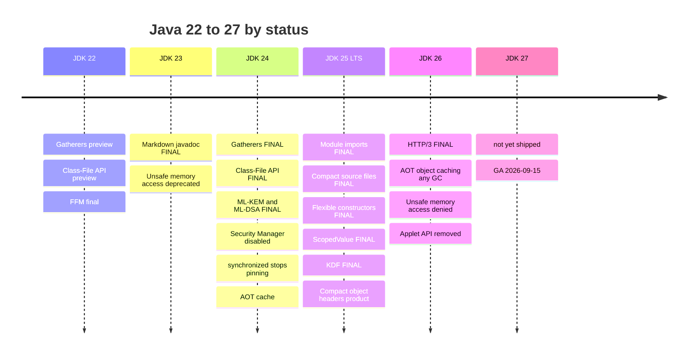
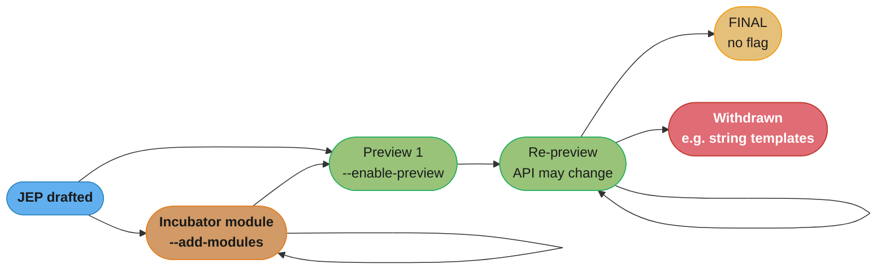

# Java 22–26 Features

## 1. Concept Overview

[Java 9–21 Features](../java9_to_21_features/java9_to_21_features.md) ends where its name says it ends. That is a problem, because the section's stated baseline is **Java 25 LTS**, and the four releases between the two LTS lines — 22, 23, 24, and 25 — delivered a substantial body of finalized language and API work, with 26 already shipped on top of it. A reader who stops at 21 has a mental model of "modern Java" that is two LTS releases stale and, worse, cannot tell which of the features they have heard about are actually usable.

That last point is the real subject of this module. The six-month release cadence means the interesting question about almost any Java feature in 2026 is not *what does it do* but **what is its status**: finalized (use it), preview (available behind `--enable-preview`, API may still change), experimental (available behind an unlock flag, may vanish), incubating (a separate module, explicitly not a preview), or deprecated for removal (works today, will not tomorrow). Those five states look identical in a blog post and could not be more different in a production codebase. Getting one wrong inverts the advice — "still in preview" about a finalized API makes people avoid something safe, and "finalized" about a preview makes them ship something whose method names will change under them.

So this module is organised around status, not chronology. It covers what **finalized** between Java 22 and 26 and is therefore ordinary Java on the section's baseline; what is **still preview** after five, six, or seven rounds and what that longevity tells you; what **changed underneath you** without any new syntax — the integrity-by-default work that turned warnings into errors; and how to reason about adopting any of it. The companion timeline for what is coming is deliberately narrow: **JDK 27 has not shipped** as of this writing (GA is 2026-09-15), so anything attributed to it here is a frozen plan, not a fact about a runtime you can download.

---

## 2. Intuition

> **One-line analogy**: Java 9–21 was the language growing new organs — records, sealed types, virtual threads. Java 22–26 is the language having its edges sanded: the ceremony that surrounded a program got smaller, and the runtime quietly stopped trusting code that had been getting away with things.

**Mental model**: hold two separate tracks in your head, because they move at completely different speeds.

- **The language track** is small, careful, and almost finished for now. Between 22 and 26 exactly three language features finalized — module import declarations, compact source files with instance `main` methods, and flexible constructor bodies — and all three are *subtractive*. Each removes ceremony that was never carrying meaning. Nothing new was added to the type system.
- **The integrity track** is where the actual disruption lives, and it ships no syntax at all. The Security Manager was permanently disabled. `sun.misc.Unsafe`'s memory-access methods went from warning to denied. Native access outside `--enable-native-access` started warning. `synchronized` stopped pinning virtual threads. None of these appear in a "what's new in Java N" slide with a code sample, and collectively they are far more likely to break your build or your runtime than any of the language changes.

**Why it matters**: the upgrade risk is not where the marketing is. A team reading a "Java 25 features" article will come away excited about `void main()` and unaware that a startup script containing `-Djava.security.manager=allow` now prevents the JVM from booting at all.

**Key insight**: **preview is a commitment, not a warning label.** A preview feature requires `--enable-preview` at both compile and run time, and a class file compiled with it is *rejected* by any other release — not just an older one, any other one. That is deliberate: it makes it impossible to accidentally ship a preview dependency into a long-lived artifact. It also means adopting a preview feature pins your entire build and deployment to one exact JDK version, and re-pins it every six months when the API changes underneath you.

---

## 3. Core Principles

- **Status is the first question, not the last.** Finalized, preview, experimental, incubating, and deprecated-for-removal are five different contracts. Never repeat a claim about a feature without its status and its release.
- **Preview features change, and the changes are not cosmetic.** `StructuredTaskScope` has been in preview for seven rounds and its API was redesigned in JDK 25 and renamed again in 26. That is preview working as designed.
- **`--enable-preview` is version-pinning.** A class file built with it names the exact release that produced it and is rejected everywhere else. There is no forward or backward compatibility to lean on.
- **Incubating is not preview.** The Vector API has been incubating for twelve rounds. An incubator module is not enabled by `--enable-preview`; it needs `--add-modules jdk.incubator.vector`, and it carries no promise of ever finalizing.
- **A default that changes is an upgrade risk with no code change to review.** `--sun-misc-unsafe-memory-access` moved from `allow` to `warn` to `deny` across three releases without a single line of your source changing.
- **Adopt on the LTS, evaluate on the feature releases.** The feature releases are where you find out whether a preview API will suit you; the LTS is where you commit.
- **A finalized feature is ordinary Java.** Once `--enable-preview` is gone, there is no flag, no caveat, and no reason to hedge in a code review.

---

## 4. Types / Architectures / Strategies

### 4.1 Finalized — language

| Feature | JEP | Final in | Preview history |
|---------|-----|:---:|-----------------|
| Markdown Documentation Comments (`///`) | 467 | **23** | — |
| Module Import Declarations | 511 | **25** | 476 (23), 494 (24) |
| Compact Source Files & Instance Main Methods | 512 | **25** | multiple rounds from 21 |
| Flexible Constructor Bodies | 513 | **25** | multiple rounds from 22 |

### 4.2 Finalized — API

| Feature | JEP | Final in | Preview history |
|---------|-----|:---:|-----------------|
| Stream Gatherers | 485 | **24** | 461 (22), 473 (23) |
| Class-File API (`java.lang.classfile`) | 484 | **24** | 457 (22), 466 (23) |
| Key Derivation Function API | 510 | **25** | 478 (24) |
| Scoped Values | 506 | **25** | preview from 21 |
| ML-KEM / ML-DSA (post-quantum) | 496 / 497 | **24** | — (final on arrival) |
| HTTP/3 for the HTTP Client API | 517 | **26** | — |

### 4.3 Finalized — runtime and GC

| Change | JEP | In | Note |
|--------|-----|:---:|------|
| Generational ZGC only (non-generational removed) | 490 | 24 | `ZGenerational` deprecated; generational is the only mode |
| `synchronized` no longer pins virtual threads | 491 | 24 | native frames and class initializers still pin |
| Compact Object Headers — **product** feature | 519 | **25** | opt-in `-XX:+UseCompactObjectHeaders`; experimental as JEP 450 in 24 |
| Generational Shenandoah — **product** feature | 521 | **25** | `-XX:+UseShenandoahGC -XX:ShenandoahGCMode=generational` |
| AOT class loading, linking, profiling | 483 / 514 / 515 | 24 / 25 / 25 | see [AOT Startup & CDS](../aot_startup_and_class_data_sharing/aot_startup_and_class_data_sharing.md) |
| AOT object caching under any GC | 516 | 26 | removes the ZGC restriction |
| G1 throughput via reduced synchronization | 522 | 26 | no flag, no action needed |
| Remove the Applet API | 504 | 26 | |

### 4.4 Integrity by default — the changes with no syntax

This is the group that breaks upgrades, and none of it announces itself in your source.

| Change | JEP | Behaviour by release |
|--------|-----|----------------------|
| `sun.misc.Unsafe` memory-access methods deprecated for removal | 471 | `--sun-misc-unsafe-memory-access` default: `allow` (23) → **`warn`** (24, 25) → **`deny`** (26, and `allow` is no longer selectable) |
| Restricted native access (FFM, JNI) | 472 | `--illegal-native-access` default **`warn`** from 24 through 27; `--enable-native-access=<modules>` lifts it per module |
| **Security Manager permanently disabled** | 486 | 24 — `System.setSecurityManager()` throws `UnsupportedOperationException`, and **`-Djava.security.manager=allow` makes the JVM refuse to start** |
| Prepare to Make Final Mean Final | 500 | 26 — prepares to disallow reflective mutation of `final` fields |

### 4.5 Still preview or incubating — do not ship these

| Feature | Latest JEP | Rounds | Status |
|---------|-----------|:---:|--------|
| Structured Concurrency | 533 (27) | 7th preview | 453 (21), 462 (22), 480 (23), 499 (24), **505 (25 — redesigned)**, 525 (26), 533 (27) |
| Lazy Constants — **renamed** from Stable Values | 531 (27) | 3rd preview | 502 (25, "Stable Values"), **526 (26, renamed "Lazy Constants")**, 531 (27) |
| Primitive Types in Patterns, `instanceof`, `switch` | 532 (27) | 5th preview | 455 (23), 488 (24), 507 (25), 530 (26), 532 (27) |
| PEM Encodings of Cryptographic Objects | 538 (27) | 3rd preview | 470 (25), 524 (26), 538 (27) |
| Vector API | 537 (27) | **12th incubator** | not a preview; needs `--add-modules jdk.incubator.vector`; blocked on Project Valhalla |
| Value Objects (Valhalla) | 401 | preview **targeted at JDK 28** | **has never appeared in any released JDK**; EA builds only |

The Vector API row deserves a sentence of its own. Twelve incubation rounds is not a feature that is nearly ready; it is a feature deliberately held open because it depends on Project Valhalla's value types to deliver its intended performance model without boxing. Treat "still incubating after twelve rounds" as information about the dependency, not about the effort.

---

## 5. Architecture Diagrams

### The release train, by status



Read the columns rather than the rows: JDK 24 is where the *API* work landed and where the integrity defaults tightened, JDK 25 is where the *language* work landed, and JDK 26 is a consolidation release with one headline API.

### Preview graduation — and where a feature can stall



The self-loop is the whole point. Structured Concurrency has taken it six times, Primitive Patterns four, and the Vector API eleven — and string templates took the branch to *withdrawn* after two, with no replacement. There is no schedule and no guarantee of arrival.

### Compact object headers — what the 4 bytes actually are

```
Object layout on 64-bit HotSpot with compressed class pointers.

  LEGACY header (12 bytes), the default through JDK 26:
  byte:  0        4        8       12
         +--------+--------+--------+---------------------------+
         |    mark word    | klass  |      instance fields      |
         |    (8 bytes)    |(4 bytes)|                          |
         +--------+--------+--------+---------------------------+
                                    ^ fields start at offset 12

  COMPACT header (8 bytes), -XX:+UseCompactObjectHeaders (product in JDK 25):
  byte:  0        4        8
         +--------+--------+---------------------------+
         | mark + klass    |      instance fields      |
         |    (8 bytes)    |                           |
         +--------+--------+---------------------------+
                           ^ fields start at offset 8

  The class pointer is folded INTO the mark word. Saving: 4 bytes per object.

  What that is worth, on a heap holding 50 million live objects:
      50,000,000 x 4 bytes = 200 MB of live heap, recovered with one flag.

  And it compounds: smaller objects mean more of them per cache line, so the
  win shows up in cache-miss rate as well as in footprint.
```

**The 4 bytes are an upper bound, not a guarantee.** Objects are 8-byte aligned, so whether the saving survives depends on the class's field layout: a class with a single `int` field is 16 bytes under *both* header sizes, because the padding simply absorbs the difference, while a class whose fields leave no 4-byte hole to fill converts the whole 4 bytes into real footprint. "It depends on the field layout" is the honest answer; measure a specific class with JOL (`ClassLayout.parseClass(Foo.class).toPrintable()`) rather than multiplying by four.

Every per-object footprint figure taught anywhere in this section assumes the 12-byte header. That assumption holds by default today and stops holding in JDK 27, where **JEP 534 makes compact headers the default** — at which point the same arithmetic is wrong by 4 bytes per object everywhere.

---

## 6. How It Works — Detailed Mechanics

### Module Import Declarations (JEP 511, final in 25)

`import module M;` imports, on demand, every package that module `M` exports to your code — transitively through its `requires transitive` edges.

```java
import module java.base;   // java.util.*, java.util.function.*, java.util.stream.*, java.io.*, ...

void main() {
    var names = List.of("ada", "grace", "barbara");
    IO.println(names.stream().map(String::toUpperCase).collect(Collectors.joining(", ")));
}
```

The mechanism worth understanding is the ambiguity rule. Because a module import is on-demand, it has the same precedence as `import java.util.*` — and if two imported modules both export a package containing the same simple name, the reference is **ambiguous and does not compile**. The canonical collision is `List`:

```java
import module java.base;      // exports java.util.List
import module java.desktop;   // exports java.awt.List

List<String> xs = new ArrayList<>();
//  ^ error: reference to List is ambiguous
```

The fix is an ordinary single-type import, which always wins over any on-demand import:

```java
import module java.base;
import module java.desktop;
import java.util.List;        // resolves the ambiguity for List specifically

List<String> xs = new ArrayList<>();   // unambiguously java.util.List
```

This is why module imports are excellent in scripts, teaching code, and small tools, and a poor default in a large codebase where explicit imports document the dependency surface and where the ambiguity risk grows with every module added.

### Compact Source Files & Instance Main Methods (JEP 512, final in 25)

A **compact source file** is a `.java` file with no enclosing class declaration. The compiler synthesises one.

```java
// hello.java — the entire file
void main() {
    IO.println("Hello");
}
```

```bash
java hello.java     # no javac step, no class declaration, no String[] args
```

The finalized rules:

- The `main` method may be an **instance** method, not just `static`, and it may take **no parameters** — `void main()`. A `void main(String[] args)` overload is still allowed, and is selected in preference when it exists.
- `main` need not be `public`.
- The `IO` class lives in **`java.lang`**, so it is implicitly available and is reached as `IO.println(...)`, `IO.readln(...)`. It is backed by `System.out` and `System.in`.
- A compact source file may still declare fields and methods; they become members of the synthesised class.

```java
// A compact source file with state — the synthesised class holds these.
private int count = 0;

void tick() { count++; }

void main() {
    for (int i = 0; i < 5; i++) tick();
    IO.println("ticked " + count + " times");
}
```

The point is not that experts save keystrokes. It is that "hello world" in Java no longer requires explaining `public`, `static`, `class`, `String[]`, and `System.out` before a student has printed anything — five concepts that were pure ceremony at that moment. In production code, a normal class remains the right shape.

### Flexible Constructor Bodies (JEP 513, final in 25)

Before this, `super(...)` or `this(...)` had to be the literal first statement of a constructor. That forced a common, ugly workaround: validate arguments inside a `static` helper called from within the `super(...)` argument list, so that validation could happen before the superclass constructor ran.

```java
// BEFORE — validation smuggled into a static helper to run before super()
class PositiveRange extends Range {
    PositiveRange(int lo, int hi) {
        super(validate(lo, hi), hi);            // contorted
    }
    private static int validate(int lo, int hi) {
        if (lo < 0 || hi < lo) throw new IllegalArgumentException("bad range");
        return lo;
    }
}
```

```java
// AFTER (JEP 513, final in Java 25) — a prologue before super()
class PositiveRange extends Range {
    PositiveRange(int lo, int hi) {
        if (lo < 0 || hi < lo)                  // fail fast, plainly
            throw new IllegalArgumentException("bad range: " + lo + ".." + hi);
        super(lo, hi);
    }
}
```

**What the prologue may and may not do** is the part to get right. Statements before `super(...)` run in a *prologue* where the object under construction does not yet exist as far as the language is concerned:

- ✓ Validate and transform the constructor's own arguments.
- ✓ Compute local variables.
- ✓ Assign to fields **declared by this class** (which is what closes the long-standing hole where a superclass constructor calling an overridden method could observe an uninitialised subclass field).
- ✗ Call any instance method on `this`.
- ✗ Read any instance field of `this`.
- ✗ Pass `this` to anything, explicitly or implicitly.

That last group is exactly [Effective Java Item 19]'s warning about calling overridable methods from a constructor, now enforced by the compiler in the region where it does the most damage.

### Stream Gatherers (JEP 485, final in 24)

`Stream` had a fixed set of intermediate operations and no supported way to add one. `Collector` let you customise the *terminal* operation; `Gatherer` does the same for the intermediate ones.

```java
import java.util.stream.Gatherers;

// Fixed-size batches — the "partition a stream into chunks of N" problem that
// previously required collecting to a list first, defeating laziness entirely.
List<List<Integer>> batches =
    Stream.iterate(1, i -> i + 1).limit(10)
          .gather(Gatherers.windowFixed(3))
          .toList();
// [[1, 2, 3], [4, 5, 6], [7, 8, 9], [10]]

// Sliding windows — a moving average over a price series.
List<Double> movingAvg =
    prices.stream()
          .gather(Gatherers.windowSliding(5))
          .map(w -> w.stream().mapToDouble(Double::doubleValue).average().orElse(0))
          .toList();

// Running total — scan emits every intermediate accumulation.
List<Integer> runningTotal =
    Stream.of(1, 2, 3, 4)
          .gather(Gatherers.scan(() -> 0, Integer::sum))
          .toList();                            // [1, 3, 6, 10]
```

The five built-in factories on `java.util.stream.Gatherers` are `windowFixed`, `windowSliding`, `fold`, `scan`, and `mapConcurrent`.

**`mapConcurrent` is the one with a trap attached.** It maps each element on its own **virtual thread**, bounded by a concurrency limit, preserving encounter order:

```java
// Fan out I/O-bound work over virtual threads, at most 20 in flight, order preserved.
List<Response> responses =
    urls.stream()
        .gather(Gatherers.mapConcurrent(20, url -> httpClient.send(request(url), ofString())))
        .toList();
```

Because the work runs on virtual threads, this is excellent for I/O-bound mapping and actively harmful for CPU-bound mapping — virtual threads multiplex onto a small pool of carrier threads sized to `availableProcessors()`, so CPU-bound tasks gain nothing and pay the scheduling overhead. Use `mapConcurrent` for network and file I/O; use `parallel()` for CPU work.

### The Class-File API (JEP 484, final in 24)

A supported, JDK-versioned replacement for reaching straight for ASM. The entry point is `ClassFile.of()`, which returns a `ClassFile` you then use to parse, build, or transform:

```java
import java.lang.classfile.*;

// Parse
ClassModel cm = ClassFile.of().parse(Files.readAllBytes(Path.of("Foo.class")));
cm.methods().forEach(m -> IO.println(m.methodName() + " " + m.methodTypeSymbol()));

// Transform: strip every method named "debug", copy everything else through.
// A ClassTransform is (ClassBuilder, ClassElement) -> void: emit what you want to keep.
byte[] out = ClassFile.of().transformClass(cm, (builder, element) -> {
    if (element instanceof MethodModel m && m.methodName().equalsString("debug")) {
        return;                 // drop it
    }
    builder.with(element);      // pass everything else through unchanged
});
```

The reason to prefer it over ASM is versioning: the Class-File API ships *with* the JDK, so it always understands the class-file format of the JDK it is part of. An external bytecode library must be upgraded for every new class-file version, and a library that has not been is the single most common cause of a `java.lang.ClassFormatError` immediately after a JDK upgrade.

### Compact Object Headers (JEP 519, product in 25)

```bash
# Product feature since JDK 25 — no -XX:+UnlockExperimentalVMOptions needed.
java -XX:+UseCompactObjectHeaders -jar app.jar
```

Compare with `-XX:+PrintFlagsFinal` or measure directly with JOL. On an object-dense heap the effect is large and free: the header falls from 12 bytes to 8, so a heap holding 50 million live objects recovers roughly 200 MB. JEP 534 makes it the default in JDK 27, which means this is a flag worth enabling *now* — you will get the change eventually, and turning it on deliberately lets you measure it under load rather than discover it during an upgrade.

### `synchronized` no longer pins virtual threads (JEP 491, JDK 24)

Through Java 23, a virtual thread that blocked inside a `synchronized` block **pinned** its carrier thread, so it could not unmount and the carrier was unavailable to any other virtual thread. That made `synchronized` a scalability hazard under Loom and drove a great deal of advice to replace it with `ReentrantLock`.

JDK 24 tracks monitor ownership per virtual thread rather than per carrier, and the pinning is gone. **Advice written before JDK 24 that says "replace `synchronized` with `ReentrantLock` for virtual threads" is now wrong** — that specific reason has been removed. Pinning still occurs for native frames (JNI, and any downcall through the Foreign Function & Memory API) and inside class initializers, so the `jdk.VirtualThreadPinned` JFR event remains worth checking once against a real workload. JEP 491 also **removed the old `jdk.tracePinnedThreads` system property**; setting it now does nothing, and the JFR event (on by default at a 20 ms threshold) is the supported diagnostic.

### Structured Concurrency — a preview whose API keeps moving

This is the clearest illustration of what preview costs. The JDK 25 form (JEP 505) uses a static factory plus a `Joiner` that expresses the completion policy:

```java
// Java 25 (JEP 505), --enable-preview required.
try (var scope = StructuredTaskScope.open(Joiner.<Response>anySuccessfulResultOrThrow())) {
    scope.fork(() -> queryReplicaA());
    scope.fork(() -> queryReplicaB());
    return scope.join();          // first success wins, siblings cancelled
}
```

JDK 26 (JEP 525) **renamed that joiner** to `anySuccessfulOrThrow()` and added `Joiner.onTimeout()`. JEP 533 carries a seventh preview into JDK 27. So the same three-line hedged-read idiom is spelled differently on 25 and on 26 — not a deprecation with a migration path, a rename in a preview API, which is precisely the contract `--enable-preview` warns you about.

**On the Java 25 LTS baseline, write `anySuccessfulResultOrThrow()`.** Pin the release, expect to edit the call site on the next upgrade, and see [Structured Concurrency & Loom](../structured_concurrency_and_loom/structured_concurrency_and_loom.md) for the full model.

### The upgrade traps with no code to review

```bash
# JDK 24+: this line does not warn. It prevents the JVM from starting.
java -Djava.security.manager=allow -jar app.jar
# -> A command line option has attempted to allow or enable the Security Manager.
#    Enabling a Security Manager is not supported.

# JDK 26: previously-warning Unsafe memory access now throws. The 'allow' value
# that would have deferred this is no longer selectable.
java --sun-misc-unsafe-memory-access=warn -jar app.jar    # last resort on 24/25, gone on 26

# JDK 24+: FFM and JNI calls warn unless the module is named. Default is 'warn'
# through JDK 27; declare it explicitly rather than relying on the default holding.
java --enable-native-access=ALL-UNNAMED -jar app.jar
```

Any library still using `Unsafe` for memory access — several serialization and off-heap-cache libraries did — must have been updated to the Foreign Function & Memory API before a JDK 26 upgrade. See [Foreign Function & Memory API](../foreign_function_and_memory_api/foreign_function_and_memory_api.md).

---

## 7. Real-World Examples

- **Gatherers were adopted first and fastest** of everything in this module, because `windowFixed` and `windowSliding` solve the "batch a stream" problem that every codebase had previously solved by collecting to a list and losing laziness — and `mapConcurrent` gives an ergonomic bounded fan-out over virtual threads without touching an executor.
- **Module imports found their home in scripts and single-file programs**, run directly with `java script.java`, where `import module java.base` genuinely removes a screen of imports. Large applications have largely stayed with explicit imports, both for the documentation value and to avoid the ambiguity rule.
- **Compact source files reshaped teaching material.** JDK-adjacent tutorials and introductory courses restructured around `void main()` because it removes five unexplained keywords from the first ten minutes.
- **The Class-File API is displacing ASM in JDK-adjacent tooling** — agents, coverage tools, and frameworks that must track the class-file version — precisely because it moves with the JDK instead of lagging it.
- **Compact object headers went into production before becoming the default.** Teams running object-dense heaps enabled `-XX:+UseCompactObjectHeaders` on JDK 25 and measured the footprint reduction, rather than waiting for JDK 27 to make the decision for them.
- **The Security Manager removal was the most disruptive item** in practice, because the affected code is usually in a startup script or an old framework rather than in application source, so it is invisible to every code search anyone thinks to run.

---

## 8. Tradeoffs

### Adopting a preview feature

| | Adopt on preview | Wait for final |
|---|---|---|
| Feedback into the JEP process | you shape the API | none |
| Build stability | pinned to one exact JDK; class files rejected by every other release | portable across releases |
| Rework on upgrade | expected every 6 months, and renames are normal | none |
| CI cost | `--enable-preview` at compile *and* run, in every module and every test task | none |
| Suitable for a shipped library | **no** — you would force `--enable-preview` on every consumer | yes |
| Suitable for an internal service on a fixed JDK | sometimes, with a named owner for the churn | yes |

### Upgrade cadence

| | Adopt each feature release | LTS to LTS |
|---|---|---|
| Time on a supported build | 6 months per release | years |
| Size of each upgrade | small, frequent, individually cheap | large, rare, and every integrity default changes at once |
| Preview access | full | you see only what finalized |
| Realistic for most teams | requires real CI investment | the default, and the reason this module exists |

The second table explains why LTS-to-LTS teams get hurt hardest by §4.4. Moving 21 → 25 lands the Security Manager removal, the `Unsafe` deprecation, the native-access default, and the `synchronized` pinning change **simultaneously**, with no intermediate release to isolate which one broke you.

---

## 9. When to Use / When NOT to Use

**Use freely — these are ordinary Java on the Java 25 baseline:**
- Stream Gatherers, the Class-File API, module import declarations, compact source files, flexible constructor bodies, `ScopedValue`, the KDF API, HTTP/3 (on 26).

**Use with a deliberate decision:**
- `-XX:+UseCompactObjectHeaders` — measure under load first, but expect to adopt it, since JDK 27 makes it the default.
- `Gatherers.mapConcurrent` — for I/O-bound mapping only.
- Module imports in application code — fine in scripts and small tools; in a large codebase the ambiguity rule and the loss of explicit dependency documentation usually outweigh the brevity.

**Do NOT ship:**
- Any preview feature in a **library**. You would force `--enable-preview` on every consumer, which is not a dependency anyone will accept.
- Any preview feature anywhere without a named owner for the six-month rework. Structured Concurrency's joiner rename between 25 and 26 is the cost, made concrete.
- The Vector API in production. Twelve incubation rounds, an incubator module rather than a preview, and a dependency on Valhalla that has not landed.
- Anything attributed to JDK 27. It has not shipped.

**Do NOT believe:**
- That Valhalla value objects are "in preview". JEP 401 has never appeared in a released JDK; the preview is targeted at JDK 28.
- That `synchronized` still pins virtual threads. That has been false since JDK 24.
- That `sun.misc.Unsafe` is entirely gone. The class remains reachable via `jdk.unsupported`; it is the **memory-access methods** specifically that are denied by default from JDK 26.

---

## 10. Common Pitfalls

### War Story 1: `-Djava.security.manager=allow` in a startup script

A trading platform upgraded from Java 21 to Java 24 in a canary. Every pod failed to start with a message about the Security Manager. The flag had been added in 2019, when Java 17 began requiring it to enable a Security Manager the application had long since stopped configuring; it was inert, so nobody removed it, and it lived in a Helm chart rather than in Java source. Under JEP 486 an inert flag became a hard boot failure. Diagnosis took forty minutes because every code search was for `SecurityManager` in `.java` files. **Grep your deployment manifests, not just your source, before a 21 → 24+ upgrade.**

### War Story 2: The `Unsafe` deprecation that arrived as a `deny`

A team on Java 23 saw `sun.misc.Unsafe` warnings from an off-heap cache library, filed a ticket, and deprioritised it — warnings had been appearing for years. On JDK 26 the default for `--sun-misc-unsafe-memory-access` became `deny` and every one of those calls began throwing, and the `allow` escape value that would have bought time was no longer selectable. The library had shipped an FFM-based version eighteen months earlier. **A deprecation warning has a deadline even when it does not state one; the state machine here ran `allow` → `warn` → `deny` across three releases.**

### War Story 3: The preview API that renamed a method

A platform team adopted Structured Concurrency on Java 25 for hedged reads across replicas, using `Joiner.anySuccessfulResultOrThrow()`. The JDK 26 upgrade failed to compile: JEP 525 renamed it to `anySuccessfulOrThrow()`. Not a deprecation with an overlap period — a rename in a preview API, which is exactly the contract. The team had budgeted zero time for it because a "minor JDK upgrade" is not usually a source change. **If you adopt a preview feature, put its next-release rework on the roadmap in the same sprint you adopt it.**

### War Story 4: `import module` and the ambiguous `List`

A service adopted module imports across its codebase in a cleanup PR. It compiled. Three weeks later an unrelated change added a dependency that brought `java.desktop` into the module graph, and forty files failed to compile with "reference to List is ambiguous" — `java.util.List` versus `java.awt.List`. The failure was correct and the diagnostic was clear, but it appeared in files nobody had touched, triggered by a change in an entirely different part of the build. **On-demand imports make your compile surface sensitive to your module graph; explicit imports do not.**

### War Story 5: `mapConcurrent` on CPU-bound work

A batch job replaced `.parallel()` with `.gather(Gatherers.mapConcurrent(64, this::transform))` on the reasoning that virtual threads scale better. `transform` was pure CPU — image resizing. Throughput fell about 30%. Virtual threads multiplex onto carrier threads sized to `availableProcessors()`, so 64 concurrent virtual threads doing CPU work ran on the same cores as before while adding scheduling and continuation-mounting overhead. **`mapConcurrent` is for I/O-bound mapping. `parallel()` is for CPU-bound mapping. The distinction is not stylistic.**

### War Story 6: Object-footprint arithmetic that is about to be wrong

A capacity model sized a cache from a per-entry footprint computed with a 12-byte object header — the correct default today. On JDK 27, JEP 534 makes compact object headers the default, and every entry becomes 4 bytes smaller per object. The model does not break; it silently over-provisions, which is the failure mode nobody investigates. **Any documented per-object footprint should now name the header size it assumes**, because that assumption stops holding at a release boundary that is weeks away.

---

## 11. Technologies & Tools

| Tool / flag | Purpose |
|-------------|---------|
| `--enable-preview` | Required at **both** `javac` and `java` for any preview feature; must be paired with `--release <N>` at compile time |
| `--release <N>` | Compile against release `N`'s API, not just its bytecode level — the only reliable cross-compilation switch |
| `--add-modules jdk.incubator.vector` | Incubator modules; **not** covered by `--enable-preview` |
| `jdeprscan` | Scan a jar or class tree for uses of deprecated APIs, with `--release` to ask about a specific target |
| `jdeps` | Static dependency analysis; finds JDK-internal API usage before it becomes a runtime failure |
| `--sun-misc-unsafe-memory-access=allow\|warn\|debug\|deny` | Control `Unsafe` memory-access enforcement (`allow` no longer selectable from JDK 26) |
| `--enable-native-access=<modules>` / `--illegal-native-access=allow\|warn\|deny` | Restricted native access policy (JEP 472) |
| `-XX:+UseCompactObjectHeaders` | 8-byte object headers; product feature from JDK 25, default in 27 |
| `jdk.VirtualThreadPinned` JFR event | Find remaining virtual-thread pinning. On by default at 20 ms. Replaces `jdk.tracePinnedThreads`, which JEP 491 removed in Java 24 |
| `java Foo.java` | Run a single source file directly, including a compact source file |
| JDK Early-Access builds (`jdk.java.net`) | The only way to evaluate JDK 27 features before 2026-09-15 |

---

## 12. Interview Questions with Answers

**Q: Is `StructuredTaskScope` finalized in Java 25?**
**Short:** No — it has been in preview since Java 21 and is on its seventh preview round, with the API still changing between releases.

No. It reached its fifth preview in Java 25 (JEP 505), a sixth in Java 26 (JEP 525), and a seventh is planned for Java 27 (JEP 533) — it has never finalized in any released JDK, and still requires `--enable-preview`. The confusion is understandable because `ScopedValue`, which is usually discussed alongside it, **did** finalize in Java 25 via JEP 506. The API is genuinely still moving: JEP 505 replaced the public constructors with a `StructuredTaskScope.open()` factory plus a `Joiner` for completion policy, and JEP 525 then renamed `anySuccessfulResultOrThrow()` to `anySuccessfulOrThrow()`. Treat it as a preview: pin the JDK, and budget rework at every upgrade.

**Q: Does `synchronized` still pin virtual threads?**
**Short:** No — JEP 491 in Java 24 removed it, so advice to replace `synchronized` with ReentrantLock for that reason is now obsolete.

Not since Java 24. JEP 491 changed monitor ownership to be tracked per virtual thread rather than per carrier thread, so a virtual thread blocking inside a `synchronized` block now unmounts and frees its carrier. That invalidates a large body of pre-Java-24 advice recommending `ReentrantLock` specifically to avoid pinning — that reason is gone, though `ReentrantLock` still has independent merits like `tryLock` and interruptible acquisition. Pinning has not disappeared entirely: native frames, meaning JNI calls and downcalls through the Foreign Function & Memory API, and class initializers still pin. Note that JEP 491 also removed the `jdk.tracePinnedThreads` system property, so the diagnostic is now the `jdk.VirtualThreadPinned` JFR event, enabled by default at a 20 ms threshold and reporting the blocking operation, the pinning reason, and the carrier thread.

**Q: Is the Class-File API still a preview feature?**
**Short:** No — JEP 484 finalized it in Java 24, so on a Java 25 baseline it is a standard API with no flag.

It finalized in Java 24 under JEP 484, after previews as JEP 457 in Java 22 and JEP 466 in Java 23. On the Java 25 baseline it is ordinary Java: no `--enable-preview`, no caveats. The entry point is `ClassFile.of()`, which returns a `ClassFile` you then call `.parse(bytes)`, `.build(...)`, or `.transformClass(...)` on — **not** a static `ClassFile.parse`, which is a common misremembering. The reason to prefer it over ASM is versioning: it ships with the JDK and therefore always understands that JDK's class-file format, whereas an external bytecode library that has not been upgraded is the most common source of a `ClassFormatError` right after a JDK upgrade.

**Q: A team upgrading from Java 21 to Java 25 finds every pod fails to start. Where do you look first?**
**Short:** The startup script, for `-Djava.security.manager=allow` — JEP 486 turned that inert flag into a hard boot failure in Java 24.

At the launch command, not the source. JEP 486 in Java 24 permanently disabled the Security Manager, and `-Djava.security.manager=allow` no longer merely fails to do anything — the JVM refuses to start, with a message saying enabling a Security Manager is not supported. That flag is very often a fossil from the Java 17 era, sitting in a Helm chart, a Dockerfile, or a systemd unit rather than in any `.java` file, so every code search for `SecurityManager` comes back empty. The related trap is quieter: `System.getSecurityManager()` now always returns `null` and `AccessController.doPrivileged` executes its action with no privilege elevation at all, so code that believed it was sandboxed compiles, runs, and silently is not.

**Q: What is the status of `sun.misc.Unsafe` today?**
**Short:** The class is still reachable via `jdk.unsupported`, but its memory-access methods are denied by default from Java 26.

Narrower than "removed", and that distinction matters. The class remains reachable through the `jdk.unsupported` module. What changed is specifically its **memory-access methods**, deprecated for removal by JEP 471 in Java 23, with enforcement escalating by default across releases: `allow` in 23, `warn` in 24 and 25, and `deny` in Java 26 — where the `allow` value is no longer even selectable, so there is no escape hatch left. The practical consequence is that any dependency still using `Unsafe` for memory access, which included several serialization and off-heap-cache libraries, must be updated to the Foreign Function & Memory API before a Java 26 upgrade. A warning you have been ignoring for three years now throws.

**Q: Which language features finalized between Java 22 and Java 26?**
**Short:** Exactly three, all in Java 25 — module import declarations, compact source files with instance main methods, and flexible constructor bodies.

Three, all in Java 25: Module Import Declarations (JEP 511), Compact Source Files and Instance Main Methods (JEP 512), and Flexible Constructor Bodies (JEP 513). Markdown documentation comments (JEP 467) finalized earlier, in Java 23. What is striking is that all three Java 25 features are *subtractive* — each removes ceremony rather than adding capability, and nothing was added to the type system across the whole window. The larger changes in this period were API work (Gatherers, the Class-File API, post-quantum crypto) and runtime work (AOT caching, compact object headers, generational Shenandoah), not language work.

**Q: What are Stream Gatherers, and what problem did they solve?**
**Short:** A supported extension point for custom *intermediate* stream operations, finalized in Java 24 — what Collector already was for terminal ones.

`Gatherer` is the intermediate-operation counterpart to `Collector`. `Stream` shipped with a fixed set of intermediate operations and no supported way to add one, so anything the JDK had not anticipated — batching, sliding windows, running totals — was written by collecting to a list first, which defeats laziness entirely. JEP 485 finalized them in Java 24 (previews in 22 and 23), with five built-in factories on `java.util.stream.Gatherers`: `windowFixed`, `windowSliding`, `fold`, `scan`, and `mapConcurrent`. Reach for `windowFixed` any time you were about to write a manual batching loop.

**Q: When should you use `Gatherers.mapConcurrent` instead of `parallel()`?**
**Short:** For I/O-bound mapping only — it runs each element on a virtual thread, which gains nothing for CPU-bound work and adds overhead.

`mapConcurrent(n, fn)` maps each element on its own virtual thread with a concurrency limit of `n`, preserving encounter order. That makes it ideal for I/O-bound mapping — HTTP calls, file reads, database queries — where the win comes from having many requests in flight while threads are parked. It is actively harmful for CPU-bound work, because virtual threads multiplex onto carrier threads sized to `availableProcessors()`, so you get exactly the same parallelism you had while paying continuation-mounting and scheduling overhead on top. The rule is simple: `mapConcurrent` for I/O, `parallel()` for CPU, and never swap one for the other on the theory that virtual threads are generally better.

**Q: What exactly may a constructor do before calling `super()` in Java 25?**
**Short:** Validate arguments, compute locals, and assign this class's own fields — but never call an instance method, read an instance field, or leak `this`.

JEP 513 (final in Java 25) allows a *prologue* of statements before `super(...)` or `this(...)`. In it you may validate and transform the constructor's arguments, compute local variables, and assign to fields declared by **this** class. You may not call any instance method on `this`, read any instance field, or pass `this` anywhere, explicitly or implicitly — the object does not yet exist as far as the language is concerned. The field-assignment permission is the genuinely valuable part: it closes the long-standing hole where a superclass constructor calling an overridable method could observe an uninitialised subclass field, which is [Effective Java Item 19]'s warning now enforced by the compiler. It also eliminates the old workaround of smuggling validation into a static helper called from inside the `super(...)` argument list.

**Q: What is the status of Valhalla value objects?**
**Short:** Not in any released JDK — JEP 401 is a preview targeted at Java 28 and exists today only in early-access builds.

They have never shipped in any released JDK, including 26. JEP 401 (Value Objects) is a *preview* targeted at Java 28, and today exists only in Project Valhalla early-access builds behind `--enable-preview`. This is worth stating precisely because "value types are in preview" is a very common and very wrong claim — it has been said about every release since roughly Java 20. The knock-on effect is visible elsewhere: the Vector API has now been through twelve incubation rounds (JEP 537 for Java 27) specifically because it depends on Valhalla to deliver its performance model without boxing, which is why it is still an incubator module rather than a preview.

**Q: What are compact object headers, and why should you enable them before Java 27?**
**Short:** They shrink the object header from 12 bytes to 8 by folding the class pointer into the mark word — and Java 27 makes them the default anyway.

JEP 519 made them a product feature in Java 25 (experimental as JEP 450 in 24), enabled with `-XX:+UseCompactObjectHeaders`. The class pointer is folded into the mark word, taking the header from 12 bytes to 8 on 64-bit HotSpot with compressed class pointers. On an object-dense heap the effect is substantial and free: 50 million live objects recover roughly 200 MB, and smaller objects also fit more densely into cache lines. The reason to enable it deliberately now is that **JEP 534 makes it the default in Java 27** — you will get the change regardless, and turning it on yourself lets you measure it under load rather than discover it mid-upgrade. It also means every per-object footprint number in your capacity models should now state which header size it assumes.

**Q: How do module import declarations resolve a name that two modules both export?**
**Short:** They do not — the reference is ambiguous and fails to compile, and you resolve it with an ordinary single-type import.

They do not resolve it. `import module M;` is an *on-demand* import with the same precedence as `import java.util.*`, so if two imported modules both export a package containing the same simple name, any use of that name is ambiguous and the code does not compile. The canonical collision is `List`: `java.base` exports `java.util.List` and `java.desktop` exports `java.awt.List`. The fix is a single-type import, which always wins over any on-demand import — add `import java.util.List;` alongside the module imports. This is also the argument against module imports in a large codebase: your compile surface becomes sensitive to the module graph, so a dependency change elsewhere can break files nobody touched.

**Q: Is HTTP/3 the default in the JDK's HttpClient?**
**Short:** No — JEP 517 added it in Java 26 as an explicit opt-in, and HTTP/2 remains the default version.

No. JEP 517 finalized HTTP/3 support in Java 26 by adding `HttpClient.Version.HTTP_3`, but the client's default version is unchanged and remains HTTP/2, as it has been since Java 11. You opt in by requesting `Version.HTTP_3` on the client or the request, with a discovery mode controlling how the client finds an HTTP/3 endpoint — including an Alt-Svc mode that starts over HTTP/2 and upgrades if the server advertises HTTP/3, and a mode that requires HTTP/3 outright and fails if it is unavailable. The practical guidance is to treat HTTP/3 as a per-endpoint decision rather than a global switch, because QUIC runs over UDP and some corporate networks and middleboxes drop it.

**Q: What is the difference between `--enable-preview` and `--add-modules jdk.incubator.vector`?**
**Short:** Preview features are candidate standard APIs gated by one flag; incubator modules are separate, unpromised modules that flag does not cover.

They gate two different things. A **preview** feature is a candidate for standardisation, built into the platform modules and enabled with `--enable-preview` at both compile and run time; a class file compiled with it names its exact release and is rejected by every other release, which is what stops preview code leaking into long-lived artifacts. An **incubator** module is a whole separate module shipped outside the standard set, added with `--add-modules jdk.incubator.vector` — `--enable-preview` does not touch it — and it carries no promise of ever finalizing. The Vector API has been incubating for twelve rounds; that is not a feature almost ready, it is one deliberately held open pending Valhalla.

**Q: What is `--enable-native-access` and when does a JVM start warning about it?**
**Short:** It grants named modules permission for restricted native calls — without it, FFM and JNI calls warn by default from Java 24.

JEP 472 in Java 24 made native access a restricted operation. `--enable-native-access=<modules>` (or `ALL-UNNAMED` for classpath code) grants permission to the named modules, and `--illegal-native-access=allow|warn|deny` controls what happens for calls outside that set — the default is **`warn`** from Java 24 through Java 27. So every Foreign Function & Memory API downcall and every JNI call in an application that has not declared its native access prints a warning on modern JDKs, which is the first thing a reader hits when running the FFM module's own examples. Declare it explicitly rather than relying on the default staying `warn`; the JDK's stated direction is to tighten it eventually.

**Q: Why is it a bad idea to use a preview feature in a published library?**
**Short:** A preview-compiled class file is rejected by every other release, so you would force `--enable-preview` on every consumer.

Because the flag is not yours to spend. A class file compiled with `--enable-preview` records the exact release that produced it and is rejected by any other release — not merely older ones, *any* other one. So a library compiled with a preview feature can only be consumed by applications running that precise JDK version and passing `--enable-preview` themselves, which is a dependency almost nobody will accept. On top of that, the API can change under you between releases: `StructuredTaskScope`'s `anySuccessfulResultOrThrow()` became `anySuccessfulOrThrow()` between Java 25 and 26. Previews belong in internal applications on a pinned JDK, with a named owner for the six-month rework.

**Q: Which JEP numbers make up the "integrity by default" work, and why is it the real upgrade risk?**
**Short:** JEPs 471, 472, 486 and 500 — they change runtime defaults with no syntax to review, so no code search finds them.

Chiefly JEP 471 (`sun.misc.Unsafe` memory access deprecated for removal), JEP 472 (restricted native access), JEP 486 (Security Manager permanently disabled), and JEP 500 (preparing to make `final` mean final). They are the real risk precisely because none of them has any syntax: there is no new keyword to search for and no deprecation warning in your own source, because the change is to a *runtime default*. The affected code is typically in a startup script, a Helm chart, or an old transitive dependency, so a code search comes back clean while the JVM refuses to boot. The risk concentrates for LTS-to-LTS teams, since a Java 21 → 25 jump lands all of these at once with no intermediate release to isolate which one broke you.

**Q: How should you decide whether to adopt a new Java feature on a feature release or wait for the LTS?**
**Short:** Adopt finalized features whenever you meet the release; evaluate previews on feature releases but only commit on an LTS.

Split the decision by status. A **finalized** feature is ordinary Java — adopt it the moment your runtime supports it, with no ceremony. A **preview** feature is worth evaluating on a feature release, because that is how the API gets feedback and how you learn whether it fits, but committing production code to it means pinning your build to one exact JDK and re-pinning every six months. **Incubating** features are for experiments only. The costly mistake is the opposite of what teams expect: it is not moving too fast on features, it is deferring upgrades so long that four releases' worth of changed runtime defaults land in one jump. If you can only do LTS-to-LTS, read the integrity-by-default JEPs for every intervening release, not just the two endpoints.

---

## 13. Best Practices

1. **Record status with every version claim.** "JEP `N`, final in Java `M`" or "JEP `N`, `K`th preview in Java `M`". A claim without a status is not usable in a decision.
2. **Before any LTS-to-LTS upgrade, read the integrity-by-default JEPs for every intervening release** — 471, 472, 486, 500. They are the ones that break you and the only ones your source will not mention.
3. **Grep deployment artifacts, not just source.** `-Djava.security.manager=allow` lives in Helm charts, Dockerfiles, and systemd units.
4. **Run `jdeprscan --release <target>` against your jars** before an upgrade, and treat `Unsafe` memory-access hits as a hard blocker for Java 26.
5. **Declare `--enable-native-access` explicitly** rather than relying on the default staying `warn`.
6. **Prefer the Class-File API over ASM** for anything JDK-adjacent; it moves with the JDK and cannot lag its class-file version.
7. **Enable `-XX:+UseCompactObjectHeaders` on Java 25 and measure**, rather than inheriting it as a surprise in Java 27.
8. **Never put a preview feature in a published library.** Never adopt one anywhere without an owner for the six-month rework.
9. **Reach for `Gatherers.windowFixed` instead of writing another manual batching loop**, and keep `mapConcurrent` for I/O only.
10. **Restate per-object footprint figures with the header size they assume**, now that the default is about to change.
11. **Prefer explicit imports in application code**; keep module imports for scripts and single-file programs.

### Upgrade checklist: Java 21 → 25

```
[ ] Remove -Djava.security.manager=* from ALL launch paths        (JEP 486, breaks boot)
[ ] jdeprscan every jar; find sun.misc.Unsafe memory access       (JEP 471, deny in 26)
[ ] Add --enable-native-access=<modules> for FFM/JNI code         (JEP 472, warns from 24)
[ ] Remove -XX:+ZGenerational / -XX:-ZGenerational                (JEP 490, obsolete in 24)     
[ ] Check jdk.VirtualThreadPinned JFR events; delete synchronized->Lock
    workarounds that existed ONLY for pinning                     (JEP 491, fixed in 24)
[ ] Confirm no bytecode library lags the class-file version       (ClassFormatError risk)
[ ] Benchmark -XX:+UseCompactObjectHeaders                        (JEP 519, default in 27)
[ ] Re-check any documented per-object footprint number           (12 -> 8 byte header)
[ ] Audit --enable-preview usage; nothing preview in a library
```

---

## 14. Case Study

### Migrating a 21-Baseline Service to Java 25

**Scenario.** `ledger-api` is an internal accounting service: 180k lines, Java 21 LTS, ~40 direct dependencies, running on Kubernetes. The mandate was to move to Java 25 LTS before Java 21's support window closed. The team budgeted one sprint on the assumption that "Java is backward compatible" and that the work would be a base-image bump plus a dependency refresh.

**Week 1 — the base-image bump, and the first surprise.** Bumping the image to `eclipse-temurin:25-jre` produced pods that would not start:

```
A command line option has attempted to allow or enable the Security Manager.
Enabling a Security Manager is not supported.
```

`-Djava.security.manager=allow` had been in the Helm values file since 2019. It was inert on Java 21; under JEP 486 in Java 24 it is a hard boot failure. Forty minutes were lost to searching the source for `SecurityManager`, which of course found nothing. **Deleting one line fixed it.**

**Week 1 — the second surprise, found by looking rather than by failing.** With the boot fixed, the logs carried warnings the team had not expected:

```
WARNING: sun.misc.Unsafe::objectFieldOffset has been called by com.acme.offheap.Slab
WARNING: Please consider reporting this to the maintainers of com.acme.offheap
WARNING: sun.misc.Unsafe::objectFieldOffset will be removed in a future release
```

An internal off-heap cache library, unmaintained for three years, was doing direct memory access. On Java 25 this warns. On Java 26 the default for `--sun-misc-unsafe-memory-access` is `deny` and it throws, with no `allow` value left to defer it. Since the whole point of the upgrade was to stop being stuck on an old release, deferring would have recreated the problem one release later. The library's 400-line memory-access layer was rewritten against the Foreign Function & Memory API — two days, and the largest single item in the migration.

**Week 2 — the cleanups the upgrade unlocked.**

- `-XX:+ZGenerational` was removed from the JVM args. JEP 490 made generational ZGC the only mode in Java 24 and deprecated the option, so it now serves only to produce a warning on every launch.
- `--enable-native-access=ALL-UNNAMED` was added for the new FFM code, silencing the JEP 472 warnings.
- Eleven `ReentrantLock` blocks, introduced in 2023 purely to avoid virtual-thread pinning under `synchronized`, were reverted to `synchronized`. JEP 491 removed that reason in Java 24. A JFR recording under load showed `jdk.VirtualThreadPinned` events only for the one JNI call in the PDF renderer. (The `jdk.tracePinnedThreads` property the team reached for first no longer exists -- JEP 491 removed it in the same release.)
- Four hand-written batching loops became `Gatherers.windowFixed(500)` — 46 lines deleted.
- Two ASM-based test fixtures became `ClassFile.of()`, removing a dependency that had needed a bump on each of the last three JDK upgrades.

**Week 2 — what was deliberately not done.** A proposal to adopt `StructuredTaskScope` for the three-way fan-out in the reconciliation job was rejected. It is still preview in Java 25 (fifth round, JEP 505), it would have required `--enable-preview` across every compile and test task, and it would have pinned the build to an exact JDK. The decision was recorded with the reason. **Two releases later that decision looks better than it did at the time**: JEP 525 renamed the joiner in Java 26, so adopting it would have bought a compile failure on the next upgrade.

**Week 2 — one measurement worth the flag.** `-XX:+UseCompactObjectHeaders` was benchmarked under production-shaped load. The service holds a large in-memory ledger index:

| | Live objects | Live heap | Full GC pause (p99) |
|---|---|---|---|
| 12-byte headers (default) | 61.2 M | 5.84 GB | 890 ms |
| **8-byte headers (JEP 519)** | 61.2 M | **5.60 GB** | **840 ms** |

A 240 MB reduction and a modest pause improvement from the smaller live set. Note this is close to the theoretical ceiling of 4 bytes x 61.2 M objects rather than exactly it: 8-byte alignment absorbs the saving entirely for some classes, so the realised win always depends on field layout and has to be measured rather than multiplied out. The flag was enabled. JEP 534 makes it the default in Java 27, so this was a change the service was going to receive regardless; taking it deliberately meant measuring it under load instead of meeting it during the next upgrade.

**Outcome.**

| | Before | After |
|---|---|---|
| JDK | 21 LTS | 25 LTS |
| Live heap under load | 5.84 GB | 5.60 GB |
| Full GC pause (p99) | 890 ms | 840 ms |
| Lines of code | 180,412 | 180,180 |
| Dependencies | 40 | 39 (ASM dropped) |
| Effort | 1 sprint budgeted | **2 sprints actual** |

**The lesson the team wrote down.** The overrun was entirely in §4.4 — the changes with no syntax. Not one hour went to a language feature; the language work in Java 22–26 is subtractive and adopting it is optional. The two sprints went to a flag in a Helm chart and a `sun.misc.Unsafe` call in an unmaintained internal library, neither of which appeared in any release-notes summary the team had read, and neither of which any code search would have found. **Budget a Java upgrade against the integrity-by-default JEPs, not against the feature list.**

---

## Related / See Also

- [Java 9-21 Features](../java9_to_21_features/java9_to_21_features.md) — the preceding survey; records, sealed types, pattern matching, virtual threads
- [Structured Concurrency & Loom](../structured_concurrency_and_loom/structured_concurrency_and_loom.md) — the full model behind the `StructuredTaskScope` preview and the `ScopedValue` finalization
- [AOT Startup & Class Data Sharing](../aot_startup_and_class_data_sharing/aot_startup_and_class_data_sharing.md) — JEPs 483, 514, 515, 516 in depth
- [Foreign Function & Memory API](../foreign_function_and_memory_api/foreign_function_and_memory_api.md) — the replacement for `sun.misc.Unsafe`, and the `--enable-native-access` policy
- [Bytecode & Class File](../bytecode_and_classfile/bytecode_and_classfile.md) — the Class-File API in context
- [Java Streams](../java_streams/java_streams.md) — where `Gatherer` fits in the pipeline model
- [JVM Internals](../jvm_internals/jvm_internals.md) — object headers, GC selection, and the runtime changes in this window
- [Security & Cryptography](../security_and_cryptography/security_and_cryptography.md) — ML-KEM, ML-DSA, the KDF API, and the Security Manager removal
- [Networking & HTTP Client](../networking_and_http_client/networking_and_http_client.md) — HTTP/3 via JEP 517
