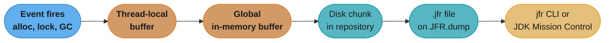

# JFR & Production Diagnostics

A deep dive into **Java Flight Recorder (JFR)** — the JVM's built-in, always-on
production profiler. This is how a team reconstructs a latency spike that
happened once, at 3am, and never reproduced in staging. It is a sub-file of
[Performance & Tuning](performance_and_tuning.md); it assumes you know the GC,
JIT, and JMH material there and focuses on the recording-and-diagnosis
discipline JFR enables. It cross-links [JMX & Management](jmx_and_management.md)
for the live-metrics plane and [JVM in Containers](jvm_in_containers.md) for
getting a recording out of a pod.

The one sentence to remember: **the hardest production problems are the ones
you cannot reproduce, so the only winning move is to already be recording —
"attach a profiler when it happens again" loses every time, because it never
happens again on your schedule.**

---

## 1. Concept Overview

JFR is a flight-recorder-style profiler built into the JVM itself: an
always-on, ring-buffered event stream with sub-1% overhead at its default
settings. It ships as a standard, open-source feature of every OpenJDK build
since **JEP 328 (JDK 11)** — no commercial license, no agent to attach, no
separate download. Before JDK 11, JFR was a JRockit-derived Oracle-JDK
commercial feature; that history is why "JFR needs a license" is still a
belief you hear in 2026, and it has been false for over a decade of JDK
releases.

JFR does not sample from outside the process the way a wall-clock profiler
does. It is instrumented into the runtime itself — the allocator, the
safepoint mechanism, the lock implementation, the class loader, the GC —
so its events are semantically typed (which class allocated, which lock was
contended, which GC phase ran) rather than reconstructed from raw stack
samples. That is the central design bet: pay a small constant cost on every
JVM, all the time, in exchange for having the evidence when an incident
actually happens.

This file assumes JDK 25 (current LTS) and covers three JFR JEPs that shipped
in that release — cooperative sampling, method timing/tracing, and
experimental CPU-time profiling, plus JEP 536 redaction, delivered in JDK 27
(GA 2026-09-15).

---

## 2. Intuition

**One-line analogy**: JFR is the aircraft flight recorder — always running,
cheap enough that nobody thinks about turning it off, and the only thing
you have after the incident. Nobody debugs a plane crash by asking the
pilot to reproduce it; they pull the recorder that was running the whole
time.

**Mental model**: picture a thread-local ring buffer that JFR events write
into continuously. Full local buffers flush into a global in-memory buffer,
which periodically flushes to disk as a **chunk** inside a **repository**
directory. A `.jfr` file is just one or more of those chunks, stitched
together — which is why `JFR.dump` can hand you a file at any moment without
stopping the recording, and why a `maxage`/`maxsize`-bounded recording
behaves like a rolling window: old chunks age out, new ones keep arriving.

**Why it matters**: the alternative to "always recording" is "attach a
profiler after the page." That loses against any bug that is
timing-dependent, load-dependent, or simply rare — by the time you have a
profiler attached, the window has closed. JFR sidesteps the reproduction
problem entirely by never needing you to reproduce anything.

**Key insight**: because the JVM instruments itself from the inside, a JFR
event carries context an external sampler cannot get — `jdk.JavaMonitorEnter`
names the exact lock class and the thread that held it; `jdk.GarbageCollection`
names the GC phase and cause; a custom event carries whatever business fields
you attached. An async stack sampler sees "this thread was blocked here"; JFR
can tell you *why*.

---

## 3. Core Principles

- **Record continuously with `maxage`/`maxsize`, not on demand.** A recording
  started after the incident begins has already missed the interesting part.
  A rolling window that is always running means the evidence exists before
  you know you need it.
- **The default profile is cheap enough to leave on forever.** Oracle's own
  published figures: `default.jfc` typically **under 1%** overhead,
  `profile.jfc` typically **around 2%**. That gap is the entire reason JFR
  exists as a production tool rather than a debugging tool you switch on.
- **Dump on the symptom, not on a schedule.** `JFR.dump` is triggered by an
  alert, a latency-SLO breach, or an on-call runbook step — not by cron. The
  recording is continuous; the dump is the moment you decide something is
  worth keeping.
- **Events are typed data, not text.** A `.jfr` file is queryable
  structured data (`jfr print --events ...`), unlike a log line or a stack
  trace scraped from a heap dump. This is what makes automated analysis and
  flame-graph generation from a recording tractable.
- **A recording you cannot get out of the container is worthless.** The
  evidence has to leave the pod before it is deleted — see
  [JVM in Containers](jvm_in_containers.md) for why a JRE-only or distroless
  image can strip `jfr`/`jcmd` out entirely.
- **Sample broadly first, instrument narrowly second.** Execution sampling
  under `default.jfc` is cheap enough to run on every thread, all the
  time, and its job is to point at a suspect. JEP 520's method timing/tracing
  is the opposite tool — precise, but scoped to the one method you already
  suspect — and using it as a first-pass discovery mechanism defeats the
  reason it is opt-in rather than default-on.
- **A `.jfr` file is evidence, not a log.** Treat it the way you would
  treat any artifact that might contain secrets or PII before it leaves a
  trusted boundary (see §10) — a recording captures whatever the process
  saw, including command-line arguments and, depending on custom events
  authored for the application, business data.

---

## 4. Types / Architectures / Strategies

**Event taxonomy** — the categories a `.jfc` settings file turns on or off:

| Category | Example events | What it answers |
|---|---|---|
| Execution samples | `jdk.ExecutionSample`, `jdk.NativeMethodSample` | Where is CPU time going (stack-sampling based) |
| Allocation | `jdk.ObjectAllocationInNewTLAB`, `jdk.ObjectAllocationOutsideTLAB` | What is allocating, and how fast |
| GC | `jdk.GarbageCollection`, `jdk.GCPhasePause` | Pause times, phases, causes |
| Locks / monitors | `jdk.JavaMonitorEnter`, `jdk.JavaMonitorWait`, `jdk.ThreadPark` | Contention — who is blocked on what |
| I/O | `jdk.SocketRead`, `jdk.FileWrite` | Blocking I/O duration by call site |
| Class loading | `jdk.ClassLoad`, `jdk.ClassDefine` | Startup and dynamic-loading cost |
| Exceptions | `jdk.JavaExceptionThrow` | Exception hot spots (thrown-but-caught storms) |
| JVM internals | `jdk.CompilerCompilation`, `jdk.SafepointBegin` | JIT and safepoint behavior |
| Method timing/tracing (JDK 25) | `jdk.MethodTiming`, `jdk.MethodTrace` | Per-method call count and duration, opt-in |
| CPU-time sampling (JEP 509, JDK 25, experimental, Linux) | `jdk.CPUTimeSample` | CPU burned in native code the execution sampler misses |
| Custom application events | your `Event` subclasses | Domain-specific: order processing time, cache miss, retry |

**Two built-in settings profiles**, selected with `settings=`:

- **`default.jfc`** — the always-on choice: execution sampling at a coarse
  interval, allocation/GC/lock events, sub-1% overhead. This is what a
  fleet leaves running permanently.
- **`profile.jfc`** — finer sampling interval and more event types for a
  deliberate, time-boxed deep dive; around 2% overhead, not meant to run
  forever on a latency-critical service (see §10 for what happens when a
  team forgets that).

**Four ways to drive a recording:**

1. **Startup flag** — `-XX:StartFlightRecording:...` on JVM launch, for
   "record from process start."
2. **`jcmd`** — attach to a running PID and start/stop/dump on demand, no
   restart required.
3. **Programmatic `Recording` API** (`jdk.jfr.Recording`) — start/stop a
   recording from inside the application, e.g. wrapped around a suspect
   code path in a diagnostic endpoint.
4. **Event streaming** (`RecordingStream` / `EventStream`, JEP 349, JDK 14) —
   react to events as they happen, in-process or by tailing a live
   repository out-of-process, without ever producing a static file.

---

## 5. Architecture Diagrams


*Every event flows through a thread-local buffer before it is globally
visible, which is what keeps the hot path lock-free and the overhead low.
A dump does not stop the recording — it snapshots the chunks on disk plus
whatever is still buffered.*

**Cooperative sampling — the JEP 518 (JDK 25) fix for safepoint bias.**
Before JEP 518, JFR's async sampler interrupted a target thread at an
arbitrary program counter and walked its stack immediately, relying on
heuristics because HotSpot's stack metadata is only *guaranteed* accurate at
a safepoint — off a safepoint the walk could produce a wrong stack, or, in
rare cases, crash the JVM. JEP 518 changes the protocol: the sampler thread
queues a sample *request* against the target thread instead of walking it
directly, and the target thread walks its own stack itself the next time it
reaches a safepoint.

```
BEFORE (JEP 518) — sampler walks the target thread directly

  target thread  ----run----run----[SAFEPOINT]----run----run----[SAFEPOINT]----
                         ^
                         |
  sampler thread   interrupt + walk stack HERE
                    (may be off-safepoint: heuristic walk, can be wrong)

AFTER (JEP 518) — sampler requests, target thread walks itself

  target thread  ----run----run----[SAFEPOINT: self-walk]----run----[SAFEPOINT: self-walk]----
                         ^                    ^
                         |                    |
  sampler thread   queue sample REQUEST   (thread services its own
                    (does not touch stack)   queued request here)
```
*The sampler never touches another thread's stack directly any more; it asks,
and the target thread answers when it is safe to answer. This removes the
unsafe out-of-safepoint walk while still correcting for safepoint bias — the
old problem where samples cluster at safepoints and under-represent code
that runs between them.*

---

## 6. How It Works — Detailed Mechanics

### Starting a recording

```bash
# From process start — continuous, bounded, disk-backed
java -XX:StartFlightRecording:disk=true,maxage=6h,settings=default \
     -XX:FlightRecorderOptions:repository=/tmp \
     -jar myapp.jar

# Oracle's own dot-form example (also valid)
java -XX:StartFlightRecording.delay=20s,duration=60s,name=myrecording,filename=myrecording.jfr,settings=profile -jar myapp.jar
```

### Driving a running JVM with jcmd

```bash
jcmd <pid> JFR.start name=incident settings=profile duration=5m filename=/tmp/incident.jfr
jcmd <pid> JFR.check                      # list running recordings
jcmd <pid> JFR.dump name=incident filename=/tmp/snapshot.jfr
jcmd <pid> JFR.stop name=incident
```

### Analyzing offline

```bash
jfr summary incident.jfr                          # event counts, categories
jfr print --events jdk.GarbageCollection incident.jfr
jfr metadata incident.jfr                          # event schema in this file
```

### Broken → fix: dumping after the window has closed

**Broken.** The alert fires at 14:32; someone SSHes in at 14:41 and starts a
recording:

```bash
jcmd 8421 JFR.start name=postmortem settings=profile duration=60s filename=/tmp/late.jfr
```

This captures 14:41–14:42 — nine minutes *after* the spike ended.
`jfr summary late.jfr` shows a perfectly healthy JVM, because it is a
recording of the JVM after the problem passed, not during it.

**Fixed.** The JVM was already running with a continuous recording:

```bash
java -XX:StartFlightRecording:disk=true,maxage=6h,maxsize=2g,settings=default \
     -XX:FlightRecorderOptions:repository=/var/jfr-repo \
     -jar myapp.jar
```

At 14:41, instead of starting anything, dump what is already there — the
14:32 spike is inside the rolling 6-hour window:

```bash
jcmd 8421 JFR.dump name=0 filename=/tmp/incident-14-32.jfr
jfr print --events jdk.JavaMonitorEnter --stack-depth 64 /tmp/incident-14-32.jfr
```

The difference is not the command — it is that the second team had a
recording running *before* they knew they would need one.

### Custom event with the `shouldCommit()` guard

```java
import jdk.jfr.*;

@Name("com.example.OrderProcessed")
@Label("Order Processed")
@Category({"Application", "Orders"})
@StackTrace(false)
public class OrderProcessedEvent extends Event {
    @Label("Order ID")
    String orderId;
    @Label("Item Count")
    int itemCount;
    @Label("Total Cents")
    long totalCents;

    public static void record(String orderId, List<Item> items) {
        OrderProcessedEvent e = new OrderProcessedEvent();
        e.begin();
        // ... process the order ...
        e.end();
        if (e.shouldCommit()) {              // guard BEFORE the expensive part
            e.orderId = orderId;
            e.itemCount = items.size();
            e.totalCents = items.stream().mapToLong(Item::priceCents).sum();
            e.commit();
        }
    }
}
```
`shouldCommit()` returns true only if this event type is enabled *and* (for
duration-thresholded events) the measured duration clears the configured
`@Threshold` in every running recording. Populate expensive fields only
inside that guard — populating them unconditionally means a "disabled"
event still costs real CPU (see §10).

### Reacting to events in-process with RecordingStream (JEP 349, JDK 14)

```java
import jdk.jfr.consumer.RecordingStream;
import java.time.Duration;

try (RecordingStream rs = new RecordingStream()) {
    rs.enable("jdk.JavaMonitorEnter").withThreshold(Duration.ofMillis(100));
    rs.onEvent("jdk.JavaMonitorEnter", event ->
        log.warn("Lock held {} ms on {} by {}",
            event.getDuration().toMillis(),
            event.getClass("monitorClass"),
            event.getThread("previousOwner")));
    rs.start();   // blocks; run on a dedicated thread
}
```
This never produces a `.jfr` file at all — it is a live tap on the event
stream, useful for wiring a "lock held over 100ms" alert directly into
application logging without an external recording-analysis step.
`EventStream.openRepository(Path)` gives the out-of-process equivalent —
tail a live JFR repository directory from a separate watchdog process
without attaching to the target JVM at all, which is the shape a sidecar
that ships events to an external system would use.

### Programmatic Recording, scoped to one operation

```java
import jdk.jfr.Recording;
import java.nio.file.Path;

@PostMapping("/admin/diagnose")
public ResponseEntity<String> diagnoseSlowEndpoint() throws Exception {
    try (Recording recording = new Recording()) {
        recording.setSettings(Recording.getConfiguration("profile"));
        recording.setDuration(Duration.ofSeconds(30));
        recording.setDestination(Path.of("/tmp/admin-diagnose.jfr"));
        recording.start();
        // ... exercise the suspect code path, or just let live traffic run ...
        recording.stop();
    }
    return ResponseEntity.ok("recorded to /tmp/admin-diagnose.jfr");
}
```
This is the right shape when the suspect is a specific endpoint or code
path rather than the whole JVM — the recording is scoped to exactly the
window you care about, at `profile.jfc` resolution, without touching the
fleet-wide `default.jfc` baseline running underneath it.

### Method timing/tracing via a custom `.jfc` (JEP 520, JDK 25)

```xml
<!-- excerpt from a custom settings file, e.g. method-timing.jfc -->
<event name="jdk.MethodTiming">
  <setting name="enabled">true</setting>
  <setting name="filter">com.example.payments.PaymentProcessor.charge</setting>
</event>
```
```bash
jcmd <pid> JFR.start name=timing settings=method-timing.jfc duration=2m filename=/tmp/timing.jfr
jfr print --events jdk.MethodTiming /tmp/timing.jfr
```
Naming one method in the `filter` is deliberate — JEP 520 itself warns
against instrumenting many methods at once, since the bytecode
instrumentation cost scales with how much code is targeted. Use this after
sampling has already narrowed the suspect down to a specific method, not as
a first-pass discovery tool.

---

## 7. Real-World Examples

- **Always-on JFR across a fleet.** A production baseline is
  `-XX:StartFlightRecording:disk=true,maxage=6h,settings=default` on every
  service JVM, all the time — the recording is the default state, not an
  incident response.
- **JFR in containers.** The recording has to leave the pod before the pod
  is gone: `kubectl cp <pod>:/tmp/incident.jfr ./incident.jfr`, a sidecar
  that ships the repository directory to object storage, or dumping
  straight to a mounted persistent volume. See
  [JVM in Containers](jvm_in_containers.md) — a JRE-only or distroless base
  image may not even ship `jfr`/`jcmd`, so this has to be decided at
  image-build time, not during the incident.
- **JDK Mission Control (JMC)** — the free GUI for opening a `.jfr` file:
  automated analysis rules flag likely problems (GC pressure, lock
  contention, allocation hot spots) without manual event browsing.
- **The `jfr` CLI** for scripted, headless analysis — `jfr summary`,
  `jfr print --events`, `jfr metadata` — the tool of choice in a CI
  pipeline or a runbook step where opening a GUI is not an option.
- **Converting execution samples to a flame graph** — `jdk.ExecutionSample`
  events carry a stack trace per sample; JMC and third-party converters
  (e.g. a `.jfr`-to-`collapsed-stacks` tool feeding `flamegraph.pl`) turn
  that into the familiar flame-graph visualization. The workflow is:
  extract stacks with `jfr print --events jdk.ExecutionSample`, collapse
  identical stacks into counted lines, then feed the collapsed format to
  any standard flame-graph renderer — the same downstream tooling
  async-profiler's output feeds, which is why the two tools are often
  compared directly on flame-graph quality.
- **Correlating JFR with distributed tracing.** A recording's events carry
  wall-clock timestamps, so a trace span that shows an unexpectedly slow
  hop into one service can be cross-referenced against that service's JFR
  recording for the same time window — the trace tells you *which* service
  owned the latency, the recording tells you *why* that service was slow.

---

## 8. Tradeoffs

| Tool | Overhead | Question it answers | Always-on safe | Production-safe by default |
|---|---|---|---|---|
| JFR (`default.jfc`) | Under 1% | JVM-internal + app events, continuously, with rich semantic context | Yes | Yes |
| JFR (`profile.jfc`) | Around 2% | Same, at finer resolution, for a bounded deep dive | No — bounded windows only | Yes if time-boxed |
| async-profiler | Low at sample intervals over 1ms | Native/JIT-level CPU flame graphs; deep allocation profiling | Yes, at low sample rates | Yes |
| JMX / Micrometer metrics | Negligible | Aggregate counters and gauges (heap used, request rate, error count) over time | Yes | Yes |
| Heap dump | High, pauses the JVM (unless async) | A snapshot of every live object and its references, at one instant | No — deliberate, rare | Only as a deliberate action |
| Distributed tracing | Low per-request | Where time went *across services* for one request | Yes | Yes |

Be honest about where each tool wins. **async-profiler still wins** for
native/JIT-level CPU flame graphs and for the depth of its allocation
profiling — it samples with a different mechanism and gives finer control
over sample rate. **JFR wins** on being always-on by design, on JVM-internal
semantic richness (it knows *which lock*, not just *that a thread blocked*),
and on being already installed in every OpenJDK build since JDK 11 — no
agent, no extra deployment step. Metrics answer "is something wrong right
now"; JFR and async-profiler answer "what, exactly, is wrong"; a heap dump
answers "what is on the heap at this instant"; tracing answers "which
service in the call chain owns the latency."

None of these tools substitute for another, and a mature production setup
runs several at once: Micrometer-fed dashboards catch the "something is
wrong" signal first, a continuous JFR recording is already running so the
"what is wrong" evidence exists the moment someone looks, and async-profiler
or a heap dump get pulled out deliberately once JFR has narrowed the
search. The mistake is treating any one of them as sufficient on its own —
metrics alone tell you a symptom is happening without telling you why, and
a profiler with no metrics tells you why something is slow without telling
you it started being slow at 03:14 rather than always.

---

## 9. When to Use / When NOT to Use

**Use JFR when:**
- You need evidence from an incident that will not reproduce on command —
  the default case for production diagnostics.
- You want JVM-internal context (which lock, which GC phase, which class
  loaded) rather than just "CPU was busy here."
- You are instrumenting your own application with custom events that need
  to correlate with JVM-level events in the same timeline.
- You need per-method call counts and timing for a *specific* suspect
  method (JEP 520's `jdk.MethodTiming`/`jdk.MethodTrace`) rather than a
  broad sampling profile.

**Reach for something else when:**
- You need a live dashboard trend over days or weeks — that is a metrics
  system (JMX-fed Micrometer/Prometheus), not a `.jfr` file. See
  [JMX & Management](jmx_and_management.md).
- You need the deepest possible native-code CPU flame graph and can afford
  a dedicated profiling run — async-profiler, not JFR's execution sampler.
- You need to know exactly what is retaining memory right now, object by
  object — a heap dump, not JFR (JFR's allocation events show *rate and
  site*, not the live retained graph).
- You need to see where latency goes across service boundaries for one
  request — distributed tracing, not a single JVM's recording.

---

## 10. Common Pitfalls

**1. Starting the recording after the incident window has closed.** The
single most common failure mode — see the broken→fix example in §6. The fix
is structural: never start a fresh recording in response to a page; dump
the one that was already running.

**2. `stackdepth=64` (the default) truncating the frames that mattered.**
`-XX:FlightRecorderOptions:stackdepth=64` caps every captured stack trace at
64 frames. A deeply nested call chain — reactive pipelines, deserialization
through several layers of wrapping, a recursive parser — gets truncated
before it reaches the frame that actually explains the cost, and the
resulting flame graph looks like it bottoms out in framework glue instead
of application code. Raise `stackdepth` explicitly for services with deep
call chains, and check it before concluding "the hot frame is in the
framework" when it might be frame 65.

**3. `maxsize` silently discarding the oldest chunk containing the
incident.** A recording bounded by `maxsize=200m` on a high-throughput
service can roll over its oldest chunks in minutes under `profile.jfc`
event volume. A team dumps 20 minutes after an alert, expecting the
6-hour `maxage` window to still hold the spike, and finds the relevant
chunk was evicted by size long before it aged out by time — `maxsize` and
`maxage` are both eviction triggers, and the tighter one wins. Size the
repository for the event volume you actually produce, not just the time
window you want.

**4. A `.jfr` file attached to a support ticket containing a database
password.** Before JDK 27, a recording captures the JVM's command
line (`jdk.JVMInformation`), environment variables
(`jdk.InitialEnvironmentVariable`), and system properties
(`jdk.InitialSystemProperty`) verbatim, including a `-Ddb.password=...`
argument. Teams attach `.jfr` files to tickets and share them outside the
security boundary without knowing what is embedded. JEP 536 (JDK 27)
redacts these by default, writing `[REDACTED]` for any key or argument
that matches the default glob filters (`*password*`, `*passwd*`, `*pwd*`,
`*secret*`, `*token*`, `*api*key*`, `*credential*`, and others). The
filters match names, not values: an environment variable called `DB_PASS`
matches none of them and is recorded in clear. Add your own names with
`-XX:FlightRecorderOptions:redact-key=+*pass*` and confirm what was
redacted with `-Xlog:jfr+redact=debug`. On JDK 26 and earlier, treat every
`.jfr` file as containing secrets.

**5. `profile.jfc` left on permanently on a latency-critical service.**
`profile.jfc`'s ~2% overhead is fine for a bounded diagnostic window; left
running indefinitely on a service with a tight p99 budget, that 2% is a
permanent tax nobody signed off on, and it tends to survive because nobody
remembers to turn it back down to `default.jfc` after the investigation
that turned it on. Time-box `profile.jfc`, and alert if a recording using
it has been running longer than its intended window.

**6. A custom event populating expensive fields with no `shouldCommit()`
guard.** An event type disabled in the active recording still executes
every line of code around `commit()` unless the population is inside an
`if (e.shouldCommit())` guard — a team building a rich custom event (a
serialized query plan, a full object dump) paid the full cost of building
that payload on every call, on every request, even with the event type
switched off, because the expensive work happened before the (unchecked)
guard. The fix in §6's example — guard first, populate second — is not
stylistic; skipping it turns a "disabled" event into a real CPU cost.

---

## 11. Technologies & Tools

| Tool | Role |
|---|---|
| `jcmd` | The scriptable local umbrella — `JFR.start`, `JFR.dump`, `JFR.stop`, `JFR.check`, plus everything covered in [Performance & Tuning](performance_and_tuning.md) §11 |
| `jfr` CLI | Offline analysis of a `.jfr` file — `summary`, `print --events`, `metadata` |
| JDK Mission Control (JMC) | The GUI for opening a recording, with automated analysis rules for GC pressure, lock contention, and allocation hot spots |
| `-XX:StartFlightRecording` | Record from process start, colon or dot option syntax |
| `-XX:FlightRecorderOptions` | Repository path, `stackdepth`, `maxchunksize` (default 12MB), `memorysize`, `dumponexit`, and (JDK 27) `redact-key`/`redact-argument` |
| `RecordingStream` / `EventStream` | JEP 349 (JDK 14) — in-process or out-of-process live event consumption without a static file |
| async-profiler | Sits alongside JFR for the deepest native/JIT CPU flame graphs and allocation depth — see §8 |
| Micrometer / JMX | Sits alongside JFR for aggregate dashboard trends — see [JMX & Management](jmx_and_management.md) §9 |

---

## 12. Interview Questions with Answers

**Q: Why does "attach a profiler when it happens again" fail as a production diagnostic strategy?**
**Short:** Because the incident that matters usually never reproduces on command, so the profiler is never attached in time.

Most production incidents worth investigating are timing-dependent, load-dependent, or simply rare — by the time someone attaches a profiler after being paged, the interesting window has already closed. JFR sidesteps this by running continuously at sub-1% overhead, so a rolling recording already contains the evidence before anyone knows an incident is coming. The practical guidance: treat JFR as always-on infrastructure, not an incident-response tool you reach for after the fact.

**Q: Does JFR require a commercial Oracle license?**
**Short:** No — JFR has been a standard open-source OpenJDK feature since JEP 328 in JDK 11.

Before JDK 11, JFR was a JRockit-derived feature bundled only with commercial Oracle JDK builds, which is where the "JFR needs a license" belief comes from. JEP 328 open-sourced it into OpenJDK, so every OpenJDK 11+ build — including free distributions — ships it with no licensing restriction. Anyone still avoiding JFR in production over license concerns is working from more than a decade of stale information.

**Q: What overhead does JFR actually add, and does that change which settings profile you use?**
**Short:** Default settings run under 1% overhead; the profile settings run around 2%, per Oracle's published figures.

`default.jfc` is cheap enough to run on every production JVM permanently — that sub-1% figure is the entire justification for leaving it always on. `profile.jfc` trades roughly double the overhead for a finer sampling interval and more event categories, appropriate for a deliberate, time-boxed deep dive rather than a permanent setting. Leaving `profile.jfc` on indefinitely on a latency-sensitive service is a real production mistake — time-box it and revert to default afterward.

**Q: A recording started right after an alert fires shows nothing wrong. What went wrong with the diagnostic approach?**
**Short:** The recording started after the incident window closed, so it only captured the JVM once it had already recovered.

Starting `JFR.start` in response to a page captures whatever the JVM is doing from that moment forward — by the time someone has logged in and typed the command, the spike is usually over. The fix is to already be running a continuous, disk-backed recording bounded by `maxage`/`maxsize` (e.g. `disk=true,maxage=6h,settings=default`), so the response to an alert is `JFR.dump`, not `JFR.start` — dumping a window that already contains the incident.

**Q: `stackdepth` defaults to 64. Why does that matter for reading a flame graph?**
**Short:** A stack deeper than 64 frames gets truncated, so the flame graph can bottom out in framework code instead of the real hot frame.

`-XX:FlightRecorderOptions:stackdepth` caps how many frames JFR captures per sample or event, defaulting to 64. Deeply nested call chains — reactive pipelines, layered deserialization, recursion — routinely exceed that, and the resulting flame graph looks like it ends in generic framework glue rather than the application code actually responsible. If a flame graph seems to blame the framework, raise `stackdepth` and re-record before concluding the framework is the cost.

**Q: `maxage=6h` is set but the incident chunk is missing from the dump. What else could have evicted it?**
**Short:** `maxsize` evicts chunks by disk size independently of `maxage`, and the tighter bound wins.

A repository bounded by both `maxage` and `maxsize` evicts chunks whichever limit is hit first — a high event-volume service under `profile.jfc` can roll past a small `maxsize` in minutes, discarding chunks the time-based window would have kept. The practical fix is to size `maxsize` for the actual event volume the settings profile produces, not just for the time window you intend to retain.

**Q: A `.jfr` file was attached to a support ticket. What might be exposed, and what does JDK 27 redact?**
**Short:** Startup args, env vars, and system properties can hold secrets; JDK 27 redacts only names matching its default filters, such as any name containing password.

A recording captures the process's command line (`jdk.JVMInformation`), environment variables (`jdk.InitialEnvironmentVariable`), and system properties (`jdk.InitialSystemProperty`) as they were at startup. Before JDK 27, a secret passed as `-Ddb.password=...` or through an environment variable lands in the file verbatim. JEP 536 (JDK 27, GA 2026-09-15) turns redaction on by default and writes `[REDACTED]` in place of the value. The default `redact-key` filters are `*api*key*`, `*auth*`, `*client*secret*`, `*credential*`, `*jaas*config*`, `*passphrase*`, `*passwd*`, `*password*`, `*private*key*`, `*pwd*`, `*secret*`, and `*token*`; `redact-argument` uses the same list without `*auth*` (it would match "author"), plus `-*password *` forms that also redact the next argument. The filters match names, so `DB_PASS` slips through: add it with `-XX:FlightRecorderOptions:redact-key=+*pass*` (a leading `+` adds to the defaults, `none` disables, `@file` loads one filter per line) and check the result with `-Xlog:jfr+redact=debug`. JDK 27 also drops command-line arguments from the `jdk.SystemProcess` event (JDK-8384164).

**Q: A custom JFR event is disabled in the active recording, but production CPU usage is still elevated. What's the likely cause?**
**Short:** Expensive field population running outside the `shouldCommit()` guard still costs CPU even when the event itself is disabled.

`shouldCommit()` tells you whether this event type is enabled and clears any configured threshold — but only the code guarded by it is skipped when the answer is false. If a custom event builds an expensive payload (serializing an object, summing a large collection) before checking `shouldCommit()`, that work runs on every call regardless of whether the event is ever committed. The fix is to do only `begin()`/`end()` unconditionally and move all expensive field population inside `if (e.shouldCommit())`.

**Q: How does JEP 518's cooperative sampling change stack collection, and what problem did it fix?**
**Short:** The sampler now requests a self-walk at the target thread's next safepoint instead of walking its stack directly.

Before JEP 518 (JDK 25), JFR's async sampler interrupted a target thread and walked its stack at essentially any program counter, relying on heuristics because HotSpot's stack metadata is only guaranteed accurate at a safepoint — this could produce incorrect stack traces or, rarely, crash the JVM. JEP 518 has the sampler queue a sample request instead, and the target thread walks its own stack itself the next time it reaches a safepoint, eliminating the unsafe out-of-safepoint walk while still correcting for the sampling bias that clusters around safepoints. This is a JVM-internal correctness fix, not something you configure — recordings taken on JDK 25+ simply get more reliable stacks.

**Q: What does JEP 520's method timing/tracing add that execution sampling doesn't already give you?**
**Short:** Exact per-call counts and durations for specific methods, versus sampling's statistical "this method is hot."

`jdk.MethodTiming` and `jdk.MethodTrace` (JDK 25) are opt-in, per-method or per-class events implemented via bytecode instrumentation configured through `.jfc` settings — you name the exact methods to instrument. This closes the gap between a sampling profiler saying "this method looks hot" and knowing precisely how many times it was called and how long each call took, which previously required a hand-rolled timing wrapper or an external agent. The JEP explicitly warns against instrumenting too many methods at once — it is a targeted-diagnosis tool for a method you already suspect, not a blanket replacement for sampling.

**Q: What does JEP 509's CPU-time profiling add, and what are its two hard restrictions?**
**Short:** It samples at fixed CPU-time intervals via the Linux kernel's per-thread timer, but it is experimental and Linux-only.

`jdk.CPUTimeSample` (JDK 25) uses the Linux kernel's per-thread CPU timer to sample at fixed *CPU-time* intervals rather than wall-clock intervals, catching CPU consumed in native code that the ordinary execution sampler can miss because it samples on wall-clock cadence. Both restrictions matter for interview correctness: it is explicitly marked experimental, and it only works on Linux — recommending it unconditionally, or for a macOS/Windows dev box, is wrong on both counts.

**Q: When would you reach for async-profiler instead of JFR, given JFR is free and always-on?**
**Short:** For the deepest native/JIT-level CPU flame graphs and finer allocation-profiling depth than JFR's execution sampler gives.

JFR's strength is being an always-on, low-overhead, JVM-semantic-rich recorder that is already installed; async-profiler's strength is a different, more granular sampling mechanism that produces sharper native/JIT flame graphs and deeper allocation profiling at low sample intervals. They are not competitors so much as complements — leave JFR's default recording on the fleet permanently, and reach for async-profiler for a dedicated, deliberate profiling session when JFR's sampling resolution is not enough.

**Q: When is JFR the wrong tool, in favor of a heap dump instead?**
**Short:** When you need to know exactly what is retaining memory right now, object by object — JFR shows allocation rate and site, not the live retained graph.

JFR's allocation events (`jdk.ObjectAllocationInNewTLAB`, etc.) tell you what is allocating and how fast, which is the right question for a high-allocation-rate GC problem. They do not give you a snapshot of every live object and its reference graph, which is what a heap dump (and a dominator-tree analysis in Eclipse MAT) is for — diagnosing a slow memory leak needs the reference chain keeping an object alive, and that is a heap dump question, not a JFR question. Use JFR to notice the allocation rate is abnormal; use a heap dump to find out what is being retained.

**Q: What are the four ways to start a JFR recording, and when would you pick each?**
**Short:** Startup flag, `jcmd`, the programmatic `Recording` API, and event streaming — chosen by whether you need it from boot, on demand, code-scoped, or reactive.

`-XX:StartFlightRecording` records from process launch, appropriate for the always-on production baseline. `jcmd <pid> JFR.start/dump/stop` attaches to an already-running JVM without a restart, the right choice for an ad hoc incident response. The programmatic `jdk.jfr.Recording` API lets application code start/stop a recording scoped to a specific operation, such as a diagnostic admin endpoint. `RecordingStream`/`EventStream` (JEP 349) skips file production entirely and reacts to events live, useful for wiring an alert directly off event data such as "lock held over 100ms."

**Q: What is the difference between `JFR.dump` and `JFR.stop`?**
**Short:** `JFR.dump` snapshots the recording to a file while it keeps running; `JFR.stop` ends the recording.

`jcmd <pid> JFR.dump name=<name> filename=<file>` writes out everything captured so far — the closed disk chunks plus whatever is still buffered — without interrupting the recording, so you can dump repeatedly over the life of one long-running recording. `jcmd <pid> JFR.stop name=<name>` terminates the named recording; if it wasn't already writing to a file with `filename=`, you need to have dumped before stopping or the data is gone. A continuous production recording is dumped many times and stopped rarely, if ever.

**Q: What can a Kubernetes-deployed service's base image do to make JFR unusable exactly when you need it?**
**Short:** A JRE-only or distroless base image can omit the `jfr`/`jcmd` binaries entirely, and distroless also drops the shell.

Diagnostics tooling is not guaranteed to be in a minimal image — a JRE-only image can lack `jcmd`/`jfr`, and a distroless image additionally has no shell to run them from even if they were present. The workable middle ground is a `jlink`-built custom runtime that explicitly includes the `jdk.jcmd` and `jdk.jfr` modules, or a Kubernetes ephemeral debug container attached to the misbehaving pod's namespaces. This has to be decided at image-build time — see [JVM in Containers](jvm_in_containers.md) — because discovering it during an incident means the diagnosis becomes a redeploy.

**Q: Why does a custom event's `@StackTrace` annotation default to off, and when would you turn it on?**
**Short:** Stack capture is disabled by default for custom events because it substantially increases recording size; enable it only when you need the call site.

Capturing a full stack trace on every commit of a high-frequency custom event can dominate the recording's size and defeat the purpose of a low-overhead always-on recorder. `@StackTrace(true)` (or the equivalent `.jfc` setting) is worth turning on when the event fires rarely enough that the size cost is acceptable and you specifically need to know the call site, not just that the event happened — for a high-frequency event, prefer adding a labeled field over enabling the stack trace.

**Q: What is the practical difference between `default.jfc` execution sampling and JEP 520's method timing for finding a hot method?**
**Short:** Sampling finds candidates statistically across the whole JVM; method timing gives exact counts and durations for methods you already suspect.

Execution sampling under `default.jfc` runs cheaply across every thread and surfaces which methods appear most often in captured stacks — a broad, low-cost first pass that tells you where to look. Once you have a suspect from that pass, JEP 520's `jdk.MethodTiming`/`jdk.MethodTrace` gives exact per-call counts and durations for that specific method or class, at a cost the JEP itself warns not to spread across too many methods at once. The practical workflow is sampling first to find the suspect, then targeted method timing to confirm and quantify it.

**Q: What is the difference between the `Recording` API and `RecordingStream` for driving JFR programmatically?**
**Short:** `Recording` produces a file you analyze afterward; `RecordingStream` delivers events live, in-process, with no file.

`jdk.jfr.Recording` starts, runs for a bounded duration or until stopped, and is typically dumped to a `.jfr` file for offline analysis with `jfr` or JMC — the right shape for scoping a diagnostic to one operation, such as an admin endpoint that records the next 30 seconds. `RecordingStream` instead calls your handler as each matching event commits, with no persisted file required, which is the right shape for wiring a live alert (for example, logging every lock held over 100ms) directly into the running application. Pick `Recording` when you want an artifact to examine later, and `RecordingStream` when you want to react immediately.

---

## 13. Best Practices

- **Ship a JFR baseline in every service's JVM args**, not as an opt-in:
  `-XX:StartFlightRecording:disk=true,maxage=6h,maxsize=2g,settings=default -XX:FlightRecorderOptions:repository=/var/jfr-repo`.
- **Add a dump-on-alert runbook step.** The on-call response to a latency
  or error-rate alert includes `jcmd <pid> JFR.dump name=0
  filename=/var/jfr-out/incident-$(date +%s).jfr` as a standard step, before
  restarting or redeploying anything that would lose the window.
- **Set a retention policy for dumped files**, separate from the rolling
  in-JVM window — a dump that lands on ephemeral pod storage needs to be
  shipped to durable storage (object storage, a sidecar upload) before the
  pod recycles, per [JVM in Containers](jvm_in_containers.md).
- **Treat every `.jfr` file from JDK 26 or earlier as containing secrets**,
  and restrict access before attaching one to a ticket. On JDK 27, add your
  own secret names to `redact-key` (the default filters miss names such as
  `DB_PASS`) and check `-Xlog:jfr+redact=debug` once per service.
- **Reserve `profile.jfc` for time-boxed investigations**, and set a
  reminder or alert if it has been running longer than the investigation
  window intended.
- **Raise `stackdepth` for services with deep call chains** rather than
  trusting the default 64-frame cap, and check it before blaming a
  framework for a flame graph that bottoms out in its code.
- **Guard every custom event's expensive field population with
  `shouldCommit()`**, never populate first and check second.
- **Author custom events for the business operations that matter** — an
  order-processed event, a cache-miss event, a retry-exhausted event —
  rather than relying solely on generic JVM-internal events; JFR's value
  compounds when application semantics sit in the same timeline as GC
  pauses and lock contention.
- **Review the settings profile after any incident investigation that
  temporarily raised it**, so `profile.jfc` or a widened `stackdepth`
  reverts to the fleet baseline instead of quietly becoming the new
  permanent default.

---

## 14. Case Study

**Symptom.** A payment-processing service serving p50 latency around 40ms
intermittently spiked to 2-3 second p99 latency for 30-90 second windows,
roughly twice a week, with no reliable trigger — load testing at 3x
production traffic in staging never reproduced it.

**What did not work.** The team's first two incidents were handled by
attaching async-profiler after being paged. Both times, by the time the
profiler was attached (roughly 4-6 minutes after the alert), the spike had
already ended, and the resulting profile showed a perfectly healthy JVM —
exactly the "recording started after the window closed" failure from §6.

**The fix.** The team rolled out a continuous JFR baseline across the fleet:
`-XX:StartFlightRecording:disk=true,maxage=6h,maxsize=2g,settings=default`,
repository on a mounted volume, plus a runbook step to `JFR.dump` on the
next occurrence instead of starting anything new.

**The third incident.** The alert fired at 03:14. The on-call dumped the
already-running recording:
```bash
jcmd 14203 JFR.dump name=0 filename=/var/jfr-out/incident-0314.jfr
```
Analysis (`jfr print --events jdk.JavaMonitorEnter --stack-depth 64`) showed
a `jdk.JavaMonitorEnter` spike overlapping the latency window exactly: 340
threads blocked for a median of 1.8 seconds on a single lock guarding an
in-memory idempotency-key cache, held by a thread executing a full linear
scan of the cache during a periodic eviction sweep — a sweep that normally
took under 5ms but occasionally raced with a GC pause and stretched to
seconds while still holding the lock for the entire scan.

**The numbers.** Before the fix: p99 latency 2,100-3,400ms during the
windows, occurring roughly 2x/week, average incident duration 55 seconds,
zero successful reproductions in staging across three prior investigation
attempts. After replacing the coarse-grained lock with a `ConcurrentHashMap`
and a bounded, incremental eviction sweep: p99 latency during equivalent
load stayed under 60ms, and the pattern has not recurred in the four months
since the fix shipped. Total diagnostic cost for the fix: one dump, one
`jfr print`, roughly 20 minutes from alert to root cause — versus two prior
incidents that each consumed a full day of inconclusive investigation using
an after-the-fact profiler.

**The lesson generalizes beyond this one bug.** Nothing about the fix
required the team to predict which lock would eventually cause trouble —
the continuous recording made the *next* unpredictable incident diagnosable
too, at the same fixed sub-1% overhead cost paid every day whether or not
an incident happens. That is the whole argument for treating JFR as
baseline infrastructure rather than a tool reached for after the fact: the
value shows up precisely on the incidents nobody could have anticipated.

---

## Related / See Also

- [Performance & Tuning](performance_and_tuning.md) — the parent module: GC
  tuning, JIT behavior, JMH benchmarking, and the `jcmd` umbrella this file
  drills into for JFR specifically.
- [JMX & Management](jmx_and_management.md) — the live-metrics and MBean
  plane; use it for continuous dashboard trends, use JFR for the recorded
  event evidence behind a specific incident.
- [JVM in Containers](jvm_in_containers.md) — why a JRE-only or distroless
  base image can silently remove `jfr`/`jcmd`, and how to get a recording
  out of a running pod.
