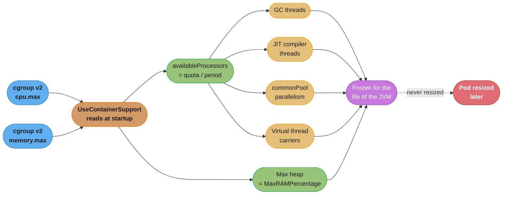
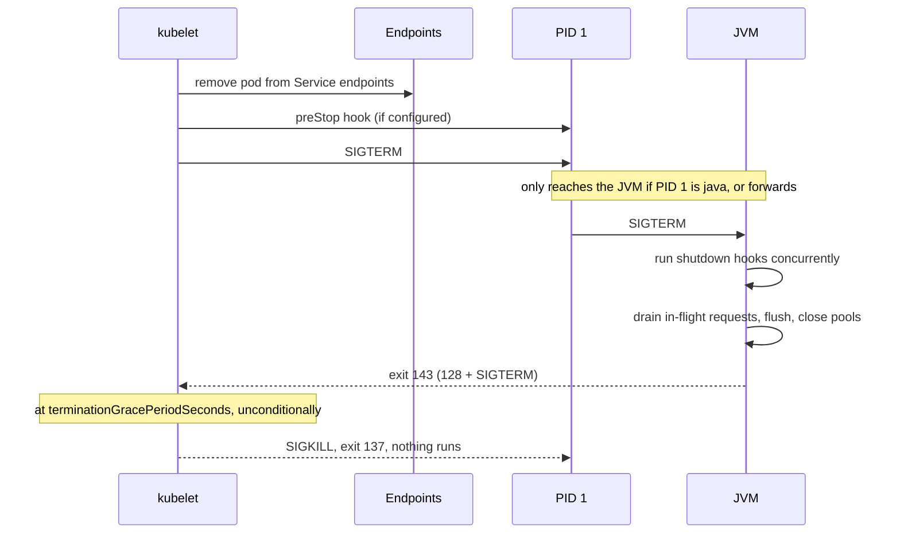

# The JVM in Containers — CPU, Lifecycle, and Image

## 1. Concept Overview

The JVM was designed for a machine. A container is not a machine — it is a process tree wearing a machine costume, stitched together from cgroups (resource accounting), namespaces (isolation), and a root filesystem. Almost every place the JVM asks "how big is this computer?" it is really asking the kernel, and the kernel's honest answer depends on whether the JVM knows to look at the cgroup instead of `/proc/cpuinfo` and `/proc/meminfo`.

Since JDK 10 (`-XX:+UseContainerSupport`, on by default) it does look, and the memory half of that story — cgroup limits, `MaxRAMPercentage`, the RSS budget that `-Xmx` does not cover, Native Memory Tracking, and diagnosing exit code 137 — is covered in depth by [JVM Tuning & GC for Services](../case_studies/cross_cutting/jvm_tuning_and_gc_for_services.md), which is the canonical home for it. **This file deliberately does not repeat that material.** It covers the other four things a JVM has to get right to be a good container citizen, none of which are about heap size:

1. **CPU.** A Kubernetes CPU limit is a CFS bandwidth quota, not a core count. It throttles a multi-threaded JVM in ways that look like "the GC is slow" or "the JIT is slow" and never look like "we are out of CPU". A JVM sizes at least six independent thread pools off `Runtime.availableProcessors()` at startup and never resizes them, even though later calls return the new value.
2. **Lifecycle and signals.** A pod termination is a `SIGTERM` followed by a hard `SIGKILL` at the grace deadline. Whether the JVM ever sees that `SIGTERM` depends on your `ENTRYPOINT` form, and whether it finishes in-flight work depends on what your shutdown hooks actually do.
3. **Probes.** A liveness probe is a watchdog that restarts your process. A JVM has legitimate multi-second stalls (a long GC pause, a slow cold start) that a naively-configured probe reads as death, producing a restart loop that looks exactly like a crash and is not one.
4. **The image.** Base image, runtime footprint, and glibc-vs-musl decide how much of the memory budget you spend before your code runs a single line.

The unifying theme is that **the JVM makes irreversible decisions at startup, from numbers the container supplies, and the container's real constraints are enforced later and by a different mechanism.** Everything below is a consequence of that gap.

---

## 2. Intuition

> **One-line analogy**: The JVM walks into the room, counts the chairs, hires a staff sized to the chair count, and never changes the staff size even when a later recount differs, while the building manager, unseen, is metering how many minutes per hour the staff is allowed to actually work.

**Mental model**: separate *what the JVM believes* from *what the kernel enforces*, because they are set by different mechanisms at different times.

- **Belief** is fixed at startup: every derived thread count (GC threads, JIT compiler threads, `ForkJoinPool.commonPool()`, the virtual-thread scheduler, Netty's event loops, your own `newFixedThreadPool(availableProcessors())`) is sized from the startup reading of `Runtime.availableProcessors()` and then frozen. HotSpot re-reads the cgroup CPU quota on later calls (behind a 20 ms cache, JDK-8227006), but no pool asks again.
- **Enforcement** is continuous and invisible: the CFS scheduler gives the cgroup a budget of CPU-microseconds per 100 ms period. When the budget runs out, every runnable thread in the cgroup is descheduled until the next period. No exception is thrown. No log line is written. The only evidence is a counter, `container_cpu_cfs_throttled_seconds_total`, that nothing in the JVM knows exists.

**Why it matters**: the failure mode is not an error, it is *latency with no cause*. A service with a 500m CPU limit and 40 GC threads spends its quota descheduling itself and reports p99 latency spikes that no profiler attributes to any method, because the time is not in any method — it is in the gap between two instructions where the kernel took the CPU away.

**Key insight**: `availableProcessors()` answers "how many cores could I run on simultaneously", and a CFS quota does not constrain that at all — it constrains *how much total CPU-time you may consume*. A pod with `limits.cpu: 500m` on a 64-core node can run 64 threads simultaneously; it just gets 50 ms of the next 100 ms to do it in. The JVM's whole sizing model assumes those two questions have the same answer, and under a quota they do not.

---

## 3. Core Principles

- **Sized once, live forever.** `availableProcessors()` re-reads the cgroup quota on each call, behind a 20 ms cache (JDK-8227006, JDK 14, backported to 11.0.10 and 8u281). The pools sized from it at startup never ask again, so vertical scaling a running pod, or a node's allocation changing, does not resize a single JVM thread pool.
- **A CPU limit is a time budget, not a core count.** `limits.cpu: 2` means 200 ms of CPU per 100 ms period, however many threads consume it. Parallelism is unbounded; consumption is metered.
- **A CPU *request* is invisible to the JVM.** Requests drive scheduling and cgroup *shares*, not quota. With no limit set there is no quota, and the JVM falls back to the node's full core count.
- **The container limit is enforced on the whole process, the JVM's limits are enforced per-region.** Heap, metaspace, code cache, thread stacks, and direct buffers each have their own JVM ceiling; the cgroup has one ceiling over all of them plus the OS overhead.
- **`SIGTERM` is a request, `SIGKILL` is not.** Everything graceful must complete inside `terminationGracePeriodSeconds`. Nothing runs after `SIGKILL` — no shutdown hook, no `finally`, no flush.
- **A shutdown hook is best-effort, not a resource manager.** It runs on `SIGTERM` and on `System.exit()`, and never on `SIGKILL`, an OOMKill, a power loss, or `Runtime.halt()`. [Effective Java Item 8] makes the same point about finalizers and cleaners: correctness must not depend on a mechanism the runtime is free to skip.
- **Liveness probes must be strictly weaker than readiness probes.** Readiness removes you from the load balancer; liveness kills the process. Any condition that is transient belongs in readiness.
- **Startup CPU demand is much higher than steady-state CPU demand.** Class loading, verification, and JIT compilation are all CPU-bound and all happen at once, against the same quota the steady state was sized for.

---

## 4. Types / Architectures / Strategies

### 4.1 Every JVM thread pool sized from `availableProcessors()` — call it `N`

| Pool | Default size | Flag / property to override | Consequence when `N` is wrong |
|------|--------------|------------------------------|-------------------------------|
| G1 parallel GC threads | `N` up to 8, then `8 + (N-8)*5/8` | `-XX:ParallelGCThreads` | Oversized: STW pauses spent on scheduler contention, not collection |
| G1 concurrent GC threads | `ParallelGCThreads / 4` (min 1) | `-XX:ConcGCThreads` | Oversized: concurrent marking steals the mutator's quota |
| JIT compiler threads | tiered: scales with `N`, minimum 2 | `-XX:CICompilerCount` | Undersized: compile queue backs up, code stays interpreted for minutes |
| `ForkJoinPool.commonPool()` | `N - 1` | `-Djava.util.concurrent.ForkJoinPool.common.parallelism` | Drives every parallel stream and every `CompletableFuture` with no explicit executor |
| Virtual-thread scheduler | `N` carrier threads | `-Djdk.virtualThreadScheduler.parallelism` and `.maxPoolSize` | Undersized: virtual threads queue behind carriers even when CPU is free |
| Netty `NioEventLoopGroup` | `N * 2` | `-Dio.netty.eventLoopThreads` | The single largest thread-count multiplier in a typical service |
| Your own `newFixedThreadPool(N)` | `N` | your code | The one you will forget about |

A pod with no CPU limit on a 64-core node gets `N = 64` and, with a Netty-based stack, materialises roughly 128 event-loop threads, 40 GC threads, 63 common-pool threads, and a compiler thread count to match — several hundred threads, each with a native stack counted against the memory limit, all competing for a share of the node it never had.

### 4.2 cgroup v1 vs v2 — where the numbers actually live

| What | cgroup v1 | cgroup v2 |
|------|-----------|-----------|
| Memory limit | `/sys/fs/cgroup/memory/memory.limit_in_bytes` | `/sys/fs/cgroup/memory.max` |
| Memory soft limit | `memory.soft_limit_in_bytes` | `memory.high` (throttles rather than kills) |
| CPU quota | `cpu/cpu.cfs_quota_us` | `cpu.max` (`"<quota> <period>"`, or `"max <period>"`) |
| CPU period | `cpu/cpu.cfs_period_us` | second field of `cpu.max` |
| CPU shares/weight | `cpu.shares` (1024 = 1 core's worth) | `cpu.weight` (1–10000, default 100) |
| CPU pinning | `cpuset/cpuset.cpus` | `cpuset.cpus` |

cgroup v2 is the default on every current distribution and on Kubernetes 1.25+. The JVM reads both; `-Xlog:os+container=trace` prints exactly which files it opened and what it concluded, which is the only reliable way to settle an argument about what the JVM thinks it has.

### 4.3 CPU limit vs CPU request vs cpuset — three different contracts

| Mechanism | Kubernetes field | Kernel mechanism | What the JVM sees | Enforcement style |
|-----------|------------------|------------------|-------------------|-------------------|
| Request | `requests.cpu` | `cpu.weight` / `cpu.shares` | **Nothing** — falls back to node core count | Proportional, only under contention |
| Limit | `limits.cpu` | CFS quota (`cpu.max`) | Quota ÷ period, rounded up | Hard, per 100 ms period, always |
| Pinned cores | `limits.cpu` integer + `static` CPU manager policy | `cpuset.cpus` | The size of the cpuset | Hard, by exclusion |

The third row is the one worth knowing: with the kubelet's `static` CPU manager policy, a Guaranteed-QoS pod requesting an integer number of CPUs gets *exclusive pinned cores* instead of a quota. The JVM then reads a cpuset, `availableProcessors()` is exactly right, and CFS throttling disappears entirely. This is the correct configuration for latency-sensitive JVM services and it is almost never enabled by default.

### 4.4 Base-image strategies

| Strategy | Typical size | Startup impact | Tradeoff |
|----------|--------------|----------------|----------|
| Full JDK (`eclipse-temurin:25-jdk`) | ~450 MB | none | Ships `javac`, `jlink`, debug tooling and their CVE surface into production |
| JRE (`eclipse-temurin:25-jre`) | ~200 MB | none | No `jcmd`/`jmap`/`jfr` — you lose live diagnostics exactly when you need them |
| `jlink` custom runtime | ~60–100 MB | faster image pull | Must track `--add-modules` and `--bind-services`; see [JPMS](../java_platform_module_system/java_platform_module_system.md) |
| Distroless + `jlink` | ~50–90 MB | faster image pull | No shell — `kubectl exec` debugging requires an ephemeral debug container |
| Alpine / musl (`-alpine`) | smallest | none | musl's allocator behaves differently from glibc under many-threaded load; benchmark before adopting |
| GraalVM native image | ~40–90 MB | ~15 ms start | Closed world; see [GraalVM Native Image](../graalvm_native_image/graalvm_native_image.md) |

Keep `jcmd` and `jfr` reachable in production one way or another. A JRE-only image that cannot take a thread dump converts a fifteen-minute diagnosis into a redeploy.

---

## 5. Architecture Diagrams

### What the JVM reads at startup, and what it freezes



Every box downstream of `availableProcessors` is decided in the first few milliseconds of the process and is immutable afterwards. Vertical-scaling a pod changes the cgroup, and a later `availableProcessors()` call returns the new count, but no pool in the diagram is resized.

### CFS throttling — where the latency actually goes

The CFS scheduler grants the cgroup `quota` microseconds of CPU per `period` (default 100 ms). Threads run freely until the budget is spent, then *every* thread in the cgroup is descheduled until the period rolls over. With `limits.cpu: 1` (quota 100 ms) and 4 runnable threads:

```
period boundary                                        period boundary
|                                                      |
+---- 25 ms wall clock ----+------- 75 ms wall clock --+
|  4 threads x 25 ms       |                           |
|  = 100 ms CPU consumed   |     ALL THREADS FROZEN    |
|  budget exhausted        |     nothing runs, no log  |
+--------------------------+---------------------------+
 ^                          ^                          ^
 work happens               throttle begins            work resumes

Observed CPU utilisation: 25%.   Actual state: 75% of the wall clock throttled.
A request that arrives here --------^  waits 75 ms before its first instruction.
```

This is the throttling paradox: the more threads you run against a fixed quota, the *earlier* in each period you exhaust it, and the longer the frozen tail becomes — while the utilisation metric, averaged over the period, goes *down*. Low CPU utilisation plus high `container_cpu_cfs_throttled_seconds_total` is the signature, and it is the exact opposite of what "we are not CPU-bound" intuition suggests.

### Pod termination — the window you actually have



Endpoint removal and `SIGTERM` are issued concurrently, not in sequence — in-flight and even newly-routed requests can arrive *after* `SIGTERM`, because propagating the endpoint removal through kube-proxy and every ingress takes time the kubelet does not wait for. A `preStop` sleep of a few seconds is the standard way to buy that propagation window.

---

## 6. How It Works — Detailed Mechanics

### Reading what the JVM actually concluded

Never infer it, print it:

```bash
# What the container layer detected and what it derived from it:
java -Xlog:os+container=trace -version 2>&1 | head -30
#   [os,container] OSContainer::init: Initializing Container Support
#   [os,container] Memory Limit is: 4294967296
#   [os,container] CPU Quota is: 200000
#   [os,container] CPU Period is: 100000
#   [os,container] OSContainer::active_processor_count: 2

# What it will actually use, after all flags and ergonomics:
java -XX:+PrintFlagsFinal -version | grep -E 'MaxHeapSize|ActiveProcessorCount|ParallelGCThreads|CICompilerCount'

# From inside a running container, the ground truth:
cat /sys/fs/cgroup/cpu.max          # "200000 100000" => 2 cores' worth of quota
cat /sys/fs/cgroup/memory.max
```

`OSContainer::active_processor_count` rounds *up*: a quota of 150000 µs against a 100000 µs period is 1.5 cores, and the JVM reports 2. Sub-core limits are therefore always at least 1, and `limits.cpu: 100m` yields `availableProcessors() == 1` while granting only 10 ms of CPU per period — a tenth of one thread's worth. That combination is the single most common cause of a JVM that "hangs on startup".

### Why a tight CPU limit hurts startup far more than steady state

Startup runs class loading, bytecode verification, static initialisation, and JIT compilation of everything on the warm-up path — all CPU-bound, all at once. Steady state runs your request handler with most hot code already compiled. Sizing the limit for the steady state starves the startup.

```
Same Spring-shaped service, same 2 GiB memory limit, cold start to first served request:

  limits.cpu: 2      ->  ~4.5 s     (JIT keeps up, compiler queue drains)
  limits.cpu: 1      ->  ~9 s       (compiler threads competing with the main thread)
  limits.cpu: 500m   ->  ~28 s      (throttled through the entire warm-up; the
                                     liveness probe usually kills it before this)
```

Three fixes, in increasing order of effort:

1. **A `startupProbe`** with a generous `failureThreshold`, so that liveness does not apply until the JVM has actually booted. This is the correct fix for the restart loop, and it costs four lines of YAML.
2. **Raise the CPU limit and accept the throttling in steady state**, or drop the limit entirely and pin `-XX:ActiveProcessorCount` to the request size. A pod that only needs its burst at startup is exactly the case CPU limits serve worst.
3. **Remove the work instead of paying for it faster** — see [AOT Startup & Class Data Sharing](../aot_startup_and_class_data_sharing/aot_startup_and_class_data_sharing.md). An AOT cache moves class loading and linking off the startup path entirely, which is worth strictly more under a tight CPU quota than under a generous one, because the work you skip is the work that was being throttled.

### Broken → fix: the `ENTRYPOINT` that swallows `SIGTERM`

```dockerfile
# BROKEN — shell form. Docker runs: /bin/sh -c "java -jar /app.jar"
# PID 1 is sh. The kernel does not apply the default SIGTERM action to PID 1, and
# sh installs no handler and forwards nothing, so SIGTERM is silently discarded.
# The JVM never learns the pod is terminating. Every shutdown is a SIGKILL at the
# grace deadline: exit 137, no shutdown hooks, in-flight requests dropped.
ENTRYPOINT java -jar /app.jar
```

```dockerfile
# FIXED — exec form. PID 1 is the JVM itself, which installs its own SIGTERM
# handler and runs the shutdown sequence.
ENTRYPOINT ["java", "-jar", "/app.jar"]
```

If a wrapper script is genuinely needed, `exec` replaces the shell with the JVM so the process ID is preserved:

```sh
#!/bin/sh
set -e
# ... compute flags ...
exec java $JAVA_OPTS -jar /app.jar     # 'exec' is load-bearing, not stylistic
```

Verify it rather than trusting it — a healthy shutdown exits **143** (`128 + 15`, SIGTERM), a swallowed one exits **137** (`128 + 9`, SIGKILL):

```bash
kubectl get pod <pod> -o jsonpath='{.status.containerStatuses[0].lastState.terminated.exitCode}'
```

An entire fleet reporting 137 on every routine rollout is not an OOM problem; it is this.

### Graceful shutdown that actually drains

```java
public final class GracefulShutdown {

    private static final Duration DRAIN = Duration.ofSeconds(20);   // < grace period

    public static void install(HttpServer server, ExecutorService work) {
        Runtime.getRuntime().addShutdownHook(new Thread(() -> {
            // 1. Stop accepting: readiness has already failed, this closes the door.
            server.stop(0);

            // 2. Let in-flight work finish, bounded by our own deadline.
            work.shutdown();
            try {
                if (!work.awaitTermination(DRAIN.toSeconds(), TimeUnit.SECONDS)) {
                    work.shutdownNow();     // cancel the stragglers, do not hang
                }
            } catch (InterruptedException e) {
                work.shutdownNow();
                Thread.currentThread().interrupt();
            }

            // 3. Flush anything buffered. An async log appender that is not flushed
            //    here loses precisely the lines describing the shutdown.
            LoggerFactory.flushAll();
        }, "graceful-shutdown"));
    }
}
```

Three rules this encodes:

- **The hook's own deadline must be strictly shorter than `terminationGracePeriodSeconds`.** If the hook takes 40 s and the grace period is 30 s, the `SIGKILL` lands mid-drain and you get the worst of both: a slow shutdown *and* dropped work.
- **Shutdown hooks run concurrently with one another**, on separate threads, in unspecified order. Anything with an ordering dependency must live in one hook, not several.
- **`awaitTermination` must be bounded.** An unbounded wait converts a graceful shutdown into a guaranteed `SIGKILL`.

The matching pod spec:

```yaml
terminationGracePeriodSeconds: 45      # > the hook's 20 s drain, with headroom
lifecycle:
  preStop:
    exec:
      command: ["sleep", "5"]          # let endpoint removal propagate first
```

### Probes that do not kill a healthy JVM

```yaml
startupProbe:                 # covers slow cold start; liveness is suspended until it passes
  httpGet: { path: /health/live, port: 8080 }
  periodSeconds: 5
  failureThreshold: 30        # allows up to 150 s to boot, once

livenessProbe:                # ONLY "the process is unrecoverable"
  httpGet: { path: /health/live, port: 8080 }
  periodSeconds: 10
  timeoutSeconds: 5           # must exceed the worst tolerable GC pause
  failureThreshold: 6         # 6 consecutive failures = 60 s of genuine death

readinessProbe:               # everything transient belongs here
  httpGet: { path: /health/ready, port: 8080 }
  periodSeconds: 5
  failureThreshold: 2
```

The liveness endpoint must not touch the database, the cache, or any downstream service. A liveness probe that checks a dependency converts *that dependency's* outage into a full restart of every pod in your fleet, at the exact moment the dependency is least able to handle a thundering herd of reconnecting clients. Dependency health is a readiness question: it removes you from the load balancer and leaves the process alive to recover.

`timeoutSeconds` deserves arithmetic rather than a guess. A liveness probe with `timeoutSeconds: 1` on a service whose p99.9 G1 pause is 400 ms will eventually catch a 1.2 s pause under load, and if `failureThreshold` is 1 it will restart a completely healthy JVM — during a traffic peak, which is when long pauses happen, and therefore across many pods at once.

### Heap that never comes back, and why memory-based autoscaling misfires

The JVM commits heap from the OS and, by default, is reluctant to give it back — RSS is a high-water mark, not a live measurement. Horizontal Pod Autoscaling on a memory metric therefore scales up on a transient allocation spike and never scales down, because the memory it is watching is heap the JVM has claimed and is holding for reuse.

```bash
# Return unused heap to the OS on an idle service. ZGC and Shenandoah uncommit by
# default; G1 needs to be told, and only acts during a concurrent cycle.
-XX:+UseG1GC -XX:G1PeriodicGCInterval=60000 -XX:G1PeriodicGCSystemLoadThreshold=0

# ZGC: a soft ceiling the collector works to stay under, distinct from the hard -Xmx.
-XX:+UseZGC -Xmx4g -XX:SoftMaxHeapSize=3g
```

JDK 27 (JDK-8238686) changed G1's `-XX:MinHeapFreeRatio`/`-XX:MaxHeapFreeRatio` defaults from 40/70 to 0/100. Under the old defaults a Full GC, including one from `System.gc()`, expanded the heap until at least 40% was free and shrank it until at most 70% was free, and G1's own sizing then often undid the change. On JDK 27, free-ratio resizing is effectively off unless a flag is set, and G1 sizes the heap from its pause-time and GC-time goals. Two consequences for a pod: a service that called `System.gc()` after a batch to drop RSS back toward `-Xms` no longer shrinks on that path, and a JDK 25 to 27 upgrade can change steady-state RSS with no flag change. To keep the old give-back behaviour, set both ratios explicitly (for example `-XX:MinHeapFreeRatio=40 -XX:MaxHeapFreeRatio=70`); explicitly set values keep working as before.

The practical guidance is to **autoscale a JVM service on CPU or on a request-rate metric, not on memory**, and to size memory as a fixed, generous, verified allocation. `SoftMaxHeapSize` is the useful knob when a service must give memory back: it lets the collector work below a soft target while retaining `-Xmx` as an emergency ceiling for a genuine burst.

---

## 7. Real-World Examples

- **Kubernetes' own guidance moved against CPU limits.** The widely-adopted position among platform teams is to set CPU *requests* and omit CPU *limits* for latency-sensitive workloads, precisely because CFS throttling penalises bursty, multi-threaded runtimes like the JVM far more than it protects neighbours — with the standing caveat that the JVM must then be told its size explicitly with `-XX:ActiveProcessorCount`, or it will read the whole node.
- **`static` CPU manager policy for latency-critical services.** Trading, ad-serving, and low-latency API teams enable the kubelet's `static` policy so Guaranteed-QoS pods with integer CPU limits get exclusive pinned cores. `availableProcessors()` then reflects a cpuset instead of a quota, throttling vanishes, and NUMA locality becomes controllable.
- **Spring Boot's `server.shutdown=graceful`** (with `spring.lifecycle.timeout-per-shutdown-phase`) is the framework-level implementation of the drain-with-a-deadline pattern above, and exists because so many teams got the hand-rolled version wrong.
- **`jlink`-based images in service templates.** Teams standardising on custom runtime images routinely cut a full-JDK base from ~450 MB to under 100 MB, which shortens image pull on cache-miss nodes — the part of cold start that no JVM flag can touch.
- **The exit-143-vs-137 audit.** A common platform-team hygiene exercise is alerting on non-143 terminations across a cluster; it reliably surfaces a long tail of services with shell-form entrypoints that nobody knew were dropping in-flight requests on every deploy.

---

## 8. Tradeoffs

| Decision | Option A | Option B | Choose A when | Choose B when |
|----------|----------|----------|---------------|---------------|
| CPU limit | Set a limit | Request only, pin `ActiveProcessorCount` | Multi-tenant cluster needing hard isolation; predictable cost | Latency-sensitive service; bursty startup; you control the node pool |
| CPU allocation | CFS quota | `static` policy pinned cores | Default clusters, fractional CPU, bin-packing matters | p99 latency is the SLO and integer cores are affordable |
| Pod shape | Many small pods | Fewer larger pods | Fine-grained scaling; small blast radius | JVM overhead (metaspace, code cache, GC threads) is paid per pod and dominates |
| Thread sizing | Trust ergonomics | Pin every pool explicitly | Limits are set and correct | Request-only pods, or a limit the JVM rounds badly |
| Base image | Full JDK | `jlink` / distroless | Diagnostics matter more than size; low deploy frequency | Image pull is on the cold-start path; CVE surface is audited |
| Autoscale metric | CPU / RPS | Memory | Always, for a JVM | Essentially never — the JVM does not release heap promptly |
| G1 heap give-back after Full GC (JDK 27+) | JDK 27 defaults (`MinHeapFreeRatio=0`, `MaxHeapFreeRatio=100`) | Set both ratios explicitly (e.g. 40/70) | G1 should size the heap from its pause and GC-time goals; RSS stability matters more than give-back | The service relies on a Full GC or `System.gc()` to shrink RSS, or must match pre-27 memory behaviour in a mixed fleet |
| Startup cost | Tune flags | AOT cache or native image | Startup is measured in seconds and that is acceptable | Scale-to-zero, Lambda, or a cold start on the request path |

---

## 9. When to Use / When NOT to Use

**Set an explicit CPU limit when:**
- The cluster is multi-tenant and a noisy neighbour is a real, observed risk.
- Cost attribution or capacity planning depends on a hard per-workload ceiling.
- The workload is genuinely steady-state with no startup burst (a batch consumer, not an API server).

**Omit the CPU limit (request only) when:**
- Startup CPU demand is several times steady-state demand — which is nearly every JVM service.
- p99 latency is an SLO and CFS throttling shows up in the tail.
- You will remember to set `-XX:ActiveProcessorCount` to match the request. **Without that, request-only is worse than a limit**, because the JVM sizes every pool off the node's core count.

**Do NOT:**
- Do not put a dependency check in a liveness probe. Ever.
- Do not autoscale a JVM on memory.
- Do not set `terminationGracePeriodSeconds` shorter than your drain deadline — you have then guaranteed a `SIGKILL` mid-drain.
- Do not use a sub-core CPU limit (`100m`, `250m`) on a service that must start quickly.
- Do not rely on a shutdown hook for anything whose loss is unacceptable; an OOMKill skips it entirely.

---

## 10. Common Pitfalls

### War Story 1: The liveness probe that turned a GC pause into an outage

A payments API ran G1 with a 4 GiB heap and a liveness probe configured `timeoutSeconds: 1, failureThreshold: 1`. p99 pauses sat around 250 ms and nobody thought about it. During a month-end traffic peak, allocation rate roughly tripled and mixed collections stretched past 1 s. The probe timed out, the kubelet restarted the pod, its traffic shifted to the remaining pods, *their* allocation rate rose, and their pauses stretched too — a cascading restart that took the whole deployment down in about four minutes. Every restarted JVM was completely healthy. Fix: `timeoutSeconds: 5`, `failureThreshold: 6`, and moving the dependency checks that were also in the liveness endpoint over to readiness. No recurrence in the following year.

### War Story 2: The rollout that dropped 0.3% of every deploy's requests

A checkout service used `ENTRYPOINT java -jar app.jar` (shell form). Every pod terminated with exit 137, which the on-call runbook had recorded as "OOMKill — increase memory", so the memory limit had been raised three times over two years with no effect. The actual cause was `sh` at PID 1 discarding `SIGTERM`; the JVM was `SIGKILL`ed 30 s later with in-flight requests still open. Roughly 0.3% of requests during each rollout window returned a connection reset. The fix was one line — exec-form `ENTRYPOINT` — and the exit code changed to 143 immediately. The diagnostic that would have caught it on day one: **137 is SIGKILL, and an OOMKill also sets `OOMKilled: true` in the pod status. Exit 137 without that flag is a grace-period timeout, not an OOM.**

### War Story 3: The 500m limit that made startup 6× slower

A batch service was sized from its steady-state profile — it used about a third of a core — so `limits.cpu: 500m` looked generous. Cold start went from 4 s in staging (no limits) to 28 s in production, and the liveness probe, with no `startupProbe` in front of it, killed the pod at 30 s. The result was an infinite `CrashLoopBackOff` on a service that worked perfectly. JIT compilation and class loading at startup want every core they can get for a few seconds; the steady-state profile says nothing about that burst. Fix: a `startupProbe` with `failureThreshold: 30`, then raising the limit to `2` after confirming the burst was genuinely brief.

### War Story 4: Vertical scaling that changed nothing

An ML feature service was throttled, so the team doubled `limits.cpu` from 2 to 4 with an in-place pod resize and saw no improvement. A fresh `availableProcessors()` call returned 4, but `ParallelGCThreads`, the common pool, and Netty's event loops had been sized from the startup reading of 2 and were still sized for a 2-core world. The extra quota was there and nothing in the JVM knew to use it. Fix: restart the pods. **Any change to a pod's CPU allocation requires a JVM restart to take effect.**

### War Story 5: Two hundred threads nobody had allocated memory for

A service moved from 4-core to 32-core nodes with request-only pods, and started getting OOMKilled at a memory limit that had been stable for a year. The heap was untouched — but `availableProcessors()` went from 4 to 32, and Netty's `N * 2` event loops went from 8 to 64, the common pool from 3 to 31, and G1's parallel GC threads from 4 to 23. Roughly 200 additional platform threads at ~1 MiB of native stack each is ~200 MiB of RSS that appears in no heap graph. Fix: `-XX:ActiveProcessorCount=4` to match the request. See the RSS-budget arithmetic in [JVM Tuning & GC for Services](../case_studies/cross_cutting/jvm_tuning_and_gc_for_services.md) for where those megabytes land.

### War Story 6: The log lines that described the shutdown and were never written

A service used an async Logback appender with a large ring buffer and a shutdown hook that closed the HTTP server and returned. Every incident investigation that involved a restart hit the same wall: the last several seconds of logs before termination simply did not exist, because the buffered events were still in the appender's queue when the process exited. Fix: register Logback's own shutdown hook (or flush explicitly, as in §6) and order it *after* the drain, so it captures the drain's own output.

---

## 11. Technologies & Tools

| Tool | Purpose |
|------|---------|
| `-Xlog:os+container=trace` | Prints exactly which cgroup files the JVM read and what it concluded — the ground truth for any container-sizing argument |
| `-XX:+PrintFlagsFinal` | Every flag's post-ergonomics value; grep for `ActiveProcessorCount`, `ParallelGCThreads`, `CICompilerCount`, `MaxHeapSize` |
| `jcmd <pid> VM.flags -all` | The same, live, on a running JVM |
| `jcmd <pid> Thread.print` | Thread dump — confirms how many threads each pool actually created |
| `jcmd <pid> VM.native_memory summary` | Native Memory Tracking; requires `-XX:NativeMemoryTracking=summary` at startup |
| `container_cpu_cfs_throttled_seconds_total` | cAdvisor metric; the only direct evidence of CFS throttling. Alert on `rate()` of it, not on utilisation |
| `container_cpu_cfs_throttled_periods_total / container_cpu_cfs_periods_total` | Throttled-period ratio — more actionable than the seconds counter |
| `kubectl describe pod` | `Last State: Terminated`, `Reason`, `Exit Code`, `OOMKilled` — distinguishes 137-with-OOM from 137-grace-timeout |
| `/sys/fs/cgroup/cpu.max`, `memory.max` | cgroup v2 ground truth, readable from inside the container |
| `tini` / `docker run --init` | A proper PID 1 that forwards signals and reaps zombies, when a wrapper process is unavoidable |
| `jlink`, `jdeps` | Custom runtime images; see [JPMS](../java_platform_module_system/java_platform_module_system.md) |
| `startupProbe` | The correct fix for a slow-booting JVM in a liveness restart loop |

---

## 12. Interview Questions with Answers

**Q: A pod has `limits.cpu: 1` and the JVM reports 25% CPU utilisation, yet p99 latency is 300 ms with no slow method in the profiler. What is happening?**
**Short:** CFS throttling — the cgroup exhausts its 100 ms quota early, then every thread is frozen for the rest of the period.

CFS throttling. A CPU limit is a bandwidth quota — 100 ms of CPU per 100 ms period — not a restriction on how many threads run simultaneously. With several runnable threads the JVM burns the whole quota in the first ~25 ms of each period, and the kernel then deschedules every thread in the cgroup until the period rolls over. Averaged across the period, utilisation reads 25%; in reality the process was frozen for 75% of the wall clock. The time is not inside any method, so a sampling profiler attributes it nowhere. Confirm with `container_cpu_cfs_throttled_periods_total / container_cpu_cfs_periods_total` — anything above a few percent is real latency. The fix is either more quota, fewer threads competing for it, or removing the limit and pinning `-XX:ActiveProcessorCount` to the request.

**Q: Why does raising a running pod's CPU limit not improve a throttled JVM until you restart it?**
**Short:** Every thread pool is sized from `availableProcessors()` at startup and never resized, though the method itself returns the new count.

`Runtime.availableProcessors()` itself is not the problem: HotSpot re-reads the cgroup quota on each call behind a 20 ms cache (JDK-8227006, JDK 14, backported to 11.0.10 and 8u281), so a call after the resize returns the new count. The pools sized from it at startup do not ask again. `ParallelGCThreads`, `ConcGCThreads`, `CICompilerCount`, `ForkJoinPool.commonPool()` parallelism, the virtual-thread scheduler's carrier count, Netty's event loops, and any `newFixedThreadPool(availableProcessors())` in your own code are fixed at that moment. The extra quota is genuinely available; nothing inside the JVM is configured to consume it. This is why an in-place vertical resize is a no-op for a JVM and a rolling restart is required, and it is also why the JVM is a poor fit for Vertical Pod Autoscaling in `Auto` mode without a restart policy.

**Q: A pod exits with code 137 on every rollout but `OOMKilled` is false. What does that mean?**
**Short:** The container was SIGKILLed at the grace-period deadline, not by the OOM killer — the process ignored or never received SIGTERM.

137 is `128 + 9`, meaning `SIGKILL`. The OOM killer is one source of `SIGKILL`, and when it fires Kubernetes also sets `OOMKilled: true` in the container status. Without that flag, the `SIGKILL` came from the kubelet at the end of `terminationGracePeriodSeconds`, which means the process did not exit on its own after `SIGTERM`. The usual cause is a shell-form `ENTRYPOINT`: `/bin/sh` is PID 1, the kernel does not apply the default `SIGTERM` action to PID 1, and `sh` neither handles nor forwards it, so the JVM never learns the pod is terminating. A clean shutdown exits **143** (`128 + 15`). The fix is an exec-form `ENTRYPOINT`, or `exec java ...` in a wrapper script.

**Q: Why must a liveness probe never check a database connection?**
**Short:** It converts a dependency outage into a fleet-wide restart storm at the exact moment the dependency can least handle reconnects.

Because liveness failure kills the process. If every pod's liveness endpoint checks the database, a database blip restarts your entire fleet simultaneously — and every restarted JVM then reconnects, re-warms its pool, and re-runs its startup work against a dependency that was already struggling. You have converted a partial degradation into a total outage and added a thundering herd. Dependency health belongs in the **readiness** probe: it removes the pod from Service endpoints so it stops receiving traffic, while leaving the process alive to recover on its own when the dependency returns. Liveness answers exactly one question: is this process unrecoverable without a restart?

**Q: A service starts in 4 s locally and 28 s in production with `limits.cpu: 500m`. Why, and what do you change first?**
**Short:** Startup is JIT- and class-loading-bound and needs far more CPU than steady state; add a startupProbe first, then raise the limit.

Startup is a CPU burst — class loading, bytecode verification, static initialisation, and JIT compilation of the entire warm-up path all run at once and all are CPU-bound. Steady state runs already-compiled code and needs a fraction of that. A limit sized from the steady-state profile throttles the burst through its whole duration. The first change is a `startupProbe` with a generous `failureThreshold`, because without one the liveness probe is very likely killing the pod before it finishes booting, producing a `CrashLoopBackOff` that looks like a crash and is not. Then raise the limit, or drop it and pin `-XX:ActiveProcessorCount`. The structural fix is to remove the startup work rather than pay for it faster — an AOT cache moves class loading and linking off the startup path entirely, and is worth strictly more under a tight quota than a generous one.

**Q: What is the difference between a Kubernetes CPU request and a CPU limit from the JVM's point of view?**
**Short:** A limit becomes a cgroup quota the JVM reads; a request is invisible to the JVM, which then falls back to the node's core count.

A **limit** becomes a CFS quota (`cpu.max` on cgroup v2), which `UseContainerSupport` reads and divides by the period to compute `availableProcessors()`. A **request** becomes a cgroup weight (`cpu.weight`), which affects scheduling only under contention and which the JVM does not read at all — there is no quota to derive a core count from, so it falls back to the node's full core count. A pod requesting 2 cores on a 64-core node with no limit therefore sizes G1, the common pool, and Netty for 64 cores, materialising hundreds of threads it can never run concurrently and hundreds of megabytes of native stack. Request-only pods are a good pattern, but only with `-XX:ActiveProcessorCount` set to match the request.

**Q: Which JVM thread pools are sized from `availableProcessors()`?**
**Short:** GC threads, JIT compiler threads, the common ForkJoinPool, virtual-thread carriers, and most frameworks' event loops.

`ParallelGCThreads` (`N` up to 8, then `8 + (N-8)*5/8`), `ConcGCThreads` (a quarter of that), `CICompilerCount` for tiered JIT compilation, `ForkJoinPool.commonPool()` parallelism (`N - 1`, which drives every parallel stream and every `CompletableFuture` with no explicit executor), the virtual-thread scheduler's carrier-thread count (`N`), and framework pools such as Netty's `NioEventLoopGroup` (`N * 2`) and most servlet-container defaults. Because the multiplier compounds across all of them, a wrong `N` is never a small error: going from a 4-core to a 32-core reading can add on the order of 200 platform threads and ~200 MiB of native stack that appears in no heap graph at all.

**Q: When does a shutdown hook NOT run, and what follows from that?**
**Short:** Never on SIGKILL, an OOMKill, or `Runtime.halt()` — so correctness must never depend on one.

Shutdown hooks run on `SIGTERM`, `SIGINT`, and normal `System.exit()`. They do **not** run on `SIGKILL` (including the kubelet's grace-period kill and the kernel OOM killer), on `Runtime.halt()`, on a JVM crash, or on host loss. They are a best-effort courtesy for draining and flushing, not a durability mechanism — the same lesson [Effective Java Item 8] draws about finalizers and cleaners. Anything whose loss is unacceptable must be committed before the work is acknowledged, not flushed on the way out. Practically: hooks run concurrently on separate threads in unspecified order, so anything order-dependent goes in a single hook, and the hook's own deadline must be shorter than `terminationGracePeriodSeconds` or the `SIGKILL` lands mid-drain.

**Q: Requests are dropped during rolling deploys even though the JVM shuts down gracefully. Why?**
**Short:** Endpoint removal and SIGTERM are issued concurrently, so traffic can still be routed to a pod that has already begun shutting down.

The kubelet removes the pod from Service endpoints and sends `SIGTERM` at the same time, and it does not wait for the removal to propagate through kube-proxy, every node's iptables or IPVS rules, and every ingress controller. That propagation takes hundreds of milliseconds to seconds, during which new connections are still routed to a pod that has already stopped accepting them. The standard fix is a `preStop` hook that sleeps a few seconds before `SIGTERM` is delivered, giving the removal time to land while the server is still serving. The grace period must then cover both the `preStop` sleep and the drain.

**Q: Why should you not autoscale a JVM service on a memory metric?**
**Short:** The JVM commits heap and is reluctant to return it, so memory is a high-water mark that scales up and never back down.

The JVM commits heap from the OS and by default does not return it promptly — RSS reflects the peak the process ever reached, not what it currently needs. An HPA watching memory therefore scales up on a transient allocation spike and never scales back down, because the metric it is watching is heap the JVM is holding for reuse. Autoscale on CPU or a request-rate metric, and treat memory as a fixed, verified allocation. If a service genuinely must give memory back, ZGC and Shenandoah uncommit unused heap by default, G1 needs `-XX:G1PeriodicGCInterval`, and `-XX:SoftMaxHeapSize` gives ZGC a soft target to work below while `-Xmx` remains the hard emergency ceiling.

**Q: How does the kubelet's `static` CPU manager policy change the JVM's view of the machine?**
**Short:** It swaps the CFS quota for exclusive pinned cores, so `availableProcessors()` is exact and CFS throttling disappears.

With the default `none` policy, a CPU limit is a CFS bandwidth quota and the JVM derives `availableProcessors()` by dividing quota by period. With the `static` policy, a Guaranteed-QoS pod requesting an integer number of CPUs gets *exclusively pinned* cores via `cpuset.cpus` instead. The JVM then reads a cpuset, so `availableProcessors()` matches the cores it can genuinely use, CFS throttling does not occur at all, and cache and NUMA locality become controllable because no other workload shares those cores. This is the right configuration for latency-sensitive JVM services and it is off by default, so it has to be requested from whoever owns the node pool.

**Q: What does `-Xlog:os+container=trace` tell you that `-XX:+PrintFlagsFinal` does not?**
**Short:** It shows the raw cgroup values the JVM read, so you can tell a misread limit from a correct read plus bad ergonomics.

`os+container=trace` prints the *inputs*: which cgroup files were opened, the raw memory limit, the CPU quota and period as read, and the `active_processor_count` derived from them. `PrintFlagsFinal` prints the *outputs* after all ergonomics and flag interactions. You need both to localise a problem: if `os+container` shows the correct quota but `PrintFlagsFinal` shows a surprising `ParallelGCThreads`, the container detection worked and an ergonomic rule or another flag is responsible; if `os+container` shows the node's full core count, container detection itself failed — usually a request-only pod with no quota to read.

**Q: How does the JVM compute `availableProcessors()` from a fractional CPU limit like `1500m`?**
**Short:** Quota divided by period, rounded up — so 1.5 cores reports 2, and any sub-core limit reports at least 1.

It reads `cpu.max` (cgroup v2) or `cpu.cfs_quota_us` / `cpu.cfs_period_us` (v1), divides quota by period, and rounds **up**. `limits.cpu: 1500m` is a quota of 150000 µs against a 100000 µs period — 1.5, reported as 2. A sub-core limit always reports at least 1, so `limits.cpu: 100m` yields `availableProcessors() == 1` while granting only 10 ms of CPU per 100 ms period, a tenth of a single thread's worth. That combination — the JVM believing it has a whole core while receiving a tenth of one — is a leading cause of a JVM that appears to hang during startup, and it is why sub-core limits are a poor fit for anything that has to boot quickly.

**Q: You are moving a service from 4-core to 32-core nodes with the same pod spec and the same memory limit. What breaks?**
**Short:** Nothing in the heap — but every processor-derived thread pool triples or more, and their native stacks blow the memory limit.

If the pods are request-only, `availableProcessors()` jumps from the old reading to 32, and every derived pool scales with it: Netty's event loops go from 8 to 64, the common pool from 3 to 31, G1's parallel GC threads from 4 to 23. That is roughly 200 additional platform threads at about 1 MiB of native stack each — around 200 MiB of RSS that lives entirely outside `-Xmx` and therefore appears in no heap graph, while counting fully against the cgroup limit. The pod starts getting OOMKilled at a memory limit that was stable for a year, with a heap that looks perfectly healthy. Fix: set `-XX:ActiveProcessorCount` to match the CPU request, or set a CPU limit so the JVM has a quota to read.

**Q: What is the correct relationship between `terminationGracePeriodSeconds` and your drain timeout?**
**Short:** The drain deadline must be strictly shorter, with room for the preStop hook — otherwise SIGKILL lands mid-drain.

`terminationGracePeriodSeconds` must be strictly greater than the sum of the `preStop` hook's duration and the shutdown hook's own bounded drain, with headroom. If the drain waits 40 s and the grace period is 30 s, the `SIGKILL` arrives mid-drain and you get the worst of both worlds — a slow shutdown *and* dropped requests. A workable shape is a 5 s `preStop` sleep for endpoint propagation, a 20 s bounded drain, and a 45 s grace period. The drain must also be bounded: an unbounded `awaitTermination` converts every graceful shutdown into a guaranteed grace-period kill.

**Q: Why is a JRE-only or distroless base image a tradeoff rather than a straight win?**
**Short:** It removes `jcmd`, `jfr`, and often the shell — exactly the diagnostics you need during the incident you cannot reproduce.

Smaller images pull faster on cache-miss nodes, which is the part of cold start no JVM flag can improve, and they carry a smaller CVE surface. But a JRE image drops `jcmd`, `jmap`, `jstack`, and `jfr`, and distroless drops the shell as well — so the moment you need a thread dump, a heap dump, or a flight recording from the pod that is misbehaving right now, you cannot get one, and the diagnosis becomes a redeploy. The workable middle ground is a `jlink` image that explicitly includes `jdk.jcmd` and `jdk.jfr`, or a Kubernetes ephemeral debug container attached to the pod's namespaces. Decide this before the incident, not during it.

**Q: How do virtual threads change container CPU sizing?**
**Short:** They remove the thread-per-request memory cost but not the CPU quota; carrier count is still `availableProcessors()`, sized at startup.

They change the memory arithmetic dramatically and the CPU arithmetic not at all. Thousands of virtual threads cost a few hundred bytes to a few kilobytes each on the heap instead of ~1 MiB of native stack, so the thread-stack term in the RSS budget largely disappears. But the scheduler's carrier threads are still `availableProcessors()` in number, still sized once at startup, and still bounded by the same CFS quota, so CPU-bound work is throttled exactly as before, and a wrong `availableProcessors()` under-sizes the carrier pool so that virtual threads queue even when quota is available. Tune with `-Djdk.virtualThreadScheduler.parallelism`. See [Structured Concurrency & Loom](../structured_concurrency_and_loom/structured_concurrency_and_loom.md).

**Q: What is the difference between cgroup v2's `memory.max` and `memory.high`, and does the JVM read both?**
**Short:** `memory.max` is the hard OOMKill ceiling the JVM reads; `memory.high` is a soft throttle it ignores entirely.

`memory.max` is the hard limit — exceed it and the kernel OOM killer sends `SIGKILL`. `memory.high` is a soft limit: exceeding it does not kill anything, it puts the cgroup under heavy reclaim pressure, so allocations slow down dramatically while the kernel tries to free memory. The JVM's container support reads `memory.max` to derive the heap ceiling and ignores `memory.high` completely. The practical consequence is that a workload above `memory.high` but below `memory.max` looks alive and healthy while running at a fraction of its normal speed, with no OOM, no `SIGKILL`, and no JVM-side signal of any kind — the symptom is unexplained slowness that correlates with memory growth. Kubernetes only sets `memory.high` under specific memory-QoS configurations, so check whether your cluster does before ruling it out.

---

## 13. Best Practices

1. **Print, never assume.** `-Xlog:os+container=trace` on first deploy of any new pod shape; keep the output in the runbook.
2. **Set `-XX:ActiveProcessorCount` explicitly on any request-only pod.** This is the single highest-value line in a JVM container config.
3. **Use exec-form `ENTRYPOINT`**, or `exec java ...` in a wrapper. Verify by asserting the exit code is 143, not 137.
4. **Always add a `startupProbe`** to a JVM service. Liveness is suspended until it passes, which removes the entire slow-cold-start restart-loop class of failure.
5. **Liveness checks the process, readiness checks the dependencies.** No exceptions.
6. **Size `livenessProbe.timeoutSeconds` above your worst tolerable GC pause**, and `failureThreshold` so that several consecutive failures are required.
7. **`terminationGracePeriodSeconds` > preStop + bounded drain**, with headroom. Bound every `awaitTermination`.
8. **Add a `preStop` sleep of a few seconds** so endpoint removal propagates before the server stops accepting.
9. **Autoscale on CPU or RPS, never on memory.**
10. **Prefer fewer, larger pods for JVM services.** Metaspace, code cache, GC threads, and JIT warm-up are per-JVM costs paid again by every replica.
11. **Keep `jcmd` and `jfr` reachable in production**, via a `jlink` image that includes `jdk.jcmd` and `jdk.jfr` or via ephemeral debug containers.
12. **Restart pods after any CPU or memory allocation change.** An in-place resize does not reach a running JVM.

---

## 14. Case Study

### An Order Service Losing Requests on Every Deploy and Throttled in Between

**Scenario.** `order-api` runs 24 replicas on Kubernetes 1.29 (cgroup v2), Java 25, Spring-shaped, ~3,000 req/s peak. Two long-standing complaints: a p99 of 340 ms against a p50 of 12 ms, and a reproducible spike of `502`s during every rolling deploy. Both had been open for months and neither had a suspect.

**Pod spec as found:**

```yaml
resources:
  requests: { cpu: "500m", memory: "2Gi" }
  limits:   { cpu: "1",    memory: "2Gi" }
livenessProbe:
  httpGet: { path: /health, port: 8080 }
  timeoutSeconds: 1
  failureThreshold: 3
# no startupProbe, no readinessProbe, no preStop
terminationGracePeriodSeconds: 30
```

```dockerfile
ENTRYPOINT java -XX:MaxRAMPercentage=75 -jar /app.jar
```

**Step 1 — establish what the JVM believes.**

```
$ kubectl exec order-api-xxx -- java -Xlog:os+container=trace -version 2>&1 | grep -E 'Quota|Period|processor'
[os,container] CPU Quota is: 100000
[os,container] CPU Period is: 100000
[os,container] OSContainer::active_processor_count: 1
```

`availableProcessors() == 1`. Correct — and the source of the first problem: `CICompilerCount` sat at its floor of 2, `ParallelGCThreads` at 1, and the common pool at 1, while the application's own executors were explicitly sized at 32.

**Step 2 — confirm throttling rather than assume it.**

```promql
rate(container_cpu_cfs_throttled_periods_total{pod=~"order-api.*"}[5m])
  / rate(container_cpu_cfs_periods_total{pod=~"order-api.*"}[5m])
```

The ratio sat at **0.61** — 61% of every 100 ms period ended with the cgroup frozen — against a reported CPU utilisation of 34%. The p99 was not in any method; it was in the frozen tail of each period. Nothing in a CPU flame graph could ever have shown this.

**Step 3 — find the deploy losses.**

```
$ kubectl get pods -l app=order-api -o json \
    | jq '.items[].status.containerStatuses[0].lastState.terminated | {exitCode, reason}'
{ "exitCode": 137, "reason": "Error" }        # x24, OOMKilled absent
```

Exit 137 with `OOMKilled` unset on every pod. Shell-form `ENTRYPOINT`, `sh` at PID 1, `SIGTERM` discarded, `SIGKILL` at 30 s with in-flight requests open. The team had spent two of those months investigating memory.

**Step 4 — the changes.**

```dockerfile
# exec form: PID 1 becomes the JVM, which handles SIGTERM itself
ENTRYPOINT ["java", "-XX:MaxRAMPercentage=70", "-XX:ActiveProcessorCount=2", "-jar", "/app.jar"]
```

```yaml
resources:
  requests: { cpu: "2", memory: "2Gi" }
  limits:   { memory: "2Gi" }              # CPU limit removed; ActiveProcessorCount pinned
startupProbe:
  httpGet: { path: /health/live, port: 8080 }
  periodSeconds: 5
  failureThreshold: 30
livenessProbe:
  httpGet: { path: /health/live, port: 8080 }   # process-only; no dependency checks
  periodSeconds: 10
  timeoutSeconds: 5
  failureThreshold: 6
readinessProbe:
  httpGet: { path: /health/ready, port: 8080 }  # dependency checks moved here
  periodSeconds: 5
  failureThreshold: 2
lifecycle:
  preStop: { exec: { command: ["sleep", "5"] } }
terminationGracePeriodSeconds: 45
```

plus the bounded-drain shutdown hook from §6, and `MaxRAMPercentage` lowered from 75 to 70 because pinning `ActiveProcessorCount` to 2 was expected to raise the thread count slightly.

**Step 5 — results after one week.**

| Metric | Before | After |
|--------|--------|-------|
| Throttled-period ratio | 0.61 | 0.00 (no CPU limit) |
| p99 latency | 340 ms | 47 ms |
| p50 latency | 12 ms | 11 ms |
| Cold start to ready | 26 s | 9 s |
| Exit code on rollout | 137 | 143 |
| `502`s per deploy | ~1,900 | 0 |
| Replicas needed at peak | 24 | 16 |

**What the numbers say.** The p50 barely moved, which is the tell: the service was never slow, it was periodically *stopped*. Removing the CPU limit cost nothing in isolation because the pods were already requesting more than they consumed on average — the limit was only ever binding during the bursts that produced the tail. And the replica count fell by a third because 24 replicas had been sized to absorb the p99, not the load.

**What was nearly missed.** The first proposal was to raise the CPU limit from 1 to 2 rather than remove it, which would have cut throttling without eliminating it and left the deploy losses entirely untouched — they were a completely unrelated bug that happened to share a symptom ("bad during deploys"). Two problems, two causes, one dashboard. Checking the exit code took thirty seconds and had never been done.

---

## Related / See Also

- [JVM Tuning & GC for Services](../case_studies/cross_cutting/jvm_tuning_and_gc_for_services.md) — the canonical home for container **memory**: cgroup heap sizing, `MaxRAMPercentage`, the non-heap RSS budget, Native Memory Tracking, and OOMKill diagnosis
- [Performance & Tuning](performance_and_tuning.md) — the parent module: GC tuning, JMH, JIT inlining, CPU cache behaviour
- [JFR & Production Diagnostics](jfr_and_production_diagnostics.md) — capturing evidence from a live container
- [AOT Startup & Class Data Sharing](../aot_startup_and_class_data_sharing/aot_startup_and_class_data_sharing.md) — removing startup work rather than paying for it faster
- [GraalVM Native Image](../graalvm_native_image/graalvm_native_image.md) — the closed-world answer to cold start
- [JPMS](../java_platform_module_system/java_platform_module_system.md) — `jlink` custom runtime images
- [Structured Concurrency & Loom](../structured_concurrency_and_loom/structured_concurrency_and_loom.md) — carrier-thread parallelism under a CPU quota
- [DevOps: Kubernetes Scheduling & Autoscaling](../../devops/kubernetes_scheduling_and_autoscaling/kubernetes_scheduling_and_autoscaling.md) — probes, QoS classes, requests vs limits, and autoscaling from the platform side
