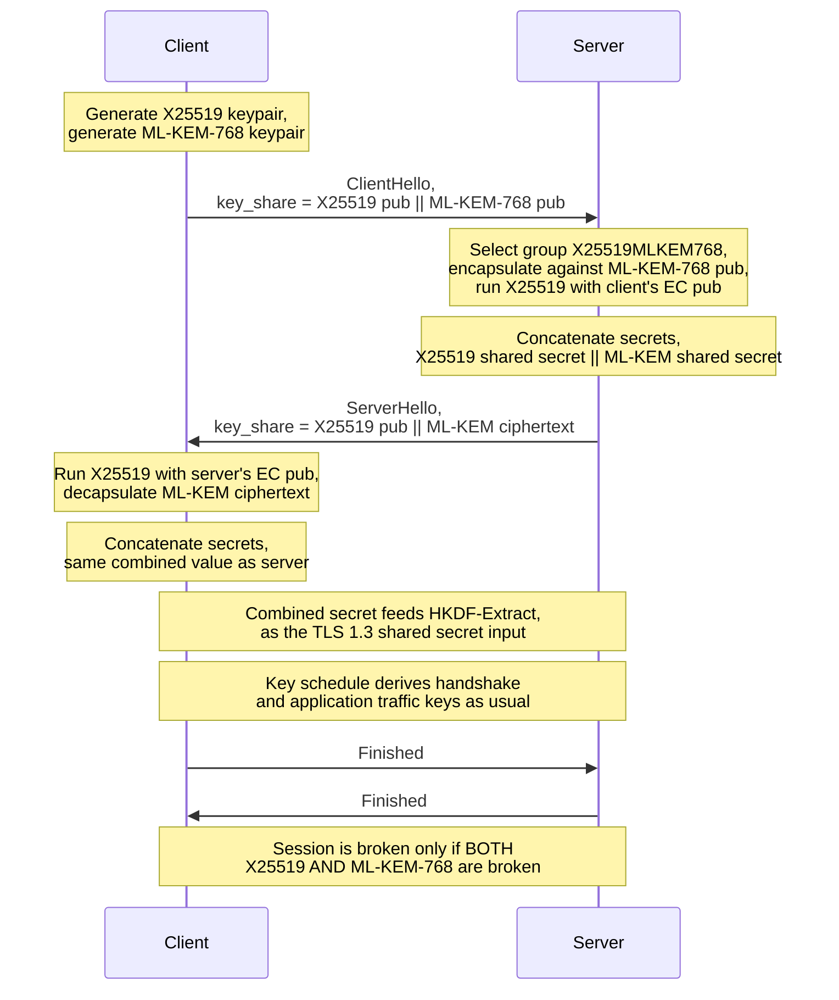
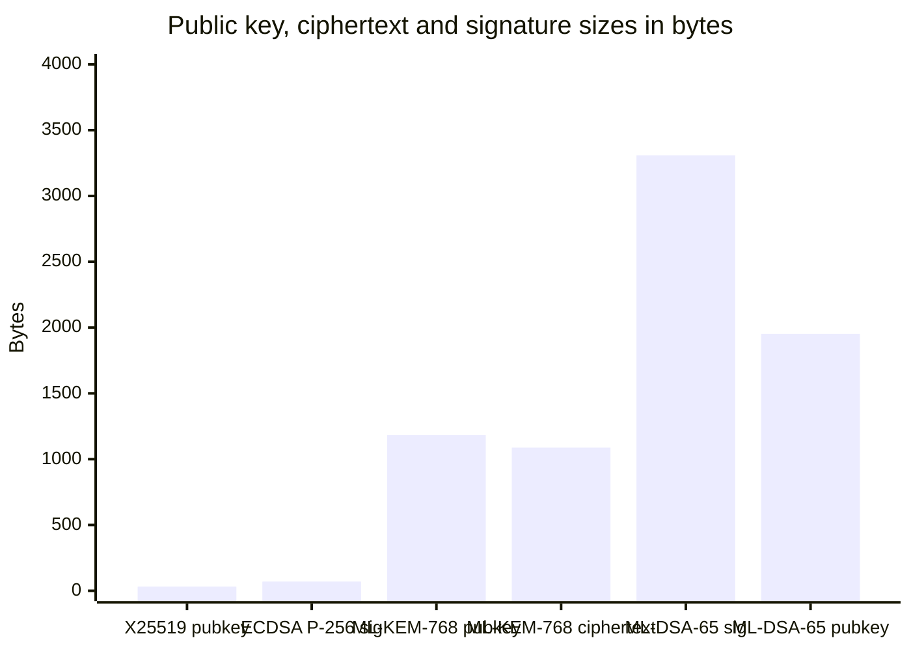
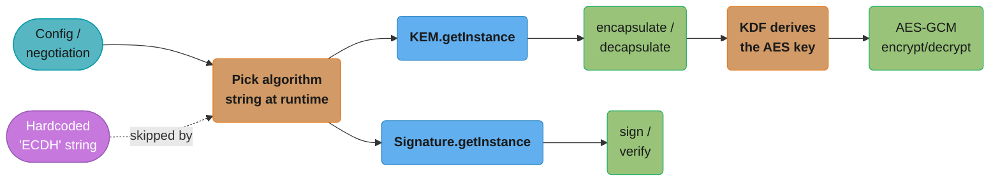
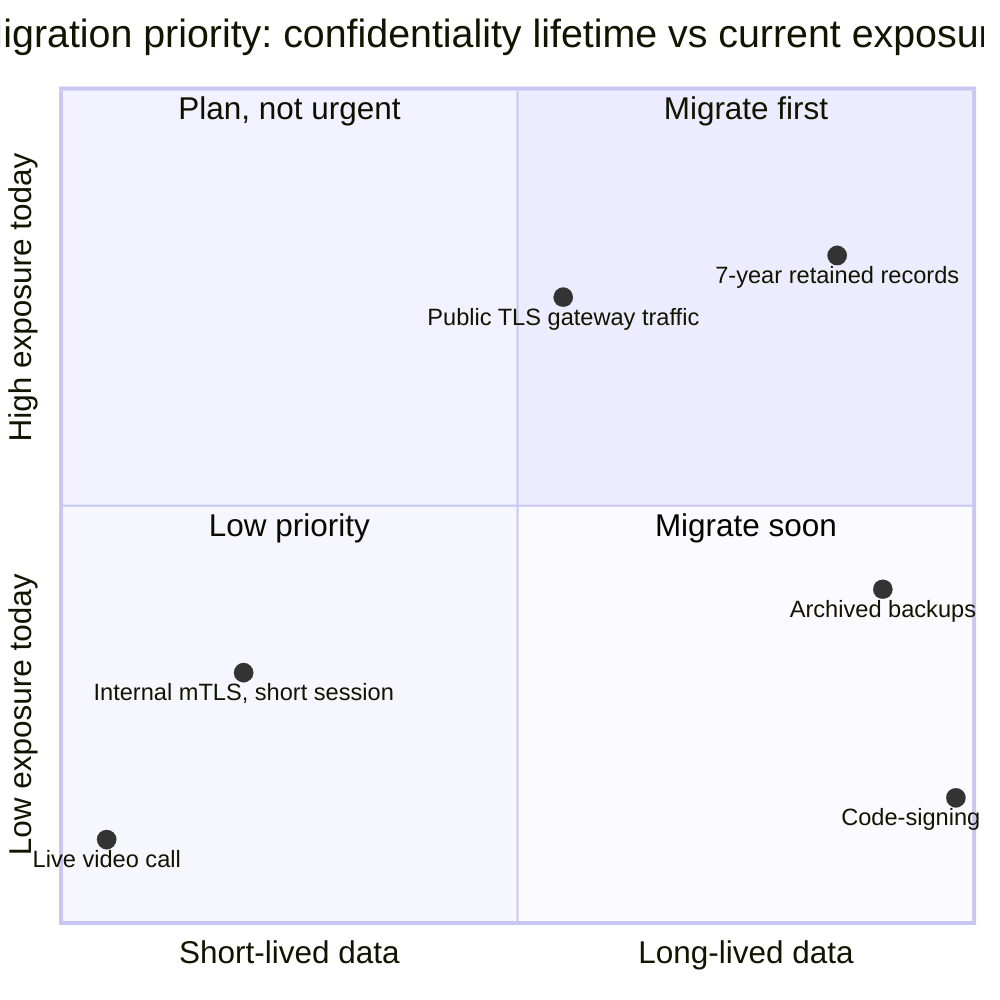

# Post-Quantum Cryptography & the Modern JCA

## 1. Concept Overview

Every TLS session, VPN tunnel, and encrypted archive built on RSA or elliptic-curve key exchange today is protected by a hardness assumption — factoring or discrete log — that a large enough fault-tolerant quantum computer would break in polynomial time via Shor's algorithm. No such machine exists yet. That does not make this a problem for 2035. An adversary who **records encrypted traffic today and decrypts it once the machine arrives** — "harvest now, decrypt later" — needs no quantum computer at capture time, only patience and disk space. Any payload whose confidentiality must outlive the hardware that protected it in transit is already exposed, right now, on 2026-08-26.

That reframes the migration as a **data-lifetime** problem, not a **calendar** problem. A 2FA session token that expires in 10 minutes is safe to protect with plain ECDHE for another decade — nobody profits from decrypting it in 2040. A patient's genomic record, a state secret, a 30-year mortgage contract, or an encrypted backup an enterprise is required to retain for seven years is a different animal: if it is transiting a network today over classical key exchange, its confidentiality window has already started leaking. This module covers the JDK's answer — `javax.crypto.KEM`, ML-KEM, ML-DSA, the new `KDF` API, and the hybrid TLS 1.3 groups landing in JDK 27 — and, just as importantly, how to write Java code today that can adopt them without a rewrite.

The engineering mistake this module is written to prevent is not "picking the wrong algorithm" — the JDK, NIST, and the industry have already converged on a reasonable answer for that. The mistake is treating this as a single migration event scheduled for whenever JEP 527 ships, rather than as groundwork that should already be underway. By the time a JDK finally ships the hybrid TLS groups, the services that spent the intervening time removing hardcoded algorithm strings and fixed-size buffers adopt it in an afternoon; the services that didn't spend that time face a rewrite under time pressure, often the same week a security questionnaire or a compliance deadline forces the question.

**Signatures do not carry the same urgency, and that asymmetry is worth internalizing before anything else in this file.** A signature's job is to resist forgery *at the moment it is verified* — an attacker who breaks ECDSA in 2040 cannot retroactively forge a signature you verified in 2026 and already acted on. A key exchange's job is to protect data whose secrecy must hold for the data's entire useful life, which can span decades. So: prioritize key-exchange migration for anything long-lived, and treat signature migration as important but less time-pressured — with the narrow exception of long-lived code-signing and firmware-signing roots, where a forged signature decades from now would still be catastrophic today.

NIST published the first three post-quantum standards — FIPS 203 (ML-KEM), FIPS 204 (ML-DSA), and FIPS 205 (SLH-DSA) — on 2024-08-13, effective the following day. That is the moment the "believed hard" lattice and hash-based problems this module relies on graduated from candidate to standardized primitive. The JDK's sequencing follows from it, and the order is worth noting because it is itself an argument for crypto-agility: the **algorithm-agnostic `KEM` API (JEP 452) finalized a year earlier, in JDK 21**, deliberately naming no algorithm at all, and the concrete **ML-KEM (JEP 496) and ML-DSA (JEP 497) providers then landed in JDK 24**, once the standards they implement were settled. The abstraction shipped before the algorithm did — which is exactly the shape §3 asks you to build into your own code.

This module assumes the parent [Security & Cryptography](security_and_cryptography.md) module — AES-GCM, RSA-OAEP, ECDH, `KeyStore`, `SecureRandom`, PBKDF2/bcrypt/Argon2, the TLS handshake, and mTLS are covered there and not repeated here. See also [Cryptography Fundamentals](../../cs_fundamentals/cryptography_fundamentals/cryptography_fundamentals.md) for the underlying math.

What follows is organized around that split. §1-§5 build the mental model and the JDK's current API surface; §6 is the executable core — a working KEM round trip, a working ML-DSA round trip, and the broken→fix pair that makes §3's agility argument concrete; §7-§11 cover real deployments, tradeoffs, and tooling; §12-§14 close with interview-depth Q&A and a full migration plan for an existing fleet. A reader who only has ten minutes should read §1, §3, and §6.5.

---

## 2. Intuition

> **One-line analogy**: A lattice is a perfectly regular infinite grid of points in many dimensions; the public key is a deliberately "bad" description of that grid — one that lets you check whether a point is *near* the grid but makes it computationally hard to find the *nearest* grid point to an arbitrary target without the secret "good" description.

**Mental model**: Picture a 2-D grid of dots stretching to infinity, generated by adding integer multiples of two basis vectors. If someone hands you a short, near-perpendicular basis (the "good" basis), finding the grid point closest to any random location is easy — round each coordinate. If they instead hand you a long, nearly-parallel, skewed basis describing the *same* grid (the "bad" basis), that rounding trick fails badly, and finding the nearest point becomes believed-hard even though the grid itself hasn't changed. ML-KEM's public key is a bad basis (plus some engineered noise); the private key is a good basis. Encryption nudges a message to a nearby lattice point using only the bad basis (easy for the sender, this is a one-way operation), and only the good-basis holder can cleanly recover which point it was.

This is also a useful way to explain in one sentence *why* the public and private keys are so much bigger than an RSA or EC key pair (§4.4, §8): a lattice basis in high enough dimension to be hard to invert simply takes more numbers to describe than a single elliptic-curve point or a single RSA modulus does, in the same way a description of a many-dimensional room takes more numbers than a description of one point on a circle. The size cost is not an implementation inefficiency to be optimized away — it is close to the structural cost of the underlying hard problem.

**Why it matters**: This hardness assumption is believed to resist both classical *and* quantum algorithms — nobody has found a quantum shortcut through a general lattice the way Shor's algorithm shortcuts factoring and discrete log. That's the entire reason lattice-based ML-KEM and ML-DSA were the first primitives NIST standardized: same "public key, hard inverse problem" shape developers already know from RSA/ECC, but resting on a different, quantum-resistant hard problem.

**Key insight**: You do not need to implement lattice math to use this correctly — the JDK does that for you behind `KEM.getInstance("ML-KEM")` exactly as it always hid modular exponentiation behind `KeyPairGenerator.getInstance("RSA")`. What you need is the operational model: PQ key material is *much larger* than classical key material for equivalent-or-better security, and that size difference — not CPU cost — is what breaks naive code (fixed buffers, DB columns, MTU assumptions). Master that one fact and section 6's broken→fix examples will make sense before you read them.

---

## 3. Core Principles

- **Crypto-agility is the actual deliverable, not the algorithm.** Nobody in 2026 can be certain ML-KEM will be the last word on PQ key exchange — NIST is still running an on-ramp for alternate signature schemes, and history (MD5, SHA-1, RC4, 3DES) says every "final" primitive eventually gets a successor. What you are building is not "an ML-KEM integration," it's *the ability to swap the negotiated algorithm without touching call sites, storage schemas, or deploy pipelines*.
- **Never hardcode an algorithm string in a place only a deploy can reach.** `Cipher.getInstance("ECDH")` buried three layers deep in business logic is a hardcode with a redeploy tax; the same string read from config or negotiated by TLS is agile. This module's broken→fix pair in §6 is built around exactly this distinction.
- **Negotiate, don't dictate.** TLS 1.3's named-group negotiation is the model: client offers a preference-ordered list, server picks the strongest mutual choice, and the application code above the handshake never sees an algorithm name at all. JEP 527 rides this mechanism for free — that is precisely why it needs zero application-code changes.
- **Prefer hybrid over pure-PQ while PQ implementations are young.** A hybrid key exchange (e.g., X25519 + ML-KEM-768) is only broken if *both* the classical and the post-quantum component are broken. That protects you from an implementation bug in a four-year-old NIST standard the same way it protects you from a future quantum computer — belt and suspenders, at the modest cost of extra bytes.
- **Size assumptions are a hidden hardcode.** A `byte[32]` shared-secret buffer, a `VARCHAR(256)` certificate column, or an assumption that a `ClientHello` fits one TCP segment are all just as brittle as a hardcoded algorithm string — they simply fail later and more confusingly, when a size-appropriate value doesn't fit.
- **Signature migration and key-exchange migration are different projects with different clocks**, per §1's asymmetry. Don't let a KEM rollout schedule dictate a code-signing rollout schedule, or vice versa.
- **Track what's shipped vs targeted with the same discipline you'd track a library's actual installed version** — JEP status is not settled by "I read about it," it's settled by which JDK is on the classpath. §4 is this discipline applied to the whole PQ surface.
- **A migration that lands on a version bump beats a migration that lands on a rewrite.** The measure of whether the crypto-agility work in a given service is done is whether adopting the next algorithm — ML-KEM today, whatever supersedes it in a decade — requires touching that service's source code at all, or only its configuration and its JDK version.
- **Internal, TLS-independent PQ adoption does not wait on TLS-layer JEPs.** Envelope encryption of data at rest, JAR/artifact signing, and any application-level use of `KEM`/`ML-KEM`/`ML-DSA`/`KDF` are all available today (JDK 24/25) and have no dependency on JEP 527 landing — conflating "the TLS handshake JEP isn't final" with "there's nothing to do yet" leaves real, available progress on the table.

---

## 4. Types / Architectures / Strategies

### 4.1 The JDK's post-quantum and modern-JCA surface, by JEP

| Capability | JEP | Status (as of JDK 25, today 2026-08-26) | What it's for |
|---|---|---|---|
| **KEM API** (`javax.crypto.KEM`) | 452 | **Final, JDK 21.** Never went through preview. | Uniform engine class for *any* key encapsulation mechanism — classical or PQ — replacing ad hoc `KeyAgreement` patterns for KEM-shaped algorithms. |
| **ML-KEM** | 496 | **Final, JDK 24.** Not preview. | NIST FIPS 203 lattice-based key encapsulation — the PQ replacement for ECDH/RSA key transport. |
| **ML-DSA** | 497 | **Final, JDK 24.** Not preview. | NIST FIPS 204 lattice-based digital signatures — the PQ replacement for ECDSA/RSA signatures. |
| **KDF API** (`javax.crypto.KDF`) | 510 | **Final, JDK 25.** Was preview as JEP 478 in JDK 24. | Uniform engine class for key-derivation functions (HKDF today), used to turn a raw shared secret into a usable symmetric key. |
| **Permanently Disable the Security Manager** | 486 | **Final, JDK 24.** | Not PQ-related, but a same-era JCA-adjacent security change with real migration traps — covered here because it lands in the same upgrade window. |
| **PEM Encodings** | 470 / 524 / 538 | **Still preview.** 470 = 1st preview (JDK 25); 524 = 2nd preview (JDK 26); 538 = 3rd preview, **targeted JDK 27 — not shipped**. | Standard `PEMEncoder`/`PEMDecoder` API — no more hand-rolled Base64 framing for keys and certs. |
| **PQ Hybrid Key Exchange for TLS 1.3** | 527 | **Targeted JDK 27 — NOT SHIPPED as of today.** | Adds `X25519MLKEM768`, `SecP256r1MLKEM768`, `SecP384r1MLKEM1024` as negotiable TLS 1.3 named groups, **default-first** in the group preference list. |
| **SLH-DSA** (FIPS 205, hash-based signatures) | — | **No JDK JEP exists.** | A conservative, hash-based PQ signature alternative to ML-DSA; not on the JDK roadmap today — say so plainly rather than implying it's coming. |
| **Composite / hybrid signatures** (e.g. Composite ML-DSA) | — | **Not natively supported in the JDK.** No JEP. | Combining a classical and PQ signature into one artifact; available in the IETF drafts and some non-JDK libraries, not here. |

The pattern across this table is the whole point of §3: KEM (the mechanism) and ML-KEM/ML-DSA (concrete PQ algorithms) are done and stable since JDK 21/24 respectively; KDF just finished its preview cycle; PEM and TLS hybrid negotiation are both still moving targets. Code that reads algorithm names from configuration or lets TLS negotiate is unaffected by which row is "not yet"; code that hardcodes today's answer will need a redeploy for each row that lands.

### 4.2 What each primitive is *for*

- **`KEM`** — a two-party protocol where the sender ("encapsulator") uses the receiver's public key to produce both a ciphertext (the "encapsulation") and a shared secret; the receiver's private key turns that ciphertext back into the same shared secret. This is the shape of ML-KEM, and also the shape RSA key transport has always informally had — `KEM` is the JDK's first API to name that shape explicitly and support it for both classical and PQ algorithms.
- **ML-KEM** — the concrete lattice-based KEM algorithm (FIPS 203), in three parameter sets (512 / 768 / 1024) trading size for security margin. Used to establish a shared secret; **it is not a signature algorithm** — an ML-KEM public key cannot sign anything, so a certificate carrying one must itself be signed with a conventional algorithm (typically EC).
- **ML-DSA** — the concrete lattice-based signature algorithm (FIPS 204), also in three parameter sets (44 / 65 / 87). Used wherever ECDSA or RSA-PSS is used today: TLS certificates, JAR signing (JDK 26+), code signing, JWS.
- **`KDF`** — takes an arbitrary shared secret (from ECDH, ML-KEM, or anywhere) and turns it into one or more properly-distributed symmetric keys via HKDF's extract-then-expand construction. A raw KEM shared secret should never be used directly as an AES key — it must go through a KDF first, exactly as a TLS master secret always has.

Two of these — `KEM` and `KDF` — are deliberately algorithm-neutral engine classes, the same shape as `Cipher` or `Signature` in the parent module: the *class* doesn't change when the underlying algorithm does, only the string passed to `getInstance`. `ML-KEM` and `ML-DSA` are the concrete algorithms that plug into that neutral surface today; a future NIST alternate (should one ever supersede them) would plug into the exact same `KEM`/`Signature` classes without the JDK needing a new engine class at all. That's crypto-agility built into the API design itself, one layer below the application-code agility §3 asks you to build on top of it.

### 4.3 JEP 486 — exactly what "permanently disable" means

This one is not PQ, but it lands in the same JDK 24 upgrade window as ML-KEM/ML-DSA, and its failure modes are sharp enough to deserve a table of their own before §10 revisits them as war stories.

| Call / flag | Pre-JDK 24 behavior | JDK 24+ behavior |
|---|---|---|
| `System.setSecurityManager(sm)` | Installs the Security Manager | **Throws `UnsupportedOperationException`** ("Setting a Security Manager is not supported") |
| `-Djava.security.manager=allow` / `=default` / a class name at JVM startup | Enables the Security Manager for the run | **The JVM refuses to start** — hard exit with an explicit error naming the flag |
| `System.getSecurityManager()` | Returns the installed manager or `null` | **Always returns `null`** |
| `AccessController.doPrivileged(action)` | Elevates privilege within the action, checked against the installed manager | **Executes the action immediately with no privilege elevation** — compiles, runs, returns a result, provides no sandboxing |
| `SecurityManager`, `AccessController`, `AccessControlContext`, `Policy`, `ProtectionDomain` | Live APIs | **Terminally deprecated, not yet removed** — a future release removes them |

The dangerous row is `doPrivileged`: it does not throw, it does not warn, it simply stops doing the one thing it was there for. Code written against the old contract keeps compiling and keeps passing its unit tests, because nothing in the test asserts that unprivileged access was actually denied — it asserts that the *privileged* path worked, which it still does.

### 4.4 Byte-for-byte size comparison, the source table for §5.2 and §8

| Artifact | X25519 | ECDSA P-256 | ML-KEM-768 | ML-DSA-65 |
|---|---|---|---|---|
| Public key | 32 B | — | 1184 B | 1952 B |
| Secret/private key | 32 B | — | 2400 B (expanded form; a 32-byte seed form also defined) | 4032 B |
| Ciphertext / signature | — | 64 B raw (r‖s), ~70–72 B DER | 1088 B (ciphertext) | 3309 B (signature) |
| Shared secret out | 32 B | — | 32 B | — |

A hybrid `X25519MLKEM768` client key share concatenates the X25519 public key and the ML-KEM-768 public key: 32 + 1184 = 1216 bytes, against 32 bytes for classical-only — roughly **38x**. That single number is what drives the MTU and middlebox concerns in §8 and §10; nothing about CPU cost changes at all.

### 4.5 PEM Encodings (JEP 470/524/538) — why it matters here even though it's still preview

The PEM API is not itself post-quantum, but it's worth flagging in a PQ-focused module for one reason: PQ artifacts are large enough that hand-rolled Base64 framing code — the kind every Java shop has a private utility class for — is exactly the kind of code most likely to have an untested edge case around an unusually long line-wrapped block. `PEMEncoder`/`PEMDecoder` exist to remove that homegrown code entirely, and once final they'll be the natural place to serialize an ML-KEM or ML-DSA `KeyPair` to disk or to a config value:

```java
// Forward-looking — requires --enable-preview on a JDK where PEM is still preview,
// and the API surface can still change before it finalizes (targeted JDK 27, not shipped).
// import java.security.PEMEncoder;
// PEMEncoder encoder = PEMEncoder.of();
// String pem = encoder.encodeToString(mlKemKeyPair.getPublic());
```

Until it finalizes, `Base64.getMimeEncoder(64, "\n".getBytes())` wrapped around `-----BEGIN PUBLIC KEY-----`/`-----END PUBLIC KEY-----` framing remains the correct, if unglamorous, approach — the same one the JDK's own `keytool` output has always used.

---

## 5. Architecture Diagrams

### 5.1 Hybrid X25519 + ML-KEM-768 TLS 1.3 handshake



The concatenation step is the whole security argument for hybrid mode: TLS 1.3's key schedule treats the combined `X25519_secret || ML-KEM_secret` as one opaque input to HKDF-Extract, so an attacker needs to break *both* components to recover anything — a classical break alone, or a PQ-implementation bug alone, is not enough.

### 5.2 Classical vs post-quantum artifact sizes



X25519's 32-byte public key is the baseline every engineer's mental model of "a key share" was calibrated on. ML-KEM-768's 1184-byte public key alone is 37x that; a hybrid key share (both concatenated) runs to roughly 1216 bytes versus 32 for classical-only — the size story, not a CPU story, drives nearly every practical migration problem in §8 and §10.

### 5.3 Crypto-agility as a request path, not a hardcode



The frozen purple node is the anti-pattern: a hardcoded algorithm string sitting outside the request path entirely, unreachable by configuration or negotiation. Every other node in the diagram takes its algorithm identity from the teal "Config / negotiation" box — swap what that box returns, and ML-KEM-768 becomes ML-KEM-1024, or ECDH becomes ML-KEM, with no other node changing shape.

### 5.4 Prioritizing what migrates first, by data lifetime and exposure



This is §1's data-lifetime argument and §9's when-to-use guidance plotted directly: the long-retention customer records from §14's case study land in the top-right "migrate first" quadrant, while the ephemeral session traffic from §9's ECDHE guidance sits safely in the bottom-left. The code-signing root is placed far right (its signatures must remain unforgeable for decades) but low on current exposure (§1's signature-vs-key-exchange asymmetry — a signature isn't compromised by being recorded today), which is why it earns "plan, not urgent" rather than "migrate first" despite its long lifetime.

---

## 6. How It Works — Detailed Mechanics

### 6.1 ML-KEM round trip with `javax.crypto.KEM`

```java
import javax.crypto.KEM;
import javax.crypto.SecretKey;
import java.security.*;

// Receiver generates a long-term (or ephemeral) ML-KEM-768 key pair.
KeyPairGenerator kpg = KeyPairGenerator.getInstance("ML-KEM-768"); // SunJCE
KeyPair receiverKeyPair = kpg.generateKeyPair();

// --- Sender side: encapsulate against the receiver's public key ---
KEM kem = KEM.getInstance("ML-KEM-768");
KEM.Encapsulator encapsulator = kem.newEncapsulator(receiverKeyPair.getPublic());
KEM.Encapsulated encapsulated = encapsulator.encapsulate(); // equivalent to encapsulate(0, secretSize(), "Generic")

SecretKey senderSharedSecret = encapsulated.key();       // the derived SecretKey
byte[] wireCiphertext = encapsulated.encapsulation();     // send this to the receiver
// encapsulated.params() carries any algorithm params the receiver needs; often empty for ML-KEM

// --- Receiver side: decapsulate using the private key ---
KEM.Decapsulator decapsulator = kem.newDecapsulator(receiverKeyPair.getPrivate());
SecretKey receiverSharedSecret = decapsulator.decapsulate(wireCiphertext);

// senderSharedSecret and receiverSharedSecret now hold the identical 32-byte key material.
```

`newEncapsulator`/`newDecapsulator` also accept an `AlgorithmParameterSpec` and a `SecureRandom` overload for cases that need explicit control; the no-arg `encapsulate()` is the common path and is exactly what `encapsulate(0, secretSize(), "Generic")` would produce. Note the algorithm string is parameterized here (`"ML-KEM-768"`) purely to be explicit for this example — §3's agility principle says the production version should read it from configuration instead.

### 6.2 ML-DSA sign/verify round trip

```java
import java.security.*;

KeyPairGenerator kpg = KeyPairGenerator.getInstance("ML-DSA"); // SUN provider, defaults to ML-DSA-65
KeyPair signerKeyPair = kpg.generateKeyPair();

Signature signer = Signature.getInstance("ML-DSA");
signer.initSign(signerKeyPair.getPrivate());
signer.update("firmware-v12.3.4-release-notes".getBytes());
byte[] signature = signer.sign();                          // 3309 bytes for ML-DSA-65

Signature verifier = Signature.getInstance("ML-DSA");
verifier.initVerify(signerKeyPair.getPublic());
verifier.update("firmware-v12.3.4-release-notes".getBytes());
boolean ok = verifier.verify(signature);                    // true
```

`ML-DSA` signature algorithms resolve through the **SUN** provider, not `SunJCE` — the two-provider split (SunJCE for the ML-KEM KEM/cipher-adjacent surface, SUN for the ML-DSA signature surface) mirrors the existing split between `SunJCE` (AES, HMAC) and `SunRsaSign`/`SunEC` (RSA/EC signatures) — see §11. `keytool -genkeypair -keyalg ML-DSA -groupname ML-DSA-65 -alias pqsign` works identically to any other `keytool` keypair generation since JDK 24, and (`-keyalg ML-DSA-65` also works directly, naming the parameter set without a separate `-groupname`).

Confirming which provider actually answers a given algorithm string, rather than assuming, is worth doing once per environment:

```java
import java.security.Security;

// Which provider will "ML-KEM-768" resolve to, right now, on this JVM?
System.out.println(Security.getProviders("KeyPairGenerator.ML-KEM-768").length > 0
    ? Security.getProviders("KeyPairGenerator.ML-KEM-768")[0].getName() : "not available"); // SunJCE

System.out.println(Security.getProviders("Signature.ML-DSA-65").length > 0
    ? Security.getProviders("Signature.ML-DSA-65")[0].getName() : "not available");         // SUN
```

Since JDK 26 (JDK-8349732), `jarsigner` can sign a JAR with an ML-DSA key exactly as it would with an RSA or EC key — `jarsigner -keystore pq.p12 -sigalg ML-DSA myapp.jar pqsign` — producing an RFC 9882 / PKCS#7 signature block. JDK 24 and 25 have the `Signature` API for ML-DSA but not yet `jarsigner` integration, so JAR signing is one more row where "the algorithm is final" and "every tool that uses the algorithm supports it" are separate facts worth checking independently.

### 6.3 KDF — extract-then-expand from a KEM shared secret to an AES key

```java
import javax.crypto.KDF;
import javax.crypto.SecretKey;
import javax.crypto.spec.HKDFParameterSpec;

KDF hkdf = KDF.getInstance("HKDF-SHA256");

SecretKey derivedAesKey = hkdf.deriveKey("AES",
    HKDFParameterSpec.ofExtract()
        .addIKM(receiverSharedSecret)              // the raw KEM output — never use this directly as a key
        .addSalt("2026-migration-salt".getBytes())
        .thenExpand("tls-record-key".getBytes(), 32)); // 256-bit AES key out

// NOTE: there is no standalone extractThenExpand(...) method — the flow is always
// ofExtract().addIKM(...).addSalt(...).thenExpand(info, length), chained as above.
```

This is the step naive PQ code skips most often: treating `receiverSharedSecret` (or its raw bytes) as if it were already an AES key. Every classical KEX-based protocol — TLS included — runs the raw shared secret through a KDF before it touches a cipher; ML-KEM's output deserves exactly the same treatment, and `KDF`/`HKDFParameterSpec` is the JDK 25 way to do it without hand-rolling HMAC calls.

### 6.4 Configuring hybrid TLS 1.3 named groups (JEP 527, JDK 27 — forward-looking)

```java
// On a JDK that has JEP 527, X25519MLKEM768 is placed FIRST by default — no code
// change required. To pin or reorder explicitly (e.g. during a staged rollout):
System.setProperty("jdk.tls.namedGroups",
    "X25519MLKEM768,x25519,secp256r1,secp384r1,secp521r1,x448,ffdhe2048,ffdhe3072,ffdhe4096");

// Or per-connection, without touching a system-wide property:
SSLParameters params = sslSocket.getSSLParameters();
params.setNamedGroups(new String[] { "X25519MLKEM768", "x25519", "secp256r1" });
sslSocket.setSSLParameters(params);
```

Nothing above this negotiation layer — no `Cipher`, no `KeyAgreement`, no application code — needs to change. That transparency is JEP 527's actual selling point and the clearest illustration of §3's thesis: the agility was bought years earlier, when TLS 1.3 was designed to negotiate named groups instead of dictating one.

### 6.5 Broken → fix: hardcoded algorithm and fixed-size storage

```java
// BROKEN: hardcoded algorithm string three layers deep, and fixed-size assumptions
// baked into both the wire format and the schema.
public class SessionKeyExchange {
    public byte[] deriveSharedSecret(PublicKey peerPublicKey, PrivateKey myPrivateKey) throws Exception {
        KeyAgreement ka = KeyAgreement.getInstance("ECDH");       // hardcoded — no path to PQ
        ka.init(myPrivateKey);
        ka.doPhase(peerPublicKey, true);
        byte[] secret = ka.generateSecret();                     // always exactly 32 bytes for X25519/P-256
        return secret;                                            // caller assumes 32 bytes, always
    }
}
// -- schema --
// CREATE TABLE peer_keys (id BIGINT, public_key VARBINARY(256), shared_secret BINARY(32));
//                                                    ^ fits an EC point, silently truncates an ML-KEM key
```

```java
// FIXED: algorithm is negotiated/configured, KEM used through its uniform API, and
// storage sized (and typed) for whatever the negotiated algorithm actually produces.
public class SessionKeyExchange {
    private final String kemAlgorithm; // e.g. injected from config: "ML-KEM-768" or "ECDH-hybrid-equivalent"

    public SessionKeyExchange(String kemAlgorithm) {
        this.kemAlgorithm = kemAlgorithm;
    }

    public byte[] encapsulateSharedSecret(PublicKey peerPublicKey) throws Exception {
        KEM kem = KEM.getInstance(kemAlgorithm);
        KEM.Encapsulator enc = kem.newEncapsulator(peerPublicKey);
        KEM.Encapsulated result = enc.encapsulate();
        return result.encapsulation();  // variable-length; caller stores length-prefixed or VARBINARY(MAX)
    }
}
// -- schema --
// CREATE TABLE peer_keys (id BIGINT, public_key VARBINARY(MAX), encapsulation VARBINARY(MAX));
//                                    ^ no assumed cap — ML-KEM-768's 1184-byte key and 1088-byte
//                                      ciphertext, or a future algorithm's sizes, both just fit
```

The fix is not "use ML-KEM" — it's removing every place a byte count or an algorithm name was assumed fixed. A team that ships the fixed version today and swaps `"ECDH"` for `"ML-KEM-768"` next year discovers the `BINARY(32)` and `VARBINARY(256)` columns on a Friday afternoon.

### 6.6 Feature-detecting a JEP that may not be on this JDK yet

Because §4's table spans final, preview, and merely-targeted rows, code that must run across a fleet of mixed JDK versions during a migration window should check for a capability rather than assume it from a version number comparison alone — a version check is brittle against backports and vendor-specific builds, while a direct capability probe is not:

```java
public final class KemAvailability {

    /** Returns true only if this JVM can actually resolve the named ML-KEM parameter set. */
    public static boolean supportsMlKem(String paramSet) {
        try {
            KEM.getInstance(paramSet);           // "ML-KEM-768", "ML-KEM-1024", ...
            return true;
        } catch (NoSuchAlgorithmException e) {
            return false;                         // pre-JDK-24, or a stripped-down runtime image
        }
    }

    /** Fall back to classical ECDH when the PQ algorithm isn't available on this runtime. */
    public static String selectKexAlgorithm(String preferred, String classicalFallback) {
        return supportsMlKem(preferred) ? preferred : classicalFallback;
    }
}
```

This is the same crypto-agility principle from §3 applied at the JDK-version boundary instead of the algorithm-choice boundary: a service that probes for `ML-KEM-768` and falls back to `ECDH` runs correctly on JDK 21 through JDK 25+ without a build-time branch, and picks up the stronger option automatically the day its runtime is upgraded — no redeploy of application logic required, only the base image.

### 6.7 Building a client `SSLContext` that prefers hybrid groups without hardcoding a JDK assumption

Putting §6.4's named-group configuration together with §6.6's feature-detection habit produces the pattern an actual TLS client should ship with today, so it is already correct the day JEP 527 lands:

```java
import javax.net.ssl.SSLContext;
import javax.net.ssl.SSLParameters;
import javax.net.ssl.SSLSocket;
import java.util.ArrayList;
import java.util.List;

public final class PqAwareTlsClient {

    /** Builds the named-group preference list, including PQ groups only where the JDK supports them. */
    private static String[] preferredNamedGroups() {
        List<String> groups = new ArrayList<>();
        // These group names only resolve once the running JDK has JEP 527. Listing
        // them ahead of that is the §6.6 feature-detection habit applied here too —
        // verify against this specific JDK/provider's documented handling of an
        // unrecognized named-group name before relying on it in a hot path.
        groups.add("X25519MLKEM768");
        groups.add("SecP256r1MLKEM768");
        groups.add("x25519");
        groups.add("secp256r1");
        groups.add("secp384r1");
        return groups.toArray(new String[0]);
    }

    public SSLSocket connect(SSLContext context, String host, int port) throws Exception {
        SSLSocket socket = (SSLSocket) context.getSocketFactory().createSocket(host, port);
        SSLParameters params = socket.getSSLParameters();
        params.setNamedGroups(preferredNamedGroups());
        params.setEndpointIdentificationAlgorithm("HTTPS"); // hostname verification — see parent module §12 Q14
        socket.setSSLParameters(params);
        socket.startHandshake();
        return socket;
    }
}
```

Nothing in this class checks a JDK version number. On JDK 25 today, the PQ group names have no meaning yet, so the negotiated result falls back to `x25519`; the day the fleet's JDK gains JEP 527, the exact same code starts negotiating hybrid groups with zero further changes — which is the whole thesis of §3 made concrete in one class.

---

## 7. Real-World Examples

- **Chrome and other major browsers** have shipped `X25519Kyber768`/`X25519MLKEM768` support for TLS 1.3 key exchange with large CDNs and cloud providers, so a meaningful share of real HTTPS traffic today already negotiates a hybrid PQ key exchange without the end user noticing — the negotiation-based design in §3 means it degrades gracefully to classical when either side doesn't support it.
- **Major CDN and cloud-edge providers** have enabled hybrid PQ key exchange by default on their TLS-terminating edges, ahead of any JDK support landing — proof that the mechanism (TLS 1.3 named-group negotiation) was general enough to add PQ support without a protocol version bump.
- **Signal and other end-to-end-encrypted messengers** have deployed post-quantum-augmented ratchets for their long-lived session state, motivated by exactly the harvest-now-decrypt-later concern in §1 — message confidentiality that must hold for years cannot rely solely on classical ECDH, however strong today.
- **The JDK's own arrival is JDK 27** (JEP 527) — until then, a Java service reaches hybrid PQ TLS the same way it reaches any pre-GA capability: an early-access build, a third-party TLS provider, or simply waiting, while doing the agility groundwork in §3 and §6 so the eventual upgrade is a version bump, not a rewrite.
- **VPN and enterprise remote-access vendors** have begun shipping hybrid PQ key exchange options in their IPsec/TLS-based products, driven by the same government and financial-sector procurement guidance referenced in §12's CNSA answer — this is often where "post-quantum" first becomes a line item in a security questionnaire a Java shop has to answer, well before it becomes a JDK feature they can point to directly.
- **Security questionnaires and vendor-risk assessments** in regulated industries (finance, healthcare, government contracting) increasingly carry a line item asking whether a vendor supports or has a roadmap for post-quantum key exchange — a Java shop that has done §3's agility refactor can answer "yes, on a version bump" today, ahead of any JDK actually shipping the TLS-layer feature.
- **Internal PQ envelope encryption** (§14's Phase 4 pattern — wrapping data-at-rest DEKs with ML-KEM rather than RSA-OAEP) is where several organizations with long-retention data obligations have started, precisely because it needs only the already-final `KEM`/`ML-KEM`/`KDF` APIs and has no dependency on TLS-layer negotiation shipping first.

---

## 8. Tradeoffs

| Dimension | Classical (X25519 / ECDSA P-256) | Post-quantum (ML-KEM-768 / ML-DSA-65) | Practical effect |
|---|---|---|---|
| **Public key size** | 32 bytes | 1184 bytes (ML-KEM-768) | ~37x larger key share in a hybrid handshake |
| **Signature size** | ~70 bytes (DER) | 3309 bytes (ML-DSA-65) | ~47x larger certificate chains and JWS tokens |
| **CPU cost** | Fast | **Often faster than ECDH/ECDSA** for the core operation | PQ's cost is bytes, not cycles — a common misconception is that PQ is slow; it mostly isn't |
| **Handshake bytes** | ClientHello fits comfortably in one TCP segment | Hybrid key share can push a `ClientHello` past a single segment | Extra round-trip risk on some paths; see MTU note below |
| **Middlebox compatibility** | Universally accepted | Some older TLS-inspecting middleboxes drop or mishandle an oversized/fragmented `ClientHello` | Real-world rollouts have hit silent connection failures behind corporate proxies |
| **Certificate chain size** | Small | Each ML-DSA-signed cert adds ~2-4 KB versus ECDSA | Affects handshake latency on high-latency/low-bandwidth links (mobile, satellite) |
| **Standardization maturity** | Decades of cryptanalysis | Standardized 2024 (FIPS 203/204/205); comparatively young | Motivates hybrid-not-pure-PQ per §3 until the newer math has more scrutiny |
| **Quantum resistance** | None — broken by Shor's algorithm on a sufficiently large quantum computer | Believed resistant — no known quantum shortcut for general lattice problems | The entire reason this module exists |
| **Migration cost, if crypto-agility was already in place** | — | Config change + JDK/library version bump | This is the payoff §3 is arguing for — the entire point of the agility refactor in §6.5 and §14 is to make this row true |
| **Migration cost, if algorithms were hardcoded** | — | Source change across every call site, plus a schema migration for every fixed-size column | This is the cost the agility refactor exists to avoid paying later |

The rows worth re-reading twice are the CPU-cost and migration-cost ones, because both cut against common intuition. Engineers who have not benchmarked ML-KEM assume "post-quantum" means "computationally heavier," and budget accordingly for extra server capacity that mostly isn't needed — the real capacity planning question is network and storage headroom for larger artifacts, not CPU headroom. And engineers who have not done a crypto-agility refactor assume a future algorithm swap is inherently a big project; whether it is or isn't is entirely a function of whether §3's discipline was already applied, which is a choice made months or years before the swap itself.

---

## 9. When to Use / When NOT to Use

**Move to hybrid PQ key exchange now** for anything whose confidentiality must outlive a decade or more: health records, government and legal archives, long-term corporate secrets, biometric data, anything under a multi-year regulatory retention mandate, and any traffic pattern an adversary would plausibly bother recording today for future decryption. This is where §1's harvest-now-decrypt-later argument is not theoretical. Because JEP 527 hasn't shipped, "move to hybrid PQ key exchange now" in practice means the internal, TLS-independent path from §7 and §14 — envelope-encrypting the data itself with ML-KEM — rather than waiting on a TLS feature that doesn't exist on any released JDK yet.

**Plain ECDHE is still a reasonable choice today** for short-lived session confidentiality where the data's usefulness expires long before a cryptographically relevant quantum computer plausibly exists — a live video call, an ephemeral OAuth token, a 5-minute API session. Don't spend the size/latency budget on PQ for data that is worthless to an attacker who decrypts it in ten years.

Between those two ends sits the largest population of real services: session-scoped but not truly ephemeral — a customer support chat transcript, an internal API call carrying a business-sensitive payload that's meaningful for a few years but not decades. §5.4's quadrant chart plots exactly this middle ground, and the honest answer for most of it is "plan the agility refactor now, adopt hybrid PQ once JEP 527 ships" rather than either extreme.

**Do not move to pure-PQ ahead of hybrid.** Skipping the classical component to save bytes trades a decades-scrutinized hardness assumption for exclusive reliance on cryptography that is a few years old — hybrid mode costs extra bytes in exchange for needing *both* assumptions broken, which is the safer trade while ML-KEM/ML-DSA implementations are still accumulating cryptanalysis and production mileage.

**Do not migrate signatures with the same urgency as key exchange** — re-read §1's asymmetry before treating a code-signing or JWT-signing migration as equally time-critical to a TLS key-exchange migration; it usually isn't, except for signatures whose forgery decades from now would still matter today (long-lived firmware/code-signing roots).

**Do not spend the crypto-agility refactor budget everywhere at once.** §14's case study deliberately sequences the highest-retention-risk services first — trying to refactor all 40 services simultaneously trades a bounded, well-tested rollout for a large, hard-to-review one, with no corresponding security benefit for the services that were never at meaningful risk in the first place.

**Do the agility refactor even where no PQ deployment is planned yet.** The refactor in §6.5 — no hardcoded algorithm strings, no fixed-size storage — is worth doing on its own merits even for a service with no near-term PQ plan, because the same discipline also pays off for any future *classical* algorithm change (an EC curve deprecation, a hash function rotation) and costs nothing extra to do now versus later, other than the redeploy it's specifically designed to avoid needing twice.

**Weigh certificate chain growth before defaulting every leaf and intermediate to ML-DSA.** §8's ~2-4 KB-per-certificate estimate compounds across a chain — a 3-certificate chain signed end-to-end with ML-DSA-65 can add well over 10 KB versus an all-ECDSA chain, which matters more on constrained or high-latency links (mobile, IoT, satellite) than on a typical data-center-to-data-center hop; a mixed chain (ML-DSA at the root, classical at the leaf, or vice versa) is a legitimate interim design while the cost is being evaluated, not a compromise to be embarrassed about.

**Distinguish "no JDK support exists" from "not urgent yet."** SLH-DSA's missing JEP (§4.1, §12) is a tooling gap, not a signal about priority — a team with a genuine SLH-DSA requirement (e.g. a specific compliance mandate for hash-based signatures) should reach for BouncyCastle today rather than waiting on a JDK feature that isn't on the roadmap, while a team with no such mandate has no reason to chase it at all.

**Do not wait for JEP 527 to start the internal PQ work.** Envelope encryption of data at rest (§14's Phase 4) needs only `KEM`, `ML-KEM`, and `KDF` — all final since JDK 24/25 — and has nothing to do with TLS negotiation at all. A team that tells itself "we can't do anything PQ until the TLS JEP ships" is confusing one narrow, still-pending capability (automatic hybrid TLS negotiation) with the much broader, already-available capability (PQ primitives usable anywhere in application code).

---

## 10. Common Pitfalls

- **Treating PQ as a drop-in replacement and shipping a fixed-size buffer.** The single most common failure: code that worked fine with ECDH's fixed 32-byte shared secret assumes every future key-exchange output is also 32 bytes, and either truncates or throws when an ML-KEM shared secret (still 32 bytes, but the *encapsulation* is 1088) or a future algorithm's larger output arrives. Fix per §6.5: size storage for the negotiated algorithm, not for the algorithm you tested with.
- **A fixed-size database column for a public key or certificate.** A `VARBINARY(256)` sized for an EC point or RSA-2048 key silently truncates a 1184-byte ML-KEM-768 key or a 1952-byte ML-DSA-65 key — and depending on the driver and column type, that truncation can fail loudly on insert or, worse, succeed and corrupt the stored key silently.
- **A middlebox dropping an oversized `ClientHello`.** A hybrid key share can push the handshake's first flight past what fits in one TCP segment, and some older TLS-inspecting corporate proxies or load balancers that were never tested against a multi-KB `ClientHello` silently drop or reset the connection instead of forwarding the fragmented packet — a rollout that works everywhere in the lab and fails intermittently only for users behind specific corporate networks.
- **`-Djava.security.manager=allow` left in a startup script through the JDK 24 upgrade.** Under JEP 486 that flag is no longer merely ignored — the JVM **refuses to start**, exiting with an explicit error about attempting to enable the Security Manager. A team that upgrades the JDK version in CI without grepping startup scripts for this flag gets a hard boot failure in every environment simultaneously, not a gradual warning.
- **Code that relied on `AccessController.doPrivileged(...)` for sandboxing, silently unsandboxed after JDK 24.** `doPrivileged` still compiles and still runs post-JEP-486 — it just executes the action immediately with no privilege elevation, because there is no Security Manager left to elevate privilege *against*. Any code that depended on the Security Manager actually denying an unprivileged caller now grants that access unconditionally, with no exception, no log line, and no test failure to catch it.
- **Hardcoded algorithm strings in a config file nobody can change without a deploy.** `"ECDH"` baked into a properties file that requires a full CI/CD pipeline to edit defeats the purpose of externalizing it at all — crypto-agility means the algorithm is genuinely swappable at the speed the organization needs to react, not merely swappable in principle.
- **Assuming ML-KEM is a signature algorithm.** It is not — attempting `Signature.getInstance("ML-KEM")` or trying to sign a certificate with an ML-KEM key fails, because ML-KEM produces only encapsulation/decapsulation key material. A certificate carrying an ML-KEM public key must be signed by a conventional signing key (EC today, or ML-DSA once the CA tooling supports it).
- **Confusing `SunJCE` and `SUN` provider names when debugging a `NoSuchAlgorithmException`.** ML-KEM resolves through `SunJCE`; ML-DSA resolves through `SUN` — mixing these up when explicitly pinning a provider (`KeyPairGenerator.getInstance("ML-DSA", "SunJCE")`) throws, and the fix is simply naming the other provider, not installing anything new.
- **Assuming a JEP that is "final" in one JDK is available on the JDK actually deployed.** JEP 496/497 being final in JDK 24 tells you nothing about whether the fleet's actual runtime — often still on an older LTS during a migration window — has it; the only authoritative check is the deployed JDK's own `java -version` and a runtime probe like §6's provider-enumeration snippet, not a changelog read months earlier.
- **Treating "standardized by NIST" as synonymous with "supported in the JDK".** SLH-DSA (FIPS 205) is fully standardized and has no JDK JEP at all — conflating NIST standardization status with JDK API availability leads to designs that assume an API exists before checking whether it does.
- **Prioritizing by "how interesting the algorithm is" instead of by data lifetime and current exposure.** It's tempting to start a PQ migration with whichever service is easiest to demo, rather than with the service actually holding the 7-year-retention customer records; §5.4's quadrant chart and §14's phased plan exist specifically to keep the prioritization question answerable in one picture instead of by gut feel.
- **Skipping the internal, TLS-independent PQ work because "we're waiting on JEP 527."** As §9 and §13 both note, envelope encryption of data at rest needs none of JEP 527's TLS negotiation — treating the whole PQ effort as blocked on one still-pending JEP leaves months of available, lower-risk progress (§14 Phase 4) sitting undone for no technical reason.

---

## 11. Technologies & Tools

The two-provider split in the table below (`SunJCE` for KEM/ML-KEM, `SUN` for ML-DSA signatures) is the single most common source of a `NoSuchAlgorithmException` when a team first wires up an explicit provider pin — check this table before assuming a missing dependency.

| Tool / API | Purpose |
|---|---|
| `javax.crypto.KEM` (JEP 452) | Uniform key-encapsulation engine class, JDK 21+ |
| `SunJCE` provider | Supplies `ML-KEM`/`ML-KEM-512/768/1024` (KEM and `KeyPairGenerator`) |
| `SUN` provider | Supplies `ML-DSA`/`ML-DSA-44/65/87` (`Signature` and `KeyPairGenerator`) — distinct from `SunJCE` |
| `javax.crypto.KDF` (JEP 510) | Uniform key-derivation engine class, JDK 25+; `HKDFParameterSpec` |
| `keytool -genkeypair -keyalg ML-DSA -groupname ML-DSA-65` | Generate a PQ signing keypair from the CLI, JDK 24+ |
| `jarsigner` | JAR signing with ML-DSA, JDK 26+ (JDK-8349732, RFC 9882/PKCS#7) |
| `jdk.tls.namedGroups` system property / `SSLParameters.setNamedGroups(...)` | Configure or reorder TLS 1.3 named-group negotiation, including the hybrid PQ groups once JEP 527 lands |
| `-Djavax.net.debug=ssl,handshake` | Trace which named group and key-exchange algorithm a handshake actually negotiated |
| BouncyCastle | Non-JDK PQ coverage (e.g. SLH-DSA, composite signatures) where the JDK has no JEP at all |
| `Security.getProviders(String filter)` | Runtime check of which provider actually answers a given algorithm — the §6 pattern for never assuming |
| `PEMEncoder` / `PEMDecoder` (JEP 470/524/538, preview) | Standard PEM read/write once it exits preview — replaces hand-rolled Base64 framing of keys and certs |
| `SSLParameters.setNamedGroups(String[])` | Same negotiation control as `jdk.tls.namedGroups`, scoped to one connection instead of the whole JVM |
| `keytool -importkeystore` | Migrate a legacy JKS store forward while also planning for PQ-signed certificate chains |
| Java Flight Recorder (JFR) | Profile the actual CPU cost of a KEM/KDF swap under load rather than assuming from §8's table alone |

---

## 12. Interview Questions with Answers

**Q: Why is "harvest now, decrypt later" a today problem and not a 2035 problem?**
**Short:** An adversary can record encrypted traffic today and decrypt it years later once a quantum computer exists.
An attacker doesn't need a quantum computer at the moment they capture your TLS traffic — they only need one by the time they get around to decrypting it, and disk space is cheap. Any data whose confidentiality must outlive the machine that will eventually break classical key exchange is exposed the instant it's transmitted, not the instant the quantum computer arrives. That's why the migration urgency is set by the data's required confidentiality lifetime, not by a projected quantum-computing timeline. Long-lived data (health records, legal archives) needs PQ key exchange now; short-lived data (a 10-minute session token) can safely wait.

**Q: Why is signature migration less urgent than key-exchange migration?**
**Short:** A signature only needs to resist forgery at verification time, unlike a key exchange whose secrecy must hold for the data's whole lifetime.
A digital signature's security property is "nobody could forge this *at the moment it was verified and acted on*" — an attacker who breaks ECDSA a decade later cannot retroactively forge a signature you already verified and trusted. A key exchange's security property has to hold for as long as the data it protected remains sensitive, which can be decades. So key-exchange migration should be prioritized well ahead of signature migration — with the narrow exception of long-lived roots (firmware/code-signing) where a future forgery would still matter today.

**Q: Is `javax.crypto.KEM` a preview API?**
**Short:** No — KEM (JEP 452) has been final since JDK 21 and was never a preview feature.
`javax.crypto.KEM` shipped final in JDK 21 under JEP 452 and never went through a preview cycle. It's easy to assume every PQ-adjacent API is still experimental because the field feels new, but the JDK's KEM abstraction, ML-KEM, and ML-DSA are all finalized features you can depend on in production code today without a `--enable-preview` flag.

**Q: Are ML-KEM and ML-DSA preview features in the current JDK?**
**Short:** No — both ML-KEM (JEP 496) and ML-DSA (JEP 497) shipped final in JDK 24, never as preview.
ML-KEM finalized under JEP 496 and ML-DSA under JEP 497, both in JDK 24, both final on arrival — neither ever required an `--enable-preview` flag. What is still preview in this space is the PEM encoding API (JEP 470/524/538, currently in its third preview round targeted for JDK 27) — don't confuse the two; the crypto primitives are settled, the encoding convenience API is not.

**Q: Has hybrid PQ key exchange for TLS 1.3 shipped in the JDK yet?**
**Short:** No — JEP 527 is targeted for JDK 27, which has not been released as of today.
JEP 527 adds `X25519MLKEM768` and related named groups to TLS 1.3, but it is targeted for JDK 27, whose GA is scheduled after today's date — it has not shipped. JDK 25 (the current LTS) and JDK 26 do not include it. Anyone claiming to run hybrid PQ TLS "in the JDK" today is either on a non-GA early-access build, using a third-party TLS provider, or mistaken about the JEP's status — checking the actual JDK version on the classpath settles it every time.

**Q: What does JEP 527's hybrid TLS support actually require of application code?**
**Short:** Nothing — the new named groups are negotiated automatically and placed first in the default preference list.
JEP 527 is designed to be transparent: `X25519MLKEM768` is placed first in the JDK's default `jdk.tls.namedGroups` list, so once the JDK ships it, existing TLS 1.3 code negotiates the hybrid group automatically with no source changes. This is only possible because TLS 1.3 already negotiates named groups from a preference-ordered list rather than hardcoding one — the crypto-agility was designed into the protocol years before PQ groups existed to plug into it.

**Q: Which provider supplies ML-KEM, and which supplies ML-DSA — are they the same?**
**Short:** No — ML-KEM resolves through the SunJCE provider, while ML-DSA resolves through the SUN provider.
ML-KEM (encapsulation/decapsulation and its `KeyPairGenerator`) is supplied by `SunJCE`, matching where other cipher-adjacent primitives live. ML-DSA (`Signature` and its `KeyPairGenerator`) is supplied by `SUN`, matching where `SunRsaSign`/`SunEC` signature algorithms live. Explicitly pinning the wrong provider name when requesting one of these throws `NoSuchAlgorithmException`, and the fix is simply naming the correct provider — nothing needs installing.

**Q: Can an ML-KEM key pair be used to sign anything?**
**Short:** No — ML-KEM is a key-encapsulation mechanism, not a signature algorithm, and cannot sign.
ML-KEM's public/private key pair is purpose-built for encapsulation and decapsulation of a shared secret — it has no signing operation, and calling `Signature.getInstance("ML-KEM")` or attempting to sign a certificate with an ML-KEM key fails. Because of this, any certificate that carries an ML-KEM public key must itself be *signed* by a conventional or ML-DSA signing key — the KEM key never signs its own certificate.

**Q: What happened to `System.setSecurityManager(...)` in JDK 24?**
**Short:** It now throws UnsupportedOperationException, and enabling a Security Manager via a JVM flag prevents the JVM from starting.
JEP 486 permanently disabled the Security Manager: `System.setSecurityManager(...)` throws `UnsupportedOperationException`, `System.getSecurityManager()` always returns `null`, and passing `-Djava.security.manager=allow` (or any variant) on the command line makes the JVM refuse to start entirely, with an explicit error message. `AccessController.doPrivileged(...)` still compiles and runs, but now executes the action immediately with no privilege elevation — code that depended on it for sandboxing is silently unsandboxed, not broken loudly.

**Q: Why is a fixed-size buffer or database column a real migration risk for PQ crypto?**
**Short:** PQ key and ciphertext sizes are far larger than classical ones, so hardcoded sizes silently truncate or reject them.
An X25519 public key is 32 bytes and an ECDSA P-256 signature is roughly 70 bytes — sizes small enough that a fixed 32- or 256-byte buffer or column "just worked" for years. ML-KEM-768's public key is 1184 bytes and ML-DSA-65's signature is 3309 bytes, both large enough to overflow or truncate a size hardcoded against classical assumptions. The fix is the same discipline as algorithm agility: size storage and buffers for whatever the negotiated algorithm actually produces, never for the algorithm you happened to test with.

**Q: Why can pushing a hybrid PQ `ClientHello` past one TCP segment break real connections?**
**Short:** Some older TLS-inspecting middleboxes silently drop or mishandle a ClientHello that no longer fits one segment.
A hybrid key share (classical plus ML-KEM-768) can grow the `ClientHello` past what fits in a single TCP segment, which some older, less-standards-compliant TLS-inspecting proxies or load balancers were never tested against and handle by dropping or resetting the connection rather than correctly processing the fragmented handshake. This produces intermittent failures specific to users behind particular corporate networks — a rollout that looks clean in the lab and breaks only for a subset of production traffic. Progressive rollout with monitoring by network path is the practical mitigation.

**Q: Is post-quantum cryptography meaningfully slower than classical crypto?**
**Short:** Not in CPU cost — ML-KEM is often faster than ECDH; the real cost is larger key and ciphertext sizes.
A common misconception is that "post-quantum" implies "computationally expensive." In practice, ML-KEM's core operations are frequently *faster* than ECDH's, because lattice arithmetic is cheap compared to elliptic-curve point multiplication. The real cost is bytes on the wire — larger public keys, ciphertexts, and signatures — which shows up as handshake latency and middlebox compatibility risk, not as CPU load.

**Q: Why is hybrid key exchange (classical + PQ) preferred over pure-PQ today?**
**Short:** Hybrid mode is only broken if both the classical and the post-quantum component are broken.
A hybrid handshake combines a classical secret (X25519) and a PQ secret (ML-KEM) into one input to the key schedule, so an attacker needs to break *both* to recover anything — a future quantum break of X25519 alone, or an as-yet-undiscovered flaw in the four-year-old ML-KEM standard alone, is insufficient on its own. Pure-PQ removes that safety net in exchange for saving a modest number of bytes, which is the wrong trade while PQ implementations are still accumulating real-world scrutiny. Hybrid is the practical default until the newer math has the decades of cryptanalysis classical algorithms have.

**Q: Does SLH-DSA (FIPS 205) have JDK support?**
**Short:** No — there is no JDK JEP for SLH-DSA, and none is currently planned.
Unlike ML-KEM and ML-DSA, SLH-DSA (the hash-based, more conservative PQ signature standard from FIPS 205) has no corresponding JDK JEP at all — it isn't in preview, it isn't targeted, it simply isn't on the roadmap. A team that needs SLH-DSA today has to reach for a third-party provider such as BouncyCastle; claiming the JDK will "soon" support it is not something the current roadmap backs up.

**Q: What is envelope-style thinking applied to a KEM shared secret, and why does it matter?**
**Short:** A raw KEM shared secret must be passed through a KDF before use as a cipher key, never used directly.
The output of `KEM.Decapsulator.decapsulate(...)` is raw shared-secret material, not a ready-to-use `SecretKey` for a cipher — exactly like a raw ECDH shared secret was never meant to be used directly as an AES key either. It needs to go through a key-derivation step (`KDF`/`HKDFParameterSpec`, extract-then-expand) to produce a properly distributed symmetric key, optionally bound to context via the `info` parameter. Skipping this step and feeding the raw KEM output straight into `SecretKeySpec` for AES is the PQ-era version of the classical mistake of using a raw ECDH secret as a key.

**Q: What's wrong with `KDF.deriveKey("AES", HKDFParameterSpec.extractThenExpand(...))`?**
**Short:** There is no such static method — the extract-then-expand flow is built by chaining ofExtract().addIKM()...thenExpand().
`HKDFParameterSpec` has no standalone `extractThenExpand(...)` factory method. The correct construction chains a builder: `HKDFParameterSpec.ofExtract().addIKM(ikm).addSalt(salt).thenExpand(info, length)`, terminating the extract phase with either `.extractOnly()` or `.thenExpand(...)`. There is a separate `HKDFParameterSpec.expandOnly(prk, info, length)` for when you already hold a pseudorandom key and only need the expand phase. Writing the nonexistent method name is a compile error, not a runtime surprise, so it's usually caught early — but it's worth knowing the actual API shape rather than guessing at it under pressure.

**Q: Does JAR signing support ML-DSA yet, even though the `Signature` API supports it since JDK 24?**
**Short:** Not until JDK 26 — Signature-level ML-DSA support and jarsigner tooling support landed in different releases.
`Signature.getInstance("ML-DSA")` has worked since JDK 24, but `jarsigner` gained the ability to actually sign a JAR with an ML-DSA key only in JDK 26 (JDK-8349732), producing an RFC 9882/PKCS#7 signature block. This is a useful reminder that "the algorithm is final in the JCA" and "every tool built on the JCA supports the algorithm" are two separate facts that can land in different JDK releases — check the specific tool's own release notes, not just the underlying JEP.

**Q: If SLH-DSA has no JDK JEP, how would a team use it from Java today?**
**Short:** Through a third-party provider such as BouncyCastle, registered into the JCA provider list.
Since there's no JDK JEP for SLH-DSA, a team that needs it has to add a non-JDK provider (BouncyCastle is the common choice) via `Security.addProvider(...)` and request the algorithm through the same `Signature`/`KeyPairGenerator` engine classes as always — the JCA's provider architecture is exactly what makes this possible without touching call sites, the same indirection the parent module's §3 describes as "provider architecture." What doesn't exist is a native, JDK-only path; anyone implying otherwise should be asked which JEP they mean.

**Q: A team wants to migrate to CNSA 2.0-compliant algorithms — how firm are the "2030/2035" deprecation dates often quoted?**
**Short:** They're widely reported guidance from NSA/NIST, not universally binding law, and shouldn't be treated as a hard cliff date.
NSA's CNSA 2.0 suite and NIST's published transition guidance are widely reported as targeting roughly 2030 for deprecating RSA-2048/ECC P-256 and roughly 2035 for disallowing them outright, with CNSA 2.0 preferred where available starting around 2025 and new national-security-system acquisitions expected to support it from around 2027. Treat these as planning guidance from the source agencies, not a universal regulatory hard stop for every organization — the practical driver for any given system should still be its own data-lifetime analysis from §1, with the published guidance as one input among several.

**Q: Why would you deliberately choose plain ECDHE over a PQ or hybrid key exchange in 2026?**
**Short:** For short-lived data where the confidentiality window closes long before a quantum computer plausibly exists.
If the data protected by a given handshake is worthless to an attacker who decrypts it in ten or twenty years — an ephemeral session token, a live video stream, a request that's meaningless out of its immediate context — there's little to gain from the extra bytes and latency of a hybrid PQ exchange today. The decision should follow the data's required confidentiality lifetime, not a blanket "always use the newest crypto" rule; spending the PQ budget on genuinely long-lived data is where it earns its cost.

**Q: What's the difference between the KEM API (JEP 452) and the older `KeyAgreement` API for something like ECDH?**
**Short:** KEM models an asymmetric encapsulate/decapsulate exchange, while KeyAgreement models a symmetric multi-party handshake like ECDH.
`KeyAgreement` models a symmetric protocol where both parties run the same doPhase-style steps with their own private key and the peer's public key to arrive at a shared secret — the natural fit for ECDH. `KEM` models an asymmetric protocol: one side (the encapsulator) only needs the other's public key to produce both a ciphertext and a secret, and the other side (the decapsulator) recovers the same secret from that ciphertext using its private key — the natural fit for ML-KEM and, historically, RSA key transport. The two APIs coexist deliberately: ECDH-style exchanges still use `KeyAgreement`, KEM-style mechanisms use `KEM`, and a service doing hybrid negotiation may call both.

**Q: If a certificate's public key is ML-KEM, what algorithm signs that certificate?**
**Short:** A conventional signing algorithm such as EC, since ML-KEM cannot sign its own certificate.
Because ML-KEM produces no signing operation (§4.2, §10), a CA issuing a certificate for an ML-KEM public key must sign that certificate with a separate, conventional signing key — typically ECDSA today, with ML-DSA-signed certificates becoming available as CA tooling adopts it. This is a normal and expected asymmetry, not a workaround: the certificate's *subject* key (ML-KEM, used for key exchange) and its *issuer* signature (EC or ML-DSA, used for authenticity) always serve different purposes even in classical PKI, where an RSA key-transport certificate is likewise signed by the CA's own signing key rather than by itself.

**Q: Why is a hybrid key share roughly 38x larger than a classical-only one, and where does that number come from?**
**Short:** A hybrid share concatenates a 32-byte X25519 key and a 1184-byte ML-KEM-768 key, versus 32 bytes alone.
`X25519MLKEM768`'s client key share is the X25519 public key (32 bytes) concatenated with the ML-KEM-768 public key (1184 bytes), totaling roughly 1216 bytes, against 32 bytes for a classical-only X25519 share — 1216 / 32 is approximately 38. That number, not any change in CPU cost, is what pushes a `ClientHello` past a single TCP segment on some paths and is the root cause behind the middlebox-compatibility pitfall in §8 and §10.

**Q: Why does encapsulating with `KEM.newEncapsulator(peerPublicKey)` not need the sender's own key pair at all?**
**Short:** A KEM's encapsulation is inherently one-sided — only the recipient's public key is needed to produce a shared secret and its ciphertext.
Unlike `KeyAgreement`-style ECDH, which needs both parties' key pairs to run `doPhase`, a KEM's encapsulate operation is defined to work from the recipient's public key alone — it generates fresh internal randomness, derives the shared secret, and produces a ciphertext the recipient can later decapsulate. This is closer in shape to how RSA key transport has always worked (encrypt a random key with the recipient's public key) than to ECDH, and it's exactly why `KEM` needed its own engine class rather than reusing `KeyAgreement`'s two-sided contract.

**Q: A code reviewer sees `KEM.getInstance("ML-KEM")` with no parameter-set suffix — is that a bug?**
**Short:** Not necessarily — it resolves to the default parameter set, ML-KEM-768, which is a reasonable choice.
`KEM.getInstance("ML-KEM")` without a parameter-set suffix resolves to the default, ML-KEM-768 — the same middle-tier default `KeyPairGenerator.getInstance("ML-KEM")` uses. It is not a bug, but it is worth flagging in review anyway for the same reason an unqualified `Cipher.getInstance("AES")` is worth flagging in the parent module: relying on a default that could change between JDK releases is a smaller risk than relying on `"AES"`'s dangerous ECB default, but naming the parameter set explicitly (`"ML-KEM-768"`) removes any ambiguity for a reader who doesn't have the default memorized.

**Q: What does the `params()` value on a `KEM.Encapsulated` result carry, and is it always populated?**
**Short:** It carries any algorithm-specific parameters the decapsulator needs, and for ML-KEM it is typically empty.
`KEM.Encapsulated.params()` returns a byte array of algorithm-specific parameter data the decapsulating side may need alongside the ciphertext — the API leaves room for KEM algorithms that require extra context beyond the encapsulation bytes themselves. For ML-KEM specifically, this is typically empty, since ML-KEM's ciphertext alone is sufficient for decapsulation; treat it as present-but-usually-unused for ML-KEM rather than assume every KEM algorithm needs it populated.

**Q: Why does ML-DSA come in three parameter sets (44/65/87), and which is the sensible default?**
**Short:** They trade signature/key size against security margin, and ML-DSA-65 is the default when no parameter set is specified.
Like ML-KEM's 512/768/1024 sets, ML-DSA-44/65/87 trade artifact size against security margin — 44 is smallest and lowest margin, 87 is largest and highest margin. `KeyPairGenerator.getInstance("ML-DSA")` and `Signature.getInstance("ML-DSA")` default to ML-DSA-65 when no specific parameter set is named, which mirrors ML-KEM-768 being the KEM default — both are the "reasonable default" middle tier NIST expects most deployments to use unless there's a specific reason to go smaller or larger.

---

## 13. Best Practices

- **Never hardcode a key-exchange or signature algorithm string in application logic.** Read it from configuration, or better, let TLS negotiate it — see §3 and the broken→fix pair in §6.5.
- **Prefer hybrid (classical + PQ) key exchange over pure-PQ** until PQ implementations have years more cryptanalysis and production mileage behind them.
- **Size every buffer, column, and wire-format field for the algorithm actually negotiated, not the one you tested with** — a `VARBINARY(MAX)` or explicit length prefix survives an algorithm swap that a `BINARY(32)` does not.
- **Run every raw KEM/KEX shared secret through a `KDF` before using it as a cipher key** — never feed `decapsulate()`'s output directly into `SecretKeySpec`.
- **Track JEP status against the actual JDK version on the classpath**, not against "I read about it" — the gap between preview, targeted, and final is exactly where broken assumptions come from (§4's table exists for this reason).
- **Grep every startup script for `-Djava.security.manager=` before a JDK 24+ upgrade** — it is a hard boot failure, not a warning, under JEP 486.
- **Audit any `AccessController.doPrivileged(...)` call for a genuine sandboxing dependency before a JDK 24+ upgrade** — it now silently grants unconditionally.
- **Rank migration urgency by data confidentiality lifetime, not by a fixed calendar date** — long-lived data moves first; ephemeral data can wait; signatures generally wait longer than key exchange.
- **Roll hybrid PQ TLS out progressively and monitor by network path**, watching specifically for middlebox-related connection failures behind corporate or legacy proxy infrastructure.
- **Feature-detect JEP availability at runtime rather than branching on a hardcoded JDK version check** — a `NoSuchAlgorithmException` catch (§6.6) survives backports, vendor JDK differences, and stripped-down runtime images that a bare version-number comparison does not.
- **Keep the KEM decapsulation output and the derived AES key in separate variables in code review** — a diff that skips the `KDF` step and passes a raw shared secret straight to `SecretKeySpec` should be as obviously wrong on sight as skipping a password hash and comparing plaintext.
- **Re-verify provider resolution (`SunJCE` vs `SUN`) after any provider-list change** — inserting a new provider at high priority (BouncyCastle, an HSM provider) can shadow the JDK's own ML-KEM/ML-DSA implementations if it also claims those algorithm names; `Security.getProviders(filter)` (§6) is the cheap way to confirm nothing shifted unexpectedly.
- **Start the internal, TLS-independent PQ work (envelope encryption of long-retention data) now** — it needs only APIs final since JDK 24/25, and does not wait on JEP 527 at all; see §7 and §14's Phase 4.
- **Test hybrid handshakes against the specific network paths and middleboxes production traffic actually crosses**, not just against a clean lab network — the failure mode in §10's `ClientHello`-fragmentation pitfall is invisible until it's tested against real corporate proxies or legacy load balancers.

---

## 14. Case Study

### Planning a post-quantum migration for an existing Java TLS fleet

A mid-size financial services company runs ~40 Java 17 microservices behind an internal service mesh, all communicating over mTLS, plus a public-facing API gateway terminating customer TLS. Several services persist encrypted customer records with a 7-year regulatory retention requirement — squarely in §1's "already exposed" category. Leadership asks for a PQ migration plan; no JDK on the roadmap yet ships JEP 527. The plan below is deliberately paced against real JEP availability rather than against wishful thinking.

| Phase | Duration | Services touched | Depends on JEP 527? |
|---|---|---|---|
| 1. Inventory | 2 weeks | 40 (read-only audit) | No |
| 2. Crypto-agility refactor | 6 weeks | 15 | No |
| 3. JDK upgrade audit | 1 week | 40 | No (JDK 25 only) |
| 4. Internal PQ pilot | 4 weeks | 2 | No |
| 5. Hybrid TLS adoption | Version bump, no fixed date | 38 (the rest) | **Yes — waits on it** |

Laying the phases out this way for leadership makes the actual dependency on JEP 527 visible: four of five phases, covering the entire fleet, do not need it at all. Only the final phase — which costs a version bump once it becomes available — is gated on a JDK that hasn't shipped, which is the argument for starting Phases 1-4 now rather than waiting.

**Phase 1 — inventory (2 weeks).** Grep the entire codebase for hardcoded algorithm strings (`"ECDH"`, `"RSA"`, `"ECDSA"`, explicit cipher-suite lists) across all 40 services; the audit turns up 11 services with a hardcoded `KeyAgreement.getInstance("ECDH")` and 4 with a fixed 32-byte shared-secret buffer identical to the broken example in §6.5. Separately, catalog every data store holding customer records under the 7-year retention mandate — this identifies the systems where §1's confidentiality-lifetime argument applies most urgently, and where migration priority should land first regardless of overall rollout order. The same pass greps `pom.xml`/`build.gradle` files across all 40 services for a pinned JDK toolchain version, since Phase 3's upgrade needs to know which services are already close to JDK 25 and which are still several majors behind.

A secondary finding from this inventory: 6 of the 40 services still target JDK 11 or JDK 17 explicitly in their build files, meaning the JDK-upgrade phase for those 6 is really two upgrades (to an LTS with the PQ JEPs, then eventually to whatever ships JEP 527) rather than one — this gets folded into Phase 3's timeline rather than surfacing as a surprise mid-migration.

**Phase 2 — crypto-agility refactor (6 weeks), no PQ yet.** Before touching any PQ code, the 11 hardcoded-algorithm services are refactored to read the KEX algorithm from configuration and the 4 fixed-buffer services move to length-prefixed or dynamically-sized storage, exactly per §6.5's fix. Each of the 11 gets the §6.6 feature-detection helper wired in as well, so the eventual PQ cutover in Phase 4/5 is a configuration flip rather than a code change. This phase alone, done with zero PQ dependency, is what makes every later phase a config change instead of a rewrite — and it is the single highest-leverage phase in the whole plan, since it's the one that turns every future NIST or JDK change into a non-event.

Code review for this phase uses a narrow, mechanical checklist rather than a general security review: does every `getInstance(...)` call in the diff read its algorithm string from a constant, a config value, or a negotiated parameter (never a literal)? Does every new byte-array field for key material or shared secrets use a length-prefixed or dynamically-sized encoding? That narrowness is deliberate — it keeps a 6-week, 15-service refactor reviewable in normal-sized PRs instead of becoming one enormous change nobody can meaningfully review.

**Phase 3 — JDK upgrade audit (1 week).** All 40 services are already on JDK 17; upgrading to JDK 25 (current LTS) picks up final ML-KEM/ML-DSA/KEM/KDF (JEPs 452/496/497/510) for any service that wants to experiment with PQ primitives directly (e.g., an internal envelope-encryption layer wrapping DEKs with ML-KEM instead of RSA-OAEP), even though JEP 527's automatic TLS hybrid negotiation is not yet available on any shipped JDK. The same upgrade sweep greps every startup script and Dockerfile for `-Djava.security.manager=`, per §10 — this fleet finds one legacy service still setting it, caught in staging rather than as a production outage.

**Phase 4 — internal PQ pilot (4 weeks).** The two services handling the 7-year-retention customer records adopt ML-KEM-768 directly for envelope-encrypting long-lived data at rest — not for TLS (JEP 527 isn't available yet), but for the encryption layer wrapping DEKs before they're written to storage, following §6.1's KEM round trip and §6.3's KDF derivation. Storage columns are sized per §6.5's fix pattern. This pilot validates the crypto-agility refactor from Phase 2 under real PQ key sizes — the ~1184-byte ML-KEM-768 public key and ~1088-byte ciphertext confirm the `VARBINARY(MAX)` schema change handles real PQ artifacts without truncation, well before TLS-layer PQ is even an option.

**Phase 5 — measure and wait for JEP 527 (ongoing).** With Phases 1-4 complete, the fleet is positioned to adopt JEP 527's hybrid TLS groups the moment a JDK ships it, at the cost of a version bump and zero code changes — exactly the outcome §3 and §6.4 describe. In the meantime, the team monitors published NIST/CNSA transition guidance (§12's CNSA 2.0 answer) as one input to re-prioritizing which of the remaining 29 services get PQ envelope encryption next, ranked by data confidentiality lifetime rather than by convenience of implementation.

**Outcome, in numbers:** 15 of 40 services (the 11 hardcoded-algorithm plus 4 fixed-buffer) needed the agility refactor; 2 of 40 (the long-retention data stores) got PQ envelope encryption in the pilot; 1 startup script would have hard-failed on the JDK 24+ upgrade had the grep not caught it; 6 of 40 needed a two-step JDK upgrade rather than one; and the remaining 38 services are TLS-hybrid-ready with a version bump alone once JEP 527 ships — no service in the fleet requires a second migration project once JEP 527 lands, because the redeploy-costly work (Phase 2) was done exactly once, ahead of the primitive it was preparing for.

**Lessons carried into the next migration.** Three things this fleet's team flagged as worth repeating on any future cryptographic transition, PQ or otherwise: (1) the inventory phase's grep-based approach found real problems in under two weeks that a manual per-service audit would likely have taken months to surface, because "search for a hardcoded string" scales linearly while "read every service's crypto code" does not; (2) sequencing the agility refactor strictly before any PQ code, rather than doing them together, meant the refactor's own regressions were caught against known-good classical crypto instead of being tangled up with new-algorithm bugs; and (3) the two-week head start spent confirming exactly which JEPs were final versus targeted (§4's table, essentially built for this fleet) prevented at least one early planning draft that assumed JEP 527 was already available and would have blocked the whole rollout on a JDK that didn't exist yet.

The plan's real deliverable, in the end, was not "PQ crypto deployed" — only 2 of 40 services actually run PQ code by the end of Phase 4. It was 40 of 40 services no longer holding a hardcoded algorithm assumption or a fixed-size crypto buffer, which is the condition under which every future cryptographic transition this fleet faces — PQ or otherwise — becomes a bounded, low-risk change instead of an emergency rewrite. That is §3's thesis, verified against a real fleet rather than argued in the abstract.

---

The version of this section that ages worst, deliberately, is §4's status table — every row in it is a snapshot as of today, 2026-08-26, and the correct way to keep using this module a year from now is to re-verify each row against the JDK actually deployed rather than trust the table blindly. That instinct, more than any specific algorithm name, is the actual skill this module is trying to teach.

Everything else in this module — the lattice intuition in §2, the KEM/KDF API shapes in §6, the size arithmetic in §4.4 and §5.2, the prioritization logic in §5.4 and §9 — is built to survive that re-verification intact even when the status table's specific rows move. An algorithm can finalize, a JEP can ship, a parameter set can be superseded, and none of that touches why hybrid beats pure-PQ, why signatures wait longer than key exchange, or why a hardcoded algorithm string is the wrong thing to ship regardless of which algorithm it names.

---

## Related / See Also

- [Security & Cryptography](security_and_cryptography.md) — the parent module: AES-GCM, RSA-OAEP, ECDH, KeyStore, SecureRandom, password hashing, TLS handshake, mTLS
- [Cryptography Fundamentals](../../cs_fundamentals/cryptography_fundamentals/cryptography_fundamentals.md) — the underlying math for hashing, symmetric/asymmetric primitives, and key agreement

A reader coming from the parent module's §9 ("When to Use / When NOT to Use") will notice this module's own §9 follows the identical two-sided structure — that's deliberate, so the two modules read as one continuous decision framework rather than as an unrelated add-on bolted onto the end of the section.
