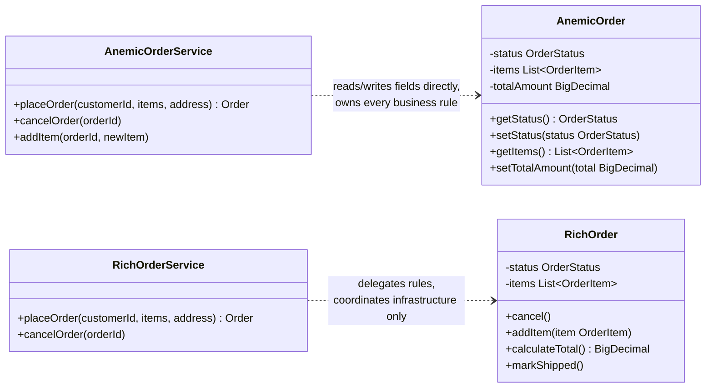
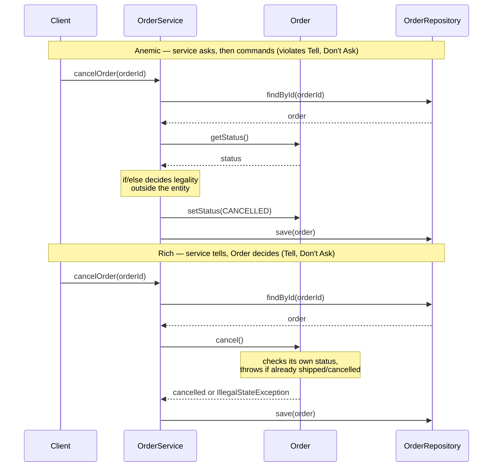

# Anti-Pattern: Anemic Domain Model
## What It Is

The Anemic Domain Model (ADM) anti-pattern describes a domain model where the domain objects (entities) contain only data — fields and getters/setters — with no business logic. All business logic is pushed into a separate layer of service classes that operate on these data containers.

Martin Fowler's bliki entry (25 November 2003) is the canonical write-up. His stated symptom is that the objects look right but have "hardly any behavior on these objects, making them little more than bags of getters and setters", and that the design is "really just a procedural style design". His stated cost is sharper than "no behaviour": an anemic model "incur[s] all of the costs of a domain model, without yielding any of the benefits" — the primary cost being the awkwardness of mapping to a database, which buys you a whole O/R mapping layer you then get nothing back from. Fowler does not claim to have coined the term; he names Eric Evans as a co-observer of the pattern and quotes *Domain-Driven Design* in support.

The contrast:
- **Anemic Domain Model**: `Order` has fields. `OrderService` has all the business logic that operates on `Order`.
- **Rich Domain Model**: `Order` knows how to place itself, cancel itself, calculate its total, and enforce its own invariants.

The diagram below puts both shapes side by side: in the anemic model `OrderService` reaches into `Order`'s fields and owns every rule; in the rich model `Order` owns its rules and `OrderService` is reduced to coordinating infrastructure.



---

## Intuition

> **One-line analogy**: Anemic Domain Model is like a recipe book where the ingredients have no instructions — data sits in one place, logic sits elsewhere, and nothing is self-contained.

**Mental model**: You have an `Order` class with 15 fields but zero methods beyond getters/setters. All the "what can an order do?" logic lives in `OrderService`, `OrderValidator`, `OrderCalculator`. The object is a dumb data bag. This violates OOP's core promise: objects should combine data and behavior. When you split them, you end up with procedural code wearing an OOP costume.

**Why it matters**: Anemic models lead to duplicated business logic scattered across service classes, no single source of truth for domain rules, and objects that can be put into invalid states because they don't enforce their own invariants.

**Key insight**: Ask "can this object tell me if it's valid?" and "can it transition itself to the next state?" If the answer is always "no, a service does that," you have an anemic model. The fix is to move behavior back into the entity where it belongs.

---

## How to Recognize It

**Code smells:**
- Domain classes contain only fields, getters, and setters (essentially POJOs / data transfer objects)
- Service classes are named after verbs: `OrderService`, `UserService`, `InvoiceService`, `AccountService`
- Service methods take a domain object as a parameter and manipulate it externally
- Domain invariants (e.g., "an order cannot be cancelled after it ships") live in a service, not in the entity
- The domain model looks like a database schema mapped to Java classes

**Example — The Anti-Pattern:**

```java
// Pure data container — no behavior
public class Order {
    private Long id;
    private Long customerId;
    private List<OrderItem> items;
    private OrderStatus status;
    private BigDecimal totalAmount;
    private LocalDateTime placedAt;
    private LocalDateTime shippedAt;
    private String shippingAddress;

    // Only getters and setters — no intelligence
    public Long getId() { return id; }
    public void setId(Long id) { this.id = id; }
    public Long getCustomerId() { return customerId; }
    public void setCustomerId(Long customerId) { this.customerId = customerId; }
    public List<OrderItem> getItems() { return items; }
    public void setItems(List<OrderItem> items) { this.items = items; }
    public OrderStatus getStatus() { return status; }
    public void setStatus(OrderStatus status) { this.status = status; }
    public BigDecimal getTotalAmount() { return totalAmount; }
    public void setTotalAmount(BigDecimal totalAmount) { this.totalAmount = totalAmount; }
    // ... more getters/setters
}

// All the intelligence lives here instead
public class OrderService {

    private final OrderRepository orderRepository;
    private final InventoryService inventoryService;
    private final PaymentService paymentService;

    // Business logic that belongs in Order lives here
    public Order placeOrder(Long customerId, List<OrderItem> items, String address) {
        // Domain invariant check — should be inside Order
        if (items == null || items.isEmpty()) {
            throw new IllegalArgumentException("Order must have at least one item");
        }

        // Total calculation — should be inside Order
        BigDecimal total = items.stream()
            .map(item -> item.getPrice().multiply(BigDecimal.valueOf(item.getQuantity())))
            .reduce(BigDecimal.ZERO, BigDecimal::add);

        Order order = new Order();
        order.setCustomerId(customerId);
        order.setItems(new ArrayList<>(items));
        order.setStatus(OrderStatus.PENDING);
        order.setTotalAmount(total);
        order.setPlacedAt(LocalDateTime.now());
        order.setShippingAddress(address);

        paymentService.authorize(customerId, total);
        inventoryService.reserve(items);
        return orderRepository.save(order);
    }

    public void cancelOrder(Long orderId) {
        Order order = orderRepository.findById(orderId)
            .orElseThrow(() -> new NotFoundException("Order not found"));

        // Cancellation policy — should be inside Order
        if (order.getStatus() == OrderStatus.SHIPPED
                || order.getStatus() == OrderStatus.DELIVERED) {
            throw new IllegalStateException("Cannot cancel an order that has already shipped");
        }
        if (order.getStatus() == OrderStatus.CANCELLED) {
            throw new IllegalStateException("Order is already cancelled");
        }

        order.setStatus(OrderStatus.CANCELLED);
        inventoryService.release(order.getItems());
        orderRepository.save(order);
    }

    public void addItem(Long orderId, OrderItem newItem) {
        Order order = orderRepository.findById(orderId)
            .orElseThrow(() -> new NotFoundException("Order not found"));

        // Another invariant in the wrong place
        if (order.getStatus() != OrderStatus.PENDING) {
            throw new IllegalStateException("Can only add items to pending orders");
        }

        order.getItems().add(newItem);
        // Recalculate total — again, belongs in Order
        BigDecimal newTotal = order.getItems().stream()
            .map(item -> item.getPrice().multiply(BigDecimal.valueOf(item.getQuantity())))
            .reduce(BigDecimal.ZERO, BigDecimal::add);
        order.setTotalAmount(newTotal);
        orderRepository.save(order);
    }
}
```

Problems visible above:
- `Order` cannot protect its own invariants — any code can call `setStatus(SHIPPED)` directly
- The total calculation is duplicated — it appears in both `placeOrder` and `addItem`
- Business rules ("cannot cancel after shipping") are scattered across service methods
- `Order` is just a data bag — it provides no encapsulation

---

## Why It Happens

1. **ORM influence**: JPA/Hibernate entities need a no-arg constructor and getter/setter pairs. Developers treat them as pure data structures.
2. **Procedural habits in OO clothing**: Developers with a procedural background write procedures (services) that operate on data structures (entities).
3. **Transaction Script pattern as default**: Many tutorials show the Transaction Script pattern — one method per use case — which naturally produces anemic models.
4. **Misunderstanding MVC**: "Model" in MVC is sometimes interpreted as just data, not a rich behavioral object.
5. **Fear of "fat models"**: Developers overcompensate against God Objects and strip all logic from entities.

---

## Why It's Harmful

1. **No encapsulation**: `setStatus()` is public — any code can put an Order into an illegal state. The entity cannot protect itself.
2. **Duplicated business logic**: Total calculation, validation, and invariant checks end up copy-pasted across multiple service methods.
3. **Business logic is hard to find**: "Where is the order cancellation rule?" — it could be in any of several service classes.
4. **Violates Tell Don't Ask**: Instead of telling `order.cancel()`, you ask `order.getStatus()`, check it, then call `order.setStatus(CANCELLED)`. The object does not participate in the operation.
5. **Services become God Objects**: With no behavior in the model, all logic must go somewhere — services grow large.
6. **Harder to test domain logic**: Testing `OrderService.cancelOrder()` requires setting up the full service with all its dependencies. Testing `order.cancel()` requires only an `Order`.

---

## How to Fix It

Move behavior into the domain object. The entity should enforce its own invariants and expose meaningful operations rather than raw setters.

```java
// Rich Domain Model: Order knows its own rules
public class Order {

    private final Long id;
    private final Long customerId;
    private final List<OrderItem> items;
    private OrderStatus status;
    private final LocalDateTime placedAt;
    private LocalDateTime shippedAt;
    private final String shippingAddress;

    // Factory method — enforces creation invariants
    public static Order place(Long customerId, List<OrderItem> items, String shippingAddress) {
        if (items == null || items.isEmpty()) {
            throw new IllegalArgumentException("Order must have at least one item");
        }
        if (shippingAddress == null || shippingAddress.isBlank()) {
            throw new IllegalArgumentException("Shipping address is required");
        }
        return new Order(null, customerId, new ArrayList<>(items),
                         OrderStatus.PENDING, LocalDateTime.now(), shippingAddress);
    }

    // Business operation — enforces its own rules
    public void cancel() {
        if (status == OrderStatus.SHIPPED || status == OrderStatus.DELIVERED) {
            throw new IllegalStateException(
                "Cannot cancel order " + id + ": already " + status);
        }
        if (status == OrderStatus.CANCELLED) {
            throw new IllegalStateException("Order " + id + " is already cancelled");
        }
        this.status = OrderStatus.CANCELLED;
    }

    // Business operation — encapsulates the rule about when items can be added
    public void addItem(OrderItem item) {
        if (status != OrderStatus.PENDING) {
            throw new IllegalStateException(
                "Cannot add items to order " + id + " with status " + status);
        }
        items.add(item);
    }

    // Business operation — the PENDING -> CONFIRMED transition markShipped() requires
    public void confirm() {
        if (status != OrderStatus.PENDING) {
            throw new IllegalStateException(
                "Only pending orders can be confirmed; order " + id + " is " + status);
        }
        this.status = OrderStatus.CONFIRMED;
    }

    // Behavior lives here — calculation is encapsulated and never duplicated
    public BigDecimal calculateTotal() {
        return items.stream()
            .map(item -> item.getPrice().multiply(BigDecimal.valueOf(item.getQuantity())))
            .reduce(BigDecimal.ZERO, BigDecimal::add);
    }

    public void markShipped() {
        if (status != OrderStatus.CONFIRMED) {
            throw new IllegalStateException("Only confirmed orders can be shipped");
        }
        this.status = OrderStatus.SHIPPED;
        this.shippedAt = LocalDateTime.now();
    }

    // No setStatus() — state transitions are explicit, named operations
    // Getters are fine for reading state
    public Long getId() { return id; }
    public OrderStatus getStatus() { return status; }
    public List<OrderItem> getItems() { return Collections.unmodifiableList(items); }
    public BigDecimal getTotal() { return calculateTotal(); }
}

// Service is now thin — coordinates infrastructure, does not own business rules
public class OrderService {

    private final OrderRepository orderRepository;
    private final InventoryService inventoryService;
    private final PaymentService paymentService;

    public Order placeOrder(Long customerId, List<OrderItem> items, String address) {
        // Business rule enforcement is in Order.place()
        Order order = Order.place(customerId, items, address);

        // Service coordinates external systems
        paymentService.authorize(customerId, order.getTotal());
        inventoryService.reserve(items);
        return orderRepository.save(order);
    }

    public void cancelOrder(Long orderId) {
        Order order = orderRepository.findById(orderId)
            .orElseThrow(() -> new NotFoundException("Order not found"));

        // Business rule is in order.cancel() — service just coordinates
        order.cancel();
        inventoryService.release(order.getItems());
        orderRepository.save(order);
    }
}

// Domain logic is now easy to unit test — no service dependencies needed
class OrderTest {

    @Test
    void cancel_throwsIfOrderAlreadyShipped() {
        Order order = Order.place(1L, sampleItems(), "123 Main St");
        order.confirm();
        order.markShipped();

        assertThrows(IllegalStateException.class, order::cancel);
    }

    @Test
    void calculateTotal_sumsItemPricesCorrectly() {
        List<OrderItem> items = List.of(
            new OrderItem("Widget", BigDecimal.valueOf(10.00), 2),
            new OrderItem("Gadget", BigDecimal.valueOf(25.00), 1)
        );
        Order order = Order.place(1L, items, "123 Main St");
        // compareTo, not equals: BigDecimal.equals() also compares scale, and
        // 10.0*2 + 25.0*1 sums to 45.0 (scale 1), which is not equal to 45.00 (scale 2)
        assertEquals(0, order.calculateTotal().compareTo(new BigDecimal("45.00")));
    }
}
```

The two `cancelOrder` implementations above differ in exactly one way: who makes the decision. The sequence below lines up the anemic call chain (the service asks `Order` for its status, decides externally, then commands a raw setter) against the rich call chain (the service simply tells `Order` to `cancel()` and the entity enforces its own rule) — the runtime picture of the Tell, Don't Ask violation and its fix.



---

## Real-World Examples

- **JPA Entity classes with all getters/setters**: Almost every beginner Spring tutorial produces anemic entities.
- **DTO objects promoted to domain model**: Developers use DTOs as their domain objects because it is simpler — but DTOs are meant for data transfer, not domain logic.
- **Generated code from database schema**: Tools that reverse-engineer a DB schema into Java classes produce purely anemic models by construction.
- **CRUD applications**: Simple CRUD apps can get away with anemic models, but the pattern becomes harmful when business logic grows.

---

## Prevention Strategies

1. **Identify domain invariants first**: Before writing a class, list the rules it must enforce. Those rules belong inside the class.
2. **Use factory methods instead of public constructors**: `Order.place(...)` forces creation through a validated path.
3. **Replace setters with named operations**: Instead of `setStatus()`, have `cancel()`, `confirm()`, `markShipped()`.
4. **Tell, Don't Ask principle**: If you find yourself asking an object for its state to decide what to do, consider if the object should make that decision itself.
5. **Test domain logic without services**: If your domain logic can only be tested through services, it is in the wrong place.
6. **Domain-Driven Design**: DDD's concept of Aggregates, Value Objects, and Entities directly addresses this — study it.

---

## Cross-Perspective: HLD Connections

**HLD View — Where Anemic Domain Model Appears in Distributed Systems**

- **Pure CRUD microservices** — A service that exposes only `GET /orders`, `POST /orders`, `PUT /orders/{id}` with no domain logic is an Anemic Microservice. All the "what are the rules for placing an order?" logic lives in the API layer or in a client — scattered and duplicated.
- **God Service emergence** — When domain entities are anemic, all logic must live somewhere. It concentrates in one "orchestration service" that calls all other services and implements all business rules — this God Service becomes a bottleneck and a deployment hazard.
- **Tight inter-service coupling** — Anemic services that expose raw data force consuming services to implement business rules about that data. Service A must understand Order's invariants to work with Order Service's raw data — coupling that proper domain modeling would eliminate.
- **Event sourcing mismatch** — Event sourcing requires entities that know how to apply events and validate transitions. Anemic entities can't enforce invariants before emitting events — invalid state changes leak into the event log, corrupting the system history.

---

## Interview Questions with Answers

**Q: Fowler called the Anemic Domain Model an anti-pattern in 2003 — what exactly is his argument?**
**Short:** You pay the full cost of a domain model, chiefly the O/R mapping layer, while collecting none of its benefits.
Fowler's bliki entry (25 November 2003) argues the objects "look right" — they have the correct fields and relationships — but have "hardly any behavior on these objects, making them little more than bags of getters and setters," so the design is "really just a procedural style design." His sharper claim is not merely "no behavior is bad style" — it's that an anemic model incurs all the costs of a domain model (chiefly the awkwardness of mapping objects to a database, which buys you a whole O/R mapping layer) without yielding any of the benefits that layer is supposed to justify. He credits Eric Evans as a co-observer of the pattern, citing *Domain-Driven Design* in support, and does not claim to have coined the term himself.

**Q: What is the counter-argument to Fowler's position — when might an anemic model be the right call?**
**Short:** Simple CRUD applications with little business logic get away with anemic models because there's little behavior to lose.
For genuinely simple CRUD applications — where the operations really are just create, read, update, delete with minimal business rules — the overhead of designing rich behavioral entities may not be worth it, since there is little domain logic to encapsulate in the first place. The pattern becomes harmful specifically as business logic grows and invariants accumulate; a small admin tool with three fields and no state machine is a different situation than an `Order` entity with cancellation rules, status transitions, and total calculations. The practical guidance is to recognize when you've crossed from "simple CRUD" into "real domain logic" and refactor toward a rich model at that point.

**Q: What is the Tell, Don't Ask principle, and how does the Anemic Domain Model violate it?**
**Short:** Tell Don't Ask means commanding an object to act, not querying its state and deciding externally what to do.
Tell, Don't Ask says you should tell an object what to do (`order.cancel()`) rather than asking it for its state, deciding externally, and then commanding a low-level mutation (`if (order.getStatus() == SHIPPED) ... else order.setStatus(CANCELLED)`). The anemic `OrderService.cancelOrder()` example does exactly the latter: it calls `order.getStatus()`, runs an if/else outside the entity to decide legality, then calls the raw setter — the object never participates in the decision about its own state transition. The rich model's `order.cancel()` inverts this: the entity checks its own status and throws if the transition is illegal, so the service simply tells it what to do.

**Q: How would you design an Order entity to be a rich domain model instead of anemic?**
**Short:** Replace public setters with named operations (cancel, confirm, markShipped) that enforce their own invariants.
Give `Order` a static factory method (`Order.place(...)`) that validates creation invariants like a non-empty item list, instead of a public no-arg constructor plus setters. Replace `setStatus(CANCELLED)` with a named operation `cancel()` that internally checks `status == SHIPPED || status == DELIVERED` and throws `IllegalStateException` if the transition is illegal. Add `calculateTotal()` as a method on the entity itself rather than duplicating the summation logic in every service method that needs it, and remove `setStatus()` entirely so state transitions can only happen through the entity's own named, invariant-checking methods.

**Q: What is the difference between a domain object and a DTO, and why does conflating them cause problems?**
**Short:** A DTO carries data across a boundary with no behavior by design; a domain object should enforce its own rules.
A DTO (Data Transfer Object) is meant to be a pure data carrier for crossing a serialization boundary — having no behavior is correct and intentional for a DTO. A domain object, by contrast, is meant to combine data and behavior and enforce its own invariants. When developers use DTOs as their domain model because it's simpler, they get an anemic model by construction: the class was never designed to protect itself, because protecting itself was never its job. The fix is to keep DTOs at the boundary (API request/response shapes) and build a separate, richer domain model behind them.

**Q: Why is duplicated total-calculation logic a direct symptom of an anemic model, not a separate bug?**
**Short:** Without a home in the entity, every service method that needs a derived value has to recompute it independently.
In the anemic `OrderService`, the same `items.stream().map(...).reduce(...)` total calculation appears twice — once in `placeOrder()` and again in `addItem()` — because there is no single place, like `Order.calculateTotal()`, that owns the computation. Every service method that needs the total has to reimplement it, and the two copies can drift (exactly the mechanism described in the Copy-Paste Programming anti-pattern). Moving `calculateTotal()` onto the entity means it's computed once, in one place, and any service or caller that needs the value simply calls the method rather than reimplementing the arithmetic.

**Q: What happens to unit testing when business logic lives in the entity instead of the service?**
**Short:** Domain logic becomes testable with zero infrastructure — no repository, no mocks, no service dependencies.
Testing `OrderService.cancelOrder()` in the anemic design requires standing up the full service with its `OrderRepository`, `InventoryService`, and other dependencies, because the cancellation rule lives inside the service method alongside repository calls. Testing `order.cancel()` on the rich entity requires only an `Order` object — as shown in the file's `OrderTest.cancel_throwsIfOrderAlreadyShipped()` example, which constructs an order, confirms and ships it, then asserts that `cancel()` throws, with no mocks or infrastructure involved at all.

**Q: Why do ORM frameworks like JPA/Hibernate tend to push developers toward anemic models?**
**Short:** JPA entities need a no-arg constructor and getter/setter pairs, which developers then treat as the whole design.
JPA/Hibernate entities are required to expose a no-arg constructor and typically use getter/setter pairs so the persistence framework can construct and populate them via reflection — this is a mechanical requirement of the mapping layer, not a design statement. The problem is that developers often mistake this persistence-layer requirement for the entire design of the class, adding no further behavior beyond what JPA needs, and the entity ends up looking exactly like a database row mapped to Java rather than a behavioral domain object. A rich model can still satisfy JPA's mechanical requirements (e.g., a protected no-arg constructor for Hibernate's use) while keeping public factory methods and named operations as the real API.

**Q: What does an "Anemic Microservice" look like at the HLD level, and why is it a problem?**
**Short:** A service exposing only raw CRUD endpoints with no domain logic, forcing rule-enforcement into callers.
A service that exposes only `GET /orders`, `POST /orders`, `PUT /orders/{id}` with no domain logic pushes all the "what are the rules for placing an order?" logic into the API layer or, worse, into each client that calls the service — scattered and duplicated across every consumer instead of centralized where the data lives. Consuming services end up needing to understand `Order`'s invariants themselves to work correctly with the raw data, creating tight coupling that a properly modeled domain service (one that enforces its own rules server-side) would have eliminated by exposing meaningful operations instead of raw field mutation.

**Q: Why does event sourcing expose anemic entities as a correctness problem, not just a style problem?**
**Short:** Anemic entities can't validate transitions before emitting events, so invalid state changes leak into the permanent event log.
Event sourcing requires entities that know how to apply events and validate transitions before they are recorded — the entity is the gatekeeper that decides whether a proposed state change is legal. Anemic entities, having no behavior, cannot perform that validation; whatever service code produces the event does so externally, and if that external logic has a gap (exactly the kind of gap that duplicated, scattered validation logic tends to have), an invalid state change is written permanently into the event log, where it cannot simply be "fixed" the way a mutable database row could be. This makes the Anemic Domain Model considerably more dangerous in an event-sourced system than in a simple CRUD one.

**Q: How does an anemic model turn into a God Service over time?**
**Short:** With no behavior in the entities, all logic must live somewhere, and it concentrates into one orchestration service.
Once entities are stripped of behavior, every piece of business logic — validation, calculation, state-transition rules — has to be implemented somewhere, and it typically accumulates in service classes. As more entities stay anemic and more logic needs a home, one "orchestration service" that calls every other service and implements most business rules tends to emerge, becoming the same kind of bottleneck and deployment hazard described in the God Object anti-pattern, but arrived at through under-designed entities rather than a single class that just grew too large.

**Q: In the refactored example, why does the service class become thinner without losing functionality?**
**Short:** The service now coordinates infrastructure (payment, inventory) while Order.place() and order.cancel() own the business rules.
`OrderService.placeOrder()` still calls `paymentService.authorize()` and `inventoryService.reserve()` — coordinating external systems is legitimately the service's job — but the validation and total calculation that used to live inline in the service now happen inside `Order.place()`. Similarly, `cancelOrder()` still calls `inventoryService.release()` and `orderRepository.save()`, but the legality check that used to be an if/else in the service is now just `order.cancel()`. No functionality is lost — it moved to a more appropriate owner, and the service's remaining code is coordination logic, which is exactly what a service should contain.

**Q: What is a factory method like `Order.place(...)` protecting against that a public constructor cannot?**
**Short:** A public constructor lets any caller build an Order in an invalid state; a factory method enforces invariants at creation.
`new Order()` followed by a series of setter calls, as in the anemic example, allows any code path to construct an `Order` with an empty items list or a missing shipping address, because nothing forces the invariant checks to run before the object exists. `Order.place(customerId, items, shippingAddress)` validates those invariants inside the factory method itself and only returns a fully-valid `Order`, or throws before construction completes — there is no window where an invalid `Order` instance exists in memory that some other code could accidentally get hold of and persist.

**Q: How would you spot an Anemic Domain Model by looking only at class and method names, without reading implementations?**
**Short:** Domain classes named after nouns with only getters/setters, paired with services named after verbs holding all the logic.
The naming pattern is distinctive: entity classes (`Order`, `User`, `Invoice`) expose only `getX()`/`setX()` pairs with no domain-specific method names, while separate classes suffixed `Service` (`OrderService`, `UserService`, `InvoiceService`) contain verb-named methods (`cancelOrder`, `calculateTotal`, `validateInvoice`) that take the entity as a parameter and manipulate it from outside. This split — nouns hold data, separately-named verb classes hold all the logic — is visible from an IDE's class list alone, before opening a single method body, which is why it's one of the fastest anti-patterns to spot in an unfamiliar codebase.

**Q: What is the "Transaction Script" pattern, and why does it naturally produce anemic models?**
**Short:** One method per use case, operating on plain data, is the default shape many tutorials teach and it yields anemic entities by construction.
Transaction Script organizes business logic as one procedure per use case — `placeOrder()`, `cancelOrder()` — each of which reads data, applies logic, and writes it back, treating the entities it touches as plain data holders rather than behavioral objects. Many introductory tutorials teach this shape first because it maps directly onto a single request handler, which is why developers with that background naturally reach for services-with-getters/setters rather than rich entities. It isn't wrong for genuinely simple CRUD, but as a default habit it produces the exact anemic split this anti-pattern describes once business rules accumulate.

## Interview Relevance

**Common interview questions:**
- "What is the Anemic Domain Model and why is it considered an anti-pattern?" — Direct question, common in senior engineering interviews.
- "What is the Tell Don't Ask principle?" — ADM is the canonical violation.
- "How would you design an Order entity in a rich domain model?" — Practical design question.
- "What is the difference between a domain object and a DTO?" — Tests understanding of where behavior belongs.

**Key talking points:**
- Cite Fowler's 2003 bliki entry as the canonical write-up, and state his actual argument: you pay the full cost of a domain model (chiefly the O/R mapping layer) and collect none of the benefits
- Contrast with rich domain model — the fix is not a new class, it is moving logic into the existing entity
- Explain encapsulation: the entity should protect its own invariants
- Mention testability: domain logic in the entity is testable without infrastructure
- Note the "Tell Don't Ask" principle as the guiding heuristic
