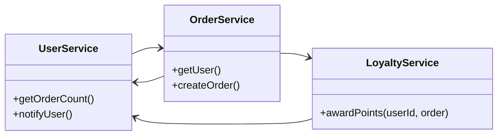
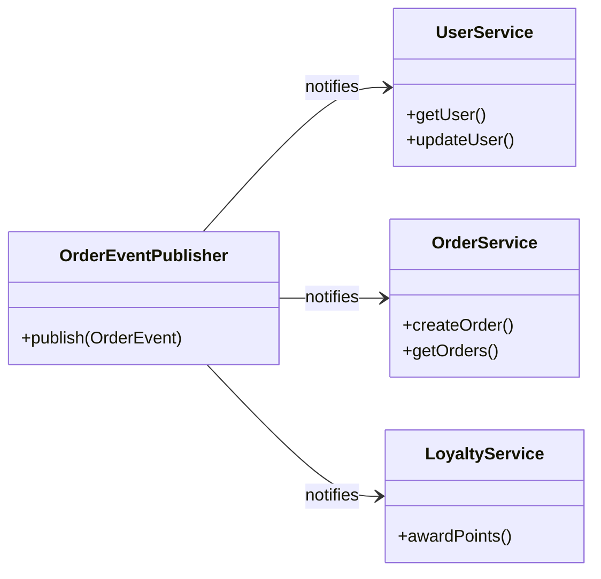
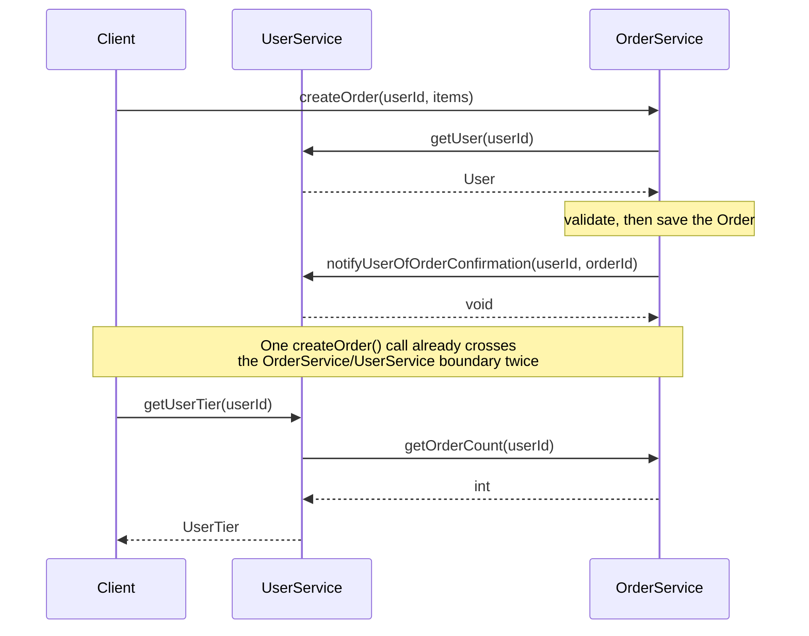
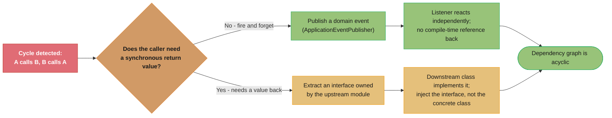

# Circular Dependencies Anti-Pattern
## Overview

Circular Dependencies occur when two or more modules, packages, or classes form a dependency cycle — A depends on B, B depends on C, and C depends back on A. The result is a tightly coupled cluster that behaves as a single indivisible unit, even though it appears to be modular. The anti-pattern is insidious because the cycle is not always obvious from reading a single file; it emerges from the aggregate of import statements and constructor parameters across the system. Circular dependencies destroy modularity: no part of the cycle can be compiled, deployed, or tested without the entire cycle being present. In Java specifically, they cause class initialization ordering problems, Spring bean creation failures, and unit test impossibility. At the architecture level, circular dependencies between packages or services are a signal that the system's boundaries are incorrectly drawn and that shared concepts have not been properly identified and extracted.

---

## Intuition

> **One-line analogy**: Circular dependencies are like two people each waiting for the other to arrive first — nothing can start without the other, so neither starts.

**Mental model**: `OrderService` needs `UserService` to look up the customer. `UserService` needs `OrderService` to list a user's orders. Neither can be created without the other. Spring throws `BeanCurrentlyInCreationException`. Tests can't instantiate either class cleanly. The two classes have merged into one logical blob wearing two names — all the disadvantages of a God Object with none of the obvious warning signs.

**Why it matters**: Cycles collapse modularity. You cannot compile, test, or deploy one side of the cycle independently. Every change to either class forces consideration of the other. Deployment ordering becomes undefined.

**Key insight**: Circular dependencies are a design boundary problem, not a coding problem. The fix is almost always to extract the shared concept that both classes depend on into a third module — breaking the cycle by introducing the abstraction that was missing.

---

## How to Spot It

**Warning Signs and Code Smells**

- Class A's import list includes a class from package B, and class B's import list includes a class from package A
- Spring application context fails to start with `BeanCurrentlyInCreationException` — a direct symptom of circular bean dependencies
- Unit tests for class A require instantiating class B, which requires class A — a test setup loop with no clean entry point
- Two (or more) services that seem to "know too much" about each other: `UserService` has methods that clearly belong to `OrderService` and vice versa
- Architects describe the design as "everything connects to everything" or draw dependency diagrams with bidirectional arrows
- Deployment ordering cannot be determined: "which service do we start first?"
- A refactor in `ClassA` always forces a change in `ClassB` and then back in `ClassA`
- SonarQube's architecture rules, ArchUnit, or IntelliJ's dependency analysis reports a cycle
- The `@Lazy` annotation is used on Spring bean injections to "fix" startup failures (a workaround that masks the underlying cycle)
- Methods in class A take a parameter of type B and methods in class B take a parameter of type A

---

## Dependency Diagrams

**Before: Circular Dependency (problematic)**



*`LoyaltyService.awardPoints()` pulls in both `UserService` and `OrderService`, which already call each other directly — together the three form a 3-node cycle with no valid initialization order.*

**After: Acyclic Dependency (correct)**



*`UserService`, `OrderService`, and `LoyaltyService` no longer hold references to each other — each is simply notified by the shared `OrderEventPublisher` (the extracted abstraction), turning the cycle into an acyclic star.*

---

## Java Violation Example

```java
// =========================================================================
// CIRCULAR DEPENDENCY EXAMPLE
// UserService <-> OrderService form a hard cycle.
// Neither can be instantiated or tested without the other.
// =========================================================================

// -------------------------------------------------------------------------
// com.example.user.UserService
// -------------------------------------------------------------------------
package com.example.user;

import com.example.order.OrderService;  // UserService imports OrderService

@Service
public class UserService {

    private final UserRepository userRepository;
    private final OrderService orderService;  // Direct dependency on OrderService

    // Spring will fail to create this bean because OrderService also requires UserService.
    // Error: "The dependencies of some of the beans in the application context
    // form a cycle: userService -> orderService -> userService"
    public UserService(UserRepository userRepository, OrderService orderService) {
        this.userRepository = userRepository;
        this.orderService = orderService;
    }

    public User getUser(String userId) {
        return userRepository.findById(userId)
            .orElseThrow(() -> new UserNotFoundException(userId));
    }

    // This method calls back into OrderService — it's the reason the cycle exists.
    // Business logic: "Get the order count to decide the user's tier."
    // The question is: why does UserService need to know about orders?
    public UserTier getUserTier(String userId) {
        int orderCount = orderService.getOrderCount(userId);  // calls OrderService
        if (orderCount >= 10) return UserTier.GOLD;
        if (orderCount >= 3)  return UserTier.SILVER;
        return UserTier.BRONZE;
    }

    // Another cycle-causing method: notifying a user after an order is placed.
    // This should not live in UserService — it belongs in a notification or order handler.
    public void notifyUserOfOrderConfirmation(String userId, String orderId) {
        User user = getUser(userId);
        // ... send email
        System.out.println("Notifying " + user.getEmail() + " about order " + orderId);
    }
}

// -------------------------------------------------------------------------
// com.example.order.OrderService
// -------------------------------------------------------------------------
package com.example.order;

import com.example.user.UserService;  // OrderService imports UserService — the cycle

@Service
public class OrderService {

    private final OrderRepository orderRepository;
    private final UserService userService;  // Direct dependency on UserService

    public OrderService(OrderRepository orderRepository, UserService userService) {
        this.orderRepository = orderRepository;
        this.userService = userService;
    }

    // This method causes the cycle: it needs to look up the user before creating an order.
    // The user lookup belongs OUTSIDE the order creation, at the application/controller layer.
    public Order createOrder(String userId, List<OrderItem> items) {
        User user = userService.getUser(userId);  // calls UserService — the cycle entry point

        if (user == null) {
            throw new IllegalArgumentException("User not found: " + userId);
        }

        Order order = new Order(userId, items);
        orderRepository.save(order);

        // After saving, it calls BACK into UserService to trigger notification.
        // This makes the cycle bidirectional and creates a call graph loop.
        userService.notifyUserOfOrderConfirmation(userId, order.getId());

        return order;
    }

    public int getOrderCount(String userId) {
        return orderRepository.countByUserId(userId);
    }
}

// =========================================================================
// ADDITIONAL CYCLE EXAMPLE: Circular static initialization
// This causes a harder-to-diagnose problem at class loading time.
// =========================================================================

// NOTE the initializers below are deliberately NOT constant expressions.
// If they were (e.g. `static final int BASE_TIMEOUT = 100;`), javac would inline
// both values at every use site under JLS 13.1 and NO class initialization would
// ever run — the cycle would be invisible and the values always correct. The bug
// only appears once an initializer needs to execute at class-init time.

public class ConfigA {
    // Initializing ConfigA triggers ConfigB's initialization.
    public static final int TIMEOUT = ConfigB.baseTimeout() * 2;   // intended: 200
}

public class ConfigB {
    public static final int BASE_TIMEOUT = Integer.parseInt("100");

    // Initializing ConfigB reads back into ConfigA. If ConfigA is already
    // in progress ON THIS THREAD, the JVM does not re-enter it (JLS 12.4.2) and
    // simply reads TIMEOUT's default value 0 — silently, with no error.
    public static final int EXTENDED = ConfigA.TIMEOUT + 500;      // intended: 700

    public static int baseTimeout() { return BASE_TIMEOUT; }
}

// Touch ConfigB first -> EXTENDED = 700, TIMEOUT = 200   (both correct)
// Touch ConfigA first -> EXTENDED = 500, TIMEOUT = 200   (EXTENDED silently wrong)
// Two threads entering from opposite ends can instead deadlock on the two
// initialization locks, because neither release happens until the other completes.

// =========================================================================
// PACKAGE-LEVEL CYCLE (Architecture violation)
// =========================================================================

// com.example.user.User references com.example.order.Order
public class User {
    private List<Order> recentOrders;  // User knows about Order — package cycle
}

// com.example.order.Order references com.example.user.User
public class Order {
    private User customer;  // Order knows about User — package cycle completes
}
// Result: the 'user' package and 'order' package cannot be compiled or deployed independently.
```

**What is wrong with this code:**
- `UserService` and `OrderService` each require the other in their constructor — Spring cannot resolve the initialization order and throws `BeanCurrentlyInCreationException`
- The bidirectional call graph (UserService calls OrderService, which calls back into UserService) can create runtime loops
- No unit test can instantiate `UserService` without a real or mock `OrderService`, and vice versa — mocking both creates a circular mock setup
- `getUserTier()` lives in `UserService` but is really a derived fact computed from `OrderService` data — the responsibility is misplaced
- `notifyUserOfOrderConfirmation()` in `UserService` is an event handler that was placed in the wrong class
- Static initialization cycle in `ConfigA`/`ConfigB` silently yields `ConfigB.EXTENDED == 500` instead of `700` when `ConfigA` is touched first, because the re-entrant read of `ConfigA.TIMEOUT` sees the field's default `0` — a class of bug that is nearly impossible to reproduce in tests, since it depends on which class the process happens to touch first

**The Runtime Call Graph (Why It's a Loop, Not Just a Cycle)**



*A single `createOrder()` call already ping-pongs between `OrderService` and `UserService` twice (`getUser()`, then `notifyUserOfOrderConfirmation()`) before `getUserTier()` adds a third cross-call in the opposite direction — the cycle is a live call loop at runtime, not just a compile-time reference.*

---

## Why It's Harmful

**Spring Bean Initialization Failure**
Constructor injection with circular dependencies causes an immediate application startup failure. Field injection or `@Lazy` can mask it, but the underlying design problem remains — and lazy initialization defers the failure to runtime.

**Unit Testing Impossibility**
To unit test `UserService.getUserTier()`, you need a mock `OrderService`. To construct a mock `OrderService`, you may need a reference to `UserService`. Clean unit testing requires a dependency tree (DAG), not a dependency cycle.

**Deployment Ordering Cannot Be Defined**
In a microservices or modular architecture, if Service A depends on Service B which depends on Service A, there is no valid startup order. Both services must be started simultaneously with retry logic, adding operational complexity.

**Compilation Coupling**
At the package level, cycles mean that changing any class in the cycle requires recompiling all other classes in the cycle. This defeats the purpose of modularization and slows large codebases significantly.

**Change Amplification**
A change to `UserService` propagates to `OrderService` and potentially back to `UserService`. Every modification in the cycle requires reviewing all nodes in the cycle, regardless of which class the change targets.

**Hidden Semantic Problems**
Cycles are often symptoms of misplaced responsibilities. If `UserService` needs to call `OrderService`, someone put logic in the wrong class. The cycle is a signal, not just a technical constraint.

---

## Refactored Solution

```java
// =========================================================================
// SOLUTION 1: Introduce a shared event/mediator to break the cycle
// UserService and OrderService both become independent.
// Communication happens via a domain event — no direct dependency.
// =========================================================================

// -------------------------------------------------------------------------
// Shared domain event (no dependency on either service)
// -------------------------------------------------------------------------
public record OrderCreatedEvent(String orderId, String userId, Money total) {}

// -------------------------------------------------------------------------
// OrderService — no longer depends on UserService
// -------------------------------------------------------------------------
@Service
public class OrderService {

    private final OrderRepository orderRepository;
    private final ApplicationEventPublisher eventPublisher;  // Spring's event bus

    public OrderService(OrderRepository orderRepository,
                        ApplicationEventPublisher eventPublisher) {
        this.orderRepository = orderRepository;
        this.eventPublisher = eventPublisher;
    }

    // userId is passed in from the caller (controller/application layer),
    // who already validated the user exists. OrderService doesn't need UserService.
    public Order createOrder(String userId, List<OrderItem> items) {
        Order order = new Order(userId, items);
        orderRepository.save(order);

        // Publish event — OrderService does not know who handles it
        eventPublisher.publishEvent(new OrderCreatedEvent(order.getId(), userId, order.getTotal()));

        return order;
    }

    public int getOrderCount(String userId) {
        return orderRepository.countByUserId(userId);
    }
}

// -------------------------------------------------------------------------
// UserService — no longer depends on OrderService
// -------------------------------------------------------------------------
@Service
public class UserService {

    private final UserRepository userRepository;

    public UserService(UserRepository userRepository) {
        this.userRepository = userRepository;
    }

    public User getUser(String userId) {
        return userRepository.findById(userId)
            .orElseThrow(() -> new UserNotFoundException(userId));
    }

    public void updateUser(User user) {
        userRepository.save(user);
    }
}

// -------------------------------------------------------------------------
// UserNotificationHandler — listens for order events, handles notification
// Depends on UserService only (no cycle)
// -------------------------------------------------------------------------
@Component
public class UserNotificationHandler {

    private final UserService userService;
    private final EmailService emailService;

    public UserNotificationHandler(UserService userService, EmailService emailService) {
        this.userService = userService;
        this.emailService = emailService;
    }

    @EventListener
    public void onOrderCreated(OrderCreatedEvent event) {
        User user = userService.getUser(event.userId());
        emailService.sendOrderConfirmation(user.getEmail(), event.orderId());
    }
}

// -------------------------------------------------------------------------
// UserTierService — computes user tier by coordinating UserService + OrderService
// This is a new, focused class at a higher layer — it CAN depend on both
// because nothing depends back on it (no cycle introduced).
// -------------------------------------------------------------------------
@Service
public class UserTierService {

    private final UserService userService;
    private final OrderService orderService;

    public UserTierService(UserService userService, OrderService orderService) {
        this.userService = userService;
        this.orderService = orderService;
    }

    public UserTier getTierForUser(String userId) {
        userService.getUser(userId); // validates user exists
        int orderCount = orderService.getOrderCount(userId);
        if (orderCount >= 10) return UserTier.GOLD;
        if (orderCount >= 3)  return UserTier.SILVER;
        return UserTier.BRONZE;
    }
}

// =========================================================================
// SOLUTION 2: Introduce an interface to invert the dependency
// When event-based decoupling is not appropriate, invert with an interface.
// =========================================================================

// Interface defined in the 'user' package — OrderService depends on the interface,
// not on the concrete UserService. The cycle is broken.
public interface UserLookup {
    User findById(String userId);
}

// UserService implements the interface
@Service
public class UserService implements UserLookup {
    private final UserRepository userRepository;

    public UserService(UserRepository userRepository) {
        this.userRepository = userRepository;
    }

    @Override
    public User findById(String userId) {
        return userRepository.findById(userId)
            .orElseThrow(() -> new UserNotFoundException(userId));
    }
}

// OrderService depends on the interface, not on UserService
@Service
public class OrderService {
    private final OrderRepository orderRepository;
    private final UserLookup userLookup;  // interface, not UserService

    public OrderService(OrderRepository orderRepository, UserLookup userLookup) {
        this.orderRepository = orderRepository;
        this.userLookup = userLookup;
    }

    public Order createOrder(String userId, List<OrderItem> items) {
        userLookup.findById(userId); // validates existence; throws if not found
        Order order = new Order(userId, items);
        return orderRepository.save(order);
    }
}
```

**What changed:**
- `UserService` and `OrderService` are now fully independent — each can be instantiated, tested, and deployed without the other
- Communication happens via `ApplicationEventPublisher` — `OrderService` publishes events, `UserNotificationHandler` consumes them
- `getUserTier()` moved to `UserTierService`, a coordinator class that lives at a higher layer and can depend on both without creating a cycle
- Dependency diagram is now a DAG (directed acyclic graph): `UserTierService` -> `UserService`, `OrderService`; `UserNotificationHandler` -> `UserService`; no cycles

**Choosing Between the Two Fixes**



*Reach for a domain event (SOLUTION 1) when the caller doesn't need anything back; reach for an extracted interface (SOLUTION 2) when the caller needs a synchronous value, like validating a user exists before creating an order.*

---

## Prevention Strategies

**1. Use Dependency Analysis Tools in CI**

Let the scanner fail the pipeline before review does. SonarQube's Java architecture rules detect
class cycles directly: `javaarchitecture:S7027` flags circular dependencies between classes in the
same package, and `javaarchitecture:S7091` flags them across packages. Turn both on in the quality
profile and make new cycles block the quality gate:

```yaml
# sonar-project.properties equivalents — enable in the quality profile,
# then gate on "no new issues" so an existing cycle backlog does not block every build.
sonar.qualitygate.wait=true
```

Two footnotes worth knowing so you do not chase dead tooling. SonarQube's old design metrics —
Package Tangle Index and the Dependency Structure Matrix — were dropped in SonarQube 5.2 and are
not coming back; the architecture rules above replaced them. And **JDepend**, the tool most blog
posts still name for this, last shipped 2.9.1 in 2005: it reads pre-generics bytecode, knows
nothing about JPMS modules, and should not be added to a new build. IntelliJ's Analyze ->
Dependency Structure Matrix is still useful interactively, but it is not a CI gate.

**2. Apply the Dependency Inversion Principle (DIP)**
High-level modules should not depend on low-level modules. Both should depend on abstractions. When two services need to communicate, define an interface in the shared or upstream module and have the downstream module implement it.

**3. Enforce the Acyclic Dependencies Principle (ADP)**
Robert C. Martin's ADP states: the dependency graph of packages must have no cycles. Make this a documented and enforced architectural rule. Include it in architecture fitness functions (e.g., ArchUnit tests).

```java
// ArchUnit: enforce no cyclic dependencies between packages
@AnalyzeClasses(packages = "com.example")
public class ArchitectureTest {

    @ArchTest
    static final ArchRule noCycles =
        slices().matching("com.example.(*)..").should().beFreeOfCycles();
}
```

**4. Use Domain Events for Cross-Boundary Communication**
Services that need to react to each other's state changes should communicate via events (Spring Events, Kafka, RabbitMQ) rather than direct method calls. This eliminates the most common source of service-level cycles.

**5. Identify and Extract Shared Concepts**
When two modules form a cycle, it is often because they both know about a concept that belongs in a third, shared module. Extract the shared concept (a domain entity, an interface, a value object) into a `core` or `common` module that both depend on.

**6. Visualize the Dependency Graph Regularly**
Use IntelliJ IDEA's "Analyze > Dependencies" or "Analyze > Module Dependencies" to generate a visual dependency graph. Schedule quarterly architecture reviews where the graph is examined for emerging cycles.

**7. Structure Packages by Feature, Not Layer**
Vertical slicing (package by feature: `com.example.order`, `com.example.user`) makes cycles visible at a glance. Horizontal slicing (package by layer: `com.example.service`, `com.example.repository`) hides cycles because all services live in the same package.

---

## Cross-Perspective: HLD Connections

**HLD View — Where Circular Dependencies Appear in Distributed Systems**

- **Service circular calls** — Service A calls Service B to complete a request; Service B calls Service A for data it needs. This creates a distributed deadlock under concurrent load: both services wait for each other, requests time out, and the cycle cascades into a full outage.
- **Deployment ordering impossibility** — When Service A depends on Service B and Service B depends on Service A at startup (to register with each other, exchange configs, etc.), deployment ordering is undefined. Blue-green deployments, rolling restarts, and failovers all fail to find a valid startup sequence.
- **Circular event subscriptions** — Service A publishes `OrderPlaced` events; Service B consumes them and publishes `InventoryReserved`; Service A consumes `InventoryReserved` and publishes another `OrderPlaced`. Without careful deduplication, this creates infinite event loops that flood the message bus.
- **Database circular foreign keys** — Table A has a foreign key to Table B; Table B has a foreign key to Table A. Insertions require both rows to exist simultaneously; deletions require both to be absent simultaneously — creating referential integrity deadlocks that require nullable columns or application-level workarounds.

---

## Real-World Consequences

*The four scenarios below are illustrative composites of common incident patterns, not reports of specific named public incidents. The numbers show the shape of the failure; treat them as worked examples rather than as citable industry statistics.*

**Scenario 1: The Spring Boot Startup Failure**
A fintech startup added a new feature that required `PaymentService` to look up account details via `AccountService`, and `AccountService` to validate payment status via `PaymentService`. The application context failed to start in the next CI run with `BeanCurrentlyInCreationException`. The team "fixed" it by adding `@Lazy` to the `AccountService` injection in `PaymentService`. Spring then injected a lazy-resolution proxy instead of the real bean, so the context started clean and the cycle looked resolved. It was not: the bean graph was still cyclic, `@Lazy` had only moved bean creation off the startup path and onto the first request that dereferenced the proxy. The loud, deterministic, CI-visible failure was traded for a quiet one whose timing depends on traffic, and the underlying design defect — the bidirectional call loop and the untestability that comes with it — was untouched.

**Scenario 2: The Microservices Deployment Deadlock**
A company decomposed their monolith into microservices but preserved the circular dependencies between the `User Service` and `Order Service`. Both services called each other's REST APIs on startup for health checks and configuration. In production, restarting both services simultaneously caused both to fail their health checks (because each was trying to call the other, which was also restarting) and both entered a crash loop. The deployment window stretched from 30 minutes to 4 hours while the team manually sequenced restarts.

**Scenario 3: The Untestable Core Module**
A logistics company's core domain model had package-level cycles between `shipment`, `warehouse`, and `carrier` packages — each imported types from the others. The result was that no class in any of the three packages could be instantiated in a unit test without bringing in all three packages. A test that should have been 10 lines required 200 lines of setup. Test coverage for the core domain dropped below 30% because writing tests was too laborious. When a calculation error in shipment cost was introduced, it was not caught by tests and reached production.

**Scenario 4: The Class Loading Race Condition**
A system had two configuration classes with a static initialization cycle similar to the example above. In single-threaded testing, the classes always loaded in the same order and constants had the correct values. In a multi-threaded production environment, the class loading order was non-deterministic. Approximately 1 in 200 application starts resulted in one constant being initialized to `0` instead of its intended value, causing a specific timeout to be set to 0 milliseconds (immediate timeout). This manifested as a mysterious "connection refused" error that appeared roughly once per week, took three months to diagnose, and was fixed in 2 minutes once the root cause was identified.

---

## Interview Questions with Answers

**Q: How do you break a circular dependency without introducing a god interface that both classes depend on?**
**Short:** Use a domain event through a mediator when no return value is needed, or extract a narrow interface owned by one side when it is.
This file's decision flowchart gives the exact branch: if the caller doesn't need a synchronous return value, publish a domain event through `ApplicationEventPublisher` and let a separate listener react — no compile-time reference back to the caller at all. If the caller does need a value back (like validating a user exists before creating an order), extract a narrow interface — `UserLookup` with just `findById()` — owned by the upstream module, and have the downstream module depend on that interface rather than the concrete class. Neither fix requires a single god interface bundling every method both classes need; each targets the specific cycle-causing call.

**Q: Why does Spring throw `BeanCurrentlyInCreationException` for circular constructor-injected beans?**
**Short:** Spring cannot determine a valid construction order when bean A's constructor needs bean B and B's constructor needs A.
Constructor injection requires the constructor to run to completion with all its arguments already available — but if `UserService`'s constructor needs a fully-constructed `OrderService`, and `OrderService`'s constructor needs a fully-constructed `UserService`, there is no valid order in which either can finish constructing first. Spring detects this cycle while building the bean graph and fails fast with `BeanCurrentlyInCreationException` at startup, which is actually the safer failure — it happens immediately and deterministically rather than being silently deferred.

**Q: Why is fixing a Spring circular dependency with `@Lazy` a trap rather than a real fix?**
**Short:** @Lazy replaces a loud, deterministic startup failure with a silent one whose timing depends on when the proxy is first dereferenced.
Adding `@Lazy` to one side of the injection makes Spring inject a lazy-resolution proxy instead of the real bean, so the application context starts cleanly and the cycle "looks resolved" — but the underlying bean graph is still cyclic. The failure that used to happen loudly and deterministically at startup is now deferred to the first request that actually dereferences the proxy, meaning its timing depends on traffic patterns rather than being caught in CI. The design defect — the bidirectional call loop and the untestability it causes — remains completely untouched; only the symptom's visibility changed.

**Q: Why can a circular dependency's cycle not be visible from reading just one file?**
**Short:** It only emerges from the aggregate of import statements and constructor parameters across multiple files.
`UserService`'s file shows it importing and depending on `OrderService` — that alone looks like an ordinary one-directional dependency. Only when you also read `OrderService`'s file and see it importing and depending on `UserService` does the cycle become apparent. This is why the anti-pattern is described as insidious: no single file "looks wrong" in isolation, and detecting the cycle requires either tracing across files manually or using tooling like ArchUnit's `beFreeOfCycles()` or SonarQube's architecture rules that analyze the whole dependency graph at once.

**Q: What is the fundamental design signal a circular dependency is telling you, according to this file's Key Insight?**
**Short:** It is a design-boundary problem, not a coding problem — a shared concept was never extracted into its own module.
The fix is almost always to extract the shared concept that both classes depend on into a third module, breaking the cycle by introducing the abstraction that was missing — not to rearrange imports or add workarounds like `@Lazy`. In the worked example, `getUserTier()` living in `UserService` but really depending on `OrderService` data was the actual signal: the responsibility was misplaced, and moving it into a new `UserTierService` that sits above both (and that nothing depends back on) resolved the cycle by fixing the underlying misplaced logic, not by hiding it.

**Q: Walk through why a single `createOrder()` call is a "live call loop," not just a compile-time cycle.**
**Short:** One createOrder() call crosses the OrderService/UserService boundary twice at runtime — getUser(), then notifyUserOfOrderConfirmation().
The sequence diagram in this file shows `createOrder()` calling `UserService.getUser()` to validate the user, then later calling back into `UserService.notifyUserOfOrderConfirmation()` after the order is saved — two separate runtime crossings of the same boundary within one logical operation. `getUserTier()` then adds a third cross-call in the opposite direction (`UserService` calling `OrderService.getOrderCount()`). This demonstrates the cycle isn't merely a static reference in code that never actually executes both directions — it's a genuine ping-pong at runtime, which is what makes reasoning about the actual call graph so difficult.

**Q: How does the static-initialization cycle between `ConfigA` and `ConfigB` produce a silently wrong value?**
**Short:** JLS 12.4.2 does not re-enter a class already initializing on the same thread; it returns the field's default value (0) instead.
`ConfigA.TIMEOUT` triggers `ConfigB`'s initialization, which reads back `ConfigA.TIMEOUT` — but if `ConfigA`'s own initialization is already in progress on that thread, the JVM does not re-enter it per JLS 12.4.2, and the read simply returns the field's default value of `0` rather than throwing an error. This means `ConfigB.EXTENDED` silently computes to `500` instead of the intended `700` when `ConfigA` happens to be touched first — with no exception, no warning, just a wrong number that depends entirely on which class the process happens to touch first. This is explicitly called out as "a class of bug that is nearly impossible to reproduce in tests."

**Q: Why do the constant-expression semantics of `static final int` matter for whether this initialization cycle bug even appears?**
**Short:** A true compile-time constant is inlined by javac at every use site under JLS 13.1, so no class-init code ever runs and the bug is invisible.
If `ConfigB.BASE_TIMEOUT` were written as `static final int BASE_TIMEOUT = 100;` — a genuine compile-time constant expression — javac would inline the literal `100` directly at every use site under JLS 13.1, meaning no class initialization would actually execute at those use points and the ordering-dependent bug would never manifest. The bug in this file's example only appears because the initializers use `Integer.parseInt("100")` and similar non-constant expressions, which force real class-initialization code to run — a reminder that the constant-inlining rule can mask exactly this class of cycle bug until a refactor removes the "constant-ness" that was hiding it.

**Q: What is the Acyclic Dependencies Principle (ADP), and how do you enforce it in CI?**
**Short:** Robert C. Martin's ADP states the package dependency graph must have no cycles, enforceable via ArchUnit's beFreeOfCycles().
ADP is an architectural rule: the dependency graph of packages in a system must be a DAG, with no cycles at all. It's enforced in this file's example via ArchUnit's `slices().matching("com.example.(*)..").should().beFreeOfCycles()`, which fails a build the moment two packages form a cycle. This turns architectural discipline from a rule people are expected to remember into a fitness function that runs automatically on every CI build, catching new cycles before they're merged rather than relying on manual review to spot them.

**Q: What is JDepend, and why does this file specifically warn against adding it to a new build?**
**Short:** JDepend last shipped in 2005, reads pre-generics bytecode, and knows nothing about JPMS modules — it should not be added today.
JDepend is the tool most older blog posts still reference for detecting package cycles, but its last release (2.9.1) shipped in 2005, meaning it reads pre-generics-era bytecode and has no awareness of the Java Platform Module System introduced years later. SonarQube's newer architecture rules — `javaarchitecture:S7027` for same-package cycles and `javaarchitecture:S7091` for cross-package cycles — are the modern replacement, having superseded SonarQube's older Package Tangle Index and Dependency Structure Matrix metrics, which were dropped in SonarQube 5.2.

**Q: Why is "package by feature" a cycle-prevention strategy, not just an organizational preference?**
**Short:** Vertical slicing makes cross-package imports visible at a glance; layer-based packaging hides cycles inside one package.
Structuring packages by feature (`com.example.order`, `com.example.user`) means a dependency between features shows up as a visible cross-package import, which is exactly what tools like ArchUnit are checking for — cycles are structurally forced into visibility. Structuring by layer instead (`com.example.service`, `com.example.repository`) puts `OrderService` and `UserService` in the same `service` package, where a cycle between them is just two classes calling each other within one package — invisible to cross-package cycle detection and much easier to miss during manual review.

**Q: Why does the database circular-foreign-key example matter for HLD, and what workaround does it force?**
**Short:** Table A referencing Table B and B referencing A means inserting either row first violates referential integrity, forcing nullable FK columns.
If Table A has a foreign key to Table B and Table B has a foreign key to Table A, inserting a new row into either table first would violate the other table's foreign key constraint, since the referenced row doesn't exist yet — you cannot insert both simultaneously in a single atomic statement in most systems. The typical workaround is making one of the foreign key columns nullable, inserting both rows with that column null, then updating it afterward — an application-level two-phase workaround for a schema-level cycle that mirrors the same "there is no valid order" problem circular class dependencies cause at startup.

**Q: What is the difference between Solution 1 (domain event) and Solution 2 (extracted interface) in this file, and how do you choose?**
**Short:** Choose the event when the caller needs no return value; choose the interface when the caller needs a synchronous answer back.
Solution 1 (`ApplicationEventPublisher` + `@EventListener`) fits `notifyUserOfOrderConfirmation()`, a fire-and-forget notification where `OrderService` doesn't need anything back from whoever handles the event. Solution 2 (extracting `UserLookup` as an interface `UserService` implements) fits `createOrder()`'s need to validate a user exists before proceeding — that's a synchronous check requiring an actual return value, which an async event can't easily provide. The file's decision flowchart makes this the single branch point: does the caller need a value back, yes or no.

**Q: In the fixed design, why can `UserTierService` depend on both `UserService` and `OrderService` without recreating the cycle?**
**Short:** Nothing depends back on UserTierService, so adding it as a new node above both keeps the graph a DAG instead of a cycle.
A dependency graph only becomes a cycle when there is a path leading back to where you started; `UserTierService` sits at a higher layer, depending on both `UserService` and `OrderService`, but neither of those two classes depends on `UserTierService` in return — there's no path back. This is the general pattern for legitimately needing two collaborators' data together: introduce a new coordinating class above both rather than making either of the two original classes depend on the other, which is exactly how `getUserTier()`'s original placement inside `UserService` created the cycle in the first place.

**Q: Why does the `@Lazy` "fix" in the Spring Boot Startup Failure scenario count as a trap rather than a legitimate workaround?**
**Short:** It swaps a deterministic, CI-visible failure for a traffic-dependent one, while leaving the untestable bidirectional call loop intact.
Before `@Lazy`, `BeanCurrentlyInCreationException` failed every CI run the moment the cycle existed, forcing the team to fix it before merging. After `@Lazy`, the context starts cleanly because Spring defers real bean creation behind a proxy until the first dereference — so the cycle's existence is no longer visible in CI at all, and whether it causes a problem now depends on production traffic timing instead of a deterministic build check. The two services are still untestable in isolation and still coupled exactly as before; only the failure's visibility changed, which is why this file frames it as trading a loud problem for a quiet one rather than solving it.

## Quick Reference Summary

| Dimension | Details |
|---|---|
| **Anti-Pattern Name** | Circular Dependencies |
| **Also Known As** | Dependency Cycle, Circular Reference, Cyclic Coupling |
| **Root Cause** | Misplaced responsibilities, missing abstractions, lack of architectural enforcement |
| **Primary Symptom** | A depends on B, B depends on A (or longer chains); Spring BeanCurrentlyInCreationException |
| **Key Code Smells** | Bidirectional imports between packages, `@Lazy` used to "fix" Spring startup, cannot test class A without class B |
| **Main Harm** | Application startup failures, unit test impossibility, deployment ordering deadlocks, class loading race conditions |
| **Detection Tools** | ArchUnit `slices().should().beFreeOfCycles()`, SonarQube architecture rules `javaarchitecture:S7027`/`S7091`, IntelliJ Dependency Structure Matrix |
| **Fix Strategy** | Introduce domain events (publisher/subscriber), extract shared interface, move shared concept to a core module |
| **Prevention** | Acyclic Dependencies Principle, ArchUnit fitness functions, package-by-feature structure, design reviews |
| **Effort to Fix** | Medium to High — requires identifying root responsibility mismatch, not just moving imports |
