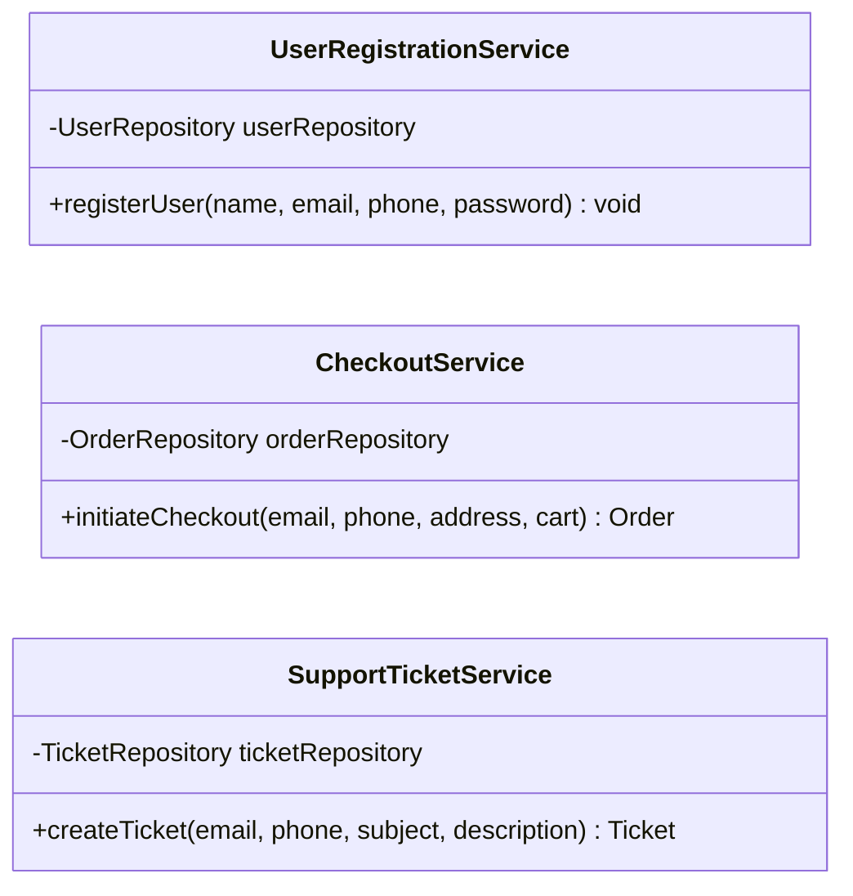
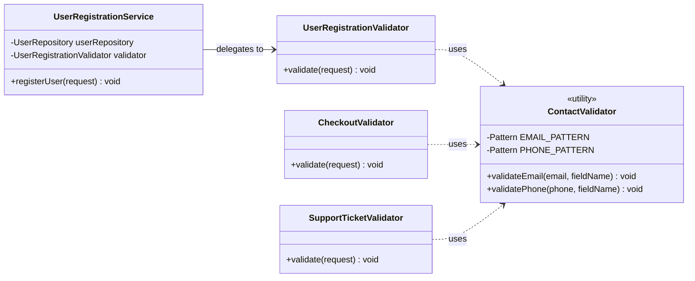

# Copy-Paste Programming Anti-Pattern

## Overview

Copy-Paste Programming, also called Code Cloning, is the practice of duplicating existing code blocks instead of abstracting shared logic into a reusable unit. It is perhaps the most seductive anti-pattern in software development: copying is fast, feels safe (you're starting from something that already works), and requires no upfront design thinking. But every copied block is a liability that multiplies over time. When a bug is found in the original, it must be hunted down and fixed in every copy — and copies are rarely tracked. When a requirement changes, every duplicate must be updated consistently. The WET principle (Write Everything Twice, or We Enjoy Typing) is the direct opposite of DRY (Don't Repeat Yourself), and its consequences compound with every release.

---

## Intuition

> **One-line analogy**: Copy-paste programming is like photocopying a contract and signing it separately — when the original changes, every copy becomes wrong, and you don't even know how many copies exist.

**Mental model**: You copy a validation function and make slight modifications for a second use case. Later: a bug in the validation logic must be found and fixed in both places. A requirement change needs to be applied to all copies. Over years, dozens of copies exist across the codebase; some have drifted; finding them all is archaeology. This is DRY violation in its most literal form.

**Why it matters**: Duplicated code means duplicated bugs and duplicated maintenance cost. Every bug found in one copy might exist in ten others. Every feature change needs to be applied ten times — and missing one is a bug. The multiplied maintenance cost makes systems increasingly expensive to change.

**Key insight**: The pattern is seductive because the first copy is quick and safe. The damage is cumulative — each additional copy seems harmless, but the effort per change scales with the number of copies while the odds of applying every change to every copy fall with each one added. Resist the first copy by extracting a shared function immediately.

---

## How to Spot It

**Warning Signs and Code Smells**

- Identical or near-identical blocks of code appearing in multiple classes or methods
- The same validation logic, transformation logic, or formatting logic re-implemented multiple times with minor surface differences
- Bug reports that keep recurring in different parts of the system with the same root cause
- A fix applied to one module that needs to be manually ported to 3 other modules
- Methods like `validateUserEmail()`, `checkEmailFormat()`, and `isEmailValid()` all doing the same thing in different service classes
- Long methods that differ from another long method only in the variable names used
- Copy-pasted error handling, logging patterns, or null-check idioms throughout the codebase
- Team members saying "I copied it from X class and changed the field names"
- Near-duplicate test setup code in every test class
- Configuration parsing logic duplicated across multiple entry points
- String formatting or date formatting code scattered in dozens of places

---

## Java Violation Example

```java
// Three service classes, each written at different times by different engineers.
// All three contain identical email and phone validation logic.
// Nobody noticed because the classes are in different packages.

// -------------------------------------------------------------------------
// Package: com.example.user
// -------------------------------------------------------------------------
public class UserRegistrationService {

    private final UserRepository userRepository;

    public UserRegistrationService(UserRepository userRepository) {
        this.userRepository = userRepository;
    }

    public void registerUser(String name, String email, String phone, String password) {

        // COPY-PASTED VALIDATION BLOCK #1
        // Originally written here, then copied to the other two services.
        if (email == null || email.trim().isEmpty()) {
            throw new IllegalArgumentException("Email cannot be empty");
        }
        if (!email.matches("^[A-Za-z0-9+_.-]+@[A-Za-z0-9.-]+\\.[A-Za-z]{2,}$")) {
            throw new IllegalArgumentException("Invalid email format");
        }
        if (phone == null || phone.trim().isEmpty()) {
            throw new IllegalArgumentException("Phone cannot be empty");
        }
        // BUG: phone regex does not allow international format (+1-800-555-1234)
        // This bug exists in all three copies — fixed in UserRegistrationService in v2.3
        // but the fix was never propagated to CheckoutService or SupportTicketService
        if (!phone.matches("^[0-9]{10}$")) {
            throw new IllegalArgumentException("Phone must be 10 digits");
        }
        if (password == null || password.length() < 8) {
            throw new IllegalArgumentException("Password must be at least 8 characters");
        }

        // ... actual registration logic
        User user = new User(name, email, phone, password);
        userRepository.save(user);
    }
}

// -------------------------------------------------------------------------
// Package: com.example.checkout
// -------------------------------------------------------------------------
public class CheckoutService {

    private final OrderRepository orderRepository;

    public CheckoutService(OrderRepository orderRepository) {
        this.orderRepository = orderRepository;
    }

    public Order initiateCheckout(String customerEmail, String customerPhone,
                                   String billingAddress, CartSummary cart) {

        // COPY-PASTED VALIDATION BLOCK #2
        // Copied from UserRegistrationService 6 months later.
        // The phone regex bug was fixed in UserRegistrationService by then,
        // but this engineer copied from the old version in their IDE cache.
        if (customerEmail == null || customerEmail.trim().isEmpty()) {
            throw new IllegalArgumentException("Email cannot be empty");
        }
        if (!customerEmail.matches("^[A-Za-z0-9+_.-]+@[A-Za-z0-9.-]+\\.[A-Za-z]{2,}$")) {
            throw new IllegalArgumentException("Invalid email format");
        }
        if (customerPhone == null || customerPhone.trim().isEmpty()) {
            throw new IllegalArgumentException("Phone cannot be empty");
        }
        // BUG STILL PRESENT: this copy was taken before the fix was applied
        if (!customerPhone.matches("^[0-9]{10}$")) {
            throw new IllegalArgumentException("Phone must be 10 digits");
        }

        // Additional checkout-specific validation (slightly different, which makes
        // deduplication harder to notice at a glance)
        if (billingAddress == null || billingAddress.trim().isEmpty()) {
            throw new IllegalArgumentException("Billing address is required");
        }
        if (cart == null || cart.getItems().isEmpty()) {
            throw new IllegalArgumentException("Cart cannot be empty");
        }

        // ... checkout logic
        return orderRepository.createFromCart(customerEmail, billingAddress, cart);
    }
}

// -------------------------------------------------------------------------
// Package: com.example.support
// -------------------------------------------------------------------------
public class SupportTicketService {

    private final TicketRepository ticketRepository;

    public SupportTicketService(TicketRepository ticketRepository) {
        this.ticketRepository = ticketRepository;
    }

    public Ticket createTicket(String reporterEmail, String reporterPhone,
                                String subject, String description) {

        // COPY-PASTED VALIDATION BLOCK #3
        // Copied from CheckoutService 3 months after CheckoutService was written.
        // Still has the original phone regex bug.
        // Email regex was "updated" by a well-meaning engineer to fix a slightly
        // different edge case, so now the email regex is DIFFERENT from the other two.
        // Three classes, three different validation behaviours — all appearing identical.
        if (reporterEmail == null || reporterEmail.trim().isEmpty()) {
            throw new IllegalArgumentException("Email cannot be empty");
        }
        // DIVERGED: this regex was slightly modified, now rejects some valid emails
        // that the other two services accept
        if (!reporterEmail.matches("^[A-Za-z0-9._-]+@[A-Za-z0-9.-]+\\.[A-Za-z]{2,6}$")) {
            throw new IllegalArgumentException("Invalid email format");
        }
        if (reporterPhone == null || reporterPhone.trim().isEmpty()) {
            throw new IllegalArgumentException("Phone cannot be empty");
        }
        // BUG STILL PRESENT — same original buggy regex
        if (!reporterPhone.matches("^[0-9]{10}$")) {
            throw new IllegalArgumentException("Phone must be 10 digits");
        }
        if (subject == null || subject.trim().isEmpty()) {
            throw new IllegalArgumentException("Subject is required");
        }

        // ... ticket creation logic
        return ticketRepository.save(new Ticket(reporterEmail, reporterPhone, subject, description));
    }
}
```

**What is wrong with this code:**
- Email and phone validation logic is duplicated in 3 service classes across 3 packages
- A phone regex bug was fixed in one copy but not the other two — users with valid international numbers are rejected at checkout and support but accepted at registration
- The email regex has silently diverged in `SupportTicketService` — valid emails are now rejected only when creating support tickets
- Any future change to validation rules (e.g., supporting new TLDs, allowing plus-addressing in emails) must be applied to 3 files with no guarantee all 3 will be updated
- There is no single source of truth for what a valid email or phone number means in this system

The class diagram below makes the duplication concrete: three classes in three different packages, no shared type between them, each holding its own inline copy of the same email and phone validation rules that have since drifted apart.



---

## Why It's Harmful

**Inconsistent Bug Fixes**
When a bug is discovered in duplicated code, it is typically fixed in the file that was reported. The developer may not know (or may forget) that the same logic exists in 2 other places. The bug "disappears" from one module and silently persists in others.

**Multiplied Maintenance Cost**
With N copies of logic, every change costs N times the effort — the cost is linear in the number of copies, and that alone is bad enough. What is worse than linear is the *reliability* of the change: each copy is an independent chance to be missed, so with 3 copies the change is usually applied everywhere, and with 30 copies scattered across a large codebase it almost never is. Teams often give up and leave duplicates inconsistent.

**Silent Divergence**
Copies evolve independently over time. Well-intentioned modifications in one copy introduce behavioral differences that are never explicitly decided — they simply drift. The system now has multiple conflicting definitions of the same concept.

**Increased Code Volume**
More code means more to read, more to compile, more to cover with tests, and more surface area for bugs. Code volume is not value — it is cost.

**Impossible to Reason About**
When validation logic is spread across 10 service classes, it is impossible to answer the question: "What is the current definition of a valid email address in our system?" The answer might be 4 different things simultaneously.

**Test Duplication**
If the implementation is duplicated, tests must also be duplicated. Test suites bloat, test maintenance costs grow, and tests covering identical code paths provide false confidence — a bug in the shared logic will fail all copies simultaneously.

---

## Refactored Solution

```java
// -------------------------------------------------------------------------
// Shared utility class — single source of truth for contact validation
// -------------------------------------------------------------------------

/**
 * ContactValidator encapsulates all validation rules for contact information.
 * This is the single authoritative definition of valid email and phone formats.
 *
 * All services requiring contact validation MUST use this class.
 * Do not inline these regex patterns elsewhere in the codebase.
 */
public final class ContactValidator {

    // Private constructor — utility class, not instantiable
    private ContactValidator() {}

    // Single regex definition — update here to affect ALL services uniformly
    private static final Pattern EMAIL_PATTERN =
        Pattern.compile("^[A-Za-z0-9+_.-]+@[A-Za-z0-9.-]+\\.[A-Za-z]{2,}$");

    // Fixed: supports international format and common formatting patterns
    private static final Pattern PHONE_PATTERN =
        Pattern.compile("^(\\+?[1-9]\\d{0,2}[-.\\s]?)?(\\(?[0-9]{3}\\)?[-.\\s]?[0-9]{3}[-.\\s]?[0-9]{4})$");

    public static void validateEmail(String email, String fieldName) {
        if (email == null || email.trim().isEmpty()) {
            throw new ValidationException(fieldName + " cannot be empty");
        }
        if (!EMAIL_PATTERN.matcher(email.trim()).matches()) {
            throw new ValidationException(fieldName + " has an invalid format: " + email);
        }
    }

    public static void validatePhone(String phone, String fieldName) {
        if (phone == null || phone.trim().isEmpty()) {
            throw new ValidationException(fieldName + " cannot be empty");
        }
        if (!PHONE_PATTERN.matcher(phone.trim()).matches()) {
            throw new ValidationException(fieldName + " has an invalid format: " + phone);
        }
    }
}

// -------------------------------------------------------------------------
// Focused request validator using the shared utility
// -------------------------------------------------------------------------

public class UserRegistrationValidator {
    public void validate(UserRegistrationRequest request) {
        ContactValidator.validateEmail(request.getEmail(), "Email");
        ContactValidator.validatePhone(request.getPhone(), "Phone");
        if (request.getPassword() == null || request.getPassword().length() < 8) {
            throw new ValidationException("Password must be at least 8 characters");
        }
    }
}

public class CheckoutValidator {
    public void validate(CheckoutRequest request) {
        ContactValidator.validateEmail(request.getCustomerEmail(), "Customer email");
        ContactValidator.validatePhone(request.getCustomerPhone(), "Customer phone");
        if (request.getBillingAddress() == null || request.getBillingAddress().isBlank()) {
            throw new ValidationException("Billing address is required");
        }
        if (request.getCart() == null || request.getCart().getItems().isEmpty()) {
            throw new ValidationException("Cart cannot be empty");
        }
    }
}

public class SupportTicketValidator {
    public void validate(SupportTicketRequest request) {
        ContactValidator.validateEmail(request.getReporterEmail(), "Reporter email");
        ContactValidator.validatePhone(request.getReporterPhone(), "Reporter phone");
        if (request.getSubject() == null || request.getSubject().isBlank()) {
            throw new ValidationException("Subject is required");
        }
    }
}

// -------------------------------------------------------------------------
// Clean service — delegates validation, focuses on business logic
// -------------------------------------------------------------------------

public class UserRegistrationService {

    private final UserRepository userRepository;
    private final UserRegistrationValidator validator;

    public UserRegistrationService(UserRepository userRepository,
                                    UserRegistrationValidator validator) {
        this.userRepository = userRepository;
        this.validator = validator;
    }

    public void registerUser(UserRegistrationRequest request) {
        validator.validate(request);  // all validation in one place
        userRepository.save(User.from(request));
    }
}
```

The class diagram below shows the fix as a shape: one `ContactValidator` that every request-specific validator depends on, so a single regex fix now reaches all three request paths at once.



**Alternative: Template Method Pattern for shared workflow structure**

```java
// When multiple services share the same processing workflow with step-specific variations,
// Template Method eliminates the duplicated skeleton while allowing customization.

public abstract class ContactFormProcessor<T extends ContactRequest, R> {

    // Template method — defines the invariant workflow
    public final R process(T request) {
        validateContact(request);          // shared: uses ContactValidator
        validateBusinessRules(request);    // hook: subclass-specific
        return execute(request);           // hook: subclass-specific
    }

    protected void validateContact(T request) {
        ContactValidator.validateEmail(request.getEmail(), "Email");
        ContactValidator.validatePhone(request.getPhone(), "Phone");
    }

    protected abstract void validateBusinessRules(T request);
    protected abstract R execute(T request);
}

public class UserRegistrationProcessor
        extends ContactFormProcessor<UserRegistrationRequest, User> {

    private final UserRepository userRepository;

    public UserRegistrationProcessor(UserRepository userRepository) {
        this.userRepository = userRepository;
    }

    @Override
    protected void validateBusinessRules(UserRegistrationRequest request) {
        if (request.getPassword().length() < 8) {
            throw new ValidationException("Password too short");
        }
    }

    @Override
    protected User execute(UserRegistrationRequest request) {
        return userRepository.save(User.from(request));
    }
}
```

---

## Prevention Strategies

**1. Follow the DRY Principle as a First Principle**
Before writing any logic, ask: "Does this concept already exist somewhere in the codebase?" Use your IDE's global search before reaching for copy-paste.

**2. Create Shared Utility Modules Early**
Establish `common`, `shared-utils`, or `core` modules at the start of a project. Validation logic, formatting, date handling, and string utilities belong there from day one.

**3. Use IDE Clone Detection**
IntelliJ IDEA has built-in duplicate code detection (Analyze > Locate Duplicates). Use it before major releases. SonarQube's CPD (Copy-Paste Detector) can be run in CI.

```bash
# Run SonarQube CPD analysis
sonar-scanner \
  -Dsonar.projectKey=myproject \
  -Dsonar.cpd.exclusions=**/generated/**
```

**4. Enforce DRY in Code Review**
Make "I recognize this logic from another class — it should be extracted" a valid and expected code review comment. Normalize the review question: "Is this the first time this logic is written?"

**5. Refactor on the Third Repetition (Rule of Three)**
The first time you write something, write it. The second time, note the duplication. The third time, refactor. This is the classic "Rule of Three" heuristic.

**6. Test the Shared Abstraction, Not the Copies**
With `ContactValidator` as a shared class, write one comprehensive test suite for it. Services that use it do not need to re-test email and phone validation — they only test their own additional rules.

**7. Use Linters to Detect Structural Duplication**
PMD's CPD tool can detect copy-paste duplication across token counts:
```bash
pmd cpd --minimum-tokens 50 --files src/main/java --language java
```

---

## Cross-Perspective: HLD Connections

**HLD View — Where Copy-Paste Programming Appears in Distributed Systems**

- **Duplicated service logic** — Each microservice independently implements JWT validation, request logging, retry logic, and health check endpoints instead of using a shared library. When a security vulnerability is found in the JWT library version, it must be patched across 15 services separately.
- **Copy-pasted Terraform modules** — Infrastructure configuration is duplicated across environments (dev, staging, prod) rather than using parameterized modules. A security group rule fix must be applied in 12 places; inevitably one environment is missed.
- **Copy-pasted Docker base images** — Services copy-paste Dockerfile layers rather than inheriting from a shared base image. OS-level CVEs require patching each service's Dockerfile individually instead of updating one base image.
- **Duplicated API error handling** — Each service independently implements error response formatting, retry headers, and rate-limit response codes. The result: inconsistent behavior across the API surface that clients must handle case-by-case.

---

## Real-World Consequences

*The four scenarios below are illustrative composites of common incident patterns, not reports of specific named public incidents. The numbers show the shape of the failure; treat them as worked examples rather than as citable industry statistics.*

**Scenario 1: The Recurring Security Vulnerability**
A security team discovered that input sanitization logic had been copy-pasted across 14 REST controllers in a web application. A SQL injection vulnerability was found and patched in the user login controller. The patch was applied to 3 of the 14 controllers. The remaining 11 stayed vulnerable for 8 months until the next security audit, despite the team believing the issue had been fixed.

**Scenario 2: The Date Formatting Incident**
An e-commerce company had date formatting logic duplicated in 23 places. When the business decided to support a new locale (with a different date format), engineers found 23 locations to update, missed 7 of them, and shipped an inconsistent user experience where some pages showed dates in the correct format and others did not. Customer support received hundreds of tickets about "wrong dates" on invoices.

**Scenario 3: The Regulatory Compliance Failure**
A financial services firm was required by a regulator to update its data retention policy. The deletion logic was copy-pasted across 9 data management classes. Engineers updated 7. Two classes continued to retain data beyond the legal limit. The firm received a regulatory fine and had to conduct a full codebase audit.

**Scenario 4: The Failed Refactor**
A team decided to consolidate duplicated business logic across 8 services into a shared library. Because the 8 copies had silently diverged over 3 years, "consolidation" required a 6-week investigation to determine the authoritative behavior for 47 cases where the copies disagreed. The project cost more than 4x the original estimate and produced 3 production incidents during rollout.

---

## Interview Questions with Answers

**Q: When is copy-paste actually the right call?**
**Short:** For a genuinely one-off, first occurrence of logic, before a second use case reveals what should actually be shared.
The first time a piece of logic is written, writing it directly — even if you copy a similar block as a starting point and adapt it — is reasonable, since abstracting shared behavior prematurely can produce a wrong abstraction that doesn't fit the eventual real requirements. The Rule of Three heuristic captures this: the first occurrence, write it; the second, note the duplication but don't necessarily act yet; the third, refactor. Copy-paste is the wrong call specifically once a third near-identical copy appears, at which point the duplication is a confirmed pattern rather than a coincidence.

**Q: What is the WET principle, and how does it contrast with DRY?**
**Short:** WET ("Write Everything Twice"/"We Enjoy Typing") is the direct opposite of DRY, tolerating duplicated logic across the codebase.
DRY (Don't Repeat Yourself) says every piece of knowledge should have a single, authoritative representation in a system. WET code is the opposite: the same logic — like email and phone validation — is independently reimplemented in `UserRegistrationService`, `CheckoutService`, and `SupportTicketService` in this file's example, each with slightly different regex patterns that have silently diverged. The name is a deliberately ironic backronym, since "We Enjoy Typing" is obviously not actually a goal — it names the failure mode people fall into, not an endorsed practice.

**Q: In the example, why did the same phone-validation bug persist in two of three services after being fixed in one?**
**Short:** The fix was applied where the bug was reported, and the engineer had no way of knowing (or forgot) the logic was duplicated elsewhere.
The phone regex bug was fixed in `UserRegistrationService` v2.3, but `CheckoutService` had copied the validation block six months earlier from an IDE cache that predated the fix, and `SupportTicketService` copied from `CheckoutService` three months after that — carrying the bug forward a second time. Because there was no single source of truth for "what does phone validation mean," nobody could confirm the fix had propagated everywhere it needed to, and the bug silently persisted in two of the three services for the full duration until the next audit.

**Q: How did the email validation regex "diverge" across the three service classes even though all three started from the same copy?**
**Short:** A well-intentioned edge-case fix in one copy, made independently, produced a third distinct validation behavior nobody decided on.
`SupportTicketService`'s email regex was modified by an engineer trying to fix a slightly different edge case, producing a validation pattern that is now different from both `UserRegistrationService`'s and `CheckoutService`'s — three classes now enforce three different definitions of "valid email," none of which was a deliberate, reviewed decision. This illustrates that duplication doesn't stay static; each copy evolves independently over time as engineers make locally reasonable changes that create divergence nobody explicitly chose.

**Q: How does the maintenance cost of copy-pasted logic scale with the number of copies?**
**Short:** Cost is linear in copies, but reliability of applying every fix everywhere degrades faster than linearly as copies grow.
With N copies of logic, every change costs roughly N times the effort just to make the edits — that alone is already bad. What's worse is reliability: each copy represents an independent chance to be missed during a change, so with 3 copies a change is usually applied everywhere, but with 30 copies scattered through a large codebase it is very unlikely to be applied everywhere, and teams often give up and leave duplicates permanently inconsistent. The practical cost isn't just multiplied effort — it's the near-certainty that large numbers of copies will eventually disagree with each other.

**Q: What is the fix for the three-service duplicated-validation example, concretely?**
**Short:** Extract a single ContactValidator utility class that all three services depend on for email and phone rules.
`ContactValidator` becomes the single authoritative definition of valid email and phone formats, with static `validateEmail()` and `validatePhone()` methods backed by one `Pattern` each — updating the regex here affects all consumers uniformly. Each service then gets a focused `*Validator` class (`UserRegistrationValidator`, `CheckoutValidator`, `SupportTicketValidator`) that delegates the shared contact checks to `ContactValidator` and only implements its own service-specific rules (password length, billing address, cart non-emptiness), so a single fix now reaches all three request paths simultaneously.

**Q: What is Template Method offering as an alternative fix, beyond what a shared utility class provides?**
**Short:** It eliminates a duplicated processing workflow's skeleton, not just a shared validation rule, while still allowing per-service steps.
Where `ContactValidator` deduplicates one shared validation rule, `ContactFormProcessor<T, R>`'s Template Method deduplicates an entire shared *workflow shape* — validate contact info, then validate business rules, then execute — while letting each subclass (`UserRegistrationProcessor`) override only the steps that genuinely differ (`validateBusinessRules()`, `execute()`). This is the right tool when multiple services share not just one piece of logic but an entire multi-step sequence with only some steps varying, which a single utility method can't capture on its own.

**Q: How do IntelliJ's duplicate detector and SonarQube's CPD differ from linting for style violations?**
**Short:** They detect structural/token-level duplication across files, not style violations — finding copies a linter would miss entirely.
IntelliJ's built-in Analyze > Locate Duplicates and SonarQube's Copy-Paste Detector (CPD) work by comparing token sequences across the codebase to find blocks of code that are identical or near-identical in structure, even if variable names differ — this is a fundamentally different check than style linting, which only flags formatting or naming convention violations within a single file. PMD's CPD tool (`pmd cpd --minimum-tokens 50`) works the same way and can be run in CI to fail a build when duplication exceeds a token threshold, catching exactly the kind of three-way validation duplication in this file's example before it ships.

**Q: Why does copy-pasted test setup code create "false confidence"?**
**Short:** A bug in the shared logic under test will fail all the duplicated test copies simultaneously, without adding any real coverage confidence.
If the implementation is duplicated across three services, the corresponding tests are typically duplicated too — three near-identical test classes verifying near-identical logic. This inflates the test count and gives the impression of thorough coverage, but a bug in the shared underlying logic (like the phone regex bug) fails all three test copies at once rather than being caught by any single one in isolation before the others ship the same defect. Testing the shared `ContactValidator` abstraction once, instead of testing three copies of the logic it replaces, gives equivalent or better real coverage with far less test code.

**Q: What is the "Regulatory Compliance Failure" scenario in this file, and what does it illustrate about copy-paste risk?**
**Short:** Deletion logic copy-pasted across nine classes meant an update reached only seven, leaving two in violation of a regulator's retention policy.
A financial firm's data retention policy update required changing deletion logic that had been copy-pasted across nine data management classes; engineers updated seven, and two classes continued retaining data beyond the legal limit, resulting in a regulatory fine and a full codebase audit. This illustrates that copy-paste risk isn't purely a maintainability inconvenience — when the duplicated logic is compliance-critical, a missed copy has direct legal and financial consequences, not just engineering overhead.

**Q: Why did consolidating 8 years of duplicated business logic into a shared library cost 4x the original estimate in the "Failed Refactor" scenario?**
**Short:** Three years of independent drift meant the eight copies disagreed in 47 cases, each requiring investigation to determine correct behavior.
Because the 8 copies had silently diverged over 3 years of independent, uncoordinated edits, "consolidation" wasn't simply "delete 7 copies and keep 1" — it required a 6-week investigation to determine, for 47 cases where the copies disagreed, which behavior was actually correct. This shows why prevention (extracting shared logic before divergence accumulates) is far cheaper than remediation: the cost of consolidating N drifted copies grows with how long they've been allowed to diverge, not just with how many copies exist.

**Q: How does copy-pasted infrastructure code (Terraform, Dockerfiles) mirror application-level copy-paste at the HLD level?**
**Short:** Duplicated Terraform modules or Dockerfile layers across environments mean a security fix must be applied in every copy, and one is inevitably missed.
Infrastructure configuration duplicated across dev, staging, and prod (rather than parameterized modules) means a security group rule fix must be applied in a dozen places, with the same "at least one gets missed" dynamic as application code. Copy-pasted Dockerfile layers instead of a shared base image mean OS-level CVEs require patching each service's Dockerfile individually rather than updating one base image — the exact same DRY-violation shape, just at the infrastructure-as-code layer instead of the application layer.

**Q: What review-culture change does this file recommend to normalize catching copy-paste before merge?**
**Short:** Make "I recognize this logic from another class — it should be extracted" a normal, expected code review comment.
Rather than relying solely on automated CPD tooling, the file recommends normalizing a specific reviewer question during code review: "Is this the first time this logic is written?" Treating recognition of duplicated logic as a legitimate and expected review comment — on par with flagging a bug — catches copies at the moment they're introduced, before they've had time to diverge into three separately-buggy versions the way the file's motivating example did.

**Q: How does "Duplicated API error handling" across microservices create a client-facing problem, not just an internal one?**
**Short:** Each service independently formats errors, retry headers, and rate-limit codes, producing inconsistent behavior clients must handle case-by-case.
When each microservice independently implements its own error response formatting, retry headers, and rate-limit response codes instead of sharing a common library, the API surface as a whole becomes inconsistent — a client integrating with five services may need five different error-parsing code paths instead of one. This is copy-paste's cost surfacing externally: the duplication isn't just an internal maintenance burden, it directly degrades the experience of everyone consuming the API, since inconsistent behavior across services is a symptom clients feel directly rather than one confined to the codebase.

**Q: Why is "the same logic reimplemented with different method names" harder to catch than exact copy-paste?**
**Short:** validateUserEmail(), checkEmailFormat(), and isEmailValid() doing the same thing hide their duplication behind different names.
When three service classes each write their own email-checking method under a different name, neither a simple text search nor a casual code review reveals that they're duplicates — you have to actually read and compare the implementations to notice the overlap. Token-based clone detectors like SonarQube's CPD or PMD's CPD still catch this, because they compare the structure of the logic itself rather than relying on identical names, which is exactly why running clone detection in CI matters more than trusting reviewers to spot renamed duplicates by eye.

## Quick Reference Summary

| Dimension | Details |
|---|---|
| **Anti-Pattern Name** | Copy-Paste Programming / Code Cloning |
| **Also Known As** | WET Code, Shotgun Surgery target, DRY violation |
| **Root Cause** | Convenience, lack of shared abstractions, time pressure, insufficient design thinking |
| **Primary Symptom** | Identical or near-identical logic blocks in multiple locations with no shared abstraction |
| **Key Code Smells** | Same validation/formatting logic in multiple classes, "fixed in one place not others" bug pattern, diverged regex definitions |
| **Main Harm** | Inconsistent bug fixes, diverging behavior, maintenance cost multiplied by copy count, security gaps |
| **Detection Tools** | IntelliJ Duplicate Code detector, SonarQube CPD, PMD CPD |
| **Fix Strategy** | Extract to shared utility class, apply Template Method or Strategy pattern, create common base class |
| **Prevention** | DRY principle, Rule of Three, shared utility modules, clone detection in CI |
| **Effort to Fix** | Medium — straightforward extraction, but diverged copies require careful reconciliation |
