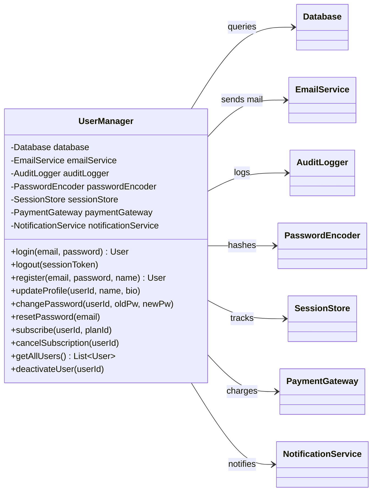
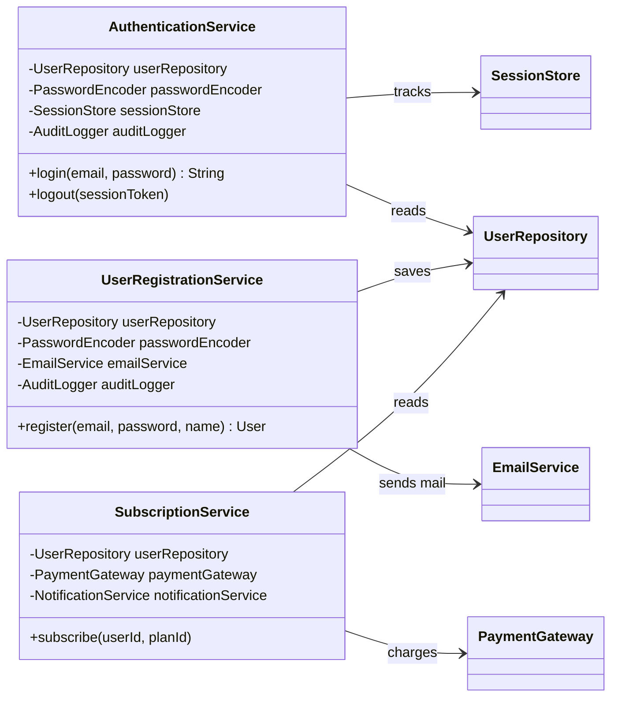

# Anti-Pattern: God Object (God Class)
## What It Is

The God Object anti-pattern occurs when a single class takes on too many responsibilities — it "knows too much" or "does too much." The class becomes the central hub of an application, with most other classes depending on it or delegating work to it.

Named after the concept of an omniscient, omnipotent entity, a God Object accumulates responsibilities over time until it becomes impossible to understand, test, or modify in isolation.

Also known as: Blob, All-Knowing Object, Master Class.

---

## Intuition

> **One-line analogy**: A God Object is like a Swiss Army knife that tries to be a knife, scissors, saw, screwdriver, and GPS simultaneously — none of those functions is as good as a dedicated tool, and the whole thing is unwieldy.

**Mental model**: Classes that accumulate responsibilities over time become impossible to understand, test, or change. When a `Manager` class grows to 2000 lines with 50 methods covering user auth, email sending, database queries, and file uploads — changing user auth requires understanding email code, and fixing a bug might break uploads. Everything depends on this class, creating a coupling nightmare.

**Why it matters**: God Objects are the most common cause of "developer fear" — the fear that touching any part of the codebase will break something unrelated. They make testing nearly impossible (too many dependencies to mock) and onboarding nightmarish (can't understand one piece without understanding the whole).

**Key insight**: God Objects don't start that way — they accumulate over time through "just add it here" shortcuts. The fix is decomposition: identify distinct responsibilities, extract cohesive groups of methods and their related fields into separate classes, then wire them together.

---

## How to Recognize It

**Code smells:**
- Class has hundreds or thousands of lines of code
- Class has more than 10-15 methods
- Class name is vague: `Manager`, `Handler`, `Controller`, `Processor`, `Utils`, `Helper`
- Nearly every other class depends on this one
- The class has fields that are only used by a subset of its methods
- Unit testing this class requires an enormous setup

**Example — The Anti-Pattern:**

```java
// God Object: UserManager does everything related to users
public class UserManager {

    private Database database;
    private EmailService emailService;
    private AuditLogger auditLogger;
    private PasswordEncoder passwordEncoder;
    private SessionStore sessionStore;
    private PaymentGateway paymentGateway;
    private NotificationService notificationService;

    // Authentication
    public User login(String email, String password) {
        User user = database.findByEmail(email);
        if (user == null || !passwordEncoder.matches(password, user.getPasswordHash())) {
            auditLogger.log("Failed login: " + email);
            throw new AuthException("Invalid credentials");
        }
        String sessionToken = UUID.randomUUID().toString();
        sessionStore.put(sessionToken, user.getId());
        auditLogger.log("Login: " + user.getId());
        return user;
    }

    public void logout(String sessionToken) {
        Long userId = sessionStore.remove(sessionToken);
        auditLogger.log("Logout: " + userId);
    }

    // Registration
    public User register(String email, String password, String name) {
        if (database.existsByEmail(email)) {
            throw new ValidationException("Email already in use");
        }
        User user = new User();
        user.setEmail(email);
        user.setName(name);
        user.setPasswordHash(passwordEncoder.encode(password));
        database.save(user);
        emailService.sendWelcomeEmail(user);
        auditLogger.log("Registered: " + email);
        return user;
    }

    // Profile management
    public void updateProfile(Long userId, String name, String bio) {
        User user = database.findById(userId);
        user.setName(name);
        user.setBio(bio);
        database.save(user);
    }

    // Password management
    public void changePassword(Long userId, String oldPw, String newPw) {
        User user = database.findById(userId);
        if (!passwordEncoder.matches(oldPw, user.getPasswordHash())) {
            throw new AuthException("Wrong password");
        }
        user.setPasswordHash(passwordEncoder.encode(newPw));
        database.save(user);
        emailService.sendPasswordChangedEmail(user);
    }

    public void resetPassword(String email) {
        User user = database.findByEmail(email);
        String token = UUID.randomUUID().toString();
        database.saveResetToken(user.getId(), token);
        emailService.sendPasswordResetEmail(user, token);
    }

    // Subscription / payments
    public void subscribe(Long userId, String planId) {
        User user = database.findById(userId);
        paymentGateway.chargeMonthly(user.getPaymentMethodId(), planId);
        user.setPlanId(planId);
        database.save(user);
        notificationService.notify(userId, "Subscription activated");
    }

    public void cancelSubscription(Long userId) {
        User user = database.findById(userId);
        paymentGateway.cancelSubscription(user.getSubscriptionId());
        user.setPlanId(null);
        database.save(user);
    }

    // Admin
    public List<User> getAllUsers() {
        return database.findAll();
    }

    public void deactivateUser(Long userId) {
        User user = database.findById(userId);
        user.setActive(false);
        database.save(user);
        auditLogger.log("Deactivated: " + userId);
    }

    // ... 20 more methods
}
```

This single class is responsible for authentication, session management, registration, profile management, password management, payments, notifications, and admin operations. It holds 7 collaborators as fields — `Database`, `EmailService`, `AuditLogger`, `PasswordEncoder`, `SessionStore`, `PaymentGateway`, `NotificationService` — and every one of them has to be stood up before any single method can be exercised.

The class diagram below makes the hub-and-spoke shape concrete: one `UserManager` wired directly to every collaborator it needs, carrying auth, registration, profile, password, payment, and admin logic as its own methods.



---

## Why It Happens

1. **Incremental growth**: The class starts small and reasonable. Features are added one at a time, and it is "easier" to add to the existing class than create a new one.
2. **Lack of up-front design**: No clear responsibility boundaries were established early.
3. **Fear of creating new files**: Some developers avoid creating new classes/files unnecessarily.
4. **Single developer ownership**: One person builds everything and keeps it all in one place for convenience.
5. **Deadline pressure**: "We'll refactor later" never comes.

---

## Why It's Harmful

1. **Violates SRP**: The class has many reasons to change. A payment bug forces changes in the same file as authentication logic.
2. **Tight coupling**: All callers depend on a single type, making substitution or mocking in tests very hard.
3. **Testing nightmare**: Setting up a unit test for `login()` requires standing up all 7 collaborators, even though `login()` itself touches only 4 of them.
4. **Merge conflicts**: Multiple developers editing the same large file creates constant conflicts.
5. **Cognitive overload**: Nobody can hold the entire class in their head at once.
6. **Impossible to reuse**: The class is too intertwined to extract a subset of its logic.

---

## How to Fix It

Apply the **Single Responsibility Principle**: each class should have one reason to change. Decompose the God Object into focused, cohesive classes.

```java
// Focused service: only handles authentication
public class AuthenticationService {

    private final UserRepository userRepository;
    private final PasswordEncoder passwordEncoder;
    private final SessionStore sessionStore;
    private final AuditLogger auditLogger;

    public AuthenticationService(UserRepository userRepository,
                                  PasswordEncoder passwordEncoder,
                                  SessionStore sessionStore,
                                  AuditLogger auditLogger) {
        this.userRepository = userRepository;
        this.passwordEncoder = passwordEncoder;
        this.sessionStore = sessionStore;
        this.auditLogger = auditLogger;
    }

    public String login(String email, String password) {
        User user = userRepository.findByEmail(email)
            .orElseThrow(() -> new AuthException("Invalid credentials"));

        if (!passwordEncoder.matches(password, user.getPasswordHash())) {
            auditLogger.log("Failed login: " + email);
            throw new AuthException("Invalid credentials");
        }

        String token = UUID.randomUUID().toString();
        sessionStore.put(token, user.getId());
        auditLogger.log("Login: " + user.getId());
        return token;
    }

    public void logout(String sessionToken) {
        Long userId = sessionStore.remove(sessionToken);
        auditLogger.log("Logout: " + userId);
    }
}

// Focused service: only handles user registration
public class UserRegistrationService {

    private final UserRepository userRepository;
    private final PasswordEncoder passwordEncoder;
    private final EmailService emailService;
    private final AuditLogger auditLogger;

    public UserRegistrationService(UserRepository userRepository,
                                   PasswordEncoder passwordEncoder,
                                   EmailService emailService,
                                   AuditLogger auditLogger) {
        this.userRepository = userRepository;
        this.passwordEncoder = passwordEncoder;
        this.emailService = emailService;
        this.auditLogger = auditLogger;
    }

    public User register(String email, String password, String name) {
        if (userRepository.existsByEmail(email)) {
            throw new ValidationException("Email already in use");
        }
        User user = User.create(email, name, passwordEncoder.encode(password));
        userRepository.save(user);
        emailService.sendWelcomeEmail(user);
        auditLogger.log("Registered: " + email);
        return user;
    }
}

// Focused service: only handles subscriptions
public class SubscriptionService {

    private final UserRepository userRepository;
    private final PaymentGateway paymentGateway;
    private final NotificationService notificationService;

    public SubscriptionService(UserRepository userRepository,
                               PaymentGateway paymentGateway,
                               NotificationService notificationService) {
        this.userRepository = userRepository;
        this.paymentGateway = paymentGateway;
        this.notificationService = notificationService;
    }

    public void subscribe(Long userId, String planId) {
        User user = userRepository.findById(userId)
            .orElseThrow(() -> new NotFoundException("User not found"));
        paymentGateway.chargeMonthly(user.getPaymentMethodId(), planId);
        user.setPlanId(planId);
        userRepository.save(user);
        notificationService.notify(userId, "Subscription activated");
    }
}
```

Same collaborators, redistributed: each service now owns a small, focused slice of the dependency graph instead of all of it, so a payment bug can no longer force a change to authentication code.



Each service now:
- Has a single clear responsibility
- Has fewer dependencies
- Can be tested in complete isolation
- Can be modified without affecting unrelated logic

---

## Real-World Examples

- **Legacy monolith controllers**: Spring MVC controllers that contain business logic, DB queries, and email sending all in one method.
- **Android Activity classes**: Android activities that manage UI, network calls, database access, and business rules — a common anti-pattern in early Android development.
- **`ApplicationContext` classes**: A single context object passed everywhere that holds global state and provides utility methods.
- **`Utils` or `Helper` classes**: Static utility classes that grow to contain hundreds of unrelated methods.

---

## Prevention Strategies

1. **Apply SRP from the start**: Before writing a method, ask "does this belong in this class?"
2. **Name classes with precision**: If you can't name a class without using "Manager" or "Handler", it may be doing too much.
3. **Set line-count soft limits**: Classes over 200-300 lines should trigger a review.
4. **Domain-driven decomposition**: Align classes with domain concepts — `AuthenticationService`, `SubscriptionService`, `ProfileService`.
5. **Package by feature, not by layer**: Grouping by feature encourages cohesive, focused classes.
6. **Code reviews**: Reviewers should flag new methods being added to already-large classes.

---

## Cross-Perspective: HLD Connections

**HLD View — Where God Object Appears in Distributed Systems**

- **The monolith anti-pattern** — A monolith is the system-level God Object: one codebase and one deployment unit that handles every concern. It starts manageable and grows until changes in one area routinely break unrelated areas — the same failure mode as a God class, one scale larger.
- **The God service** — In a nominally microservice system, a "God service" emerges when all other services depend on one central service for most operations. It becomes a single point of failure, a deployment bottleneck, and an on-call nightmare.
- **The fat API gateway** — When an API gateway starts containing business logic, data transformation, and orchestration logic beyond routing and auth, it becomes a God Gateway. Changes to any business flow require modifying one central component.
- **Diagnostic signal** — If one service or component is in the critical path of every user request across the system, it is probably a God Object at the HLD level. The fix is the same as at LLD: decompose along single-responsibility boundaries.

---

## Interview Questions with Answers

**Q: What is a God Object and why is the name apt?**
**Short:** A God Object is a single class that accumulates so many responsibilities it becomes the omniscient hub everything depends on.
It is a class that "knows too much" or "does too much" — it becomes the central hub of an application, with most other classes depending on it or delegating work to it. The name comes from the idea of an omniscient, omnipotent entity, since the class ends up touching nearly every concern in the system. `UserManager` in the example holds seven collaborators (`Database`, `EmailService`, `AuditLogger`, `PasswordEncoder`, `SessionStore`, `PaymentGateway`, `NotificationService`) and methods spanning auth, registration, profile, payments, and admin. It is also known as Blob, All-Knowing Object, or Master Class.

**Q: How do you tell a God Object from a legitimately large orchestrator class?**
**Short:** A God Object mixes unrelated responsibilities in one class; a large orchestrator delegates each responsibility to a focused collaborator.
A legitimate orchestrator can be long because it coordinates many steps of a single workflow, but each step is delegated to a focused collaborator it depends on — the orchestrator itself has one reason to change (the workflow's shape). A God Object is long because it directly implements many unrelated concerns itself: `UserManager` doesn't delegate to an `AuthenticationService`, it *is* the authentication logic, the registration logic, and the payment logic all at once. The test is Single Responsibility: does the class have one reason to change, or does a payment bug force you to touch the same file as an authentication bug? If touching one concern risks breaking an unrelated one, it's a God Object regardless of how "central" its role sounds.

**Q: What are the concrete code smells that flag a God Object?**
**Short:** Hundreds of lines, 10-15+ methods, vague names like Manager/Handler, and near-universal dependence on the class.
Watch for: hundreds or thousands of lines of code; more than 10-15 methods; a vague class name like `Manager`, `Handler`, `Controller`, `Processor`, `Utils`, or `Helper`; nearly every other class in the codebase depending on this one; fields that are only used by a subset of the class's own methods; and unit testing the class requiring an enormous setup. In the example, `UserManager` needed all seven collaborators stood up before any single method could be exercised, even though most methods only touch two or three of them.

**Q: Why does a God Object make unit testing so painful?**
**Short:** Testing any one method forces you to construct every collaborator, even ones that method never touches.
Setting up a unit test for `login()` in the God Object example requires standing up all seven collaborators — `Database`, `EmailService`, `AuditLogger`, `PasswordEncoder`, `SessionStore`, `PaymentGateway`, `NotificationService` — even though `login()` itself only touches four of them. After decomposition, `AuthenticationService` needs only `UserRepository`, `PasswordEncoder`, `SessionStore`, and `AuditLogger`, and can be tested in complete isolation from payments or registration. The mismatch between "what a method needs" and "what the class forces you to provide" is the direct cost of poor cohesion.

**Q: Walk through how you would decompose a God Object using SRP.**
**Short:** Identify cohesive method-and-field groups by responsibility, then extract each into its own focused class.
Apply the Single Responsibility Principle: each class should have one reason to change. Look at the God Object's methods and group them by the collaborators and fields they actually touch — `login()`/`logout()` cluster around `SessionStore` and `AuditLogger`, so they become `AuthenticationService`; `register()` clusters around `EmailService`, so it becomes `UserRegistrationService`; `subscribe()`/`cancelSubscription()` cluster around `PaymentGateway`, so they become `SubscriptionService`. Each new service takes only the collaborators its own methods need, and the classes are then wired together at a composition root.

**Q: What is the practical cost of a God Object during code review and team collaboration?**
**Short:** Multiple developers editing the same large file create constant merge conflicts.
When authentication, registration, and payment logic all live in one file, any two developers working on unrelated features are statistically likely to touch the same file, producing frequent merge conflicts. After decomposition into `AuthenticationService`, `UserRegistrationService`, and `SubscriptionService`, developers working on different concerns touch different files, and conflicts become rare. This is a purely mechanical consequence of coupling unrelated logic into one file — it has nothing to do with code quality within any single method.

**Q: How do vague class names like Manager or Handler contribute to God Objects?**
**Short:** A name you can't pin down usually means the class has no single, nameable responsibility.
If you can't name a class without reaching for "Manager" or "Handler," that's a signal the class doesn't have one clear job — a precise name like `AuthenticationService` or `SubscriptionService` is only possible once the responsibility is actually singular. Vague names also invite vague growth: because "Manager" doesn't rule anything out, every new feature has an excuse to land there ("it's user-related, so it goes in `UserManager`"). Precise naming is therefore both a diagnostic and a prevention strategy for God Objects.

**Q: Why do God Objects usually emerge gradually rather than being designed that way?**
**Short:** They start small and grow through repeated "just add it here" shortcuts under deadline pressure.
Five causes compound over time: incremental growth where each new feature seems easier to bolt onto the existing class than to create a new one; lack of upfront design establishing responsibility boundaries; fear of creating new files; a single developer owning everything and keeping it all in one place for convenience; and deadline pressure where "we'll refactor later" never actually happens. No one sits down and designs a 2000-line `Manager` class on day one — it accumulates one shortcut at a time until it is unrecognizable.

**Q: In the fixed design, why can SubscriptionService be tested without touching AuthenticationService at all?**
**Short:** After decomposition each service holds only the collaborators its own methods need, so their dependency graphs don't overlap.
`SubscriptionService` depends only on `UserRepository`, `PaymentGateway`, and `NotificationService` — none of which overlap with `AuthenticationService`'s `SessionStore` and `PasswordEncoder` dependencies except for the shared `UserRepository`. Because the class no longer holds `PasswordEncoder`, `SessionStore`, or `EmailService` as fields, a test for `subscribe()` never has to construct or mock them. This is the direct, testable payoff of SRP-based decomposition: each class's construction cost equals only what its own logic actually requires.

**Q: What HLD-level anti-pattern mirrors the God Object at the system-design scale?**
**Short:** The monolith and the "God service" are the same failure pattern one scale larger.
A monolith is the system-level God Object: one codebase and one deployment unit handling every concern, growing until changes in one area routinely break unrelated areas. In a nominally microservice system, a "God service" emerges when every other service depends on one central service for most operations, making it a single point of failure and a deployment bottleneck. A "fat API gateway" that absorbs business logic and orchestration beyond routing is the same pattern applied to a gateway. The diagnostic signal at any scale is the same: if one component sits in the critical path of every request, decompose it along single-responsibility boundaries.

**Q: Give two real-world examples of God Objects outside of a hand-written service class.**
**Short:** Early Android Activity classes and static Utils/Helper classes are classic real-world God Objects.
Early Android `Activity` classes commonly manage UI rendering, network calls, database access, and business rules all in one class, which was a widespread anti-pattern before architectural guidance like MVVM became standard. `Utils` or `Helper` static utility classes are another common instance — they start with a couple of unrelated helper methods and grow to contain hundreds of methods with no cohesive theme, because "utility" is vague enough to justify adding almost anything. Legacy Spring MVC controllers that embed business logic, database queries, and email sending directly in a controller method are a third common case.

**Q: What's a practical, enforceable prevention strategy against God Objects besides "write better code"?**
**Short:** Set a soft line-count limit per class and flag any class over it in code review.
Setting a soft limit — for example, 200-300 lines — that triggers a mandatory review when a class exceeds it turns "this class is getting too big" from a vague feeling into an enforced checkpoint. Combined with domain-driven decomposition (aligning classes with domain concepts like `AuthenticationService` rather than technical layers) and packaging by feature rather than by layer, this keeps classes naturally cohesive as the codebase grows. Code review should specifically flag new methods being added to an already-large class, since that is the exact moment a God Object typically forms.

**Q: In the refactored design, is the total amount of code less, or is it just redistributed?**
**Short:** Roughly the same collaborators and logic, redistributed into focused classes with smaller individual dependency graphs.
The fix does not delete functionality — `AuthenticationService`, `UserRegistrationService`, and `SubscriptionService` collectively still depend on all the same collaborators (`UserRepository`, `PasswordEncoder`, `SessionStore`, `AuditLogger`, `EmailService`, `PaymentGateway`, `NotificationService`) that `UserManager` did. What changes is that no single class holds all seven anymore; each service owns only the slice its own responsibility needs. This is the essential nature of the God Object fix: it is a redistribution of existing logic along responsibility boundaries, not a reduction in what the system does.

**Q: Why is "it holds 7 collaborators as fields" a stronger smell than "it has one collaborator field used everywhere"?**
**Short:** A high collaborator count with disjoint usage per method signals unrelated responsibilities crammed together.
A class can legitimately hold several collaborators if every method uses most of them for one cohesive purpose — that's a normal, well-designed orchestrator. The God Object smell is specifically when the collaborator set is large *and* each method only touches a small, non-overlapping subset of it, which is exactly what `UserManager` shows: `login()` uses four of the seven, `subscribe()` uses three different ones. That pattern of disjoint subsets is what class diagrams like the one in this file make visible — a hub with many spokes, no spoke connected to the whole.

**Q: How would you defend, in an interview, the claim that decomposing a God Object improves reusability?**
**Short:** A God Object's logic is too intertwined to extract a subset; focused classes can be reused independently.
Because the God Object's methods and fields are entangled — payment logic sits next to authentication logic in the same file, sharing no clean boundary — you cannot pull out just the payment behavior for reuse in another context without dragging along unrelated code. Once decomposed, `SubscriptionService` can be reused, mocked, or even extracted into a separate microservice on its own, because its dependency graph is self-contained. This is a direct consequence of SRP: a class with one reason to change is also a class you can lift out and reuse without collateral entanglement.

## Interview Relevance

**Common interview questions:**
- "Walk me through the Single Responsibility Principle with an example." — God Object is the canonical violation.
- "How would you refactor a large class that does too many things?" — Demonstrates decomposition thinking.
- "What is a God Object?" — Direct question in design-focused interviews.
- "Review this code and tell me what's wrong." — God Objects appear frequently in code review interview rounds.

**Key talking points:**
- Name the principle violated: SRP
- Describe the decomposition strategy: identify cohesive groups of methods and fields, extract into dedicated classes
- Mention testability as a concrete consequence — every test has to mock all 7 collaborators, even the ones the method under test never calls
- Mention merge conflict overhead as a practical team problem
