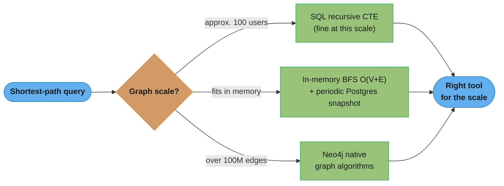
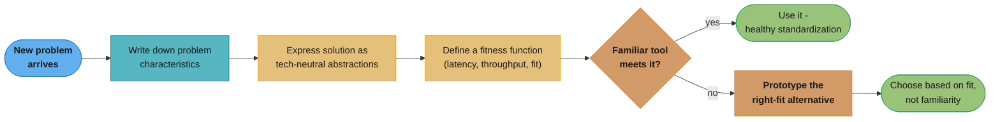

# Anti-Pattern: Golden Hammer
## What It Is

The Golden Hammer anti-pattern occurs when a developer or team over-applies a familiar technology, tool, or technique to every problem, regardless of whether it is the right fit. The name comes from the saying: "If all you have is a hammer, everything looks like a nail."

Also known as: Law of the Instrument, Silver Bullet Syndrome (related), Familiar Technology Bias.

The key distinction from other anti-patterns: this is not about bad code — the hammer itself may be excellent technology. The problem is applying it indiscriminately because it is well-understood, comfortable, or politically convenient.

---

## Intuition

> **One-line analogy**: Golden Hammer is "if all you have is a hammer, everything looks like a nail" — using your favorite tool for every problem regardless of fit.

**Mental model**: A team expert in SQL Server uses it for everything — time series data (wrong tool), full-text search (wrong tool), graph queries (wrong tool). A developer who knows Regex writes a regex for everything, even when simple string operations suffice. The familiarity bias overrides objective fit assessment. The tool may be excellent — the problem is applying it indiscriminately.

**Why it matters**: Every wrong-tool application makes the codebase harder — a general-purpose relational table with a timestamp column carries index and storage overhead that a purpose-built time-series engine avoids; a regex for a simple prefix check is unreadable. Over time, golden hammer applications accumulate into a system that's poorly suited to each of its own use cases.

**Key insight**: The antidote is tool-agnostic problem definition — state the requirement clearly ("store and query 10M sensor readings per second with point-in-time lookups") before choosing a tool. Choose based on fit, not familiarity.

---

## How to Recognize It

**Code and architecture smells:**
- The same technology is used for wildly different problems with poor fit
- Technology is chosen before the problem is fully understood
- Justification for a tool is "we already know how to use it" rather than "it is the right fit"
- Simple problems have disproportionately complex solutions due to the chosen tool
- Edge cases and workarounds multiply because the tool was not designed for this use case

**Common real-world instances:**
- Using a relational database (with complex joins and schemas) for data that is naturally a document or graph
- Using a full messaging queue (Kafka, RabbitMQ) for a problem that a simple cron job would solve
- Using microservices for a two-person team's internal tool
- Writing a custom ORM because the team is "more comfortable" than learning JPA
- Applying design patterns (e.g., Factory, Decorator) to every class whether needed or not

**Example — The Anti-Pattern:**

```java
// Team knows SQL extremely well and applies it to EVERYTHING.
// Problem: finding the shortest path between users in a social network.
// The hammer: relational database with recursive CTEs.

public class SocialNetworkServiceViolation {

    private final JdbcTemplate jdbc;

    public SocialNetworkServiceViolation(JdbcTemplate jdbc) {
        this.jdbc = jdbc;
    }

    // Shoe-horning a graph traversal problem into SQL
    // This query explodes at scale and is extremely hard to maintain
    public List<Long> findShortestPath(long fromUserId, long toUserId) {
        String sql =
            "WITH RECURSIVE path(user_id, path, depth) AS (" +
            "  SELECT ?, CAST(? AS VARCHAR(1000)), 0 " +
            "  UNION ALL " +
            "  SELECT f.friend_id, path || ',' || f.friend_id, depth + 1 " +
            "  FROM friendships f " +
            "  JOIN path p ON f.user_id = p.user_id " +
            "  WHERE depth < 6 AND path NOT LIKE '%' || f.friend_id || '%'" +
            ") " +
            "SELECT path FROM path WHERE user_id = ? ORDER BY depth LIMIT 1";

        // Performs full recursive table scan — catastrophic at 10M+ rows.
        // The recursive term expands every row into up to b children per level, so
        // the CTE materializes up to b^d rows for average friend count b and the
        // depth cap d = 6 above: at b = 100 that is 100^6 = 10^12 candidate paths.
        String pathStr = jdbc.queryForObject(sql, String.class, fromUserId, fromUserId, toUserId);
        return parsePathString(pathStr);
    }

    private List<Long> parsePathString(String path) {
        // ... parse comma-separated IDs
        return new java.util.ArrayList<>();
    }
}

// The right tool for this problem is a graph database (Neo4j)
// or an in-memory BFS algorithm on an adjacency list.
// The SQL solution works for 100 users and falls apart at 1 million.
```

---

## A Second Example: Over-Engineering with Patterns

```java
// Team has just learned the Factory pattern and applies it to everything,
// including simple value construction that needs no polymorphism.

// VIOLATION: Factory for a simple Point object — zero polymorphism needed
interface PointFactory {
    Point createPoint(double x, double y);
}

class CartesianPointFactory implements PointFactory {
    @Override
    public Point createPoint(double x, double y) {
        return new Point(x, y);
    }
}

class PointFactoryProvider {
    private static PointFactory instance = new CartesianPointFactory();

    public static PointFactory getInstance() { return instance; }
    public static void setFactory(PointFactory f) { instance = f; }
}

class PointUsage {
    void demo() {
        // Usage — massively over-engineered
        Point p = PointFactoryProvider.getInstance().createPoint(3.0, 4.0);

        // What it should be:
        Point p2 = new Point(3.0, 4.0); // or a static factory method if that is genuinely useful
    }
}
```

---

## Why It Happens

1. **Expertise bias**: Developers naturally reach for tools they know well. Learning a new tool has upfront cost; using the hammer is faster today even if it costs more tomorrow.
2. **Organizational momentum**: A team that standardized on one technology (e.g., PostgreSQL for everything) resists introducing new tools due to operational and training overhead.
3. **Architecture astronauts**: Excitement about a technology leads to premature adoption ("Let's use Kafka for everything — we'll need it eventually").
4. **Lack of problem analysis**: Teams jump to solutions before deeply understanding the problem characteristics.
5. **Risk aversion**: "No one ever got fired for using Oracle" — the known tool feels safer politically.

---

## Why It's Harmful

1. **Impedance mismatch**: Forcing a problem into the wrong tool creates complexity that fights the tool's grain at every turn.
2. **Performance degradation**: Tools optimized for one problem space perform poorly in another (e.g., relational joins on graph data, key-value store used as a relational system).
3. **Maintenance burden**: Workarounds accumulate. The codebase fills with adapter code to make the hammer fit the screw.
4. **Opportunity cost**: Time spent forcing the wrong tool could have been spent learning the right one.
5. **Architectural rigidity**: Once the wrong tool is deeply embedded, replacing it is a major project.

---

## How to Fix It

The fix is not to throw away the hammer — it is to develop a broader toolkit and apply problem-first thinking.

```java
// PROBLEM: Shortest path in a social network with millions of nodes.
// Right tool: BFS on an adjacency list (or Neo4j for persistent graphs)

public class SocialNetworkService {

    // In-memory adjacency list — loaded once, queried many times
    private final Map<Long, Set<Long>> adjacencyList;

    public SocialNetworkService(Map<Long, Set<Long>> adjacencyList) {
        this.adjacencyList = adjacencyList;
    }

    // BFS: O(V + E) — appropriate for this problem
    public List<Long> findShortestPath(long from, long to) {
        if (from == to) return List.of(from);

        Map<Long, Long> parentMap = new HashMap<>();
        Queue<Long> queue = new LinkedList<>();
        Set<Long> visited = new HashSet<>();

        queue.add(from);
        visited.add(from);
        parentMap.put(from, null);

        while (!queue.isEmpty()) {
            long current = queue.poll();

            Set<Long> neighbors = adjacencyList.getOrDefault(current, Set.of());
            for (long neighbor : neighbors) {
                if (!visited.contains(neighbor)) {
                    visited.add(neighbor);
                    parentMap.put(neighbor, current);
                    queue.add(neighbor);

                    if (neighbor == to) {
                        return reconstructPath(parentMap, from, to);
                    }
                }
            }
        }

        return List.of(); // no path found
    }

    private List<Long> reconstructPath(Map<Long, Long> parentMap, long from, long to) {
        List<Long> path = new ArrayList<>();
        Long current = to;
        while (current != null) {
            path.add(0, current);
            current = parentMap.get(current);
        }
        return path;
    }
}

// For truly large-scale graphs (> 100M edges): use Neo4j's native graph algorithms
// For moderate-scale: in-memory BFS with periodic snapshots to PostgreSQL
// For small-scale: even SQL recursive CTEs are fine
// The right answer depends on the actual scale requirements.
```

The code comment above collapses three different "right answers" into one line each. Making the scale thresholds an explicit checkpoint — instead of a habit — is what stops the SQL hammer from creeping back in as the data grows:



---

## Prevention Strategies

1. **Problem-first thinking:** Write down the problem characteristics (read/write ratio, data model, scale, query patterns) before selecting a technology.

2. **Technology-neutral design phase:** Express the solution in terms of abstractions and data structures before choosing the implementation technology.

3. **Fitness functions:** Define measurable criteria for the right tool — latency, throughput, data model fit — and evaluate candidates against them.

4. **Broaden the team's toolkit deliberately:** Allocate time for engineers to learn adjacent technologies (graph DBs, streaming platforms, cache stores) so the toolbox grows.

5. **Challenge "we already use X":** In architecture reviews, require justification that addresses fit, not just familiarity.

6. **Prototype alternative approaches:** A two-day spike with the right tool often demonstrates it is faster than weeks of fighting the wrong one.

These six strategies form a single feedback loop rather than a checklist: define the problem before the tool, hold the familiar option to a fitness function, and only spend prototyping effort once that check actually fails:



---

## Real-World Examples

| Hammer | Applied Where It Doesn't Fit |
|--------|------------------------------|
| Relational DB (PostgreSQL) | Social graph traversal, time-series data, full-text search, document storage |
| Microservices | A three-developer team building an internal CRUD tool |
| Kafka | A simple background job that runs once an hour |
| Redis | The primary database for a financial application with ACID requirements |
| OOP + design patterns | A short, procedural data transformation script |
| REST API | A real-time bidirectional chat feature (better fit: WebSocket) |

---

## Cross-Perspective: HLD Connections

**HLD View — Where Golden Hammer Appears in Distributed Systems**

- **Kafka for everything** — A team that knows Kafka deeply uses it for a background job that runs once per hour. A cron job with a simple database flag would be simpler, faster to build, and easier to operate. The hammer: Kafka. The screw: scheduled batch processing.
- **Microservices for all team sizes** — A two-person team building an internal tool adopts microservices because "that's how it's done." Most of their effort goes into service discovery, inter-service auth, and distributed tracing instead of building features. The right tool: a well-structured monolith.
- **Redis as primary database** — A team comfortable with Redis uses it as the source of truth for financial transactions that require ACID guarantees. Redis is an excellent cache and message broker, but its persistence and consistency model is wrong for this use case.
- **NoSQL for relational data** — Using MongoDB or DynamoDB for data with complex relationships and ad-hoc query requirements because "NoSQL scales better." The result: joins reimplemented in application code, consistency headaches, and access patterns that a well-indexed relational database would have answered with one query.

---

## Interview Questions with Answers

**Q: What is the Golden Hammer anti-pattern, and where does the name come from?**
**Short:** Over-applying a familiar tool to every problem, from "if all you have is a hammer, everything looks like a nail."
Golden Hammer occurs when a developer or team over-applies a familiar technology, tool, or technique to every problem regardless of whether it's the right fit. It is also known as the Law of the Instrument or Familiar Technology Bias. The critical distinction from most anti-patterns is that it's not about bad code — the hammer itself may be excellent technology; the problem is applying it indiscriminately because it's well-understood, comfortable, or politically convenient rather than because it fits the problem.

**Q: How do you distinguish healthy technology standardization from unhealthy Golden Hammer uniformity?**
**Short:** Standardization reduces operational burden for genuinely similar problems; a hammer ignores problem fit entirely.
Healthy standardization means a team consistently uses PostgreSQL for its various relational, transactional workloads because those workloads genuinely share the same shape — this reduces operational burden, deepens expertise, and is a deliberate, fit-based choice. Golden Hammer is applying that same PostgreSQL expertise to a graph traversal problem or time-series ingestion where the data model and access patterns are fundamentally different. The test is whether the justification is "we evaluated this against the requirement and it fits" versus "we already know how to use it."

**Q: Why does the SQL recursive-CTE shortest-path example in this file fail at scale?**
**Short:** The recursive CTE performs a full recursive table scan whose candidate paths grow exponentially with depth.
The recursive term expands every row into up to `b` children per level, so the CTE materializes up to `b^d` candidate rows for average friend count `b` and depth cap `d`. At a depth cap of 6 and an average of 100 friends per user, that's `100^6 = 10^12` candidate paths — a number that makes the query catastrophic well before reaching realistic social-graph scale. The right tool, an in-memory BFS on an adjacency list, is `O(V + E)` — linear in graph size rather than exponential in path depth, which is why it scales where the SQL approach cannot.

**Q: When is a SQL recursive CTE actually an acceptable choice for this same shortest-path problem?**
**Short:** At small scale — roughly 100 users — where the exponential blowup never materializes in practice.
The file's own scale-threshold flowchart makes this explicit: at approximately 100 users, an SQL recursive CTE is fine because the candidate-path explosion never reaches a size that matters in practice. Once the graph fits in memory but exceeds toy scale, in-memory BFS with periodic Postgres snapshots is the right tool; beyond roughly 100M edges, a native graph database like Neo4j becomes appropriate. The lesson is that "wrong tool" is scale-dependent — the same technology can be the pragmatic choice below a threshold and the Golden Hammer above it.

**Q: What five factors typically cause a team to fall into Golden Hammer?**
**Short:** Expertise bias, organizational momentum, premature adoption excitement, insufficient problem analysis, and risk aversion.
Expertise bias means developers reach for tools they know well because learning something new has upfront cost. Organizational momentum means a team standardized on one technology resists introducing new tools due to training and operational overhead. "Architecture astronauts" adopt exciting new technology prematurely ("let's use Kafka for everything, we'll need it eventually"). Lack of problem analysis means jumping to a solution before understanding the problem's actual characteristics. And risk aversion — "no one ever got fired for using Oracle" — makes the familiar tool feel politically safer even when it's technically the wrong fit.

**Q: How does "problem-first thinking" work as an antidote to Golden Hammer, concretely?**
**Short:** State the requirement in tool-neutral terms before selecting a technology, then evaluate options against it.
Instead of starting with "we'll use PostgreSQL," write down the problem's actual characteristics first — for example, "store and query 10M sensor readings per second with point-in-time lookups" — before any technology is named. This tool-neutral framing forces an explicit comparison of candidate technologies against the stated requirement, rather than defaulting silently to whatever the team already knows. The Golden Hammer file frames this as a repeatable loop: define the problem, express it as tech-neutral abstractions, define a fitness function (latency, throughput, data-model fit), and only reach for the familiar tool if it actually satisfies that fitness function.

**Q: What is a "fitness function" in the context of avoiding Golden Hammer, and why does it matter?**
**Short:** A measurable criterion — latency, throughput, data-model fit — that a candidate technology must satisfy before adoption.
A fitness function converts "is this the right tool?" from a subjective, familiarity-driven judgment into an objective, measurable check: does the candidate technology meet the stated latency, throughput, and data-model requirements? If the team's familiar tool passes the fitness function, using it is healthy standardization, not a hammer — the check has genuinely validated fit. If it fails, that failure is the trigger to prototype an alternative rather than forcing the familiar tool through anyway, which is exactly the branch point in the file's prevention-strategy flowchart.

**Q: Give an example of Golden Hammer applied to a design pattern rather than a database or infrastructure choice.**
**Short:** Wrapping a simple Point object in a Factory pattern when zero polymorphism is ever needed.
The file's second example shows a team that just learned the Factory pattern applying it to constructing a simple `Point(x, y)` value object — building a `PointFactory` interface, a `CartesianPointFactory` implementation, and a `PointFactoryProvider` singleton wrapper, none of which is needed because there is no variation in how a `Point` is constructed. The fix is simply `new Point(3.0, 4.0)`. This shows Golden Hammer isn't limited to choosing the wrong database — it applies equally to over-applying design patterns learned recently, without asking whether the polymorphism the pattern provides is actually needed.

**Q: Why is "we already use X" an insufficient justification in an architecture review, according to this anti-pattern?**
**Short:** Familiarity is not fit — the review should require the tool be justified against the problem's characteristics.
"We already use X" describes organizational convenience, not technical suitability — it says nothing about whether X's data model, consistency guarantees, or performance profile actually match the problem at hand. The prevention strategy explicitly calls for challenging this justification in architecture reviews by requiring that a proposed tool's fit be argued from the problem's read/write ratio, data model, scale, and query patterns, not from what the team happens to already operate. A tool can pass this bar and still be "the one we already use" — the point is that familiarity alone must not be the deciding argument.

**Q: What real-world mismatch does using Redis as a system of record for financial transactions illustrate?**
**Short:** Redis is an excellent cache/broker but its persistence and consistency model is wrong for ACID-requiring data.
A team comfortable with Redis using it as the source of truth for financial transactions is applying a tool built for caching and messaging to a problem that requires strict ACID guarantees — durability, atomicity, and strong consistency — which Redis's design does not prioritize the same way a relational database with proper transaction support does. This is Golden Hammer at the infrastructure level: Redis is genuinely excellent at what it's designed for, and the failure is entirely about applying it to a problem whose correctness requirements it was never built to satisfy.

**Q: How does Golden Hammer manifest as "Kafka for everything" at the HLD level, and what's the simpler alternative?**
**Short:** Using Kafka for a once-an-hour batch job when a cron job with a database flag would be simpler and easier to operate.
A team deeply familiar with Kafka may reach for it even for a background job that only needs to run once per hour, absorbing the operational overhead of running and monitoring a distributed streaming platform for a workload that a simple cron job checking a database flag could handle with a fraction of the complexity. The mismatch is the same shape as the SQL-for-graphs example: excellent technology, wrong fit — the fix isn't "stop using Kafka," it's recognizing that scheduled batch processing doesn't need a streaming platform's guarantees.

**Q: What goes wrong when a two-person team adopts microservices for an internal CRUD tool?**
**Short:** Effort shifts from building features to service discovery, inter-service auth, and distributed tracing overhead.
Microservices architecture is designed to let large teams work independently on separately deployable services — value that depends on having enough people and enough scale to need that independence. A two-person team adopting it anyway spends most of its effort standing up service discovery, inter-service authentication, and distributed tracing instead of building the actual features the tool exists for. The right tool at that team size and scope is usually a well-structured monolith, which delivers the same functionality with a fraction of the operational surface area.

**Q: Why can a two-day spike be a more persuasive argument against Golden Hammer than a design document?**
**Short:** A working prototype with the right tool concretely demonstrates fit or speed, which abstract arguments rarely settle.
Prototyping the alternative approach — actually building a small working version with the candidate right-fit tool — produces concrete evidence (this query runs in 50ms instead of 5 seconds; this code is 30 lines instead of 300) that is far more persuasive in a team debate than an argument about theoretical fit. The file frames this as the last resort in the prevention loop: only spend prototyping effort once the fitness-function check on the familiar tool has actually failed, since prototyping is real cost and shouldn't be spent to settle disagreements that a clear requirement could resolve on paper.

**Q: What question should you ask in an interview when asked "how do you choose between SQL and NoSQL"?**
**Short:** What are the access patterns and scalability needs — not what does the team already use.
The Golden Hammer framing reorients the SQL-vs-NoSQL question away from "which one do we already know" and toward the access patterns (read/write ratio, query shape, need for joins or ad-hoc queries) and scalability needs (data volume, consistency requirements, horizontal scaling needs) the actual workload has. Answering with awareness of this anti-pattern signals that technology choices are evaluated by problem characteristics, which is the trait interviewers are specifically probing for when they ask this kind of open-ended tooling question.

**Q: Describe a Golden Hammer scenario involving relational data forced into a NoSQL store, and its consequence.**
**Short:** Using MongoDB/DynamoDB for complex relational data reimplements joins in application code and causes consistency headaches.
Choosing MongoDB or DynamoDB for data with complex relationships and ad-hoc query requirements because "NoSQL scales better" often means the application ends up reimplementing joins in its own code, since the datastore doesn't natively support the relational queries the data actually needs. The result is consistency headaches from denormalized data going out of sync, plus access patterns that a well-indexed relational database would have answered with a single query — the scaling benefit that motivated the choice frequently isn't even needed at the data volumes involved.

## Interview Relevance

**Common interview questions:**
- "How do you choose between a SQL and NoSQL database?" — Golden Hammer awareness signals you evaluate by problem characteristics.
- "When would you NOT use microservices?" — Shows architectural judgment over fashion.
- "Describe a time you chose a tool that turned out to be the wrong fit." — Golden Hammer experience is a valuable story.

**Key talking points:**
- Problem characteristics drive technology choices, not familiarity or org standards
- The right question is "what are the access patterns and scalability needs?" not "what do we already use?"
- Golden Hammer often masquerades as standardization — distinguish healthy standardization (reduces operational burden) from unhealthy uniformity (wrong tool for the job)
