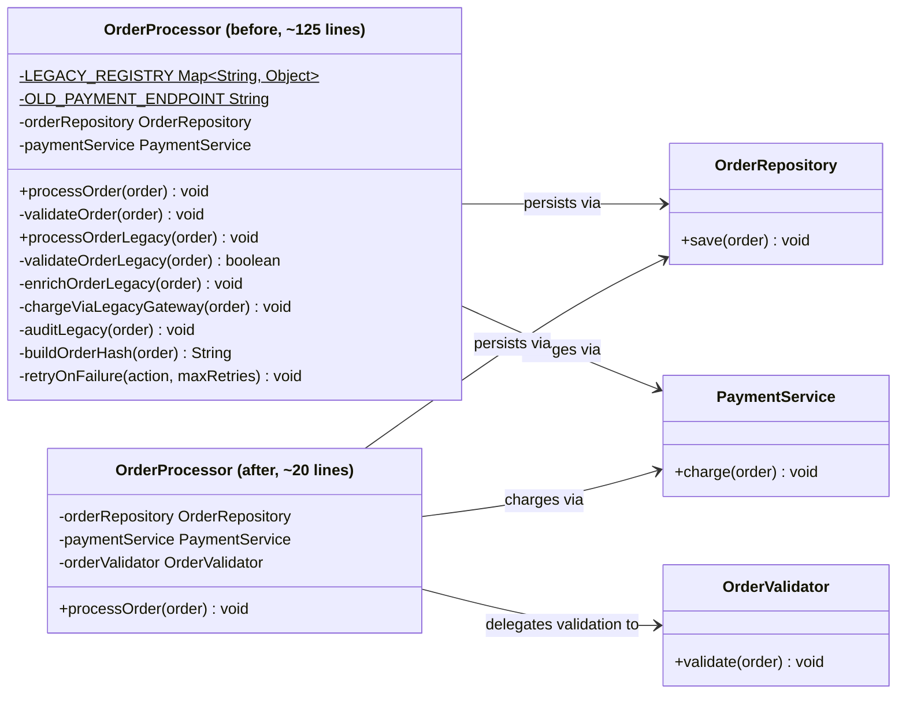
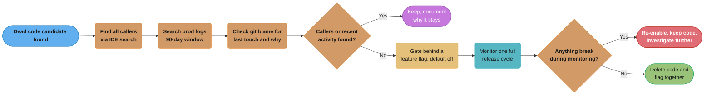

# Lava Flow Anti-Pattern
## Overview

The Lava Flow anti-pattern describes the accumulation of dead, obsolete, or poorly understood code that persists in a codebase because no one knows what it does or whether it is safe to remove. Like solidified lava that hardens over time into an immovable rock layer, this code becomes a permanent fixture of the system — untouched, undocumented, and quietly dangerous. It typically originates from rapid prototyping sessions that were never cleaned up, departed engineers who left no documentation, or fear-driven development where removing something "just in case it breaks production" feels riskier than leaving it. The result is a codebase that grows heavier with every release cycle while delivering less and less business value per line of code.

---

## Intuition

> **One-line analogy**: Lava Flow is like geological strata in a codebase — layers of old, hardened code nobody dares remove because no one remembers what it does or what might crack if it's touched.

**Mental model**: A prototype ships to production in a hurry. The messy scaffolding code goes with it. The engineer who wrote it leaves. Months later, a new developer finds a class called `LegacyProcessorV2Final` with no tests and a comment reading `// do not remove — something breaks`. Nobody knows what breaks. Nobody is willing to find out. The code stays forever, growing more mysterious with each passing year.

**Why it matters**: Dead code imposes a cognitive tax on every developer who reads it. It slows builds, confuses onboarding, and occasionally causes real bugs when the "dead" code isn't quite dead — it fires in an obscure edge case no one knew about.

**Key insight**: The antidote is not bravery — it's test coverage and tooling. A well-tested codebase lets you safely delete suspect code; a delete-and-run-tests cycle either confirms the code is dead or surfaces the hidden dependency quickly.

---

## How to Spot It

**Warning Signs and Code Smells**

- Methods or classes annotated with `@Deprecated` but still referenced throughout the codebase with no migration plan
- Comments like `// not sure if this is still needed`, `// TODO: remove this (2019)`, `// legacy - do not touch`
- Large blocks of commented-out code that have lived in version control for months or years
- Static initializers or class-level setup code with no clear purpose and no tests covering them
- Unused imports, fields, and local variables scattered across files
- Classes with names like `UtilsHelper`, `DataProcessorV2Old`, `TempFix`, `LegacyAdapter`
- Configuration entries for features that no longer exist
- Database columns or API fields that are populated but never read
- Test coverage gaps precisely around the "mysterious" code — nobody tests what nobody understands
- Long methods (500+ lines) that mix current logic with historical workarounds
- Constant values defined but never referenced
- Version suffixes on class names: `ServiceV1`, `ServiceV2`, `ServiceV2Final`, `ServiceV2FinalActual`

---

## Java Violation Example

```java
/**
 * OrderProcessor - handles order processing.
 *
 * NOTE: This class was written in 2017 during the migration from the legacy
 * monolith. Some methods may no longer be needed. Do NOT remove anything
 * without checking with the platform team first (most of them have left).
 *
 * TODO: Clean this up (added 2019-03-12, still here in 2026)
 */
public class OrderProcessor {

    // Not sure what this does but removing it breaks the build somehow
    private static final Map<String, Object> LEGACY_REGISTRY = new HashMap<>();

    // This was used by the old payment gateway. Keep for now.
    @Deprecated
    private static final String OLD_PAYMENT_ENDPOINT = "https://legacy-pay.internal/v1/charge";

    // Mysterious static initializer — origin unknown, last touched 2018
    static {
        LEGACY_REGISTRY.put("INIT_FLAG", true);
        LEGACY_REGISTRY.put("MODE", "COMPAT");
        // System.out.println("OrderProcessor initialized"); // commented out for prod
    }

    private final OrderRepository orderRepository;
    private final PaymentService paymentService;

    public OrderProcessor(OrderRepository orderRepository, PaymentService paymentService) {
        this.orderRepository = orderRepository;
        this.paymentService = paymentService;
    }

    // -----------------------------------------------------------------------
    // CURRENT LOGIC — these methods are actively used
    // -----------------------------------------------------------------------

    public void processOrder(Order order) {
        validateOrder(order);
        paymentService.charge(order);
        orderRepository.save(order);
    }

    private void validateOrder(Order order) {
        if (order == null) throw new IllegalArgumentException("Order must not be null");
        if (order.getItems().isEmpty()) throw new IllegalArgumentException("Order must have items");
    }

    // -----------------------------------------------------------------------
    // DEAD CODE ZONE — nothing below this line is called by anything alive
    // -----------------------------------------------------------------------

    /**
     * @deprecated Use processOrder() instead. This was the original v1 flow.
     * Left here because the batch job might still call it (nobody checked).
     */
    @Deprecated
    public void processOrderLegacy(Order order) {
        // OLD FLOW: validate -> enrich -> charge -> audit
        validateOrderLegacy(order);
        enrichOrderLegacy(order); // WHAT DOES THIS DO?
        chargeViaLegacyGateway(order);
        auditLegacy(order);
    }

    @Deprecated
    private boolean validateOrderLegacy(Order order) {
        // This duplicates validateOrder() but with slightly different rules.
        // Which one is correct? Nobody knows.
        if (order == null) return false;
        if (order.getItems() == null) return false;
        if (order.getCustomerId() == null) return false; // is customerId still required?
        return true;
    }

    @Deprecated
    private void enrichOrderLegacy(Order order) {
        // TODO: figure out what "enrichment" meant in 2017 context
        // Appears to have set some fields that no longer exist on the Order object
        // Leaving this in case the data team needs it
    }

    @Deprecated
    private void chargeViaLegacyGateway(Order order) {
        // Uses OLD_PAYMENT_ENDPOINT — this gateway was decommissioned in 2020
        // HttpClient.post(OLD_PAYMENT_ENDPOINT, order); // commented out but not deleted
        System.out.println("Legacy charge executed"); // should this be a log? a no-op?
    }

    @Deprecated
    private void auditLegacy(Order order) {
        // Wrote to an audit table that was dropped from the schema in 2021
        // auditRepository.insert(new AuditRecord(order)); // compile error if uncommented
    }

    // Dead utility methods — origin and purpose unknown

    private String buildOrderHash(Order order) {
        // Was this for idempotency? Caching? Fraud detection?
        // Nothing calls this method.
        return order.getId() + "-" + order.getCustomerId() + "-HASH";
    }

    private void retryOnFailure(Runnable action, int maxRetries) {
        // Generic retry logic — now replaced by Spring Retry everywhere else
        // Still here because removing it felt risky
        for (int i = 0; i < maxRetries; i++) {
            try {
                action.run();
                return;
            } catch (Exception e) {
                if (i == maxRetries - 1) throw new RuntimeException(e);
            }
        }
    }

    /*
     * =========================================================================
     * COMMENTED-OUT GRAVEYARD
     * =========================================================================
     *
     * private void notifyFulfillmentCenter(Order order) {
     *     // FulfillmentService was decommissioned Q3 2022
     *     // fulfillmentService.dispatch(order);
     * }
     *
     * private boolean isHighValueOrder(Order order) {
     *     return order.getTotal().compareTo(new BigDecimal("500.00")) > 0;
     * }
     *
     * private void applyLoyaltyPoints(Order order) {
     *     // loyalty program was sunset
     * }
     */
}
```

**What is wrong with this code:**
- `processOrderLegacy()` and its private helpers are dead code — no callers exist
- `LEGACY_REGISTRY` static map is populated but never read after initialization
- `OLD_PAYMENT_ENDPOINT` references a decommissioned system
- The static initializer performs work of unknown purpose with no test coverage
- Commented-out code blocks occupy mental bandwidth without providing value
- `buildOrderHash()` and `retryOnFailure()` are unreachable private methods
- Nobody on the current team can confidently say what is safe to delete

---

## Why It's Harmful

**Maintenance Burden**
Every new engineer must read and reason about dead code before they can confidently modify the class. A 500-line class where 300 lines are inert is still a 500-line cognitive burden — the reader has to prove each line is dead before ignoring it, which costs as much as reading live code.

**Security Risk**
Unreviewed code paths can harbor vulnerabilities. A deprecated method that "nobody calls" might still be invokable via reflection, serialization, or a forgotten cron job. Security audits must cover all code, dead or alive.

**False Complexity**
Static analysis tools, test coverage reports, and dependency graphs all include dead code. This inflates complexity metrics, hides real problems, and produces noisy reports that engineers learn to ignore.

**Incident Risk from Resurrection**
Dead code sometimes gets accidentally reactivated. A refactor changes a method name, an old import gets re-added, or a new engineer calls a deprecated utility because it appears to do exactly what is needed — but it connects to a decommissioned system.

**Onboarding Cost**
New team members waste days investigating methods that serve no purpose. This erodes confidence, slows onboarding, and produces tribal knowledge gaps that compound over time.

**Build and Test Slowness**
Dead classes still compile. Dead tests still run (or fail mysteriously). Every CI cycle pays the cost of code that delivers nothing.

---

## Refactored Solution

```java
/**
 * OrderProcessor - processes validated orders through payment and persistence.
 *
 * This class is solely responsible for orchestrating the order processing
 * lifecycle: validation, payment, and persistence. All legacy v1 processing
 * was removed in ticket ORD-4821 (2026-01-15) after confirming zero callers
 * via static analysis and production log search over 90 days.
 */
public class OrderProcessor {

    private final OrderRepository orderRepository;
    private final PaymentService paymentService;
    private final OrderValidator orderValidator;

    public OrderProcessor(
            OrderRepository orderRepository,
            PaymentService paymentService,
            OrderValidator orderValidator) {
        this.orderRepository = orderRepository;
        this.paymentService = paymentService;
        this.orderValidator = orderValidator;
    }

    public void processOrder(Order order) {
        orderValidator.validate(order);
        paymentService.charge(order);
        orderRepository.save(order);
    }
}

/**
 * Encapsulates all order validation rules.
 * Extracted from OrderProcessor to enable independent testing.
 */
public class OrderValidator {

    public void validate(Order order) {
        if (order == null) {
            throw new IllegalArgumentException("Order must not be null");
        }
        if (order.getItems() == null || order.getItems().isEmpty()) {
            throw new IllegalArgumentException("Order must contain at least one item");
        }
    }
}
```

**What changed:**
- All deprecated methods and their dead private helpers were deleted after a confirmed-safe audit
- The mysterious static initializer was investigated, found unnecessary, and removed
- `OrderValidator` was extracted for testability and single responsibility
- Class is now about 20 lines instead of roughly 125; every line has a known purpose

**Visualized — the class shape before and after:**



*Thirteen members are crammed into the "before" `OrderProcessor` — nine of them dead, duplicated, or unexplainable. The "after" version keeps only four members and delegates validation to a new `OrderValidator` collaborator; `OrderRepository` and `PaymentService` are the same two dependencies in both versions, untouched by the cleanup. Redrawing the diff as class shapes makes the actual deletion — not just the line count — visible at a glance.*

---

## Prevention Strategies

**1. Establish a Deprecation Lifecycle**
When marking code `@Deprecated`, attach a removal date and a ticket number. Example:
```java
/**
 * @deprecated Use {@link OrderProcessor#processOrder(Order)} instead.
 * Scheduled for removal in Q2 2027. See ticket ORD-4500.
 */
@Deprecated(since = "2026-07", forRemoval = true)
public void processOrderLegacy(Order order) { ... }
```

**2. Use Static Analysis to Detect Dead Code**
Tools like IntelliJ IDEA's unused code inspection, SpotBugs, or SonarQube can flag unreferenced methods, fields, and classes. Make these checks part of your CI pipeline.

**3. Treat Dead Code as a Bug**
Enforce in code review: any method or class that is not reachable must either have a documented reason or be removed. Dead code should never be merged.

**4. Archaeological Dig Process for Legacy Systems**
When cleaning up old code:
1. Use your IDE to find all callers of the suspicious method
2. Search production logs for the method name over a 90-day window
3. Check git blame for when it was last touched and why
4. If no callers and no recent activity — delete it, don't comment it out
5. Use feature flags to safely decommission code paths in production before deletion

**5. Feature Flags for Safe Removal**
Before deleting a code path, gate it behind a feature flag set to `false`. Monitor for a release cycle. If nothing breaks, delete the flag and the code together.

**Visualized — the safe-deletion decision flow (strategies 4 and 5 combined):**



*This merges strategies 4 and 5 into one decision flow: a method only reaches the feature-flag gate after surviving the callers, log, and git-blame audit, and only gets deleted after surviving a full release cycle behind that flag. Anything that breaks along the way is kept and re-investigated instead of deleted — the diagram makes both escape hatches explicit instead of leaving them implicit in two separate numbered lists.*

**6. Enforce Clean Commit History**
Commented-out code should fail code review. Version control is the history — use `git log` to find deleted code, not inline comments.

**7. Document Intent, Not Mechanics**
When code must remain for non-obvious reasons, document *why* with a ticket reference:
```java
// Required for PCI compliance audit trail. See SEC-2201.
// Do not remove without review from the Security team.
```

---

## Cross-Perspective: HLD Connections

**HLD View — Where Lava Flow Appears in Distributed Systems**

- **Deprecated API endpoints** — Endpoints marked deprecated but still receiving traffic because callers are unknown. The endpoint can't be removed; it must be maintained indefinitely. API surface grows without bound; the dead code is now network-accessible dead code.
- **Orphaned microservices** — Services that were supposed to be decommissioned but still handle traffic from unknown callers. No team owns them; nobody knows what breaks if they go down. They consume infrastructure budget and on-call attention indefinitely.
- **Dead database tables** — Database tables with no current writers or readers that persist for years because nobody is sure they're truly unused. Schema migrations must work around them; query planners consider them; backups include them.
- **Zombie feature flags** — Feature flags that are always `true` or always `false` but were never cleaned up after the rollout. The flag evaluation adds latency; the conditional code paths still exist in the codebase; new engineers waste time understanding toggles that do nothing.

---

## Real-World Consequences

*The four scenarios below are illustrative composites of common incident patterns, not reports of specific named public incidents. The numbers show the shape of the failure; treat them as worked examples rather than as citable industry statistics.*

**Scenario 1: The Resurrected Vulnerability**
A fintech company had a commented-out authentication bypass added during a testing sprint. A developer debugging an unrelated issue noticed the commented block, assumed it was a useful shortcut for local development, and uncommented it. The code was reviewed quickly and merged. It reached production. A security researcher found it three weeks later.

**Scenario 2: The Phantom Batch Job**
An e-commerce platform had a `processOrderLegacy()` method that appeared unused. It was actually invoked by a cron job defined in an XML scheduler file in a different repository. The team deleted the method confidently. The next morning, overnight batch reconciliation failed silently, and thousands of orders were left in a stuck state.

**Scenario 3: Compliance Audit Failure**
A healthcare company underwent a SOC 2 audit. Auditors required documentation for every code path that touched PII. The team could not explain 30% of their data processing class because it contained undocumented legacy code. The audit was delayed by six weeks while engineers reverse-engineered their own system.

**Scenario 4: Onboarding Time Sink**
A startup calculated that new engineers spent an average of 3 days in their first two weeks investigating code that turned out to be dead. Over a year, with 10 new hires, this represented 30 engineering-days of pure waste — equivalent to six full work weeks.

---

## Interview Questions with Answers

**Q: What is the Lava Flow anti-pattern, and why the geological name?**
**Short:** Dead or obsolete code that hardens into a permanent, untouchable fixture because nobody knows whether it's safe to remove.
Lava Flow describes the accumulation of dead, obsolete, or poorly understood code that persists because no one knows what it does or whether removing it is safe. Like solidified lava that hardens over time into an immovable rock layer, this code becomes a permanent fixture — untouched, undocumented, and quietly dangerous. It typically originates from rapid prototyping that was never cleaned up, departed engineers who left no documentation, or fear-driven development where removing something "just in case it breaks production" feels riskier than leaving it.

**Q: How do you find dead code you are afraid to delete?**
**Short:** Search for callers, grep 90 days of production logs, check git blame, then gate it behind a feature flag before deleting.
The "Archaeological Dig" process is a four-step audit: use your IDE to find all callers of the suspicious method; search production logs for the method name over a 90-day window to catch infrequent invocations like batch jobs; check git blame for when it was last touched and why; and if no callers and no recent activity turn up, delete it — don't comment it out. For genuinely uncertain cases, gate the code behind a feature flag defaulting to off, monitor for a full release cycle, and only delete the flag and code together once nothing breaks.

**Q: In the "Phantom Batch Job" scenario, why did deleting `processOrderLegacy()` cause a production incident despite it "appearing unused"?**
**Short:** It was invoked by a cron job defined in an XML scheduler file in a different repository, invisible to the IDE's caller search.
An IDE's "find usages" only sees callers within the codebase it's indexing — it cannot see a cron job's XML scheduler configuration living in an entirely separate repository that invokes the method by name at runtime. The team deleted the method confidently after an IDE-only search found no callers, and the next morning overnight batch reconciliation failed silently, leaving thousands of orders stuck. This is exactly why the archaeological-dig process also requires a production log search — a cross-repository or reflection-based caller is invisible to static analysis but shows up in logs if it ever actually ran.

**Q: What is the difference between `@Deprecated` code with a removal date and the deprecated code in this file's violation example?**
**Short:** A removal date and ticket number create an enforceable lifecycle; the example's `@Deprecated` methods have neither and never get removed.
`processOrderLegacy()` in the violation example is marked `@Deprecated` with a comment saying "left here because the batch job might still call it (nobody checked)" — there is no removal date, no ticket reference, and no plan, so the deprecation is purely decorative and the method persists indefinitely. The prevention strategy is to always attach a removal date and ticket number using `@Deprecated(since = "2026-07", forRemoval = true)` with a Javadoc `@deprecated` pointing to the replacement and citing a tracking ticket, turning "deprecated" from a permanent label into a scheduled, enforceable event.

**Q: Why is a "500-line class where 300 lines are inert" still a 500-line cognitive burden, not a 200-line one?**
**Short:** The reader must first prove each dead line is actually dead before they can safely ignore it, which costs as much as reading live code.
You cannot skip the 300 dead lines just because they're unused — you have to read and understand them well enough to confirm they're genuinely unreachable, unless someone has already done that verification and documented it. That proof-of-deadness effort costs roughly the same cognitive work as understanding live code would, so the class doesn't get cheaper to reason about just because a majority of it never executes; it stays exactly as expensive to onboard onto until the dead code is actually removed.

**Q: What security risk does "nobody calls this method" actually leave unaddressed?**
**Short:** A deprecated method invocable via reflection, serialization, or a forgotten cron job can still be a live attack surface.
Static "no callers found" analysis only sees direct method calls in the indexed codebase — it cannot rule out invocation via reflection, deserialization of an old payload format, or an external scheduler referencing the method by name (as in the Phantom Batch Job scenario). A security audit must therefore cover dead code paths as thoroughly as live ones, because "nobody calls this" is an unverified assumption, not a proven fact, and the "Resurrected Vulnerability" scenario shows a commented-out authentication bypass being mistaken for a useful local-dev shortcut and merged back into production.

**Q: Why does the file insist on deleting dead code outright rather than commenting it out?**
**Short:** Version control already IS the history — commented-out code just duplicates that history inline where it costs ongoing attention.
`git log` and `git blame` already preserve every version of a file including deleted code, so commenting a block out and leaving it in the source provides no historical value that version control doesn't already give you — it only adds permanent visual clutter that every future reader has to mentally filter out. The "COMMENTED-OUT GRAVEYARD" block in the violation example is a direct illustration: three dead private methods preserved as comments, occupying space and attention for zero benefit, when `git log -p` could recover them in seconds if ever actually needed.

**Q: How does a mysterious static initializer like `LEGACY_REGISTRY` become dangerous even if nothing reads it after startup?**
**Short:** Work of unknown purpose runs with no test coverage, so nobody can confirm removing it is safe without risking a regression.
The static initializer populates `LEGACY_REGISTRY` with `INIT_FLAG` and `MODE` entries that nothing subsequently reads, but because it has no test coverage and nobody currently on the team wrote it, there's no way to be confident it's truly side-effect-free — it could, for instance, be silently relied upon by a reflection-based framework hook or a monitoring agent. In the refactored version, this initializer is investigated and confirmed unnecessary before being removed entirely, which is the discipline the anti-pattern is really about: verify, don't assume, before deleting anything with unclear provenance.

**Q: What is a "zombie feature flag," and how is it a form of Lava Flow?**
**Short:** A flag left permanently on or off after rollout that nobody cleaned up, leaving dead conditional branches that still cost attention.
A feature flag that is always evaluated `true` or always `false` because the rollout finished but the flag and its now-dead branch were never removed is Lava Flow at the configuration layer: the flag evaluation still adds a small amount of latency, the conditional code paths for the "other" branch still exist in the codebase, and new engineers still waste time trying to understand a toggle that in practice does nothing. The fix mirrors code-level dead code cleanup — once a flag's rollout is confirmed complete and stable, delete both the flag and the now-unreachable branch together.

**Q: Why do deprecated but still-live API endpoints represent Lava Flow at the HLD level?**
**Short:** An endpoint can't be removed because its remaining callers are unknown, so it must be maintained indefinitely.
An endpoint marked deprecated but still receiving traffic cannot simply be turned off, because the team doesn't know which external or internal clients still depend on it — removing it risks breaking callers nobody has inventoried. This forces the endpoint to be maintained indefinitely, growing the API surface without bound; it's the exact same "we're afraid to delete it because we don't know what breaks" dynamic as dead code inside a single class, just expressed as network-accessible dead code that other teams' systems may silently depend on.

**Q: What is the practical benefit of the "Onboarding Time Sink" scenario's math — 3 days per new hire across a year?**
**Short:** 10 hires × 3 days each = 30 engineering-days, roughly six full work weeks, spent investigating code that turned out to be dead.
The scenario quantifies a cost that's usually invisible because it's distributed across many individuals over time: new engineers spending an average of 3 days in their first two weeks investigating mysterious legacy code that ultimately proves to be dead, multiplied across 10 new hires in a year, totals 30 engineering-days — about six full work weeks of pure waste. Making this cost explicit and quantified is useful in an interview or a business case for prioritizing a cleanup effort, since "the code is confusing" is a much weaker argument than "this costs six person-weeks per year."

**Q: How does feature-flag-gated removal reduce the risk of deleting suspect code compared to deleting it directly?**
**Short:** It creates a reversible, monitored intermediate step — code stays present but inert, so a break can be caught and reverted cheaply.
Rather than deleting a code path outright and hoping nothing depended on it, gating it behind a feature flag set to `false` keeps the code physically present (so re-enabling it is instant) while making it inert in production — if something breaks during the monitoring period, the fix is flipping the flag back, not a rushed revert-and-redeploy. Only after a full release cycle passes with nothing breaking does the file recommend deleting the flag and the dead code path together, converting an irreversible action into a reversible experiment first.

**Q: What is the difference in cost between the SOC 2 audit scenario and the Onboarding scenario in this file?**
**Short:** Onboarding cost is steady, distributed toil; the audit cost was a hard six-week external delay triggered by undocumented code.
The Onboarding Time Sink is a chronic, distributed cost — 3 days per new hire, absorbed continuously as normal (if wasteful) engineering activity. The SOC 2 audit failure is an acute, concentrated cost: auditors required documentation for every code path touching PII, the team could not explain 30% of a data-processing class due to undocumented legacy code, and the entire audit was delayed six weeks while engineers reverse-engineered their own system. Both trace back to the same root cause — undocumented, unexplained code — but the audit scenario shows how that same debt can suddenly become a hard business blocker rather than a background tax.

**Q: Why does documenting "intent, not mechanics" matter when code must remain for a non-obvious reason?**
**Short:** A ticket-referenced business reason survives staff turnover; a mechanical description of what the code does does not explain why it must stay.
Documenting *why* code must remain — e.g., "Required for PCI compliance audit trail. See SEC-2201. Do not remove without review from the Security team" — gives a future engineer a concrete, verifiable reason to leave it alone and a specific path (the ticket, the named team) to get clarity if they want to challenge it. A comment merely restating what the code mechanically does, by contrast, doesn't explain why it can't simply be deleted, and the reasoning behind "why does this need to exist" is precisely the information that gets lost first when the original author leaves the team.

**Q: Why does dead code inflate complexity metrics and produce noisy static analysis reports?**
**Short:** Dead classes and unreachable methods still get counted by coverage, complexity, and dependency tools, hiding real problems in the noise.
Static analysis tools, test coverage reports, and dependency graphs all include dead code in their totals, because the tooling has no reliable way to distinguish "unreachable" from "reachable but untested" without the same archaeological effort a human would need. This inflates complexity scores and produces coverage gaps that look identical to genuinely risky untested live code, and engineers who repeatedly see the same false-positive noise learn to ignore the reports altogether — which means a real problem hiding in the same report is now also more likely to be missed.

## Quick Reference Summary

| Dimension | Details |
|---|---|
| **Anti-Pattern Name** | Lava Flow |
| **Also Known As** | Dead Code Accumulation, Archaeocode, Legacy Residue |
| **Root Cause** | Fear of removal, poor documentation, team turnover, no deprecation process |
| **Primary Symptom** | Code that exists but serves no current purpose and cannot be safely reasoned about |
| **Key Code Smells** | `@Deprecated` without removal dates, `// not sure if needed`, commented-out blocks, version-suffixed class names |
| **Main Harm** | Maintenance overhead, security risk, onboarding friction, false complexity |
| **Detection Tools** | SonarQube, IntelliJ unused code inspection, SpotBugs, production log analysis |
| **Fix Strategy** | Archaeological audit, static analysis, 90-day log search, then delete (not comment) |
| **Prevention** | Deprecation lifecycle with removal dates, dead code as a code review violation, feature flags |
| **Effort to Fix** | Medium — requires systematic process, not just deletion |
