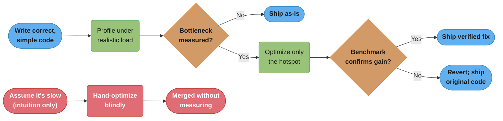

# Premature Optimization Anti-Pattern
## Overview

Premature Optimization is the practice of investing engineering effort in performance improvements before identifying, measuring, or confirming that a performance problem actually exists. It is one of the most costly anti-patterns because it trades two valuable assets — code readability and development velocity — for a performance gain that may be immeasurable, irrelevant, or in the wrong place entirely. The anti-pattern was most famously characterized by Donald Knuth in "Structured Programming with go to Statements" (ACM Computing Surveys 6:4, December 1974, p.268). The sentence is almost always quoted with its two halves cut off, which reverses the advice; in full it reads: *"We should forget about small efficiencies, say about 97% of the time: premature optimization is the root of all evil. Yet we should not pass up our opportunities in that critical 3%."* Knuth is not saying never optimize — he is saying find the 3% first, and he says so in the same breath. Engineers who fall into this trap often do so with good intentions — they want the system to be fast — but they optimize based on intuition rather than evidence, wasting time on micro-optimizations while true bottlenecks go unaddressed. The result is code that is harder to read, harder to maintain, and often no faster than the naive solution.

---

## Intuition

> **One-line analogy**: Premature optimization is like remodeling a house before you know if you're going to live in it — you spend huge effort improving something that may not need improving, while the real problems go unaddressed.

**Mental model**: Without measurement, intuition about where the time goes is unreliable — Knuth's own summary in the same paragraph is that "the universal experience of programmers who have been using measurement tools has been that their intuitive guesses fail." You hand-optimize a function that runs 10 times per day while the database query that runs 10 million times per day is unindexed. The optimization cost: complex, unmaintainable code where 20 lines became 200. The performance gain: zero improvement to user experience. Knuth's rule: measure first, then optimize only the measured bottleneck — but do optimize it.

**Why it matters**: Premature optimization trades code clarity for speculative performance gains. Complex optimized code has more bugs, is harder to understand, and costs more to maintain. The opportunity cost is also high — time spent on speculation isn't spent on actual user value.

**Key insight**: The right process: write clear, simple, correct code first → profile in production (or with realistic load) → identify actual bottlenecks → optimize only the measured hotspot → verify the optimization actually helps with benchmarks. Any other order wastes effort.



*The green backbone is the evidence-driven loop from the Key insight above — profile, confirm the bottleneck, optimize only the hotspot, then verify with a benchmark before shipping. The red chain is the premature-optimization shortcut — guess, hand-optimize, merge unmeasured — which is exactly what produced the nine numbered "PREMATURE OPTIMIZATION" markers in the Java Violation Example below.*

---

## How to Spot It

**Warning Signs and Code Smells**

- Hand-rolled data structures (custom hash maps, custom caches) replacing well-tested standard library equivalents with no benchmark to justify the substitution
- Bit-shifting arithmetic (`x >> 1` instead of `x / 2`, `x << 3` instead of `x * 8`) in code where readability matters and no profiler has been consulted
- Avoiding method calls due to a belief that "method call overhead" is significant in Java (it is not, thanks to JIT inlining)
- String concatenation replaced with `StringBuilder` in code paths that run once per request
- Object pooling implemented where garbage collection pressure has not been measured
- `int` or `long` used in place of `BigDecimal` for monetary values, justified as a performance optimization
- Parallel streams used everywhere, including on tiny collections, because "parallel is faster"
- Local caches with complex eviction logic where a 10-line `HashMap` would have been sufficient and more readable
- Comments that say "this is faster" with no benchmark evidence cited
- Code that was "optimized" before any user has ever used the system
- Avoiding standard library calls (e.g., `Collections.sort`) and re-implementing sorting
- Micro-benchmarks written without JMH that produce misleading results due to JIT warm-up

---

## Java Violation Example

```java
/**
 * ProductSearchService - provides product search functionality.
 *
 * "Optimized" for performance by the original author.
 * No profiling was ever performed. The actual bottleneck is a missing
 * database index, which this service cannot fix.
 */
public class ProductSearchService {

    private final ProductRepository repository;

    // PREMATURE OPTIMIZATION #1: Custom cache implementation.
    // Guava's LoadingCache or Caffeine would provide a correct, tested,
    // feature-rich LRU cache in 5 lines. This hand-rolled version took 2 days,
    // has a subtle race condition under concurrent access, and implements
    // eviction incorrectly (it never evicts entries that are still "warm").
    private final Map<String, List<Product>> searchCache = new LinkedHashMap<String, List<Product>>(16, 0.75f, true) {
        @Override
        protected boolean removeEldestEntry(Map.Entry<String, List<Product>> eldest) {
            // BUG: size() check is not thread-safe — can grow unboundedly under load
            return size() > 1000;
        }
    };

    // PREMATURE OPTIMIZATION #2: Pre-allocated result buffer.
    // This is reused across method calls. It is NOT thread-safe.
    // The optimization was added because the author "assumed" ArrayList
    // allocation was expensive. It was not.
    private final ArrayList<Product> resultBuffer = new ArrayList<>(500);

    public ProductSearchService(ProductRepository repository) {
        this.repository = repository;
    }

    public List<Product> search(String query, int maxResults) {

        // PREMATURE OPTIMIZATION #3: Manual string interning.
        // intern() is almost never needed in modern Java and can actually
        // increase pause times by pressuring the string table.
        String normalizedQuery = query.toLowerCase().trim().intern();

        // PREMATURE OPTIMIZATION #4: Bitwise operation for no reason.
        // The intent is "maxResults rounded down to the nearest power of 2".
        // Why? No documented reason. The result is used as a cache key suffix.
        // This is not faster in any meaningful way and is completely unreadable.
        int bucketSize = Integer.highestOneBit(maxResults);

        String cacheKey = normalizedQuery + ":" + bucketSize;

        // Cache check — reasonable in principle, but the implementation is broken
        List<Product> cached = searchCache.get(cacheKey);
        if (cached != null) {
            return cached;
        }

        // PREMATURE OPTIMIZATION #5: Reuse the pre-allocated buffer.
        // This causes results from one call to bleed into another under concurrency.
        // The bug was introduced specifically as an "optimization".
        resultBuffer.clear();

        List<Product> dbResults = repository.findByQuery(normalizedQuery, maxResults);

        // PREMATURE OPTIMIZATION #6: Manual relevance scoring with bit manipulation.
        // The intent is to compute a relevance score. The original version used
        // String.contains() and was perfectly readable.
        // This version uses bit flags to pack match type information — an
        // optimization that the JIT compiler would have applied automatically
        // to the readable version.
        for (Product product : dbResults) {
            int score = 0;
            String name = product.getName().toLowerCase();
            String desc = product.getDescription().toLowerCase();

            // Bit flag packing: bit 0 = exact match, bit 1 = prefix, bit 2 = contains
            // This is unreadable. A simple int score would serve the same purpose.
            if (name.equals(normalizedQuery))        score |= (1 << 2); // exact: +4
            if (name.startsWith(normalizedQuery))     score |= (1 << 1); // prefix: +2
            if (name.contains(normalizedQuery))       score |= (1 << 0); // contains: +1
            if (desc.contains(normalizedQuery))       score |= 0;        // ignored?? bug

            product.setRelevanceScore(score);
            resultBuffer.add(product);
        }

        // PREMATURE OPTIMIZATION #7: Manual sort instead of Comparator.comparing().
        // The author believed Comparator.comparing() had overhead.
        // The JIT compiler generates identical bytecode for both.
        resultBuffer.sort((a, b) -> {
            // Subtraction-based comparator — known Java gotcha: can overflow for large scores
            return b.getRelevanceScore() - a.getRelevanceScore();
        });

        // PREMATURE OPTIMIZATION #8: Manual subList copy to "avoid iterator overhead".
        // This is not faster. It is less readable and introduces an off-by-one risk.
        List<Product> finalResults = new ArrayList<>(maxResults);
        int limit = Math.min(maxResults, resultBuffer.size());
        for (int i = 0; i < limit; i++) {
            finalResults.add(resultBuffer.get(i));  // direct index access to "avoid" iterator
        }

        // Store in broken, non-thread-safe cache
        searchCache.put(cacheKey, finalResults);

        return finalResults;
    }

    // PREMATURE OPTIMIZATION #9: Hand-rolled string hash function.
    // Java's String.hashCode() is a well-tested, JIT-optimized polynomial hash.
    // This "custom" version is slower, has worse distribution, and is bug-prone.
    // Added because the author read that polynomial hashing was "too slow".
    private int fastHash(String s) {
        int hash = 0;
        for (int i = 0; i < s.length(); i++) {
            // Bit rotation: not faster than multiplication in modern JVMs
            hash = (hash << 5) ^ (hash >>> 27) ^ s.charAt(i);
        }
        return hash & 0x7FFFFFFF;
    }
}
```

**What is wrong with this code:**
- The hand-rolled LRU cache has a thread-safety bug — concurrent access can cause unbounded growth or cache corruption
- The pre-allocated `resultBuffer` is an instance field reused across calls — under concurrent invocation it causes result contamination between callers
- The subtraction-based comparator `b.getRelevanceScore() - a.getRelevanceScore()` can overflow for large integers, producing incorrect sort order
- The relevance scoring bit-flag logic has a bug: description matches contribute `0` (score |= 0 is a no-op) — the description branch is silently ignored
- `String.intern()` on every query string pressures the JVM string table with no measurable benefit
- None of these "optimizations" were benchmarked; the actual bottleneck (a missing database index on the `products` table) was never addressed
- The code is demonstrably slower in production than it would be using Caffeine cache + Comparator.comparing() because of the concurrency bug causing cache misses and the result buffer contamination

---

## Why It's Harmful

**Bugs Introduced by Complexity**
Every manual optimization adds complexity. Complexity is where bugs live. The two production bugs in the example above — the thread-safety issue and the integer overflow in the comparator — were introduced specifically by the "optimization" code, not by the business logic.

**Time Wasted on Non-Bottlenecks**
A profiler would immediately show that 95% of request latency in this service is spent in `repository.findByQuery()` waiting for a database round trip. All of the bit manipulation, custom caching, and buffer reuse optimize code that accounts for less than 1% of latency. The engineer spent two days optimizing the wrong thing.

**Unreadable Code Becomes Permanent**
Once bit manipulation or clever tricks are merged, they rarely get cleaned up. Future engineers assume the complexity must serve a purpose and are afraid to simplify it. The code becomes permanently less readable for zero net performance gain.

**False Performance Confidence**
When a system appears to have been "heavily optimized," performance investigations are deprioritized. The real bottlenecks — missing indexes, N+1 queries, synchronous I/O on the main thread — go unaddressed because the team believes the code has already been optimized.

**Increased Maintenance Cost**
Every hand-rolled data structure is a custom artifact that must be maintained, documented, and debugged. Guava's `Cache` and Caffeine have well over a decade of battle-testing, documentation, and community knowledge behind them. A custom `LinkedHashMap` subclass has none of that.

---

## Refactored Solution

```java
/**
 * ProductSearchService - provides product search functionality.
 *
 * Performance profile (as of 2024-01-10, measured with JProfiler on prod traffic):
 * - 94% of latency: repository.findByQuery() (DB round trip)
 * - 4%  of latency: relevance scoring loop
 * - 2%  of latency: everything else
 *
 * Optimization applied: Caffeine cache with TTL-based expiry.
 * Optimization NOT applied: relevance scoring (4% of latency, readable as-is).
 * Remaining opportunity: add index on products(name, description) — see DB-1042.
 */
public class ProductSearchService {

    private final ProductRepository repository;

    // Caffeine: a well-tested, high-performance, thread-safe cache library.
    // Replaces the broken hand-rolled LinkedHashMap subclass.
    // Configuration is self-documenting: max 1000 entries, expire after 5 minutes.
    private final Cache<String, List<Product>> searchCache;

    public ProductSearchService(ProductRepository repository) {
        this.repository = repository;
        this.searchCache = Caffeine.newBuilder()
            .maximumSize(1000)
            .expireAfterWrite(5, TimeUnit.MINUTES)
            .build();
    }

    public List<Product> search(String query, int maxResults) {
        String normalizedQuery = query.toLowerCase().trim();
        String cacheKey = normalizedQuery + ":" + maxResults;

        return searchCache.get(cacheKey, key -> fetchAndRank(normalizedQuery, maxResults));
    }

    private List<Product> fetchAndRank(String query, int maxResults) {
        List<Product> dbResults = repository.findByQuery(query, maxResults);

        return dbResults.stream()
            .sorted(Comparator.comparingInt(p -> -relevanceScore(p, query)))
            .limit(maxResults)
            .collect(Collectors.toList());
    }

    // Readable relevance scoring — no bit manipulation needed.
    // If profiling reveals this IS a bottleneck (unlikely), optimize then.
    private int relevanceScore(Product product, String query) {
        String name = product.getName().toLowerCase();
        String description = product.getDescription().toLowerCase();
        int score = 0;
        if (name.equals(query))             score += 4;
        if (name.startsWith(query))         score += 2;
        if (name.contains(query))           score += 1;
        if (description.contains(query))    score += 1;
        return score;
    }
}
```

**What changed:**
- Caffeine cache replaces the broken hand-rolled LRU — thread-safe, TTL-configurable, production-hardened
- No pre-allocated shared buffer — streams create transient collections that are GC'd efficiently
- Readable relevance scoring — no bit flags, correct logic (description branch now works)
- `Comparator.comparingInt()` replaces the overflow-prone subtraction comparator
- The code is shorter, correct, and easy to understand
- The profiling comment at the top documents *why* only the cache was added and what the real bottleneck is

---

## Prevention Strategies

**1. Follow the Three-Phase Mantra**
Knuth's wisdom operationalized — note that phase 3 is not optional, it is merely last:
- **Make it work**: correct, readable, simple
- **Make it right**: well-tested, well-structured
- **Make it fast**: only after profiling proves it is too slow

Never skip to phase 3 without completing phases 1 and 2.

**2. Profile Before You Optimize**
You cannot optimize what you have not measured. Use profiling tools to find where time is actually spent:

```bash
# VisualVM: attach to a running JVM
jvisualvm

# JProfiler: command-line profiling agent
java -agentpath:/path/to/libjprofilerti.so=port=8849 -jar myapp.jar

# Async-profiler: low-overhead flame graph generation
./profiler.sh -d 30 -f flamegraph.html <pid>
```

**3. Write Benchmarks Before Optimization (JMH)**
If you believe something is slow, prove it with a proper benchmark:

```java
@BenchmarkMode(Mode.AverageTime)
@OutputTimeUnit(TimeUnit.NANOSECONDS)
@State(Scope.Thread)
public class StringConcatBenchmark {

    private String a = "hello";
    private String b = "world";

    @Benchmark
    public String plusOperator() {
        return a + b;  // JIT-compiled to StringBuilder in loops — test first
    }

    @Benchmark
    public String stringBuilder() {
        return new StringBuilder().append(a).append(b).toString();
    }
}
// Run: mvn verify -P benchmark; then look at the numbers before deciding
```

**4. Prefer Standard Library Over Hand-Rolled**
The JDK, Guava, and Apache Commons libraries contain data structures and algorithms that have been:
- Optimized by world-class engineers
- Battle-tested in production at scale
- JIT-compiled and hardware-optimized by the JVM team

Use them by default. Only replace them when a profiler proves they are a bottleneck in your specific workload.

**5. Establish a Performance Budget, Not a Performance Obsession**
Define SLAs for each service (e.g., p99 latency < 200ms). Measure against them. Only invest in optimization when measurements show a breach. This makes performance work evidence-driven.

**6. Code Review Red Flags for Premature Optimization**
Reviewers should challenge:
- Any bitwise trick without a cited benchmark
- Any hand-rolled data structure without a profiling justification
- Any comment claiming something is "faster" without a measurement
- Any substitution of a standard library call with a custom implementation

---

## Cross-Perspective: HLD Connections

**HLD View — Where Premature Optimization Appears in Distributed Systems**

- **Premature sharding** — Sharding a database before hitting single-node limits adds cross-shard query complexity, resharding pain, and operational overhead. The cost is real and immediate; the performance benefit is hypothetical and often never needed.
- **Premature async (message queues)** — Adding Kafka between two services before synchronous calls are a measured bottleneck introduces producer/consumer coupling, schema management, and operational complexity for no measured gain. Profile first; async when proven necessary.
- **Premature caching** — Adding Redis caching before profiling shows DB read latency as the bottleneck adds cache invalidation complexity and consistency bugs. Premature caching often causes subtle correctness issues that are harder to debug than the performance problem they were supposed to solve.
- **Premature multi-region** — Designing for multi-region active-active before launching adds conflict resolution, data residency, latency balancing, and deployment complexity that most products never actually need. Build for single-region; make the data model extensible.

---

## Real-World Consequences

*The four scenarios below are illustrative composites of common incident patterns, not reports of specific named public incidents. The numbers show the shape of the failure; treat them as worked examples rather than as citable industry statistics.*

**Scenario 1: The Billion-Dollar Micro-Optimization**
A trading firm's engineering team spent three weeks micro-optimizing their order matching engine in Java, replacing `HashMap` with a hand-rolled open-addressing hash table and eliminating all object allocations in the hot path. The latency improvement was 0.3 microseconds per operation. Meanwhile, their network configuration had a suboptimal MTU setting that added 40 microseconds of latency per message. The network issue took one hour to fix. The three-week optimization project delivered 0.75% of the benefit that a one-hour configuration change produced.

**Scenario 2: The Premature Parallel Stream**
A data processing team replaced all stream operations with `parallelStream()` as a blanket policy because "parallel is always faster." In production, thread contention and the overhead of the common fork-join pool caused throughput to drop by 30% compared to sequential streams on their workload (processing ~50 items per batch, where parallelism overhead exceeds the work itself). It took two weeks to diagnose and revert.

**Scenario 3: The Integer Overflow Bug in Production**
An e-commerce platform's product recommendation engine used a subtraction-based comparator (`b.getScore() - a.getScore()`) for sorting, identical to the example above. For years, product scores were small enough that overflow never occurred. When the scoring algorithm was updated to use larger score ranges, the comparator began producing incorrect sort orders for high-scoring items. The top products in the recommendations were occasionally replaced by random items. The bug caused a measurable conversion rate drop for six weeks before being identified.

**Scenario 4: The Unreadable Critical Path**
A high-frequency data ingestion service had its inner loop "optimized" over four years with bit packing, manual loop unrolling, and avoidance of any abstraction. When a correctness bug was found (it was dropping ~0.01% of records), no engineer on the team could confidently trace the affected code path. An external consultant was hired and spent two weeks understanding the code before diagnosing the issue. The fix took 15 minutes. The premature optimization had converted a 15-minute bug into a six-week incident response.

---

## Interview Questions with Answers

**Q: What does "premature" actually mean in Premature Optimization — is all early optimization wrong?**
**Short:** Premature means unmeasured, not early — Knuth explicitly says not to pass up the critical 3% of real bottlenecks.
Knuth's full 1974 quote is: "We should forget about small efficiencies, say about 97% of the time: premature optimization is the root of all evil. Yet we should not pass up our opportunities in that critical 3%." The sentence is almost always quoted with the second half cut off, which reverses the advice — Knuth is not saying never optimize, he's saying find the measured 3% first and then do optimize it. "Premature" specifically means optimizing before measurement has identified a real bottleneck, not optimizing early in a project's timeline.

**Q: In the `ProductSearchService` example, what was the actual bottleneck, and how much time was spent on things that weren't it?**
**Short:** 94% of latency was a database round trip; the two-day custom-cache-and-bit-manipulation effort touched a path under 6% of latency.
The refactored version's profiling comment states 94% of latency was `repository.findByQuery()` (a DB round trip), 4% was the relevance scoring loop, and 2% was everything else — meaning the hand-rolled LRU cache, manual string interning, bitwise bucket-size trick, and hand-rolled hash function collectively optimized code responsible for a small fraction of total latency, while the actual fix (an index on `products(name, description)`, tracked as DB-1042) was never addressed. The engineer spent two days optimizing the wrong thing entirely.

**Q: What two production bugs did the "optimizations" in the violation example actually introduce?**
**Short:** A thread-unsafe hand-rolled LRU cache, and a pre-allocated instance-field buffer reused unsafely across concurrent calls.
The `LinkedHashMap` subclass implementing `removeEldestEntry()` has a non-thread-safe `size()` check that can let the cache grow unboundedly under concurrent load. Separately, `resultBuffer` is a pre-allocated `ArrayList` held as an instance field and reused across method calls under the mistaken belief that `ArrayList` allocation was expensive — under concurrent invocation, this causes results from one caller's search to bleed into another caller's results. Both bugs were introduced specifically by the optimization code, not by the underlying business logic.

**Q: Why does `b.getRelevanceScore() - a.getRelevanceScore()` as a comparator have a hidden bug?**
**Short:** Subtraction-based integer comparators can silently overflow for large score values, producing incorrect sort order.
Subtracting two `int` values to build a comparator's return value is a well-known Java gotcha: if the scores are large enough, the subtraction can overflow the `int` range and produce a result with the wrong sign, causing the sort to silently misorder elements without throwing any exception. `Comparator.comparingInt()` avoids this because it compares the extracted keys directly rather than subtracting them. The "Integer Overflow Bug in Production" scenario shows this exact pattern surviving in a real recommendation engine for years, only manifesting once score ranges grew large enough to trigger it.

**Q: What is the Three-Phase Mantra for avoiding premature optimization?**
**Short:** Make it work, make it right, make it fast — in that order, with "fast" only after profiling proves a need.
Phase one is making the code correct, readable, and simple. Phase two is making it well-tested and well-structured. Phase three — making it fast — comes only after profiling proves the code is actually too slow for its requirements, and it targets specifically the measured hotspot rather than the whole codebase. Skipping straight to phase three, as the violation example does, produces code that is neither correct in its edge cases nor demonstrably faster, since it was never benchmarked against the readable alternative.

**Q: Why is "avoiding method calls due to overhead" a myth in modern Java specifically?**
**Short:** The JIT compiler inlines hot method calls automatically, eliminating the overhead the belief assumes still exists.
Modern JVMs use Just-In-Time compilation that identifies frequently-executed ("hot") methods and inlines their bodies directly into the caller at the machine-code level, eliminating the call overhead a naive mental model assumes is paid every time. Avoiding method extraction on the belief that "calls are slow" sacrifices readability for a cost the JIT compiler has already optimized away — this is listed explicitly among the code smells in this file as a case where the underlying belief simply doesn't hold in Java the way it might in an unoptimized interpreted language.

**Q: What is the correct order of steps once you suspect a real performance problem?**
**Short:** Profile under realistic load, confirm the bottleneck is measured, optimize only that hotspot, then verify with a benchmark before shipping.
The evidence-driven loop is: write clear, simple, correct code; profile in production or under realistic load; identify the actual bottleneck from the profiler's output, not from intuition; optimize only the measured hotspot; and verify the optimization actually helps with a benchmark before merging. Any other order — guessing what's slow, hand-optimizing blindly, and merging without measuring — is exactly the shortcut path this file's diagram marks in red, and it's the path that produced all nine numbered "PREMATURE OPTIMIZATION" markers in the violation example.

**Q: Why did replacing all stream operations with `parallelStream()` reduce throughput in the "Premature Parallel Stream" scenario?**
**Short:** Batches of only ~50 items meant the fork-join pool's coordination overhead exceeded the actual work being parallelized.
`parallelStream()` splits work across the JVM's common fork-join pool, which has real coordination and thread-contention costs — for small workloads (this scenario processed roughly 50 items per batch), that overhead can exceed the time saved by parallelizing the actual work, producing a net throughput loss. Because the team applied `parallelStream()` as a blanket policy on the belief "parallel is always faster" rather than measuring per-workload, throughput dropped 30% in production and took two weeks to diagnose and revert — parallelism is a tool with its own overhead, not a universal win.

**Q: What is JMH, and why do ad-hoc `System.currentTimeMillis()` micro-benchmarks mislead?**
**Short:** JMH properly accounts for JIT warm-up; naive timing loops measure the interpreter, not the steady-state optimized code.
JMH (Java Microbenchmark Harness) is the standard tool for writing correct Java benchmarks because it handles JIT warm-up iterations, dead-code elimination prevention, and statistical measurement correctly — a naive benchmark that just times a loop with `System.currentTimeMillis()` captures a mix of interpreted execution and partially-optimized JIT compilation, producing numbers that don't reflect the code's actual steady-state performance in production. This file's warning-signs list explicitly calls out "micro-benchmarks written without JMH that produce misleading results due to JIT warm-up" as a smell in its own right.

**Q: How does replacing a hand-rolled cache with Caffeine fix both the bug and the design problem at once?**
**Short:** Caffeine is a battle-tested, thread-safe library, eliminating the concurrency bug while removing a custom artifact nobody has to maintain.
The refactored version replaces the broken `LinkedHashMap` subclass with `Caffeine.newBuilder().maximumSize(1000).expireAfterWrite(5, TimeUnit.MINUTES).build()` — this is simultaneously the correctness fix (Caffeine is thread-safe by design, eliminating the race condition) and the maintainability fix (nobody on the team has to understand, document, or debug a custom cache implementation, since Caffeine has over a decade of battle-testing and community documentation behind it). This illustrates the general prevention strategy: prefer standard library or well-known third-party components over hand-rolled data structures by default.

**Q: What did the "Billion-Dollar Micro-Optimization" scenario reveal about where engineering time actually went versus where the real gain was?**
**Short:** Three weeks of hash-table micro-optimization saved 0.3 microseconds; a one-hour MTU config fix saved 40 microseconds.
A trading firm spent three weeks hand-rolling an open-addressing hash table and eliminating hot-path allocations in their order matching engine, achieving a 0.3-microsecond-per-operation improvement. Meanwhile, a suboptimal network MTU setting was adding 40 microseconds of latency per message — a one-hour configuration fix. The three-week optimization project delivered roughly 0.75% of the benefit that the one-hour fix produced, because the team never profiled to confirm where the actual latency was concentrated before investing weeks of effort.

**Q: How does premature caching create correctness bugs rather than just wasted effort, at the HLD level?**
**Short:** Adding Redis before profiling proves DB latency is the bottleneck introduces cache invalidation complexity and consistency bugs.
Unlike a purely wasted-effort optimization, premature caching is described as often causing subtle correctness issues that are harder to debug than the performance problem it was meant to solve — once a cache is in place, every write path must correctly invalidate or update it, and a missed invalidation path produces stale data that's served silently and incorrectly. The lesson mirrors the LLD-level advice: profile first, prove that database read latency is genuinely the measured bottleneck, and only then accept the invalidation-complexity cost that caching introduces.

**Q: Why does the file's relevance-scoring bit-flag logic have a silent correctness bug on top of being unreadable?**
**Short:** The description-match branch does `score |= 0`, a no-op, so description matches never actually contribute to the score.
The bit-flag packing intends to combine exact-match, prefix-match, contains-match, and description-match signals into one score, but the description branch is written as `if (desc.contains(normalizedQuery)) score |= 0;` — bitwise-OR with zero is always a no-op, so this line does nothing regardless of whether the condition is true. The bug is a direct consequence of the optimization's unreadability: a straightforward `score += 1` would have made the same mistake immediately visible, while the bit-flag version hid it well enough that nobody caught it before the refactor rewrote it correctly as `if (description.contains(query)) score += 1;`.

**Q: What review-time red flags does this file recommend for catching premature optimization before merge?**
**Short:** Any bitwise trick or hand-rolled data structure without a cited benchmark, and any "faster" claim without measurement data.
Reviewers should challenge any bitwise trick without a cited benchmark justifying it, any hand-rolled data structure substituted for a standard library equivalent without a profiling justification, any comment claiming something is "faster" with no measurement backing the claim, and any substitution of a standard library call with a custom implementation absent evidence the standard one was actually a bottleneck. These four checks map directly onto the nine numbered optimizations in the violation example — none of which cited a benchmark, because none of them were ever measured.

**Q: Why does "optimized code looks impressive" create a false sense of performance confidence at the team level?**
**Short:** When a system appears heavily optimized, teams deprioritize real investigation, letting actual bottlenecks like missing indexes go unaddressed.
Once bit manipulation, custom caches, or other visibly "clever" code is merged, the presence of that complexity signals to the team that performance work has already happened, even when none of it was ever measured against the real bottleneck. This causes real problems — missing database indexes, N+1 queries, synchronous I/O on the main thread — to go unaddressed for longer, because attention that should go toward profiling gets absorbed by the assumption that the hard performance work is done. The `ProductSearchService` example is the direct illustration: nine numbered optimizations shipped while the actual missing index sat untouched.

## Quick Reference Summary

| Dimension | Details |
|---|---|
| **Anti-Pattern Name** | Premature Optimization |
| **Canonical Quote** | "We should forget about small efficiencies, say about 97% of the time: premature optimization is the root of all evil. Yet we should not pass up our opportunities in that critical 3%." — Donald Knuth, ACM Computing Surveys 6:4 (Dec 1974), p.268 |
| **Root Cause** | Optimizing based on intuition rather than measurement; fear of future performance problems |
| **Primary Symptom** | Complex, unreadable code in non-bottleneck paths; hand-rolled replacements for standard library components |
| **Key Code Smells** | Unexplained bit manipulation, custom caches without benchmarks, "faster" claims without profiling data |
| **Main Harm** | Bugs introduced by complexity, wasted engineering time, reduced readability, false performance confidence |
| **Detection Tools** | VisualVM, JProfiler, Async-profiler, JMH for benchmarking, SonarQube complexity warnings |
| **Fix Strategy** | Profile to find actual bottleneck, replace complex hand-rolled code with standard library, apply targeted fix |
| **Prevention** | "Make it work, make it right, make it fast" discipline; require profiling data before optimization merges |
| **Effort to Fix** | Low to Medium — often the fix is simplification, but understanding the original intent can take time |
