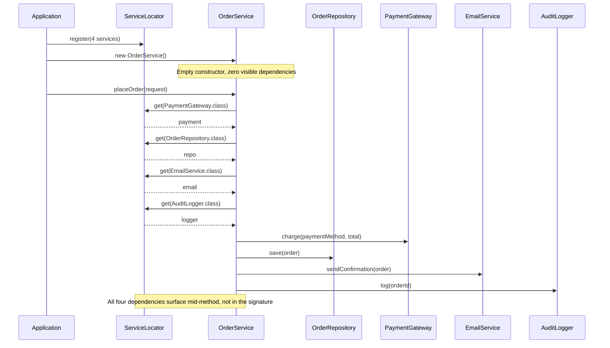
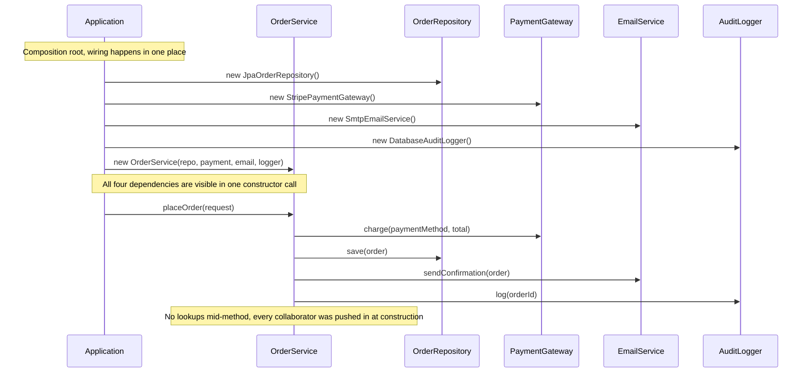

# Anti-Pattern: Service Locator
## What It Is

The Service Locator pattern provides a centralized registry where services (dependencies) can be looked up by name or type at runtime. Any class can call the locator to obtain a dependency instead of receiving it through a constructor or setter.

Get the attribution right, because it is commonly mangled. The "Service Locator is an anti-pattern" position is **Mark Seemann's** (2010), and it rests on the hidden-dependency argument: the class compiles and constructs fine while its real requirements stay invisible, so the failure shows up at runtime. Martin Fowler's 2004 article "Inversion of Control Containers and the Dependency Injection pattern" — the piece everyone cites here — does **not** condemn Service Locator. Fowler presents the two as alternatives that "provide the fundamental decoupling that's missing in the naive example", says his preference is "to start with constructor injection", and concludes that "the choice between Service Locator and Dependency Injection is less important than the principle of separating service configuration from the use of services." Citing Fowler as calling it an anti-pattern is a misattribution.

The rest of this file argues the Seemann position, which is the mainstream one for application business logic; the "When Service Locator Is Acceptable" section below is where Fowler's nuance lands.

The contrast:
- **Service Locator**: Dependencies are pulled from a global registry inside the class.
- **Dependency Injection**: Dependencies are pushed into the class from outside.

---

## Intuition

> **One-line analogy**: Service Locator is like a warehouse where workers walk in and grab whatever tools they need without anyone tracking what each worker requires — you can't tell what anyone needs until they're mid-task.

**Mental model**: Instead of a class declaring its dependencies up front (via constructor injection), it sneaks off to a global registry and pulls them at runtime. The class looks simple from the outside — a two-field constructor — but internally it has hidden wires running to a global container. When you want to test it, you have to pre-populate the locator; when you want to understand it, you have to trace every `locator.get()` call inside.

**Why it matters**: Hidden dependencies are the root of test friction and debugging pain. If a class doesn't declare what it needs, you can't reason about it in isolation, mock it cleanly, or refactor it safely.

**Key insight**: The difference between Dependency Injection and Service Locator is *who is in control*. DI pushes dependencies in (explicit, testable). Service Locator pulls them out (implicit, hidden). Always prefer explicit over implicit.

---

## How to Recognize It

**Code smells:**
- A class contains calls like `ServiceLocator.get(OrderRepository.class)` or `ServiceLocator.resolve("emailService")`
- Dependencies are not visible in a class's constructor or method signatures
- A global `ServiceLocator`, `Registry`, `Container`, or `Context` class is used throughout business logic
- You cannot tell what a class depends on by reading its constructor

**Example — The Anti-Pattern:**

```java
// The Service Locator itself
public class ServiceLocator {

    private static final Map<Class<?>, Object> services = new HashMap<>();

    public static <T> void register(Class<T> type, T implementation) {
        services.put(type, implementation);
    }

    @SuppressWarnings("unchecked")
    public static <T> T get(Class<T> type) {
        T service = (T) services.get(type);
        if (service == null) {
            throw new IllegalStateException("No service registered for: " + type.getName());
        }
        return service;
    }
}

// Registration at startup
public class Application {
    public static void main(String[] args) {
        ServiceLocator.register(OrderRepository.class, new JpaOrderRepository());
        ServiceLocator.register(EmailService.class, new SmtpEmailService());
        ServiceLocator.register(PaymentGateway.class, new StripePaymentGateway());
        ServiceLocator.register(AuditLogger.class, new DatabaseAuditLogger());

        new OrderController().placeOrder(new OrderRequest());
    }
}

// Consumer: uses Service Locator to pull dependencies
public class OrderService {

    public Order placeOrder(OrderRequest request) {
        // Hidden dependencies — you cannot tell what this class needs
        // from its constructor signature alone
        OrderRepository repo = ServiceLocator.get(OrderRepository.class);
        EmailService email = ServiceLocator.get(EmailService.class);
        PaymentGateway payment = ServiceLocator.get(PaymentGateway.class);
        AuditLogger logger = ServiceLocator.get(AuditLogger.class);

        Order order = Order.create(request);
        payment.charge(request.getPaymentMethod(), order.getTotal());
        repo.save(order);
        email.sendConfirmation(order);
        logger.log("Order placed: " + order.getId());
        return order;
    }
}
```

The runtime collaboration makes the "pull" model concrete: `OrderService`'s constructor takes zero arguments, so all four collaborators surface only as `ServiceLocator.get()` calls buried inside `placeOrder()` — invisible until you read the method body.



**Testing problem:**

```java
// To test OrderService, you must configure the global ServiceLocator
// Any test that forgets to register a service will fail with a runtime error
class OrderServiceTest {

    @BeforeEach
    void setup() {
        // Must remember to register every single dependency
        // If a new dependency is added to OrderService, tests silently break at runtime
        ServiceLocator.register(OrderRepository.class, mock(OrderRepository.class));
        ServiceLocator.register(EmailService.class, mock(EmailService.class));
        ServiceLocator.register(PaymentGateway.class, mock(PaymentGateway.class));
        ServiceLocator.register(AuditLogger.class, mock(AuditLogger.class));
        // Forgot to register one? Runtime IllegalStateException, not a compile error
    }

    @Test
    void placeOrder_chargesPaymentAndSavesOrder() {
        OrderService service = new OrderService();
        // ...
    }
}
```

---

## Why It Happens

1. **Avoiding constructor parameter explosion**: When a class has many dependencies, developers avoid adding more constructor parameters and reach for a registry instead.
2. **Legacy framework design**: Older Java EE patterns (JNDI lookups, EJB home interfaces) used service location heavily. Developers carry these habits forward.
3. **Retrofitting DI**: Teams that want to decouple classes but don't have a DI framework use a hand-rolled Service Locator as a substitute.
4. **Plugin / extension points**: Some plugin architectures genuinely need late-bound service discovery — Service Locator feels natural here, even when it is not the best fit.

---

## Why It's Harmful

1. **Hidden dependencies (the core problem)**: A class's contract — what it needs to function — is invisible. You must read the entire method body to find out what it depends on.
2. **Runtime failures instead of compile-time failures**: If a service is not registered, you get an exception at runtime, possibly deep in a call stack. Constructor injection fails at object construction time or at container startup.
3. **Tight coupling to the locator itself**: Every class is coupled to `ServiceLocator`. This makes the locator a God Object and makes porting or testing classes in isolation impossible without the locator.
4. **Non-obvious test setup**: Tests must manually configure global state before each run. Adding a new dependency to a class does not break the compiler — it breaks tests at runtime.
5. **Harder to trace data flow**: IDEs cannot show you what implements `OrderRepository` when it is pulled from a map by type at runtime. Static analysis is undermined.
6. **Thread safety**: If services are registered at startup and the map is shared, concurrent registration can cause race conditions.

---

## How to Fix It

Replace Service Locator calls with **Constructor Injection**. All dependencies are declared in the constructor — they are explicit, compile-time-checked, and injectable with test doubles.

```java
// Refactored: constructor injection — dependencies are explicit and visible
public class OrderService {

    private final OrderRepository orderRepository;
    private final EmailService emailService;
    private final PaymentGateway paymentGateway;
    private final AuditLogger auditLogger;

    // Every dependency is declared here — no surprises
    public OrderService(OrderRepository orderRepository,
                        EmailService emailService,
                        PaymentGateway paymentGateway,
                        AuditLogger auditLogger) {
        this.orderRepository = orderRepository;
        this.emailService = emailService;
        this.paymentGateway = paymentGateway;
        this.auditLogger = auditLogger;
    }

    public Order placeOrder(OrderRequest request) {
        Order order = Order.create(request);
        paymentGateway.charge(request.getPaymentMethod(), order.getTotal());
        orderRepository.save(order);
        emailService.sendConfirmation(order);
        auditLogger.log("Order placed: " + order.getId());
        return order;
    }
}

// Wiring happens in one place — the composition root
public class Application {
    public static void main(String[] args) {
        OrderRepository repo = new JpaOrderRepository();
        EmailService email = new SmtpEmailService();
        PaymentGateway payment = new StripePaymentGateway();
        AuditLogger logger = new DatabaseAuditLogger();

        OrderService service = new OrderService(repo, email, payment, logger);
        // ...
    }
}

// Tests are clean — inject mocks directly, no global state
class OrderServiceTest {

    private OrderRepository mockRepo;
    private EmailService mockEmail;
    private PaymentGateway mockPayment;
    private AuditLogger mockLogger;
    private OrderService orderService;

    @BeforeEach
    void setup() {
        mockRepo = mock(OrderRepository.class);
        mockEmail = mock(EmailService.class);
        mockPayment = mock(PaymentGateway.class);
        mockLogger = mock(AuditLogger.class);
        // If OrderService gains a new dependency, this line fails at compile time
        orderService = new OrderService(mockRepo, mockEmail, mockPayment, mockLogger);
    }

    @Test
    void placeOrder_chargesPaymentGateway() {
        OrderRequest request = new OrderRequest(paymentMethod(), items());
        orderService.placeOrder(request);
        verify(mockPayment).charge(any(), any());
    }

    @Test
    void placeOrder_savesOrderToRepository() {
        orderService.placeOrder(new OrderRequest(paymentMethod(), items()));
        verify(mockRepo).save(any(Order.class));
    }
}
```

Mirror this against the diagram above: the composition root constructs every collaborator and pushes all four into `OrderService`'s constructor in a single call — `placeOrder()` makes no lookups at all, it only uses what it already holds.



**Using Spring for wiring (the standard approach):**

```java
@Service
public class OrderService {

    private final OrderRepository orderRepository;
    private final EmailService emailService;
    private final PaymentGateway paymentGateway;

    // Spring injects these at startup — no ServiceLocator needed
    @Autowired
    public OrderService(OrderRepository orderRepository,
                        EmailService emailService,
                        PaymentGateway paymentGateway) {
        this.orderRepository = orderRepository;
        this.emailService = emailService;
        this.paymentGateway = paymentGateway;
    }
}
```

---

## Service Locator vs Dependency Injection — Side by Side

| Aspect | Service Locator | Dependency Injection |
|---|---|---|
| Dependencies visible in signature? | No — hidden inside method body | Yes — in constructor |
| Failure mode | Runtime exception | Compile error or startup failure |
| Testability | Requires global setup | Inject mocks directly |
| Coupling | Coupled to locator | Coupled only to interface |
| Traceability | Hard — dynamic lookup | Easy — static analysis works |
| When to use | Plugin discovery, dynamic resolution | Almost everything else |

---

## When Service Locator Is Acceptable

Service Locator is not always wrong. It is appropriate when:
- Building a plugin system where implementations are discovered at runtime from the classpath
- Implementing a framework (e.g., a servlet container locating request handlers)
- The consumer genuinely does not know at compile time what it will need

Even in these cases, the Service Locator should be used at the **boundary** of the system — not inside business logic classes.

---

## Real-World Examples

- **JNDI in Java EE**: `InitialContext.lookup("java:comp/env/jdbc/MyDS")` — the original Service Locator pattern in Java.
- **Android's `getSystemService()`**: Technically Service Locator, but appropriate here since Android's framework controls the lifecycle.
- **Spring's `ApplicationContext.getBean()`**: When used inside business logic (not the composition root), this is Service Locator abuse.
- **OSGi service registry**: Legitimate use — dynamic, runtime plugin discovery.

---

## Prevention Strategies

1. **Constructor injection as the default**: Always inject dependencies through constructors. This is enforced by most modern DI frameworks.
2. **Use a DI framework**: Spring, Guice, or Dagger eliminate the need for hand-rolled registries.
3. **Composition root discipline**: Service wiring belongs in one place — the application entry point or configuration class. Never inside domain/business logic.
4. **Code review**: Flag any call to a global registry inside a service or repository class.
5. **The test smell rule**: If setting up a unit test requires configuring global state, the production code has a design problem.

---

## Cross-Perspective: HLD Connections

**HLD View — Where Service Locator Appears in Distributed Systems**

- **Hard-coded service URLs** — A service that calls `http://order-service.internal:8080/api/orders` instead of resolving the address via service discovery is a distributed Service Locator: dependencies are hidden in code rather than declared and injected via config.
- **Implicit service discovery** — When service addresses are resolved via a global registry without being declared as explicit dependencies (not in env vars, not in the service's declared dependency graph), operators can't reason about what a service calls — same hidden-dependency problem as the Service Locator pattern.
- **Opaque API gateway routing** — An API gateway that silently routes requests to backend services without publishing its routing table creates a Service Locator effect: clients can't reason about what calls what, making tracing, debugging, and incident response harder.
- **Static config mixed with service resolution** — Config files or environment variables that contain both static values and dynamically resolved service addresses without distinction create opaque dependency graphs — the distributed equivalent of `ServiceLocator.resolve()` calls scattered through business logic.

---

## Interview Questions with Answers

**Q: Why is Service Locator harder to test than constructor injection when both hide the dependency inside the class?**
**Short:** Service Locator's dependency is hidden AND must be globally registered before the test runs, unlike DI which just needs a passed argument.
With constructor injection, a dependency is visible in the constructor signature even though it is "hidden" from callers who only see the interface — a test simply passes a mock argument and is done. With Service Locator, the dependency is invisible in the constructor (`OrderService`'s constructor takes zero arguments) and the test must additionally pre-populate a global `ServiceLocator` registry before instantiating the class, and if a new dependency is added to the class later, existing tests don't fail to compile — they fail at runtime with `IllegalStateException` when the forgotten service isn't registered. That shift from a compile-time signature mismatch to a runtime lookup failure is what makes Service Locator strictly worse for testability.

**Q: Who actually called Service Locator an anti-pattern, and who is commonly misattributed?**
**Short:** Mark Seemann (2010) argued it's an anti-pattern; Martin Fowler (2004) presented it as a legitimate alternative to DI.
The "Service Locator is an anti-pattern" position belongs to Mark Seemann (2010), resting on the hidden-dependency argument. Martin Fowler's widely-cited 2004 article "Inversion of Control Containers and the Dependency Injection pattern" does not condemn Service Locator — Fowler presents DI and Service Locator as alternatives that both "provide the fundamental decoupling that's missing in the naive example," states his own preference is "to start with constructor injection," but concludes the choice between the two "is less important than the principle of separating service configuration from the use of services." Citing Fowler as calling it an anti-pattern is a factual misattribution worth getting right in an interview.

**Q: What is the core mechanical difference between Service Locator and Dependency Injection?**
**Short:** DI pushes dependencies into a class from outside; Service Locator has the class pull them from a global registry.
In Dependency Injection, the composition root constructs all dependencies and passes them into the consuming class's constructor — the class receives what it needs without asking for it. In Service Locator, the class itself reaches out mid-method to a global registry (`ServiceLocator.get(OrderRepository.class)`) and pulls what it needs. The practical consequence is visibility: DI's dependencies show up in the constructor signature and can be verified by the compiler; Service Locator's dependencies are buried inside method bodies and are invisible until you read the full implementation.

**Q: Why does a missing dependency fail differently under Service Locator versus constructor injection?**
**Short:** Service Locator fails at runtime with an exception; constructor injection fails to compile or fails at startup.
If a service was never registered with the `ServiceLocator`, the failure surfaces as a runtime `IllegalStateException`, possibly deep in a call stack, the first time that code path executes — which could be in production, long after deployment. With constructor injection, forgetting to wire a dependency either fails to compile (if a test tries to construct the object without all required parameters) or fails immediately at application startup when the DI container tries to resolve the graph. Constructor injection converts an unpredictable runtime failure into an immediate, deterministic one.

**Q: Is Service Locator always wrong? When is it actually appropriate?**
**Short:** It's appropriate at system boundaries — plugin discovery, framework internals — never inside business logic.
Service Locator is legitimate when building a plugin system where implementations are discovered at runtime from the classpath, when implementing a framework like a servlet container locating request handlers, or when the consumer genuinely cannot know at compile time what it will need. Even in these cases, the Service Locator should be used at the boundary of the system, not inside business logic classes — `OrderService.placeOrder()` reaching into a locator is the abuse; a plugin-loading bootstrap doing so is normal.

**Q: Give two real-world Java/Android APIs that are technically Service Locator, and explain why one is more acceptable than the other.**
**Short:** JNDI's InitialContext.lookup() and Android's getSystemService() are both Service Locator; Android's is more acceptable at its framework boundary.
JNDI's `InitialContext.lookup("java:comp/env/jdbc/MyDS")` is the original Service Locator pattern in Java EE. Android's `getSystemService()` is technically the same pattern, but it is more acceptable because Android's framework controls the component lifecycle and the lookup happens at a well-defined system boundary rather than being scattered through arbitrary business logic. `Spring's ApplicationContext.getBean()` used inside business logic (rather than at the composition root) is the abusive case — Spring's constructor-injected `@Autowired` fields are the framework's own recommended alternative.

**Q: How would you refactor the `OrderService` example from Service Locator to constructor injection?**
**Short:** Declare all four dependencies as constructor parameters, remove the ServiceLocator.get() calls, and wire everything at one composition root.
Replace `OrderRepository repo = ServiceLocator.get(OrderRepository.class);` and the three similar lines inside `placeOrder()` with four `private final` fields set through the constructor: `public OrderService(OrderRepository orderRepository, EmailService emailService, PaymentGateway paymentGateway, AuditLogger auditLogger)`. Then move the object construction that used to happen via `ServiceLocator.register()` calls into a single composition root — either a hand-written `Application.main()` or a Spring `@Service`-annotated class where `@Autowired` lets the container inject the four collaborators automatically. `placeOrder()` itself is unchanged except that it no longer performs any lookups.

**Q: Why does Service Locator undermine static analysis and IDE tooling specifically?**
**Short:** IDEs cannot show what implements an interface when it is resolved from a type-keyed map at runtime.
When a dependency is pulled via `ServiceLocator.get(OrderRepository.class)`, the actual implementation is resolved from a `Map<Class<?>, Object>` at runtime — an IDE's "find implementations" or "go to declaration" cannot trace that lookup back to the concrete `JpaOrderRepository` the way it can trace a constructor parameter typed as an interface with a known injected implementation. This loss of traceability makes navigating unfamiliar code, refactoring safely, and debugging significantly harder, because the tooling that developers rely on for large codebases simply cannot see through the dynamic lookup.

**Q: What distributed-systems pattern mirrors Service Locator's hidden-dependency problem?**
**Short:** A service that hard-codes another service's URL instead of declaring it as an explicit, injected dependency.
A service that calls `http://order-service.internal:8080/api/orders` directly, rather than resolving the address through a declared dependency in its config or service-discovery contract, is a distributed Service Locator: the dependency is hidden in code instead of being visible in the service's declared dependency graph. The same problem shows up as an opaque API gateway that silently routes requests without publishing its routing table — in both cases, operators lose the ability to reason about what calls what, which makes tracing, debugging, and incident response harder.

**Q: What happens to your test setup as more dependencies get added to a class under Service Locator versus DI?**
**Short:** Under Service Locator you must remember to register every new dependency; under DI a missed one fails to compile.
Under Service Locator, `@BeforeEach` setup manually registers each dependency (`ServiceLocator.register(OrderRepository.class, mock(...))`), and if `OrderService` later gains a fifth dependency, existing tests keep compiling and silently fail at runtime with `IllegalStateException` the first time that new dependency is looked up. Under constructor injection, adding a parameter to `OrderService`'s constructor breaks every test that constructs it — a compile error immediately flags every call site that needs updating. The compile-time failure is strictly safer because it cannot be missed.

**Q: Why did older Java EE patterns lean so heavily on Service Locator, and what changed?**
**Short:** JNDI lookups and EJB home interfaces predate mature DI containers, so location-based lookup was the era's default.
Before Spring's DI and CDI matured, patterns like JNDI lookups (`InitialContext.lookup(...)`) and EJB home interfaces were the standard way to obtain remote or managed resources — there was no widely-adopted alternative for "give me the object that implements this contract." As DI frameworks became mainstream, the Service Locator habits from that era persisted in codebases and in developers who learned Java EE first, even though modern practice now favors constructor injection almost everywhere except at genuine plugin/framework boundaries.

**Q: What is the "constructor parameter explosion" justification for Service Locator, and why doesn't it hold up?**
**Short:** Developers avoid adding constructor parameters by reaching for a registry — but that hides a design smell instead of fixing it.
When a class accumulates many dependencies, adding each one as a constructor parameter feels increasingly awkward, so developers reach for `ServiceLocator.get()` instead to avoid the growing parameter list. But a class needing many dependencies is usually itself a symptom of insufficient decomposition — the constructor-parameter "problem" is a visible warning sign that Service Locator conveniently hides rather than a nuisance to engineer around. The better fix is usually to split the class (the same SRP-based fix used for God Objects), not to make its dependencies invisible.

**Q: In the vs-DI comparison table, why is "compile error or startup failure" listed as strictly better than "runtime exception"?**
**Short:** Failures that happen earlier and more deterministically are cheaper to diagnose and can't reach production silently.
A compile error is caught before the code is even committed; a DI container's startup failure is caught the moment the application boots, before any user traffic is served. A Service Locator's runtime `IllegalStateException` can occur at any time after deployment — potentially in production, on a rarely-exercised code path, hours or days after the change that introduced it. The earlier and more deterministic the failure point, the smaller the blast radius and the shorter the feedback loop for the developer who introduced the bug.

**Q: What is the "test smell rule" for detecting Service Locator abuse in existing code?**
**Short:** If setting up a unit test requires configuring global state, the production code likely has a design problem.
If a test's `@BeforeEach` needs to call `ServiceLocator.register()` for several services before the class under test can even be constructed, that global-state configuration requirement is itself evidence the production code depends on a Service Locator rather than declared, injectable dependencies. This rule is useful precisely because it requires no code reading — it can be spotted purely from the shape of the test setup, which is often the first place a reviewer looks when investigating why a test suite feels brittle.

**Q: How does field/setter injection compare to Service Locator on the hidden-dependency problem?**
**Short:** Field injection hides dependencies from the constructor too, but they're still declared as typed fields the compiler and IDE can see.
Field injection (`@Autowired private OrderRepository repo;`) shares Service Locator's weakness of not exposing dependencies in the constructor signature, so a reader still can't tell what a class needs just by looking at how it's instantiated. But it's meaningfully better than Service Locator because the dependency is still a typed, named field the IDE can navigate to, the DI container still fails at startup if it can't be resolved, and there's no runtime `get()` call scattered mid-method — the container populates it once, deterministically, before the object is used. Constructor injection remains preferred because it also makes the class impossible to construct in an invalid, partially-wired state.

## Interview Relevance

**Common interview questions:**
- "What is the difference between Service Locator and Dependency Injection?" — Classic design question.
- "Why is Service Locator considered an anti-pattern?" — Tests whether you understand hidden dependencies.
- "How does constructor injection improve testability?" — Practical angle on the same concept.
- "What is the Dependency Inversion Principle?" — Service Locator violates DIP; DI upholds it.

**Key talking points:**
- The core problem is hidden dependencies — the class's needs are not visible from outside
- DI makes dependencies explicit, enabling compile-time checking and easy mocking
- Service Locator couples every class to the locator — DI decouples classes from each other
- Cite Fowler's 2004 "Inversion of Control Containers and the Dependency Injection pattern" for the comparison, and Mark Seemann (2010) for the anti-pattern verdict — getting that split right is a credibility signal, because Fowler treats the two as alternatives rather than condemning Service Locator
