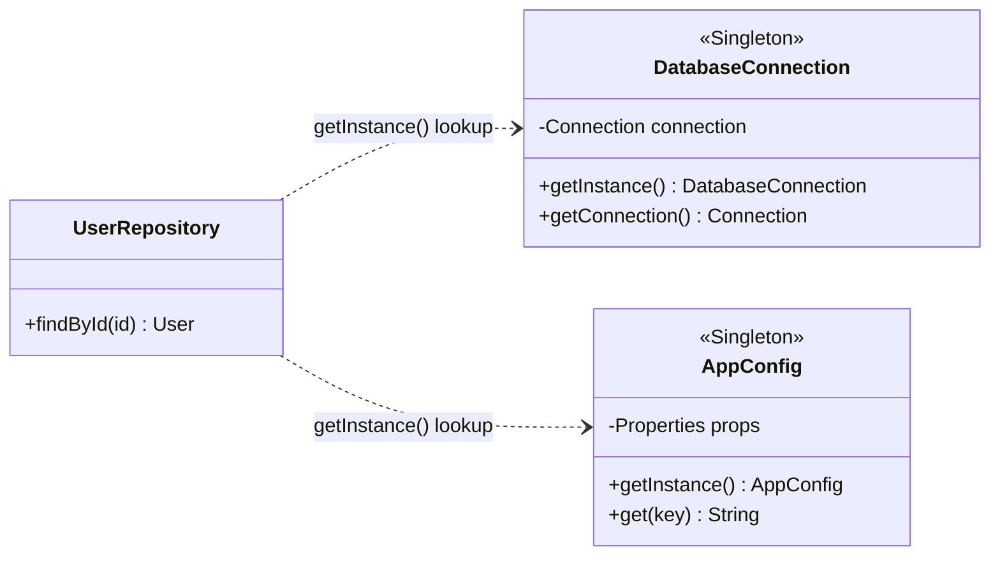
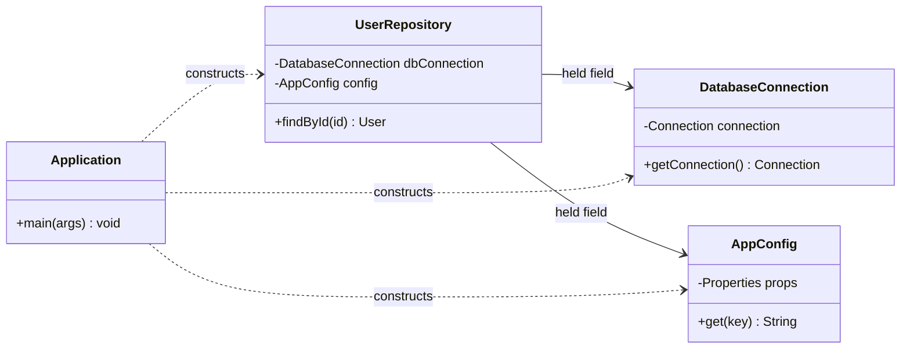

# Anti-Pattern: Singleton Abuse
## What It Is

The Singleton pattern — ensuring a class has only one instance and providing global access to it — is a legitimate creational pattern when used correctly. Singleton Abuse occurs when Singleton is applied to classes that do not genuinely require a single global instance, turning it into a mechanism for managing global mutable state.

The distinction:
- **Legitimate Singleton**: A class that represents a truly unique resource (e.g., a hardware driver, a connection pool manager).
- **Abused Singleton**: A class that is made Singleton purely for convenience — to avoid passing dependencies explicitly.

---

## Intuition

> **One-line analogy**: Singleton Abuse is like making every tool in your workshop a wall-mounted fixture to avoid carrying it — convenient access, but now you can't move the workshop or test anything without the whole building.

**Mental model**: Singleton is convenient — no parameter passing, global access anywhere. But convenience creates hidden dependencies. `UserService.getInstance()` inside a method makes that method impossible to test (can't inject a mock UserService), creates global mutable state (UserService state affects all callers), and makes initialization order fragile. What was "easy to access" becomes "impossible to replace."

**Why it matters**: Singleton abuse is the primary reason Java enterprise code is untestable. Every `getInstance()` call in production code is a testing obstacle. The fix — Dependency Injection — is only slightly more verbose but dramatically more testable and maintainable.

**Key insight**: Legitimate Singleton use cases are narrow: truly unique hardware resources (hardware clock, GPU device), logging (one log file, one writer), connection pool (one pool per application). Everything else should be injected via constructor or DI framework.

---

## How to Recognize It

**Code smells:**
- `getInstance()` calls scattered across the codebase instead of injected dependencies
- Singletons hold mutable state that varies between tests
- Tests must reset Singleton state between runs
- The class has no inherent reason to be unique — it was just "easier"
- Multiple Singletons calling other Singletons (Singleton web)

**Example — The Anti-Pattern:**

```java
// Singleton used to avoid passing dependencies — the abuse
public class DatabaseConnection {

    private static DatabaseConnection instance;
    private Connection connection;

    private DatabaseConnection() {
        // hardcoded config — can't be overridden in tests
        try {
            this.connection = DriverManager.getConnection(
                "jdbc:mysql://localhost:3306/prod_db", "root", "password"
            );
        } catch (SQLException e) {
            throw new RuntimeException("Cannot connect to database", e);
        }
    }

    public static DatabaseConnection getInstance() {
        if (instance == null) {
            instance = new DatabaseConnection();
        }
        return instance;
    }

    public Connection getConnection() {
        return connection;
    }
}

// Another Singleton — config that could easily be injected
public class AppConfig {

    private static AppConfig instance;
    private Properties props = new Properties();

    private AppConfig() {
        try {
            props.load(new FileInputStream("config.properties"));
        } catch (IOException e) {
            throw new RuntimeException("Config load failed", e);
        }
    }

    public static AppConfig getInstance() {
        if (instance == null) {
            instance = new AppConfig();
        }
        return instance;
    }

    public String get(String key) {
        return props.getProperty(key);
    }
}

// Consumer: tightly coupled to both singletons
public class UserRepository {

    public User findById(Long id) {
        // Direct call to Singleton — hidden dependency, impossible to test without real DB
        Connection conn = DatabaseConnection.getInstance().getConnection();
        String table = AppConfig.getInstance().get("users.table");

        try (PreparedStatement stmt = conn.prepareStatement(
                "SELECT * FROM " + table + " WHERE id = ?")) {
            stmt.setLong(1, id);
            ResultSet rs = stmt.executeQuery();
            return mapToUser(rs);
        } catch (SQLException e) {
            throw new RuntimeException(e);
        }
    }

    private User mapToUser(ResultSet rs) throws SQLException {
        return rs.next() ? new User(rs.getLong("id"), rs.getString("email")) : null;
    }
}
```

The class diagram makes the hidden coupling concrete: both arrows are dependencies (`..>`), not held associations — `UserRepository` stores no field for either collaborator, so each is fetched fresh via a static `getInstance()` call buried inside `findById()`, invisible from the class's own signature.



**Testing problem:**

```java
// This test always hits the real production database
// There is no way to inject a mock connection
class UserRepositoryTest {

    @Test
    void findById_returnsUser() {
        UserRepository repo = new UserRepository(); // hidden deps — DB, config
        User user = repo.findById(1L);              // hits prod DB or fails
        assertNotNull(user);
    }
}
```

---

## Why It Happens

1. **Laziness / convenience**: It is easier to call `Foo.getInstance()` than to wire dependencies through constructors.
2. **Misunderstanding the pattern**: Developers learn Singleton as a "useful pattern" and apply it broadly without understanding its trade-offs.
3. **Avoiding refactoring**: Adding a constructor parameter means updating all call sites — `getInstance()` avoids that.
4. **Legacy patterns**: Pre-dependency-injection era code (pre-Spring, pre-Guice) relied heavily on Singletons.
5. **No DI framework**: In projects without a DI container, developers reach for Singleton as a substitute.

---

## Why It's Harmful

1. **Hidden dependencies**: A method that calls `Singleton.getInstance()` has an invisible dependency. You cannot tell from its signature what it depends on.
2. **Global mutable state**: Singletons are effectively global variables. Any code anywhere can mutate them, making reasoning about state extremely difficult.
3. **Untestable code**: You cannot substitute a test double (mock) for a Singleton dependency because the dependency is not injected — it is looked up internally.
4. **Initialization order problems**: Singleton A may depend on Singleton B which may not yet be initialized. This creates fragile, order-dependent startup sequences.
5. **Thread safety issues**: The basic `if (instance == null)` check is not thread-safe — two threads can both see `null` and both construct. Double-checked locking is the usual patch, and it is correct **only if the instance field is `volatile`**: without `volatile` the publishing write can be reordered relative to the constructor's writes, so a second thread can observe a non-null reference to a partially initialized object and read default or half-written field values. JSR-133 (Java 5) strengthened `volatile` enough to make the volatile form correct, and it has been broken on every Java version without it. An `enum` singleton or a static holder class sidesteps the problem entirely and is the better default when a singleton is genuinely warranted.
6. **Tight coupling**: Every consumer is coupled directly to the concrete Singleton class.
7. **Testing interference**: Tests can corrupt shared state, causing order-dependent test failures.

```java
// Thread safety problem: two threads can create two instances
public static DatabaseConnection getInstance() {
    if (instance == null) {                          // Thread A checks — null
        // Thread B also checks here — also null
        instance = new DatabaseConnection();         // Both create instances
    }
    return instance;
}
```

---

## How to Fix It

Replace Singleton lookups with **Dependency Injection**. The class is constructed once by the DI container and injected wherever needed — you get the "one instance" behavior without the global state problem.

```java
// Step 1: Remove the Singleton mechanism entirely
public class DatabaseConnection {

    private final Connection connection;

    // Constructor injection — dependencies are explicit
    public DatabaseConnection(String url, String user, String password) {
        try {
            this.connection = DriverManager.getConnection(url, user, password);
        } catch (SQLException e) {
            throw new RuntimeException("Cannot connect to database", e);
        }
    }

    public Connection getConnection() {
        return connection;
    }
}

// Step 2: Repository receives its dependencies through the constructor
public class UserRepository {

    private final DatabaseConnection dbConnection;
    private final AppConfig config;

    // Dependencies are explicit — visible in the constructor signature
    public UserRepository(DatabaseConnection dbConnection, AppConfig config) {
        this.dbConnection = dbConnection;
        this.config = config;
    }

    public User findById(Long id) {
        Connection conn = dbConnection.getConnection();
        String table = config.get("users.table");
        try (PreparedStatement stmt = conn.prepareStatement(
                "SELECT * FROM " + table + " WHERE id = ?")) {
            stmt.setLong(1, id);
            ResultSet rs = stmt.executeQuery();
            return rs.next() ? new User(rs.getLong("id"), rs.getString("email")) : null;
        } catch (SQLException e) {
            throw new RuntimeException(e);
        }
    }
}

// Step 3: Wire everything in one place (composition root)
// AppConfig gets the same treatment as DatabaseConnection above: the private
// no-arg constructor and getInstance() are gone, replaced by a public constructor
// that takes the config file path, so tests can point it at a fixture.
public class Application {

    public static void main(String[] args) {
        AppConfig config = new AppConfig("config.properties");
        DatabaseConnection db = new DatabaseConnection(
            config.get("db.url"), config.get("db.user"), config.get("db.password")
        );
        UserRepository userRepo = new UserRepository(db, config);
        UserService userService = new UserService(userRepo);
        // ... start application
    }
}

// Step 4: Tests can now inject mocks
class UserRepositoryTest {

    @Test
    void findById_returnsUser() {
        DatabaseConnection mockDb = mock(DatabaseConnection.class);
        AppConfig mockConfig = mock(AppConfig.class);
        when(mockConfig.get("users.table")).thenReturn("users");
        when(mockDb.getConnection()).thenReturn(mockConnection());

        UserRepository repo = new UserRepository(mockDb, mockConfig);
        User user = repo.findById(1L);
        assertNotNull(user);
    }
}
```

Both dependency arrows from the diagram above become explicit `-->` associations here: `UserRepository` now stores `DatabaseConnection` and `AppConfig` as constructor-injected fields, and `Application` is the single composition root that constructs every collaborator exactly once.



**When Singleton IS appropriate:**

```java
// Legitimate Singleton: system-wide logger backed by a file handle
// Truly should be one instance — multiple would corrupt the log file
public class ApplicationLogger {

    private static final ApplicationLogger INSTANCE = new ApplicationLogger();
    private final PrintWriter writer;

    private ApplicationLogger() {
        try {
            this.writer = new PrintWriter(new FileWriter("app.log", true));
        } catch (IOException e) {
            throw new RuntimeException(e);
        }
    }

    public static ApplicationLogger getInstance() {
        return INSTANCE;
    }

    public synchronized void log(String message) {
        writer.println(Instant.now() + " " + message);
        writer.flush();
    }
}
```

---

## Real-World Examples

- **Android Application class**: Often abused as a Singleton to hold global state, making Android apps hard to test.
- **Legacy Spring beans**: Before Spring's DI was well-understood, developers made Spring beans Singletons and then also gave them `getInstance()` methods.
- **Game development**: `GameManager`, `AudioManager`, `InputManager` — every system ends up as a Singleton, creating a web of global state.
- **Configuration objects**: `Config.getInstance()` scattered throughout a codebase when the config could simply be injected.

---

## Prevention Strategies

1. **Use a DI framework**: Spring, Guice, Dagger, or CDI manage object lifecycles correctly. A `@Singleton`-scoped bean in Spring is constructed once and injected — no `getInstance()` needed.
2. **Composition root**: Wire all dependencies in one place at startup. Pass dependencies down, never look them up.
3. **Treat global state as a red flag**: Any time you reach for a static field or `getInstance()`, question whether DI would work instead.
4. **Apply the test question**: "Can I test this class without hitting real infrastructure?" If not, you probably have a Singleton abuse.
5. **Code review**: Flag new `getInstance()` call sites in code review.

---

## Cross-Perspective: HLD Connections

**HLD View — Where Singleton Abuse Appears in Distributed Systems**

- **Global state across replicas is catastrophic** — A JVM Singleton only guarantees one instance per process. Across 10 microservice replicas, there are 10 "singletons" with independent state. Any logic that assumes global state via a singleton will produce inconsistent behavior at scale.
- **Shared mutable state requires distributed locks** — If state truly must be globally unique (e.g., a rate limiter counter, a distributed lock), it requires Redis, ZooKeeper, or etcd — not a local Singleton. Misusing Singleton for this leads to race conditions across replicas.
- **Service registries as singletons** — A service registry that becomes a single point of dependency for all other services is Singleton Abuse at the HLD level. If the registry is unavailable, the entire system fails. Mitigation: client-side caching, health checks, and fallback discovery.
- **Static config in distributed systems** — Hard-coding configuration in a static singleton field rather than injecting it via a config service means all replicas must be redeployed for a config change — defeating the purpose of dynamic configuration management.

---

## Interview Questions with Answers

**Q: What is the difference between a legitimate Singleton and Singleton Abuse?**
**Short:** Legitimate Singleton models a genuinely unique resource; abuse uses it only to avoid passing dependencies explicitly.
A legitimate Singleton represents a truly unique resource — a hardware driver, a single log file handle, a connection pool manager — where having more than one instance would be actively wrong. Singleton Abuse is applying the same mechanism to classes that have no inherent uniqueness requirement, purely for the convenience of global access instead of constructor injection. `DatabaseConnection` and `AppConfig` in the example are abuse: nothing about them requires exactly one instance, they were just made Singleton to avoid wiring dependencies through constructors.

**Q: Why does the basic double-checked-locking Singleton implementation break without `volatile`?**
**Short:** Without volatile, a thread can see a non-null but only partially constructed instance due to reordering.
The naive `if (instance == null) { instance = new Foo(); }` check is not thread-safe: two threads can both observe `null` and both construct an instance. Double-checked locking patches the race, but it is correct only if the instance field is `volatile` — without it, the write that publishes the reference can be reordered relative to the constructor's field writes, so a second thread can see a non-null reference to an object whose fields are still default or half-written. JSR-133 (Java 5) strengthened `volatile` enough to make the volatile form correct; it was broken on every earlier Java version. An `enum` singleton or a static holder class sidesteps the problem entirely and is the better default.

**Q: Why is a method that calls `Singleton.getInstance()` internally harder to test than one taking a constructor parameter?**
**Short:** getInstance() is a hidden dependency invisible in the method signature, so no test double can be substituted.
`UserRepository.findById()` calling `DatabaseConnection.getInstance()` cannot be tested without hitting the real production database, because the dependency is looked up internally rather than injected — there is no seam where a test can hand in a mock. Once the class is refactored to take `DatabaseConnection` and `AppConfig` through its constructor, a test can pass `mock(DatabaseConnection.class)` directly. The core distinction is control: Singleton pulls a dependency from inside the method, DI pushes it in from outside where the caller — including a test — controls what gets passed.

**Q: What exactly goes wrong when Singleton state is assumed "global" across microservice replicas?**
**Short:** A JVM Singleton is one instance per process, so 10 replicas produce 10 independent singletons, not one shared state.
A Singleton only guarantees uniqueness within a single JVM process. Across 10 microservice replicas behind a load balancer, there are 10 separate "singletons," each with its own independent state — any logic that assumes the Singleton represents global truth (like a rate limiter counter) will produce inconsistent behavior because each replica enforces its own local view. Truly global unique state requires an external coordinator like Redis, ZooKeeper, or etcd, not a local Singleton.

**Q: List the concrete problems Singleton Abuse creates, in order of how directly they hurt testability.**
**Short:** Untestability, hidden dependencies, global mutable state, initialization order fragility, and thread-safety bugs.
Untestable code is the sharpest pain: you cannot substitute a mock for a Singleton because the dependency is looked up internally rather than injected. Hidden dependencies follow directly — a method's signature no longer tells you what it needs. Global mutable state means any code anywhere can mutate the Singleton, making reasoning about state difficult. Initialization order problems arise when Singleton A depends on Singleton B, which may not yet be constructed. And the naive `getInstance()` implementation itself often has a thread-safety bug in the double-checked-null check.

**Q: When you see `Config.getInstance()` scattered across a codebase, how would you refactor it, step by step?**
**Short:** Remove the static instance and getInstance(), add a real constructor, then push construction to one composition root.
First, remove the private no-arg constructor and `getInstance()` method entirely, replacing them with a normal public constructor that takes its dependencies (e.g., a config file path) as parameters. Second, change every consumer class to receive the config through its own constructor rather than calling `getInstance()` internally. Third, construct the config object exactly once in a single composition root — the application's `main()` method or DI container configuration — and pass that one instance down to whoever needs it. The result is the same "one instance" behavior, but achieved through explicit wiring instead of a global lookup.

**Q: What did JSR-133 change about `volatile`, and why does it matter for Singleton?**
**Short:** JSR-133 (Java 5) strengthened volatile semantics so double-checked locking became correct when the field is volatile.
Before JSR-133, `volatile` only guaranteed visibility ordering for the volatile variable itself, which was insufficient to prevent a thread from observing a partially-constructed object through double-checked locking. JSR-133 redefined the Java Memory Model so that a `volatile` write acts as a full memory barrier, ensuring that all writes made before the volatile write (including the constructor's field writes) are visible to any thread that subsequently reads the volatile field as non-null. This is why the double-checked-locking Singleton idiom is correct on modern Java only when the instance field is declared `volatile` — omitting it reintroduces the exact race it was meant to fix.

**Q: Is Singleton ever the right choice, and what's an example from this file?**
**Short:** Yes — for a resource that genuinely must be unique, like a single file-backed logger.
`ApplicationLogger` in the example is a legitimate Singleton: it wraps a single `PrintWriter` backed by one file handle, and having multiple instances would genuinely corrupt the log file through concurrent uncoordinated writes. The narrow legitimate cases are truly unique hardware resources (a hardware clock, a GPU device), a single log writer, or a single connection pool per application — everywhere else, dependency injection should be used instead. The distinguishing question is "does uniqueness matter for correctness, or only for convenience?"

**Q: How does Singleton relate to the Dependency Inversion Principle?**
**Short:** Singleton violates DIP because consumers depend directly on a concrete global class instead of an abstraction.
DIP states that high-level modules should depend on abstractions, not concrete implementations. A class that calls `DatabaseConnection.getInstance()` is tightly coupled to that one concrete class by name — it cannot be pointed at a different implementation, mock, or abstraction without changing the call site. Dependency Injection upholds DIP because the consumer declares a dependency (often on an interface) through its constructor, and the composition root decides which concrete implementation to supply, leaving the consumer decoupled from the concrete class.

**Q: Why does "no DI framework in the project" often lead teams toward Singleton Abuse?**
**Short:** Without a container to manage object lifecycles, Singleton becomes the easiest substitute for "construct once, use everywhere."
In projects predating widespread Spring/Guice/Dagger adoption, or in codebases without a DI container at all, developers still want "construct this expensive object once and share it" — and without a framework to do that wiring for them, `getInstance()` looks like the simplest way to get that behavior. The fix is not necessarily adopting a full framework; even a hand-written composition root in `main()` that constructs objects once and passes them down achieves the same result without the testability cost of a global static.

**Q: What is a "Singleton web" and why is it worse than one abused Singleton?**
**Short:** Multiple Singletons calling other Singletons multiplies hidden dependencies and initialization-order fragility.
When `GameManager`, `AudioManager`, and `InputManager` are all Singletons that call each other's `getInstance()` internally, the hidden-dependency problem compounds: tracing what any one of them actually needs requires following a chain of static lookups through several classes. Initialization order becomes especially fragile here, since Singleton A's constructor might trigger Singleton B's lazy construction, which might in turn call back into A before A has finished constructing — a scenario that DI's explicit composition root avoids entirely by constructing dependencies in a known, deterministic order.

**Q: How would you explain the testing problem shown in this file's `UserRepositoryTest` example?**
**Short:** The test always hits the real production database because there's no way to inject a mock connection.
`new UserRepository()` internally calls `DatabaseConnection.getInstance()` and `AppConfig.getInstance()`, so the test has no constructor parameter through which to supply a mock — every test run either fails without a real database available or silently exercises production infrastructure. After refactoring to constructor injection, the same test can call `new UserRepository(mockDb, mockConfig)` and verify behavior without touching any real infrastructure. This single example captures why Singleton Abuse is described as "the primary reason Java enterprise code is untestable."

**Q: What operational fix replaces "static config in a singleton field" at the distributed-systems level?**
**Short:** A dynamic config service that replicas poll or subscribe to, instead of hard-coded static fields.
Hard-coding configuration in a static Singleton field means every config change requires redeploying all replicas, which defeats the purpose of dynamic configuration management. The HLD-level fix mirrors the LLD fix: instead of each service instance looking up its own static config, inject a client for a config service (or feature-flag service) that can push updates without a redeploy — the same shift from "look up a global" to "receive an injected, externally-managed dependency."

**Q: Name a legitimate use of Service Registry-as-Singleton at the architecture level, and its risk.**
**Short:** A service registry is a legitimate single point of truth but becomes a single point of failure if unmitigated.
A service registry that all other services depend on for discovery is conceptually similar to a Singleton — there is meant to be one source of truth for "where is service X." The risk mirrors Singleton's downside at scale: if the registry is unavailable, the entire system can fail, since every service's ability to find its dependencies routes through it. Mitigations include client-side caching of previously resolved addresses, health checks, and fallback discovery mechanisms, so a registry outage degrades gracefully rather than causing a hard system-wide failure.

**Q: What test question can a developer ask themselves to detect Singleton Abuse before it ships?**
**Short:** "Can I test this class without hitting real infrastructure?" — if not, it likely depends on a Singleton.
If constructing and exercising a class in a unit test requires a live database connection, a real file on disk, or any other piece of real infrastructure, that is a strong sign the class is reaching for a Singleton internally rather than receiving its dependencies through its constructor. This question is deliberately simple enough to apply during code review on every new `getInstance()` call site, which is also the recommended review-time flag: treat any new static field or `getInstance()` reach as a prompt to ask whether DI would work instead.

## Interview Relevance

**Common interview questions:**
- "When is Singleton appropriate and when does it become an anti-pattern?" — Core distinction to know.
- "How does Singleton relate to the Dependency Inversion Principle?" — Singleton violates DIP by making consumers depend on a concrete global.
- "What are the problems with Singleton and how would you fix them?" — Expect to walk through thread safety, testability, and hidden dependencies.
- "What is the difference between Singleton and Dependency Injection?" — DI gives you one instance per context, explicitly wired; Singleton gives you one global instance, looked up statically.

**Key talking points:**
- Distinguish legitimate use (truly unique resource) from abuse (convenience)
- Mention all three problems: hidden deps, global mutable state, untestability
- Propose DI as the fix — show you understand composition root and constructor injection
- Thread safety: mention `enum` Singleton or `static final` initialization as thread-safe alternatives if Singleton is truly needed
