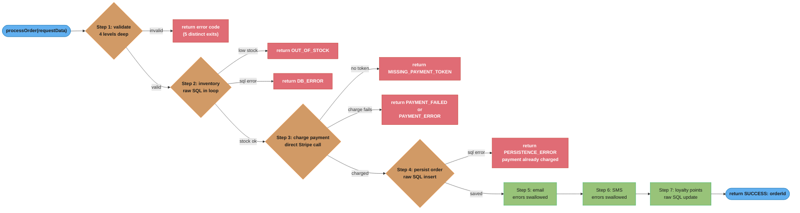
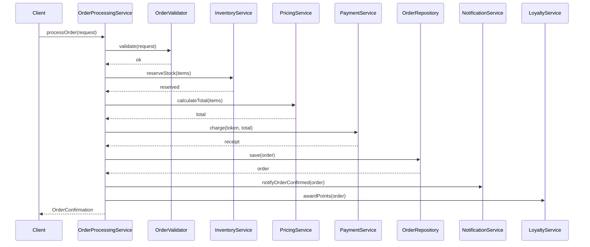

# Spaghetti Code Anti-Pattern

## Overview

Spaghetti Code is one of the oldest and most widely recognized anti-patterns in software engineering. It describes code whose control flow is so tangled and unstructured that it resembles a plate of spaghetti — you pull on one strand and the entire dish moves. The pattern emerges when code is written without architectural planning, when features are bolted on incrementally without refactoring, or when delivery pressure overrides engineering discipline. There is no separation of concerns: business logic, persistence, communication, and presentation all live in the same method or class, deeply nested inside conditionals and loops, making it nearly impossible to understand, test, or safely change any single behavior in isolation.

---

## Intuition

> **One-line analogy**: Spaghetti code is like a plate of pasta — pull one strand and the whole dish moves. No strand has a clear start and end; everything is tangled with everything else.

**Mental model**: Code written without structure — business logic, database access, UI rendering, and validation all tangled in one long method with deeply nested conditionals. No separation of concerns. Understanding any one part requires understanding the whole. Testing is impossible (no seams). Changing anything breaks something else unpredictably.

**Why it matters**: Spaghetti code makes every change risky and slow. Teams spend more time understanding what the code does than writing new features. It's the primary driver of "technical debt" that eventually requires costly rewrites.

**Key insight**: Spaghetti code emerges from deadline pressure ("just make it work") compounding over many iterations. Prevention: short methods with clear names, separate concerns into layers (Controller → Service → Repository), refactor immediately when a method grows beyond ~30 lines.

---

## How to Spot It

**Warning Signs and Code Smells**

- Methods exceeding 100-200 lines that perform multiple unrelated operations
- Nesting depth of 4 or more levels (if inside if inside for inside try)
- A single method that validates input, queries the database, processes business logic, calls external services, formats responses, and logs — all in sequence
- Boolean flag variables used to control flow across distant parts of a method (`isValid`, `shouldSend`, `hasFailed`)
- Methods with names like `doEverything()`, `process()`, `handleRequest()`, `run()` that give no hint of scope
- Classes with no clear identity — they are neither a service, nor a repository, nor a model
- Absence of interfaces or abstractions — every dependency is a concrete class
- Cyclomatic complexity scores above 15 on individual methods
- No unit tests, or unit tests that require spinning up the entire application context to test a single condition
- Copy-pasted error handling blocks scattered throughout a method
- Comments that explain *what* the code does line-by-line (a sign the code cannot speak for itself)
- Multiple `return` statements embedded deep in nested blocks
- "Flag variables" that are set in one branch and checked 50 lines later

---

## Java Violation Example

```java
/**
 * WARNING: This method was "temporarily" written to ship the MVP.
 * That was 3 years ago. It now handles all order processing.
 * Cyclomatic complexity: 32 by Checkstyle's counting rules (one for the method,
 * plus one each for if, for, ?:, catch, and every && or ||). Test coverage: 0%.
 */
public class OrderService {

    // Everything is injected as a concrete class — no interfaces
    private final Connection dbConnection;
    private final SmtpMailClient mailClient;
    private final StripeHttpClient stripeClient;
    private final FileLogger fileLogger;
    private final SmsGateway smsGateway;

    public OrderService(Connection dbConnection, SmtpMailClient mailClient,
                        StripeHttpClient stripeClient, FileLogger fileLogger,
                        SmsGateway smsGateway) {
        this.dbConnection = dbConnection;
        this.mailClient = mailClient;
        this.stripeClient = stripeClient;
        this.fileLogger = fileLogger;
        this.smsGateway = smsGateway;
    }

    // This single method does: validation, inventory check, pricing,
    // payment charging, order persistence, email notification, SMS notification,
    // audit logging, and loyalty point calculation.
    // It is ~175 lines and cannot be unit tested in isolation.
    public String processOrder(Map<String, Object> requestData) {

        boolean isValid = false;
        boolean paymentSucceeded = false;
        boolean emailSent = false;
        String orderId = null;
        double totalPrice = 0.0;

        // ---- STEP 1: Validate input (mixed with null checks and business rules) ----
        if (requestData != null) {
            if (requestData.containsKey("customerId")) {
                if (requestData.get("customerId") != null) {
                    String customerId = (String) requestData.get("customerId");
                    if (!customerId.isEmpty()) {
                        if (requestData.containsKey("items")) {
                            List<Map<String, Object>> items =
                                (List<Map<String, Object>>) requestData.get("items");
                            if (items != null && !items.isEmpty()) {
                                // Validation passes only if we reach this deeply nested block
                                isValid = true;
                            } else {
                                fileLogger.log("ERROR: items list is null or empty");
                                return "INVALID_ITEMS";
                            }
                        } else {
                            fileLogger.log("ERROR: no items key in request");
                            return "MISSING_ITEMS";
                        }
                    } else {
                        fileLogger.log("ERROR: customerId is blank");
                        return "INVALID_CUSTOMER";
                    }
                }
            } else {
                return "MISSING_CUSTOMER_ID";
            }
        } else {
            return "NULL_REQUEST";
        }

        // ---- STEP 2: Inventory check (directly queries DB, no repository abstraction) ----
        if (isValid) {
            try {
                List<Map<String, Object>> items =
                    (List<Map<String, Object>>) requestData.get("items");
                for (Map<String, Object> item : items) {
                    String productId = (String) item.get("productId");
                    int quantity = (int) item.get("quantity");
                    double unitPrice = (double) item.get("price");

                    // Raw SQL in the middle of the business method
                    PreparedStatement stmt = dbConnection.prepareStatement(
                        "SELECT stock FROM inventory WHERE product_id = ?"
                    );
                    stmt.setString(1, productId);
                    ResultSet rs = stmt.executeQuery();
                    if (rs.next()) {
                        int stock = rs.getInt("stock");
                        if (stock < quantity) {
                            fileLogger.log("ERROR: insufficient stock for " + productId);
                            return "OUT_OF_STOCK:" + productId;
                        }
                    }
                    totalPrice += unitPrice * quantity;
                }
            } catch (SQLException e) {
                fileLogger.log("DB ERROR: " + e.getMessage());
                return "DB_ERROR";
            }
        }

        // ---- STEP 3: Payment (directly calls Stripe, no abstraction layer) ----
        if (isValid && totalPrice > 0) {
            try {
                String paymentToken = (String) requestData.get("paymentToken");
                if (paymentToken == null || paymentToken.isEmpty()) {
                    return "MISSING_PAYMENT_TOKEN";
                }
                // Direct HTTP call to payment provider inside business logic
                Map<String, Object> chargeResult = stripeClient.charge(paymentToken, totalPrice);
                if ("succeeded".equals(chargeResult.get("status"))) {
                    paymentSucceeded = true;
                } else {
                    fileLogger.log("Payment failed: " + chargeResult.get("failure_code"));
                    return "PAYMENT_FAILED";
                }
            } catch (Exception e) {
                fileLogger.log("PAYMENT EXCEPTION: " + e.getMessage());
                return "PAYMENT_ERROR";
            }
        }

        // ---- STEP 4: Persist order (more raw SQL) ----
        if (paymentSucceeded) {
            try {
                orderId = UUID.randomUUID().toString();
                PreparedStatement insertOrder = dbConnection.prepareStatement(
                    "INSERT INTO orders (id, customer_id, total, status, created_at) " +
                    "VALUES (?, ?, ?, 'CONFIRMED', NOW())"
                );
                insertOrder.setString(1, orderId);
                insertOrder.setString(2, (String) requestData.get("customerId"));
                insertOrder.setDouble(3, totalPrice);
                insertOrder.executeUpdate();

                // Insert line items in the same try block
                List<Map<String, Object>> items =
                    (List<Map<String, Object>>) requestData.get("items");
                for (Map<String, Object> item : items) {
                    PreparedStatement insertItem = dbConnection.prepareStatement(
                        "INSERT INTO order_items (order_id, product_id, quantity, price) " +
                        "VALUES (?, ?, ?, ?)"
                    );
                    insertItem.setString(1, orderId);
                    insertItem.setString(2, (String) item.get("productId"));
                    insertItem.setInt(3, (int) item.get("quantity"));
                    insertItem.setDouble(4, (double) item.get("price"));
                    insertItem.executeUpdate();
                }
            } catch (SQLException e) {
                fileLogger.log("INSERT ERROR: " + e.getMessage());
                // Payment already charged but order not saved — no compensation logic!
                return "PERSISTENCE_ERROR";
            }
        }

        // ---- STEP 5: Send email notification ----
        if (orderId != null) {
            try {
                String email = (String) requestData.get("customerEmail");
                if (email != null) {
                    String body = "Dear customer, your order " + orderId +
                                  " for $" + totalPrice + " has been confirmed.";
                    mailClient.send(email, "Order Confirmation", body);
                    emailSent = true;
                }
            } catch (Exception e) {
                // Swallowed — email failure should not fail the order, but this is implicit
                fileLogger.log("EMAIL FAILED: " + e.getMessage());
            }

            // ---- STEP 6: Send SMS (conditionally, with more nested logic) ----
            try {
                String phone = (String) requestData.get("customerPhone");
                if (phone != null && !phone.isEmpty()) {
                    boolean smsEnabled = Boolean.TRUE.equals(requestData.get("smsOptIn"));
                    if (smsEnabled) {
                        smsGateway.send(phone, "Order " + orderId + " confirmed. Total: $" + totalPrice);
                    }
                }
            } catch (Exception e) {
                fileLogger.log("SMS FAILED: " + e.getMessage());
            }

            // ---- STEP 7: Loyalty points (more DB access, more raw SQL) ----
            try {
                if (totalPrice >= 50.0) {
                    int points = (int) (totalPrice / 10);
                    PreparedStatement updatePoints = dbConnection.prepareStatement(
                        "UPDATE customers SET loyalty_points = loyalty_points + ? WHERE id = ?"
                    );
                    updatePoints.setInt(1, points);
                    updatePoints.setString(2, (String) requestData.get("customerId"));
                    updatePoints.executeUpdate();
                }
            } catch (SQLException e) {
                fileLogger.log("LOYALTY UPDATE FAILED: " + e.getMessage());
                // Silently ignored — loyalty points may or may not be accurate
            }
        }

        fileLogger.log("Order processed: " + orderId + " | email sent: " + emailSent);
        return orderId != null ? "SUCCESS:" + orderId : "UNKNOWN_FAILURE";
    }
}
```



*`processOrder`'s actual control-flow graph: seven sequential responsibilities linked by twelve return statements, with validation alone producing five distinct exits before any business logic runs. Step 4 shows the cost directly — a persistence failure there strands the payment already captured in Step 3, exactly the "no rollback" gap called out below.*

**What is wrong with this code:**
- One method handles 7 distinct responsibilities simultaneously
- 6+ levels of nesting make control flow nearly impossible to follow
- Raw SQL lives inside business logic — no repository or data access layer
- Concrete dependencies (SmtpMailClient, StripeHttpClient) make substitution and testing impossible
- Boolean flags (`isValid`, `paymentSucceeded`) used to track state across the method instead of early returns or extracted methods
- No transaction management — payment can succeed but persistence can fail with no rollback
- Errors are silently swallowed in several catch blocks
- The return type is a `String` encoding success and error states — a primitive obsession smell on top of spaghetti

---

## Why It's Harmful

**Untestable in Isolation**
To test "what happens when inventory is insufficient", you must provide a valid payment token, a real database connection, and a working mail client. There is no seam where a single concern can be tested without the others.

**Change Amplification**
A requirement to change how loyalty points are calculated requires reading and understanding the whole method before safely modifying 5 lines at the bottom. Any change risks breaking any of the other 6 concerns.

**Debugging Nightmare**
When a production incident occurs, engineers must trace the control flow through deeply nested conditionals with boolean flags to determine which code path was taken. Log messages are scattered and inconsistent.

**Onboarding Friction**
New engineers presented with this method cannot build a mental model of the system because the method violates every principle of readable design. The codebase appears hostile and discourages contribution.

**Impossible to Parallelize Work**
Teams cannot work on loyalty points and email notifications concurrently because they live in the same method. Every feature requires a merge conflict negotiation.

**Technical Debt Compounding**
Every new requirement adds more nesting, more flags, more raw SQL to the same method. The debt grows super-linearly — each addition makes the next addition harder.

---

## Refactored Solution

```java
// Clean orchestrator — only knows about the steps, not how they work
public class OrderProcessingService {

    private final OrderValidator validator;
    private final InventoryService inventoryService;
    private final PricingService pricingService;
    private final PaymentService paymentService;
    private final OrderRepository orderRepository;
    private final NotificationService notificationService;
    private final LoyaltyService loyaltyService;

    public OrderProcessingService(
            OrderValidator validator,
            InventoryService inventoryService,
            PricingService pricingService,
            PaymentService paymentService,
            OrderRepository orderRepository,
            NotificationService notificationService,
            LoyaltyService loyaltyService) {
        this.validator = validator;
        this.inventoryService = inventoryService;
        this.pricingService = pricingService;
        this.paymentService = paymentService;
        this.orderRepository = orderRepository;
        this.notificationService = notificationService;
        this.loyaltyService = loyaltyService;
    }

    @Transactional
    public OrderConfirmation processOrder(OrderRequest request) {
        // Each line is one responsibility, each collaborator is an interface
        validator.validate(request);
        inventoryService.reserveStock(request.getItems());

        Money total = pricingService.calculateTotal(request.getItems());
        PaymentReceipt receipt = paymentService.charge(request.getPaymentToken(), total);

        Order order = orderRepository.save(Order.from(request, total, receipt));

        notificationService.notifyOrderConfirmed(order);
        loyaltyService.awardPoints(order);

        return OrderConfirmation.from(order);
    }
}

// Each collaborator is an interface — swappable, mockable, independently testable
public interface InventoryService {
    void reserveStock(List<OrderItem> items); // throws InsufficientStockException
}

public interface PaymentService {
    PaymentReceipt charge(String token, Money amount); // throws PaymentFailedException
}

public interface NotificationService {
    void notifyOrderConfirmed(Order order);
}

public interface LoyaltyService {
    void awardPoints(Order order);
}

// Validator is a focused, independently testable class
public class OrderValidator {
    public void validate(OrderRequest request) {
        Objects.requireNonNull(request, "Order request must not be null");
        if (request.getCustomerId() == null || request.getCustomerId().isBlank()) {
            throw new ValidationException("Customer ID is required");
        }
        if (request.getItems() == null || request.getItems().isEmpty()) {
            throw new ValidationException("Order must contain at least one item");
        }
    }
}
```



*The same eight lines from `processOrder` above, drawn as a call sequence: one orchestrator, seven collaborators, one call each. No branching, no shared flags, no early-return maze — the linear opposite of the control-flow graph in the Java Violation Example above.*

**What changed:**
- `processOrder` is now 8 lines — readable as a specification of what happens
- Every concern lives in its own class with a focused interface
- Dependencies are interfaces — each one can be mocked in unit tests
- `@Transactional` handles atomicity declaratively instead of ad-hoc try/catch
- Exceptions are typed (`ValidationException`, `InsufficientStockException`) rather than string codes
- Each collaborator class can be developed, tested, and deployed independently

---

## Prevention Strategies

**1. Apply the Single Responsibility Principle (SRP) Aggressively**
Every class should have one reason to change. A class that sends email AND charges payment AND updates inventory has three reasons to change. Split it.

**2. Set Cyclomatic Complexity Limits in CI**
Use Checkstyle or SonarQube to enforce a maximum cyclomatic complexity (e.g., 10 per method). Reject builds that exceed the threshold.

```xml
<!-- checkstyle.xml -->
<module name="CyclomaticComplexity">
    <property name="max" value="10"/>
</module>
```

**3. Enforce Method Length Limits**
Methods longer than 30-50 lines are a code smell. Configure your linter to warn at 40 lines and fail at 80.

**4. Use the Extract Method Refactoring Continuously**
Any time you find yourself writing a comment above a block of code, that comment is the name of a method. Extract it.

**5. Program to Interfaces**
Dependencies should always be injected as interfaces. This makes testing trivial and enforces a natural boundary between concerns.

**6. Apply Design Patterns for Complex Flows**
- Use **Chain of Responsibility** for sequential validation steps
- Use **Strategy** for interchangeable algorithms
- Use **Command** for encapsulating operations that can be queued or rolled back

**7. Pair Programming and Code Review**
Spaghetti code rarely survives a second pair of eyes during development. Establish team norms: if a reviewer cannot understand a method in under 2 minutes, it must be refactored before merging.

**8. Test-Driven Development (TDD)**
If you write tests first, untestable spaghetti code cannot be written — the test will demand clean seams between concerns before the implementation begins.

---

## Cross-Perspective: HLD Connections

**HLD View — Where Spaghetti Code Appears in Distributed Systems**

- **Distributed spaghetti** — Service meshes without clear ownership produce distributed Spaghetti Code: Service A calls B calls C calls D, with no documented API contracts and shared database tables. Tracing a bug requires following a call chain across 6 services. Each hop adds latency, failure surface, and on-call confusion.
- **Orphaned microservices** — Services that everyone depends on but nobody owns are distributed Spaghetti: the "legacy auth service" that was deprecated two years ago but still handles 30% of auth traffic because removing it would require untangling dozens of callers.
- **Implicit coupling via shared database** — Multiple services reading and writing the same database tables create invisible dependencies. A schema change in table `orders` requires coordinating across 5 services simultaneously — the distributed equivalent of spaghetti control flow.
- **Unstructured event flows** — Event-driven systems without clear event ownership and documented event schemas become event spaghetti: any service can publish any event; any service may consume it; nobody has the full picture of what triggers what.

---

## Real-World Consequences

*The four scenarios below are illustrative composites of common incident patterns, not reports of specific named public incidents. The numbers show the shape of the failure; treat them as worked examples rather than as citable industry statistics.*

**Scenario 1: The Three-Day Bug Hunt**
A payments team spent three days debugging a production issue where some orders were being double-charged. The root cause was a single boolean flag (`paymentSucceeded`) that was set to `true` in two separate branches of a 300-line method. Finding the second assignment required reading the entire method in sequence. A clean extracted `chargePayment()` method would have isolated the bug in minutes.

**Scenario 2: The Untestable Compliance Feature**
A regulatory change required adding fraud detection before payment processing. The team discovered the payment logic was embedded inside a 400-line orchestration method with no seams. Writing a test for the new fraud check required mocking a database connection, a mail server, and an SMS gateway — none of which were relevant to fraud detection. The feature took 3x longer than estimated due to the spaghetti architecture.

**Scenario 3: The Cascading Production Failure**
A simple change to the email template variable format caused a `NullPointerException` inside the order processing method. Because error handling was interleaved with business logic and exceptions were caught at the wrong level, the failure caused the entire order to fail — including the database commit — even though payment had already been captured. Customers were charged but received no order. Recovery required manual reconciliation of 200 orders.

**Scenario 4: The Paralysis Effect**
A team reported that a business-critical service had zero feature development for six months because every engineer was too afraid to touch its main processing method. The method had accumulated contributions from 12 engineers over 4 years, had a cyclomatic complexity of 67, and contained 11 levels of nesting in one branch. The team eventually rewrote it from scratch — a two-week effort that could have been avoided with incremental refactoring.

---

## Interview Questions with Answers

**Q: What is Spaghetti Code, and why does the pasta metaphor fit?**
**Short:** Code whose control flow is so tangled that pulling one strand moves the entire dish.
Spaghetti Code describes code whose control flow is so tangled and unstructured that changing any single behavior in isolation is nearly impossible — like a plate of pasta where no strand has a clear start and end, and pulling one strand moves the whole dish. It emerges when code is written without architectural planning, when features are bolted on incrementally without refactoring, or when delivery pressure overrides engineering discipline. There is no separation of concerns: business logic, persistence, communication, and presentation all live in the same method or class.

**Q: What specific code smells signal Spaghetti Code before you even read the logic in detail?**
**Short:** 100+ line methods, 4+ levels of nesting, boolean flag variables, and cyclomatic complexity above 15.
Watch for methods exceeding 100-200 lines performing multiple unrelated operations, nesting depth of 4 or more levels (if inside if inside for inside try), and boolean flag variables like `isValid`, `shouldSend`, `hasFailed` used to control flow across distant parts of a method. Cyclomatic complexity scores above 15 on individual methods, vague method names like `doEverything()` or `process()`, and comments explaining what the code does line-by-line (a sign the code cannot speak for itself) round out the list. The example `processOrder()` method scores 32 by Checkstyle's counting and has 6+ levels of nesting.

**Q: Why is `processOrder()` in this file's example "untestable in isolation"?**
**Short:** Testing any one concern requires providing valid data for all seven others, since there's no seam between them.
To test "what happens when inventory is insufficient," you must also supply a valid payment token, a real database connection, and a working mail client, because validation, inventory, payment, persistence, email, SMS, and loyalty points are all sequential steps inside one 175-line method with no separation. There is no seam where a single concern — like the inventory check — can be exercised without also exercising the six others. The refactored `OrderProcessingService` fixes this by making each concern an injectable interface that can be mocked independently.

**Q: What went wrong with transaction management in the `processOrder()` example, and how does `@Transactional` fix it?**
**Short:** Payment could succeed while persistence failed with no rollback, stranding a charged customer; @Transactional makes atomicity declarative.
In the violation example, Step 4 (persist order) can throw a `SQLException` after Step 3 (charge payment) has already succeeded — the code has no compensation logic, so the customer is charged but the order is never saved, requiring manual reconciliation. The refactored `OrderProcessingService.processOrder()` is annotated `@Transactional`, letting the framework handle atomicity declaratively instead of the original's ad-hoc try/catch blocks, which is one of the concrete named changes when the method dropped from 175 lines to 8.

**Q: How many distinct exit points does the flawed `processOrder()` method have, and why does that matter?**
**Short:** Twelve return statements, five of them from validation alone before any business logic runs.
The control-flow diagram in this file shows `processOrder`'s validation step alone producing five distinct exits (`NULL_REQUEST`, `MISSING_CUSTOMER_ID`, `INVALID_CUSTOMER`, `MISSING_ITEMS`, `INVALID_ITEMS`) before any business logic even runs, out of twelve return statements total across the whole method. Each exit point is a separate path a reader must trace to understand what the method does, and each is a place where a future change could introduce a regression that only manifests on that specific path — the sheer count is itself evidence of a method doing too much.

**Q: What refactoring technique turns a 175-line tangled method into an 8-line orchestrator?**
**Short:** Extract each responsibility into its own interface-backed collaborator, leaving the method as a linear sequence of delegated calls.
The refactored `OrderProcessingService.processOrder()` calls `validator.validate(request)`, `inventoryService.reserveStock(...)`, `pricingService.calculateTotal(...)`, `paymentService.charge(...)`, `orderRepository.save(...)`, `notificationService.notifyOrderConfirmed(...)`, and `loyaltyService.awardPoints(...)` — one line per responsibility, each delegated to a focused, independently-testable, interface-typed collaborator. This is the Extract Method refactoring applied aggressively: "any time you find yourself writing a comment above a block of code, that comment is the name of a method" — extract it.

**Q: Why does Spaghetti Code make onboarding new engineers especially difficult?**
**Short:** New engineers can't build a mental model when a method violates every principle of readable design at once.
A new engineer presented with a 175-line method mixing seven unrelated concerns, six levels of nesting, and boolean flags controlling flow across distant parts of the method cannot build a coherent mental model of what the code does, because the method violates separation of concerns, naming clarity, and linear readability all at once. This is distinct from merely "unfamiliar code" — even an experienced engineer new to the codebase faces the same wall, which is why the anti-pattern is described as making the codebase "appear hostile and discourage contribution."

**Q: What CI-enforceable limits does this file recommend to prevent Spaghetti Code, and what are typical thresholds?**
**Short:** Cyclomatic complexity capped around 10 per method, and method length capped around 40-80 lines.
Checkstyle's `CyclomaticComplexity` module can enforce a maximum (e.g., `max` value of 10) and fail the build on violation. Method length limits are typically set to warn at 40 lines and fail at 80, since methods longer than 30-50 lines are themselves a code smell independent of complexity score. Both checks are meant to catch the growth pattern early — before a method reaches the 175-line, complexity-32 state of the example — rather than relying on developers noticing on their own.

**Q: What is "distributed spaghetti" at the HLD level?**
**Short:** A service mesh where Service A calls B calls C calls D with no documented contracts and shared database tables.
Service meshes without clear ownership reproduce the same tangled-dependency structure at the architecture level: tracing a bug requires following a call chain across six services with no documented API contracts, and each hop adds latency, failure surface, and on-call confusion. A related HLD symptom is the "orphaned microservice" — a legacy auth service everyone depends on but nobody owns, that handles 30% of traffic and cannot be removed because untangling its callers would itself require unwinding distributed spaghetti.

**Q: How does Test-Driven Development prevent Spaghetti Code from being written in the first place?**
**Short:** Writing the test first demands clean seams between concerns before the implementation exists to tangle them.
If you write a test for "inventory check fails" before writing `processOrder()`, that test naturally wants to construct only an inventory-related collaborator and assert on its behavior — it cannot be written against a monolithic method that also requires a database connection, a mail client, and a payment gateway just to compile. TDD forces the seams (interfaces, focused classes) to exist from the start, because untestable spaghetti simply cannot satisfy a test written first; the test demands the decomposition before the implementation has a chance to tangle everything together.

**Q: Why are boolean "flag variables" like `paymentSucceeded` a particularly dangerous form of coupling within a method?**
**Short:** They let one branch silently influence behavior 50+ lines away, hiding the actual dependency between distant code blocks.
A flag like `paymentSucceeded` is set in one branch (Step 3) and checked in a much later, physically distant branch (Step 4's `if (paymentSucceeded)`), meaning the connection between the two pieces of code is invisible from either location alone — you have to read the entire method sequentially to know the flag exists and what sets it. The Real-World Consequences section's "Three-Day Bug Hunt" scenario shows exactly this: a boolean flag set in two separate branches of a 300-line method caused double-charging, and finding the second assignment required reading the entire method in sequence.

**Q: What does "Program to Interfaces" mean as a Spaghetti Code prevention strategy, and why does it matter for testing?**
**Short:** Inject dependencies as interfaces so any implementation, including a mock, can be substituted at test time.
The violation example injects concrete classes directly (`SmtpMailClient mailClient`, `StripeHttpClient stripeClient`), which means a test cannot substitute a mock — the concrete class is baked into the constructor's type. The refactored solution declares `InventoryService`, `PaymentService`, `NotificationService`, and `LoyaltyService` as interfaces, so tests can pass a Mockito mock implementing the same interface, and production code can pass the real implementation — the class itself never needs to know or care which one it received.

**Q: In the "Cascading Production Failure" scenario, why did a template-format change break the database commit too?**
**Short:** Error handling was interleaved with business logic, so a NullPointerException in email formatting caught at the wrong level failed the whole order.
Because the method's error handling was tangled together with its business logic rather than isolated per concern, a `NullPointerException` thrown while formatting an email confirmation propagated up and was caught at a level broad enough to abort the entire `processOrder()` call — including the database commit that should have already been independent of the email step. Customers were charged but received no order, and recovery required manually reconciling 200 orders, illustrating how tangled control flow turns an unrelated formatting bug into a payment-and-persistence incident.

**Q: What makes the "strangler fig" approach the recommended fix strategy for existing Spaghetti Code, rather than a rewrite?**
**Short:** Incremental extraction and replacement lets you decompose the tangled method safely, piece by piece, without a risky big-bang rewrite.
The Quick Reference Summary lists the effort to fix as "high — requires systematic decomposition; best approached incrementally via strangler fig pattern," meaning you extract one responsibility at a time (say, validation first) into its own tested class, redirect the original method to delegate to it, verify nothing broke, and repeat for the next responsibility — gradually starving the original tangled method rather than attempting to rewrite all seven concerns simultaneously. A full rewrite of a method with a cyclomatic complexity of 67 (as in the "Paralysis Effect" scenario) carries high risk of missing an undocumented edge case that the tangled original silently handled.

**Q: Why is returning a `String` encoding both success and error states, as `processOrder()` does, its own smell on top of the tangled control flow?**
**Short:** Encoding outcomes as strings like "OUT_OF_STOCK:sku123" is primitive obsession — callers must parse strings instead of checking typed results.
`processOrder()` returns values like `"OUT_OF_STOCK:productId"`, `"PAYMENT_FAILED"`, or `"SUCCESS:orderId"` — every caller has to parse or prefix-match these strings to determine what happened, and nothing prevents a typo in one of these magic strings from silently producing an unrecognized outcome. The refactored solution replaces this with typed exceptions (`ValidationException`, `InsufficientStockException`) and a proper `OrderConfirmation` return type, so the compiler and IDE can verify every caller handles the possible outcomes instead of relying on runtime string comparisons that are invisible to static analysis.

## Quick Reference Summary

| Dimension | Details |
|---|---|
| **Anti-Pattern Name** | Spaghetti Code |
| **Also Known As** | Big Ball of Mud (at system scale), God Method |
| **Root Cause** | No upfront design, feature accretion without refactoring, delivery pressure |
| **Primary Symptom** | Massive methods mixing multiple unrelated concerns with deep nesting |
| **Key Code Smells** | 200+ line methods, 5+ nesting levels, boolean flow flags, no interfaces, raw SQL in business logic |
| **Main Harm** | Untestable, unmaintainable, debugging nightmare, change amplification |
| **Detection Tools** | SonarQube cyclomatic complexity, Checkstyle method length, IntelliJ code inspections |
| **Fix Strategy** | Extract Method, introduce interfaces, apply SRP, use Chain of Responsibility / Strategy patterns |
| **Prevention** | TDD, pair programming, complexity limits in CI, code review standards |
| **Effort to Fix** | High — requires systematic decomposition; best approached incrementally via strangler fig pattern |
