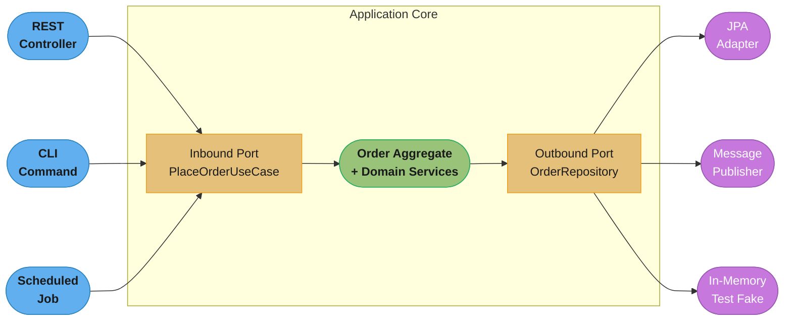
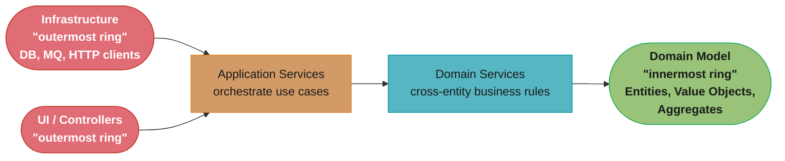
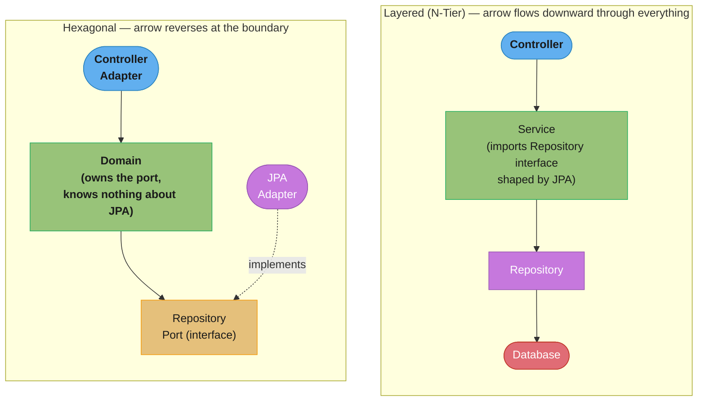
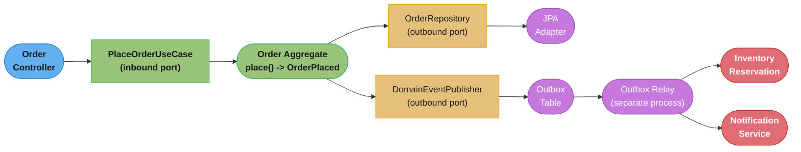

# Architecture Patterns

How you arrange classes into layers, ports, and rings so that business rules survive a
database migration, a framework upgrade, or a UI rewrite without being touched.

---

## 1. Concept Overview

An architecture pattern at the code level answers one question: **which way do the
dependency arrows point?** Layered (n-tier), hexagonal (ports and adapters), onion, and
clean architecture are four ways of drawing the same underlying idea — separate what the
business does from how it is delivered and how it is persisted — with different diagrams
and different amounts of rigor about which direction a dependency is allowed to point.

Underneath all four sits **Domain-Driven Design's tactical toolkit**: Entity, Value
Object, Aggregate Root, Repository, Domain Service, Domain Event, and Factory. These are
not a separate topic — they are the *vocabulary* the domain layer is written in, no
matter which of the four architectures wraps around it. A hexagon with an anemic domain
model inside it is still an anemic domain model with better packaging.

The unifying idea across every variant is **the Dependency Rule**: the domain — the code
that encodes business rules — depends on nothing. Not on Spring, not on Hibernate, not on
a web framework, not on a message broker client. Everything else depends on the domain,
never the reverse. Layered architecture violates this by default; hexagonal, onion, and
clean architecture exist specifically to enforce it. This module is the LLD-level
treatment of that rule and the vocabulary that lives inside it; see
[Anemic Domain Model](../anti_patterns/Anemic_Domain_Model.md) for the failure mode of
having the right *shape* of domain layer with none of the *behavior* the rule was
protecting, and [`hld/microservices`](../../hld/microservices/microservices.md) for the
same dependency-direction question applied to service boundaries instead of class
boundaries.

---

## 2. Intuition

**One-line analogy**: a restaurant kitchen doesn't care whether orders arrive by phone,
app, or a waiter's notepad, and it doesn't care whether the walk-in fridge is from one
vendor or another — the *recipes* are the business, and everything else is a replaceable
adapter plugged into the kitchen.

**Mental model**: draw two concentric regions. The inner region is "what the business
does" — pure logic with no import statement pointing outward. The outer region is
"everything that talks to the outside world" — HTTP, SQL, message queues, file systems.
Arrows are only allowed to point from outer to inner. The specific diagram (hexagon,
onion rings, four concentric circles, or a stack of layers) is presentation; the arrow
direction is the actual rule being taught.

**Why it matters**: a codebase that gets this backwards — where the domain's business
rules import `jakarta.persistence.Entity` or `org.springframework.web.bind.annotation.*`
— cannot be unit tested without a database, cannot swap Postgres for DynamoDB without
touching business logic, and cannot be understood by reading the domain alone, because
the domain's classes are entangled with infrastructure concerns that have nothing to do
with the business problem.

**Key insight**: layered and hexagonal architecture can produce an *identical folder
listing* — `controller/`, `service/`, `repository/`, `entity/` — while disagreeing
completely about which way the arrows point. A `service/` package that directly
constructs a `JpaRepository` and a `service/` package that depends on a `Port` interface
that some infrastructure adapter happens to implement look the same in a file tree and
are architecturally opposite. The folder name never tells you the dependency direction;
only the `import` statements do.

---

## 3. Core Principles

- **The Dependency Rule** (Robert C. Martin's term, but the idea predates the name):
  source-code dependencies point in one direction only — toward the domain. An inner
  layer never imports a name declared in an outer layer.
- **Dependency Inversion, applied at the architecture level.** The domain defines an
  interface (`OrderRepository`) for a capability it needs; infrastructure implements
  that interface. The domain owns the contract; infrastructure is a plugin. This is SOLID's
  Dependency Inversion Principle scaled from a single class to an entire codebase — see
  [`solid_principles/DependencyInversion.md`](../solid_principles/DependencyInversion.md).
- **The domain layer is framework-agnostic.** No `@Entity`, no `@RestController`, no
  `@Transactional` inside the domain model. Those annotations describe *how* something is
  delivered or persisted, and the domain does not know it is being delivered or persisted.
- **Ports are contracts owned by the inside; adapters are implementations owned by the
  outside.** An inbound port is a use case the domain exposes (`PlaceOrderUseCase`); an
  outbound port is a capability the domain needs (`OrderRepository`, `PaymentGateway`).
  Adapters — a REST controller, a JPA repository, an HTTP payment client — implement or
  invoke ports; ports never implement adapters.
- **Aggregates are the unit of consistency.** Every write to a cluster of related objects
  goes through exactly one designated entity — the Aggregate Root — which enforces every
  invariant that spans the cluster. Nothing outside the aggregate holds a direct reference
  into it.
- **Value Objects have no identity; Entities do.** Two `Money` instances with the same
  amount and currency are interchangeable and can be compared by value. Two `Order`
  instances with identical fields but different order IDs are not the same order.
- **Repositories give the illusion of an in-memory collection of aggregates.** The domain
  calls `orderRepository.save(order)` and `orderRepository.findById(id)` without knowing
  or caring whether that resolves to a SQL `INSERT`, a document write, or an in-memory
  `Map` in a test.
- **Domain Events decouple "something happened" from "who needs to know."** An aggregate
  raises an event (`OrderPlaced`) describing a fact about its own history; interested
  parties — inside or outside the process — react without the aggregate knowing who they
  are.

---

## 4. Types / Architectures / Strategies

### Layered (N-Tier) Architecture

The default architecture most engineers reach for first: Presentation → Service →
Repository → Database, each layer calling only the layer directly below it. **The
dependency arrow points downward, through every layer, including the database.** A
`Service` class typically depends on a concrete `Repository` interface that is itself
shaped by the persistence technology (returns `Page<OrderEntity>`, throws
`DataAccessException`). Nothing stops the domain logic from picking up a persistence
detail, because there is no rule enforcing otherwise — layering is a convention about
*which classes call which*, not about *which classes may know what*.

### Hexagonal Architecture (Ports and Adapters)

Coined by Alistair Cockburn in a September 2005 technical report. The application core
sits in the middle; **ports** are the interfaces the core exposes (inbound) or requires
(outbound); **adapters** are concrete technology-specific implementations plugged into
those ports. The hexagon shape itself carries no meaning beyond "more than two sides, so
nobody assumes there are exactly two kinds of adapter" — Cockburn's point was that any
number of driving adapters (a REST controller, a CLI, a scheduled job, a test harness)
and any number of driven adapters (a SQL database, a message broker, an email gateway)
can be plugged in and swapped without touching the core, because they all satisfy the
same port contract.

### Onion Architecture

Coined by Jeffrey Palermo in a July 2008 blog series. Draws the same dependency-inward
rule as concentric rings instead of a hexagon: **Domain Model** at the center, wrapped by
**Domain Services**, wrapped by **Application Services**, wrapped by the outermost ring
of **Infrastructure and UI**. Palermo's stated tenets: the application is built around an
independent domain model; inner layers define interfaces that outer layers implement; and
all coupling points toward the center. Onion architecture is best read as hexagonal
architecture's answer to "but how many concentric layers of application logic do I get,
not just one core blob?" — it subdivides the hexagon's single "application core" into
domain model, domain services, and application services.

### Clean Architecture

Described by Robert C. Martin in a 2012 blog post and later expanded into the 2017 book
*Clean Architecture: A Craftsman's Guide to Software Structure and Design*. Four
concentric rings: **Entities** (enterprise-wide business rules) → **Use Cases**
(application-specific business rules) → **Interface Adapters** (presenters, controllers,
gateways that translate between use cases and the outside) → **Frameworks and Drivers**
(the web framework, the database, the UI). Martin's contribution is naming and stating
**the Dependency Rule** explicitly as the organizing law of the whole family: "source code
dependencies must point only inward... nothing in an inner circle can know anything at
all about something in an outer circle." Clean architecture, onion architecture, and
hexagonal architecture are, by Martin's own description, the same idea independently
arrived at three times; the differences between them are which concentric rings get
named and how many of them there are, not the direction of the arrow.

### Comparison at a glance

| Architecture | Origin | Core shape | Where domain logic lives | Enforces inward dependency? |
|---|---|---|---|---|
| Layered (N-Tier) | Folk convention, pre-dates all three below | Stack | Scattered across Service + Entity | No — by convention only |
| Hexagonal | Cockburn, 2005 | Hexagon, ports at the edge | Application Core | Yes — via ports |
| Onion | Palermo, 2008 | Concentric rings | Domain Model (center ring) | Yes — via ring interfaces |
| Clean Architecture | Martin, 2012 | Four concentric circles | Entities + Use Cases | Yes — the Dependency Rule, named explicitly |

### DDD tactical patterns — the vocabulary inside the core

| Pattern | What it is | Key rule |
|---|---|---|
| Entity | An object defined by identity, not by its attribute values | Two entities with identical fields but different IDs are different objects |
| Value Object | An object defined entirely by its attribute values, no identity | Immutable; equality is structural; replace, never mutate |
| Aggregate Root | The single entry point entity for a consistency boundary | All external references and all writes go through the root; invariants spanning the cluster are enforced there |
| Repository | An interface giving the illusion of an in-memory collection of aggregates | Domain depends on the interface; infrastructure implements it |
| Domain Service | Business logic that doesn't naturally belong to one entity or value object | Stateless; operates on domain objects passed to it, not injected infrastructure |
| Domain Event | An immutable record that something significant happened in the domain | Named in the past tense (`OrderPlaced`); raised by an aggregate, consumed by others |
| Factory | Encapsulates the logic of constructing a valid aggregate or complex value object | Guarantees no caller can end up holding a partially-valid object |

---

## 5. Architecture Diagrams

### Hexagonal architecture — driving and driven adapters around one core



Every arrow points **into** the core. A driving adapter (REST, CLI, a scheduled job) calls
the inbound port; the core calls the outbound port; a driven adapter (JPA, a message
publisher, or an in-memory fake used only in tests) implements that port. Swapping JPA
for a test fake, or adding a GraphQL adapter alongside REST, never touches the core.

### Onion architecture — concentric rings, dependency pointing inward



Each ring may only depend on rings strictly inside it. The Domain Model at the center
depends on nothing else in this diagram; Infrastructure and UI, the outermost ring, are
the only boxes allowed to know about a database driver or an HTTP framework.

### Layered vs. hexagonal — same folder names, inverted arrow



The load-bearing difference: in the layered diagram, `Service` depends *forward* on
`Repository`, and `Repository`'s method signatures are typically already shaped by the
persistence technology (`Page<T>`, `Specification<T>`) — a persistence concern has leaked
upward into the service layer through the interface it depends on. In the hexagonal
diagram, `Domain` still depends on a `Repository Port`, but the arrow from the JPA adapter
to that port is **implements**, not **imports** — the adapter depends on the domain's
contract, and the domain has no idea a JPA adapter exists. Same four boxes, opposite
dependency source.

---

## 6. How It Works — Detailed Mechanics

### The outbound port — a contract the domain owns

```java
package com.example.order.domain;

// Lives in the DOMAIN package. No import of jakarta.persistence, no import of Spring.
public interface OrderRepository {
    Order findById(OrderId id);
    void save(Order order);
}
```

### The domain service — depends only on ports, never on infrastructure

```java
package com.example.order.domain;

// Application service implementing the inbound port. Constructor-injected with the
// OUTBOUND port interface, not a concrete JPA class — see dependency_injection_and_testability.
public class PlaceOrderService implements PlaceOrderUseCase {

    private final OrderRepository orderRepository;   // port, not JpaOrderRepository
    private final PaymentGateway paymentGateway;      // another outbound port
    private final DomainEventPublisher events;

    public PlaceOrderService(OrderRepository orderRepository,
                              PaymentGateway paymentGateway,
                              DomainEventPublisher events) {
        this.orderRepository = orderRepository;
        this.paymentGateway = paymentGateway;
        this.events = events;
    }

    @Override
    public OrderId placeOrder(CustomerId customerId, List<OrderLine> lines, Address shipTo) {
        Order order = Order.place(customerId, lines, shipTo);   // factory method, §4
        paymentGateway.authorize(customerId, order.total());
        orderRepository.save(order);
        events.publish(order.pullDomainEvents());               // OrderPlaced, raised inside Order
        return order.id();
    }
}
```

Nothing in `PlaceOrderService` can be recompiled against a different database, because
nothing in it names one. A unit test constructs this class with an in-memory
`OrderRepository` fake and an in-memory `PaymentGateway` fake — no Spring context, no
database, no network call, and the test runs in milliseconds.

### The driven adapter — implements the port, isolated in its own package

```java
package com.example.order.infrastructure.persistence;

import jakarta.persistence.EntityManager;
import com.example.order.domain.Order;
import com.example.order.domain.OrderId;
import com.example.order.domain.OrderRepository;

// Lives in INFRASTRUCTURE. Only this class, and its mapper, know jakarta.persistence exists.
public class JpaOrderRepositoryAdapter implements OrderRepository {

    private final EntityManager em;
    private final OrderJpaMapper mapper;   // domain Order <-> OrderJpaEntity, both directions

    public JpaOrderRepositoryAdapter(EntityManager em, OrderJpaMapper mapper) {
        this.em = em;
        this.mapper = mapper;
    }

    @Override
    public Order findById(OrderId id) {
        OrderJpaEntity row = em.find(OrderJpaEntity.class, id.value());
        return mapper.toDomain(row);
    }

    @Override
    public void save(Order order) {
        OrderJpaEntity row = mapper.toJpaEntity(order);
        em.merge(row);
    }
}
```

### Broken -> Fixed pair 1: the domain entity importing `jakarta.persistence.*`

```java
// BROKEN: the domain entity is annotated as a JPA entity directly.
// Every consumer of Order — the application service, every unit test — now
// transitively depends on jakarta.persistence and cannot construct an Order
// without a JPA-aware environment behind it.
package com.example.order.domain;

import jakarta.persistence.Entity;
import jakarta.persistence.Id;
import jakarta.persistence.OneToMany;
import jakarta.persistence.Table;

@Entity
@Table(name = "orders")
public class Order {
    @Id
    private Long id;

    @OneToMany(mappedBy = "order")
    private List<OrderLineJpa> lines;   // domain now depends on a persistence-only type

    private OrderStatus status;

    public void cancel() {
        if (status == OrderStatus.SHIPPED) throw new IllegalStateException("already shipped");
        this.status = OrderStatus.CANCELLED;
    }
    // getters/setters for JPA...
}
```

```java
// FIXED: Order is plain Java, framework-agnostic. Persistence shape lives in a
// separate OrderJpaEntity in the infrastructure package; a mapper translates
// between the two. Order can be constructed and unit-tested with `new`.
package com.example.order.domain;

public class Order {
    private final OrderId id;
    private final CustomerId customerId;
    private final List<OrderLine> lines;
    private OrderStatus status;

    private Order(OrderId id, CustomerId customerId, List<OrderLine> lines, OrderStatus status) {
        this.id = id;
        this.customerId = customerId;
        this.lines = lines;
        this.status = status;
    }

    public static Order place(CustomerId customerId, List<OrderLine> lines, Address shipTo) {
        if (lines.isEmpty()) throw new IllegalArgumentException("order must have at least one line");
        return new Order(OrderId.newId(), customerId, List.copyOf(lines), OrderStatus.PLACED);
    }

    public void cancel() {
        if (status == OrderStatus.SHIPPED) throw new IllegalStateException("already shipped");
        this.status = OrderStatus.CANCELLED;
    }
    // no @Entity, no @Id, no @OneToMany anywhere in this file
}

// infrastructure/persistence/OrderJpaEntity.java — the ONLY class that knows about JPA
@jakarta.persistence.Entity
@jakarta.persistence.Table(name = "orders")
class OrderJpaEntity {
    @jakarta.persistence.Id Long id;
    Long customerId;
    String status;
    // flat, JPA-friendly shape; a separate OrderLineJpaEntity for the line items
}
```

The fixed version's domain module can be compiled and unit-tested with zero JPA
dependency on the classpath at all — the strongest possible proof that the dependency
rule holds, because a missing dependency is a compile error, not a code-review opinion.

### Broken -> Fixed pair 2: the repository returning DTOs instead of aggregates

```java
// BROKEN: OrderRepository returns a flat DTO shaped by a SQL row, not a domain
// aggregate. Every caller now has to re-derive business rules (is this order
// cancellable?) from raw fields instead of asking the aggregate.
public interface OrderRepository {
    OrderRowDto findById(Long id);   // {id, status: String, totalCents: long, ...}
}

// Caller has to re-implement the cancellation rule OUTSIDE the domain:
OrderRowDto row = orderRepository.findById(orderId);
if (!"SHIPPED".equals(row.status()) && !"DELIVERED".equals(row.status())) {
    // now what? there's no order.cancel() to call — this row is not an aggregate
}
```

```java
// FIXED: the port returns the domain aggregate. Business rules live in Order,
// not in whatever code happened to call the repository.
public interface OrderRepository {
    Order findById(OrderId id);
}

Order order = orderRepository.findById(orderId);
order.cancel();                 // aggregate enforces its own invariant
orderRepository.save(order);
```

This is the same defect as [Anemic Domain Model](../anti_patterns/Anemic_Domain_Model.md),
arrived at from the repository side rather than the entity side: a repository whose
return type has no behavior forces every caller to reconstruct business rules externally,
exactly the anti-pattern that section documents in depth.

---

## 7. Real-World Examples

- **Spring applications structured around ports and adapters.** A Spring Boot service
  where `@Service`-annotated application classes depend on a plain interface, and a
  separate `@Repository`-annotated class in an `infrastructure` package implements it —
  Spring's dependency injection wires the interface to the implementation at runtime, but
  nothing in the domain package imports Spring itself.
- **CQRS/event-sourced systems built on DDD aggregates.** Frameworks such as Axon
  (AxonIQ) model the write side explicitly as aggregates that apply domain events to
  change their own state, and a repository that reconstitutes an aggregate by replaying
  its event stream rather than reading a row.
- **Modular monoliths.** Spring Modulith structures a single deployable application into
  modules with enforced boundaries between them, verified at build or test time — the
  same dependency-direction discipline hexagonal architecture applies to one service,
  applied instead to the seams between modules inside it.
- **Netflix's and Amazon's microservice guidance** on keeping a service's core business
  logic free of any specific database or transport SDK so the team can change the
  datastore without a rewrite — the same motivation as the Dependency Rule, stated at
  the service-boundary level rather than the class level (see
  [`hld/microservices`](../../hld/microservices/microservices.md)).
- **Test suites built on in-memory port fakes.** A team building against
  `OrderRepository` writes a `InMemoryOrderRepository implements OrderRepository`
  backed by a `HashMap`, and runs the entire application-service test suite against it —
  no database container, no network I/O, sub-second test runs.

---

## 8. Tradeoffs

| Approach | What you gain | What it costs | How the wrong choice shows up |
|---|---|---|---|
| Layered (N-Tier) | Fast to start; every framework tutorial teaches it; low ceremony for small CRUD apps | No enforced boundary — a persistence detail leaks into the service layer the first time someone is in a hurry | Swapping the ORM touches half the service layer; unit tests need a database |
| Hexagonal | Domain is fully framework-agnostic; any number of driving/driven adapters swap freely; tests run without infrastructure | More interfaces and mapping code up front; a small CRUD screen pays the same ceremony as a complex one | A team applies it to a five-field settings page and burns a day on ports nobody will ever swap |
| Onion | Explicit intermediate rings (domain services vs. application services) give a home for cross-entity logic that hexagonal's single "core" blob leaves ambiguous | One more ring to explain to new hires than hexagonal's two-sided port/adapter split | Domain services and application services end up as two names for the same undifferentiated bucket |
| Clean Architecture | The Dependency Rule is named and testable; the Entities/Use-Cases split maps directly onto DDD's Aggregate/Application-Service split | Four rings is the most ceremony of the four options; over-applied to a small service it multiplies files with no payoff | A five-endpoint microservice ships with `entities/`, `usecases/`, `interface_adapters/`, `frameworks/` — sixteen files for what a layered service does in four |
| Aggregate Root as sole write path | One place enforces every cross-entity invariant; no caller can leave the cluster in an inconsistent state | Every write funnels through one object, which can become a bottleneck if the aggregate is drawn too large | A "Customer" aggregate that includes every order the customer ever placed — loading it loads the customer's entire history to change an email address |
| Domain Events for cross-aggregate consistency | Aggregates stay small and independently consistent; other aggregates react asynchronously instead of being loaded inline | Consistency across aggregates becomes eventual, not immediate — the reader must design for a window where the second aggregate hasn't reacted yet | A read model built by summing "OrderPlaced" events shows a stale total for a few hundred milliseconds and a test asserts strict consistency and flakes |

The single most useful framing: **layered architecture optimizes for how fast you can
start; hexagonal, onion, and clean architecture optimize for how cheaply you can change
your mind later** about the database, the framework, or the delivery mechanism. Pay for
that optionality only where you are actually going to use it.

---

## 9. When to Use / When NOT to Use

**Use hexagonal, onion, or clean architecture when:**
- The domain has real business rules — invariants, calculations, state transitions —
  worth protecting from framework churn.
- You expect to swap or add delivery mechanisms (REST today, gRPC or an event consumer
  tomorrow) or persistence technologies over the service's lifetime.
- Fast, infrastructure-free unit tests of business logic are a priority — a large test
  suite that needs a running database for every test is a signal this rule was skipped.
- Multiple teams work in the same codebase and need a boundary that survives code review
  disagreements about "is this a service concern or a controller concern."

**Stay with plain layered architecture — or no architecture pattern at all — when:**
- The service is a thin CRUD facade over a single table with no business rules beyond
  validation; there is no domain logic to protect from infrastructure.
- It's a prototype, a script, or a short-lived internal tool where the codebase will be
  deleted before the underlying database or framework ever changes.
- The team is small, the domain is genuinely simple, and the ceremony of ports, adapters,
  and mappers would out-cost the entire feature being built.
- A `## N. Case Study` scale system with one bounded context and one team — the payoff
  of swappable adapters mostly shows up when *something actually gets swapped*, and a
  small system may never reach that point.

**Do not** apply DDD's Aggregate/Value Object/Domain Event vocabulary to a data model
with no invariants to protect — a lookup table of country codes is not crying out to be
an aggregate root. See [YAGNI](../design_principles/YAGNI.md) for the general form of this
warning; architecture patterns are exactly where premature abstraction hides best,
because the ceremony *looks* like engineering discipline right up until nobody ever swaps
the adapter it was built to make swappable.

---

## 10. Common Pitfalls

**"Pretend hexagonal" — ports that mirror the adapter's shape instead of the domain's
need.** A team defines `OrderRepository` with a method `findByStatusAndCustomerIdOrderByCreatedAtDesc(...)`
copied straight from a Spring Data method-name query. The port is technically an
interface the domain depends on, but its *shape* is dictated by what one specific ORM's
query-derivation syntax can express, not by what the domain actually needs to ask.
Swapping to a different persistence technology means redesigning the port anyway — the
abstraction never did its job. Fix: design the port from the domain's vocabulary
(`findPendingOrdersFor(CustomerId)`), then make the adapter translate that into whatever
query the underlying technology requires.

**God aggregate — modeling the whole object graph as one aggregate.** A `Customer`
aggregate that contains every `Order` the customer has ever placed means loading the
customer to update their shipping address also loads and locks their entire order
history. Fix: keep aggregates small — `Customer` and `Order` are separate aggregates,
related by `CustomerId`, not by object reference; cross-aggregate consistency is
eventual, coordinated by domain events, not by a shared in-memory graph.

**Anemic domain model inside a hexagon.** Getting the architecture diagram right —
ports, adapters, a clean dependency arrow — while the "domain" package is still fields
and getters/setters with all the logic in an application service is a purely cosmetic
fix. The architecture pattern controls *where* code lives; it says nothing about *whether*
the code that lives there has any behavior. See
[Anemic Domain Model](../anti_patterns/Anemic_Domain_Model.md) for the full failure mode
and its fix — moving logic onto the entity applies inside a hexagon exactly as it does
inside a layered service.

**Leaking the persistence transaction boundary into the domain.** `@Transactional` on a
domain method, or a domain method accepting an open `EntityManager` as a parameter,
couples business logic to a specific persistence framework's transaction semantics. Fix:
the application service (which is allowed to know about transactions) opens and commits
the transaction; the domain method it calls has no knowledge that a transaction exists.

**Value Objects implemented as mutable classes with setters.** A `Money` class with
`setAmount()` defeats the entire point of being a value object — code elsewhere can
mutate a `Money` instance that a dozen other objects hold a reference to, silently
changing all of their totals. Fix: make every field `final`, provide no setters, and
have every "change" return a new instance (`money.add(other)` returns a new `Money`,
it does not mutate `this`).

**Domain events fired synchronously inside the same transaction, then treated as
guaranteed delivery.** An in-process event bus that calls listeners synchronously inside
the aggregate's own save transaction means a slow or failing listener can roll back an
otherwise-valid order placement, or the event can be "delivered" and then lost if the
transaction rolls back after the listener already acted externally. Fix: persist the
event in the same transaction as the aggregate (the outbox pattern), and publish it to
external consumers from a separate process that reads the outbox — see
[`backend/event_sourcing_and_cqrs`](../../backend/event_sourcing_and_cqrs/event_sourcing_and_cqrs.md)
and [`backend/distributed_transactions_and_consistency`](../../backend/distributed_transactions_and_consistency/distributed_transactions_and_consistency.md)
for the outbox pattern in full.

**Applying four concentric rings to a five-endpoint microservice.** Clean architecture's
full ceremony — separate `entities`, `usecases`, `interface_adapters`, and `frameworks`
packages — on a service with one aggregate and three use cases produces more
indirection than the domain logic justifies. Fix: collapse rings that have no distinct
content of their own; a single `domain` package and a single `infrastructure` package,
hexagonal-style, is enough until the service is actually big enough for four rings to
each hold something real.

---

## 11. Technologies & Tools

| Tool / Library | Role |
|---|---|
| Spring Framework (constructor injection) | Wires domain ports to infrastructure adapters at runtime without the domain importing Spring |
| Hibernate / JPA (`jakarta.persistence`) | Implements the persistence adapter behind a repository port; never referenced from the domain package |
| MapStruct | Generates the mapping code between a domain aggregate and its persistence-entity or DTO shape at compile time |
| ArchUnit | Writes the Dependency Rule as an executable test — asserts the domain package has zero dependency on infrastructure packages, failing the build on a violation |
| jMolecules | Annotation library that marks classes as `@AggregateRoot`, `@ValueObject`, `@Entity` (DDD sense) and lets ArchUnit-style checks verify the tactical patterns are used consistently |
| Spring Modulith | Enforces module boundaries inside a single deployable, verified at build/test time — the same dependency discipline applied between modules, not just between domain and infrastructure |
| Axon Framework | End-to-end DDD, CQRS, and event-sourcing framework where aggregates apply domain events to derive their own state |
| Testcontainers | Runs a real database or broker in a container for adapter-level integration tests, kept separate from the domain's infrastructure-free unit tests |

---

## 12. Interview Questions with Answers

**Q: Layered and hexagonal architecture can produce the same folder structure — what actually distinguishes them?**
**Short:** The direction of the dependency arrow between the domain and infrastructure, not the folder names.

Both can have `controller/`, `service/`, `repository/`, `entity/` packages and look identical in a file tree. The difference is which way an `import` statement points. In layered architecture, the service layer typically imports a repository interface shaped by the persistence technology, and the domain has no protection from persistence details leaking upward. In hexagonal architecture, the domain defines the repository as a port it owns; the persistence adapter *implements* that port, so the dependency runs from infrastructure toward the domain, never the reverse. Reading the folder names never answers the question — reading the imports does.

---

**Q: Why is "hexagonal" the name — does the six-sided shape mean anything?**
**Short:** No — Cockburn chose a hexagon only so the diagram wasn't limited to two sides for adapters.

Alistair Cockburn's original 2005 write-up chose a hexagon specifically to avoid the visual bias of a two-sided box (like "left side is UI, right side is database"), which would wrongly suggest there are only two kinds of adapter. A hexagon has room to draw several driving adapters (REST, CLI, a scheduled job) and several driven adapters (a database, a message broker, an email gateway) around the same core with no implied limit. The number six carries no architectural significance — the pattern's real name, "Ports and Adapters," describes the mechanism; "hexagonal" only describes the picture.

---

**Q: What breaks when a domain entity is annotated directly with `jakarta.persistence.@Entity`?**
**Short:** Every consumer of that class, including unit tests, now transitively depends on a JPA-aware environment.

The class can no longer be constructed and tested with a plain `new` in isolation — depending on the JPA provider and its enhancement/proxying behavior, tests may need a persistence context, or fields typed for ORM mapping (a `@OneToMany` to a JPA-only entity type) leak persistence concerns into what should be pure business logic. It also blocks swapping persistence technology cleanly: a migration off JPA now means rewriting the domain class itself, not just an adapter. The fix is a plain domain class with no persistence annotations, paired with a separate persistence-entity class and a mapper — shown in this module's broken-then-fixed pair.

---

**Q: A repository interface returns a DTO instead of a domain aggregate — why is that a real defect, not just a style preference?**
**Short:** Callers must re-derive business rules from raw fields externally instead of asking the aggregate to enforce them.

If `OrderRepository.findById()` returns a flat `OrderRowDto` with a `String status` field, no caller can call `order.cancel()` — there is no aggregate to call it on. Every caller that needs to check whether the order is cancellable has to reimplement that rule against the raw string, the same duplication problem the Anemic Domain Model anti-pattern describes. Fixing the return type to the domain `Order` aggregate means the cancellation rule exists in exactly one place, and every caller invokes it instead of reinventing it.

---

**Q: What is the actual difference between a Port and an Adapter?**
**Short:** A port is an interface the domain owns; an adapter is a concrete class outside the domain that implements or calls it.

A port is a contract — `OrderRepository`, `PaymentGateway`, `PlaceOrderUseCase` — declared inside the application core, describing a capability the core needs (outbound) or offers (inbound). An adapter is a concrete, technology-specific class living outside the core that either implements an outbound port (`JpaOrderRepositoryAdapter implements OrderRepository`) or calls an inbound port (`OrderController` calling `PlaceOrderUseCase`). The core never imports an adapter class; adapters always import a port interface. Multiple adapters can implement the same port — a JPA adapter for production, an in-memory adapter for tests.

---

**Q: What's the difference between a "driving" (primary) adapter and a "driven" (secondary) adapter?**
**Short:** A driving adapter initiates a use case on the core; a driven adapter is called by the core to fulfill one.

A driving adapter sits on the side that starts the conversation: a REST controller receiving an HTTP request, a CLI command, a scheduled job — each calls into the core through an inbound port to kick off a use case. A driven adapter sits on the side the core reaches out to during that use case: a JPA repository adapter, a message publisher, a payment gateway client — each implements an outbound port the core calls when it needs something from outside. The core is always the one being driven on one side and doing the driving on the other; the names describe who calls whom, not which side of a diagram something is drawn on.

---

**Q: Are onion architecture and hexagonal architecture actually different, or is this a distinction without a difference?**
**Short:** They express the same dependency rule; onion subdivides hexagonal's single "core" into domain model, domain services, and application services.

Both enforce the same rule — the center depends on nothing, everything else depends inward — and Robert Martin has described clean, onion, and hexagonal architecture as the same idea independently arrived at more than once. The practical difference is granularity: hexagonal architecture draws one undifferentiated "application core" bounded by ports; onion architecture explicitly names three inner rings (domain model, domain services, application services), giving cross-entity business logic and use-case orchestration logic separate, named homes instead of leaving them both inside one core blob. Neither is "more correct" — onion gives more structure to explain to a team; hexagonal gives less ceremony to a small service.

---

**Q: What is the Dependency Rule, precisely, and who named it?**
**Short:** Source-code dependencies may only point inward; nothing in an inner circle may reference anything in an outer circle.

Robert C. Martin names and states it explicitly in his 2012 "Clean Architecture" writing: source code dependencies can only point inwards, and nothing declared in an outer circle may be named by code in an inner circle — not a class, not a function, not a variable, not any other named software entity. It generalizes the Dependency Inversion Principle from a single class relationship to the entire codebase's layering: instead of one class depending on an abstraction another class implements, an entire outer region (infrastructure, frameworks, delivery mechanisms) depends on abstractions an entire inner region (the domain) defines. Hexagonal and onion architecture enforce the same rule; Martin's contribution is naming it and stating it as the organizing law rather than an emergent property of good layering.

---

**Q: Why must a domain service never receive a concrete infrastructure class through its constructor, even for something as simple as a `Clock`?**
**Short:** Any infrastructure type in the constructor forces every test and every future swap to satisfy that concrete dependency.

Constructor-injecting `SystemClock` instead of a `Clock` port means every unit test of that domain service now depends on wall-clock time and cannot deterministically test a time-sensitive rule, and swapping to a different time source later means editing the domain class instead of swapping an adapter. The fix generalizes past persistence: any capability the domain needs from the outside world — the current time, a random ID generator, an external system call — should be a port the domain defines and an adapter implements, exactly like `OrderRepository`. See [`dependency_injection_and_testability`](../dependency_injection_and_testability/dependency_injection_and_testability.md) for the general seam-design technique this specializes.

---

**Q: What is an Aggregate Root, and why must all writes go through it rather than through the entities it contains?**
**Short:** It's the single entity that owns a consistency boundary and enforces every invariant spanning the objects inside it.

An aggregate is a cluster of related objects — `Order` and its `OrderLine`s, for example — treated as one unit for the purpose of data changes. The Aggregate Root (`Order`) is the only object in that cluster external code is allowed to hold a reference to or call methods on directly; `OrderLine` is only reachable through `Order`. This matters because invariants that span the cluster — "an order's total must equal the sum of its lines," "you cannot add a line to a shipped order" — can only be reliably enforced if there is exactly one gatekeeper checking them on every write. If external code could mutate an `OrderLine` directly, it could violate the total-equals-sum-of-lines invariant with no code path responsible for catching it.

---

**Q: What is the difference between a Value Object and an Entity, and why does the distinction matter for equality?**
**Short:** An Entity is compared by identity (its ID); a Value Object is compared by its attribute values, and has no ID at all.

Two `Order` instances with identical customer, lines, and total but different order IDs are different orders — they represent two distinct real-world placements, so `Order` is an Entity and its `equals()` should compare IDs. Two `Money` instances both representing "50.00 USD" are completely interchangeable — there is no meaningful sense in which one is "the same fifty dollars" as the other — so `Money` is a Value Object, `equals()` compares amount and currency, and it should be immutable so nothing can mutate one shared instance out from under code that holds a reference to it. Getting this backwards — giving a Value Object an identity field, or comparing Entities by their attribute values — produces bugs where objects that should be interchangeable are treated as distinct, or objects that represent genuinely different real-world things are treated as equal.

---

**Q: What is the difference between a Domain Service and an Application Service?**
**Short:** A Domain Service holds business logic that spans multiple entities; an Application Service orchestrates use cases and infrastructure.

A Domain Service (`PricingService.applyDiscount(order, customer)`) holds business logic that doesn't naturally belong to one single entity or value object — it operates purely on domain objects passed as arguments and returns domain objects, with zero knowledge of transactions, repositories, or HTTP. An Application Service (`PlaceOrderService` in this module's §6) is the orchestration layer for one use case: it loads aggregates via repository ports, calls domain logic, coordinates a transaction, and publishes events — it is allowed to know about ports and infrastructure concerns like transactions, which a Domain Service is not. Confusing the two typically means transaction and persistence code creeping into what was meant to be pure business logic.

---

**Q: What problem does a Factory solve in DDD that a public constructor doesn't?**
**Short:** It guarantees no caller can end up holding a reference to a partially-constructed or invalid aggregate.

A public constructor plus a series of setter calls, as in the broken Anemic Domain Model example, allows any code path to construct an object in an invalid intermediate state — an `Order` with no lines, or a `Money` with a negative amount — because nothing forces validation to run before the object exists and becomes reachable. A factory method (`Order.place(customerId, lines, address)`) runs every creation invariant inside itself and either returns a fully valid aggregate or throws before construction completes; there is no window where an invalid instance exists that some other code could accidentally persist or pass along. For aggregates whose construction genuinely needs multiple collaborators or complex logic, a dedicated Factory class plays the same role as the static factory method, just extracted into its own type.

---

**Q: What is a Domain Event, and how does it differ from an application-level notification like an email?**
**Short:** A Domain Event is an immutable record, named in the past tense, of something significant that already happened inside the domain.

`OrderPlaced`, `OrderCancelled`, and `PaymentAuthorized` are domain events — each one is a fact about the aggregate's own history, raised by the aggregate itself, immutable once created, and carrying only the data needed to describe what happened. It differs from an application-level side effect like "send a confirmation email" in that the event doesn't know or care who consumes it; a listener that sends an email, a listener that updates a read model, and a listener in an entirely different bounded context can all react to the same `OrderPlaced` event without the `Order` aggregate having any dependency on any of them. The aggregate's job stops at raising the event; dispatching it to interested parties is infrastructure's job.

---

**Q: Should a domain event be published synchronously inside the same database transaction that saves the aggregate, or asynchronously afterward?**
**Short:** Persist it transactionally with the aggregate via an outbox, then publish it asynchronously from a separate process.

Publishing directly to an external message broker inside the same transaction that saves the aggregate creates a dual-write problem: the database commit and the broker publish can't both succeed or both fail atomically, so a crash between them either loses the event or publishes one for a save that then rolls back. The outbox pattern resolves this: the event is written to an outbox table in the same local transaction as the aggregate, which is atomic by definition, and a separate process reads the outbox and publishes to the broker, retrying independently of the original transaction. See [`backend/event_sourcing_and_cqrs`](../../backend/event_sourcing_and_cqrs/event_sourcing_and_cqrs.md) for the outbox mechanism in full.

---

**Q: How do you keep cross-aggregate consistency correct when each aggregate is its own transaction boundary?**
**Short:** Accept eventual consistency between aggregates, coordinated by domain events rather than a shared in-memory reference.

If `Order` and `Inventory` are separate aggregates, reserving stock when an order is placed cannot be done as one atomic transaction spanning both without violating the rule that each aggregate is its own consistency boundary. Instead, `Order.place()` raises `OrderPlaced` inside its own transaction; a listener (in-process or via the outbox) reacts to that event by calling `Inventory.reserve()` in a second, separate transaction. Between the two transactions there is a real window where the order exists but stock hasn't been reserved yet — the design has to accept that window explicitly (compensating actions, a "pending" status) rather than pretending it doesn't exist by loading both aggregates into one oversized transaction.

---

**Q: How do you unit-test a hexagonal application core without spinning up a database?**
**Short:** Provide an in-memory adapter implementing the same port interface the production adapter implements.

Because the application core depends only on the `OrderRepository` interface, a test can construct `PlaceOrderService` with an `InMemoryOrderRepository implements OrderRepository` backed by a plain `HashMap`, and a similar in-memory fake for `PaymentGateway`. The test then exercises real business logic — invariant checks, calculations, state transitions — with no JVM process outside the test itself, no container, and no network call, running in the same milliseconds-per-test range as any pure unit test. Separate, slower integration tests (often using Testcontainers) verify that the real JPA adapter correctly implements the port's contract against an actual database — the two test suites check different things and neither can substitute for the other.

---

**Q: A "port" interface's method is literally `findByStatusAndCustomerIdOrderByCreatedAtDesc(...)`, copied from a Spring Data query-derivation method name — what's wrong with this even though it's technically an interface the domain depends on?**
**Short:** The port's shape is dictated by one ORM's query syntax, not the domain's actual need, so swapping technology means redesigning it anyway.

Being an interface is necessary but not sufficient for a port to do its job — the interface also has to be designed from the domain's vocabulary, not mechanically derived from what one specific persistence technology's query-builder syntax happens to support. A method named after Spring Data's naming convention encodes an implementation detail (this will become a derived JPQL query) into the contract itself; moving to a different persistence technology, or even a different ORM, means the port's method signatures no longer make sense and have to be redesigned, at which point the "abstraction" never actually decoupled anything. A well-designed port reads like a sentence about the business (`findPendingOrdersFor(CustomerId)`), and the adapter is responsible for translating that into whatever query syntax the underlying technology requires.

---

## 13. Best Practices

- **Write the port interface from the domain's vocabulary, before writing any adapter.**
  If the first draft of a repository method name only makes sense in terms of one ORM's
  query syntax, the port has already leaked an implementation detail.
- **Keep the domain module's dependencies buildable without the persistence, web, or
  messaging framework on the classpath.** If the domain module cannot compile without
  Spring or Hibernate present, the dependency rule has already been violated somewhere.
- **Enforce the rule with a test, not a code-review reminder.** ArchUnit (or an equivalent
  static-analysis rule) asserting "no class in `..domain..` may depend on a class in
  `..infrastructure..`" fails the build the moment someone imports `EntityManager` into an
  entity, instead of relying on every reviewer catching it every time.
- **Keep aggregates small.** If loading one aggregate to change one field also loads and
  locks a large, unrelated object graph, the aggregate boundary is drawn too wide — split
  it and coordinate the pieces with domain events.
- **Make every Value Object immutable.** No setters, every field `final`, every "mutation"
  returns a new instance. A mutable value object is a bug generator: code elsewhere can
  change a `Money` that other objects still hold a reference to.
- **Name domain events in the past tense and keep them immutable.** `OrderPlaced`, not
  `PlaceOrder` — an event describes something that already happened, and rewriting it
  after the fact makes the domain's own history lie.
- **Publish domain events transactionally via an outbox, not inline to an external
  broker.** A direct in-transaction publish to a network broker is a dual-write hazard;
  writing to a local outbox table in the same transaction is atomic by construction.
- **Match the ceremony to the domain's actual complexity.** A five-endpoint CRUD service
  does not need four concentric rings; a domain with real invariants, multiple aggregates,
  and a long expected lifetime is exactly where the extra structure pays for itself.

---

## 14. Case Study

**Bounded context: Order Management**, modeled hexagonally with DDD tactical patterns.

**Aggregates in this context:**
- `Order` (aggregate root) — contains `OrderLine` value objects, an `OrderStatus`, a
  `CustomerId` reference (not a full `Customer` object — `Customer` is a separate
  aggregate in a different bounded context), and a `Money` total.
- `Money` (value object) — amount + `Currency`, immutable, arithmetic operations return
  new instances.
- `OrderLine` (value object) — `ProductId`, `Quantity`, unit `Money` price; not an
  entity, because two lines with the same product, quantity, and price are
  interchangeable within the order.

**One domain event: `OrderPlaced`.** Raised inside `Order.place(...)` the moment a new
order is successfully constructed, carrying `OrderId`, `CustomerId`, and the total. Two
independent listeners react to it: an `InventoryReservationListener` (a different
bounded context, reserving stock) and a `NotificationListener` (sending the confirmation
email) — neither is known to `Order`, and neither is required for `Order.place()` itself
to succeed.



**Walking the flow:**

1. `OrderController` (driving adapter) receives an HTTP request and calls
   `PlaceOrderUseCase.placeOrder(...)` — the inbound port. The controller knows nothing
   about `Order`'s internal invariants; it only translates HTTP into a method call.
2. `PlaceOrderService` (application service) calls `Order.place(customerId, lines,
   shipTo)` — the factory method. `Order` validates that the line list is non-empty and
   computes its total from the `OrderLine` value objects, then raises `OrderPlaced`
   internally.
3. `PlaceOrderService` calls `orderRepository.save(order)` — the outbound port — and,
   in the same local transaction, writes the pulled `OrderPlaced` event to an outbox
   table via `DomainEventPublisher`. Both writes commit atomically together, or neither
   does.
4. A separate outbox-relay process reads the outbox table and publishes `OrderPlaced`
   to the message broker. `InventoryReservationListener` and `NotificationListener`,
   running in their own processes, consume it independently — `Order` never called
   either of them directly, and a slow or failing notification send cannot roll back
   the order that has already been placed.
5. If `Order.cancel()` is later called on an already-`SHIPPED` order, the aggregate
   itself throws — no service, controller, or repository code has to remember that rule,
   because it was never scattered outside `Order` in the first place.

The boundary that matters most in this walk-through: `Order`, `Money`, and `OrderLine`
never import `jakarta.persistence`, never import a web framework annotation, and never
call the outbox table directly. Every one of those concerns sits in an adapter that
depends inward on a port `Order`'s own package defines — which is the entire content of
the Dependency Rule, applied to one bounded context end to end.
