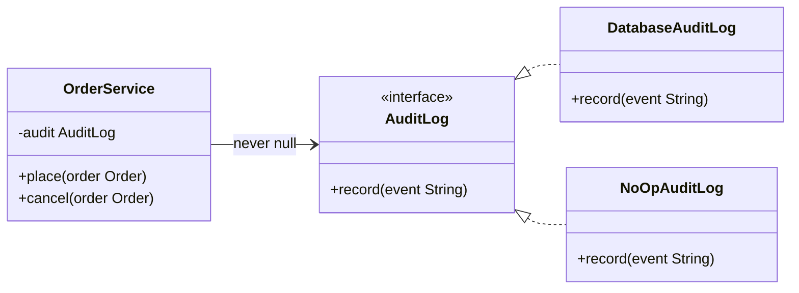
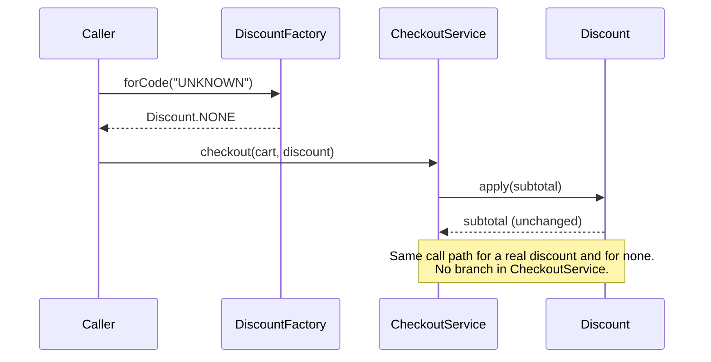

# Null Object Pattern

## 1. Pattern Name & Category

**Pattern:** Null Object
**Category:** Behavioral
**Classification:** Not in the GoF catalog. Described by Bobby Woolf in *Pattern Languages of Program Design 3* (Addison-Wesley, 1998); catalogued as the refactoring "Introduce Special Case" in Fowler's *Refactoring*, 2nd edition (2018)
**Also Known As:** Special Case (the general form), Active Nothing, No-op implementation

---

## 2. Intent

Replace a `null` reference with an object that implements the expected interface and does nothing, or does a safe default, so that callers can call it without checking for absence.

---

## Intuition

> **One-line analogy**: Null Object is the "do not disturb" voicemail box. Callers still dial the number and leave a message; nothing happens to it, and nobody had to check first whether the phone exists.

**Mental model**: Every `if (logger != null) logger.log(...)` is the caller doing work that belongs to the type. A Null Object moves that decision to one place, the moment of construction or lookup, and from then on every call site treats "no logger" and "a logger" the same way. The absence is still there; it has just become a polymorphic case instead of a branch repeated at 40 call sites.

**Why it matters**: a `NullPointerException` in production usually comes from a reference that was optional in practice but typed as if it were mandatory. Null Object removes the check where the "do nothing" behavior is genuinely correct: no-op logging, no-op metrics, an empty discount, an empty collection.

**Key insight**: Null Object is correct only when doing nothing is the right business answer. If absence must be noticed (no payment method, no shipping address), a silent no-op turns a loud crash into silent data loss. That single test decides between Null Object, `Optional`, and an exception.

---

## 3. Problem Statement

### The Core Problem
An object collaborates with a dependency that is sometimes absent. The code represents absence as `null`, so every call site needs a guard, and the one call site that forgets throws `NullPointerException` in production.

### Concrete Scenario
An `OrderService` takes an optional `AuditLog`. Tests and a CLI tool construct it without one. The production code reads:

```java
// BROKEN: absence leaks into every call site
public class OrderService {
    private final AuditLog audit; // may be null
    public OrderService(AuditLog audit) { this.audit = audit; }

    public void place(Order order) {
        if (audit != null) audit.record("placing " + order.id());
        // ... business logic ...
        if (audit != null) audit.record("placed " + order.id());
    }

    public void cancel(Order order) {
        audit.record("cancel " + order.id());   // forgotten guard: NPE when audit is null
        // ...
    }
}
```

### What Goes Wrong Without the Pattern
- Every method repeats the same null check; one omission is a production NPE.
- The branch count grows with the number of call sites, not with the number of behaviors.
- Tests must cover both the null and non-null path of every method.
- Readers cannot tell from the type whether `null` is a legal value or a bug.

---

## 4. Solution

Give absence its own implementation of the interface. `NoOpAuditLog.record()` does nothing. The constructor (or the factory that resolves the dependency) substitutes it once, and the field is never `null` again.

```java
public interface AuditLog {
    void record(String event);

    AuditLog NONE = event -> { };   // stateless, so one shared instance is safe
}

public class OrderService {
    private final AuditLog audit;
    public OrderService(AuditLog audit) {
        this.audit = Objects.requireNonNullElse(audit, AuditLog.NONE);
    }
    public void place(Order order) {
        audit.record("placing " + order.id());
        // ...
        audit.record("placed " + order.id());
    }
    public void cancel(Order order) {
        audit.record("cancel " + order.id());   // safe on every path
    }
}
```

`Objects.requireNonNullElse` (JDK 9) is the one place `null` is converted. Better still, callers pass `AuditLog.NONE` explicitly and the constructor uses `Objects.requireNonNull`, so `null` is rejected at the boundary.

---

## 5. UML Structure



**Key structural insight:** `NoOpAuditLog` is a sibling of the real implementation, not a subclass of it. Subclassing the real class and overriding everything to do nothing inherits its constructor side effects (opening a connection) and breaks as soon as a new method is added to the parent.

---

## 6. How It Works

1. **Define the interface** the client depends on (`AuditLog`).
2. **Write the null implementation**: each `void` method does nothing; each value-returning method returns the neutral value for that type (empty collection, `0`, `false`, another Null Object, `this` for fluent APIs).
3. **Substitute once**, at construction, in a factory, or in a lookup method (`findDiscount()` returns `Discount.NONE` instead of `null`).
4. **Remove every null check** for that dependency from the client.
5. **Share one instance** when the Null Object is stateless (enum constant, `static final` field, or a constant on the interface).



**Neutral values by return type:**

| Return type | Null Object returns | Reason |
|-------------|---------------------|--------|
| `void` | nothing | No effect is the point |
| `Collection` / `Stream` | `List.of()`, `Stream.empty()` | Callers loop zero times |
| Numeric money or score | `0` or the input unchanged | Additive or multiplicative identity |
| `boolean` predicate | depends on meaning | `isEnabled()` returns `false`; `allows()` must be decided per case |
| Another interface | that interface's Null Object | Keeps chains like `customer.plan().discount()` safe |
| Fluent builder | `this` | Chained calls keep working |

---

## 7. Key Components

| Role | Responsibility |
|------|---------------|
| **AbstractObject** (interface) | The contract clients call |
| **RealObject** | Normal behavior |
| **NullObject** | Same contract, neutral behavior, usually stateless and shared |
| **Client** | Calls the interface with no null checks |
| **Provider** (factory, lookup, constructor) | The single place that decides real vs null |

### Variants
- **Special Case** (Fowler): a generalization where the stand-in has real behavior for a known case, e.g. `UnknownCustomer` whose `name()` returns `"occupant"` and whose `billingPlan()` returns the basic plan.
- **Logging Null Object**: does nothing to the business result but records a debug line or increments a counter, so absence stays observable.
- **Enum singleton**: `enum NoOpMetrics implements Metrics { INSTANCE; ... }` gives one instance and free serialization safety.

---

## 8. When to Use

- **Optional collaborators with a correct "do nothing" behavior**: loggers, metrics, tracers, audit sinks, event listeners, caches.
- **Lookup results with a neutral default**: no discount, no tax exemption, no feature flags set.
- **Collections**: return `List.of()` instead of `null`. Effective Java (3rd ed.) Item 54 is titled "Return empty collections or arrays, not nulls."
- **Leaf nodes of a recursive structure**: an empty tree node whose `size()` is `0` and whose `insert()` returns a real node.
- **Default strategies**: a `RetryPolicy.NONE`, a `Compressor.IDENTITY`.

**Concrete examples:**
- JDK 11 added `OutputStream.nullOutputStream()`, `InputStream.nullInputStream()`, `Reader.nullReader()` and `Writer.nullWriter()`.
- `Collections.emptyList()`, `emptyMap()`, `List.of()`.
- SLF4J falls back to `NOPLogger` when no provider is on the class path, and prints a single warning saying so.
- OpenTelemetry's `OpenTelemetry.noop()` returns tracers and meters that record nothing; the API is usable with no SDK installed.
- Spring's `NoOpCacheManager` disables caching without removing `@Cacheable` annotations.

---

## 9. When NOT to Use

- **Absence is an error the caller must handle**: a missing payment method, shipping address, or account. A no-op `charge()` that returns success ships goods for free. Throw, or return `Optional`.
- **The caller needs to know whether a value was found**: `findUser(id)` should return `Optional<User>`, not a `NullUser` whose `name()` is `""`, because the caller usually branches on presence.
- **No neutral behavior exists**: what should `NullConnection.executeQuery()` return? Any answer is wrong.
- **The interface is large and changes often**: every new method needs a deliberate neutral implementation, and a default that silently returns `null` from the Null Object defeats the pattern.
- **Absence must be counted or alerted on**: a silent no-op hides that a dependency failed to load.

---

## 10. Pros

- **Removes repeated null checks** and the NPEs from the one that was forgotten.
- **Polymorphism instead of conditionals**: the "absent" case is one class, tested once.
- **Simpler client code and tests**: each method has one path.
- **Safe defaults for optional infrastructure**: telemetry, logging and caching can be switched off by wiring, not by code edits.
- **Reusable**: a stateless Null Object is a single shared constant.

---

## 11. Cons

- **Hides absence**: a bug that left a dependency unwired produces no error, only missing behavior.
- **One more class per interface**, and it must change whenever the interface changes.
- **Neutral value is a judgment call**: the wrong neutral value is a silent logic bug.
- **Identity checks creep back**: code that writes `if (log == AuditLog.NONE)` has reintroduced the branch with a different spelling.
- **Debugging is harder**: stepping into a no-op shows nothing, and the stack trace that an NPE would have given is gone.

---

## 12. Tradeoffs

| Approach | Absence visible to caller? | Branch at call site? | Best for |
|----------|---------------------------|----------------------|----------|
| `null` + checks | Yes, if checked | Yes, every site | Nothing new; legacy only |
| Null Object | No | No | Optional collaborators with a correct no-op |
| `Optional<T>` | Yes, in the type | Yes, via `map`/`orElse` | Query results where presence matters |
| Exception | Yes, loudly | No | Absence that is a bug or a business error |
| Special Case object | Partly (it has a type) | No | Known edge cases with real behavior (`UnknownCustomer`) |

---

## 13. Common Pitfalls

1. **Null Object for a mandatory dependency.** A `NoOpPaymentGateway` wired by mistake in production returns success and the business ships unpaid orders. Mandatory dependencies fail fast with `Objects.requireNonNull` in the constructor.

2. **Mutable shared Null Object.** A `NullCart` singleton with a working `add()` collects items from every anonymous session. A shared Null Object must be immutable; `add()` either ignores the call or throws `UnsupportedOperationException`.

3. **Returning `null` from a Null Object method.** `NullCustomer.address()` returning `null` moves the NPE one call deeper. Each returned reference is itself a Null Object or an empty value.

4. **Subclassing the real class.** `class NullAuditLog extends DatabaseAuditLog` runs the parent constructor, which opens a database connection the Null Object never uses.

5. **Identity checks.** `if (discount == Discount.NONE)` in client code means the client still branches. If the caller needs to know, the type should say so (`Optional` or a `sealed` hierarchy).

6. **Equality surprises.** Two Null Object instances created with `new` are not `equals()` unless `equals` is overridden; use one shared instance or a record/enum.

7. **Silent misconfiguration.** SLF4J's no-provider warning is a single line at startup; teams have lost days of logs because the logging backend dependency was excluded from a shaded JAR and the application ran on `NOPLogger`.

---

## 14. Real-World Usage

### Production Scenario: Optional Telemetry in a Shared Client Library

A payments SDK used by 30 internal services must emit metrics, but some services do not run a metrics backend. The first version took a `MeterRegistry` and checked it everywhere.

```java
// BROKEN: 57 null checks across the SDK, one missing in the retry path
public class PaymentClient {
    private final MeterRegistry registry;   // null when the host app has no metrics
    public Receipt charge(ChargeRequest req) {
        Timer.Sample sample = registry != null ? Timer.start(registry) : null;
        try { return doCharge(req); }
        finally { if (sample != null) sample.stop(registry.timer("payments.charge")); }
    }
    private Receipt retry(ChargeRequest req) {
        registry.counter("payments.retry").increment();   // NPE in apps with no registry
        return doCharge(req);
    }
}
```

```java
// FIX: the client depends on its own narrow port, with a shared no-op
public interface PaymentMetrics {
    void chargeTook(Duration d, boolean success);
    void retried();

    PaymentMetrics NONE = new PaymentMetrics() {
        public void chargeTook(Duration d, boolean success) { }
        public void retried() { }
    };
}

public final class MicrometerPaymentMetrics implements PaymentMetrics {
    private final MeterRegistry registry;
    public MicrometerPaymentMetrics(MeterRegistry registry) { this.registry = registry; }
    public void chargeTook(Duration d, boolean success) {
        registry.timer("payments.charge", "success", String.valueOf(success)).record(d);
    }
    public void retried() { registry.counter("payments.retry").increment(); }
}

public class PaymentClient {
    private final PaymentMetrics metrics;
    public PaymentClient(PaymentMetrics metrics) { this.metrics = Objects.requireNonNull(metrics); }
    private Receipt retry(ChargeRequest req) {
        metrics.retried();   // no branch, no NPE
        return doCharge(req);
    }
}
```

Services without metrics construct `new PaymentClient(PaymentMetrics.NONE)`. The constructor still rejects `null`, so "no metrics" is an explicit choice in the wiring and never an accident. Micrometer itself offers the same idea at a different level: a `SimpleMeterRegistry` or a `CompositeMeterRegistry` with no children records into nothing exported.

### Special Case: Unknown Customer

```java
public sealed interface Customer permits KnownCustomer, UnknownCustomer {
    String displayName();
    BillingPlan plan();
}

public record KnownCustomer(String name, BillingPlan plan) implements Customer {
    public String displayName() { return name; }
}

public enum UnknownCustomer implements Customer {
    INSTANCE;
    public String displayName() { return "Guest"; }
    public BillingPlan plan() { return BillingPlan.BASIC; }
}
```

Because `Customer` is `sealed`, code that genuinely needs to tell the cases apart uses an exhaustive `switch` with `case UnknownCustomer u ->`, while code that only renders a name calls `displayName()` with no branch at all.

### Famous Codebase Usages

| Library | Null Object | What it stands in for |
|---------|-------------|----------------------|
| JDK 11+ | `OutputStream.nullOutputStream()`, `Writer.nullWriter()` | A sink that discards bytes or chars |
| JDK | `Collections.emptyList()`, `List.of()` | "No elements" without `null` |
| SLF4J | `NOPLogger` | Logging with no provider bound |
| OpenTelemetry API | `OpenTelemetry.noop()` | Tracing and metrics with no SDK installed |
| Spring Framework | `NoOpCacheManager` | Caching turned off, annotations kept |
| Guava | `Runnables.doNothing()` | A callback with no effect |

### Anti-Pattern: No-op Where Absence Is a Bug

```java
// BROKEN: a missing gateway silently "succeeds"
PaymentGateway gw = gateways.getOrDefault(region, PaymentGateway.NOOP);
gw.charge(order);           // region "eu-north" was never configured: order ships unpaid

// FIX: absence of a mandatory collaborator is an error
PaymentGateway gw = Optional.ofNullable(gateways.get(region))
    .orElseThrow(() -> new IllegalStateException("no gateway for " + region));
```

### Migration Story

**Move TO Null Object when** the same null check for one dependency appears in three or more places and every branch does "skip it".
**Move AWAY from Null Object to `Optional` or an exception when** callers start comparing against the null instance, or an incident shows a dependency was silently missing.

---

## 15. Comparison with Similar Patterns

| Pattern | Relationship |
|---------|-------------|
| **Strategy** | A Null Object is often the "do nothing" strategy (`RetryPolicy.NONE`); see [Strategy](../strategy/strategy.md) |
| **State** | A null state object can stand for "idle" in a state machine; see [State](../state/state.md) |
| **Singleton** | Stateless Null Objects are usually single shared instances; see [Singleton](../../creational/singleton/singleton.md) |
| **Proxy / Decorator** | A decorator chain can end in a Null Object instead of a `null` delegate; see [Decorator](../../structural/decorator/decorator.md) |
| **Factory Method** | The factory is the one place that returns the Null Object; see [Factory Method](../../creational/factory_method/factory_method.md) |
| **`Optional<T>`** | Makes absence explicit in the type for the caller to handle; Null Object hides it behind behavior |

---

## 16. Interview Questions with Answers

**Q: When is a Null Object the wrong choice even though it would remove every null check?**
**Short:** When absence is an error the caller must notice, such as a missing payment gateway, because a silent no-op turns a crash into data loss.

A: The pattern assumes doing nothing is a correct business outcome. For logging, metrics and optional listeners it is. For a payment gateway, an address, or an account it is not: a `NoOpPaymentGateway` that returns normally lets the order ship unpaid, and nothing in the logs explains why. Those dependencies should fail fast with `Objects.requireNonNull` at construction or an exception at lookup. The test to apply is one question: if this dependency were missing in production, would you want an alert? If yes, do not use a Null Object.

**Q: Null Object or `Optional<T>`: how do you choose?**
**Short:** Use Optional when the caller must decide what absence means; use a Null Object when every caller would do the same neutral thing anyway.

A: `Optional<User> findUser(id)` puts absence in the type, and the caller chooses `orElseThrow`, a default, or a different flow; that is correct when callers differ. A Null Object fixes the behavior once for all callers, which is correct when they would all skip the call. Effective Java Item 55 presents `Optional` as a return type and calls it rarely appropriate as a field or a collection element, which is where Null Object fits instead, for example a `final AuditLog audit` field set to `AuditLog.NONE`.

**Q: Why must a shared Null Object be immutable?**
**Short:** It is one instance used by every caller, so any state it accepts leaks between unrelated users and requests.

A: A stateless Null Object is usually a `static final` constant or an enum singleton. If it accepts state, for example a `NullCart` whose `add()` appends to a list, every anonymous session adds to the same list and one user sees another's items. Make every mutator either ignore the call or throw `UnsupportedOperationException`, and return fresh or immutable values (`List.of()`) from accessors.

**Q: What is wrong with comparing a reference against the Null Object, as in `if (discount == Discount.NONE)`?**
**Short:** It puts the branch the pattern removed back into the client, so the absence case is again handled at each call site.

A: The pattern's benefit is that callers do not branch on absence. An identity check reintroduces exactly that branch, now hidden behind a constant, and it breaks if someone creates a second no-op instance with `new`. If callers really need to tell the cases apart, the design wants `Optional`, or a `sealed` interface with an exhaustive `switch`, not a Null Object.

**Q: Why implement the Null Object as a sibling of the real class instead of a subclass that overrides every method?**
**Short:** A subclass inherits the parent's constructor side effects and silently inherits real behavior for any method added later.

A: `class NullAuditLog extends DatabaseAuditLog` runs `DatabaseAuditLog`'s constructor, which may open a connection or read configuration. Worse, when someone adds `flush()` to `DatabaseAuditLog`, the Null Object inherits the real `flush()` without anyone deciding whether that is neutral. Implementing the interface directly makes the compiler demand a decision for every new abstract method.

**Q: What should a Null Object return from a method that returns a value?**
**Short:** The neutral value for that type: an empty collection, zero or the unchanged input, another Null Object, or this for a fluent API, never null.

A: Returning `null` only moves the NPE one call deeper (`nullCustomer.address().city()`). Collections return `List.of()` so loops run zero times; arithmetic returns the identity (`apply(amount)` returns `amount` for a no-op discount); references return that type's own Null Object; builders return `this`. Booleans need a per-method decision: `isEnabled()` returning `false` is safe, while `isAuthorized()` returning `true` is a security hole.

**Q: How does the Special Case pattern differ from Null Object?**
**Short:** Special Case gives a known edge case real, specific behavior, while Null Object gives absence neutral do-nothing behavior.

A: Fowler's Special Case (Introduce Special Case in *Refactoring*, 2nd ed.) generalizes the idea. An `UnknownCustomer` has a display name of "Guest" and the basic billing plan, which is real behavior for a real case, not a no-op. Null Object is the special case where the right behavior is to do nothing. Both remove repeated conditionals; Special Case also carries domain decisions, so it needs the same review as any business rule.

**Q: How do you keep a Null Object from hiding a misconfiguration?**
**Short:** Make the no-op an explicit wiring choice, reject null at the boundary, and log or count once when the no-op is selected.

A: Reject `null` in constructors with `Objects.requireNonNull`, so the Null Object only appears when a caller passed it on purpose. When a framework selects it by default (SLF4J's `NOPLogger`, a disabled cache), emit one startup warning and a metric or health detail saying which collaborator is a no-op. SLF4J prints one such line when no provider is bound, and teams that missed it ran for days with no application logs.

**Q: Where does the JDK use Null Object?**
**Short:** Empty collections such as Collections.emptyList() and List.of(), and the JDK 11 null streams such as OutputStream.nullOutputStream() and Writer.nullWriter().

A: `Collections.emptyList()`, `emptyMap()`, `List.of()` and `Stream.empty()` stand in for "no elements". JDK 11 added `InputStream.nullInputStream()` (reads end-of-stream immediately), `OutputStream.nullOutputStream()` (discards bytes), `Reader.nullReader()` and `Writer.nullWriter()`. Each removes a branch: a method that takes an `OutputStream` for optional diagnostics can be given `nullOutputStream()` instead of `null`.

**Q: How do sealed interfaces and pattern-matching `switch` change the Null Object pattern in Java 21?**
**Short:** A sealed hierarchy can include the no-op as a named case, so callers that only call methods stay branch-free and callers that must distinguish get an exhaustive switch.

A: Declare `sealed interface Customer permits KnownCustomer, UnknownCustomer`. Rendering code calls `customer.displayName()` with no branch, which is the Null Object benefit. Code that must treat guests differently writes `switch (customer) { case KnownCustomer k -> ...; case UnknownCustomer u -> ...; }`, and the compiler fails the build if a new case is added and not handled. That replaces the fragile identity check while keeping the polymorphic default.

**Q: Does `switch` with `case null` (Java 21) replace the Null Object pattern?**
**Short:** No, case null only centralizes a null check inside one switch; every other call site that receives the reference still needs its own check.

A: JEP 441 lets a pattern-matching `switch` handle `null` with `case null ->` instead of throwing NPE. That tidies one dispatch point, but the reference is still `null` everywhere else it flows. A Null Object removes `null` from the field or return value itself, so no later call site can forget.

**Q: How do you test a Null Object?**
**Short:** Run the interface's shared contract tests against it plus one test that each call has no observable effect and returns the neutral value.

A: Write the interface's contract tests once as an abstract test class and run them against both the real implementation and the Null Object, so the no-op stays a valid substitute (Liskov). Then add direct checks: `NONE.apply(amount)` returns `amount`, `NONE.items()` is empty and unmodifiable, and no method returns `null`. Clients of the interface need no separate "absent dependency" tests, which is part of the payoff.

**Q: Is a Mockito mock with default answers a Null Object?**
**Short:** It behaves like one, since unstubbed methods return empty collections, zero and false, but it belongs in tests, not production wiring.

A: Mockito's `RETURNS_DEFAULTS` answer returns `0`, `false`, empty collections and `Optional.empty()` for unstubbed calls, which is a generated Null Object. It is useful in tests for collaborators the test does not care about. In production it would add bytecode generation overhead and hide intent; a hand-written `NONE` constant states the neutral behavior in the code.

**Q: How do you apply Null Object to a recursive structure such as a binary tree?**
**Short:** Use an empty-node object as the leaf, whose size is 0, whose contains returns false, and whose insert returns a new real node.

A: Instead of `left == null` checks in every recursive method, each child is either a `Node` or `Empty.INSTANCE`. `Empty.size()` returns `0`, `Empty.contains(x)` returns `false`, and `Empty.insert(x)` returns `new Node(x, EMPTY, EMPTY)`, so recursion bottoms out by polymorphism. With a `sealed` interface the two cases are also checked by the compiler in any `switch`.

**Q: What is the performance cost of a Null Object?**
**Short:** Usually none measurable, because a shared stateless instance allocates nothing and the JIT inlines a monomorphic or bimorphic no-op call.

A: A single shared instance means no per-call allocation. HotSpot inline-caches a call site that sees one or two receiver types, so `metrics.retried()` on a `NONE` instance compiles to almost nothing. The real cost to watch is argument construction: `log.debug("x=" + expensive())` still builds the string before the no-op discards it, so use parameterized messages or a `Supplier`.

**Q: How does Null Object relate to the Liskov Substitution Principle?**
**Short:** A Null Object must honor the interface contract, so it is valid only where the contract allows doing nothing; otherwise it violates LSP.

A: If `PaymentGateway.charge()` promises money moves or an exception is thrown, a no-op that returns normally breaks that promise, which is an LSP violation. If `AuditLog.record()` promises only best-effort recording, a no-op is a valid substitute. Write the contract first, in Javadoc and in shared contract tests, and the Null Object question answers itself. See [SOLID: Liskov Substitution](../../solid_principles/LiskovSubstitution.md).

---

## Cross-Perspective: HLD Connections

- **Feature flags and kill switches**: turning off a subsystem by wiring a no-op implementation is the in-process form of a feature flag; see [Deployment Strategies](../../../devops/deployment_strategies/deployment_strategies.md).
- **Graceful degradation**: a recommendation service that falls back to an empty list when a dependency is down is a Special Case at the service level, paired with a circuit breaker; see [Resilience Patterns](../../../hld/resilience_patterns/resilience_patterns.md).
- **Telemetry without a backend**: OpenTelemetry's no-op API lets a library emit spans unconditionally; whether anything is exported is the application's deployment choice.

---

## 17. Best Practices

- Use a Null Object only where doing nothing is a correct outcome; fail fast otherwise.
- Expose it as a named constant on the interface (`AuditLog.NONE`) or an enum singleton.
- Keep it stateless and immutable; never return `null` from it.
- Implement the interface directly; do not subclass the real implementation.
- Reject `null` at constructors so the no-op is always an explicit wiring choice.
- Log or count once when infrastructure falls back to a no-op.
- Run the interface's contract tests against the Null Object.

---

## 18. Technologies and Tools

| Technology | What it gives you | When to reach for it |
|-----------|-------------------|---------------------|
| `Objects.requireNonNullElse` (JDK 9) | Converts `null` to a default in one call at the boundary | Constructors that accept an optional collaborator |
| `OutputStream.nullOutputStream()` and siblings (JDK 11) | Byte and char sinks and sources that do nothing | Optional diagnostic output |
| `List.of()`, `Collections.emptyList()` | Immutable empty collections | Every method that returns a collection |
| SLF4J `NOPLogger` | No-op logging | Libraries that log only when the host provides a backend |
| OpenTelemetry `OpenTelemetry.noop()` | No-op tracer and meter providers | Instrumented libraries used by apps without an SDK |
| Spring `NoOpCacheManager` | Caching disabled without code changes | Tests or environments with no cache |
| `sealed` interfaces + `switch` (JDK 17 / 21) | Named special cases with compiler-checked handling | When some callers must distinguish the absent case |
